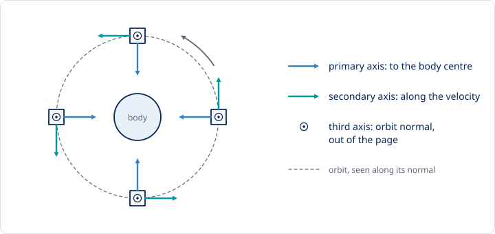
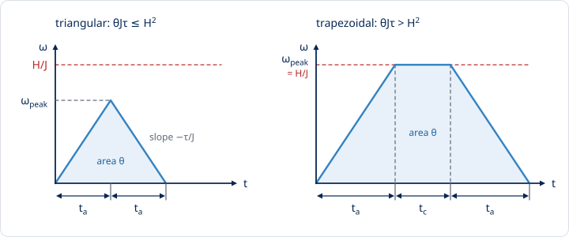
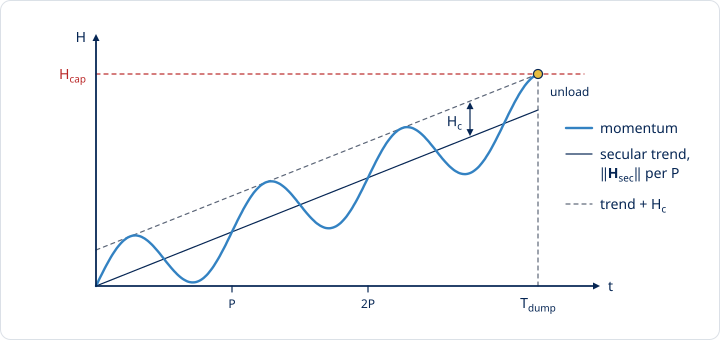
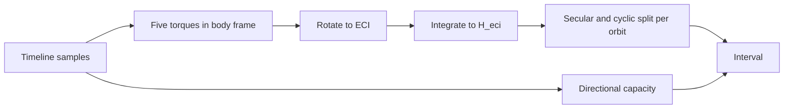
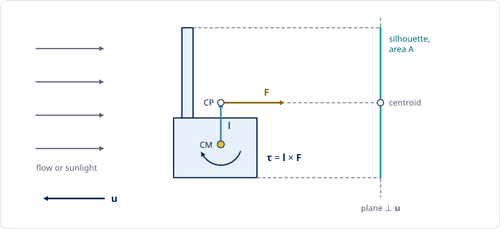

# AOCS analyses

The attitude and orbit control system (AOCS) analyses answer four questions in concept design. Does a sensor look at the Sun, the central body or the Moon too closely? How long does a slew take? How fast do disturbance torques fill the reaction wheels? How long does it take to empty them again? FoV means field of view, RW means reaction wheel, MTQ means magnetorquer, and RCS means reaction control system (thrusters).

| ID | Purpose | Main inputs | Main outputs |
|---|---|---|---|
| `aocs.sensor_fov` | Find body intrusions into exclusion angles | Orbit, attitude law, sensor axes, exclusion angles | Minimum angles, intrusion windows |
| `aocs.slew_time` | Time a rest-to-rest slew | Inertia, wheels, slew angle | Limiting axis and rate profile |
| `aocs.rw_unloading` | Estimate momentum accumulation and the unloading interval | Orbit, attitude law, wheel limits, disturbance inputs | Capacity, cyclic amplitude, secular drift, unloading interval |
| `aocs.unload_time` | Time a momentum dump | Wheel limits, orbit, MTQs or thrusters | Torque, time and propellant |

## Common ground

### Frames, cases and sampling

Frames and time follow the [orbit conventions](orbit.md#common-ground). The analyses use three frames. ECI is the inertial frame, centred on the central body. The body frame rotates with the spacecraft. Part directions such as `boresight` or `spin_axis` are written in the part frame and are rotated into the body frame through the mount chain of the configuration in effect (the phase's configuration of the case, else the base). The same configuration supplies part placements and the mass properties.

The mode of the analysis case selects the attitude law (below). `aocs.rw_unloading` and `aocs.sensor_fov` use `analysis.common.default_case` when no case is given. The case's beta angle replaces the RAAN of the orbit in the time-domain analyses and in the field average of `aocs.unload_time`. `aocs.slew_time` needs no orbit.

The time-domain analyses sample the orbit with step $\max(30, P/200)$ s, where $P$ is the orbit period in s. The span depends on the analysis.

| Analysis | Span |
|---|---|
| `aocs.rw_unloading` | Three orbits. One orbit around the Sun. The whole span of a one-off trajectory (the step then follows $P$ = span) |
| `aocs.sensor_fov`, field average of `aocs.unload_time` | One orbit, or the span of a one-off trajectory |

### Attitude laws

The law of each mode is set in `analysis/aocs.toml` as `analysis.aocs.law.<MODE>.*`. A phase can replace the whole entry of a mode with `phases.<ID>.law.<MODE>.*`. The key `law` is required. The other keys are optional vectors in the body frame (or a quaternion) with the defaults shown.

| `law` | Keys | Defaults | What it does |
|---|---|---|---|
| `sun_pointing` | `axis`, `secondary` | +Z, +X | `axis` points at the Sun. `secondary` is turned as close as possible to the orbit normal $\hat{\mathbf n}=\mathbf r\times\mathbf v/\lVert\mathbf r\times\mathbf v\rVert$ |
| `nadir_pointing` | `axis`, `along_track` | +Z, +X | `axis` points at the centre of the central body. `along_track` is turned as close as possible to the inertial velocity $\mathbf v$ |
| `inertial` | `orientation` | identity quaternion $(w,x,y,z)=(1,0,0,0)$ | The body axes stay fixed relative to ECI |



*Under the nadir law the primary axis follows the local vertical and the secondary axis follows the velocity, so the body turns once per orbit and the third axis stays along the orbit normal.*

The two-vector laws use the TRIAD construction (`sat_astro::attitude::align_two_axes`). For a primary vector $\mathbf a$ and a secondary vector $\mathbf b$, the triad is

```math
\hat{\mathbf x}=\hat{\mathbf a},\qquad
\hat{\mathbf y}=\frac{\hat{\mathbf x}\times\mathbf b}{\lVert\hat{\mathbf x}\times\mathbf b\rVert},\qquad
\hat{\mathbf z}=\hat{\mathbf x}\times\hat{\mathbf y}.
```

The body triad is built from (`axis`, `secondary` or `along_track`). The reference triad is built from (Sun or nadir direction, target of the secondary). The rotation maps the body triad onto the reference triad. The primary axis is matched exactly. The component of the secondary axis perpendicular to the primary is matched to the component of the target perpendicular to the primary target. The third axis follows from right-handedness. For a circular orbit under the demo's `MISSION` law (`axis` = +Z, `along_track` = +Y), +Z points to nadir, +Y along the velocity and +X along the orbit normal.

Targets that are nearly parallel to the primary are replaced. The test is $\lVert\hat{\mathbf u}\times\mathrm{primary}\rVert>10^{-6}$. For `sun_pointing` the secondary target is $\hat{\mathbf n}$, then the velocity direction, then any direction perpendicular to the Sun direction. For `nadir_pointing` it is $\mathbf v$, then $\hat{\mathbf n}\times\hat{\mathbf g}$ (orbit normal crossed into nadir, with $\hat{\mathbf g}=-\mathbf r/\lVert\mathbf r\rVert$ the nadir direction), then any perpendicular direction. If `axis` and `secondary` (or `along_track`) are parallel in the body frame, an arbitrary direction perpendicular to `axis` is used for the body secondary. The Sun direction is the line from the spacecraft to the Sun.

### Wheels and directional capacity

Parts with role `reaction_wheel` supply `spin_axis` (part frame), `max_momentum` $h_{\max,i}$ in N·m·s and `max_torque` $\tau_{\max,i}$ in N·m. The setting `analysis.aocs.usable_momentum_fraction` $\kappa$ is the usable share of the momentum. Its analysis default is 0.8, and it must lie in $(0,1]$. The usable momentum of wheel $i$ is $h_i=\kappa\,h_{\max,i}$.

Any number of wheels is allowed if their axes span three dimensions. Let $W$ be the $3\times N$ matrix of unit spin axes. A body-frame vector $\mathbf b$ (momentum or torque) is shared among the wheels with the minimum-norm solution, using the pseudo-inverse $W^+=W^\mathsf T(WW^\mathsf T)^{-1}$:

```math
\mathbf q=W^+\mathbf b,\qquad q_i=\hat{\mathbf a}_i\cdot(WW^\mathsf T)^{-1}\mathbf b .
```

For a unit direction $\hat{\mathbf d}$ the shares $q_i$ are dimensionless. The largest momentum that can be stored along $\hat{\mathbf d}$ is reached when the first wheel hits its limit:

```math
H_\mathrm{cap}(\hat{\mathbf d})=\min_{i:\,|q_i|>10^{-15}}\frac{h_i}{|q_i|}.
```

The same function gives the torque available along a direction with $\tau_{\max,i}$ in place of $h_i$. For three orthogonal wheels with $h_i=0.016$ N·m·s, the diagonal direction $(1,1,1)/\sqrt3$ gives $q_i=1/\sqrt3$ and $H_\mathrm{cap}=0.016\sqrt3$ N·m·s. This case is in the unit tests of `wheels.rs`.

## aocs.sensor_fov — Sensor FoV and exclusion angles

### What it answers

It finds the fraction of an orbit during which the Sun, the limb of the central body or the Moon comes closer to a sensor boresight than the exclusion angle, and when it happens.

### Inputs

| Quantity | Symbol | Unit | Design source | Default |
|---|---|---|---|---|
| Orbit and attitude law | — | — | Effective orbit and the law of the case's mode | Must be given |
| Boresight direction | $\hat{\mathbf b}$ | 1 | `boresight` of parts with role `star_tracker`, `sun_sensor` or `camera` | Must be given |
| Sun exclusion | $\theta_\mathrm{ex,Sun}$ | rad | `exclusion_sun` | Target not checked if absent |
| Central-body exclusion | $\theta_\mathrm{ex,limb}$ | rad | `exclusion_earth` | Target not checked if absent |
| Moon exclusion | $\theta_\mathrm{ex,Moon}$ | rad | `exclusion_moon` | Target not checked if absent |

Other inputs: `fov_half_angle` is only reported in the output and does not enter any check. To keep a bright body out of the field of view, include the half-angle in the exclusion angle yourself. The library accepts an intrusion limit $f_\mathrm{max}$ (0 to 1); the design projection never sets it.

### Model and assumptions

At every sample the analysis computes the angle between the boresight and the direction to each body, all in the body frame. The Sun and the Moon are points. The central body is a sphere seen from the spacecraft as a disc, and the limb is the edge of that disc.

An angle below the exclusion angle is an intrusion, with two gates. The Sun counts only when the illumination factor of the sample is at least 0.5 (`SUNLIT_THRESHOLD`), so an eclipsed Sun never intrudes. The Moon counts only when the line from the spacecraft to the Moon does not pass through the central body. The limb always counts. A negative limb angle means the boresight is inside the disc.

The analysis does not see the spacecraft structure. A boresight blocked by the spacecraft's own parts is judged statically by [structure.cone_clearance](structure.md#structurecone_clearance--plume-and-field-of-view-clearance), which reads the same `boresight` and `fov_half_angle`. The two analyses do not feed each other.

### Equations

Let $\hat{\mathbf s}$, $\hat{\mathbf g}$ and $\hat{\mathbf m}$ be the unit directions from the spacecraft to the Sun, to the centre of the central body (nadir) and to the Moon in the body frame. Let $r$ be the distance from the centre of the central body to the spacecraft and $R$ its radius, both in m. All angles are in rad.

```math
\theta_\mathrm{Sun}=\angle(\hat{\mathbf b},\hat{\mathbf s}),\qquad
\theta_\mathrm{limb}=\angle(\hat{\mathbf b},\hat{\mathbf g})-\arcsin\frac{R}{\max(r,R)},\qquad
\theta_\mathrm{Moon}=\angle(\hat{\mathbf b},\hat{\mathbf m}).
```

The second term of $\theta_\mathrm{limb}$ is the apparent angular radius of the disc. It is the standard result for a sphere seen from distance $r$.

### Algorithm

1. Build the timeline (one orbit, step $\max(30,P/200)$ s). At each sample compute $\hat{\mathbf s}$, $\hat{\mathbf g}$, $\hat{\mathbf m}$ and the two gates from the orbit, the ephemeris and the attitude law.
2. For each sensor and each of the three bodies, compute the angle series. Each series is also stored in the output.
3. For a body with an exclusion angle, flag the samples with an allowed gate and $\theta<\theta_\mathrm{ex}$.
4. Per body, the intrusion fraction is the time average of the 0/1 flags with the trapezoidal rule over the whole span. The windows are the runs of flagged samples. Their ends are sample times, and the longest window is reported. The minimum angle is the minimum over all samples, including those where the gate was closed.
5. Per sensor, repeat step 4 with the union (logical OR) of the flags of all checked bodies.

### Checks and verdicts

One check per sensor, `intrusion:<sensor>`. Without a limit (the design projection) the check is `ok` for zero intrusion and `warning` for any positive intrusion fraction. With the library limit $f_\mathrm{max}$ it is `ok` at or below the limit and `violation` above it, with margin $f_\mathrm{max}/f_\mathrm{intrusion}-1$. The margin is absent when the intrusion is zero.

### Outputs

| Output | Unit | Meaning |
|---|---|---|
| `sensors[].targets[]` | rad, 1, s | Per body: exclusion angle, minimum angle, intrusion fraction, longest intrusion, windows |
| `sensors[].intrusion_fraction`, `intrusions` | 1, s | Union over bodies: fraction of the span and merged windows |
| `series` | rad | Angle series `<sensor>:sun`, `<sensor>:earth_limb`, `<sensor>:moon` |

### Worked example

Command: `fune -C <demo copy> analyze aocs.sensor_fov --json`. The default case `hot_imaging` uses the `MISSION` mode (nadir law with `axis` +Z, `along_track` +Y) on the 550 km sun-synchronous orbit, $a=6928137$ m, $P=5738.992815$ s.

The star tracker `STT` has boresight $-Y$ and an Earth exclusion of 0.4363323 rad (25°). Under the nadir law, +Z points to nadir, so $-Y$ is perpendicular to nadir at every sample: $\angle(\hat{\mathbf b},\hat{\mathbf g})=\pi/2$. With $R=6378137$ m:

```math
\arcsin\frac{6378137}{6928137}=\arcsin 0.9206136=1.1696490\ \mathrm{rad},\qquad
\theta_\mathrm{limb}=\frac{\pi}{2}-1.1696490=0.4011474\ \mathrm{rad}\ (22.98^\circ).
```

The program prints a minimum limb angle of 0.4011474 rad, which is below the 0.4363323 rad exclusion, so every sample is flagged. The flagged window runs from 0 to 5738.992815 s, and the fraction is $5738.99/5738.99=1$. The check reads `Intrusion 100 %` with verdict `warning`. The Sun and Moon minima for `STT` are 1.0472 rad and 0.9045 rad, above their exclusions of 0.6981 rad and 0.1745 rad. The Sun minimum is close to the beta angle of the case (60°), because the boresight lies in the orbit plane.

### Limits

The sampling step limits the resolution of short windows. A window that is flagged for one sample has zero duration, although the trapezoidal fraction counts about one step for it. The Sun and Moon are points, the limb is a sphere, and the Sun and Moon directions come from the ephemeris. Structure obstruction is not modelled here. Other central bodies use their own radius.

### Verification

`aocs/sensor_fov/tests.rs` derives the limb angle at 500 km by hand ($\arcsin(6378.137/6878.137)$), checks a sun-pointing sensor against the illumination fraction, checks nadir viewing, and checks the verdict rules.

### Source

[Analysis](../../crates/lib/analysis/src/aocs/sensor_fov.rs), [projection](../../crates/app/projection/src/aocs.rs), [attitude laws](../../crates/lib/astro/src/attitude.rs), [timeline](../../crates/lib/astro/src/timeline.rs).

## aocs.slew_time — Slew time

### What it answers

It computes the time of a rest-to-rest rotation about each body axis, limited by the wheel torque and the usable wheel momentum, and reports the slowest axis.

### Inputs

| Quantity | Symbol | Unit | Design source | Default |
|---|---|---|---|---|
| Slew angle | $\theta$ | rad | `analysis.aocs.slew_angle` (at most 180°) | Must be given |
| Inertia tensor | $\mathbf I$ | kg·m² | Mass properties of the parts in the configuration in effect | Must be given |
| Wheels | $h_i$, $\tau_{\max,i}$ | N·m·s, N·m | Wheel attributes and `usable_momentum_fraction` (see Common ground) | Wheel values must be given; fraction 0.8 |
| Time limit | $T_\mathrm{req}$ | s | Requirement with `verify.analysis = "aocs.slew_time"`, `verify.check = "slew_time"`, `at_most` | No check if absent |

The inertia tensor is the sum over parts of the inertia of a uniform cuboid with the part's `size` and mass ($m(b^2+c^2)/12$ on the diagonal), rotated into the body frame and shifted to the centre of mass with the parallel-axis theorem. A part without a size is a point mass. The part origin is taken as the box centre and as the centre of mass of the part. The library can take an explicit rotation axis; the design projection evaluates body $X$, $Y$ and $Z$.

### Model and assumptions

The spacecraft turns about a fixed axis from rest to rest. It accelerates at the largest torque the wheels can deliver about that axis, optionally coasts at the largest rate the wheel momentum allows, and brakes at the same torque. The wheels start with zero momentum. The result is the shortest time for that profile, not an optimised manoeuvre.



*The rate reaches the momentum-limited plateau only in the trapezoidal profile.*

### Equations

For a unit axis $\hat{\mathbf e}$ let $J=\hat{\mathbf e}^\mathsf T\mathbf I\hat{\mathbf e}$ (kg·m²). Let $\tau$ and $H$ be the torque and momentum that the wheel set can deliver along $\hat{\mathbf e}$. They are $H_\mathrm{cap}$ from Common ground with the limits $\tau_{\max,i}$ and $h_i$. Let $t_\mathrm{a}$ be the acceleration time (also the braking time), $t_\mathrm{c}$ the coasting time and $\omega_\mathrm{peak}$ the largest rate.

Acceleration at $\tau$ gives $\omega=\tau t/J$. A rotation by $\theta$ needs the area under the rate curve to equal $\theta$. Without coasting, $\theta=\tau t_\mathrm{a}^2/J$. The wheel momentum at the peak is $J\omega_\mathrm{peak}=\tau t_\mathrm{a}$ and must not exceed $H$. This gives the two cases:

```math
(t_\mathrm a,t_\mathrm c,\omega_\mathrm{peak})=
\begin{cases}
\left(\sqrt{\theta J/\tau},\;0,\;\tau t_\mathrm a/J\right), & \theta J\tau\le H^2\quad\text{(triangular)}\\[4pt]
\left(H/\tau,\;\theta J/H-H/\tau,\;H/J\right), & \theta J\tau>H^2\quad\text{(trapezoidal)}
\end{cases}
\qquad T=2t_\mathrm a+t_\mathrm c .
```

The two cases give the same $T=2H/\tau$ at $\theta=H^2/(J\tau)$, so the time is continuous. For the trapezoid, $T=\theta J/H+H/\tau$.

### Algorithm

1. Check $0<\theta\le\pi$ (a tolerance of $10^{-9}$ rad is allowed). Build the wheel pseudo-inverse and the limit vectors $\tau_{\max,i}$ and $h_i$.
2. For each axis, compute $J$, then $\tau$ and $H$ with the directional capacity of the wheel set.
3. Choose the profile by $\theta J\tau\le H^2$ and compute $t_\mathrm a$, $t_\mathrm c$, $\omega_\mathrm{peak}$, $T$.
4. Report all axes. The worst axis is the one with the largest $T$.

### Checks and verdicts

If the design has an `at_most` requirement bound to `slew_time`, the check `slew_time` compares the worst-axis time with $T_\mathrm{req}$. It is `ok` at or below the limit and `violation` above it, with margin $T_\mathrm{req}/T-1$. Without a requirement there is no check and no warning band.

### Outputs

| Output | Unit | Meaning |
|---|---|---|
| `axes[]`, `worst` | — | Per axis: label, axis vector, profile |
| `moment_of_inertia`, `torque`, `momentum` | kg·m², N·m, N·m·s | $J$, $\tau$, $H$ of the axis |
| `accel_time`, `coast_time`, `time`, `peak_rate` | s, s, s, rad/s | $t_\mathrm a$, $t_\mathrm c$, $T$, $\omega_\mathrm{peak}$ |

### Worked example

Command: `fune -C <demo copy> analyze aocs.slew_time --json`. The slew angle is 90°, $\theta=\pi/2$ rad, and the requirement is 120 s. The three wheels lie on $X$, $Y$, $Z$ with 0.01 N·m·s and 0.001 N·m, and $\kappa=0.8$. Along each body axis one wheel carries the whole vector, so $\tau=0.001$ N·m and $H=0.008$ N·m·s.

The slowest axis is $X$ with $J=I_{xx}=0.1122807943$ kg·m². The profile test is

```math
\theta J\tau=1.5707963\times0.1122807943\times0.001=1.7637\times10^{-4}>H^2=6.4\times10^{-5},
```

so the profile is trapezoidal. Then

```math
t_\mathrm a=\frac{0.008}{0.001}=8\ \mathrm s,\qquad
t_\mathrm c=\frac{\theta J}{H}-t_\mathrm a=\frac{0.1763703}{0.008}-8=14.04628\ \mathrm s,\qquad
T=2(8)+14.04628=30.04628\ \mathrm s,
```

and $\omega_\mathrm{peak}=H/J=0.07125$ rad/s. The program prints 30.0462824 s. The $Y$ and $Z$ axes take 23.568 s and 16.694 s. The margin against 120 s is $120/30.046-1=2.994$.

### Limits

The model assumes zero rate at both ends and a fixed axis. It omits gyroscopic coupling between axes, cross-axis torque, disturbances, wheel friction and torque ramps, and settling time. A slew about a non-principal axis uses only $J=\hat{\mathbf e}^\mathsf T\mathbf I\hat{\mathbf e}$. The wheels are assumed empty at the start.

### Verification

`aocs/slew_time/tests.rs` checks the trapezoidal case by hand (27.635 s for $J=0.1$), the triangular case by hand (8.3554 s), the meeting point at $\theta=H^2/(J\tau)$, and a diagonal axis with projected inertia and shared wheel capacity. `aocs/wheels.rs` checks the pseudo-inverse allocation.

### Source

[Analysis](../../crates/lib/analysis/src/aocs/slew_time.rs), [wheels](../../crates/lib/analysis/src/aocs/wheels.rs), [mass properties](../../crates/lib/analysis/src/structure/mass_properties.rs), [projection](../../crates/app/projection/src/aocs.rs).

## aocs.rw_unloading — RW unloading frequency

### What it answers

Disturbance torques push momentum into the wheels. Part of it averages out over an orbit and part builds up. The analysis estimates how much wheel capacity the periodic part takes, how fast the rest builds up, and so how often the wheels must be unloaded.

### Inputs

| Quantity | Symbol | Unit | Design source | Default |
|---|---|---|---|---|
| Orbit and attitude law | — | — | Effective orbit and the law of the case's mode | Must be given |
| Inertia tensor | $\mathbf I$ | kg·m² | Mass properties (see `aocs.slew_time`) | Must be given |
| Wheels, usable fraction | $h_i$, $\tau_{\max,i}$, $\kappa$ | N·m·s, N·m, 1 | See Common ground | Wheel values must be given; $\kappa=0.8$ |
| Drag coefficient | $C_\mathrm D$ | 1 | `analysis.aocs.drag_coefficient` | Aerodynamic torque omitted if absent |
| Reflectivity coefficient | $C_\mathrm R$ | 1 | `analysis.aocs.srp_coefficient` | Solar pressure torque omitted if absent |
| Projected areas | $A_\mathrm D$, $A_\mathrm R$ | m² | `analysis.aocs.aero_area`, `analysis.aocs.srp_area` | From the part boxes at every sample |
| Centre-of-pressure offsets | $\mathbf l_\mathrm D$, $\mathbf l_\mathrm R$ | m | `analysis.aocs.cp_offset_aero`, `analysis.aocs.cp_offset_srp` (body frame) | From the part boxes at every sample |
| Residual dipole | $\mathbf m$ | A·m² | `analysis.aocs.residual_dipole` (body frame) | 0 (analysis default: no magnetic torque) |
| Thruster disturbance | $f_i$, $\mathbf r_i$, $\mathbf F_i$ | 1, m, N | Parts with role `thruster`, their placement, and the fraction of time the mode puts them in state `on` | None |

Other inputs: an `rcs` block (thrusters, centre of mass, mass) is added when thruster parts exist, to compute the daily propellant. The library accepts a required unloading interval, an atmosphere model (default exponential) and an atmospheric density scale (default 1). The design projection sets neither and passes no interval requirement. Absent coefficients omit a term, unlike `orbit.decay`, which assumes $C_\mathrm D=2.2$.

### Model and assumptions

The model follows momentum in the inertial frame. At each sample the five disturbance torques (below) are summed in the body frame, rotated to ECI and integrated. The integral is the momentum the wheels must absorb. The spacecraft's own momentum $\mathbf I\boldsymbol\omega$ from a body rate (for example the orbital rate of the nadir law) is taken as constant and not included.

Over a complete orbit the ECI momentum rises by a net amount, the secular part, and oscillates about the straight line of that rise, the cyclic part. The wheels must hold the cyclic amplitude at all times, so only the rest of their capacity is available for the secular growth. When that rest is used up, the wheels are unloaded.



*The momentum oscillates about the secular trend. The wheels must unload when the trend plus the cyclic amplitude reaches the usable capacity.*



### Disturbance torques

All torques are about the centre of mass and in the body frame, in N·m. Common symbols: $\mathbf r$ is the position from the centre of the central body (m), $\mu$ its gravitational parameter (m³/s²), $\mathbf v_\mathrm{rel}$ the velocity relative to the rotating atmosphere (m/s), $\rho$ the density (kg/m³), $\hat{\mathbf s}$ the unit vector to the Sun, $\mathbf B$ the magnetic flux density (T), $\mathbf r_\mathrm{CM}$ the centre of mass.

Gravity gradient. The force of a central body varies across the spacecraft, and a non-spherical mass distribution feels a torque. To first order in the size over $r$:

```math
\boldsymbol\tau_\mathrm{gg}=\frac{3\mu}{\lVert\mathbf r\rVert^{5}}\,\mathbf r\times(\mathbf I\mathbf r).
```

This is the textbook result (Wertz). It vanishes when $\mathbf r$ is along a principal axis. The torque uses the full tensor $\mathbf I$ with products of inertia, so a tilted principal axis gives a torque even under the nadir law. $\mathbf I$ and $\mu$ are those of the spacecraft and the central body.

Aerodynamic torque. Drag on the cannonball surface acts at the centre of pressure, with the force along the relative wind:

```math
\mathbf F_\mathrm D=-\tfrac12\rho\,C_\mathrm D A_\mathrm D\,\lVert\mathbf v_\mathrm{rel}\rVert\,\mathbf v_\mathrm{rel},\qquad
\boldsymbol\tau_\mathrm D=\mathbf l_\mathrm D\times\mathbf F_\mathrm D .
```

The density is the static exponential atmosphere (Vallado, Table 8-4; 28 layers, extrapolated above 1000 km) at the geodetic altitude, with no solar activity. The wind is $\mathbf v-\boldsymbol\omega_E\times\mathbf r$ for an atmosphere corotating with the Earth, rotated into the body frame. The atmosphere exists only for the Earth. For other central bodies the torque is 0.

Solar radiation pressure. Cannonball model with one coefficient. The force is always along the Sun line, away from the Sun, with no separate treatment of specular and diffuse reflection:

```math
P_\odot=\nu\,\frac{S_0}{c}\left(\frac{d_0}{d_\odot}\right)^{2},\qquad
\mathbf F_\mathrm R=-P_\odot\,C_\mathrm R A_\mathrm R\,\hat{\mathbf s},\qquad
\boldsymbol\tau_\mathrm R=\mathbf l_\mathrm R\times\mathbf F_\mathrm R .
```

Here $S_0=1361$ W/m², $d_0=1.495978707\times10^{11}$ m, $c$ is the speed of light and $d_\odot$ the distance to the Sun. $P_\odot$ equals the pressure on a fully absorbing surface ($C_\mathrm R=1$). $\nu\in[0,1]$ is the illumination factor of the conical shadow model, which is 0 in the umbra and fractional in the penumbra (Montenbruck and Gill). With $\nu=0$ the torque is 0 and the projection is not computed.

Residual magnetic torque. A fixed dipole $\mathbf m$ in the geomagnetic field:

```math
\boldsymbol\tau_\mathrm B=\mathbf m\times\mathbf B,\qquad
\mathbf B=B_0\left(\frac{R_E}{r}\right)^{3}\left[3(\hat{\mathbf m}_E\cdot\hat{\mathbf r})\hat{\mathbf r}-\hat{\mathbf m}_E\right].
```

The field is a tilted centred dipole (`sat_astro::geomag`) with $B_0=3.12\times10^{-5}$ T at the equatorial surface and $R_E=6378137$ m. The dipole axis $\hat{\mathbf m}_E$ is fixed in the Earth-fixed frame, points opposite the geomagnetic north pole at latitude 80.65° and longitude −72.68°, and turns with the Earth. The field is 0 for other central bodies.

Thruster misalignment. Thrusters that fire in the mode produce a mean torque, if the line of thrust misses the centre of mass:

```math
\boldsymbol\tau_\mathrm{thrust}=\sum_i f_i\,(\mathbf r_i-\mathbf r_\mathrm{CM})\times\mathbf F_i .
```

$f_i$ is the fraction of time that the mode assigns to state `on` (duty included), $\mathbf r_i$ the mounting position and $\mathbf F_i$ the thrust vector, whose direction is the unit vector of the part's `direction`. The mean torque is constant in the body frame.

Projected area and arm. For $A$ and $\mathbf l$ the code uses written values when the settings give them. Area and arm are replaced independently. Otherwise, at every sample it projects the union of the part boxes (every part with a `size`, placed by the configuration in effect) along $\mathbf u$, the wind direction for drag and the Sun direction for solar pressure. $A$ is the exact area of the union of the silhouettes, so overlaps count once. The centre of pressure is the centroid of that silhouette, and $\mathbf l$ is the component of $(\text{centroid}-\mathbf r_\mathrm{CM})$ perpendicular to $\mathbf u$. The component along $\mathbf u$ is parallel to the force and gives no torque. If neither area nor boxes are available, the input is an error. If the arm is neither written nor derivable, it is zero.



*The silhouette plane is perpendicular to the flow or Sun direction. The torque arm is the offset of its centroid from the centre of mass, perpendicular to that direction.*

### Equations

Let $\boldsymbol\tau_\mathrm{ECI}$ be the total torque rotated into ECI. Let $\mathbf H(t)$ be the accumulated inertial momentum with $\mathbf H(0)=0$ and $t_j$, $t_{j+1}$ the first samples of orbit $j$ and of the next one. Orbit $j$ lasts $T_j=t_{j+1}-t_j$. $\Delta\mathbf H_j=\mathbf H(t_{j+1})-\mathbf H(t_j)$ and $P$ is the orbit period (or the span of a one-off trajectory).

```math
\mathbf H(t)=\int_0^t\boldsymbol\tau_\mathrm{ECI}(u)\,du \tag{1}
```

```math
\mathbf H_\mathrm{sec}=\frac1{N_\mathrm{orb}}\sum_j\frac{P}{T_j}\,\Delta\mathbf H_j,\qquad
H_\mathrm c=\max_j\max_{t\in[t_j,t_{j+1}]}\left\lVert\mathbf H(t)-\mathbf H(t_j)-\frac{t-t_j}{T_j}\Delta\mathbf H_j\right\rVert \tag{2}
```

$\mathbf H_\mathrm{sec}$ is the mean momentum gain per orbit (N·m·s per period), $H_\mathrm c$ the cyclic amplitude, $N_\mathrm{orb}$ the number of orbits used. Let $\hat{\mathbf h}_\mathrm{sec}=\mathbf H_\mathrm{sec}/\lVert\mathbf H_\mathrm{sec}\rVert$ and let $\mathbf R_k$ rotate ECI into the body frame at sample $k$. The capacity is the smallest directional capacity (Common ground) over all attitudes:

```math
H_\mathrm{cap}=\min_k H_\mathrm{cap}\!\left(\mathbf R_k\hat{\mathbf h}_\mathrm{sec}\right),\qquad
T_\mathrm{dump}=\frac{H_\mathrm{cap}-H_\mathrm c}{\lVert\mathbf H_\mathrm{sec}\rVert}\,P . \tag{3}
```

The formula (3) says that the trend may rise until the trend plus the oscillation fills the capacity. The number of orbits between dumps is $(H_\mathrm{cap}-H_\mathrm c)/\lVert\mathbf H_\mathrm{sec}\rVert$.

### Algorithm

1. Build the timeline (three orbits, one orbit around the Sun, or the one-off span; step $\max(30,P/200)$ s). At each sample evaluate the torques of the five terms in the body frame. Total them and rotate them to ECI.
2. Integrate (1) from zero with the fourth-order Runge–Kutta step (`rk4_linear_step`), with the torque varying linearly between samples. This equals trapezoidal integration here. Rotate $\mathbf H$ back to the body frame and share it, and the torque, among the wheels with the pseudo-inverse.
3. Cut the samples into complete orbits, where orbit $k$ starts at the first sample not earlier than $t_0+kP-10^{-6}P$, and each segment shares its end sample with the next orbit. Compute $\mathbf H_\mathrm{sec}$ and $H_\mathrm c$ from (2). If no orbit is complete, the whole span is one segment, and the trend is scaled to one period by $P/T$.
4. Compute $H_\mathrm{cap}$. If $\mathbf H_\mathrm{sec}$ is zero, use the smallest capacity along the body axes $\pm X,\pm Y,\pm Z$.
5. Compute the interval. If $H_\mathrm{cap}-H_\mathrm c\le0$ the interval is 0. Otherwise, if $\lVert\mathbf H_\mathrm{sec}\rVert\le10^{-12}\max(H_\mathrm{cap},10^{-30})$ (the floor in N·m·s), no unloading is needed and there is no finite interval. Otherwise use (3). Unloads per day are $86400/T_\mathrm{dump}$, 0 without an interval, and unset for a zero interval.
6. Record the first sample where any wheel exceeds $\kappa h_{\max,i}$ (`first_saturation`), the peak momentum and the peak torque of each wheel. If there is a thruster set, compute the daily propellant: $H_\mathrm{day}=\lVert\mathbf H_\mathrm{sec}\rVert\times86400/P$ is dumped with the six-direction rule of `aocs.unload_time`, and the effective exhaust velocity $v_e=\sum F/\sum(F/(I_\mathrm{sp}g_0))$ of the firing thrusters gives $\Delta v_\mathrm{day}=v_e\ln\bigl(m_0/(m_0-m_\mathrm{day})\bigr)$ (rocket equation) with the spacecraft mass $m_0$.

### Checks and verdicts

- `momentum_capacity` is a `violation` when the interval is 0, that is, when the cyclic amplitude alone fills the usable capacity. Otherwise it is `ok` and states $H_\mathrm c/H_\mathrm{cap}$.
- `torque_margin` has margin $1/u_\max-1$, where $u_\max$ is the largest ratio of peak wheel torque to `max_torque` over the wheels. It is `ok` at margin 0 or more, `violation` below 0 (the warning band is 0). It is absent when there is no disturbance.
- `unload_interval` exists only when the library gives a requirement. It passes if no secular unloading is needed or the interval is at least the requirement, with margin interval/requirement − 1.
- `environment_models` appears for a central body other than the Earth when an aerodynamic surface or a nonzero dipole is given. It is `ok` for a body that has no atmosphere or field (the Moon), and `warning` for a body that has one but has no model (Mars atmosphere, Jupiter field), where the zero torque may be an underestimate.
- `rcs_direction` is a `violation` if, with thrusters, no thruster can produce torque against the dumped momentum in the direction chosen as worst.

### Outputs

| Output | Unit | Meaning |
|---|---|---|
| `disturbances[]` | N·m | Peak and time-mean magnitude of each torque |
| `peak_disturbance` | N·m | Peak of the total torque magnitude |
| `secular_per_orbit`, `secular_per_orbit_eci` | N·m·s | $\lVert\mathbf H_\mathrm{sec}\rVert$ and the vector in ECI |
| `cyclic_amplitude`, `capacity`, `peak_momentum` | N·m·s | $H_\mathrm c$, $H_\mathrm{cap}$, peak of $\lVert\mathbf H\rVert$ in the body frame |
| `unload_interval`, `unloads_per_day`, `first_saturation` | s, 1/d, s | Result of (3), its daily rate, first sample with an over-limit wheel |
| `wheels[]` | — | Peak momentum and torque of each wheel and their utilisation |
| `surfaces[]` | m², m | Source (written or geometry), area range and largest arm of each surface |
| `rcs_unloading` | N·m·s, kg, m/s | Daily momentum, propellant and $\Delta v$, when thrusters exist |
| `series` | N·m, N·m·s | Torque magnitudes, body-frame momentum, wheel momenta |

### Worked example

Command: `fune -C <demo copy> analyze aocs.rw_unloading --json`. The default case is `hot_imaging` (mode `MISSION`, nadir law, beta 60°) on the orbit of the sensor example. Three complete orbits are used. There are no thrusters.

Worst-case gravity-gradient torque. Under the nadir law the body axes are fixed relative to the local vertical and the orbit is circular, so $\mathbf r_\mathrm{body}=-r\hat{\mathbf z}$ at every sample, and the torque magnitude is constant (the printed peak and mean agree). The mass-property tensor has $I_{xz}=-3.3475\times10^{-4}$ and $I_{yz}=-4.3306\times10^{-4}$ kg·m². Since $\hat{\mathbf z}\times\mathbf I\hat{\mathbf z}=(-I_{yz},\,I_{xz},\,0)$:

```math
\frac{3\mu}{r^3}=\frac{3\times3.986004418\times10^{14}}{(6928137)^3}=\frac{1.1958013\times10^{15}}{3.325442\times10^{20}}=3.595917\times10^{-6}\ \mathrm{s^{-2}},
```

```math
\lVert\boldsymbol\tau_\mathrm{gg}\rVert=3.595917\times10^{-6}\sqrt{(4.3306\times10^{-4})^2+(3.3475\times10^{-4})^2}
=3.595917\times10^{-6}\times5.47360\times10^{-4}=1.9683\times10^{-9}\ \mathrm{N\,m}.
```

The program prints a peak of $1.96826\times10^{-9}$ N·m. The torque is small, because the demo is nearly symmetric. The largest term is the residual magnetic torque ($8.39\times10^{-7}$ N·m peak), and the total peak is $8.38\times10^{-7}$ N·m.

One unloading interval. The printed values are $H_\mathrm{cap}=0.0080550663$, $H_\mathrm c=0.0011382686$ and $\lVert\mathbf H_\mathrm{sec}\rVert=0.0006262517$ N·m·s, with $P=5738.992815$ s. The ECI components $(2.4514,\,5.6701,\,-1.0291)\times10^{-4}$ give $\lVert\mathbf H_\mathrm{sec}\rVert=6.2625\times10^{-4}$. The capacity is slightly above the 0.008 N·m·s limit of one wheel because the worst attitude puts 99.3 % of the secular direction on one wheel axis ($0.008/0.0080551=0.9932$). By (3):

```math
T_\mathrm{dump}=\frac{0.0080550663-0.0011382686}{0.0006262517}\times5738.992815=11.0448\times5738.99=63385.8\ \mathrm s,
```

which is 11.04 orbits, or $86400/63385.8=1.3631$ unloads per day. The cyclic part uses 14.1 % of the capacity. No wheel saturates in the three orbits (`first_saturation` is null), and the wheel torque margin is 1527 (a utilisation of 0.065 %).

The surfaces report area and arm from the part boxes: the aerodynamic area ranges from 0.0390 to 0.0493 m² with an arm up to 5.8 mm, and the solar-pressure area from 0.1450 to 0.1665 m² with an arm up to 93.5 mm.

### Limits

The secular rate is extrapolated from the representative orbits and from a start at zero momentum, with no scheduled unloads in the trace. The exponential atmosphere has no solar-activity dependence, so drag torque can be off by large factors. Solar pressure uses one coefficient. The magnetic model is a centred dipole. Box silhouettes approximate the surface, and a redundant wheel set uses the minimum-norm allocation. The body's own momentum from its rotation is not included. A single atmospheric density scale cannot be set from the design.

### Verification

`aocs/disturbance.rs` has hand calculations for gravity gradient (a 45° case, $\tfrac{3\mu}{2r^3}\lvert I_z-I_y\rvert$), drag ($F=-\tfrac12\rho C_\mathrm DAv^2$), solar pressure, the magnetic torque and thruster misalignment. `aocs/rw_unloading/tests.rs` checks the integration of a constant torque, the secular and cyclic split of $at+b\sin(2\pi t/T)$, and a dump interval by hand (28 orbits, 156 800 s). It also checks that a symmetric nadir spacecraft needs no unloading, the secular sunlit torque, a nadir product of inertia on a wheel pyramid, aerodynamic and thrust torques about the orbit normal, and the RCS propellant and $\Delta v$ per day. `aocs/rw_unloading/geometry_tests.rs` checks the projected area and arm and that written values replace them. `aocs/disturbance/environment.rs` checks the verdicts for the Moon, Mars and Jupiter.

### Source

[Analysis](../../crates/lib/analysis/src/aocs/rw_unloading.rs), [trace and secular split](../../crates/lib/analysis/src/aocs/rw_unloading/trace.rs), [RCS term](../../crates/lib/analysis/src/aocs/rw_unloading/rcs.rs), [torques](../../crates/lib/analysis/src/aocs/disturbance.rs), [area and arm](../../crates/lib/analysis/src/aocs/disturbance/surface.rs), [projection](../../crates/app/projection/src/aocs.rs).

## aocs.unload_time — Momentum unloading time

### What it answers

It estimates how long it takes to dump the usable momentum of a wheel with the magnetorquers and with the thrusters.

### Inputs

| Quantity | Symbol | Unit | Design source | Default |
|---|---|---|---|---|
| Momentum to dump | $H$ | N·m·s | Largest `max_momentum` of the wheels times `usable_momentum_fraction` | The library accepts an explicit value |
| MTQ axes and dipoles | $\hat{\mathbf a}_i$, $m_i$ | 1, A·m² | `axis` and `max_dipole` of parts with role `magnetorquer` | Must be given for MTQ |
| Mean field | $\bar B$ | T | Magnitude of the geomagnetic field averaged over one orbit | Computed from the orbit |
| MTQ effectiveness | $\eta$ | 1 | `analysis.aocs.unload_dipole_fraction` | 0.5 (analysis default) |
| Thrusters | $F_i$, $I_{\mathrm{sp},i}$, $\mathbf r_i$, $\hat{\mathbf d}_i$ | N, s, m, 1 | Parts with role `thruster`: `thrust`, `isp`, `direction` and placement; the mass-property centre of mass | Must be given for RCS |

### Model and assumptions

MTQ. A magnetorquer with dipole $\mathbf m$ gives torque $\mathbf m\times\mathbf B$, which is perpendicular to $\mathbf B$. The component of $\mathbf m$ along $\mathbf B$ does nothing, and the direction of $\mathbf B$ changes along the orbit. The analysis does not simulate this. It multiplies the torque by an average effectiveness $\eta$, with default 0.5 as a rough value, and uses the orbit-mean field magnitude. The dipole that is available whatever the direction is the weakest body axis of the MTQ set.

RCS. The thrusters that can produce torque against the stored momentum all fire together at their full thrust. This choice maximises the torque using on-off thrusters only. It does not trim the pulse widths, and it does not cancel torque about other axes or the net force. Those are reported.

If the central body has no field model, the MTQ is not evaluated. Absent fields (Moon, Venus, Mars) mean the MTQ cannot dump momentum. A field without a model (Jupiter) gives only a warning. The RCS result is kept either way.

### Equations

Let $\hat{\mathbf a}_i$ be the unit axis of MTQ $i$ and $\hat{\mathbf e}_k$ a unit body axis. Let $\hat{\mathbf h}$ be the unit direction of the stored momentum and $\hat{\mathbf d}=-\hat{\mathbf h}$ the direction in which torque must act. Thruster torque is $\boldsymbol\tau_i=(\mathbf r_i-\mathbf r_\mathrm{CM})\times\mathbf F_i$ (N·m), and $\dot m_i=F_i/(I_{\mathrm{sp},i}g_0)$ is the mass flow (kg/s).

```math
m_\mathrm{eff}=\min_{k\in\{x,y,z\}}\sum_i m_i\,|\hat{\mathbf a}_i\cdot\hat{\mathbf e}_k|,\qquad
T_\mathrm{MTQ}=\frac{H}{\eta\,m_\mathrm{eff}\,\bar B}
```

```math
T_\mathrm{RCS}=\frac{H}{\sum_i\max(0,\boldsymbol\tau_i\cdot\hat{\mathbf d})},\qquad
m_\mathrm{used}=T_\mathrm{RCS}\sum_{i:\,\boldsymbol\tau_i\cdot\hat{\mathbf d}>0}\dot m_i .
```

The sum $\sum_i m_i|\hat{\mathbf a}_i\cdot\hat{\mathbf e}_k|$ is the largest dipole the set can put along body axis $k$. The minimum over the three axes is the dipole that is available in every direction (a lower bound). The mean field is $\bar B=\frac1P\int\lVert\mathbf B\rVert\,dt$ from the tilted-dipole model of `aocs.rw_unloading`.

### Algorithm

1. Resolve $H$. Average $\lVert\mathbf B\rVert$ over one orbit with the trapezoidal rule at step $\max(30,P/200)$ s, and record its minimum and maximum. This is skipped if there are no MTQs.
2. If the central body has no field model, skip the MTQ and record the reason. Otherwise compute $m_\mathrm{eff}$ and $T_\mathrm{MTQ}$. The number of orbits is $T_\mathrm{MTQ}/P$.
3. If there are thrusters, evaluate each of the six directions $\hat{\mathbf h}=\pm X,\pm Y,\pm Z$ (or the library's explicit direction) with the rule above.
4. The worst direction, reported as `worst`, is chosen by a maximum over the directions. A direction in which no thruster has a positive torque component has no time, and counts as infinite. So the code picks an impossible direction first, and the longest time otherwise. If several directions are impossible, the last of the order $+X,-X,+Y,-Y,+Z,-Z$ is reported.

### Checks and verdicts

- `rcs_direction` is a `violation` when the worst direction cannot be unloaded.
- `mtq_field_model` is added when the MTQ was skipped. It is `ok` when the RCS covers all six directions, `violation` when the body has no field and the RCS does not cover the missing field, and `warning` when the field exists without a model and the RCS does not cover it.
- `mtq_time` and `rcs_time` exist only when the library gives a time limit. They are `ok` if time $\le$ limit, with margin limit/time − 1, or −1 and `violation` when the direction cannot be unloaded. The design projection gives no limit.

### Outputs

| Output | Unit | Meaning |
|---|---|---|
| `momentum`, `usable_momentum_fraction` | N·m·s, 1 | $H$ and $\kappa$ |
| `mtq` | T, A·m², N·m, s | Mean, minimum and maximum field, $m_\mathrm{eff}$, $\eta$, torque $\eta m_\mathrm{eff}\bar B$, $T_\mathrm{MTQ}$, number of orbits |
| `rcs.directions[]`, `rcs.worst` | N·m, N, s, kg | Per direction: torque along $\hat{\mathbf d}$, off-axis torque, net force, time, propellant, firing thrusters |
| `mtq_field_gap` | — | Why the MTQ was skipped and whether the RCS covers it |

### Worked example

Command: `fune -C <demo copy> analyze aocs.unload_time --json`. The demo has three MTQs of 0.2 A·m² on $X$, $Y$, $Z$, so $m_\mathrm{eff}=0.2$ A·m². The momentum is $H=0.01\times0.8=0.008$ N·m·s and $\eta=0.7$. The orbit-mean field is $\bar B=3.745580\times10^{-5}$ T (minimum 2.434 and maximum $4.868\times10^{-5}$ T).

```math
\eta m_\mathrm{eff}\bar B=0.7\times0.2\times3.745580\times10^{-5}=5.2438\times10^{-6}\ \mathrm{N\,m},\qquad
T_\mathrm{MTQ}=\frac{0.008}{5.2438\times10^{-6}}=1525.6\ \mathrm s=25.4\ \mathrm{min}.
```

This is 0.266 orbits. The demo has no thrusters, so the report has no RCS part.

### Limits

The mean-field approximation does not schedule the dump along the orbit. $\eta$ is a single number and is not computed from the field direction. The weakest-axis dipole is a conservative approximation of the directional authority. The RCS rule reports off-axis torque and net force without cancelling them. The net force of the firing thrusters is reported but not converted to a velocity change. The momentum to dump is a full usable wheel, not the accumulated disturbance of `aocs.rw_unloading`.

### Verification

`aocs/unload_time/tests.rs` checks the MTQ time by hand (3333.3 s for 30 µT), the RCS time and propellant (10 s, $1.6995\times10^{-4}$ kg), the use of the centre of mass for the arm, the choice of thrusters with a positive component, the impossible worst direction, the skewed effective dipole, the orbit-averaged field bounds, and the missing-field-model cases.

### Source

[Analysis](../../crates/lib/analysis/src/aocs/unload_time.rs), [RCS](../../crates/lib/analysis/src/aocs/unload_time/rcs.rs), [missing field](../../crates/lib/analysis/src/aocs/unload_time/field_gap.rs), [thruster torque](../../crates/lib/analysis/src/aocs/thrusters.rs), [projection](../../crates/app/projection/src/aocs.rs).

## References

- J. R. Wertz (ed.), *Spacecraft Attitude Determination and Control*, 1978 (gravity-gradient torque and disturbance models).
- D. A. Vallado, *Fundamentals of Astrodynamics and Applications*, 4th ed., 2013 (exponential atmosphere, Table 8-4).
- O. Montenbruck and E. Gill, *Satellite Orbits*, 2000 (conical shadow model).
- B. Wie, *Space Vehicle Dynamics and Control*, 1998 (rest-to-rest slews).
- G. P. Sutton and O. Biblarz, *Rocket Propulsion Elements*, 9th ed., 2016 (rocket equation).
- [Design model](../model.md).
