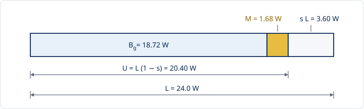
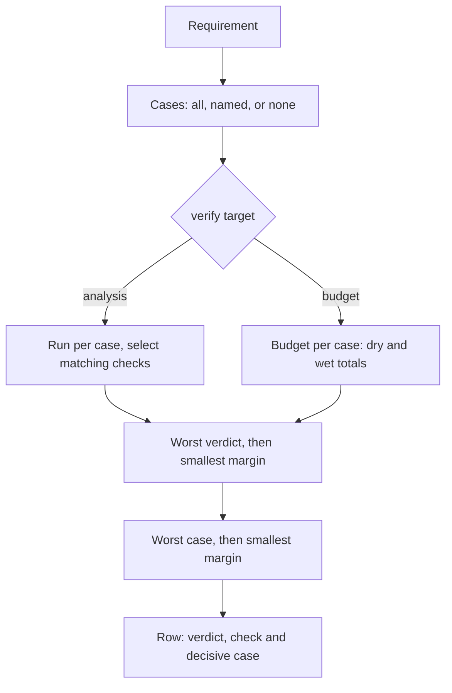

# Budget analyses

A budget sums one quantity over the whole design and compares it with a limit. The compliance table then collects the verdicts of budgets and analysis checks for each requirement. Neither is an analysis in the `fune analyze` list. They have their own commands.

| Entry point | Purpose | Main inputs | Main outputs |
|---|---|---|---|
| `fune budget mass` | Track dry mass and loaded mass | Part masses, counts, growth, loaded propellant | Rows by allocation, dry and wet totals, margins |
| `fune budget power` | Track mode consumption | Mode loads, growth, power allocations | Selected mode, rows by allocation, margin of every mode |
| `fune budget data` | Track one day of generated data | Data rates, mode shares, data allocations | Daily volume and margin |
| `fune requirement compliance` | Judge requirements | Constraints, verification links, quantified cases | Verdict, decisive check and case for each requirement |

## Common ground

A budget uses the case's resolved inputs. For mass, the case `side` selects the nominal, minimum or maximum side of a part's uncertain mass. For power, the case mode selects the mode that is summed. For data, the case mode counts for the whole day. Without a case mode, the data budget uses the mode shares in `analysis.power.mode_share`. An analysis used for compliance resolves its own case and configuration as described in the [analysis entry page](index.md#common-ground).

Four design files feed a budget.

- **Limit.** The limit of a budget is the `at_most` constraint of a requirement with `verify.budget = "<kind>"`. If several requirements apply, the smallest limit is used. No limit is built in. Without one, the budget gives the total and no verdict, and `fune check` warns (`budget.limit_unset`).
- **System reserve.** `[<kind>].system_margin` in `budget/allocation.toml` is the fraction of the limit kept back by the system lead. It must be at least 0 and less than 1. It is 0 if the file has no table for the kind.
- **Allocations.** `[<kind>.alloc]` in `budget/allocation.toml` assigns a target to a subsystem, an assembly or a part. The key is a subsystem ID or a part ID. Only the allocations of the same budget kind are read.
- **Growth.** A growth allowance is a fraction added to an estimate to cover the increase expected as the design matures. `[growth]` in `budget/policy.toml` gives one fraction for each maturity of a part (`off_the_shelf`, `modified`, `new`). A part without a maturity, or a maturity without an entry, has growth 0.

`[uncertainty]` and `[harness].allowance` in the same policy file are not budget inputs. The uncertainty width is the default margin of the thermal temperature check. `fune check` validates the harness allowance (a fraction from 0 to 1), and no budget total reads it.

## Budget rollup

### What it answers

How much of the usable limit is taken by the design, how much of each allocation is used, and how much room remains?

### Inputs

| Quantity | Symbol | Unit | Design source | Default |
|---|---|---|---|---|
| Mass of a part | $v_i$ | kg | Part attribute `mass` for the case side. A part without `mass` is listed in `uncounted` and not counted | Must be present to count the part |
| Mean sunlit power of a part in the mode | $v_i$ | W | Result of [mode load](power.md#powermode_load--mode-power-consumption), with the unit count already included | Parts with no value for the mode are listed in `uncounted` |
| Daily data of a part | $v_i$ | bit | Result of [`cdh.data_budget`](comm.md#cdhdata_budget--data-volume-and-storage): housekeeping plus mission data in a day, with the unit count included | — |
| Unit count | $n_i$ | 1 | Part `count` (mass only. Power and data use 1 on the aggregated value) | 1 |
| Growth | $g_i$ | 1 | `budget/policy.toml`, `[growth]`, by part maturity. Data and loaded propellant use 0 | 0 |
| System limit | $L$ | kg, W or bit | Tightest `at_most` requirement with `verify.budget` | None. Without it there is no system verdict |
| System reserve | $s$ | 1 | `[<kind>].system_margin` in `budget/allocation.toml` | 0 |
| Allocation | $L_j$ | kg, W or bit | `[<kind>.alloc]` entry for row $j$ | Optional |

### Model and assumptions

The mass budget sums the dry mass of the parts. If the design has propulsion, it also shows the propellant loaded according to `propulsion.propellant` as a separate row without growth, and gives a second total with propellant (wet). The power budget sums the growth-adjusted mean sunlit load of the parts in one mode. With a case mode it uses that mode. Without one it uses the mode whose growth-adjusted total is largest, and it also shows the total of every mode. The data budget sums the daily data of the parts for the case mode, or over the mode shares.

A row is a subsystem, an assembly or a part that has an allocation. A part goes to the first of these that applies: its own allocation, the nearest ancestor assembly with an allocation, its subsystem, and finally the row `Other`. The rows are listed in the order of the allocation file, then rows without an allocation, then `Other`. An allocation that no part uses still has a row.

The data budget compares one day of generation with the data limit. The retention time of `cdh.data_budget` does not enter this comparison. The storage check of [`cdh.data_budget`](comm.md#cdhdata_budget--data-volume-and-storage) multiplies the daily generation by the retention time, so the two views of the same storage requirement can differ.



*The limit L of the demo power budget in mode `DOWNLINK` splits into the growth-adjusted total, the margin and the system reserve s·L. The usable amount U is L less the reserve.*

### Equations

$B$ is the current total, $B_\mathrm{g}$ the total with growth, $U$ the usable amount and $M$ the margin. They have the unit of $v_i$. For row $j$, $B_{\mathrm{g},j}$ is the sum over the items of that row.

```math
B=\sum_i n_i v_i,\qquad B_\mathrm{g}=\sum_i n_i v_i(1+g_i),\qquad
U=L(1-s),\qquad M=U-B_\mathrm{g},\qquad M_j=L_j-B_{\mathrm{g},j}
\tag{1}
```

The growth allowance is applied once per item. The system reserve is applied once to the limit, and not to allocations. A system with an allocation total above $U$ is reported by `fune check` (`budget.over_allocated`).

### Algorithm

1. Resolve the case and collect the item values. The power budget runs `power.mode_load` once and builds the total and the row for every mode from that output.
2. Assign each item to a row as described above. Rows are made from allocations first.
3. Sum $B$ and $B_\mathrm{g}$ over all items and over each row. Select the system limit, compute $U$ and $M$, and compute $M_j$ against each allocation.
4. If a propellant load is available, add it as one item with count 1 and growth 0 to the dry items. Compute the wet total and margin against the same $U$.

### Checks and verdicts

The budget is judged by one rule everywhere. The margin ($M$ or $M_j$) is the usable amount minus the growth-adjusted total. A margin of zero or more is `ok`, and a negative margin is a `violation`. There is no warning level. A row without an allocation shows `ok` and has no margin. The system verdict is absent if no requirement sets a limit.

The row verdicts do not change the system verdict, and a row can be a violation while the system is `ok`. `fune budget` exits with code 1 when inputs are missing or when the system total is a violation. For mass, the total with propellant counts too.

`uncounted` lists parts that were left out of a total because they have no value (not counted as zero). `missing` lists the inputs that prevent the rollup. For the mass view, `propellant` reports `no_propulsion`, `missing` or `failed` when the propellant row cannot be computed.

### Outputs

| Output | Unit | Meaning |
|---|---|---|
| `total`, `margin`, `limit`, `system_margin` | kg, W or bit; 1 | $B_\mathrm{g}$, $M$, $L$ and $s$ |
| `rows` | kg, W or bit | For each row: current $B$, with growth $B_\mathrm{g}$, allocation, margin and verdict |
| `mode`, `modes` | W | Mode used by the power budget, and total, usable amount and margin of every mode |
| `propellant` | kg | Loaded propellant, the wet total with its margin and verdict, and the tanks |
| `limit_requirement`, `verdict`, `uncounted`, `missing`, `notes` | — | Requirement that set the limit, system verdict, parts left out, missing inputs, and notes |

### Worked example

Run `fune budget mass`, `fune budget power` and `fune budget data` in the demo project. Add `--case <ID>` to use a case and `--json` for structured output.

**Mass.** The parts add up to 5.548 kg. With growth the dry total is 6.2349 kg. The mass requirement `R_MASS` limits it to 12 kg, and the system reserve is 10 %. So $U=12\times0.9=10.8$ kg and $M=10.8-6.2349=4.5651$ kg. The propellant tank holds 0.067219 kg, so the wet total is $6.2349+0.067219=6.302119$ kg and the wet margin is $10.8-6.302119=4.497881$ kg. The `aocs` row has 1.042 kg now and 1.0981 kg with growth against an allocation of 1.6 kg, so $M_j=1.6-1.0981=0.5019$ kg.

**Power.** Without a case mode, the mode with the largest growth-adjusted total is `DOWNLINK` at 18.72275 W. The limit is 24 W (`R_POWER`) and the reserve is 15 %, so $U=24\times0.85=20.4$ W and $M=20.4-18.72275=1.67725$ W. The `comm` row has 11.27425 W against an allocation of 3 W, so it is a violation (−8.27425 W), while the system total is `ok`.

**Data.** The daily data is 22132224000 bit (2.766528 GB), from the [data budget example](comm.md#cdhdata_budget--data-volume-and-storage). The limit is 8 GB (`R_STORAGE`) and the reserve is 20 %, so $U=8\times0.8=6.4$ GB and $M=6.4-2.766528=3.633472$ GB.

### Limits

The budgets sum values. They do not model peak load, generated power, the battery profile or retained data. These need the dedicated analyses. A mass total is conditional on the parts that have a mass and on the propellant result. The allocation margins do not include the system reserve. The data budget compares one day of generation with the limit and ignores the retention time.

### Verification

`mass_budget_by_hand` in `budget.rs` checks the growth, count, reserve, margin and verdict of a mass budget by hand arithmetic, and `counted_helpers_by_hand` checks the counting helpers. The service tests `budget_propellant.rs` and `budget_uncounted.rs` cover the propellant row and the uncounted parts. `requirements_compliance.rs` uses budget limits in compliance.

### Source

[Rollup](../../crates/lib/analysis/src/budget.rs), [budget service](../../crates/app/service/src/budget.rs), [power mode selection](../../crates/app/service/src/budget/power.rs), [loaded propellant](../../crates/app/service/src/budget/propellant.rs), [limits and criteria](../../crates/app/model/src/design/criteria.rs), [allocation checks](../../crates/app/model/src/check/budget.rs).

## Requirement compliance

### What it answers

For each requirement, does the design meet it, and which case and check decide the answer?

### Inputs

| Quantity | Design source | Default |
|---|---|---|
| Constraint | `[constraint]` in `requirements/<ID>.toml` (`at_most`, `at_least`, `equal` or `range`) | Must be given for a numeric criterion |
| Verification target | `verify.analysis` with optional `verify.check`, or `verify.budget` | Optional. A requirement with no target is not verified |
| Cases | `quantify.all_cases = true`, or `quantify.cases = [...]` | The target's own default case |
| Design input | Top-level `input`, for example `mission_duration` | Optional |

### Model and assumptions

Each case of a requirement is judged on its own. The compliance table does not compare the measured value with the constraint again. It reads the verdict that the analysis or the budget made.

The criterion of a check is held by requirements. When several requirements share one criterion, the analyses and budgets use the tightest. To judge each requirement against its own constraint, the table runs the target on a draft design without the other requirements that share the criterion. Nothing is saved. A looser requirement is therefore met when a tighter one is, and a violated tighter requirement does not fail the looser one.

A check key matches a produced key if the two are equal or if the requirement key is followed by `:` or `@`. For example, `margin` covers every `margin:<link>@<station>`, and `margin:s_down` covers the link `s_down` at every station. Without a check key, all checks of the analysis are eligible. A key can be built at run time, so its existence is verified against the checks that the run produced.

### Equations

Compliance does not add a formula. It compares two ranks. The first is the verdict rank, from worst to best: `violation`, not verified, `warning`, `ok`. The second is the margin of the check (see [margins](index.md#read-a-result)), where a smaller margin is tighter and a missing margin comes after a finite one. For a budget, the margin is $M$ of equation (1) of the [budget rollup](#budget-rollup), the usable amount minus the total.

### Algorithm



1. List the cases. `all_cases = true` uses every case in `cases/` (in ID order), and `cases = [...]` uses the named cases in their order. With neither, or when `cases/` is empty, one run without an explicit case is made.
2. For each case, remove the other requirements that share the criterion and run or reuse the result of the target. If the case does not exist, the case is not verified (`unknown_target`).
3. For an analysis, select the checks whose key matches. Take the worst verdict. Among checks with that verdict, take the one with the smallest margin. If two margins are equal, or both are missing, the first stays. A check with a margin comes before one without.
4. For a budget, the candidates are the total with propellant (for mass, if counted) and the dry total. Take the worst verdict, then the smaller margin.
5. Rank the cases by the worst verdict (`violation`, not verified, `warning`, `ok`), then by the smallest margin, then by the first case. The case that wins is the decisive case, and its check and message are the row's.

### Checks and verdicts

The row verdict is the verdict of the decisive case. A requirement is not `ok` if any case could not be verified. A row that is not verified has a reason.

| Reason | Meaning |
|---|---|
| `no_link` | The requirement names no analysis or budget |
| `design_input` | The requirement gives an analysis input and has nothing to verify |
| `missing_inputs` | The analysis or budget lacks inputs (listed in `detail`), or a budget has no limit |
| `failed` | The analysis failed |
| `key_not_produced` | The analysis ran but produced no check with that key (the keys it produced are in `detail`) |
| `unknown_target` | The analysis, the budget or the case does not exist |

`fune requirement compliance` exits with code 1 when a requirement is violated. `--deny-unverified` also fails for not verified rows. Warnings never fail it.

### Outputs

| Output | Meaning |
|---|---|
| `verdict`, `reason`, `detail` | Verdict of the row, and the reason and detail for evidence that is missing |
| `value`, `margin`, `check` | Total of a budget, margin of the decisive check or budget, and the decisive check (key, label, owner) |
| `decisive_case`, `cases` | Case that decided the row, and the result for each case |
| `summary` | Number of requirements and number by verdict |

In the GUI, read the budget panels on the Overview for totals, allocations and the requirement that set the limit. Open Requirements and select the `Compliance` tab for verdicts, checks and cases.

### Worked example

The demo has 16 requirements. `fune requirement compliance` reports 11 ok, 1 warning, 1 violation and 3 not verified.

- `R_LINK_MARGIN` has `verify.check = "margin"`, which covers `margin:uhf_down@TOKYO_GS`, `margin:s_down@TOKYO_GS` and `margin:uhf_up@TOKYO_GS`. All three are `ok`. The decisive check is the one with the smallest margin, `uhf_down` with 3.05 dB.
- `R_STORAGE` has `verify.budget = "data"`, the limit 8 GB, and `quantify.cases = ["eclipse_worst", "hot_imaging"]`. In `hot_imaging` the mode is `MISSION` for the whole day, so the data is 54.066528 GB. The margin is $8(1-0.20)-54.066528=-47.666528$ GB, which is the reported −381332224000 bit. The other case is `ok`, so `hot_imaging` is the decisive case and the row is a violation.
- `R_DEPLOY` names no target (`no_link`), `R_MISSION` gives an analysis input (`design_input`) and `R_THRUST_POWER` is missing the `maneuvers` input.

### Limits

The table reports the evidence of the selected targets and cases. A check that covers several keys is only comparable if the keys have the same kind of margin. Use a specific check key when that matters. A requirement that covers a whole analysis can compare margins of different units in the tie-break. A target that was removed for the draft is not saved, so the table does not edit the design.

### Verification

`requirements/tests.rs` in the service covers the worst-case selection (`the_worst_case_decides_and_unverified_outranks_a_warning`), the margin order among equal verdicts (`among_equal_verdicts_the_smallest_margin_decides`) and the failure counts. `tests/requirements_compliance.rs` runs the table on the demo and on designs with cases, check keys and budget requirements. It includes `the_link_margin_row_shows_the_tightest_link`, `a_budget_row_names_the_deciding_case` and `each_row_is_judged_against_its_own_constraint_when_limits_overlap`.

### Source

[Compliance service](../../crates/app/service/src/requirements.rs), [criteria](../../crates/app/model/src/design/criteria.rs), [margin order](../../crates/lib/analysis/src/spec/check.rs), [compliance integration tests](../../crates/app/service/tests/requirements_compliance.rs).

## References

- [Design model: requirements and the compliance table](../model.md#79-requirements-one-file-per-requirement-and-the-compliance-table).
- [Design model: allocations and margin policy](../model.md#8-allocations-and-margin-policy-budget).
- [Analyses entry page](index.md).
