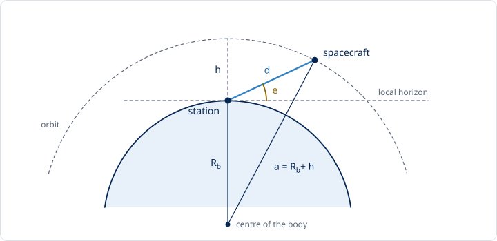
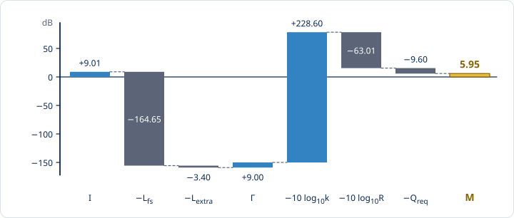

# Communications analyses

These analyses answer three questions about the radio link and the data it carries. Does a link close with enough margin at the worst distance? When can a ground station see the spacecraft? Can the downlink carry the data that the spacecraft generates and stores? Command and data handling (CDH) provides the data generation and storage model, so `cdh.data_budget` is documented on this page as well.

| ID | Purpose | Main inputs | Main outputs |
|---|---|---|---|
| `comm.link_budget` | Size a radio link | Frequency, gains, losses, orbit, data rate | Link margin, power flux density, supportable rate |
| `comm.visibility` | Find ground contacts | Orbit, station coordinates and mask | Passes, contact time, gaps |
| `comm.data_throughput` | Compare transfer and generation | Passes, link settings, daily production | Capacity, sent data, backlog |
| `cdh.data_budget` | Size data storage | Part rates, mode shares, retention | Daily data, required capacity |

## Common ground

**Orbit.** All three comm analyses read the orbit in `conditions/orbit.toml`, or the orbit of the phase that applies to the case. Spacecraft states are propagated in an inertial frame. For a ground station they are translated to Earth-centred coordinates (the position of a spacecraft around the Moon or a planet is added to the position of that body) and rotated into the Earth-fixed frame.

**Case.** An explicit case can select a phase orbit. `comm.visibility` and `comm.data_throughput` also read the case `epoch` (the search window starts there) and the case `beta`. For an orbit given by elements, `beta` replaces the right ascension of the ascending node. `comm.link_budget` uses the phase orbit but ignores the case epoch and the case `beta`. Its Earth-distance window always starts at the epoch of the orbit, because the link margin is a worst case over the whole span.

**Stations.** The ground stations come from `analysis.comm.stations`. An empty or absent list selects every station in `conditions/ground/`. A station is described by geodetic latitude, longitude and altitude (default 0 m above the reference ellipsoid) and a minimum elevation, the mask (default 0 rad).

**Margins.** A margin in dB is a difference. A ratio margin is `capability / demand − 1`. The definitions of verdicts and margins are in the [analysis entry page](index.md#read-a-result).

## comm.link_budget — Link budget

### What it answers

For each link and ground station, what energy-per-bit margin is left at the farthest distance the link must work at? For a downlink, how strong is the power flux density at the Earth's surface at the nearest distance?

### Inputs

Here `link` denotes `analysis.comm.link.<name>`, and `band` denotes `conditions.ground.<ID>.link.<band>`. The link table gives `direction` (`down` or `up`), `part` (the transceiver) and `band`. The analysis evaluates every pair of a link and a station that has settings for the link's band. Each pair is one row in the result.

| Quantity | Symbol | Unit | Design source | Default |
|---|---|---|---|---|
| Carrier frequency and bit rate | $f,R$ | Hz, bit/s | Transceiver `frequency_down`, `data_rate_down` (downlink) or `frequency_up`, `data_rate_up` (uplink) | Must be given |
| Transmit power | $P_\mathrm{tx}$ | W | Downlink: transceiver `tx_power`. Uplink: `band.tx_power` | Must be given |
| Transmit and receive antenna gain | $G_\mathrm{tx},G_\mathrm{rx}$ | dBi | Spacecraft side: `antenna_gain` of the part named by `link.antenna`, otherwise of the transceiver. Ground side: `band.antenna_gain` | Must be given. A downlink band with `g_over_t` may omit the ground gain |
| Feed losses | $L_\mathrm{tx},L_\mathrm{rx}$ | dB | Spacecraft side: `link.line_loss`. Ground side: `band.line_loss`. Assigned to transmit or receive by direction | 0 dB each, analysis default |
| System noise temperature | $T$ | K | Downlink: `band.noise_temperature`. Uplink: transceiver `noise_temperature` | Must be given unless G/T is given |
| Receiver G/T | $\Gamma$ | dB/K | Downlink only: `band.g_over_t` | Optional. When present it replaces the value derived from gain, loss and temperature |
| Path and implementation losses | $L_\mathrm{atm},L_\mathrm{pol},L_\mathrm{point},L_\mathrm{impl}$ | dB | `link.atmospheric_loss`, `link.polarization_loss`, `link.pointing_loss`, `link.implementation_loss` | 0 dB each, analysis default |
| Required energy per bit | $Q_\mathrm{req}$ | dB | `link.ebn0_required` | Must be given |
| Required margin | $M_\mathrm{req}$ | dB | Tightest `at_least` requirement whose `verify.check` is `margin`, `margin:<link>` or `margin:<link>@<station>` | 3 dB, analysis default |
| Orbit radius and body radius | $a,R_\mathrm{b}$ | m | Orbit semimajor axis; radius of the central body | Orbit must be given |
| Elevation mask | $e$ | rad | Station `min_elevation` | 0 rad, analysis default |
| Distance window | $T_\mathrm{span}$ | s | Requirement with `input = "mission_duration"` | 365.25 days, analysis default. A one-off orbit uses its own span |
| Occupied bandwidth and reference bandwidth | $B_\mathrm{occ},B_\mathrm{ref}$ | Hz | `link.occupied_bandwidth`, `link.pfd_reference_bandwidth` | Occupied bandwidth optional. Reference 4000 Hz, analysis default |
| Flux limit | $F_\mathrm{lim}$ | dBW/m² per reference band | Tightest `at_most` requirement with `verify.check` `pfd`, `pfd:<link>` or `pfd:<link>@<station>` | None. Without it there is no PFD check |

### Model and assumptions

The analysis uses the standard link equation. The transmitter radiates an equivalent isotropically radiated power (EIRP), which is the transmit power times the transmit gain less the feed loss. The signal spreads over a sphere, and the receive antenna collects part of it. Together these give the free-space path loss (FSPL), $(4\pi d f/c)^2$ as a power ratio (Friis, 1946). The receiver is characterised by its gain over its system noise temperature, G/T. If a ground band gives G/T directly, that value is used and the gain, feed loss and temperature of the ground station are not needed. Dividing the received carrier power by the noise power density $kT$ gives the carrier-to-noise-density ratio $C/N_0$. Dividing by the bit rate gives the energy per bit over noise density, $E_b/N_0$. The link closes when $E_b/N_0$ exceeds the value the modulation and coding need, $Q_\mathrm{req}$ (a design input for the target bit error rate).

Atmosphere, polarisation mismatch, pointing and implementation losses are fixed numbers that the design supplies. The analysis does not compute them.

Two distance models are used, depending on the orbit.

- **Earth orbit** (central body is the Earth, the orbit has a semimajor axis). The link is judged at the slant range at the station mask elevation. The nearest distance is the zenith range, which equals the altitude.
- **Earth-centre distance** (central body is the Moon, a planet or the Sun, or the orbit has no semimajor axis, as for a state-vector or libration orbit). The distance is the Earth-centre-to-spacecraft distance, sampled over a window. The link is judged at the largest sampled distance. The nearest sampled distance gives the best-case values.



*Spherical geometry of the Earth-orbit model: the slant range d at elevation e, the body radius R_b, the orbit radius a and the altitude h. The pass search of `comm.visibility` uses the actual line of sight instead.*

### Equations

**Slant range.** For a spherical body of radius $R_\mathrm{b}$ and a spacecraft at altitude $h=a-R_\mathrm{b}$, the law of cosines in the triangle formed by the body centre, the station and the spacecraft gives, for elevation $e$ (rad),

```math
d(e)=\sqrt{(R_\mathrm{b}+h)^2-R_\mathrm{b}^2\cos^2 e}-R_\mathrm{b}\sin e
\tag{1}
```

The farthest distance is $d(e)$ at the mask elevation. The nearest is $d(\pi/2)=h$. In the Earth-centre model the distance is $d=\lVert\mathbf r_\mathrm{b/E}+\mathbf r_\mathrm{sc/b}\rVert$, the position of the central body relative to the Earth plus the position of the spacecraft relative to that body, in m.

**Link equation in dB.** Let $c=299792458$ m/s and $k=1.380649\times10^{-23}$ J/K. $I$ is the EIRP in dBW, $L_\mathrm{fs}$ and $L_\mathrm{extra}$ are losses in dB, $N=C/N_0$ is in dBHz, and $Q=E_b/N_0$ and the margin $M$ are in dB. Each $10\log_{10}$ takes the numeric value of its argument in the unit listed in the tables ($P_\mathrm{tx}$ in W, $T$ in K, $R$ in bit/s, $k$ in J/K).

```math
\begin{aligned}
I &= 10\log_{10}P_\mathrm{tx}+G_\mathrm{tx}-L_\mathrm{tx} &&\tag{2}\\
L_\mathrm{fs} &= 20\log_{10}\!\left(4\pi d f/c\right) &&\tag{3}\\
L_\mathrm{extra} &= L_\mathrm{atm}+L_\mathrm{pol}+L_\mathrm{point}+L_\mathrm{impl} &&\tag{4}\\
\Gamma &= G_\mathrm{rx}-L_\mathrm{rx}-10\log_{10}T \quad \text{(unless G/T is given)} &&\tag{5}\\
N &= I-L_\mathrm{fs}-L_\mathrm{extra}+\Gamma-10\log_{10}k &&\tag{6}\\
Q &= N-10\log_{10}R,\qquad M=Q-Q_\mathrm{req} &&\tag{7}
\end{aligned}
```

Equation (3) is twice the decibel value of an amplitude ratio, because $(4\pi d f/c)^2$ is the power ratio. In (6), $-10\log_{10}k=228.599$ dB. Equation (6) is $C/N_0=\mathrm{EIRP}\cdot(G/T)/(L_\mathrm{fs}L_\mathrm{extra}\,k)$ written in decibels.



*The signed terms of equations (2) to (7) for the demo S-band downlink, in dB of their own reference (dBW, dB, dB/K, dB(1/(J/K)), dB(bit/s)). Bar heights are to scale and the bars add up to the margin M of 5.95 dB.*

**Supportable rate, light time and power flux density.** $R_\mathrm{max}$ is the largest bit rate (bit/s) that still leaves the required margin $M_\mathrm{req}$. $\tau$ is the one-way light time (s). $F$ is the power flux density in dBW/m² within the reference bandwidth.

```math
R_\mathrm{max}=10^{(N-Q_\mathrm{req}-M_\mathrm{req})/10},\qquad
\tau=d/c,\qquad
F=I-10\log_{10}(4\pi d^2)-10\log_{10}\max\!\left(1,\frac{B_\mathrm{occ}}{B_\mathrm{ref}}\right)
\tag{8}
```

The last term in $F$ is the share of the EIRP that falls into the reference band. It is capped at zero, so a signal narrower than the reference band, or an unspecified occupied bandwidth, is not given any credit (the safe side). $F$ uses the EIRP of (2) without the atmospheric, polarisation, pointing or implementation losses, and it uses the nearest distance. It is a worst case.

### Algorithm

1. Build the pairs. A link is paired with each selected station that has settings for the link's band. A link whose band no station has, or whose required radio values are missing, is reported as a missing input.
2. Find the distances. For an Earth orbit with an altitude, evaluate (1) at the mask elevation and at zenith. In the Earth-centre model, sample the Earth-centre distance from the epoch of the orbit over the window $T_\mathrm{span}$. A one-off orbit uses its own length as the window, and a periodic orbit uses the mission duration or 365.25 days. The sampling step is the largest of 30 s, $T_\mathrm{cycle}/200$ and $T_\mathrm{span}/50000$, limited to $T_\mathrm{span}$, where $T_\mathrm{cycle}$ is the orbit period or the length of a one-off orbit. Instants where a chain of arcs changes (a flyby) are added as samples. The largest and smallest sampled distances are taken as they are, without refinement between samples.
3. For each pair, evaluate (2) to (7) at the larger distance. For a downlink, evaluate (8) for $F$ at the smaller distance. In the Earth-centre model, also evaluate the margin, $R_\mathrm{max}$ and $\tau$ at the smaller distance.
4. In the Earth-centre model, compute the Sun–Earth–probe angle (SEP), the angle at the Earth between the directions to the Sun and to the spacecraft. Take its sampled minimum. Refine the minimum by golden-section search in the interval around the sampled minimum, with the interval split at flyby instants. The search uses at most 60 iterations per interval and no time tolerance. The time below the 3° threshold is accumulated by linear interpolation of the sampled angle between samples.

### Checks and verdicts

- `margin:<link>@<station>` attaches the margin $M$ from (7). It is a violation when $M<0$, a warning when $0\le M<M_\mathrm{req}$, and passes when $M\ge M_\mathrm{req}$. The requested reserve $M_\mathrm{req}$ is only the warning boundary. The comparison with zero is made on achieved minus required $E_b/N_0$.
- `pfd:<link>@<station>` exists for a downlink when a flux limit is given. Its margin is $F_\mathrm{lim}-F$. It is a violation when negative, a warning below 1 dB, and passes otherwise.
- `solar_conjunction` exists when some link uses the Earth-centre model. It is a warning if the minimum SEP is below 3°, and passes otherwise. The attached margin is the minimum SEP divided by 3° minus one. The 3° threshold is an analysis default and has no setting.

### Outputs

| Output | Unit | Meaning |
|---|---|---|
| `slant_range`, `range_min`, `range_min_epoch`, `range_max_epoch` | m, epoch | Far and near distance. The epochs are given only for the Earth-centre model |
| `distance_model` | — | `earth_orbit` or `earth_to_body` |
| `eirp_dbw`, `fspl_db`, `extra_loss_db`, `g_over_t_dbk` | dBW, dB, dB, dB/K | Terms $I$, $L_\mathrm{fs}$, $L_\mathrm{extra}$, $\Gamma$ at the far distance |
| `c_over_n0_dbhz`, `eb_n0_db`, `required_eb_n0_db`, `margin_db` | dBHz, dB, dB, dB | $N$, $Q$, $Q_\mathrm{req}$, $M$ |
| `max_data_rate`, `light_time` | bit/s, s | $R_\mathrm{max}$ and $\tau$ at the far distance |
| `margin_db_at_range_min`, `max_data_rate_at_range_min`, `light_time_min` | dB, bit/s, s | The same at the near distance (Earth-centre model only) |
| `pfd_dbw_m2`, `pfd_limit_db`, `pfd_margin_db` | dBW/m² per band, dB | $F$, limit and margin (downlink) |
| `solar_conjunction` | rad, epoch, s | Threshold, minimum SEP with its epoch, time below the threshold |

### Worked example

The demo link `s_down` is the S-band downlink to `TOKYO_GS`. The transceiver gives 2 W, 6.5 dBi and 2245 MHz at 2 Mbit/s. The link has 0.5 dB feed loss, 0.4 dB atmospheric, 0.5 dB polarisation, 1.0 dB pointing and 1.5 dB implementation loss, and requires 9.6 dB. The station gives G/T = 9 dB/K and a 10° mask. The orbit radius is 6928137 m, the Earth radius is 6378137 m, and the altitude is 550 km.

1. Equation (1) at $e=10°$ gives $d=1815652.17$ m, and zenith gives 550000 m.
2. $I=10\log_{10}2+6.5-0.5=9.0103$ dBW.
3. $L_\mathrm{fs}=20\log_{10}(4\pi\times1815652.17\times2.245\times10^9/299792458)=164.6528$ dB.
4. $L_\mathrm{extra}=0.4+0.5+1.0+1.5=3.4$ dB.
5. $N=9.0103-164.6528-3.4+9+228.5992=78.5567$ dBHz, and $Q=78.5567-63.0103=15.5464$ dB.
6. $M=15.5464-9.6=5.9464$ dB. This is above the 3 dB requirement of `R_LINK_S`, so the check passes.
7. $R_\mathrm{max}=10^{(78.5567-9.6-3)/10}=3.94$ Mbit/s.
8. For $F$ at 550000 m: $10\log_{10}(4\pi\,550000^2)=125.7994$ dB, and $10\log_{10}(2\,\mathrm{MHz}/4\,\mathrm{kHz})=26.9897$ dB. So $F=9.0103-125.7994-26.9897=-143.7788$ dBW/m² per 4 kHz. The fictional demo limit of requirement `R_PFD` is −135 dB, so the margin is 8.78 dB.

The UHF downlink `uhf_down` (9.6 kbit/s at 437.25 MHz) has no G/T given, so (5) applies: $\Gamma=14-2-10\log_{10}600=-15.78$ dB/K. Its margin is 3.05 dB. It passes by a small amount, and a margin between 0 and 3 dB would be a warning. The uplink `uhf_up` has a margin of 20.19 dB.

### Limits

- The spherical estimate uses the mean altitude and one mask angle. It ignores the orbit eccentricity and the oblateness of the Earth.
- In the Earth-centre model the distance is to the centre of the Earth, not to the station. The difference is up to one Earth radius (about 1.7 % at the Moon, 0.01 % or less beyond Mars). The extremes are the sampled extremes. A closest or farthest approach between two samples is missed. For a heliocentric cruise the far distance can be short by about $2\times10^{-4}$ in relative terms.
- For a fixed bit rate the margin at the near end exceeds the margin at the far end by $20\log_{10}(d_\mathrm{max}/d_\mathrm{min})$ dB.
- The solar conjunction check is geometric. It does not model the rise of the receiver noise near the Sun or refraction.
- Variable atmospheric and rain loss, antenna tracking dynamics and interference are outside the model.

### Verification

`link_budget/tests.rs` has `hand_calculated_downlink`, which compares EIRP, FSPL, $C/N_0$ and the margin of a downlink with a hand calculation. `comm/link.rs` has unit tests for the 437 MHz, 1000 km free-space loss (145.25 dB), the power flux density at 600 km (−140.53 dBW/m² per 4 kHz) and the Boltzmann constant in dB. `link_budget/deep_space_tests.rs` checks the inverse-square scaling of the rate (`doubling_the_distance_costs_6_db_and_a_factor_of_four_in_rate`), the light time of 1 AU (499 s), the near and far ranges, and the conjunction warning.

### Source

[Link equations](../../crates/lib/analysis/src/comm/link.rs), [link budget](../../crates/lib/analysis/src/comm/link_budget.rs), [range model](../../crates/lib/analysis/src/comm/link_budget/range.rs), [conjunction](../../crates/lib/analysis/src/comm/link_budget/conjunction.rs), [Earth-distance sampling](../../crates/lib/astro/src/ground/earth_range.rs), [projection](../../crates/app/projection/src/comm.rs).

## comm.visibility — Ground station visibility

### What it answers

When is the spacecraft above the mask of each station, how long are the contacts, and how long are the outages?

### Inputs

| Quantity | Symbol | Unit | Design source | Default |
|---|---|---|---|---|
| Orbit, start epoch, beta | — | epoch, rad | `conditions/orbit.toml` or phase orbit; case `epoch` and `beta` | Orbit must be given. Start at the orbit epoch, or at the case epoch |
| Latitude, longitude | $\phi,\lambda$ | rad | `conditions.ground.<ID>.latitude`, `conditions.ground.<ID>.longitude` | Must be given |
| Station altitude, mask | $h_\mathrm{st},e_\mathrm{min}$ | m, rad | Station `altitude`, `min_elevation` | 0 m and 0 rad, analysis defaults |
| Search window and step | $T,\Delta t$ | s | Derived from the orbit | $T=86400$ s, or the length of a one-off orbit if shorter. $\Delta t=\min(600,\max(30,T_\mathrm{cycle}/200))$ s |

### Model and assumptions

The station sits at its altitude above the reference ellipsoid (WGS84). Its local up direction is the ellipsoid normal. The spacecraft is visible when its elevation is at or above the mask. For an orbit around a body other than the Earth, the body can also block the line of sight. The line is blocked when the sphere of the body (equatorial radius) intersects the segment from the station to the spacecraft. For an Earth orbit the horizon already blocks the path, so no extra test is made. Refraction and terrain are not modelled.

### Equations

$\boldsymbol\rho$ is the spacecraft position minus the station position in Earth-fixed coordinates (m). $\hat{\mathbf u}$ is the local up direction. For occultation, $d_\mathrm{seg}$ is the minimum distance from the centre of the occulting body to the sight segment, $R_\mathrm{b}$ its radius and $d_\mathrm{b}$ the distance from the station to the centre of the body (all in m).

```math
e=\arcsin\!\left(\operatorname{clamp}\!\left(\frac{\boldsymbol\rho\cdot\hat{\mathbf u}}{\lVert\boldsymbol\rho\rVert},-1,1\right)\right),\qquad
m_\mathrm{occ}=\frac{d_\mathrm{seg}-R_\mathrm{b}}{d_\mathrm{b}}
\tag{1}
```

The search level is $e$ for an Earth orbit, and $\min(e,\,e_\mathrm{min}+m_\mathrm{occ})$ when a body can block the path. $m_\mathrm{occ}$ is negative while the spacecraft is behind the body, which pushes the level below the mask. The spacecraft is visible while the level is at or above $e_\mathrm{min}$. The cubic Hermite interpolation used between propagated states, with $s=(t-t_0)/h$, is

```math
\mathbf r(t)=(2s^3-3s^2+1)\mathbf r_0+h(s^3-2s^2+s)\mathbf v_0+(-2s^3+3s^2)\mathbf r_1+h(s^3-s^2)\mathbf v_1
\tag{2}
```

where $h$ is the step between the two states $(\mathbf r_0,\mathbf v_0)$ and $(\mathbf r_1,\mathbf v_1)$ (inertial position and velocity).

### Algorithm

1. Sample the orbit with the step $\Delta t$ over the window $T$. The window starts at the epoch of the orbit, or at the case epoch. The orbit is first adjusted for the case beta if one is given.
2. Between the propagated states, interpolate the inertial position by (2) and transform it to the Earth-fixed frame at the evaluation time. The propagator is run once.
3. Scan the sampled levels. A change from below to above the mask starts a pass (acquisition of signal, AOS), and a change from above to below ends it (loss of signal, LOS). Each crossing is refined by bisection on the level. A pass already open at the start or at the end of the window is clipped at the window edge.
4. A short pass can fit between two samples. If a sampled level below the mask is a local maximum, golden-section search on the interval around it finds the true peak. If the peak is above the mask, both crossings are found by bisection and the pass is kept.
5. For each pass, find the time and value of the maximum elevation by golden-section search between AOS and LOS. Bisection and golden-section search stop when the interval is narrower than 0.001 s, or after at most 200 iterations.
6. Sort the passes by AOS. Per station, sum the pass durations. For the combined result over all stations, merge overlapping intervals first, so simultaneous contact is not counted twice. Count a pass on the day of its AOS. Split durations at day boundaries. The maximum gap includes the gap before the first contact and after the last contact.

### Checks and verdicts

Visibility reports geometry and has no pass or fail check. Missing inputs and calculation errors still appear in the execution status.

### Outputs

| Output | Unit | Meaning |
|---|---|---|
| `passes` | epoch, rad, s | For each pass: station, AOS, LOS, time of maximum elevation, maximum elevation and duration |
| `stations`, `combined` | count, s, rad | Per station and over all stations: pass count, total contact, contact per day, mean and longest pass, maximum gap, maximum elevation |
| `days` | count, s | Per day: pass count and contact time |

### Worked example

The demo propagates the 550 km sun-synchronous orbit with a 30 s step for 86400 s. `TOKYO_GS` is at 35.7126° N, 139.762° E, 40 m, with a 10° mask. The analysis finds three passes.

| Pass | AOS (UTC) | LOS (UTC) | Duration (s) | Maximum elevation |
|---|---|---|---|---|
| 1 | 00:36:08.548 | 00:41:21.932 | 313.38409 | 16.84° |
| 2 | 02:10:06.460 | 02:16:58.695 | 412.23450 | 28.57° |
| 3 | 12:51:44.575 | 12:59:41.233 | 476.65833 | 80.29° |

The durations sum to $313.38409+412.23450+476.65833=1202.27692$ s, which is the reported total contact (20.04 min per day). The largest gap is the time from the end of pass 3 to the end of the window, $86400-46781.233=39618.77$ s. The first gap is 2168.5 s, and the gap between passes 2 and 3 is 38085.9 s. Values are rounded as the program prints them.

### Limits

- Refraction, terrain and horizon obstructions other than the mask are not modelled.
- A short pass whose sampled levels are all below the mask and have no local maximum can be missed. The search tolerance concerns the interpolated orbit, not the propagation error.
- The window is one day, so passes repeat only if the orbit does. A day is not necessarily representative of a ground-track repeat cycle.

### Verification

`ground/tests.rs` compares equatorial passes with a closed form in `equatorial_passes_match_closed_form`, checks that a Moon orbiter behind the Moon is occulted (`moon_orbiter_behind_the_moon_is_occulted`) and checks the slant range at zenith, horizon and on the Moon. In `visibility.rs`, `gaps_include_edges` checks the gap rule by hand, and `combined_does_not_double_count` checks that two co-located stations give the contact time of one.

### Source

[Visibility](../../crates/lib/analysis/src/comm/visibility.rs), [pass aggregation](../../crates/lib/analysis/src/comm/passes.rs), [ground geometry and search](../../crates/lib/astro/src/ground.rs), [projection](../../crates/app/projection/src/comm.rs).

## comm.data_throughput — Downlink capacity and backlog

### What it answers

Can the selected downlink carry the data that the spacecraft generates in a day, and how much data is left waiting?

### Inputs

| Quantity | Symbol | Unit | Design source | Default |
|---|---|---|---|---|
| Downlink rate and radio settings | $R$ | bit/s | `analysis.comm.data_downlink` names the link. Transceiver `data_rate_down` and the radio settings of [link budget](#commlink_budget--link-budget) | The first downlink in name order if `data_downlink` is absent |
| Required link margin | $M_\mathrm{req}$ | dB | The largest (tightest) `margin` criterion over the stations that have the downlink band | 3 dB, analysis default |
| Search window | $T,\Delta t$ | s | As in visibility | Same defaults as visibility |
| Daily generation | $G$ | bit/day | `total_per_day` of `cdh.data_budget` | Must be computable |
| Usable fraction of a pass, initial backlog | $u,B_0$ | 1, bit | Typed analysis inputs `usable_pass_fraction`, `initial_backlog` | 1 and 0 bit, analysis defaults. The design projection does not set them |
| Storage capacity | $C$ | bit | Typed analysis input `storage_capacity` | Optional. The design projection does not set it |

### Model and assumptions

Only one downlink contributes capacity. Other downlinks are named in a notice. A station that has no settings for the downlink band is not counted. The data are generated at a constant rate $g=G/D$. During a contact the transmitter sends at the effective rate $Ru$ and can serve both the queued data and the data generated at that moment. Between contacts the queue grows at $g$. One transmitter works at a time, so when two stations see the spacecraft at once, the pass that starts first keeps the interval and the later pass gets only the time after the earlier one ends.

Before the queue is simulated, each station is limited to the elevations where the downlink closes with the required margin. This follows from the link equations (2) to (7) of the [link budget](#commlink_budget--link-budget) at the full rate $R$ and the slant range of (1) of that section.

### Equations

$D=86400$ s is one day. $t_i$ is the time assigned to pass $i$ in s, and $B$ is the backlog in bit. For an interval of duration $\delta t$ in s, the rate is $r=Ru$ during contact and $r=0$ otherwise. $V_\mathrm{sent}$ is the data sent in the interval, in bit.

```math
V_\mathrm{cap/day}=\frac{Ru\sum_i t_i}{T/D},\qquad
V_\mathrm{sent}=\min(r\,\delta t,\;B+g\,\delta t),\qquad
B_\mathrm{next}=B+g\,\delta t-V_\mathrm{sent}
\tag{1}
```

The daily margin shown as `downlink_margin` is the ratio $V_\mathrm{cap/day}/G-1$. It is not the margin of the `capacity` check.

### Algorithm

1. Compute the closure elevation of each station at the full rate $R$. For an Earth orbit with an altitude, evaluate the margin at the horizon and at zenith. If the margin at zenith is below the requirement, the link never closes. If it is met at the horizon, the closure elevation is 0. Otherwise bisect the elevation (at most 100 iterations, tolerance $10^{-12}$ rad). For the Earth-centre model, evaluate the margin at the largest sampled Earth distance within the window. The link then closes from the horizon, or never.
2. Exclude stations that never close and stations with no band settings. Raise the mask of each remaining station to the larger of its own mask and its closure elevation. Find the passes of these stations and sort them by AOS as in visibility.
3. Give each pass the time after the end of the previously assigned pass. A pass that is completely covered gets no time.
4. Simulate the queue with (1). Split intervals at day boundaries. Record a vertex where the queue becomes empty inside a pass.
5. Report the capacity per day, the sent data, the final backlog and the largest backlog (the maximum over the recorded vertices).

### Checks and verdicts

- `link_closes` is a violation when no station closes. When at least one station closes, each station that never closes gets a warning and is not counted. The check key of that warning names the station.
- A notice `downlinks_not_counted` (ok) names the downlinks that were not counted.
- `capacity` compares the daily capacity with the daily generation. Its attached margin is the capacity minus the generation in bit, with no reserve. It is a violation when negative and ok otherwise.
- `storage` exists only if a storage capacity was supplied. Its margin is the capacity minus the largest backlog. It is a violation when negative and ok otherwise.

### Outputs

| Output | Unit | Meaning |
|---|---|---|
| `link_closure`, `station_closures` | rad | Aggregate and per-station closure: `closes_above` with the elevation, `never_closes`, `not_evaluated` or `no_band_settings` |
| `passes`, `days` | s, bit | Per pass: assigned time and capacity. Per day: generated, capacity, sent data and backlog at the end |
| `capacity_per_day`, `generated_per_day` | bit/day | Nominal service and demand |
| `downlink_margin` | 1 | $V_\mathrm{cap/day}/G-1$ |
| `max_backlog`, `final_backlog`, `series` | bit | Largest and final backlog, and the backlog at each vertex |

### Worked example

The first downlink in name order is `s_down` (2 Mbit/s, `uhf_down` is not counted). Its required margin is 3 dB. The closure elevation is 0.0252701 rad (1.448°). At that elevation equation (1) of the link budget gives $d=2548900$ m and $L_\mathrm{fs}=167.5992$ dB. The margin is then $78.5567-(167.5992-164.6528)-63.0103-9.6=3.000$ dB. The station mask is 10°, which is higher than 1.448°, so the mask stays at 10° and the passes are those of the visibility example. The assigned time is 1202.2769 s, and $2000000\times1202.2769165=2404553833$ bit/day (about 301 MB). Generation is 22132224000 bit/day (from `cdh.data_budget`). The rate in contact (2 Mbit/s) is above the generation rate (256160 bit/s), but the queue does not become empty during any of the three passes, so all of the capacity is used. The final backlog is therefore $22132224000-2404553833=19727670167$ bit. It is also `max_backlog`, because the queue ends the day at its highest point. The `capacity` margin is −19727670167 bit, so the check is a violation. `downlink_margin` is $2404553833/22132224000-1=-0.8914$.

### Limits

- Generation is uniform and the downlink rate is constant. Rate adaptation and station scheduling are not modelled.
- Closure is judged at one elevation threshold per station.
- The simulated queue is not limited by the storage capacity. A design run does not pass a storage capacity, so the `storage` check is not produced. The storage assessment of the design comes from `cdh.data_budget`.

### Verification

`data_throughput/tests.rs` has `backlog_hand_calculation`, which checks the queue against a hand calculation, and `capacity_is_rate_times_assigned_time`. It also checks overlapping stations (`two_stations_are_counted_without_double_counting`), mask changes from closure (`link_closure_raises_min_elevation`, `station_links_close_per_station`) and the Earth-centre closure for a Moon orbiter (`moon_orbiter_closure_uses_the_earth_distance`). The closure elevation itself is verified in `comm/link.rs` (`min_elevation_uses_the_central_body_radius`).

### Source

[Throughput](../../crates/lib/analysis/src/comm/data_throughput.rs), [closure](../../crates/lib/analysis/src/comm/data_throughput/closure.rs), [queue evolution](../../crates/lib/analysis/src/comm/data_throughput/backlog.rs), [checks](../../crates/lib/analysis/src/comm/data_throughput/checks.rs), [projection](../../crates/app/projection/src/comm/throughput.rs).

## cdh.data_budget — Data volume and storage

### What it answers

How much housekeeping (HK) and mission data does the spacecraft generate in a day, and how much storage is needed to hold the data until it can be sent down?

### Inputs

| Quantity | Symbol | Unit | Design source | Default |
|---|---|---|---|---|
| Per-unit data rates | $r_{i,s}$ | bit/s | Part attributes `hk_rate` and `mission_rate`, by state | At least one part must have a rate |
| Mode assignments | — | — | `modes/<ID>.toml`: part state, duty, active count, spare state | A part with a rate but no assignment in a mode is counted as zero in that mode and reported with a warning |
| Mode share | $w_m$ | 1 | `analysis.power.mode_share.<mode>`. With a case that has a mode, that mode has share 1 | Must be given |
| HK overhead | $o$ | 1 | `analysis.cdh.packet_overhead` | 0, analysis default |
| Mission compression | $q$ | 1 | `analysis.cdh.compression_ratio` (compressed over uncompressed) | 1, analysis default |
| Storage and reserve | $C,s$ | bit, 1 | Part with role `obc`: `storage_capacity` times `count`. `analysis.cdh.storage_margin` is the fraction to keep free | Capacity must be given. Reserve 0.20, analysis default |
| Retention | $T_\mathrm{ret}$ | s | `analysis.cdh.retention` | Must be given |
| Downlink volume | $V_\mathrm{down}$ | bit/day | Typed analysis input `downlink_per_day` | Not set by the design projection |

### Model and assumptions

Each part has a data rate for each of its states. The mode definitions say which state a part is in, with what duty and for how many units, as for the [mode load](power.md#powermode_load--mode-power-consumption). This gives the average rate of a part in a mode, $\bar r_{im}$. The time share of each mode gives the average over a day. Time not assigned to any mode generates no data, and a warning reports it. The compression ratio multiplies the mission stream. The packet overhead is a fraction added to the HK stream.

The storage needed is the data generated while the spacecraft cannot downlink, for the time $T_\mathrm{ret}$. The data budget view (`fune budget data`, see [budgets](budgets.md)) sums one day of generation per part and compares it with the data limit. The storage check of this analysis multiplies the daily generation by the retention time. The two answer different questions, and the retention time does not enter the budget view.

### Equations

For part $i$ and mode $m$, the state $s'$ has time fraction $f_{ims'}$ (its duty), unit count $n_{ims'}$ and rate $r_{ims'}$, in bit/s. $\bar r_{im}$ is the weighted rate of part $i$ in mode $m$ in bit/s. $G_\mathrm{HK}$ and $G_\mathrm{mission}$ are the daily volumes in bit. $B_\mathrm{req}$ is the required capacity in bit. $m_\mathrm{store}$ is the storage margin and $m_\mathrm{warn}$ its warning boundary. $D=86400$ s.

```math
\begin{aligned}
\bar r_{im}&=\sum_{s'}f_{ims'}\,n_{ims'}\,r_{ims'} &&\tag{1}\\
G_\mathrm{HK}&=D\,(1+o)\sum_{m,i}w_m\,\bar r_{im,\mathrm{HK}},\qquad
G_\mathrm{mission}=D\,q\sum_{m,i}w_m\,\bar r_{im,\mathrm{mission}} &&\tag{2}\\
B_\mathrm{req}&=(G_\mathrm{HK}+G_\mathrm{mission})\,T_\mathrm{ret}/D &&\tag{3}\\
m_\mathrm{store}&=C/B_\mathrm{req}-1,\qquad m_\mathrm{warn}=\frac{s}{1-s} &&\tag{4}
\end{aligned}
```

$m_\mathrm{warn}$ follows from asking that $B_\mathrm{req}\le(1-s)C$, that is, the storage keeps the fraction $s$ free. With $s=0.2$, $m_\mathrm{warn}=0.25$.

### Algorithm

1. Sum the installed storage $C$ over the parts with role `obc` and check the parameters. The mode shares must not sum to more than 1 (tolerance $10^{-9}$).
2. For each mode that has a share, evaluate the average rate of each part by (1). Parts whose state or value is unresolved are left out and a warning is returned.
3. Apply the factors $(1+o)$ and $q$, weight by $w_m$, and convert to daily volumes by (2).
4. Compute $B_\mathrm{req}$ by (3) and $m_\mathrm{store}$ by (4). If $V_\mathrm{down}$ was supplied, compute the balance $V_\mathrm{down}-(G_\mathrm{HK}+G_\mathrm{mission})$.

### Checks and verdicts

- `mode_shares` is a warning when the shares sum to less than 1 by more than $10^{-9}$. A sum above 1 by more than that tolerance is an input error.
- Warnings about states and assignments are given per mode and per stream, with keys of the form `hk:<kind>:<mode>` and `mission:<kind>:<mode>`, where `<kind>` is `unassigned` or `missing_value`.
- `storage_margin` attaches $m_\mathrm{store}$. It is a violation below 0, a warning from 0 up to $m_\mathrm{warn}$ and ok otherwise. If $B_\mathrm{req}$ is 0, there is no ratio and the check is ok.
- `downlink` exists when $V_\mathrm{down}$ is supplied. Its margin is $V_\mathrm{down}$ minus the daily generation in bit. It is a violation when negative.

### Outputs

| Output | Unit | Meaning |
|---|---|---|
| `hk_per_day`, `mission_per_day`, `total_per_day`, `average_rate` | bit/day, bit/s | Daily production and its average rate |
| `modes`, `parts` | bit/s, bit/day | HK and mission rate by mode (after the factors), and the daily volumes and share by part |
| `storage_capacity`, `storage_required`, `capacity_margin` | bit, bit, 1 | $C$, $B_\mathrm{req}$ and $m_\mathrm{store}$ |
| `storage_reserve`, `required_capacity_margin` | 1 | $s$ and $m_\mathrm{warn}$ |
| `downlink_balance_per_day` | bit/day | Downlink surplus, if $V_\mathrm{down}$ is supplied |

### Worked example

In the demo, the HK rates of the parts that are on in each mode add up to $2000+500+1000+3\times200+1000+500=5600$ bit/s (OBC, GPS, PCDU, three reaction wheels, star tracker and UHF transceiver). The packet overhead is 0.1, so the HK rate is $5600\times1.1=6160$ bit/s in each of the three modes. The camera produces 20 Mbit/s when on. In `MISSION` it is on for half of the time, and the compression ratio is 0.5, so the mission rate is $20\times10^6\times0.5\times0.5=5\times10^6$ bit/s. The mode shares are 0.1 (`DOWNLINK`), 0.05 (`MISSION`) and 0.85 (`NOMINAL`).

$G_\mathrm{HK}=86400\times6160=532224000$ bit and $G_\mathrm{mission}=86400\times0.05\times5\times10^6=21600000000$ bit. The daily total is 22132224000 bit (2.77 GB). Retention is 3 days, so $B_\mathrm{req}=66396672000$ bit. The OBC has 8 GB = 64000000000 bit, so $m_\mathrm{store}=64000000000/66396672000-1=-0.03610$. The check is a violation, since the margin is below 0.

### Limits

This is a retention model with average rates. It does not know when the contacts occur. The [throughput analysis](#commdata_throughput--downlink-capacity-and-backlog) uses the contact windows. The data volume of each mode comes from fixed rates, with no queueing, file system overhead or redundancy in the storage.

### Verification

`cdh/data_budget/tests.rs` has `hand_calculated_budget`, `compression_and_overhead`, `rates_and_storage_use_per_unit_counts`, `storage_verdict_follows_the_reserve` and `redundant_data_rates_by_hand`. They check aggregation, the stream factors, the verdict boundaries and the active and spare unit rates against hand calculations.

### Source

[CDH calculation](../../crates/lib/analysis/src/cdh/data_budget.rs), [mode rates](../../crates/lib/analysis/src/cdh/data_budget/mode_rates.rs), [projection](../../crates/app/projection/src/cdh.rs).

## References

- Harald T. Friis, *A Note on a Simple Transmission Formula*, Proceedings of the IRE 34(5), 1946.
- James R. Wertz and Wiley J. Larson (eds.), *Space Mission Analysis and Design*, 3rd edition, Microcosm Press and Kluwer, 1999.
- David A. Vallado, *Fundamentals of Astrodynamics and Applications*, 4th edition, 2013.
- [Design model](../model.md#54a-communication-settings-analysiscommtoml).
