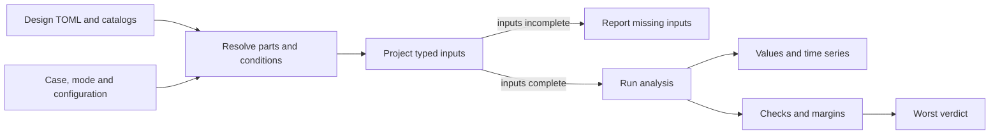
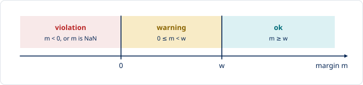

# Analyses

An analysis answers one design question with a defined physical or engineering model. It reads the design data (a directory of TOML files), computes a result, and where the model can judge a criterion it also returns checks with verdicts. This page explains what the analyses have in common and lists all of them. The pages for each area give the equations and algorithms.

## How an analysis runs

The design is not passed to the calculation as files. Projection resolves the design first: parts, their attributes in the state of the selected mode, the conditions, and the case. It then builds a typed input for the selected analysis. Linear quantities are converted to SI units. Logarithmic quantities such as link losses carry their own decibel types. If a value the analysis needs cannot be found, projection stops and reports the design path and the reason as a missing input. Otherwise the calculation runs and returns outputs (steady values or time series) and checks.



*Projection connects the design to the calculation. Checks give the verdict.*

An analysis is either steady (one set of values) or a time series (values over time, for example over several orbits). The kind is shown by `fune analyze ls`.

## Common ground

**Cases.** A case can select a mode and a mission phase, and give overrides: an epoch, a solar beta angle, an orbit count, a Sun distance and the side of the uncertainty to read (`nominal`, `min` or `max`). Each analysis reads only the fields that matter for its model. A mode assigns part states, duty cycles and active unit counts. An attitude law can follow the mode. A phase can supply its own orbit, laws and configuration.

**Default case.** An explicit `--case` takes precedence. Otherwise `analysis.common.default_case` selects the whole case for `power.orbit_generation`, `aocs.rw_unloading`, `aocs.sensor_fov` and `thermal.transient`. For `power.energy_balance` and `power.sizing` it supplies only the mode for the top-level attitude law. Other analyses apply their own behavior when no case is given.

**Configurations.** A configuration overlays part poses on the base design. An explicit `--configuration` takes precedence. Without it, `structure.launch_fit`, `structure.static_load`, `structure.modal_estimate` and `structure.modal_fem` use the configuration named in `conditions/launch.toml`. Other analyses use the configuration of the effective case's phase. Without a selection, the base poses apply. The [design data model](../model.md) and the [design concepts](../guide/concepts.md) describe resolution and the setting keys.

## Read a result

- `status` describes the execution. `missing_inputs` lists the design paths and reasons for the inputs that projection could not supply. `failed` reports a calculation error. `ok` means the calculation ran.
- Each check has a key, a label, a message and a verdict. A pass is written `ok`. The other verdicts are `warning` and `violation`. The overall verdict, when checks exist, is the worst of them, in the order `violation`, `warning`, `ok`.
- A check can carry a finite margin, the number from which its verdict was derived. A smaller margin is tighter, and a negative margin is a shortfall against the criterion. The margin has the scale of the check: a difference in decibels, a difference in SI units, or the dimensionless ratio below. Informational checks and warnings about missing evidence have no margin.

For a capability $C$ and a demand $D$ in the same units, the ratio margin $m$ is dimensionless.

```math
m = C/D-1
```

For example, $m=0.25$ means the capability is 1.25 times the demand. A ratio that is not finite, including a division by zero, gives no margin, and the ratio verdict treats a missing margin as `ok`.

Most checks turn a margin $m$ into a verdict with a warning threshold $w$ (zero for a two-level check):



*The verdict of a margin m with the warning threshold w. A margin that is NaN is a violation.*

A two-level pass or fail check maps true to `ok` and false to `violation`. Some analyses use their own check logic, which their pages describe. The compliance table orders margins from smallest to largest and puts a missing margin after the finite ones. See [budgets and compliance](budgets.md). The helpers are in [spec.rs](../../crates/lib/analysis/src/spec.rs), and the ordering is in [check.rs](../../crates/lib/analysis/src/spec/check.rs).

## Run an analysis

From the design directory, run `fune analyze <id>`. Use `fune analyze ls` to list the available IDs. Add `--json` for the structured input, output, checks and verdict. For example, `fune analyze power.energy_balance --case eclipse_worst --json` runs the named case. The command exits with code 1 if an input is missing, the run fails or a check is a violation. In the graphical user interface (GUI), open the subsystem or conditions page, choose an option in `Analysis case` and use `Recompute` to run its analyses again. The page shows the inputs, result tables, charts and checks.

## Analysis catalog

Attitude and orbit control system (AOCS) and command and data handling (CDH) are subsystem names. The radiation analyses have the ID prefix `orbit`. The kind is S for steady and T for time series.

| Area | Analysis ID | Kind | What it computes |
|---|---|---|---|
| [AOCS](aocs.md) | `aocs.rw_unloading` | T | Reaction wheel unloading frequency |
| | `aocs.sensor_fov` | T | Sensor field of view and exclusion angles |
| | `aocs.slew_time` | S | Slew duration |
| | `aocs.unload_time` | S | Momentum unloading duration |
| [CDH](comm.md#cdhdata_budget--data-volume-and-storage) | `cdh.data_budget` | S | Data generation and storage |
| [Communications](comm.md) | `comm.link_budget` | S | Link performance and margin |
| | `comm.visibility` | T | Ground-station passes |
| | `comm.data_throughput` | T | Downlink capacity and backlog |
| [Orbit](orbit.md) | `orbit.decay` | T | Drag decay and station keeping |
| | `orbit.eclipse_season` | T | Beta-angle and eclipse seasons |
| | `orbit.geometry` | T | Mission geometry |
| [Power](power.md) | `power.mode_load` | S | Operating-mode loads |
| | `power.solar_sunlit` | S | Sunlit generation by attitude |
| | `power.orbit_generation` | T | Generation and eclipse history |
| | `power.energy_balance` | T | Battery charge and energy balance |
| | `power.sizing` | S | Required array area and battery capacity |
| | `power.thrust_balance` | T | Battery balance during firing |
| [Propulsion](propulsion.md) | `propulsion.dv_budget` | S | Delta-v budget |
| | `propulsion.launch_window` | S | Transfer dates and costs |
| | `propulsion.maneuvers` | S | Maneuver results |
| | `propulsion.mass_properties` | S | Mass properties with propellant |
| | `propulsion.orbit_history` | T | Orbit after each maneuver |
| | `propulsion.propellant` | S | Propellant and tank sizing |
| | `propulsion.thruster_usage` | S | Thruster operating time and impulse |
| | `propulsion.transfer_check` | S | Transfer propagation with several gravitating bodies |
| [Radiation](radiation.md) | `orbit.total_dose` | S | Part total ionising dose |
| | `orbit.trapped_dose` | S | Trapped dose versus shielding depth |
| | `orbit.trapped_flux` | S | Trapped particle flux and fluence |
| [Structure](structure.md) | `structure.cone_clearance` | S | Plume and field-of-view clearance |
| | `structure.external_geometry` | S | Outer surfaces and projected areas |
| | `structure.interference` | S | Part interference |
| | `structure.launch_fit` | S | Launch vehicle and dispenser fit |
| | `structure.mass_properties` | S | Mass, centre of mass and inertia |
| | `structure.modal_estimate` | S | Estimated natural frequencies |
| | `structure.modal_fem` | S | Finite-element natural frequencies |
| | `structure.static_load` | S | Quasi-static loads |
| [Thermal](thermal.md) | `thermal.steady` | S | Steady temperatures |
| | `thermal.transient` | T | Temperature history |

[Budgets and compliance](budgets.md) covers the mass, power and data rollups and the requirements table. These are separate entry points (`fune budget` and `fune requirement compliance`), and they do not appear in `fune analyze ls`.

## References

[Analysis registry](../../crates/lib/analysis/src/catalog.rs), [case selection policy](../../crates/app/projection/src/case_policy.rs), [trapped radiation model](../trapped-radiation.md).
