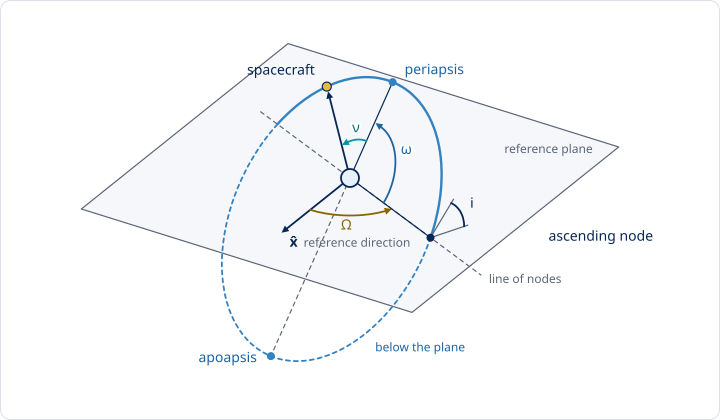
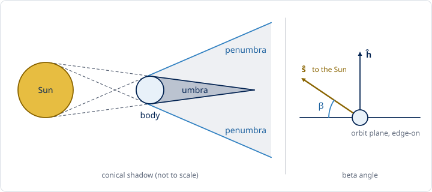
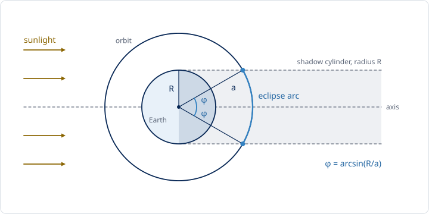
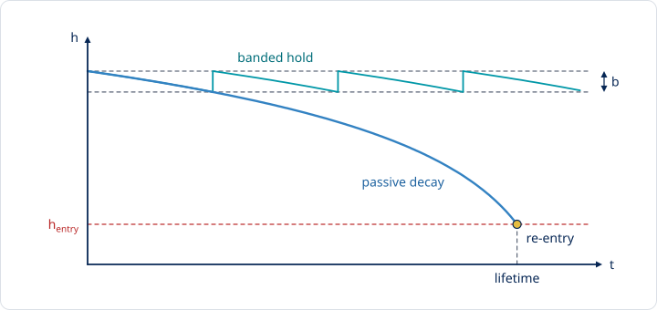

# Orbit analyses

These analyses describe where the spacecraft is relative to the Sun and the Earth, how long it spends in eclipse over the mission, and how long an orbit survives atmospheric drag.
They also define the orbit, time and shadow conventions that the power, thermal, AOCS, communication and radiation pages rely on (see [Common ground](#common-ground)).

| ID | Purpose | Main inputs | Main outputs |
|---|---|---|---|
| `orbit.geometry` | Find mission geometry extremes | Phase trajectories and durations | Sun and Earth ranges, angles, light time |
| `orbit.eclipse_season` | Find the longest eclipse and beta range | Element orbit, mission duration | Umbra and penumbra times, beta extremes |
| `orbit.decay` | Estimate decay and station keeping | Earth orbit, drag area and mass | Lifetime, altitude history, annual delta-v |

## Common ground

### Time and epochs

`Epoch` stores seconds since J2000.0 (2000-01-01T12:00:00) as a floating-point number.
Text is read as ISO 8601: `YYYY-MM-DD`, optionally followed by `Thh:mm:ss[.fff]` and `Z`. A date alone means 00:00.

The model does not distinguish Coordinated Universal Time (UTC), Terrestrial Time (TT) and Barycentric Dynamical Time (TDB), and it ignores leap seconds.
The difference of about 69 s changes the Sun direction by about 0.0008°. Only the DE440 reader adds the main TDB − TT term (at most 1.7 ms) to a time it takes as TT.
Greenwich mean sidereal time (GMST) uses the IAU 1982 polynomial, with UT1 taken as UTC.

### Reference frames

- Earth-centred inertial (ECI) axes are the J2000 mean equator and equinox. Every orbit state in the model uses them, including those about other bodies.
  A trajectory around another body moves only the origin to that body's centre and keeps these axes.
- Earth-centred Earth-fixed (ECEF) coordinates rotate about the ECI $z$ axis by GMST. Precession, nutation and polar motion are not applied to this rotation.
- Geodetic latitude, longitude and height use the WGS84 ellipsoid.
- Body axes follow the spacecraft attitude. The attitude laws are described on the [AOCS page](aocs.md).

### Orbit definitions



*$\Omega$ measures the ascending node from the reference direction, and $\omega$ measures periapsis from that node in the orbit plane.*

| Symbols | Meaning | Units |
|---|---|---|
| $a,p,R$ | Semi-major axis, semi-latus rectum, body reference radius | m |
| $e,J_2$ | Eccentricity, second zonal gravity coefficient | 1 |
| $i,\Omega,\omega,M,E$ | Inclination, right ascension of the ascending node (RAAN), argument of periapsis, mean and eccentric anomaly | rad |
| $\mu,n$ | Gravitational parameter, mean motion | m³/s², rad/s |

The orbit comes from `conditions/orbit.toml`, or from a phase's `[orbit]` table, which replaces the design orbit as a whole.
The key `source` selects where the orbit comes from: `elements` (the default), `state`, `libration` or `transfer`.

**Keplerian elements (`source = "elements"`).**
The inputs are `epoch`, `central` (the central body, Earth by default), the size as `semi_major_axis` or as `altitude` above the central body's equatorial radius, and the plane as `inclination` or `sun_synchronous = true`.
If `eccentricity`, `raan`, `arg_perigee` or `mean_anomaly` is not written, it is 0. These are mean elements at the epoch.
An explicit `inclination` or `raan` always wins over a derived value.

**Sun-synchronous orbits.**
For Earth, `sun_synchronous = true` chooses the inclination at which the $J_2$ nodal rate $\dot\Omega$ of (1) equals the mean motion of the Sun, $n_\odot=2\pi/(365.2422\ \mathrm{d})$.
Setting $\dot\Omega=n_\odot$ and solving for $\cos i$ gives

```math
\cos i=-\frac{n_\odot}{\tfrac32\,n\,J_2\,(R/p)^2}\tag{2}
```

There is no solution if $|\cos i|>1$, which happens when the semi-major axis is too large. For any other central body, write `inclination` directly.

**Local time of the node.**
A sun-synchronous design usually fixes the local time of the descending node (LTDN) or of the ascending node (LTAN).
The `ltdn` key takes `"HH:MM"` and is used when `raan` is not written. The library converts both LTAN and LTDN, for Earth only.
The local time is apparent solar time: the Sun's right ascension $\alpha_\mathrm{Sun}$ (rad) comes from the same ephemeris as every other Sun direction (DE440 if installed), so it includes the equation of time of up to ±16 min.
With $t_\mathrm{AN},t_\mathrm{DN}$ in hours, $0\le t<24$:

```math
t_\mathrm{AN}=(t_\mathrm{DN}+12)\bmod24,\qquad
\Omega=\left(\alpha_\mathrm{Sun}+ (t_\mathrm{AN}-12)\,\pi/12\right)\bmod 2\pi\tag{3}
```

A node at 12:00 has the same right ascension as the mean Sun, and each hour of local time moves the node 15° in RAAN. The RAAN is fixed at the epoch. Afterwards a sun-synchronous orbit follows the mean Sun, so the apparent local time drifts only with the equation of time.

**State vector (`source = "state"`).**
The keys are `epoch`, `central`, `position`, `velocity` (centre-relative, in the ECI axes) and `span`, a one-off duration from the epoch. The orbit is not periodic and has no elements or altitude.

**Libration point or halo (`source = "libration"`).**
The keys are `primary`, `secondary`, `point` (`l1` to `l5`), `epoch`, and for a halo around L1 or L2 `amplitude_z` and `branch` (`north` by default).
The orbit is a periodic orbit of the circular restricted three-body problem (CR3BP) carried on the ephemeris. It is not a force-model propagation.
The halo starts from the third-order Richardson approximation, and a differential correction with the state transition matrix makes it periodic.
One corrected period is tabulated in 400 intervals and read by cubic Hermite interpolation.
At each time the actual state of the secondary about the primary from the ephemeris sets the length unit, the angular rate and the rotating axes, which maps the rotating-frame state to ECI.
The origin of the trajectory is the secondary. Station keeping is not estimated.

**Transfer (`source = "transfer"`).**
The key `maneuver` names a maneuver with a dated `[transfer]`. The orbit is its cruise arc, found by Lambert's problem, between the spheres of influence of the two bodies.
See [`propulsion.maneuvers`](propulsion.md#propulsionmaneuvers--maneuvers) and the [design model](../model.md).

Analyses that need Kepler elements (`orbit.eclipse_season`, `orbit.decay`) are not applicable to the other three sources.
They report a missing input on `source`.

### Propagators

The key `propagator` selects `kepler`, `j2` (the default) or `numerical`.

**Two-body (`kepler`).**
The mean anomaly advances as $M=M_0+nt$. Kepler's equation $M=E-e\sin E$ is solved by Newton iteration. $M$ is wrapped to $[0,2\pi)$, the start is $E=M$ for $e<0.8$ and $E=\pi$ otherwise, and the loop stops when the correction is below $10^{-14}$ rad or after 50 iterations.

**$J_2$ secular (`j2`).**
Semi-major axis, eccentricity and inclination stay fixed, and $\Omega$, $\omega$ and $M$ drift at the secular rates of (1) (Vallado, eq. 9-41). Short-period terms are not modelled.
Around a body other than Earth, the rates are evaluated in the body's equatorial frame at the epoch, with the pole direction fixed at its epoch value, and the result is rotated back to ECI.

```math
\begin{aligned}
n&=\sqrt{\mu/a^3},\quad p=a(1-e^2),\quad k=nJ_2(R/p)^2\\
\dot\Omega&=-\tfrac32 k\cos i,\qquad
\dot\omega=\tfrac34 k(5\cos^2i-1)\\
\dot M&=n+\tfrac34 k\sqrt{1-e^2}(3\cos^2i-1)
\end{aligned}\tag{1}
```

The orbital period reported for sampling is the Kepler period $2\pi/n$, not the period of the drifting mean anomaly. The two differ by $\tfrac34 k\sqrt{1-e^2}\,|3\cos^2i-1|/n$, below 0.1 % at 550 km.

**Numerical (`numerical`).**
Cowell's method integrates $\dot{\mathbf r}=\mathbf v$, $\dot{\mathbf v}=\sum_k\mathbf a_k$ with the adaptive eighth-order Dormand–Prince integrator DOP853 and dense output, so one integration serves all requested times.
The relative tolerance is $10^{-11}$, the absolute tolerance is $10^{-6}$ in SI units of the state, the step limit is 2,000,000, and the largest step is 600 s (86,400 s about the Sun).
In the symbols below, $\mathbf r$ and $\mathbf v$ are the centre-relative position (m) and velocity (m/s), $\hat{\mathbf p}$ is the unit spin axis of the central body, $q=\mathbf r\cdot\hat{\mathbf p}$ (m), and a third body has centre-relative position $\mathbf r_b$ (m) and gravitational parameter $\mu_b$ (m³/s²).
The third-body term subtracts the acceleration of the coordinate origin, which is the indirect term.

```math
\begin{aligned}
\mathbf a_0&=-\mu\mathbf r/\|\mathbf r\|^3,\\
\mathbf a_{J_2}
&=-\frac{3J_2\mu R^2}{2\|\mathbf r\|^5}
 \left[\left(1-\frac{5q^2}{\|\mathbf r\|^2}\right)\mathbf r+2q\hat{\mathbf p}\right],\\
\mathbf a_b
&=\mu_b\left[\frac{\mathbf r_b-\mathbf r}{\|\mathbf r_b-\mathbf r\|^3}
 -\frac{\mathbf r_b}{\|\mathbf r_b\|^3}\right].
\end{aligned}\tag{4}
```

The force model can also contain Earth Gravitational Model 1996 (EGM96) harmonics up to degree 70, solar radiation pressure, Earth drag, solid Earth tide and a relativity term. Thrust is added by the powered propagation of `propulsion.maneuvers`.
The analyses do not expose these choices. A state orbit uses a default decided by the central body:

| Central body | Default forces |
|---|---|
| Earth | Point mass and $J_2$, Sun and Moon as third bodies |
| Moon or a planet | Point mass and $J_2$ of that body, Sun and Earth as third bodies |
| Sun | Point masses of the Sun, the planets Mercury to Neptune, and Earth (Earth's gravitational parameter only, no Moon) |

Drag, solar radiation pressure, EGM96, tides and relativity are not included.
Setting `propagator = "numerical"` on an element orbit has no effect: the orbit is propagated as `j2` and `fune check` warns (`setting.not_applied`).
Numerical propagation would read the elements as osculating, so the same numbers would give a different orbit.

### Positions of the Sun, Moon and planets

`sat_astro::ephem` is the only source of body positions. It returns geometric positions, without aberration or light-time correction, in ECI axes.

- **Analytic model (always available).** The Sun uses a truncated VSOP87A series of the Earth. The Moon uses the Meeus series of chapter 47. The planets use the Standish mean elements (table 1, valid for 1800–2050).
  The module documentation gives the errors against DE440 for J2000 ± 50 years: at worst 0.0006° for the Sun direction and 0.005° for the Moon direction. Mars is in error by the order of $10^5$ km.
- **DE440 (optional).** The JPL DE440 ephemeris is read from the data set `de440` (`fune data fetch de440`). It covers 1849–2150.
  It is used for any time inside its range. Outside the range, or when the data set is not installed, the analytic model is used instead.
  `orbit.geometry` reports which one served each leg in `ephemeris` (`de440` only if the start and the end of the leg are both inside the range).
  Dated planetary transfers are refused outside the analytic range 1800–2050 unless DE440 covers the dates.

### Eclipse model



*Beta is measured from the orbital plane. The inner and outer shadow boundaries delimit the umbra and penumbra.*

`sat_astro::shadow` is the only place that decides eclipse. The central body is a sphere of its equatorial radius (Earth, Moon or a planet).
Eclipse by a body other than the central one is modelled only for a libration orbit, where the Earth also shadows an Earth–Moon point (the smaller of the two factors is used).

The default is the **conical model**. Seen from the spacecraft, the Sun and the occulting body are discs with angular radii $\alpha$ and $\rho$, whose centres are $c$ apart:

```math
\alpha=\arcsin\frac{R_\odot}{d_\odot},\qquad
\rho=\arcsin\frac{R_b}{d_b},\qquad
c=\arccos\frac{\mathbf d_\odot\cdot\mathbf d_b}{d_\odot d_b}\tag{5}
```

$\mathbf d_\odot$ and $\mathbf d_b$ are the vectors from the spacecraft to the Sun and to the body centre (m), with lengths $d_\odot$ and $d_b$. $R_\odot=6.957\times10^8$ m and $R_b$ is the body radius.
The illumination fraction $f$ is the unobscured fraction of the solar disc:

```math
f=\begin{cases}
1, & c\ge\alpha+\rho\\
0, & c\le\rho-\alpha\\
1-\rho^2/\alpha^2, & c\le\alpha-\rho\\
1-A_\cap/(\pi\alpha^2), & \text{otherwise}
\end{cases}\qquad
A_\cap=\alpha^2\arccos\frac{c^2+\alpha^2-\rho^2}{2c\alpha}+\rho^2\arccos\frac{c^2+\rho^2-\alpha^2}{2c\rho}-\tfrac12\sqrt{(-c+\alpha+\rho)(c+\alpha-\rho)(c-\alpha+\rho)(c+\alpha+\rho)}\tag{6}
```

The cases are, in order: full sunlight, umbra ($f=0$), an annular eclipse (the body is smaller than the Sun), and penumbra ($0<f<1$) where the two discs partly overlap. $A_\cap$ is the area of the lens where the discs overlap (Montenbruck and Gill, section 3.4.2).
A spacecraft inside the body has $f=0$, and one inside the Sun's radius has $f=1$. About the Sun there is no shadow.

The **cylindrical model** is binary: $f=0$ if the spacecraft is on the night side ($\mathbf r\cdot\hat{\mathbf s}<0$) and its distance from the Sun–body axis is smaller than $R_b$, and $f=1$ otherwise.
For a circular orbit of radius $a$ the Earth's apparent radius is $\rho=\arcsin(R/a)$, and the cylinder gives the eclipse half-angle used in the examples below.



*View along the orbit normal for $\beta=0$. The orbit is in shadow while it is on the night side and within $R$ of the Sun–Earth axis, over the half-angle $\varphi=\arcsin(R/a)$ on each side of the axis.*

### Beta angle

The signed beta angle is the angle between the Sun direction and the orbit plane:

```math
\beta=\arcsin(\hat{\mathbf h}\cdot\hat{\mathbf s})\tag{7}
```

$\hat{\mathbf s}$ is the unit vector from the central body to the Sun, and $\hat{\mathbf h}$ is the unit orbit normal. $\beta$ is positive when the Sun is on the side of the angular momentum.
For an analytic Earth orbit, $\hat{\mathbf h}=(\sin i\sin\Omega,\,-\sin i\cos\Omega,\,\cos i)$ from the drifted $i,\Omega$ at the time of interest.
For a numerical or non-Earth orbit, $\hat{\mathbf h}$ is the normalised $\mathbf r\times\mathbf v$. A Sun-centred orbit has no beta.

With the Sun's right ascension $\alpha$ and declination $\delta$, (7) is $\sin\beta=\cos\delta\sin i\sin(\Omega-\alpha)+\sin\delta\cos i$.
For a given inclination, $\sin\beta$ ranges over $\sin\delta\cos i\mp\cos\delta\sin i$, which bounds the beta angles that a date and inclination can reach.
A case's `beta` override uses the same relation: it replaces the RAAN at the orbit epoch so that the requested $\beta$ holds there, choosing the solution with $\Omega-\alpha$ in $[-90^\circ,90^\circ]$ (the ascending node on the day side), and undoing the $J_2$ drift between the epoch and that date.
An unreachable beta is an input error that states the reachable range. The override applies only to element orbits.

### Orbit sampling

Time-series analyses (power, thermal, AOCS, communication) share one description of the grid, `OrbitSampling`: the orbit, a span, a step and an optional beta.
The defaults live in `analysis::spec::sampling`, and the grid is $0,\Delta t,2\Delta t,\dots$, always ending exactly at the span. A grid of more than 5,000,000 points is an error.

| Sampling | Span | Step $\Delta t$ |
|---|---|---|
| Series (the usual case) | Written orbit count (default 3) times the period $P$; one-off orbits use the whole span; a Sun-centred orbit with no count uses 1 | $\max(30\ \mathrm{s},P/200)$ |
| Orbit average | One period | The same |
| Daily (ground stations) | 86,400 s, or the one-off span if shorter | $\min(600\ \mathrm{s},\max(30\ \mathrm{s},P/200))$ |

For a periodic orbit $P$ is the Kepler period, and for a one-off orbit $P$ is its span. A design that writes a step (the thermal `time_step`) keeps it for periodic orbits and does not make it finer than the default for one-off orbits.
Samples also give the sunlit fraction, from (6), the spacecraft position and the Sun direction at each time.

A **case** can pick the phase whose orbit and configuration are used, impose a `beta` (see above), set a start `epoch`, or give a `sun_distance` for a circular heliocentric orbit.
A case `epoch` advances the elements to that date (with the secular drift for `j2`), so the season, beta and Sun distance are those of the date.
`orbit.eclipse_season` and `orbit.decay` ignore these overrides, and worst-case calculations such as the longest range of a link do not read `epoch`.

### Worst days

`orbit.geometry` and `orbit.eclipse_season` find the dates on which a case should be run, and the CLI turns those dates into cases:

- `fune case from-eclipse <ID> --at longest|beta_min` stores the beta of the longest-eclipse day or of the smallest beta, and writes the date in the description.
- `fune case from-geometry --phase <ID>` stores cases whose `epoch` is the day of the maximum Sun distance, the minimum Sun distance and the maximum Earth distance in the leg.
- `fune case from-sun-distance` writes a circular-orbit override for steady analyses about the Sun.

The days are as accurate as the analysis that produced them (see their Limits sections).

### Worked example: nodal precession of the demo orbit

The demo orbit (`fixtures/demo-6u`) is circular at 550 km altitude with `sun_synchronous = true` and `ltdn = "10:30"` at 2027-04-01. Then $a=6378137+550000=6928137$ m, $p=a$, and

- $n=\sqrt{\mu/a^3}=\sqrt{3.986004\times10^{14}/(6928137)^3}=1.09482\times10^{-3}$ rad/s, so $P=2\pi/n=5738.99$ s.
- $(R/a)^2=0.847536$ and $k=nJ_2(R/p)^2=1.09482\times10^{-3}\times1.082627\times10^{-3}\times0.847536=1.00456\times10^{-6}$ rad/s.
- The Sun's mean motion is $n_\odot=2\pi/(365.2422\times86400)=1.991064\times10^{-7}$ rad/s ($0.985647^\circ$/day).
- From (2), $\cos i=-1.991064\times10^{-7}/(1.5\times1.00456\times10^{-6})=-0.132134$, so $i=97.5930^\circ$. The program prints $i=1.703318$ rad, the same value.
- From (1), $\dot\Omega=-1.5\times1.00456\times10^{-6}\times(-0.132134)=+1.99106\times10^{-7}$ rad/s, or $0.985647^\circ$ per day. Over 365.2422 d this is $360.000^\circ$, so the node keeps up with the mean Sun.

The same inputs give the secular argument-of-perigee rate $\dot\omega=\tfrac34k(5\cos^2i-1)=-3.40^\circ$/day, which does not matter for a circular orbit.
For the RAAN in the file, (3) with $t_\mathrm{DN}=10.5$ h gives $t_\mathrm{AN}=22.5$ h, so $\Omega=\alpha_\mathrm{Sun}+157.5^\circ$. With $\alpha_\mathrm{Sun}=9.80^\circ$ on 2027-04-01 the RAAN is $167.30^\circ$ ($2.91996$ rad), the value in the program input.

### Source files for the common ground

[Epoch](../../crates/lib/astro/src/time.rs), [secular rates](../../crates/lib/astro/src/orbit/analytic.rs), [orbit elements and sun-synchronous inclination](../../crates/lib/astro/src/orbit.rs), [local time](../../crates/lib/astro/src/orbit/local_time.rs), [beta](../../crates/lib/astro/src/orbit/beta.rs), [numerical propagation](../../crates/lib/astro/src/orbit/numerical.rs), [force model](../../crates/lib/astro/src/force.rs), [ephemerides](../../crates/lib/astro/src/ephem.rs), [libration](../../crates/lib/astro/src/orbit/synodic.rs), [shadow](../../crates/lib/astro/src/shadow.rs), [timeline sampling](../../crates/lib/astro/src/timeline.rs), [default grids](../../crates/lib/analysis/src/spec/sampling.rs), [orbit projection](../../crates/app/projection/src/context/orbit.rs), [orbit source projection](../../crates/app/projection/src/context/orbit_source.rs).

## orbit.geometry — Mission geometry

### What it answers

It finds the extreme Earth and Sun distances, the minimum Sun–Earth–probe angle and the maximum one-way light time for each leg of the mission.

### Inputs

| Quantity | Symbol | Unit | Design source | Default |
|---|---|---|---|---|
| Trajectory and epoch | $\mathbf r,t_0$ | m, date | Phase `[orbit]` or `conditions.orbit` | Must be given |
| Leg duration | $T$ | s | Phase `duration` | One cycle for a periodic orbit (analysis default) |

### Model and assumptions

There is one leg per phase, in phase order. A design without phases has one leg for the design orbit. The orbit of a leg is the orbit in effect for that phase, whatever its source, and a selected case does not pick a leg.
Each leg starts at its trajectory epoch.
The span is the one-off span of the orbit if it has one, otherwise the phase `duration` if written, otherwise one period. The output field `span_basis` says which (`one_off`, `phase_duration`, `one_cycle`).

Positions of the spacecraft and of the Sun are put in geocentric ECI axes: the spacecraft is the central body's geocentric position plus its relative position.
Distances to the central body use the orbit radius directly, so that a low Earth orbit does not lose precision by subtracting two large positions.

### Equations

Let $\mathbf x$ and $\mathbf s$ be the geocentric spacecraft and Sun positions (m), $\angle$ the angle between two vectors (rad), and $c=299792458$ m/s.
SEP is the angle at the Earth between the Sun and the probe. SPE is the angle at the probe between the Sun and the Earth.
For $\mathbf x$ and $\mathbf s$ in a triangle Sun–Earth–probe, $\theta_\mathrm{SEP}+\theta_\mathrm{SPE}+\theta_\mathrm{S}=\pi$, where $\theta_\mathrm{S}$ is the angle at the Sun.

```math
d_\mathrm{Earth}=\|\mathbf x\|,\quad d_\mathrm{Sun}=\|\mathbf s-\mathbf x\|,\quad
\theta_\mathrm{SEP}=\angle(\mathbf s,\mathbf x),\quad
\theta_\mathrm{SPE}=\angle(\mathbf s-\mathbf x,-\mathbf x),\quad \tau=d_\mathrm{Earth}/c\tag{8}
```

For an orbit about the Sun, $d_\mathrm{Sun}$ is the orbit radius instead.

### Algorithm

1. Choose the span $T$ as above and sample it at $T/720$, including the endpoint. This is the `sample_step`.
2. Propagate the orbit to the sample times and evaluate (8) at each.
3. Take the sample with the smallest and the largest value of each quantity. Refine each one by a golden-section search on $[t_{i-1},t_{i+1}]$ for 60 iterations, evaluating the geometry exactly at each trial time.
   The sample value is kept if it is better than the refined one. For a chain of cruise arcs the interval is split at each arc boundary and the boundary is a candidate.
4. Report the ephemeris as `de440` if the start and the end of the leg are both inside its range, and `analytic` otherwise.

### Checks and verdicts

There are no verdict checks. An empty leg list or a non-positive span is an input error.

### Outputs

| Output | Unit | Meaning |
|---|---|---|
| `sun_distance`, `earth_distance` | m | Minimum and maximum, each with its date |
| `sep_min` | rad | Smallest Sun–Earth–probe angle, with its date |
| `light_time_max` | s | Largest one-way light time, with its date |
| `series` | m, rad | Sun distance, Earth distance, SEP and SPE against time from the leg start |
| `span`, `span_basis`, `sample_step` | s | The leg's span, how it was chosen, and the step |
| `phase`, `central`, `start`, `ephemeris` | | Leg identity and the ephemeris used |

### Worked example

The demo's `LEOP` leg has a phase `duration` of 30 d = 2,592,000 s, so the step is $2592000/720=3600$ s.
The orbit radius is $6378137+550000=6928137$ m, which is the Earth distance everywhere on the orbit, so the program prints equal minimum and maximum (to 2 nm).
The light time is $6928137/299792458=0.02310978$ s, equal to `light_time_max`. The Sun distance spans $1.4945019\times10^{11}$ to $1.5070834\times10^{11}$ m, which lies within $1\ \mathrm{AU}\,(1\pm0.0167)$ plus or minus the orbit radius.

For a circular orbit the smallest angle between the Sun direction and the satellite direction over one revolution is $|\beta|$. `sep_min` is 0.310826 rad on 2027-04-30T23:00:38Z.
The beta angle of `orbit.eclipse_season` at that time, interpolated between 0.312526 rad (2027-04-30T00:00Z) and 0.310754 rad (2027-05-01T00:00Z), is 0.31082 rad. The two analyses agree.

### Limits

The refinement assumes one extremum in the bracket around the extreme sample. It cannot resolve variations faster than the sample step, so on a long leg in low Earth orbit the Earth–Sun angle is sampled coarsely.
For an Earth orbit SEP is a geocentric direction difference that goes around once per revolution, so it is not a conjunction indicator there.

### Verification

`orbit/geometry/tests.rs` checks the circular Earth radius, the light time and the bounds of the Sun distance in `leo_one_cycle`, and heliocentric bounds in `heliocentric_leg_bounds_and_consistency`. `span_rule` checks the span precedence.
The geometry itself is tested in `timeline/geometry/tests.rs` (for example the angle sum and the law of cosines).

### Source

[Analysis](../../crates/lib/analysis/src/orbit/geometry.rs), [geometry evaluator](../../crates/lib/astro/src/timeline/geometry.rs), [extreme refinement](../../crates/lib/astro/src/timeline/geometry/extremes.rs), [projection](../../crates/app/projection/src/orbit.rs).

## orbit.eclipse_season — Beta angle and eclipse seasons

### What it answers

It finds how the beta angle and the time in umbra and penumbra change over the mission, and the date of the longest eclipse.

### Inputs

| Quantity | Symbol | Unit | Design source | Default |
|---|---|---|---|---|
| Element orbit | — | — | Effective `[orbit]` | Must be given |
| Mission duration | $T$ | s | `at_least` requirement with `input = "mission_duration"` | Must be given |
| Season step | $\Delta t$ | s | `conditions.orbit.eclipse_season.step` | 86,400 s (analysis default) |
| Orbit history | — | — | Propagated maneuvers when present | The constant orbit otherwise |

### Model and assumptions

On each sampled date the Sun is held fixed in space for one revolution: the Sun position at the sample date is used for every point of that revolution, and the shadow follows from (6).
The central body is a sphere. The calculation ignores a case's `beta` and `epoch`. It uses the model's own orbit.
Eclipse of a Moon orbiter by the Earth, and of an Earth orbiter by the Moon, are not counted.

### Equations

At the sample times $t_j$ of the revolution (s), $I_j$ is 1 when the spacecraft is in the selected shadow state and 0 otherwise. The sums are trapezoidal. $P$ is the Kepler period (s):

```math
T_I=P\,\frac{\sum_j(t_{j+1}-t_j)(I_j+I_{j+1})/2}{t_N-t_0},\qquad
T_\mathrm{eclipse}=T_\mathrm{umbra}+T_\mathrm{penumbra}\tag{9}
```

Umbra is the state $f\le0$. Penumbra is the state $0<f<1$, which includes the annular case. The orbit grid covers $t_N-t_0=P$, so the factor $P/(t_N-t_0)$ is 1.

For a circular orbit of radius $a$ with the Sun fixed, the cylindrical model has the closed form (figure above; Montenbruck and Gill, section 3.4.1):

```math
T_\mathrm{cyl}=\frac{P}{\pi}\arccos\frac{\sqrt{a^2-R^2}}{a\cos\beta}\tag{10}
```

It is zero for $|\beta|\ge\arcsin(R/a)$. The conical result is 0 to 30 s from this for a 550 km orbit.

### Algorithm

1. Sample the mission at $\Delta t$ from 0 to $T$, with the endpoint (a final fractional step is allowed). If propagated maneuvers exist, find the orbit in effect at each date in the orbit history of `propulsion.maneuvers`.
2. For each date compute $\beta$ from (7) with the orbit at that date.
3. Propagate one revolution from that date at a step $\max(5\ \mathrm{s},P/1200)$ (5 s for periods up to 6,000 s). The Sun is the position at the date. Evaluate $f$ from (6) at each point.
4. Add umbra and penumbra times by (9).
5. Choose the longest eclipse (umbra plus penumbra), the smallest $\beta$ and the largest $\beta$. Ties take the first sample.
6. Count the dates with no eclipse at all, and integrate the no-eclipse indicator over the season grid by the trapezoid rule to estimate the eclipse-free duration.

### Checks and verdicts

There are no verdict checks. A Sun-centred orbit or a non-positive mission duration is an input error. Missing inputs are reported when there is no `mission_duration` requirement or the orbit is not an element orbit.

### Outputs

| Output | Unit | Meaning |
|---|---|---|
| `points` | date, rad, s | Beta, umbra and penumbra per orbit at each date |
| `longest`, `max_eclipse_duration` | date, s | The sample with the longest umbra plus penumbra |
| `beta_min`, `beta_max` | rad | Smallest and largest signed beta, with dates |
| `eclipse_free_samples`, `eclipse_free_duration` | count, s | Dates with no eclipse, and the estimated eclipse-free time |
| `step`, `shadow_step`, `fixed_sun_per_orbit` | s | Season step, in-orbit step, and the fixed-Sun approximation flag |
| `series` | rad, s | Beta, umbra, penumbra against time |

### Worked example

For the 550 km sun-synchronous demo orbit and a mission of 31,557,600 s, beta spans 0.281730 rad (2027-06-02) to 0.454015 rad (2028-02-10). The longest sample is 2027-05-20T00:00:00Z, with $\beta=0.286739$ rad ($16.429^\circ$), 2,100 s of umbra and 20 s of penumbra: 2,120 s, or 35.33 min.

Check with (10). The Earth's apparent radius is $\rho=\arcsin(R/a)=\arcsin(6378137/6928137)=67.016^\circ$, so $\cos\rho=\sqrt{a^2-R^2}/a=0.390475$.
With $\cos\beta=0.959171$, the argument of the arc cosine is $0.390475/0.959171=0.407094$, giving $\varphi=65.977^\circ$.
With $P=5738.99$ s the cylinder gives $T_\mathrm{cyl}=P\varphi/180^\circ=2103.6$ s.
With the Sun's angular radius $\alpha=0.2633^\circ$ (at 1.012 AU), the umbra ends where the Sun's disc is hidden, at $\rho-\alpha$, and the penumbra ends at $\rho+\alpha$. Replacing $\rho$ in the same formula gives $2094.8$ s for the umbra and $2112.4$ s for the umbra plus penumbra.
The program's 2,100 s and 2,120 s agree with these within the 5 s grid, since each boundary is placed to the nearest sample.

### Limits

The boundary resolution is the in-orbit step, and the date of the longest eclipse is limited by the season step.
The one-period window starts at the phase of the satellite on that date and has length $P$, the Kepler period, while the mean anomaly drifts slightly faster, so the window misses up to about 4 s of a revolution at 550 km.
Short eclipses and penumbrae can hide between dates. Extremes are chosen among the samples, not searched between them.

### Verification

In `orbit/eclipse_season/tests.rs`, `cylindrical_shadow_matches_hand_calculation` checks (10) for $\beta=0^\circ,30^\circ,60^\circ$ and that the conical umbra is within 30 s of it. `no_eclipse_above_critical_beta` checks that no eclipse is found for $|\beta|>\arcsin(R/a)$.
`sso_year_and_solar_precession` checks $\dot\Omega=0.9856^\circ$/day and the 367 samples of a year. `lunar_orbit_eclipse_season` checks a lunar orbit by hand. `extrema_ties_and_eclipse_free_duration_by_hand` checks ties and time integration.
In `astro`, `timeline/tests.rs` (`eclipse_fraction_at_550_km_beta_zero`) and `shadow.rs` test the shadow functions, and `orbit/tests.rs` tests beta, the sun-synchronous inclination and the nodal rate.

### Source

[Analysis](../../crates/lib/analysis/src/orbit/eclipse_season.rs), [shadow](../../crates/lib/astro/src/shadow.rs), [beta](../../crates/lib/astro/src/orbit/beta.rs), [projection](../../crates/app/projection/src/orbit.rs).

## orbit.decay — Drag decay and station keeping

### What it answers

It estimates how long the orbit lasts without thrust, how fast the altitude falls, and the delta-v needed to keep the altitude, for low, moderate and high solar activity and for the dated activity of a space weather table if one is installed.

### Inputs

| Quantity | Symbol | Unit | Design source | Default |
|---|---|---|---|---|
| Earth element orbit | — | — | Effective `[orbit]` | Must be given |
| Mass | $m$ | kg | Part mass properties | Must be given |
| Drag area | $A$ | m² | `conditions.orbit.decay.drag_area` or sized part boxes | Mean projected area of the union of the boxes (analysis default) |
| Drag coefficient | $C_\mathrm D$ | 1 | `analysis.aocs.drag_coefficient` | 2.2 (analysis default) |
| Integration span | $T_\mathrm{span}$ | s | `decay.span` | 25 Julian years (analysis default) |
| Re-entry altitude | $h_\mathrm{entry}$ | m | `decay.reentry_altitude` | 120,000 m (analysis default) |
| Altitude band | $b$ | m | `decay.band` | Continuous hold (analysis default) |
| Hold span | $T_\mathrm{hold}$ | s | `input = "mission_duration"` requirement | 1 Julian year (analysis default) |
| Disposal limit | $T_\mathrm{max}$ | s | `orbit.decay` criterion `max_lifetime` | Optional |
| Propellant and thrusters | — | kg, s | [Propulsion](propulsion.md) | Optional |
| Dated solar activity | — | sfu, 1 | Installed `space_weather` data set | Presets are always run |

The `decay` keys are in `conditions/orbit.toml` (`conditions.orbit.decay.<key>`). The mass is the total of the effective configuration. A Julian year is $Y=31557600$ s.

### Model and assumptions

Drag slows the satellite, and the orbit shrinks. The model follows the **semi-major axis** $a$ through the loss of orbital energy. The Gauss form of the planetary equation for the energy, $\dot a=2a^2(\mathbf v\cdot\mathbf a_\mathrm D)/\mu$, gives the instantaneous rate, and the analysis averages it over one revolution on a two-body orbit.
The velocity $\mathbf v$ in the product is the inertial velocity, because the work of drag on the orbit is done in the inertial frame. The drag acceleration $\mathbf a_\mathrm D$ uses the velocity relative to the atmosphere, which rotates with the Earth.
This replaces the common constant-density circular-orbit formula. The two agree when the atmosphere does not rotate and the density is constant: then $\mathbf v\cdot\mathbf a_\mathrm D=-\rho v^3/(2\mathcal B)$ with $v=\sqrt{\mu/a}$, and $\dot a=-\rho\sqrt{\mu a}/\mathcal B$, the King-Hele form.
Here the density changes around the orbit with latitude, local solar time and season, and the rotation of the air changes the relative speed by the factor $(1-\omega_\mathrm Ea\cos i/v)^2$ for a circular orbit, 1.8 % at 550 km for the demo.

Eccentricity, argument of perigee, inclination and the drag area are held fixed. $\Omega$ drifts at the $J_2$ rate, because the density bulge on the day side of the Earth depends on the orbit plane's local time.
The model is for near-circular Earth orbits roughly 180–1,000 km high.

**Atmosphere.** The density comes from the NRLMSISE-00 empirical model, evaluated at the geodetic position (WGS84), the day of year, the universal time and the mean local solar time $\mathrm{UT}+\lambda/15^\circ$.
Its solar and geomagnetic inputs are the 10.7 cm solar flux $F_{10.7}$ of the previous day, its 81-day average $\bar F_{10.7}$ (both in solar flux units, sfu) and the daily Ap index. The analysis passes Ap as one daily value; it does not use the three-hour history.

- **Presets (always run).** Low, moderate and high activity are the long-term fixed values of ECSS-E-ST-10-04C, table 6-3. The values $(F_{10.7},\bar F_{10.7},\mathrm{Ap})$ are $(65,65,0)$, $(140,140,15)$ and $(250,250,45)$, held for the whole integration.
- **Dated.** If the data set `space_weather` is installed (`fune data fetch space_weather`, the CelesTrak SW-All table), a fourth condition `dated` looks up the values by date every 27 days and holds the value of the sample just before.
  $F_{10.7}$ is the observed value of the previous UTC day, $\bar F_{10.7}$ is the centred 81-day average (the trailing 81-day average if the centred one is missing), and Ap is the daily average.
  Observed, interpolated and predicted values keep their source in the output. Flux and Ap fall back independently to the moderate preset outside the table or where a value is missing.
  The result records the table version.



*The passive trace falls to the re-entry altitude. Banded maintenance returns the orbit to its starting altitude every time it has fallen by the band $b$.*

### Equations

$\mathcal B$ is the ballistic coefficient (kg/m²), $\rho$ the density (kg/m³), $\mathbf v$ the inertial velocity (m/s), $\boldsymbol\omega_\mathrm{Earth}$ the Earth's angular velocity (rad/s) along the ECI $z$ axis, and $\mathbf v_\mathrm{rel}$ the velocity relative to the co-rotating atmosphere.
Angle brackets are the time average over one revolution, $\mathbf a_\mathrm D$ is the drag acceleration (m/s²), and $h_\mathrm p$ is the perigee altitude (m).

```math
\begin{aligned}
\mathcal B&=m/(C_\mathrm DA),&
\mathbf v_\mathrm{rel}&=\mathbf v-\boldsymbol\omega_\mathrm{Earth}\times\mathbf r,\\
\mathbf a_\mathrm D&=-\rho\|\mathbf v_\mathrm{rel}\|\mathbf v_\mathrm{rel}/(2\mathcal B),&
\dot a&=2a^2\langle\mathbf v\cdot\mathbf a_\mathrm D\rangle/\mu,\\
h_\mathrm p&=a(1-e)-R,&
\dot V_\mathrm{hold}&=-\langle\hat{\mathbf v}\cdot\mathbf a_\mathrm D\rangle,\\
\Delta v_\mathrm{yr}&=\Delta v_\mathrm{hold}\,Y/T_\mathrm{hold},&
\dot\Omega&=-\tfrac32 nJ_2(R/p)^2\cos i
\end{aligned}\tag{11}
```

$\dot V_\mathrm{hold}$ is the rate of delta-v (m/s²) that cancels the along-track part of drag, and $\Delta v_\mathrm{hold}$ is its integral over the hold span.
With propellant, the delta-v that the propellant can give is the rocket equation with the wet mass $m_0$, the usable propellant $m_\mathrm p$ and the specific impulse $I_\mathrm{sp}$:

```math
\Delta v_\mathrm{avail}=I_\mathrm{sp}\,g_0\ln\frac{m_0}{m_0-m_\mathrm p},\qquad
T_\mathrm{hold,life}=\frac{\Delta v_\mathrm{avail}}{\Delta v_\mathrm{yr}}\,Y\tag{12}
```

### Algorithm

1. **Drag area.** If `drag_area` is written, use it. Otherwise use the mean projected area of the union of the part boxes of the effective configuration. The mean over all directions is a quadrature on a hemisphere: 12 Gauss–Legendre nodes in polar angle times 4 quadrants of 8 nodes each in azimuth, so 384 directions.
   For each direction the silhouettes of the boxes are merged, and overlaps are counted once. The same function serves `structure.external_geometry`. For one convex box the mean is a quarter of the surface area.
2. **Orbit mean.** For a given $a$, $\Omega$ and date, propagate one revolution on a two-body orbit with the initial eccentricity, inclination and argument of perigee, starting at $M=0$, and sample it at 12 equal time steps (13 points including both ends).
   At each point compute the density, $\mathbf v_\mathrm{rel}$, $\mathbf a_\mathrm D$, $\mathbf v\cdot\mathbf a_\mathrm D$ and $-\hat{\mathbf v}\cdot\mathbf a_\mathrm D$, and average them by the trapezoid rule.
3. **Decay.** Integrate the state $(a,\Omega,\Delta v)$ with the classical fourth-order Runge–Kutta method. Each step is chosen so that the previous rate gives a drop of at most 1,000 m, then limited to 600 s up to 10 d, to the end of the span, and to the next 27-day weather sample.
   The perigee altitude is $h_\mathrm p=a(1-e)-R$ with $e$ fixed. When it falls to $h_\mathrm{entry}$ within a step, the crossing time is found by linear interpolation. The lifetime is that time, and `reentry_epoch` is the epoch plus the lifetime.
   If there is no re-entry within the span, `lifetime` is absent. The altitude series records the mean altitude $a-R$ at least 10 d apart and always keeps the crossing and the last point. The step limit is 200,000.
4. **Hold.** Integrate again from the initial $a$ for the hold span. Without a band, $\dot a$ is set to zero, so the altitude stays and $\Delta v$ accumulates as $\int\langle-\hat{\mathbf v}\cdot\mathbf a_\mathrm D\rangle\,dt$.
   With a band, $a$ decays, and at the end of any step where $a\le a_0-b$ it is reset to $a_0$ (an instantaneous reboost) and the burn is counted. The drop per step is limited to $b/4$. The delta-v is the along-track drag integral, a first-order approximation of the boost.
   The annual delta-v is $\Delta v_\mathrm{yr}=\Delta v_\mathrm{hold}Y/T_\mathrm{hold}$. With a band the output adds the burn count, mean interval and mean delta-v per burn.
5. **Propellant.** If propulsion data exist, the station-keeping propellant is taken from `propulsion.propellant`. Use maneuvers of category `station_keeping` that name a thruster, with the specific impulse of the lowest-$I_\mathrm{sp}$ named thruster and the propellant those maneuvers use.
   If none name a thruster and there is exactly one propellant group with thrusters, use its lowest specific impulse and its usable propellant. The wet mass is the dry mass plus loaded propellant. Propellants are never converted across groups. Otherwise the thruster is undetermined and `station_keeping_thruster` warns.
   The hold life is (12).

### Checks and verdicts

- `near_circular` warns when $e>0.01$. The lifetime is then a rough estimate, since the eccentricity is not tracked.
  An initial perigee at or below the re-entry altitude, and a central body other than Earth, are input errors.
- `lifetime_vs_mission` (only with a mission duration) takes, for every condition, the lifetime or, if there is no re-entry, the span as a lower bound. It warns if the shortest is below the mission duration. The margin is that shortest value divided by the mission duration, minus 1.
  If there is no re-entry within a span shorter than the mission, the message says the lifetime cannot be confirmed.
- `propellant_life` (with a mission duration and a usable station-keeping propellant) compares the shortest hold life over the conditions with the mission duration. It warns if shorter. The margin is the shortest hold life divided by the mission duration, minus 1.
- `max_lifetime` (only with the criterion) uses the `dated` condition if present and the `moderate` preset otherwise, not the low preset, which assumes no solar cycle. If the lifetime is within the limit it is ok, and if it is longer, or there is no re-entry up to a span that reaches the limit, it is a violation.
  With no re-entry in a span shorter than the limit it warns. The margin is the limit divided by the lifetime (or its lower bound), minus 1.

### Outputs

Results are given per condition (`low`, `moderate`, `high`, and `dated` if available) in `cases`, with the used values in `used`.

| Output | Unit | Meaning |
|---|---|---|
| `lifetime`, `reentry_epoch` | s, date | Time and date at which the perigee reaches $h_\mathrm{entry}$, absent if not within the span |
| `decay_per_day`, `initial_decay_rate` | m, m/s | Initial altitude loss per day and the rate $-\dot a$ at the epoch |
| `decay_first_year`, `final_altitude` | m | Altitude lost in the first year (up to re-entry if earlier) and the last altitude |
| `initial_density` | kg/m³ | Orbit-mean density at the epoch |
| `series` | m | Mean altitude history |
| `station_keeping` | m/s, s | Annual and total delta-v, burn count, interval, delta-v per burn, propellant life |
| `used` | | Drag coefficient and area (with source), span, re-entry altitude, hold span, band, propellant, thruster, available delta-v, orbit samples, largest step |

### Worked example

The demo (mass 5.548 kg, $C_\mathrm D=2.2$, drag area 0.108342 m² from the boxes, 550 km sun-synchronous orbit at 2027-04-01) gives $\mathcal B=5.548/(2.2\times0.108342)=23.276$ kg/m².
The mean projected area of the bus box alone, $\tfrac12(0.1\times0.226+0.226\times0.366+0.366\times0.1)=0.0710$ m², is smaller than the 0.108 m² of the union, which also includes the solar panels.

For the high preset the program's initial density is $1.829\times10^{-12}$ kg/m³. The King-Hele form with air rotation is
$\dot a\approx-\rho\sqrt{\mu a}\,(1-\omega_\mathrm Ea\cos i/v)^2/\mathcal B$. With $\sqrt{\mu a}=5.2551\times10^{10}$ m²/s, $v=7585$ m/s, $\cos i=-0.132134$ and $\omega_\mathrm Ea=505.2$ m/s, the factor is $(1+66.76/7585)^2=1.0177$ and

```math
\dot a\approx-\frac{1.829\times10^{-12}\times5.2551\times10^{10}}{23.276}\times1.0177=-4.202\times10^{-3}\ \mathrm{m/s}
```

The program prints $\dot a=-4.2074\times10^{-3}$ m/s, which differs by 0.12 %. The remainder is the density varying around the orbit and the first-order form of the air-rotation factor.
Over one day this is $0.0042074\times86400=363.5$ m, the printed `decay_per_day`. The lifetime of the high preset is 21,011,503 s = 243.19 d, and `decay_first_year` is 430,000 m because the orbit re-enters (550 km to 120 km) before one year.
With the lifetime in the check message, `lifetime_vs_mission` gives a margin $243.19/365.25-1=-0.334$ and warns, because the high condition re-enters before the one-year mission.

For the moderate preset the initial loss is 66.98 m/day, and the lifetime is 93,695,309 s = 2.97 yr (re-entry on 2030-03-20). For an exponential atmosphere with constant scale height $H$ the lifetime is about $H/|\dot a_0|$, so the numbers imply $H\approx66.98\ \mathrm{m/d}\times1084.4\ \mathrm d=72.6$ km. This is an order-of-magnitude check, not a hand reproduction.
The annual hold delta-v is 11.6039 m/s for the moderate preset and 63.1960 m/s for the high one. The high value is below the initial rate times a year, since the hold integral uses the density through the year (season and nodal drift), not that at the epoch.
The demo's propulsion data give an available delta-v of 137.570 m/s (thruster `EPT`, 0.06526 kg of propellant), so the moderate hold life is $137.570/11.6039=11.855$ yr (374,132,849 s). The `max_lifetime` check uses the moderate preset (no dated data in this run): 2.97 yr against 25.0 yr gives a margin of $25.0/2.97-1=7.42$.

### Limits

The orbit average assumes a near-circular orbit of about 180–1,000 km. Eccentricity, argument of perigee and the drag area stay fixed, so tumbling or a changing panel angle must be included in the area you write.
The last days before re-entry are coarse. The step is at least 600 s, and a perigee below about 180 km does not suit the revolution average.
Maintenance is the integrated along-track drag and instantaneous reboosts, not a thrust design. The thruster's own limits, such as the burn duration, are not checked.
The solar activity is a preset held constant or a table value held for 27 days, so the day-to-day variation is not followed, and predicted values beyond the table (or the preset) carry the usual uncertainty of solar-cycle forecasts.
The area is a box approximation. Drag area and the coefficient $C_\mathrm D=2.2$ (a conventional value for a box in free-molecular flow, Vallado §8.6.2) dominate the uncertainty together with the density model.

### Verification

In `orbit/decay/tests.rs`:

- `equatorial_rates_match_king_hele_by_hand` compares the density, $\dot a$ and the cancelling thrust for an equatorial circular orbit in the exponential atmosphere with $\dot a=-\rho\,\mathcal B^{-1}\sqrt{\mu a}\,(1-\omega_\mathrm Ea/v)^2$ and $\tfrac12\rho\,\mathcal B^{-1}(v-\omega_\mathrm Ea)^2$, to $10^{-5}$, and the one-year hold with a band to within 10 %.
- `one_box_gives_a_quarter_of_the_surface` checks the box area against 1.5 m² and 0.039 m². `mean_area_is_the_union_of_the_boxes` and `a_written_drag_area_wins_over_the_boxes` check the area rules.
- `cubesat_lifetime_at_500_km_is_a_few_years` and `iss_like_decay_is_kilometres_per_month` check magnitudes against published values. `dated_weather_matches_the_same_preset` checks the dated lookup against a preset.
- `propellant_life_and_checks` and `orbit/decay/station_keeping_tests.rs` check the propellant group selection and the available delta-v against hand masses.

The astro functions are tested in `atmosphere/space_weather/tests.rs` and `atmosphere/nrlmsise00/tests.rs`.

### Source

[Analysis](../../crates/lib/analysis/src/orbit/decay.rs), [orbit averages](../../crates/lib/analysis/src/orbit/decay/rates.rs), [integration](../../crates/lib/analysis/src/orbit/decay/simulate.rs), [weather schedule](../../crates/lib/analysis/src/orbit/decay/weather.rs), [propellant](../../crates/lib/analysis/src/orbit/decay/propellant.rs), [checks](../../crates/lib/analysis/src/orbit/decay/checks.rs), [space weather](../../crates/lib/astro/src/atmosphere/space_weather.rs), [drag](../../crates/lib/astro/src/force/terms.rs), [drag area](../../crates/lib/analysis/src/structure/external_geometry/directions.rs), [projection](../../crates/app/projection/src/orbit.rs).

## References

- O. Montenbruck and E. Gill, *Satellite Orbits*, Springer, 2000.
- D. A. Vallado, *Fundamentals of Astrodynamics and Applications*, 4th ed., 2013.
- D. King-Hele, *Satellite Orbits in an Atmosphere*, Blackie, 1987.
- J. M. Picone et al., *NRLMSISE-00 empirical model of the atmosphere: Statistical comparisons and scientific issues*, 2002. [Paper](https://doi.org/10.1029/2002JA009430)
- R. S. Park et al., *The DE440 and DE441 Planetary and Lunar Ephemerides*, 2021. [Paper](https://ssd.jpl.nasa.gov/doc/Park.2021.AJ.DE440.pdf)
- J. Meeus, *Astronomical Algorithms*, 2nd ed., 1998.
- ECSS-E-ST-10-04C, *Space environment*, 2008.
- D. L. Richardson, *Analytic construction of periodic orbits about the collinear points*, Celestial Mechanics 22, 1980.
