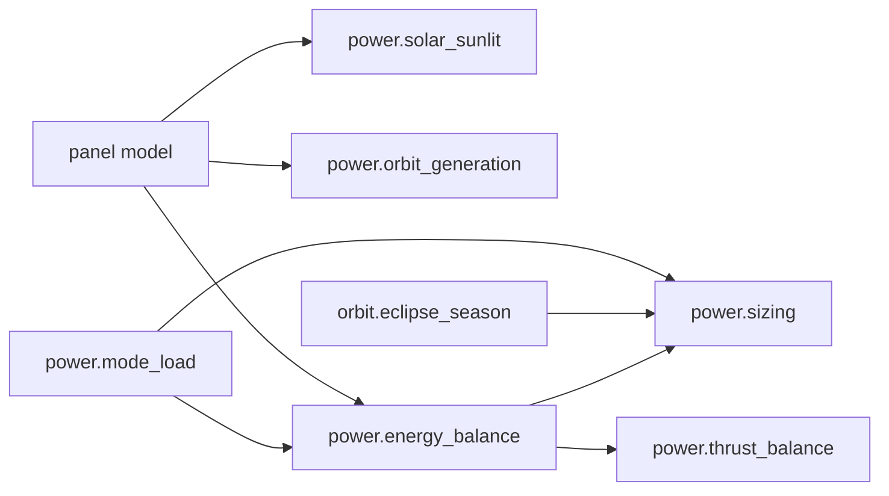
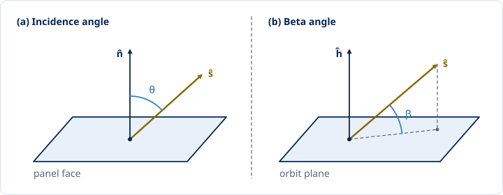
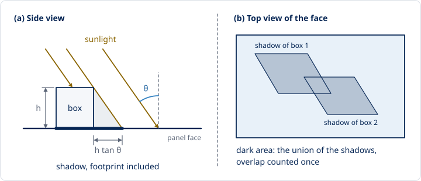
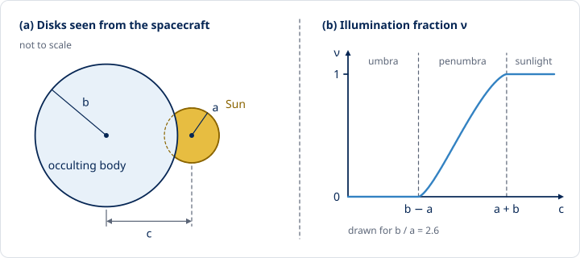
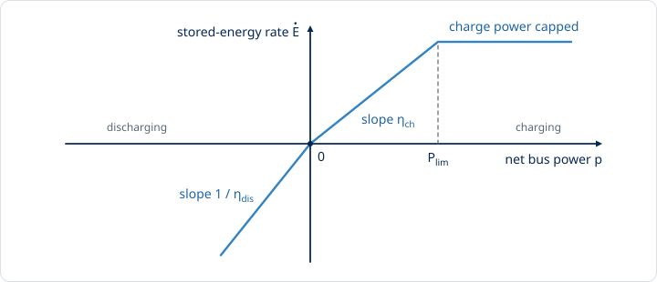
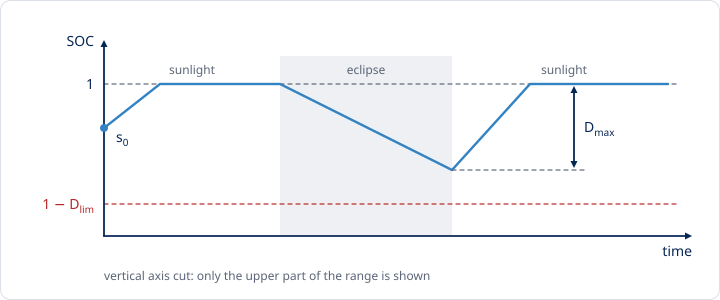
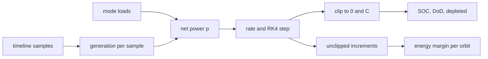
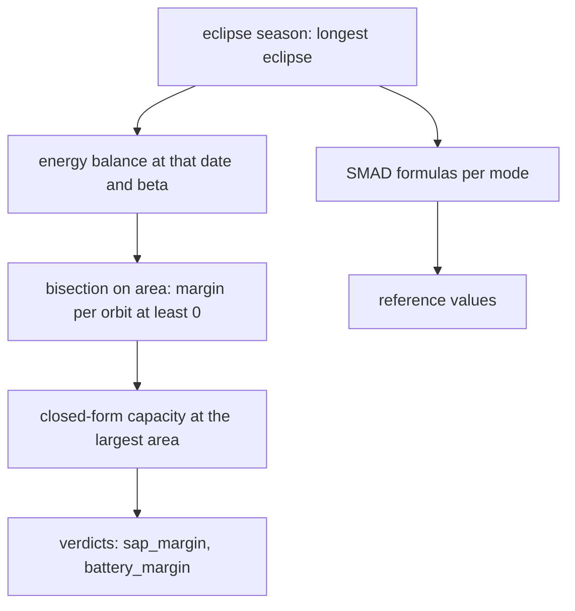

# Power analyses

The power analyses answer four questions in concept design. How much electrical load does each operating mode draw? How much power do the solar panels produce, in sunlight and over a whole orbit? Does the battery stay within its allowed depth of discharge? How large must the array and the battery be?

| ID | Purpose | Main inputs | Main outputs |
|---|---|---|---|
| `power.mode_load` | Mean and peak load of each mode | State powers, duty fractions, unit counts, growth margins | Load per mode, part and group |
| `power.solar_sunlit` | Panel output in sunlight for each attitude law | Panels, part boxes, orbit, attitude law | BOL and EOL power per panel and mode |
| `power.orbit_generation` | Generation through eclipse and partial shadow | Panels, orbit, attitude law, shadow model | Generation history, orbit average, eclipse length |
| `power.energy_balance` | Battery state of charge and energy margin | Generation, mode loads, battery, operating sequence | State of charge, depth of discharge, energy margin |
| `power.sizing` | Panel area and battery capacity needed | Longest eclipse, loads, panels, efficiencies, mission duration | Required area and capacity, margins |
| `power.thrust_balance` | Battery balance while a maneuver fires | Firing mode, duty, sunlit-only flag, battery | Balance per maneuver |

The analyses build on one another. All generation figures come from one panel model, and the battery model of the energy balance is reused by the sizing and the thrust balance.



## Common ground

### Frames and attitude laws

Panel normals are given in the frame of their part. The selected configuration places each part, and the normals are rotated into the spacecraft body frame. An attitude law gives the rotation from the body frame to the inertial frame (ECI) at each sample. The Sun direction in the body frame, $\hat{\mathbf s}$, is the inertial Sun direction rotated back by that rotation.

The laws are read from `analysis.aocs.law.<mode>`. A phase can carry its own `[law.<mode>]`, and the phase entry replaces the design entry for that mode. Three kinds exist.

- `sun_pointing` aligns the body axis `axis` with the Sun. The secondary axis `secondary` is aligned with the orbit normal. If the orbit normal is nearly parallel to the Sun direction (cross-product norm below $10^{-6}$), the velocity direction is used instead.
- `nadir_pointing` aligns `axis` with the direction to the central body. The secondary axis `along_track` is aligned with the velocity. Where that is nearly parallel to nadir, the orbit normal times nadir is used.
- `inertial` holds a fixed quaternion `orientation`.

For the first two laws the primary axis is aligned exactly. The secondary axis is aligned as closely as the primary alignment allows. The rotation is built from two right-handed triads, one from the body axes and one from the target directions. Without further input the primary axis is +Z, the secondary axis is +X, and the inertial quaternion is the identity. If no mode is named and the design does not hold exactly one law, the law is reported as a missing input.

### Beta angle

The solar beta angle $\beta$ is the signed angle between the Sun direction and the orbit plane. With the unit orbit normal $\hat{\mathbf h}$ (along the orbital angular momentum), $\sin\beta=\hat{\mathbf h}\cdot\hat{\mathbf s}$. The angle $\theta$ between a panel normal $\hat{\mathbf n}$ and the Sun is the incidence angle, with $\cos\theta=\hat{\mathbf n}\cdot\hat{\mathbf s}$.



*Left: the incidence angle $\theta$ between the panel normal and the Sun. Right: the beta angle $\beta$ between the Sun and the orbit plane.*

An analysis case can set `beta`. The right ascension of the ascending node of the orbit is then replaced so that the orbit has that beta angle at its epoch. This works only for an orbit given by Kepler elements. For any other orbit source the analysis stops with an input error.

### Orbit sampling

The time-series analyses sample the orbit at $0,\Delta t,2\Delta t,\dots$ up to the span, and the last sample falls exactly on the span. The step is

```math
\Delta t=\max\left(30\ \mathrm{s},\ T/200\right)
\tag{1}
```

where $T$ is the orbital period in s. Orbits up to 100 minutes use 30 s. The span is $N$ orbits. $N$ is the case's `orbits`, else `analysis.power.orbits`, else 3. A value of 0 counts as 1. An orbit around the Sun uses 1 when nothing is written. An orbit that does not repeat (a cruise arc, for example) is solved over its whole span, and $T$ in (1) is that span. `power.solar_sunlit` is the exception and always uses one orbit.

### Illumination and eclipse

Each sample carries an illumination fraction $\nu$ between 0 and 1 from the shadow of the central body (see `power.orbit_generation`). A sample counts as sunlit when $\nu\ge0.5$, and as eclipse otherwise. This threshold is shared by all power analyses. An eclipse window is a run of eclipse samples. Its start and end are the times of the first and last eclipse sample, so a window of $n$ samples lasts $(n-1)\,\Delta t$. Reported eclipse lengths are therefore sampled values and can be short by up to one step.

### Orbit averages

An orbit average covers the complete orbits of the span. Orbit $j$ consists of the samples with $t_0+jT\le t<t_0+(j+1)T$, with a tolerance of $10^{-6}T$. The last sample of an orbit is the first sample of the next one, so the trapezoid segments are closed. The average is the sum of the trapezoid integrals over all complete orbits divided by their total duration. If the span holds no complete orbit, the whole span is averaged, and the output carries a `span_fallback` marker. The service turns it into a `span` warning, or into an `ok` notice for an orbit that does not repeat.

### Signs

Generation and load are magnitudes in W. The net bus power is generation minus load. In the battery model a positive net power charges and a negative one discharges.

## power.mode_load — Mode power consumption

### What it answers

What does each mode draw on average, in sunlight and in eclipse, and what is the sum of the individual state peaks?

### Inputs

| Quantity | Symbol | Unit | Design source | Default |
|---|---|---|---|---|
| Power of one unit in a state | $p_{is}$ | W | Attribute `power` of the part (catalog value or override), per state | Needed for every state with positive time share |
| Time share of a state | $f_{is}$ | 1 | `modes/<ID>.toml`: `state` (base state) and `duty` per part, optional `[eclipse]` | Base state takes the remaining time |
| Units in a state | $n_{is}$ | 1 | Part `count` and `redundancy`; mode `active` and `spare_state` | `count` 1; all units active |
| Growth margin | $g_i$ | 1 | Part `maturity` looked up in `budget/policy.toml` `[growth]` | 0 |

Other inputs: the typed input also has `default_growth_margin` (0), used when a part carries no margin.

### Model and assumptions

A mode assigns a base state to each part. A `duty` table gives the time share of other states. The base state takes the rest, and nothing is added for the order in time. The result is a time average.

A part with a redundancy has spare units. The $a$ active units follow the duty mix. The $N-a$ spares sit in one state for the whole time. A cold spare is `off`. A warm spare uses the mode's `spare_state`. If that is absent, the first of `standby` and `idle` found in the part's state vocabulary is used. Spares add to the load at all times.

An `[eclipse]` table replaces the whole assignment of each part it names, for eclipse only. It does not merge field by field. A part named there that has no sunlit assignment is ignored. Parts it does not name keep their sunlit assignment.

A part without an assignment, or with a missing power value for a state it uses, is not counted as 0 W. It is left out of the sums and reported.

### Equations

For part $i$ the state list contains the duty states and the base state with $n_{is}=a_i$, and the spare state with $f_{is}=1$ and $n_{is}=N_i-a_i$. The base share is $f_{i,\mathrm{base}}=\max\left(0,\,1-\sum f_{is}\right)$.

```math
\bar P_i=\sum_s f_{is}\,n_{is}\,p_{is},\qquad
P_\mathrm{mode}=\sum_i \bar P_i,\qquad
P_\mathrm{g}=\sum_i (1+g_i)\,\bar P_i
\tag{2}
```

$\bar P_i$ is the mean power of the part, $P_\mathrm{mode}$ the sum over parts and $P_\mathrm{g}$ the sum with growth, all in W. The peak adds, for each part, the largest active-state power among states with $f_{is}>0$ to the spare power:

```math
P_\mathrm{peak}=\sum_i (1+g_i)\left(\max_{s:\,f_{is}>0}\,a_i\,p_{is}\;+\;(N_i-a_i)\,p_{i,\mathrm{spare}}\right)
\tag{3}
```

Equation (3) assumes that every part is in its highest state at the same moment. It is an envelope, not a prediction.

### Algorithm

1. For each mode and part, build the state list. Reject a duty share outside 0 to 1, a base state that is also listed in `duty`, a total above $1+10^{-9}$, `active` above `count`, `active` without a redundancy, and a spare state outside the vocabulary.
2. Compute $\bar P_i$ with (2). Leave out parts with a missing value or no assignment, and report them.
3. Sum the means over parts, and per group (the subsystem of the part). Compute the same sums with growth.
4. Compute the peak (3) from the sunlit assignment.
5. If the mode has `[eclipse]` entries, replace those assignments and repeat steps 1 to 3 for the eclipse totals. Without entries the eclipse totals equal the sunlit ones. The peak and the group sums always use the sunlit assignment.

### Checks and verdicts

No criterion is applied. Three warning keys mark incomplete sums: `unassigned` (a part has no assignment in the mode), `missing_value` (a needed state power is missing) and `unknown_part` (an assignment names a part without a `power` attribute). The checks above in step 1 are input errors. Consumption against an allocation is judged by the [power budget](budgets.md).

### Outputs

| Output | Unit | Meaning |
|---|---|---|
| `total`, `total_with_growth` | W | Mean sunlit load, without and with growth |
| `total_eclipse`, `total_eclipse_with_growth` | W | Mean eclipse load |
| `peak_with_growth` | W | Sum of part peaks (3) |
| `parts[]` | W | Per part: states, share, power, mean, growth margin, spare power |
| `groups[]` | W | Per group: total and total with growth |
| `unassigned`, `missing_power` | — | Parts left out of the sums |

### Worked example

The demo mode `DOWNLINK` has no `[eclipse]` table, so its sunlit and eclipse loads are equal. These parts draw power (the others are `off` and draw 0 W):

| Part | State shares | Unit power | $\bar P_i$ | $g_i$ | $(1+g_i)\bar P_i$ |
|---|---|---|---|---|---|
| `STX` | `tx` 1 | 9.5 W | 9.5 W | 0.10 | 10.45 W |
| `UHF_TRX` | `rx` 0.9, `tx` 0.1 | 0.45 W, 3.8 W | 0.785 W | 0.05 | 0.82425 W |
| `HTR_CAM` | `off` 0.8, `on` 0.2 | 0 W, 7 W | 1.4 W | 0.05 | 1.47 W |

For `UHF_TRX`: $0.9\times0.45+0.1\times3.8=0.405+0.38=0.785$ W. Summing the ten drawing parts gives the program's $P_\mathrm{mode}=17.305$ W (the others are `GPS` 0.9, `HTR_BAT` 0.3, `OBC` 0.65, `PCDU` 0.35, three `RW` of 0.6, four `SS` of 0.13 and `STT` 1.1). With each part's growth the total is $P_\mathrm{g}=18.72275$ W.

The peak (3) takes the `on` power of the heaters (3 W and 7 W) and the `tx` power of `UHF_TRX` (3.8 W), each with growth: 3.15, 7.35 and 3.99 W. The other parts have one state. The sum is 30.6035 W.

### Limits

Duty fractions give no timing inside the orbit. A peak above the mean cannot be placed in time, and the peak sum assumes all part peaks coincide. A load that depends on eclipse is modeled only through the `[eclipse]` replacement. The result carries no uncertainty beyond the growth margin and the case's value side.

### Verification

`mode_load/tests.rs` checks, against hand sums, the duty mix with growth (`duty_and_growth_by_hand`), the cold and warm spares (`cold_and_warm_units_by_hand`), the constant spare load beside duty-following active units, the eclipse replacement and its inheritance (`eclipse_parts_population_duty_growth_and_inheritance_by_hand`), and the rule that a part missing a value is reported and not counted as zero.

### Source

[crates/lib/analysis/src/power/mode_load.rs](../../crates/lib/analysis/src/power/mode_load.rs), [crates/lib/analysis/src/modes.rs](../../crates/lib/analysis/src/modes.rs) (states, spares, duty), [crates/app/projection/src/power.rs](../../crates/app/projection/src/power.rs).

## power.solar_sunlit — Sunlit power generation

### What it answers

How much power does each solar panel deliver to the bus while the spacecraft is sunlit, for each attitude law?

### Inputs

| Quantity | Symbol | Unit | Design source | Default |
|---|---|---|---|---|
| Panel area | $A_i$ | m² | Attribute `area` of each `solar_panel` part, times `count` | Must be given |
| Panel normal | $\hat{\mathbf n}_i$ | 1 | Attribute `normal` in the part frame, rotated to the body | Must be given |
| Cell efficiency | $\eta_i$ | 1 | `cell_efficiency` | Must be given |
| Packing factor | $k_i$ | 1 | `packing_factor` | 1 |
| End-of-life factor | $\ell_i$ | 1 | `eol_factor` | 1 |
| Conversion to the bus | $\eta_\mathrm{bus}$ | 1 | `analysis.power.conversion_efficiency` | 1 |
| Irradiance | $S$ | W/m² | Solar constant scaled by the Sun distance of each sample | 1361 W/m² at 1 au when no distance is known |
| Sun direction | $\hat{\mathbf s}$ | 1 | Orbit and attitude law of each mode, in the body frame | Orbit and law must be given |
| Part boxes | — | m | Attribute `size` of each part, placed by the configuration | Shadowing is on when boxes exist |

Other inputs: `analysis.power.shadowing = false` switches shadowing off. The typed input accepts a fixed `solar_flux` or a single body-frame Sun direction instead of an orbit.

### Model and assumptions

Each panel is a flat, one-sided plate. Its power is the irradiance times the area that faces the Sun (the projection factor $\cos\theta$), times the cell efficiency, the packing factor, the ageing factor and the conversion efficiency. Cell temperature has no effect, and there is no separate begin-of-life (BOL) cell model. End of life (EOL) differs from BOL only by the factor $\ell_i$.

This analysis assumes full illumination ($\nu=1$) at every sample, so that only the attitude changes the result. It averages over the sunlit samples only. Eclipse is handled by `power.orbit_generation`.

Parts of the spacecraft can shade a panel. The Sun is a point source with parallel rays, and every part is an opaque box. The shaded fraction of the panel face is computed from the boxes, and the panel power is multiplied by the lit fraction. The cell face is the face of the panel part's own box whose normal matches the written panel normal (cosine at least 0.999).



*A part box raised above the face shifts its outline along the rays. The union of the shifted outlines, including the footprint of the box on the face, is the dark area.*

The rules are these. A box shades the face only through the part that rises above the face plane by more than $10^{-4}$ m. Boxes that are flush with the face (a neighbouring panel, the structure panel under the cells) do not shade it, and a box never shades its own face. A part mounted on the face shades the area under it, because the shadow hull includes its footprint. Overlapping shadows are counted once. A face whose normal matches no box face is not shaded and is listed in `shadowing.unshadowed`.

### Equations

The irradiance at the Sun distance $d$ follows from the solar constant $S_0=1361$ W/m² at the distance $d_0$ of 1 au:

```math
S=S_0\left(\frac{d_0}{d}\right)^{2}
\tag{4}
```

A point of the box at height $h$ above the face plane casts its shadow onto the plane at a lateral shift along the in-plane part of the ray. With the unit Sun direction $\hat{\mathbf s}$ and the face normal $\hat{\mathbf n}$, the shadow of a point $\mathbf q$ in face coordinates is

```math
\mathbf q'=\mathbf q-h\,\frac{\hat{\mathbf s}-(\hat{\mathbf n}\cdot\hat{\mathbf s})\,\hat{\mathbf n}}{\hat{\mathbf n}\cdot\hat{\mathbf s}}
\tag{5}
```

The shadow of a box is the convex hull of the shifted points of its part above the plane. Hull vertices are the box corners above the plane and the points where box edges cross the plane. The hull is clipped to the face rectangle. $A_\mathrm{dark}$ is the area of the union of all clipped hulls, $A_\mathrm{face}$ the face area, and

```math
f_{\mathrm{lit},i}=1-\frac{A_\mathrm{dark}}{A_\mathrm{face}}
\tag{6}
```

Panel power on the bus, in W, is

```math
P_i=S\,A_i\,\eta_i\,k_i\,\ell_i\,\eta_\mathrm{bus}\;\max\left(0,\cos\theta_i\right)\,\nu\,f_{\mathrm{lit},i},\qquad \cos\theta_i=\hat{\mathbf n}_i\cdot\hat{\mathbf s}
\tag{7}
```

with $\ell_i=1$ at BOL and $\nu=1$ in this analysis. Grazing light with $\hat{\mathbf n}\cdot\hat{\mathbf s}\le10^{-9}$ gives $f_\mathrm{lit}=0$ (also a back face).

### Algorithm

1. For each mode that has an attitude law, build one orbit of samples with step (1). The case's `beta` is applied.
2. At each sample, rotate the Sun direction into the body frame. Compute $S$ from the sampled Sun distance with (4).
3. For each panel, find the boxes that rise above the face plane by more than $10^{-4}$ m. Project them with (5), take convex hulls, clip them to the face and compute the union area. Fractions within $10^{-12}$ of 0 or 1 (relative) are set to 0 or 1.
4. Compute $P_i$ with (7) for BOL and EOL.
5. Average over the sunlit samples ($\nu\ge0.5$) with the trapezoid rule: mean $=\int P\,m\,dt\,/\int m\,dt$, with $m=1$ on sunlit samples and 0 elsewhere. Record the smallest and largest total EOL power over the sunlit samples. Also record the mean angle between each panel normal and the Sun.

### Checks and verdicts

No criterion is applied. A zero panel normal, a duplicated panel ID, an efficiency or factor outside 0 to 1, or a negative area is an input error.

### Outputs

| Output | Unit | Meaning |
|---|---|---|
| `cases[].bol`, `eol` | W | Mean sunlit power of the array, BOL and EOL |
| `cases[].eol_min`, `eol_max` | W | Smallest and largest sampled sunlit EOL power |
| `cases[].panels[]` | W, rad | Per panel: BOL and EOL mean power, `mean_sun_angle` |
| `cases[].sunlit_samples` | 1 | Number of samples used |
| `cases[].shadowing` | 1 | Lit fraction per panel (mean, minimum, samples) and the casting parts |

### Worked example

The demo case `NOMINAL` points the +X axis at the Sun. The orbit epoch is 2027-04-01, where the Sun is at $d=0.99904$ au, so (4) gives $S=1361/0.99904^2=1363.63$ W/m². The cells use $\eta=0.295$, the bus conversion is 0.9 and the EOL factor is 0.88.

The module `CELL_MOD_1` has $A=0.01509$ m², $k=1$, and normal +X, so $\cos\theta=1$. Nothing shades it.

```math
P=1363.63\times0.01509\times0.295\times1\times0.9=5.4632\ \mathrm{W}
```

The program prints 5.463227 W (BOL), and $5.4632\times0.88=4.8076$ W agrees with its 4.807640 W (EOL).

The panel `SP_PX` has $A=0.0827$ m² and $k=0.73$. A sun sensor on it (a box 0.03 m × 0.03 m on the face, standing out of the face) shades the area under it. The face is $0.226\times0.366=0.082716$ m², so (6) gives $f_\mathrm{lit}=1-0.0009/0.082716=0.989119$. The program reports the same mean lit fraction. Then

```math
P=1363.63\times0.0827\times0.295\times0.73\times0.9\times0.989119=21.619\ \mathrm{W}
```

which is the program's 21.619074 W. The panels with normal +X are the four modules and `SP_PX`. The array total is $4\times5.463227+21.619074=43.471982$ W at BOL and $\times0.88=38.255344$ W at EOL. The extremes of the sampled EOL power are 38.2521 W and 38.2572 W, because the distance of the spacecraft from the Sun changes slightly during the orbit.

Under the nadir-pointing laws (`MISSION`, `DOWNLINK`) the mean sunlit power falls to 19.29 W at BOL, because the Sun direction in the body frame turns during the orbit.

### Limits

Shading scales the power linearly with the lit area. The model has no partial-cell effects, no bypass-diode behaviour, no mismatch, no reflected light and no temperature dependence of the efficiency. The Sun is a point, so there is no penumbra from part shadows. A panel whose face matches no box is treated as unshaded. The result for a nearly grazing Sun direction is sensitive to the 0.999 face match and the $10^{-4}$ m tolerance.

### Verification

`solar.rs` tests the panel formula for one square metre at normal incidence (1 m² × 0.3 × 1361 W/m² = 408.3 W, EOL 326.64 W), the cosine law at 60°, the back side, half illumination, and the conversion and irradiance overrides. `solar_sunlit.rs` checks normal incidence and the diagonal case (two panels at 45° give 577.4 W). `solar/shading_tests.rs` checks that shaded generation equals the unshaded one times the lit fraction, that switching shadowing off restores the old numbers exactly, and that a cell flush on its panel is not shaded.

### Source

[crates/lib/analysis/src/power/solar_sunlit.rs](../../crates/lib/analysis/src/power/solar_sunlit.rs), [crates/lib/analysis/src/power/solar.rs](../../crates/lib/analysis/src/power/solar.rs) (panel model), [crates/lib/analysis/src/structure/external_geometry/lit.rs](../../crates/lib/analysis/src/structure/external_geometry/lit.rs) (face shadows), [crates/lib/astro/src/illumination.rs](../../crates/lib/astro/src/illumination.rs), [crates/lib/analysis/src/spec/sampling.rs](../../crates/lib/analysis/src/spec/sampling.rs), [crates/app/projection/src/power.rs](../../crates/app/projection/src/power.rs).

## power.orbit_generation — Orbital power generation

### What it answers

How much power does the array deliver over an orbit, including eclipse and partial illumination, and how long is the longest eclipse?

### Inputs

| Quantity | Symbol | Unit | Design source | Default |
|---|---|---|---|---|
| Array | — | — | Same panel inputs as `power.solar_sunlit` | Same defaults |
| Orbit and span | $T$ | s | The case's orbit, `orbits` | 3 orbits; orbit must be given |
| Attitude law | — | — | `analysis.aocs.law.<mode>` of the case's mode | Must be given |
| Beta angle | $\beta$ | rad | Case `beta` | Orbit as written |
| Shadow model | — | — | Typed input | Conical |
| Life | — | — | Typed input | EOL for the main series |

### Model and assumptions

The central body blocks sunlight. From the spacecraft, the Sun appears as a disk of angular radius $a$ and the body as a disk of angular radius $b$. The illumination fraction $\nu$ is the part of the Sun disk that the body does not cover. This is the conical model, and it is the default. It resolves the penumbra, so $\nu$ changes continuously between 0 and 1.



*The illumination fraction $\nu$ equals the uncovered fraction of the Sun disk. It is 0 for $c\le b-a$, 1 for $c\ge a+b$, and varies in between.*

The cylindrical model is the alternative in the typed input. The shadow is a cylinder behind the body along the Sun direction, with the body's radius. A sample inside it has $\nu=0$ and any other has $\nu=1$. The design data always uses the conical model.

If the trajectory defines another shadow-casting body, $\nu$ is the smaller of the factor of the central body and the factor of that body. A Sun-centred orbit has no shadow.

Orbital shadow and part shadows are separate. $\nu$ multiplies the incidence in (7), and the lit fraction $f_\mathrm{lit}$ of the panel face multiplies it again.

### Equations

The panel power is (7) with the sampled $\nu$. The angular radii as seen from the spacecraft are

```math
a=\arcsin\frac{R_\odot}{d_\odot},\qquad b=\arcsin\frac{R_\mathrm{b}}{d_\mathrm{b}}
\tag{8}
```

with $R_\odot=6.957\times10^{8}$ m, $R_\mathrm{b}$ the radius of the body (for the Earth $6\,378\,137$ m), and $d_\odot$ and $d_\mathrm{b}$ the distances to the Sun and to the body centre in m. $c$ is the angle between the two directions. The illumination fraction follows from the overlap area $A_\cap$ of the two disks:

```math
\nu=\begin{cases}
0 & d_\mathrm{b}\le R_\mathrm{b}\ \text{or}\ c\le b-a\\
1-\dfrac{b^{2}}{a^{2}} & c\le a-b\\
1 & c\ge a+b\\
1-\dfrac{A_\cap}{\pi a^{2}} & \text{otherwise}
\end{cases}
\tag{9}
```

The case $c\le a-b$ occurs only if the body appears smaller than the Sun (annular geometry). The overlap area of two disks (Montenbruck and Gill, 2000, section 3.4.2) is

```math
A_\cap=a^{2}\arccos\frac{c^{2}+a^{2}-b^{2}}{2ca}+b^{2}\arccos\frac{c^{2}+b^{2}-a^{2}}{2cb}-\frac12\sqrt{(-c+a+b)(c+a-b)(c-a+b)(c+a+b)}
\tag{10}
```

The array power is $P_\mathrm{gen}(t)=\sum_i P_i(t)$. The orbit average $\bar P$ follows the rule given in the common ground. With $T$ the period (or the span of an orbit that does not repeat),

```math
E_\mathrm{orbit}=\bar P\,T,\qquad
\bar P_\mathrm{sun}=\frac{\int P_\mathrm{gen}\,m\,dt}{\int m\,dt}
\tag{11}
```

where $m=1$ for sunlit samples and 0 otherwise.

### Algorithm

1. Propagate the orbit and sample it with step (1). At each sample compute the attitude from the law, the Sun direction in the body frame and $\nu$ with (8) to (10).
2. Evaluate the panel power (7) at each sample for BOL and for EOL. Sum over panels.
3. Find the complete orbits and the orbit averages (common ground). Compute $\bar P$ (BOL and EOL), $\bar P_\mathrm{sun}$, the peak $\max_t P_\mathrm{gen}$ over all samples, and $E_\mathrm{orbit}$ for the chosen life (EOL by default).
4. Find the eclipse windows from $\nu<0.5$. Report the longest one, the sunlit fraction of the complete orbits, and each panel's share of the average.

### Checks and verdicts

No criterion is applied to the generation. The service adds a `span` warning when the span is shorter than one orbit and the averages cover the whole span.

### Outputs

| Output | Unit | Meaning |
|---|---|---|
| `orbit_average`, `orbit_average_bol`, `orbit_average_eol` | W | Orbit-average generation for the chosen life, BOL and EOL |
| `sunlit_average`, `peak` | W | Mean generation over sunlit samples, and maximum over all samples |
| `energy_per_orbit`, `period` | J, s | $\bar P\,T$ for the chosen life, and the period |
| `sunlit_fraction`, `complete_orbits` | 1 | Share of sunlit time and number of complete orbits |
| `max_eclipse_duration`, `eclipses` | s | Longest eclipse and all windows |
| `panels[]` | W, 1 | Orbit average and share per panel |
| `series` | s, W, 1 | `generation`, `sunlit`, and one `panel:<id>` channel per panel |
| `shadowing` | 1 | Lit-fraction statistics of the panels, when part shadows were applied |

### Worked example

The default demo case has $\beta=60°$, 15 orbits and step 30 s. The attitude is nadir pointing with +Z at nadir. The orbit has $a=6\,928\,137$ m, so $h=550$ km and $T=5738.9928$ s.

For $\beta=60°$ the cylindrical eclipse fraction is $\arccos\left(\sqrt{h^2+2R_Eh}/(a\cos\beta)\right)/\pi$ with $\sqrt{h^2+2R_Eh}=2.7052\times10^{6}$ m and $a\cos\beta=3.4641\times10^{6}$ m. This gives $\arccos(0.78095)/\pi=0.21474$, and $0.21474\times5738.99=1232$ s. The program reports a longest sampled eclipse of 1230 s, which is a window of 42 eclipse samples at 30 s. The two agree within one step. The sunlit threshold $\nu=0.5$ lies in the middle of the penumbra, close to the edge of the cylindrical shadow. The window length counts from the first to the last eclipse sample, so it can be short by up to one step.

The program prints the EOL orbit average 27.0523186 W and the BOL average 30.7413 W. The ratio is the common EOL factor 0.88. The energy per orbit is

```math
E_\mathrm{orbit}=27.0523186\ \mathrm{W}\times5738.992815\ \mathrm{s}=155\,253.06\ \mathrm{J}
```

which equals the printed `energy_per_orbit`. The sunlit fraction is 0.78428, the mean sunlit generation is 34.449 W and the peak is 36.853 W.

### Limits

Eclipse boundaries and the peak are sampled, so they depend on the step. The orbit is propagated with the orbit's own propagator. The Sun is a point in (8) except for the disk model, and there is no atmosphere, no albedo input and no Earth shine on the panels. When the span is shorter than one orbit, `energy_per_orbit` extrapolates the mean of the span to one period.

### Verification

`orbit_generation.rs` checks a synthetic profile against a hand sum (`synthetic_profile_by_hand`), a sun-pointing low Earth orbit against the cylindrical eclipse fraction $\arccos\left(\sqrt{h^2+2R_Eh}/(r\cos\beta)\right)/\pi$ within 1 % (`sun_pointing_leo_against_cylindrical_eclipse_formula`), the longest eclipse at $\beta=0$ (`beta_zero_gives_the_longest_eclipse`), the short-span fallback, and the inverse-square dependence of generation on the Sun distance for orbits around the Sun at 0.7, 1.0 and 1.5 au. `crates/lib/astro/src/shadow.rs` tests the sunlit and umbra points of both shadow models and the monotonic penumbra.

### Source

[crates/lib/analysis/src/power/orbit_generation.rs](../../crates/lib/analysis/src/power/orbit_generation.rs), [crates/lib/analysis/src/power/solar.rs](../../crates/lib/analysis/src/power/solar.rs), [crates/lib/astro/src/timeline.rs](../../crates/lib/astro/src/timeline.rs), [crates/lib/astro/src/shadow.rs](../../crates/lib/astro/src/shadow.rs), [crates/lib/analysis/src/spec/orbit.rs](../../crates/lib/analysis/src/spec/orbit.rs) (averages), [crates/lib/analysis/src/spec/sampling.rs](../../crates/lib/analysis/src/spec/sampling.rs).

## power.energy_balance — Energy balance and DoD

### What it answers

Does the battery stay within its allowed depth of discharge (DoD), and does each orbit return at least the energy it takes out, for each operating mode and for the planned mode sequence?

### Inputs

| Quantity | Symbol | Unit | Design source | Default |
|---|---|---|---|---|
| Generation | $P_\mathrm{gen}$ | W | `power.orbit_generation` for the mode's attitude law, EOL | Same inputs as there |
| Load, sunlit and eclipse | $P_\mathrm{load}$ | W | `power.mode_load`, with growth | Same inputs as there |
| Capacity | $C$ | J | Attribute `capacity` of each `battery` part, times `count`; the parts add | Must be given |
| Voltage | $V$ | V | Attribute `voltage` | Must be given |
| Charge and discharge efficiency | $\eta_\mathrm{ch},\eta_\mathrm{dis}$ | 1 | `charge_efficiency`, `discharge_efficiency` | 1 |
| Initial state of charge | $s_0$ | 1 | `analysis.power.initial_soc` | 1 |
| Allowed DoD | $D_\mathrm{lim}$ | 1 | Requirement `at_most` verified by `power.energy_balance` / `dod` | Must be given |
| Charge power limit | $P_\mathrm{lim}$ | W | Typed input `max_charge_power` (the design data leaves it unset) | No limit |

Other inputs: `analysis.power.base_mode` (the mode under a duration-limited mode; else the first mode of the sequence), `analysis.power.active_sequence`, `[[sequence]]` and `[sequences.<name>]` (mode sequences with `anchor`), mode `max_duration`, `when` and `start`, and the typed `load_growth` (growth included by default).

### Model and assumptions

The batteries form one lumped battery. Capacities and charge limits add (a battery without a limit removes the limit). Voltage, efficiencies, initial state of charge and DoD limit are taken from the first battery. If the batteries differ in these, a `battery_mismatch` warning is added once to the output.

Net bus power is generation minus load. A positive net power charges the battery at efficiency $\eta_\mathrm{ch}$, up to the charge limit. A negative net power discharges it, and the battery energy falls by the load divided by $\eta_\mathrm{dis}$. The energy stays between 0 and $C$. When the battery is full, surplus power goes to a shunt. When it is empty, a deficit is unserved.



*The stored-energy rate is piecewise linear in the net power. The kink at zero carries both efficiencies.*

The load is the mode's mean load, sunlit or eclipse. Without a selected mode every mode is evaluated. A case that names a mode evaluates only that one. Each mode uses its own attitude law for generation, if it has one. Three operations are evaluated.

- Continuous: the mode runs for the whole span.
- Duration-limited: a mode with `max_duration` runs once for that time on top of the base mode. The worst start is searched.
- Sequence: the sequence of modes repeats over the span.

The case fields (`max_dod`, `orbits`, `series` and so on) always describe the continuous run. The verdicts use the operation named in `evaluation`.



*The battery is full in sunlight, discharges at a constant rate through eclipse, and recharges after it. The maximum DoD is measured from the full level to the lowest state of charge.*



### Equations

$p$ is the net bus power in W and $\dot E$ the rate of change of the stored energy in W, both at one time:

```math
p=P_\mathrm{gen}-P_\mathrm{load},\qquad
\dot E=\begin{cases}
\eta_\mathrm{ch}\,\min(p,\,P_\mathrm{lim}) & p>0\\[2pt]
p/\eta_\mathrm{dis} & p\le0
\end{cases}
\tag{12}
```

Between samples $t_k$ and $t_{k+1}$ the net power is the linear interpolation of its two sample values. $\Delta E_k$ is the unclipped energy increment of the step. A single fourth-order Runge–Kutta (RK4) step over the whole sample interval $\Delta t_k$ gives

```math
\Delta E_k=\frac{\Delta t_k}{6}\left[\dot E(0)+4\,\dot E(\tfrac12)+\dot E(1)\right]
\tag{13}
```

where $\dot E(w)$ is (12) at the interpolated net power at the fraction $w$ of the step. Equation (13) is Simpson's rule: the rate does not depend on the stored energy, so the two middle RK4 stages coincide. The stored energy $E_k$, the state of charge $s_k$ and the maximum DoD follow:

```math
E_0=s_0C,\qquad E_{k+1}=\operatorname{clamp}\left(E_k+\Delta E_k,\,0,\,C\right),\qquad s_k=\frac{E_k}{C},\qquad D_\mathrm{max}=1-\min\left(1,\ \min_k s_k\right)
\tag{14}
```

For a complete orbit $j$ spanning samples $a_j$ to $b_j$ (the first sample of the next orbit), the energy margin per orbit scales the unclipped increments to one period:

```math
M_j=\frac{T}{t_{b_j}-t_{a_j}}\sum_{k=a_j}^{b_j-1}\Delta E_k,\qquad M=\min_j M_j
\tag{15}
```

Because the increments are not clipped, $M$ does not depend on the capacity, and it includes the battery efficiencies.

### Algorithm

1. Combine the batteries. Build the generation profile of each attitude law that is needed (one profile per law, reused), with the shadow and part-shadow factors of `power.orbit_generation`.
2. For each mode compute the sunlit and eclipse load with `power.mode_load`. At each sample use the sunlit load if $\nu\ge0.5$ and the eclipse load otherwise. A fixed load or a pair of sunlit and eclipse modes is also possible in the typed input.
3. Compute $p$ at each sample and integrate with (12) and (13): one RK4 step per sample interval, clipping the energy to 0 and $C$ at the end of the step (14). Record charge, discharge and shunt power at each sample. A sample with discharge at zero energy marks the battery as depleted.
4. For each complete orbit compute $M_j$ with (15), the minimum state of charge and the final state of charge. Take $M$ as the smallest. Report the deepest state of charge, $D_\mathrm{max}$, and the largest SOC drop in one eclipse (from the sample before the eclipse to the lowest sample up to the next sunlit sample).
5. For a mode with `max_duration` and a different base mode, run the base mode continuously and put the mode in a window of that length, with a start $t_k$. The window holds the samples with $t_k\le t<t_k+\text{duration}$, which uses the mode's load and its own generation. The candidate starts are the samples of one orbit that begins "period + duration + period" before the end of the span (or at the start of the span if that is too early), skipping the first sample when others exist. With `start` the start is fixed to the eclipse entry or exit plus an offset. With `when` only starts whose whole window lies in the sunlit or eclipse period are used. Each start re-integrates from the sample before it. The worst start has the lowest state of charge from that point on. The DoD of the verdict is measured from there (`max_dod_from_start`). The margin is the sum of the increments over one period starting at the sample before the window, with the last increment prorated.
6. For the sequence, repeat its intervals over the span. The mode of sample $k$ is that of the interval containing $(t_k-t_\mathrm{origin})\bmod T_\mathrm{seq}$. The origin is the start of the span or the first eclipse entry or exit plus the anchor offset. If that event does not occur, a `sequence_anchor` warning is raised and the origin is the start.

### Checks and verdicts

| Check | Compared | Pass | Violation |
|---|---|---|---|
| `dod` | $D_\mathrm{max}$ with $D_\mathrm{lim}$ | $D_\mathrm{max}\le D_\mathrm{lim}+10^{-12}$ | otherwise |
| `energy_balance` | $M$ with 0 | $M\ge0$ | $M<0$ |
| `depleted` | battery empty with negative net power at a sample | not raised | raised |

The attached margin of `dod` is $D_\mathrm{lim}/D_\mathrm{max}-1$, floored at 0 for a pass within the tolerance. The margin of `energy_balance` is $M$ in J. If the span holds no complete orbit, `energy_balance` is a warning and the balance over the span is shown in `energy_margin_over_span`. A `battery_mismatch`, a `sequence_anchor` and a `timing` warning (a requested start or window that cannot be placed, in which case the search falls back to the whole orbit) can also appear. Unresolved mode inputs appear as the mode-load warnings.

### Outputs

| Output | Unit | Meaning |
|---|---|---|
| `cases[]`, `sequence`, `by_max_duration` | — | Continuous, sequence and duration-limited evaluations |
| `min_soc`, `final_soc`, `max_dod`, `max_eclipse_dod` | 1 | Lowest and final state of charge, $D_\mathrm{max}$, largest SOC drop in one eclipse |
| `energy_margin_per_orbit` | J | $M$ |
| `orbit_average_generation`, `orbit_average_load`, `orbit_average_balance` | W | Orbit averages, balance without battery losses |
| `peak_charge_power`, `peak_discharge_power`, `peak_discharge_current` | W, A | Peaks (the current is the peak power divided by $V$) |
| `orbits[]` | J, 1 | Per orbit: generation, load, margin, minimum and end state of charge |
| `series` | s, W, 1 | `generation`, `load`, `soc`, `charge_power`, `discharge_power`, `shunt_power` |

### Worked example

The demo battery has $C=162\,000$ J, $s_0=0.90$, $\eta_\mathrm{ch}=0.95$, $\eta_\mathrm{dis}=0.97$ and $D_\mathrm{lim}=0.30$. The orbit is unmodified (no case beta), so the first 900 s are an eclipse and the later eclipse windows last 2040 s to 2070 s. The `NOMINAL` mode loads 8.58985 W in sunlight and eclipse. Its generation under its sun-pointing law is 38.253 W in sunlight.

A step in eclipse has $p=-8.58985$ W, so (12) gives $\dot E=-8.58985/0.97$ and (13) gives $\Delta E=-8.58985\times30/0.97=-265.665$ J. A sunlit step has $p=38.2533-8.58985=29.6635$ W and $\Delta E=0.95\times29.6635\times30=845.41$ J. Both match the printed series.

The lowest state of charge occurs at the end of the first eclipse, after 30 steps: $E=0.90\times162\,000-30\times265.665=137\,830$ J. So $s=137\,830/162\,000=0.85080$, which is the printed `min_soc` 0.8508027. Then $D_\mathrm{max}=1-0.8508027=0.1491973$, below 0.30. The `dod` margin is $0.30/0.1491973-1=1.0108$.

The largest drop in one eclipse (2070 s) is $8.58985\times2070/0.97/162\,000=0.11315$. The printed `max_eclipse_dod` is 0.11312, because the penumbra edges deliver a little power. The energy margin per orbit is $M=84\,188.68$ J (the smallest of 15 orbits), and the check passes.

The continuous `DOWNLINK` trace (18.72275 W, nadir pointing) empties the battery. The mode has `max_duration` 15 min, so the verdict uses the duration-limited run on top of `NOMINAL`: the worst of 192 starts has $\min s=0.8297695$, $D_\mathrm{max}=0.1702$ and $M=75\,184.7$ J, and passes. The `evaluation` field and the text of the check name the operation behind each verdict.

### Limits

The model is a lumped energy store. It has no cell voltage or current dynamics, no temperature effect, no capacity fade and no converter losses beyond the constant efficiencies. The reported charge, discharge and shunt power at a sample are set from the energy at that sample, while the energy is clipped at the end of each step. The resolution of eclipse entry and exit, and of window starts, is one sample step. Duty fractions are averaged, so a short high-power burst inside a mode is not seen. The worst start is the worst among sampled starts.

### Verification

`battery.rs` checks a constant discharge (9.5 W for 600 s from a full battery removes 6000 J through $\eta_\mathrm{dis}=0.95$), charging with efficiency and the full-battery clip, an exact linear ramp (0 to −19 W over 100 s removes 1000 J), the closed-form capacity (`required_capacity_by_hand`) and its inverse relation to the simulation, and the depletion flag. `energy_balance/tests.rs` checks discharge by hand, the eclipse drop and the battery combination. `energy_balance/tests/operation.rs` checks a two-mode sequence, a duration-limited window and the worst start by hand. `energy_balance/tests/timing.rs` checks fixed and windowed starts and the sequence anchor.

### Source

[crates/lib/analysis/src/power/energy_balance.rs](../../crates/lib/analysis/src/power/energy_balance.rs), [crates/lib/analysis/src/power/battery.rs](../../crates/lib/analysis/src/power/battery.rs) (lumped battery, RK4 step), [crates/lib/analysis/src/power/energy_balance/case.rs](../../crates/lib/analysis/src/power/energy_balance/case.rs), [crates/lib/analysis/src/power/energy_balance/duration.rs](../../crates/lib/analysis/src/power/energy_balance/duration.rs), [crates/lib/analysis/src/power/energy_balance/timing.rs](../../crates/lib/analysis/src/power/energy_balance/timing.rs), [crates/lib/analysis/src/power/energy_balance/sequence.rs](../../crates/lib/analysis/src/power/energy_balance/sequence.rs), [crates/lib/analysis/src/power/energy_balance/verdict.rs](../../crates/lib/analysis/src/power/energy_balance/verdict.rs), [crates/lib/astro/src/ode.rs](../../crates/lib/astro/src/ode.rs), [crates/app/projection/src/power.rs](../../crates/app/projection/src/power.rs).

## power.sizing — Power sizing

### What it answers

How large must the solar array and the battery be to support all operating modes at the longest eclipse of the mission? The analysis gives a closed-form estimate in the style of the Space Mission Analysis and Design (SMAD) textbook, and a time-series estimate that uses the energy balance. The verdicts use the time-series values when they are available.

### Inputs

| Quantity | Symbol | Unit | Design source | Default |
|---|---|---|---|---|
| Orbit and mission life | $T$, $y$ | s, yr | Orbit; requirement `at_least` with `input = "mission_duration"` | Mission duration must be given |
| Season sampling step | — | s | `conditions.orbit.eclipse_season.step` | 1 d |
| Panels, batteries, modes, attitude laws | — | — | As in the preceding analyses; `dod` requirement | Same rules |
| Sunlit path efficiency | $X_\mathrm{d}$ | 1 | `analysis.power.sizing.sunlit_efficiency` | `analysis.power.conversion_efficiency`, else 0.8 |
| Eclipse path efficiency | $X_\mathrm{e}$ | 1 | `analysis.power.sizing.eclipse_efficiency` | 0.6 |
| Battery efficiency | $X_\mathrm{bat}$ | 1 | `analysis.power.sizing.battery_efficiency` | Discharge efficiency of the first battery |
| Yearly degradation | $a_\mathrm{yr}$ | 1/yr | `analysis.power.sizing.annual_degradation` | 0 |
| Inherent degradation | $k_\mathrm{inh}$ | 1 | `analysis.power.sizing.inherent_degradation` | 1 |
| Battery strings | $N_\mathrm{bat}$ | 1 | `analysis.power.sizing.battery_strings` | 1 |
| Sun distance | $d$ | m | `analysis.power.sizing.sun_distance` | 1 au for Earth and Moon; otherwise the largest distance in the mission |

Other inputs: `analysis.power.sizing.bus_voltage` with the panel attributes `cell_voltage` and `cell_current` gives a series and parallel cell count. A case with a `mode` sizes for that mode only. Otherwise every mode is sized, and so is the mode sequence in the time-series branch.

### Model and assumptions

The longest eclipse of the mission sets the case. `orbit.eclipse_season` samples the mission at the season step. For each sampled day it holds the Sun fixed over one orbit and measures the eclipse (umbra plus penumbra) with the conical shadow. The shadow within an orbit is sampled every $\max(5\ \mathrm{s},T/1200)$. If propagated maneuvers exist, the orbit in effect on each day is used. The sample with the longest eclipse gives the eclipse time $t_\mathrm{e}$, the date and the beta angle. The sunlit time is $t_\mathrm{d}=T-t_\mathrm{e}$. An orbit around the Sun cannot be sized, because it has no eclipse season.

Both branches use the grown mode loads: $P_\mathrm{d}$ in sunlight and $P_\mathrm{e}$ in eclipse. A mode with missing load values stops the analysis, because the requirement would be underestimated.

The SMAD branch treats generation as one constant sunlit value and loads as constant. The battery supplies the eclipse load through the path efficiency $X_\mathrm{e}$ and the battery efficiency. The solar flux is fixed at the sizing Sun distance, the bus conversion efficiency is replaced by $X_\mathrm{d}$, and the incidence is the sunlit average of the attitude law from `power.orbit_generation` divided by the normal-incidence power.

The time-series branch runs the energy balance at the longest-eclipse date and beta angle. It keeps the attitude laws, the part shadows, the finite-duration operations and the sequence. It scales the generation by the ratio of a trial area to the design area. Individual panels are not resized, and shadow fractions stay as the current layout gives them. It uses the irradiance of the sampled Sun distances and the bus conversion efficiency of the array.



### Equations

With $y$ the design life in years, the degradation factor is $k_\mathrm{life}=(1-a_\mathrm{yr})^{y}\,k_\mathrm{inh}$. The panel power at normal incidence, EOL, before bus conversion and at the sizing irradiance, is $P_\mathrm{ref}$ in W. The total panel area is $A_\mathrm{des}$. The incidence factor $k_\mathrm{inc}$ is the sunlit average generation of the mode's attitude law divided by $P_\mathrm{ref}$, both before bus conversion. The generation per unit area is

```math
\rho=\frac{P_\mathrm{ref}}{A_\mathrm{des}}\,k_\mathrm{life}\,k_\mathrm{inc}
\tag{16}
```

The required generation, area and total battery capacity in the SMAD branch are

```math
P_\mathrm{req}=\frac{P_\mathrm{e}t_\mathrm{e}/X_\mathrm{e}+P_\mathrm{d}t_\mathrm{d}/X_\mathrm{d}}{t_\mathrm{d}},\qquad
A_\mathrm{req}=\frac{P_\mathrm{req}}{\rho},\qquad
C_\mathrm{req}=\frac{P_\mathrm{e}t_\mathrm{e}}{D_\mathrm{lim}\,X_\mathrm{bat}}
\tag{17}
```

Equation (17) is the SMAD form: the array must carry the sunlit load and recharge the energy used in eclipse, and the battery holds the eclipse energy within the allowed DoD. The capacity per string is $C_\mathrm{req}/N_\mathrm{bat}$.

In the time-series branch the required area is the smallest $A$ for which the energy margin (15) of the operation is at least 0. The capacity follows in closed form from the unclipped increments $\Delta E_k$ of (13). Let $X_k=\sum_{j<k}\Delta E_j$ be their cumulative sum with $X_0=0$. With the battery full at the start, the shortfall from the full level is $d_k=\max\left(d_0-X_k,\ \max_{1\le j\le k}X_j-X_k\right)$, where $d_0=(1-s_0)C$. Requiring $d_k\le D_\mathrm{lim}C$ for all $k$ gives

```math
C_\mathrm{req}=\max\left(\frac{D_\mathrm{drop}}{D_\mathrm{lim}},\ \frac{\max\left(0,-\min_k X_k\right)}{D_\mathrm{lim}-(1-s_0)}\right),\qquad D_\mathrm{drop}=\max_k\left(\max_{1\le j\le k}X_j-X_k\right)
\tag{18}
```

$D_\mathrm{drop}$ is the deepest drop from an earlier peak, in J. The second term applies only when $-\min_k X_k>0$, and it needs $D_\mathrm{lim}>1-s_0$. If $-\min_kX_k>0$ and $D_\mathrm{lim}\le1-s_0$, the capacity cannot be determined and the analysis falls back to SMAD. The derivation assumes that the battery never empties, which holds for the sized capacity.

### Algorithm

1. Run the eclipse season over the mission duration. Take the sample with the longest eclipse (umbra plus penumbra). The eclipse time is $t_\mathrm{e}$, and $t_\mathrm{d}=T-t_\mathrm{e}$.
2. Resolve the assumptions: efficiencies, $k_\mathrm{life}$, the battery strings, and the Sun distance (the written value, else 1 au for Earth and Moon, else the largest Sun distance during the mission). The life $y$ is the mission duration in Julian years (365.25 days). The same duration is the length of the season scan.
3. For each mode compute $k_\mathrm{inc}$ (modes with the same attitude law share it), then (16) and (17). The governing modes for area and capacity are those with the largest value (`area_mode`, `capacity_mode`).
4. Time-series branch. Build the energy-balance input with the epoch and beta of the longest eclipse. Use a probe battery that starts full and cannot empty (capacity $2P_\mathrm{max}\,\text{span}/\eta_\mathrm{dis}+1$ J, where $P_\mathrm{max}$ is the largest load). For each operation (each mode, with its duration limit and timing, and the sequence when all modes are sized) find the smallest area by bisection:
   - Evaluate the margin $M$ at area 0. If $M\ge0$, the area is 0.
   - Otherwise set the upper end to the SMAD area of the mode (1 m² if that is 0). Double it until $M\ge0$. At most 40 evaluations are allowed in total.
   - Bisect until the bracket is at most $10^{-4}$ of its upper end. Keep the upper end, whose margin is at least 0.
   - The trial generation is the unit generation times $A/A_\mathrm{des}\cdot k_\mathrm{life}$.
5. The required area is the largest over the operations. At that area, re-run each operation and compute the capacity with (18), using the design's initial state of charge and DoD limit. The required capacity is the largest, and its per-string value is that divided by $N_\mathrm{bat}$.
6. If the time-series branch cannot judge (no complete orbit in the span, or the capacity cannot be determined), use SMAD for the verdict and add a `time_series` warning.
7. Cell counts, if `bus_voltage` and the cell attributes of all panels agree and the panels have the same EOL factor: series count $\lceil V_\mathrm{bus}/V_\mathrm{cell}\rceil$, and parallel count $\lceil I_\mathrm{req}/(I_\mathrm{cell}\,k_\mathrm{EOL}\,k_\mathrm{life}\,k_\mathrm{inc})\rceil$ with $I_\mathrm{req}=P_\mathrm{req}/V_\mathrm{bus}$ from the SMAD requirement.

### Checks and verdicts

`sap_margin` and `battery_margin` compare the design with the required value of the chosen basis. The margin is design over required minus 1. Negative is a violation, and zero or more passes (the warning width is 0). If the required value is 0, the margin is undefined and the check passes. The per-mode checks `mode_checks` do the same for each mode. `time_series` is a warning when the SMAD values are used. A `battery_mismatch` warning appears when batteries differ. In the user interface the KPIs are called `Solar Cells margin` and `Battery margin`.

### Outputs

| Output | Unit | Meaning |
|---|---|---|
| `required_area`, `required_capacity`, `required_capacity_per_string` | m², J, J | Required sizes on the chosen basis |
| `design_area`, `design_capacity` | m², J | Installed sizes |
| `sap_margin`, `battery_margin` | 1 | Design over required minus 1 |
| `area_mode`, `capacity_mode`, `basis` | — | Governing operations and basis (`time_series` or `smad`) |
| `smad` | W, m², J | SMAD requirement of the governing modes |
| `time_series` | m², J, 1 | Epoch and beta used, per operation area, capacity and number of evaluations |
| `modes[]` | — | Per mode: loads, incidence factor, SMAD and time-series values, their ratios |
| `sunlit_duration`, `eclipse_duration`, `longest` | s | $t_\mathrm{d}$, $t_\mathrm{e}$, the longest-eclipse sample |
| `used` | — | Assumptions used, with their origin |
| `strings`, `shadowed` | — | Cell counts; whether part shadows are included |

### Worked example

The mission is one year. The longest eclipse is on 2027-05-20 at $\beta=0.2867$ rad: umbra 2100 s plus penumbra 20 s, so $t_\mathrm{e}=2120$ s and $t_\mathrm{d}=5738.9928-2120=3618.9928$ s. The sunlit efficiency is 0.9 (from `conversion_efficiency`), $X_\mathrm{e}=0.6$, $X_\mathrm{bat}=0.97$ and $D_\mathrm{lim}=0.30$.

For `DOWNLINK` the load is 18.72275 W in both periods. By (17),

```math
P_\mathrm{req}=\frac{18.72275\times2120/0.6+18.72275\times3618.9928/0.9}{3618.9928}=\frac{66\,154.7+75\,285.6}{3618.9928}=39.083\ \mathrm{W}
```

```math
C_\mathrm{req}=\frac{18.72275\times2120}{0.30\times0.97}=136\,399.4\ \mathrm{J}
```

For the area, the normal-incidence EOL power of the array at 1361 W/m² is $P_\mathrm{ref}=1361\times0.295\times0.88\times0.229414=81.056$ W, where 0.229414 m² is the sum of $A_ik_i$ over the panels. The design area is $A_\mathrm{des}=0.29896$ m². With $k_\mathrm{life}=1$ and the `DOWNLINK` incidence factor $k_\mathrm{inc}=0.231778$, (16) gives $\rho=81.056/0.29896\times0.231778=62.84$ W/m², and $A_\mathrm{req}=39.083/62.84=0.6219$ m². Both agree with the program's `smad` values (required area 0.62193 m², capacity 136 399.42 J).

The time-series branch gives far smaller values for the same mode, 0.1602182 m² and 97 403.87 J. The installed array has 0.29896 m² and the battery 162 000 J. The margins on the chosen `time_series` basis are +0.866 for the area and +0.663 for the capacity. With the SMAD values the area margin would be −0.519. The SMAD branch assumes a round trip of $X_\mathrm{e}=0.6$ from array to eclipse load, which is much lower than the $0.95\times0.97$ of the battery model, and it adds the eclipse energy to the array requirement. The bisection for `DOWNLINK` took 18 evaluations.

### Limits

The longest eclipse of the sampled mission days sets the case, and the Sun is held fixed within an orbit. The time-series branch needs a span of at least one orbit and an orbit given by elements or a propagated history. The required area scales every panel by the same ratio. It does not resize individual panels or recompute shadow fractions. The SMAD branch uses one sunlit mean, so it cannot see a power deficit within sunlight (fixed panels in nadir pointing, for example). The cell count is a voltage and current estimate with no string topology, no temperature variation and no voltage degradation.

### Verification

`sizing/tests.rs` checks the SMAD formulas against a hand calculation (`smad_by_hand`), the incidence factor of different attitudes, the scaling with the Sun distance, and the per-mode checks. `sizing/tests/series.rs` checks the time-series values against a hand calculation for sun pointing (`sun_pointing_matches_hand_calculation_and_smad`), a case where SMAD underestimates (`zenith_panel_on_nadir_pointing_where_smad_underestimates`), and that a sized design passes the forward energy balance for every operation (`sized_design_passes_every_judged_operation`). `battery.rs` checks the closed-form capacity (18) by hand and against the simulation.

### Source

[crates/lib/analysis/src/power/sizing.rs](../../crates/lib/analysis/src/power/sizing.rs), [crates/lib/analysis/src/power/sizing/calculate.rs](../../crates/lib/analysis/src/power/sizing/calculate.rs) (SMAD, assumptions, cell counts), [crates/lib/analysis/src/power/sizing/modes.rs](../../crates/lib/analysis/src/power/sizing/modes.rs), [crates/lib/analysis/src/power/sizing/series.rs](../../crates/lib/analysis/src/power/sizing/series.rs) (bisection), [crates/lib/analysis/src/power/sizing/judge.rs](../../crates/lib/analysis/src/power/sizing/judge.rs), [crates/lib/analysis/src/power/battery.rs](../../crates/lib/analysis/src/power/battery.rs) (`required_capacity`), [crates/lib/analysis/src/orbit/eclipse_season.rs](../../crates/lib/analysis/src/orbit/eclipse_season.rs), [crates/app/projection/src/power/sizing.rs](../../crates/app/projection/src/power/sizing.rs).

## power.thrust_balance — Energy balance while thrusting

### What it answers

Can the battery sustain the electrical load of a maneuver that fires over many orbits, such as a low-thrust orbit raise?

### Inputs

| Quantity | Symbol | Unit | Design source | Default |
|---|---|---|---|---|
| Firing mode | — | — | `maneuvers/<ID>.toml`: `method = "propagated"` and `constraints.mode` | At least one such maneuver must exist |
| Sunlit-only flag | — | — | `constraints.sunlit_only` | false |
| Duty | $u$ | 1 | `constraints.duty` | 1 |
| Base mode | — | — | `analysis.power.base_mode`, else the first mode of the active sequence | Needed when firing is sunlit-only or $u<1$ |
| Battery, generation, loads | — | — | As in `power.energy_balance` | Same rules |

### Model and assumptions

The analysis maps each maneuver to a load pattern and runs the energy balance for it. It does not propagate the maneuver or the thruster. The firing mode supplies the load during firing, and the base mode supplies the load when the thruster rests.

- Continuous, unrestricted firing ($u=1$, not sunlit-only): the firing mode runs at all times.
- Sunlit-only firing: the firing mode runs in sunlight, and the base mode's eclipse load applies in eclipse. If $u<1$, the firing mode is still applied at full duty throughout the sunlit samples. This is conservative and is reported as `duty_as_full_sunlit`.
- Unrestricted firing with $u<1$: one orbit becomes a sequence of a firing block followed by a base-mode block, reported as `duty_as_block_per_orbit`. One contiguous block discharges the battery more deeply than firing spread over the orbit.

The first two patterns use, for generation, the attitude law of the mode of the analysis case (the default case when none is chosen). The block pattern uses the attitude law of each block's mode when it has one.

### Equations

The balance uses (12) to (15) with the load pattern above. In the block pattern the block durations in s are

```math
t_\mathrm{on}=u\,T,\qquad t_\mathrm{base}=(1-u)\,T
\tag{19}
```

where $T$ is the period (or the span of an orbit that does not repeat).

### Algorithm

1. Select the maneuvers with `method = "propagated"` and a `constraints.mode`. Reject a duty outside $0<u\le1$.
2. If firing is sunlit-only or $u<1$, find the base mode. If there is none, stop with an input error.
3. Build the load pattern. For sunlit-only firing, use the firing mode in sunlight and the base mode in eclipse. For $u<1$ without the sunlit-only flag, build a sequence with the firing mode for $t_\mathrm{on}$ and the base mode for $t_\mathrm{base}$. Otherwise use the firing mode throughout.
4. Run `power.energy_balance` for each pattern, attach its checks and traces to the maneuver, and add the note.

### Checks and verdicts

The checks are those of the energy balance: `dod`, `energy_balance` and `depleted`, evaluated for the pattern as a continuous run over the span. The notes `duty_as_full_sunlit` and `duty_as_block_per_orbit` state which approximation was applied.

### Outputs

| Output | Unit | Meaning |
|---|---|---|
| `thrusts[].maneuver`, `mode`, `base_mode` | — | Maneuver, firing mode and rest mode |
| `thrusts[].sunlit_only`, `duty`, `note` | 1 | Inputs used and the approximation applied |
| `thrusts[].balance` | W, J, 1 | A complete energy-balance case: loads, margin, state of charge, checks, series |

### Worked example

The stock demo returns `missing_inputs` because its maneuvers do not use numerical propagation. In a private copy, `RAISE` was changed to `method = "propagated"` with `constraints.mode = "DOWNLINK"` and `constraints.duty = 0.5`, and it keeps `sunlit_only = true`. The base mode is `NOMINAL` (the first mode of the sequence).

The note is `duty_as_full_sunlit`, so `DOWNLINK` is applied fully in sunlight: 18.72275 W in sunlight and 8.58985 W in eclipse (the eclipse load of `NOMINAL`). With the sunlit fraction 0.63879, the average load is $0.63879\times18.72275+0.36121\times8.58985=15.0626$ W. The average generation of the nadir-pointing top-level law is 10.8247 W. The average balance is $10.8247-15.0626=-4.2379$ W, or $-4.2379\times5738.99=-24\,322$ J per orbit before battery losses. Discharging divides by 0.97 and charging multiplies by 0.95, so the printed energy margin per orbit is more negative: $-25\,497.77$ J. The battery empties, and the `dod`, `energy_balance` and `depleted` checks all report violations.

### Limits

This electrical proxy does not propagate the maneuver and does not follow individual pulses. With sunlit-only firing a duty below 1 is treated as full duty in sunlight, which overstates the load. With unrestricted firing the contiguous block is a conservative case. The load pattern is the same in every orbit, so a gradual change of orbit during the burn is not seen.

### Verification

`thrust_balance/tests.rs` checks that sunlit-only firing fires in sunlight and rests in eclipse (`sunlit_only_fires_in_sunlight_and_rests_in_eclipse`), that a duty below 1 gives a block sequence whose average load equals the duty-weighted load (`duty_runs_a_block_sequence_with_the_average_load`), and that a missing base mode is an error (`a_base_mode_is_needed_when_the_thruster_rests`).

### Source

[crates/lib/analysis/src/power/thrust_balance.rs](../../crates/lib/analysis/src/power/thrust_balance.rs), [crates/app/projection/src/power/thrust.rs](../../crates/app/projection/src/power/thrust.rs).

## References

- James R. Wertz and Wiley J. Larson, eds., *Space Mission Analysis and Design*, 3rd edition, Microcosm Press and Kluwer Academic Publishers, 1999. The power sizing equations (17) follow its form.
- Oliver Montenbruck and Eberhard Gill, *Satellite Orbits: Models, Methods and Applications*, Springer, 2000. Section 3.4.2 gives the conical shadow model used in (8) to (10).
- [Power sizing and design settings](../model.md#55-reverse-computed-power-sizing-powersizing) in the data model.
