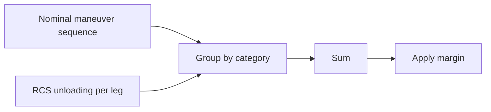
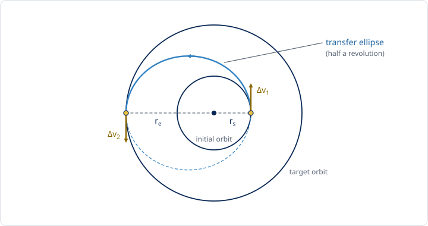
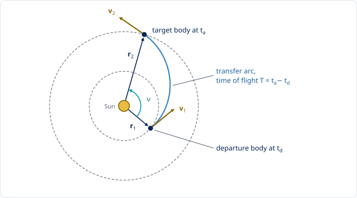
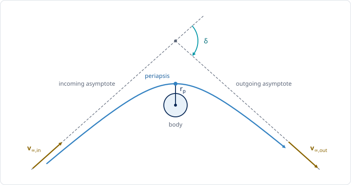
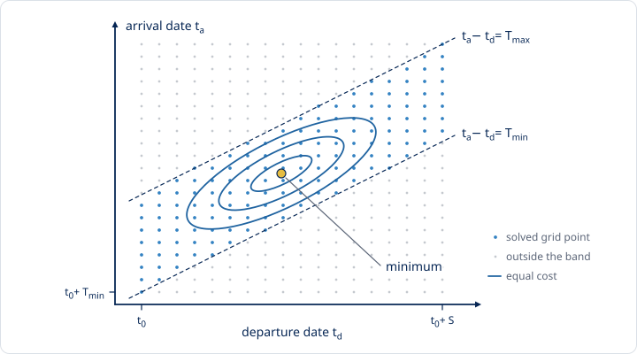

# Propulsion analyses

The propulsion analyses answer four questions in concept design. How much velocity change (delta-v) does the mission need? What do the transfers cost, and on which dates? How much propellant must be loaded, and does it fit the tanks? How do the thrusters, the orbit and the mass properties change as the propellant is used?

| ID | Purpose | Main inputs | Main outputs |
|---|---|---|---|
| `propulsion.dv_budget` | Sum delta-v by category, with a margin | Maneuvers, written allowances, reaction-control unloading | Nominal and margined delta-v |
| `propulsion.maneuvers` | Compute each burn or transfer | Initial orbit, target orbit, dates, thruster | Burns, transfer time, burn time, propellant |
| `propulsion.transfer_check` | Re-propagate a dated interplanetary cruise | Dated transfers | Arrival miss, closest approach, velocity difference |
| `propulsion.launch_window` | Search departure and arrival dates | Body pair, flybys, search settings | Date grids, minimum points |
| `propulsion.orbit_history` | Follow the orbit through the maneuver sequence | Initial orbit, maneuvers | Dated orbit segments and mass |
| `propulsion.propellant` | Size the propellant and the tanks | Maneuvers, margins, tanks | Loads, residuals, volume margins |
| `propulsion.thruster_usage` | Compare use with thruster ratings | Design burns, ratings | Impulse, firing time, firing count |
| `propulsion.mass_properties` | Add the propellant to the mass properties | Parts, tank placement, loads | Mass, centre of mass, inertia at beginning and end of life |

The power available while a thruster fires is analysed by [`power.thrust_balance`](power.md#powerthrust_balance--energy-balance-while-thrusting), which is not repeated here.

## Common ground

### Inputs shared by all the analyses

- The first orbit is the design orbit (`conditions/orbit.toml`), reduced to its Kepler elements. See [orbit conventions](orbit.md#common-ground) for epochs, inertial axes and propagators.
- The maneuvers are the files under `maneuvers/`. `Design::ordered_maneuvers` fixes the execution order: maneuvers with no `after` come first in ID order, and each following maneuver is linked by `after`. The data model is in [design model §7.7](../model.md).
- The dry mass is `analysis.propulsion.dry_mass`, or the total mass of the part mass properties when the setting is absent. `propulsion.mass_properties` always uses the part items for the dry part.
- Thrusters are parts with the role `propulsion_thruster`, plus any part a maneuver names in `thruster`. Their `thrust` (N) and `isp` (s) are required. Tanks are parts with the role `propellant_tank`; `tank_volume` is required.
- Without a `thruster`, a maneuver gets its delta-v only. Propellant and burn time are not computed for it (note `no_thruster`).
- The settings are `analysis.propulsion.dry_mass`, `dv_margin` (default 0.10), `residual_fraction` (default 0.03) and the `[launch_window]` table. The defaults live in `crates/lib/analysis/src/propulsion/input.rs`, not in the projection.

### The rocket equation and the single home of the propellant flow

A thruster ejects propellant at the effective exhaust velocity $v_\mathrm e$. Conservation of momentum for a vehicle whose mass falls from $m_0$ to $m_1$ gives the Tsiolkovsky equation (see Curtis, ch. 11, or Vallado, ch. 6). In SI units:

```math
v_\mathrm e = g_0 I_\mathrm{sp},\quad
\Delta v = v_\mathrm e \ln\frac{m_0}{m_1},\quad
m_\mathrm p = m_0\left(1-e^{-\Delta v/v_\mathrm e}\right),\quad
\dot m_\mathrm p = \frac{F}{v_\mathrm e},\quad
t_\mathrm b = \frac{m_\mathrm p}{\dot m_\mathrm p}.
\tag{1}
```

| Symbol | Meaning | Unit |
|---|---|---|
| $g_0$ | Standard gravity, 9.80665 | m/s² |
| $I_\mathrm{sp}$ | Specific impulse | s |
| $v_\mathrm e$ | Effective exhaust velocity | m/s |
| $m_0,m_1,m_\mathrm p$ | Mass before and after a burn, and propellant used | kg |
| $F$ | Thrust | N |
| $\dot m_\mathrm p$ | Propellant mass flow (positive) | kg/s |
| $t_\mathrm b$ | Burn time | s |

Equation (1) is coded once, in [`crates/lib/astro/src/rocket.rs`](../../crates/lib/astro/src/rocket.rs): `exhaust_velocity`, `delta_v`, `propellant_for`, `burn_time` and `mass_flow_kg_s`. The value of $g_0$ is `sat_astro::constants::G0`. The rule "propellant mass flow $F/(I_\mathrm{sp}g_0)$ only in `sat_astro::rocket`" is checked by `cargo xtask check`. The sequence solver, the unloading estimate in [AOCS](aocs.md#aocsrw_unloading--rw-unloading-frequency) and the powered propagation all call these functions.

### The maneuver sequence and the two margins

The analyses share one sequence solver (`sequence.rs`); only `propulsion.launch_window` bypasses it and calls the planner directly. The solver applies the maneuvers in order, reducing the mass after each burn. There are two modes.

| Mode | Delta-v scale $s$ | Residual fraction $f_\mathrm r$ | Used by |
|---|---|---|---|
| Nominal | 1 | 0 | `propulsion.maneuvers`, `propulsion.dv_budget`, `propulsion.orbit_history`, `propulsion.transfer_check` |
| Design | $1+f_\mathrm{dv}$ | `residual_fraction` | `propulsion.propellant`, `propulsion.thruster_usage`, `propulsion.mass_properties` (through `propulsion.propellant`) |

In design mode every burn of delta-v $\Delta v_i$ uses $m_\mathrm p = m(1-e^{-s\Delta v_i/v_\mathrm e})$. The margin $f_\mathrm{dv}$ therefore multiplies each burn, including a finite-burn loss, a flyby burn and a written allowance. The loss estimate of a finite burn is made with the unscaled delta-v. In `propulsion.dv_budget` the margin instead multiplies the total, including the computed unloading delta-v (see that analysis). The propellant analysis does not include the unloading delta-v in this scaling. Its unloading propellant is added separately.

The start mass is not an input. The solver finds the starting mass $m_0$ such that the mass at the end equals the dry mass plus the residual propellant, where the residual is $f_\mathrm r$ times the propellant used:

```math
m_\mathrm{end}=m_\mathrm d+f_\mathrm r\,(m_0-m_\mathrm{end})
\;\Rightarrow\;
m_\mathrm{end}=\frac{m_\mathrm d+f_\mathrm r m_0}{1+f_\mathrm r}.
\tag{2}
```

Algorithm:

1. Set $m_0=m_\mathrm d$.
2. Apply the burns in order with (1), starting from $m_0$. Let $m_1$ be the final mass.
3. Compute the target $m_\mathrm{end}$ from (2). If $|m_1-m_\mathrm{end}|\le10^{-12}m_0$, stop.
4. Otherwise set $m_0\leftarrow m_0\,m_\mathrm{end}/m_1$ and repeat. After 200 iterations, or if the mass becomes non-finite, the analysis fails with the error "The propellant mass does not converge".

If any maneuver is `propagated`, the solver runs twice. First, a nominal sequence with the analytic estimate fixes the mass at the start of each propagated maneuver. Then the thrust is propagated from that mass, and the propagated delta-v, duration and final orbit replace the estimate of that maneuver. The sequence is solved again. The propellant of a propagated maneuver is computed from its propagated delta-v with (1), not taken from the integration. The two agree when the masses agree.

## propulsion.dv_budget — Delta-v budget

### What it answers

How much delta-v does the mission need, by purpose (insertion, station keeping, unloading, deorbit, other), including a margin and the estimated cost of unloading reaction wheels with thrusters?

### Inputs

| Quantity | Symbol | Unit | Design source | Default |
|---|---|---|---|---|
| Maneuvers (nominal sequence) | $\Delta v_i$ | m/s | `maneuvers/`: `category`, `method`, targets or `delta_v` | At least one maneuver must exist |
| Margin | $f_\mathrm{dv}$ | 1 | `analysis.propulsion.dv_margin` | 0.10 (analysis default) |
| Unloading legs | $T_j$ | s | Phase `duration`, else the mission duration | Optional |
| Unloading environment, RCS thrusters | | | As for [RW unloading](aocs.md#aocsrw_unloading--rw-unloading-frequency); thrusters are parts with the role `thruster` | Optional |

### Model and assumptions

A written `delta_v` is an allowance. It changes no orbit and counts in its `category` as it is. Wheel unloading by reaction control thrusters is a delta-v equivalent: the propellant that the thrusters burn to dump the wheel momentum, converted to delta-v with (1). It is not a commanded translation.



*Computed unloading adds to any written allowance in the category `unloading`.*

### Equations

For each leg $j$ (a phase with a duration, or the whole mission), AOCS gives a representative daily delta-v $u_j$ (m/s per day). Let $\mathbf H_\mathrm{sec}$ be the secular momentum gained per orbit of period $P$, and $T_\mathrm{day}=86400$ s:

```math
H_\mathrm{day}=\frac{\lVert\mathbf H_\mathrm{sec}\rVert\,T_\mathrm{day}}{P},\qquad
u_j=v_\mathrm{e,eff}\ln\frac{m_\mathrm{sc}}{m_\mathrm{sc}-m_\mathrm{day}},\qquad
v_\mathrm{e,eff}=\frac{\sum_i F_i}{\sum_i F_i/v_{\mathrm e,i}} .
\tag{3}
```

$H_\mathrm{day}$ is the momentum to dump per day (N·m·s). $m_\mathrm{day}$ is the propellant (kg) used in a day by the thrusters firing together, found as in [AOCS unload time](aocs.md#aocsunload_time--momentum-unloading-time). $m_\mathrm{sc}$ is the spacecraft mass in the AOCS input, and the sum runs over the firing thrusters. The totals are

```math
\Delta v_\mathrm{total}=\sum_i\Delta v_i+\sum_j u_j\frac{T_j}{T_\mathrm{day}},\qquad
\Delta v_\mathrm{design}=(1+f_\mathrm{dv})\,\Delta v_\mathrm{total}.
\tag{4}
```

Each $\Delta v_i$ is the nominal value of the maneuver, which includes the finite-burn loss for a `finite_burn` maneuver.

### Algorithm

1. Solve the nominal sequence (see Common ground). Rows are the maneuvers grouped by category, in the order insertion, station keeping, unloading, deorbit, other.
2. If the design has role `thruster` parts, evaluate `aocs.rw_unloading` once per leg. Legs are the phases in order when any phase has a `duration`; otherwise there is one leg with the design orbit and the mission duration. For each leg, the six body directions ±x, ±y, ±z are tried. A direction that no thruster can dump is the worst one. Otherwise the worst is the direction that takes the longest. Its daily propellant gives $u_j$ through (3), and the leg contributes $u_jT_j/T_\mathrm{day}$.
3. Add the unloading delta-v of the counted legs to the row `unloading`. A leg with no duration is listed but not counted. A leg with no thruster for the worst direction is not counted and raises a warning.
4. Sum the rows, then apply the margin (4). Each row also reports its share of the total.

### Checks and verdicts

There is no limit on the total, so no pass or violation. The analysis can add:

- the dated-transfer and flyby warnings of `propulsion.maneuvers`;
- `unloading_direction` (warning): a leg cannot unload along the worst direction;
- `unloading_note`, which says why no unloading was added: `no_rcs` (no `thruster` part), `unloading_inputs_missing`, `no_mission_duration`, or `not_unloadable` (no leg could unload).

### Outputs

| Output | Unit | Meaning |
|---|---|---|
| `rows[]` | m/s, 1 | Category, delta-v, share of the total, maneuver IDs, whether RCS unloading is included |
| `total`, `margin`, `margin_delta_v`, `total_with_margin` | m/s, 1 | Sum, margin, margin value, margined sum |
| `unloading` | various | Per-leg momentum, worst direction, propellant, delta-v |
| `dated_transfers`, `checks` | various | Dated-transfer results and warnings |

### Worked example

The demo (`fixtures/demo-6u`) has `RAISE` (insertion) and `DEORBIT` (deorbit). With no `thruster` part for unloading the report says `unloading_note = "no_rcs"`. The program prints 27.22332863 m/s and 97.84039482 m/s, and the budget follows (4):

```math
\Delta v_\mathrm{total}=27.22332863+97.84039482=125.06372345\ \mathrm{m/s},\qquad
\Delta v_\mathrm{design}=1.10\times125.06372345=137.57009579\ \mathrm{m/s}.
```

The shares are 21.77 % and 78.23 %. The program prints `total_with_margin` = 137.570096 m/s.

### Limits

- The unloading estimate evaluates the disturbance environment once per leg and scales it by the leg duration.
- The delta-v equivalent uses the spacecraft mass of the AOCS input, which is constant over the leg.
- Written unloading allowances and computed unloading delta-v are both counted in the same row.
- Net translation caused by unbalanced thrusters is not part of the delta-v.

### Verification

`propulsion/tests.rs::dv_budget_sums_by_category_with_the_default_margin` checks the category sums and the default margin. `propulsion/unloading_tests.rs::hundred_days_of_a_micro_newton_metre_by_hand` derives the delta-v for 100 days of constant torque, and `dv_budget_total_and_margin_include_the_computed_unloading` checks (4) with unloading.

### Source

[dv_budget.rs](../../crates/lib/analysis/src/propulsion/dv_budget.rs), [unloading.rs](../../crates/lib/analysis/src/propulsion/unloading.rs), [rcs.rs](../../crates/lib/analysis/src/aocs/rw_unloading/rcs.rs), [projection](../../crates/app/projection/src/propulsion.rs).

## propulsion.maneuvers — Maneuvers

### What it answers

For each maneuver in order: delta-v, elapsed time, burn time, propellant, and the orbit before and after. This is the nominal sequence, with no margin and no residual propellant.

### Inputs

| Quantity | Symbol | Unit | Design source | Default |
|---|---|---|---|---|
| Initial orbit | | | Design orbit (Kepler elements) | Must be given |
| Target orbit | $r_\mathrm p,r_\mathrm a,i$ | m, m, rad | `target.altitude`, `target.perigee_altitude`, `target.apogee_altitude`, `target.inclination` (altitudes above the central body radius) | Unwritten elements stay as before |
| Calculation stage | | | `method`: `impulsive`, `finite_burn`, `low_thrust`, `propagated` | Must be given |
| Intermediate apoapsis | $r_\mathrm b$ | m | `via_altitude` | Optional (impulsive, finite burn) |
| Written allowance | $\Delta v$ | m/s | `delta_v` (not with a target, `via_altitude` or `transfer`) | Optional |
| Thruster | $F,I_\mathrm{sp}$ | N, s | `thruster`; part `thrust`, `isp` | Required for `propagated` |
| Powered-flight constraints | | | `[constraints]`: `sunlit_only`, `duty`, `steering` (`propagated` only), `mode` (used by `power.thrust_balance`) | `sunlit_only` off, `duty` 1, `steering` tangential |
| Target body | | | `target.body` | Same body as before |
| Transfer dates | | | `transfer.departure`, `transfer.arrival`, `transfer.departure_by` | Hohmann patched conic when undated; `departure_by` is `spacecraft` |
| Flybys | $h_\mathrm{min}$ | m | `[[transfer.flybys]]`: `body`, `date`, `min_altitude`, `powered` | `powered = true`; minimum altitude 200 km (Mercury), 300 km (Venus, Earth, Mars); no default for the giant planets |

For a method other than `propagated`, the keys of `[constraints]` are ignored and listed in `ignored_constraints`.

### Model and assumptions

The model has five parts.

**Orbits.** An orbit is kept as periapsis radius, apoapsis radius and inclination. The apsides are assumed aligned, so the right ascension of the ascending node is not changed, and every burn is tangential at an apsis. The target takes only the elements that are written. `altitude` sets both apsides.

**Impulsive and finite-burn transfers.** The planner uses two tangent burns between the apsides. It tries leaving from the departure periapsis toward the target apoapsis and leaving from the departure apoapsis toward the target periapsis, and keeps the cheaper path. For circle-to-circle this is the Hohmann transfer. A change of inclination is combined with the burn at the larger radius, where the speed is lower. With `via_altitude` the transfer is bi-elliptic: three burns, with the plane change at the intermediate apoapsis. The intermediate apoapsis must be at least both apoapsis radii. Burns smaller than $10^{-9}$ m/s are dropped. A `finite_burn` maneuver adds a loss for the arc swept while the burn lasts (equation 7).



*The transfer ellipse joins two apsidal radii with tangent burns at the endpoints.*

**Low thrust.** Edelbaum's formula treats the transfer as a spiral between circular orbits whose radii equal the semi-major axes of the two orbits. If an orbit has an eccentricity above $10^{-3}$ the result carries the note `low_thrust_circular_approximation`. The time is the burn time, and `via_altitude` is ignored.

**Propagated thrust.** The thrust is integrated with the orbit. The state is position, velocity, mass and accumulated delta-v. The force model follows the propagator of the first orbit (point mass, J2, or the numerical force settings). The thrust acts along a direction set by `steering`, and the mass falls at $F/v_\mathrm e$.

- `tangential` (default): along the velocity. When the inclination also changes, the direction is tilted out of the plane by Edelbaum's yaw angle, and the sign of the out-of-plane part follows $\cos u$, where $u$ is the argument of latitude.
- `inertial`: a fixed direction, the along-track direction at the start (reversed when the orbit is lowered).
- `duty` $d$: over the time so far, the fired time cannot exceed $d$ times the time in which firing was allowed (plus half a control step).
- `sunlit_only`: firing is allowed only when the sunlit fraction of the conical shadow model is at least 0.5 (`SUNLIT_THRESHOLD`).

Whether to fire and the out-of-plane sign are decided at the start of each 60 s control step and held through it.

**Stopping observable.** Powered propagation stops on one observable, not on both the semi-major axis and the inclination. The code compares the two delta-v needs: the semi-major-axis change $|v_0-v_1|$ and the plane change $\tfrac\pi2 v_0|\Delta i|$. If the first is at least as large, the run stops when the mean semi-major axis crosses the target. Otherwise it stops when the osculating inclination crosses the target. The unselected element is not checked. This agrees with Edelbaum's law, in which the two changes are completed together, as long as the yaw law is followed. With a different law, or with perturbations, the unselected element can end off target.

**Interbody transfers (patched conics).** If `target.body` differs from the current central body, the transfer is a patched conic. The two orbits of the bodies are taken as circular and coplanar. Between sibling bodies (Earth and Mars) the heliocentric part is a Hohmann transfer. Between parent and child (Earth and Moon), the transfer ellipse is around the parent. Escape and capture are burns at the periapsis of the parking orbit and the capture orbit, on hyperbolas of excess speed $v_\infty$. The inclination change is ignored (`plane_change_ignored`). Only `impulsive` and `finite_burn` are supported. With dates, the heliocentric part is a Lambert arc instead (see below). Both departure and capture burns are at the periapsis of the orbit written in the input.

**Dated transfers and Lambert's problem.** With `transfer`, the delta-v comes from Lambert's problem. The two positions are those of the departure body on `departure` and of the target body on `arrival`, taken from the ephemeris (DE440 when installed, otherwise an analytic series; the result says which in `ephemeris`). Lambert's problem asks for the conic about the parent through two positions $\mathbf r_1,\mathbf r_2$ in a given time of flight $T$. The solution here is the zero-revolution, prograde one, with prograde defined about the ecliptic north. A multi-revolution solution is not available. Each arc is solved with the universal-variable formulation (Curtis, algorithm 5.2; Vallado, algorithm 58). The excess velocities are the arc end velocities minus the body velocities, and $C_3=|\mathbf v_{\infty,\mathrm{dep}}|^2$. The departure declination is the angle between $\mathbf v_{\infty,\mathrm{dep}}$ and the equator of the departure body.



*The arc through $\mathbf r_1$ and $\mathbf r_2$ about the Sun fixes $\mathbf v_1$ and $\mathbf v_2$ for the time of flight; the transfer angle $\nu$ is measured in the prograde direction.*

**Swing-bys.** With `[[transfer.flybys]]` the transfer is a chain of Lambert arcs, one for each pair of consecutive bodies (departure, flybys in date order, arrival). Consecutive bodies must differ. The incoming and outgoing excess velocities at a flyby body are the velocities of the two arcs at the flyby date minus the body velocity. The flyby is an instantaneous patch: the time inside the sphere of influence and the hyperbolic arc are not modelled, and the body is a point.



*The hyperbola turns the excess velocity by $\delta$. The required periapsis radius $r_\mathrm p$ follows from $\delta$ and the two excess speeds.*

A hyperbola of excess speed $v_\infty$ and periapsis radius $r_\mathrm p$ has eccentricity $e=1+r_\mathrm pv_\infty^2/\mu$ and turns the velocity by $2\arcsin(1/e)$ (Curtis §8.10). The two sides of a powered flyby may have different speeds, so each side contributes its own half turn. The turn angle $\delta$ is the angle between the incoming and outgoing excess velocities. The periapsis radius is the one at which the two half turns sum to $\delta$. The burn at periapsis changes the speed from that of the incoming hyperbola to that of the outgoing one. If $\delta$ is larger than the turn available at the minimum periapsis radius $R+h_\mathrm{min}$ (the body radius plus the minimum altitude), the flyby is infeasible. The model then flies at the minimum radius and charges the missing turn as a change of the outgoing excess velocity: the chord of the missing angle. This is a rough cost estimate, not an optimised trajectory.

With `powered = false` the periapsis burn and the missing-turn delta-v are omitted from the delta-v, the propellant and the budget. If a flyby is declared unpowered but the two excess speeds differ, a warning gives the omitted burn.

### Equations

**Orbit speeds and burns.** For gravitational parameter $\mu$ (m³/s²), radius $r$ and semi-major axis $a$ (m), $v(r,a)$ is the orbital speed (vis-viva equation). A burn that changes speed $v_1\to v_2$ and turns the velocity by $\theta$ costs $\Delta v$ by the cosine rule.

```math
v(r,a)=\sqrt{\mu\left(\frac2r-\frac1a\right)},\qquad
\Delta v=\sqrt{v_1^2+v_2^2-2v_1v_2\cos\theta}.
\tag{5}
```

A pure speed change ($\theta=0$) is $|v_2-v_1|$. A pure plane change at speed $v$ is $2v\sin(\theta/2)$. In a two-burn transfer from radius $r_\mathrm s$ to $r_\mathrm e$, the plane angle $\theta=|\Delta i|$ is combined with the burn at the larger radius (the second burn when $r_\mathrm e\ge r_\mathrm s$, otherwise the first), and the other burn is a pure speed change. The transfer time is half the period of the transfer ellipse, $\pi\sqrt{a_\mathrm t^3/\mu}$. Bi-elliptic transfers add the half periods of both ellipses.

**Low thrust** (Edelbaum 1961), with circular speeds $v_0=\sqrt{\mu/a_0}$ and $v_1=\sqrt{\mu/a_1}$:

```math
\Delta v_\mathrm{low}=\sqrt{v_0^2+v_1^2-2v_0v_1\cos\left(\tfrac\pi2\Delta i\right)} .
\tag{6}
```

**Finite burn** (Robbins 1966). The burn is fixed in direction and sweeps the arc $\phi=nt_\mathrm b$ at the circular mean motion $n=\sqrt{\mu/r^3}$ of the burn radius, so only the component of thrust along the velocity helps. The ideal delta-v is multiplied by a factor, with the series for small arcs:

```math
\Delta v_\mathrm{finite}=\Delta v_\mathrm{ideal}\,\kappa(\phi),\qquad
\kappa=\begin{cases}1+(\phi/2)^2/6,&|\phi/2|<10^{-6}\\[2pt](\phi/2)/\sin(\phi/2),&\text{otherwise.}\end{cases}
\tag{7}
```

Because $t_\mathrm b$ depends on the propellant, which depends on the delta-v, the two are solved together (see the algorithm).

**Lambert** (universal variable $z$). With $r_1=\lVert\mathbf r_1\rVert$, $r_2=\lVert\mathbf r_2\rVert$, transfer angle $\nu$, and Stumpff functions $C(z)$ and $S(z)$:

```math
\begin{aligned}
A_\mathrm L&=\sin\nu\sqrt{\frac{r_1r_2}{1-\cos\nu}},\qquad
y(z)=r_1+r_2+A_\mathrm L\,\frac{zS(z)-1}{\sqrt{C(z)}},\\
0&=\left(\frac{y}{C}\right)^{3/2}S+A_\mathrm L\sqrt y-\sqrt\mu\,T,\\
f&=1-\frac y{r_1},\quad g=A_\mathrm L\sqrt{\frac y\mu},\quad \dot g=1-\frac y{r_2},\\
\mathbf v_1&=\frac{\mathbf r_2-f\,\mathbf r_1}{g},\qquad
\mathbf v_2=\frac{\dot g\,\mathbf r_2-\mathbf r_1}{g}.
\end{aligned}
\tag{8}
```

The angle is $\nu=\arccos(\hat{\mathbf r}_1\cdot\hat{\mathbf r}_2)$, replaced by $2\pi-\nu$ when the sense of $\mathbf r_1\times\mathbf r_2$ about the normal is opposite to the requested direction. $A_\mathrm L$ and $y$ are lengths (m), $z$ is dimensionless, $T$ is in s, and $f$, $\dot g$ (dimensionless) and $g$ (s) are the Lagrange coefficients.

**Departure, arrival and capture.** The excess velocities are $\mathbf v_{\infty,\mathrm{dep}}=\mathbf v_1-\mathbf v_\mathrm{body,dep}$ and $\mathbf v_{\infty,\mathrm{arr}}=\mathbf v_2-\mathbf v_\mathrm{body,arr}$. A burn from or into an orbit at periapsis radius $r_\mathrm p$ costs the difference between the hyperbolic periapsis speed and the orbit speed there (Curtis §8.7):

```math
C_3=\lVert\mathbf v_{\infty,\mathrm{dep}}\rVert^2,\qquad
v_\mathrm p=\sqrt{v_\infty^2+\frac{2\mu}{r_\mathrm p}},\qquad
\Delta v_\mathrm{esc/cap}=\left|v_\mathrm p-v(r_\mathrm p,a_\mathrm{orbit})\right|.
\tag{9}
```

Here $\mu$ is that of the body being left or captured, and $a_\mathrm{orbit}$ is the semi-major axis of the parking or capture orbit.

**Flyby.** With excess speeds $v_\mathrm{in},v_\mathrm{out}$, minimum radius $r_\mathrm{min}=R+h_\mathrm{min}$ and body parameter $\mu$:

```math
\begin{aligned}
\delta&=\angle(\mathbf v_{\infty,\mathrm{in}},\mathbf v_{\infty,\mathrm{out}}),\qquad
\delta(r_\mathrm p)=\arcsin\frac1{1+r_\mathrm pv_\mathrm{in}^2/\mu}+\arcsin\frac1{1+r_\mathrm pv_\mathrm{out}^2/\mu},\\
\delta_\mathrm{max}&=\delta(r_\mathrm{min}),\qquad
\Delta v_\mathrm{flyby}=\left|\sqrt{v_\mathrm{out}^2+\tfrac{2\mu}{r_\mathrm p}}-\sqrt{v_\mathrm{in}^2+\tfrac{2\mu}{r_\mathrm p}}\right|,\\
\Delta v_\mathrm{short}&=2v_\mathrm{out}\sin\frac{\delta-\delta_\mathrm{max}}2\quad(\delta>\delta_\mathrm{max}).
\end{aligned}
\tag{10}
```

For $v_\mathrm{in}=v_\mathrm{out}=v_\infty$ the condition $\delta(r_\mathrm p)=\delta$ gives $r_\mathrm p=(\mu/v_\infty^2)\,(1/\sin(\delta/2)-1)$, and $\Delta v_\mathrm{flyby}=0$. A flyby is ballistic when its periapsis burn is at most $10^{-3}$ m/s (`BALLISTIC_DV_M_S`).

### Algorithm

1. Walk the maneuvers in order, starting with the initial orbit, and plan each from the orbit that the previous one leaves. A written `delta_v` skips the orbit calculation: it is one burn at the semi-major axis of the current orbit (`impulsive`) or a continuous burn (`low_thrust`), and the orbit does not change. `propagated` is refused with a written `delta_v`, and `fune check` refuses `finite_burn` too (`maneuver.delta_v_method`).
2. For an undated interbody transfer, use the Hohmann transfer between the circular orbits of the two bodies and the escape and capture burns (9).
3. For a dated transfer:
   1. read the body positions at each node date. The velocities are central differences of the ephemeris at ±60 s about the date;
   2. solve each arc of the chain with (8). The variable $z$ is bisected in $[-4\pi^2,\,4\pi^2(1-10^{-12})]$ for at most 400 iterations. A step with $y<0$ or a negative time residual moves the lower bound up. Bisection stops when the bracket is narrower than $10^{-13}(1+|z|)$. The result is accepted only if $y>0$ and the time residual is at most $10^{-6}\sqrt\mu\,T$. Otherwise the arc fails with "universal variable did not converge". The solution is also refused when the two positions are collinear with the parent (the plane is undefined);
   3. compute $\mathbf v_{\infty}$ at both ends, $C_3$ and the declination, and burns (9). Unless `departure_by = "launcher"`, the first burn is the escape burn at the periapsis of the parking orbit. The last burn is the capture burn at the periapsis of the target orbit. With `departure_by = "launcher"` the escape burn is not counted, but $C_3$, $v_\infty$ and the declination remain in the result as launch requirements;
   4. for each flyby, find $r_\mathrm p$ by bisection of $\ln r_\mathrm p$ in $[-6.9,\,41.4]$ with tolerance $10^{-14}$ and at most 300 iterations. A turn of at most $10^{-9}$ rad is treated as no turn (infinite $r_\mathrm p$, and only the speed difference is burnt). A feasible flyby uses (10). An infeasible one uses $r_\mathrm{min}$ and adds $\Delta v_\mathrm{short}$. The flyby burn is added as a burn of the maneuver between departure and capture, at the flyby body, only if `powered` is true and the total is above $10^{-9}$ m/s. With `powered = false` both $\Delta v_\mathrm{flyby}$ and $\Delta v_\mathrm{short}$ are left out.
4. Turn the ideal burns into propellant, in order. For `impulsive`, each burn is a delta-v and (1) is applied to the mass at that point. For `finite_burn`, each burn solves the loss: start with $\Delta v=\Delta v_\mathrm{ideal}$; compute $m_\mathrm p$ and $t_\mathrm b$ from (1); then $\phi=nt_\mathrm b$ with $n=\sqrt{\mu/r^3}$ at the burn radius; then $\Delta v\leftarrow\Delta v_\mathrm{ideal}\,\kappa(\phi)$. Repeat for at most 100 iterations until successive values differ by less than $10^{-9}$ m/s. If $\phi>\pi$ or the iteration does not converge, the ideal delta-v is used and the note `finite_burn_arc` warns. For a finite burn the transfer time is the coast time plus half of the first and half of the last burn time (burns centred on the apsides). A burn in the middle of the flight, such as a flyby burn, does not count. For `low_thrust` the burn is one continuous delta-v and the transfer time equals the burn time.
5. For `propagated`:
   1. start from the Edelbaum estimate (6) and the mass from the nominal sequence;
   2. integrate state, mass and accumulated delta-v with DOP853 (relative tolerance $10^{-11}$, absolute $10^{-6}$, largest step 600 s) in control steps of 60 s. The control is held in each step;
   3. choose the stopping observable as described above, and test it after every step. When the target is crossed, the step is cut at the linear interpolation of the observable and integrated again to that fraction;
   4. stop at the target, or at the time cap, which is the larger of 86,400 s and $3\,\Delta v_\mathrm{ideal}\,m_0/F$ divided by the duty and doubled for `sunlit_only`. If the cap is hit the note `propagation_not_reached` marks the result as the state reached;
   5. report the duration, the firing time, the accumulated delta-v and the propellant, and the mean elements at the end (for J2, the orbit-averaged elements).

### Checks and verdicts

All of the following are warnings.

| Check | Condition |
|---|---|
| `dated_transfer_plane` | The magnitude of the departure declination exceeds the inclination of the parking orbit. The plane change is not counted. Not raised when `departure_by = "launcher"`. |
| `dated_transfer_timing` | The previous maneuvers, laid end to end from the first epoch, end after `departure`. Not raised for a launcher departure. |
| `swing_by_turn` | The needed turn exceeds the maximum turn at the minimum altitude. The missing turn is charged only when the flyby is powered. |
| `swing_by_unpowered` | `powered = false`, the flyby is feasible, and the periapsis burn that is not counted exceeds $10^{-3}$ m/s. |
| `finite_burn_arc` | A finite burn sweeps more than half an orbit, so the loss was not estimated. |

A `propagation_not_reached` note marks a stop at the time cap. Invalid input is an error: a target body that is not a sibling or parent or child, an interbody transfer by `low_thrust` or `propagated`, dates outside the ephemeris, an arrival that is not after the departure, a Lambert problem that fails, or a propagated maneuver without a thruster.

### Outputs

| Output | Unit | Meaning |
|---|---|---|
| `maneuvers[].burns[]` | m, m/s, s, m/s | Altitude above the burning body, delta-v with loss, burn time, excess speed (interbody burns) |
| `delta_v`, `ideal_delta_v` | m/s | Delta-v with finite-burn loss, and without |
| `transfer_time`, `burn_time`, `propellant` | s, s, kg | Elapsed transfer time, thrusting time, propellant |
| `mass_before`, `mass_after` | kg | Mass around the maneuver |
| `before`, `after` | m, m, rad | Perigee and apogee altitude and inclination |
| `dated_transfer` | various | Time of flight, $C_3$, $v_\infty$, declination, ephemeris source, `flybys[]` (turn, periapsis, burns, feasibility) |
| `propagation` | various | Start, duration, firing time and fraction, delta-v, final elements, `reached` |
| `total_delta_v`, `total_propellant`, `initial_mass` | m/s, kg, kg | Sequence totals; initial mass is the dry mass plus the nominal propellant |

### Worked example

The numbers use $\mu=3.986004418\times10^{14}$ m³/s², $R_\mathrm E=6\,378\,137$ m, and the demo in `fixtures/demo-6u`: dry mass 5.548 kg, thruster `EPT` with $F=1.2$ mN and $I_\mathrm{sp}=1200$ s. The demo runs from a 550 km circular orbit (`RAISE`, `low_thrust`, to 600 km) and then `DEORBIT` (`impulsive`, perigee to 250 km).

*Low-thrust raise.* The radii are $a_0=6\,928\,137$ m and $a_1=6\,978\,137$ m, and the inclination is unchanged, so (6) is $v_0-v_1$:

```math
\sqrt{\mu/6928137}-\sqrt{\mu/6978137}=7585.0885-7557.8652=27.2233\ \mathrm m/s .
```

The program prints 27.22332863 m/s.

*Hohmann-type burn.* After the raise the orbit is circular at $r_\mathrm a=6\,978\,137$ m. `DEORBIT` lowers the perigee to $r_\mathrm p=6\,628\,137$ m. The target orbit has $a=(r_\mathrm p+r_\mathrm a)/2=6\,803\,137$ m. Both candidate paths reduce to one burn at the apoapsis, with the speed change from (5):

```math
v_\mathrm{circ}=\sqrt{\tfrac{\mu}{6978137}}=7557.8652,\quad
v_\mathrm{apo}=\sqrt{\mu\left(\tfrac2{6978137}-\tfrac1{6803137}\right)}=7460.0248,\quad
\Delta v=97.8404\ \mathrm m/s .
```

The program prints 97.84039482 m/s. For comparison, a full Hohmann transfer between the same circles 550 km and 600 km costs $13.6239+13.5994=27.2232$ m/s, the same as (6) to four digits.

*Propellant by the rocket equation.* $v_\mathrm e=1200\times9.80665=11\,767.98$ m/s. The sequence ends at the dry mass, so work backward from $m=5.548$ kg:

```math
m_0^{\mathrm{DEORBIT}}=5.548\,e^{97.84039/11767.98}=5.594319\ \mathrm{kg},\qquad
m_\mathrm p=5.594319-5.548=0.046319\ \mathrm{kg}.
```

The program prints `propellant` 0.0463190204 kg and `mass_before` 5.5943190204 kg for `DEORBIT`. The same step for `RAISE` gives $5.594319\,e^{27.22333/11767.98}=5.607276$ kg and 0.012957 kg. The total of 0.059276 kg and the burn time $t_\mathrm b=m_\mathrm pv_\mathrm e/F$ follow: for `DEORBIT`, $0.046319\times11767.98/0.0012=454\,234$ s.

*Dated transfer.* To show the dated model, a copy of the demo has `DEORBIT` replaced by a maneuver `MARS` (`--body mars --altitude "300 km" --depart 2028-12-10T00:00:00Z --arrive 2029-09-25T00:00:00Z`) after `RAISE`. With DE440 installed (`fune data fetch de440`), the program prints for `dated_transfer`: time of flight 24 969 600 s (289 d), $C_3=12\,092\,443\ \mathrm{m^2/s^2}$ and $v_{\infty,\mathrm{dep}}=3477.419$ m/s. The escape burn from the 600 km circular parking orbit ($r=6\,978\,137$ m) follows (9):

```math
\sqrt{3477.419^2+2\mu/6978137}-\sqrt{\mu/6978137}=11\,239.889-7557.865=3682.023\ \mathrm m/s .
```

The printed value is 3682.0234 m/s. The capture burn into a 300 km circular Mars orbit uses $\mu_\mathrm M=4.282837\times10^{13}$ m³/s², $r=3\,696\,190$ m and $v_{\infty,\mathrm{arr}}=3171.190$ m/s: $5764.615-3403.993=2360.622$ m/s, as printed. Without DE440 the analytic ephemeris is used and the numbers differ slightly.

*Flyby.* A hand-checked flyby (the case of `ballistic_turn_of_sixty_degrees_matches_hand_calculation`) has $v_\infty=5$ km/s on both sides at Venus ($\mu=3.24859\times10^{14}$ m³/s², $R=6051.8$ km) and a turn $\delta=60^\circ$. Then $\sin30^\circ=0.5=1/(1+r_\mathrm pv_\infty^2/\mu)$ gives $r_\mathrm p=\mu/v_\infty^2=12\,994\,360$ m, an altitude of 6943 km, and no periapsis burn. With the 300 km default minimum altitude the maximum turn is $2\arcsin(1/(1+6\,351\,800\times25\times10^6/\mu))=84.4^\circ$. So this flyby is feasible. For a powered flyby with $v_\mathrm{in}=5$ km/s, $v_\mathrm{out}=7$ km/s and $r_\mathrm p=10^4$ km, (10) gives $\sqrt{49\times10^6+2\mu/r_\mathrm p}-\sqrt{25\times10^6+2\mu/r_\mathrm p}=10\,675.76-9485.35=1190.41$ m/s and a turn of $57.90^\circ$.

### Limits

- The impulsive planner aligns apsides and ignores the right ascension and argument of periapsis. Plane change is combined only with one burn.
- Interbody transfers without dates are a Hohmann estimate between circular coplanar orbits, with no plane change and no launch window.
- Dated transfers are patched conics: spheres of influence are points, and flybys are instantaneous. Only zero-revolution prograde Lambert arcs are used.
- Analytic low thrust (6) does not enforce `sunlit_only` or `duty`. Only `propagated` does.
- The finite-burn model is the first-order loss of a fixed-direction burn. It does not treat steering or gravity loss on arcs longer than half an orbit.
- Powered propagation checks one observable, and the other element can end off target. `propagated` cannot be used for interbody transfers.
- The J2 propagation uses the mean semi-major axis as the target. The short-period term is removed, so the final osculating radius can differ.

### Verification

- `propulsion/tests.rs`: `impulsive_raise_matches_hohmann_and_the_rocket_equation`, `low_thrust_uses_edelbaum`, `finite_burn_adds_a_loss`.
- `astro/src/transfer/tests.rs`: Hohmann 400 to 550 km, bi-elliptic, plane change by hand, `deorbit_lowers_perigee_with_one_burn`, `edelbaum_by_hand`, `finite_burn_factor_by_hand`.
- `astro/src/transfer/dated_tests.rs`: `lambert_matches_vallado_example_7_5`, `dated_transfer_matches_curtis_example_8_8` (excess speeds 3.1651 and 2.8852 km/s, within 0.015 km/s because the analytic ephemeris is used), `hyperbolic_periapsis_dv_matches_hand_calculation`.
- `astro/src/transfer/flyby_tests.rs`: the 60° ballistic turn, the powered speed difference, the shortfall chord.
- `propulsion/dated_tests.rs`, `swing_by_tests.rs`: dated burns from the excess speeds by hand, launcher departure, flyby accounting, `an_unpowered_flyby_is_not_counted_and_warns_when_the_speeds_differ`.
- `astro/src/orbit/powered/tests.rs` and `propulsion/propagated_tests.rs`: the coplanar spiral and the combined raise match Edelbaum, `sunlit_only` takes longer, a duty of 0.5 halves the firing, and a J2 raise stops on the mean semi-major axis.

### Source

[maneuvers.rs](../../crates/lib/analysis/src/propulsion/maneuvers.rs), [plan.rs](../../crates/lib/analysis/src/propulsion/plan.rs), [sequence.rs](../../crates/lib/analysis/src/propulsion/sequence.rs), [flight.rs](../../crates/lib/analysis/src/propulsion/flight.rs), [dated.rs](../../crates/lib/analysis/src/propulsion/dated.rs), [flyby.rs](../../crates/lib/analysis/src/propulsion/flyby.rs), [transfer.rs](../../crates/lib/astro/src/transfer.rs), [patched.rs](../../crates/lib/astro/src/transfer/patched.rs), [lambert.rs](../../crates/lib/astro/src/transfer/lambert.rs), [dated.rs (astro)](../../crates/lib/astro/src/transfer/dated.rs), [flyby.rs (astro)](../../crates/lib/astro/src/transfer/flyby.rs), [powered.rs](../../crates/lib/astro/src/orbit/powered.rs), [thrust.rs](../../crates/lib/astro/src/force/thrust.rs), [rocket.rs](../../crates/lib/astro/src/rocket.rs), [projection](../../crates/app/projection/src/propulsion.rs).

## propulsion.transfer_check — Transfer check (n-body)

### What it answers

A Lambert arc is a two-body solution about the Sun. Does the cruise still reach the target body when the other planets pull on the spacecraft?

### Inputs

| Quantity | Symbol | Unit | Design source | Default |
|---|---|---|---|---|
| Dated transfers | | | Maneuvers with `[transfer]` | None: the result is an empty list |
| Ephemeris | | | DE440 when installed and covering the dates | Analytic series (numbers are shown, but not judged) |

### Model and assumptions

The cruise starts at the centre of the departure body on the departure date, with the Lambert departure velocity. It is propagated about the Sun under the point-mass gravity of the Sun and the planets. The gravity of the departure and arrival bodies is left out, because inside their spheres of influence the patched-conic burns stand in, and a point mass at the aim point would make the aimed trajectory singular. Earth is a third body unless it is an end, and only the Earth's own gravitational parameter is used (the Moon is not included). A transfer with flybys is checked leg by leg: each leg starts from its own Lambert velocity, and the legs are not chained (note `legs_not_chained`). The miss is therefore how far the other planets push a trajectory aimed at the centre of the body. It is not a flyby design.

### Equations

For the spacecraft position $\mathbf r(t)$ and the target body position $\mathbf r_\mathrm b(t)$ (m), the distance is $d$. The sphere of influence (Laplace) uses the body's orbit radius $a_\mathrm b$ and gravitational parameters $\mu_\mathrm b$ and $\mu_\mathrm{parent}$:

```math
d(t)=\lVert\mathbf r(t)-\mathbf r_\mathrm b(t)\rVert,\qquad
r_\mathrm{SOI}=a_\mathrm b\left(\frac{\mu_\mathrm b}{\mu_\mathrm{parent}}\right)^{2/5},\qquad
\mathcal R=\frac{r_\mathrm{SOI}}{d}-1 .
\tag{11}
```

The miss distance is $d$ at the arrival date. The closest approach is the minimum of $d(t)$.

### Algorithm

1. Solve the dated transfer as in `propulsion.maneuvers` (Lambert chain).
2. Propagate the departure state about the Sun with DOP853 (relative tolerance $10^{-11}$, absolute $10^{-6}$, largest step one day). Output times are at 21 600 s spacing, from departure to arrival (the arrival date is the last point), and, if the ephemeris covers it, 10 days past the arrival.
3. Find the closest approach. Take the coarse minimum of $d$, and re-propagate 401 evenly spaced times between its two neighbours. Fit a parabola to the squared distance at the fine minimum and its two neighbours, and take its vertex. If the minimum stays at the end of the span, the note `closest_approach_at_end` marks it.
4. Take the state at the arrival date. The miss vector is the spacecraft position minus the body position. The propagated arrival excess velocity is the spacecraft velocity minus the body velocity, compared with the Lambert value.
5. Return about 120 points of the trajectory (ecliptic $x,y$ of the spacecraft and the two bodies, and the distance to the arrival body) from departure to arrival.

### Checks and verdicts

Only when the ephemeris is DE440 (`judged`):

| Check | Pass | Warning |
|---|---|---|
| `transfer_check_arrival_miss` | miss $\le r_\mathrm{SOI}$ | miss $>r_\mathrm{SOI}$: targeting or trajectory correction is needed (not counted in delta-v) |
| `transfer_check_closest_approach` | closest approach $\le r_\mathrm{SOI}$ | the spacecraft does not reach the sphere of influence without a correction |

The margin of each check is $\mathcal R$ from (11), using the miss or the closest approach as $d$. It is reported but does not set the verdict. With the analytic ephemeris, the numbers are shown without a verdict (`analytic_ephemeris_not_judged`), because the ephemeris error (about $10^5$ km for Mars) is as large as the miss.

### Outputs

| Output | Unit | Meaning |
|---|---|---|
| `transfers[]` | | One per transfer, or per leg (`leg`) when there are flybys |
| `miss_distance`, `arrival_soi_radius`, `miss_in_soi_radii` | m, m, 1 | Miss at arrival and the sphere of influence |
| `closest_approach_distance`, `closest_approach_time`, `closest_approach_epoch` | m, s, date | Closest approach |
| `v_inf_arrival_lambert`, `v_inf_arrival_propagated`, `v_inf_arrival_difference` | m/s | Arrival excess speeds and the size of the vector difference |
| `perturbers`, `notes`, `checks`, `series` | | Third bodies, notes, verdicts, trajectory |

### Worked example

The stock demo has only Earth-orbit maneuvers, so `transfers` is empty. The copy with `MARS` (see `propulsion.maneuvers`) is judged with DE440. The program prints $r_\mathrm{SOI}=577\,239\,190$ m for Mars ($a_\mathrm b$ is the Mars orbit radius, and $\mu_\mathrm M/\mu_\mathrm{Sun}=3.2\times10^{-7}$), a miss of 30 060 476 m and a closest approach of 21 880 757 m, 1.8 h before the arrival date. The margins are $\mathcal R=577\,239\,190/30\,060\,477-1=18.2026$ and $577\,239\,190/21\,880\,757-1=25.3811$, both passes. The propagated arrival excess speed is 3173.289 m/s against the Lambert 3171.190 m/s, a difference of 3.99 m/s. The third bodies are Mercury, Venus, Jupiter, Saturn, Uranus and Neptune. Earth and Mars are ends.

### Limits

- Each leg is an independent cruise. There is no targeting correction, no capture trajectory and no flight through a flyby body's sphere of influence.
- The closest-approach search covers only the span above.
- The Moon is not a separate perturber.

### Verification

`propulsion/transfer_check_tests.rs`: `arrival_v_inf_follows_the_lambert_transfer`, `verdict_rule_compares_miss_and_closest_approach_with_the_soi` (including the boundary), and a trajectory test. `astro/src/transfer/cruise/tests.rs`: `sun_only_propagation_reproduces_lambert_arrival` and conservation of energy and angular momentum. `astro/src/orbit/approach.rs` has a straight-line closest-approach test.

### Source

[transfer_check.rs](../../crates/lib/analysis/src/propulsion/transfer_check.rs), [cruise.rs](../../crates/lib/astro/src/transfer/cruise.rs), [approach.rs](../../crates/lib/astro/src/orbit/approach.rs), [projection](../../crates/app/projection/src/propulsion.rs).

## propulsion.launch_window — Launch window (date search)

### What it answers

On which pair of departure and arrival dates is an interplanetary transfer cheapest, in delta-v or in $C_3$? The grid is the data of a porkchop plot.

### Inputs

| Quantity | Symbol | Unit | Design source | Default |
|---|---|---|---|---|
| Body pair, flybys, parking and capture orbit | | | Maneuver with `target.body` (a body with the same parent), optional `[[transfer.flybys]]` | Maneuvers without such a target give an empty result |
| Departure window start | $t_0$ | date | `analysis.propulsion.launch_window.departure_start` | Written departure minus half the span, else the first orbit epoch |
| Departure span | $S$ | s | `departure_span` | One synodic period |
| Flight-time bounds | $T_\mathrm{min},T_\mathrm{max}$ | s | `time_of_flight_min`, `time_of_flight_max` | 0.5 and 1.5 times the Hohmann time; with flybys, 0.5 and 1.5 times the written flight time |
| Grid points per axis | $N_\mathrm d,N_\mathrm a$ | 1 | `departure_steps`, `arrival_steps` | 100; with 1, 2, 3 flybys 60, 36, 20 |

### Model and assumptions

Every grid point calls the maneuver planner with those dates, so a point gives the same numbers as `propulsion.maneuvers` with the dates written into the maneuver. The reported delta-v is the ideal one (`ideal_delta_v`): escape plus flyby burns plus capture, with no finite-burn loss. The parking orbit is the orbit before the maneuver, computed with the dates removed. The grid axes are departure and arrival. Only points with a time of flight inside the band are solved.



*Grid points inside the flight-time band sample the cost surface. Contours and the minimum are schematic.*

With flybys, each grid point also optimises the flyby dates, and the reported minimum is refined over all dates (see the algorithm). The search is local and deterministic.

### Equations

With departure $t_\mathrm d$ and arrival $t_\mathrm a$ (s), body orbit periods $P_1,P_2$, and the Hohmann time $T_\mathrm H$ of the patched-conic transfer between the two bodies:

```math
T_\mathrm{min}\le t_\mathrm a-t_\mathrm d\le T_\mathrm{max},\qquad
S_\mathrm{syn}=\left|\frac1{P_1}-\frac1{P_2}\right|^{-1},\qquad
(T_\mathrm{min},T_\mathrm{max})=(0.5,\,1.5)\,T_\mathrm H .
\tag{12}
```

With flybys the reference time of the band is the written flight time $t_\mathrm a-t_\mathrm d$ of the maneuver instead of $T_\mathrm H$.

The synodic period in the code is $2\pi/|n_1-n_2|$ with $n=\sqrt{\mu_\mathrm{parent}/a^3}$ for each body orbit radius $a$. The default span $S$ is $S_\mathrm{syn}$. The quantity minimised, $J$, is not exactly the reported delta-v when a flyby is declared unpowered:

```math
J=\Delta v_\mathrm{counted}+\sum_{k\in\text{unpowered}}\Delta v_{\mathrm{flyby},k},
\tag{13}
```

where $\Delta v_\mathrm{counted}$ is the escape, powered-flyby and capture burns. The reported delta-v is $\Delta v_\mathrm{counted}$ without the unpowered flyby terms. Searching on $J$ steers the search toward dates where the incoming and outgoing excess speeds match, so that the unpowered assumption is true.

### Algorithm

1. Build the axes. Departure points are $N_\mathrm d$ equally spaced dates from $t_0$ over $S$; arrival points are $N_\mathrm a$ equally spaced dates from $t_0+T_\mathrm{min}$ over $S+(T_\mathrm{max}-T_\mathrm{min})$. All dates are rounded to whole seconds. Each axis has at least 2 points. The grid has at most 250 000 points, or 10 000 with flybys. At most 3 flybys are searched. The synodic period and the Hohmann time are reported.
2. Solve each grid point whose flight time is in $[T_\mathrm{min},T_\mathrm{max}]$. A point that cannot be solved (date outside the ephemeris, nearly opposite positions, no hyperbola) has no value.
3. Direct transfers: that is all. The minimum delta-v and the minimum $C_3$ are the best grid points. If no point is solved, the first error is returned.
4. With $k\le3$ flybys, solve each grid point by choosing the flyby dates:
   1. seeds: even lattices of the interval between departure and arrival (24 points for one flyby, 14 for two, taken in increasing order (91 sets), 10 for three (120 sets)), plus the written flyby dates when they are in order with a gap of at least 3600 s. Seeds in which a flyby cannot turn at its minimum altitude are dropped;
   2. from the best feasible seed (by $J$), a compass search over the flyby dates alone. The step starts at $16\times$ the floor and is halved four times to the floor, where the floor is the larger of 3600 s and the seed spacing divided by 16. At most 200 evaluations. Moves follow a guide value that also includes the missing-turn delta-v of unpowered flybys, so that the search can follow the edge of the feasible range. The kept result is feasible and has the lowest $J$;
   3. a point with no feasible date has no value and is counted in `infeasible_cells`.
5. Refine the minimum (flybys only). Take up to the six lowest local minima of $J$ on the grid (a point at most equal to its eight neighbours). From each:
   1. a compass search over all dates (departure, flybys, arrival), moving each axis by $-1$, $0$ or $+1$ steps ($3^n-1$ directions, including all dates moving together). The first improving direction is taken, and the step is halved when none improves. The floor is 3600 s, and the initial step is the floor times the smallest power of two that reaches the finer grid spacing. At most 1500 evaluations. The search stays inside the departure window and the flight-time band;
   2. a deterministic polish by random perturbations (fixed seed): eight levels with radius from 8 days halved at each level (1.5 hours at the last), at most 500 trials per level and 1500 evaluations in all. An improved point becomes the new centre;
   3. a second compass pass with initial step 8 h and the same floor and cap;
   4. if any flyby is unpowered: a last compass pass with floor 1 s (initial step 4096 s) and at most 3000 evaluations, so that the dates written out with whole seconds reproduce the reported residual.
   
   The best refined point replaces the grid minimum if its $J$ is not higher.
6. The minimum $C_3$ is always the best grid point, with no refinement. For each maneuver that has written dates, `written` reports that point and its excess over the minima.

### Checks and verdicts

The search gives notes, not verdicts.

| Note | Meaning |
|---|---|
| `analytic_ephemeris` | Some dates use the analytic series; the minimum date can move by days |
| `declination_above_inclination` | The departure asymptote of the minimum needs a plane change that is not counted |
| `minimum_at_grid_edge` | The minimum touches the edge of the grid or an unsolved point; a wider window could be lower |
| `written_dates_unsolved`, `written_flyby_infeasible` | The dates written in the maneuver cannot be solved, or a written flyby cannot turn enough |
| `unpowered_flyby_not_ballistic` | Even the best point has an unpowered flyby burn above $10^{-3}$ m/s. The reported delta-v is lower by that amount. |
| `refinement_incomplete` | A refinement stopped at its evaluation cap |

### Outputs

| Output | Unit | Meaning |
|---|---|---|
| `windows[].grid` | date, various | `departures`, `arrivals` and layers `delta_v` (m/s), `c3` (m²/s²), `v_inf_departure`, `v_inf_arrival` (m/s), `departure_declination` (rad). Row-major, departure by arrival |
| `minimum_delta_v`, `minimum_c3`, `written` | various | The points, and the written point with its excess over the minima |
| `span`, `synodic_period`, `hohmann_time`, `evaluated_cells`, `solved_cells` | | The search range actually used |
| `flyby_search` | count, m/s | Chain solves, infeasible solves, refinement evaluations, `unpowered_residual` |
| `points` | | The same points as a flat table |

### Worked example

The demo has no interplanetary maneuver, so `windows` is empty. The `MARS` copy (see `propulsion.maneuvers`; written dates 2028-12-10 and 2029-09-25) gives, with DE440:

- Hohmann time $T_\mathrm H=22\,366\,454$ s, so $T_\mathrm{min}=11\,183\,227$ s and $T_\mathrm{max}=33\,549\,680$ s (0.5 and 1.5 $T_\mathrm H$).
- Synodic period 67 385 828 s (779.9 d). The window is centred on the written departure: it starts 2027-11-16T00:51:26Z and ends 2030-01-03T23:08:34Z. Departure spacing is $67\,385\,828/99=680\,665$ s (7.88 d).
- 2452 of the 10 000 grid points are in the flight-time band, and all are solved.
- Minimum delta-v 5807.69 m/s at 2028-11-20T07:18:58Z to 2029-09-21T02:28:45Z. The time of flight is 26 334 587 s, which is inside the band. Its $C_3$ is $3040.587^2=9\,245\,169\ \mathrm{m^2/s^2}$.
- Minimum $C_3$ 9 022 918 m²/s² ($3003.817^2$), departure 2028-11-28, arrival 2029-10-01, with delta-v 5835.64 m/s.
- The written dates give 6042.65 m/s and $C_3=12\,092\,443$, so they are 234.95 m/s and 3 069 525 m²/s² above the minima.

### Limits

- The grid covers only the band and the window specified. Refinement is local, and the result is not a proof of a global minimum. The grid decides which basins are found: the model documentation reports 8.26, 7.95 and 7.97 km/s for 24, 60 and 100 steps on its flyby test case.
- Feasibility is judged with patched conics. The flyby bodies and options are those written. The search does not choose bodies.
- The Lambert arcs have zero revolutions. Dates with the analytic ephemeris can differ from DE440 by days.

### Verification

`propulsion/launch_window/tests.rs`: `grid_points_equal_the_maneuvers_analysis_for_those_dates`, `minimum_points_are_minima_of_the_grid`, `refining_around_the_minimum_gains_no_more_than_the_grid_bound`, `minimum_c3_lies_in_the_hohmann_range`. `launch_window/flyby_tests.rs`: `the_minimum_equals_the_maneuvers_analysis_at_those_dates`, `an_unpowered_flyby_is_driven_to_ballistic_dates_or_noted`, `sampled_neighbours_of_the_minimum_improve_by_under_a_tenth_of_a_percent`. `launch_window/chain.rs` has unit tests for the lattice sizes (24, 91, 120) and the direction count.

### Source

[launch_window.rs](../../crates/lib/analysis/src/propulsion/launch_window.rs), [axes.rs](../../crates/lib/analysis/src/propulsion/launch_window/axes.rs), [cell.rs](../../crates/lib/analysis/src/propulsion/launch_window/cell.rs), [grid.rs](../../crates/lib/analysis/src/propulsion/launch_window/grid.rs), [chain.rs](../../crates/lib/analysis/src/propulsion/launch_window/chain.rs), [projection](../../crates/app/projection/src/propulsion/launch_window.rs).

## propulsion.orbit_history — Orbit history

### What it answers

Which orbit is the spacecraft in at each time of the nominal maneuver sequence, and how much does it weigh?

### Inputs

| Quantity | Symbol | Unit | Design source | Default |
|---|---|---|---|---|
| Initial orbit and epoch | | date | Design orbit | Must be given |
| Maneuvers | | | `maneuvers/`, in order | As for `propulsion.maneuvers` |

### Model and assumptions

The first maneuver starts at the epoch of the first orbit. Each next maneuver starts when the previous one ends. There is no waiting time. A maneuver that is not propagated ends after its transfer time and puts the spacecraft in an orbit with the target semi-major axis, eccentricity and inclination. The angular elements (right ascension, argument of periapsis, mean anomaly) are those of the previous orbit advanced to that time. A `propagated` maneuver is followed by its integration, and the elements come from the integrated states.

### Equations

For a maneuver $j$ with transfer time $T_i$ for each earlier maneuver $i$ (the duration of the integration for a propagated one), the start time (s since the first epoch) and the altitudes (m) of a segment orbit are

```math
t_j=\sum_{i<j}T_i,\qquad h_\mathrm p=a(1-e)-R,\qquad h_\mathrm a=a(1+e)-R .
\tag{14}
```

### Algorithm

1. Solve the nominal sequence. Start with the first orbit as segment 0.
2. For each maneuver that is not propagated, advance to the end time, and add a segment whose orbit has the target $a$, $e$ and $i$, with the other elements of the previous orbit at that time. The mass is the mass after the maneuver, if propellant was computed.
3. For each propagated maneuver, add one segment per saved state (about one per revolution, marked `thrusting`), then a final segment from the end elements (orbit-averaged for J2).
4. The series gives the altitude, inclination and mass at the start of each segment. A lookup at a time uses the last segment that started not later than it.

### Checks and verdicts

None. The analysis fails if the maneuver inputs are invalid.

### Outputs

| Output | Unit | Meaning |
|---|---|---|
| `history.segments[]` | s, various | Start time, maneuver, `thrusting`, mass, orbit |
| `maneuvers_end` | s | End of the last maneuver |
| `propagated` | | IDs of the propagated maneuvers |
| `series` | s, m, rad, kg | `altitude` (mean semi-major axis minus the radius), `inclination`, `mass` |

### Worked example

`RAISE` takes 127 060.231 s of low-thrust burn, and `DEORBIT` is impulsive with zero transfer time, so its segment starts at the same time. The program prints segment starts 0, 127 060.23098 and 127 060.23098 s, so $t_2=127060.23098+0$ and `maneuvers_end` is 127 060.23098 s. The last segment has $a=6\,803\,137$ m and $e=0.025723$, so (14) gives $h_\mathrm p=6\,803\,137\times0.974277-6\,378\,137=250\,000$ m and $h_\mathrm a=600\,000$ m. The mean altitude in the series is 425 km. The masses at the segment starts are 5.60728, 5.59432 and 5.54800 kg.

### Limits

The history lists discrete analytic changes and sampled powered arcs. It does not schedule waits between maneuvers. Dated transfers are not taken into account except through their transfer time.

### Verification

`propulsion/propagated_tests.rs::orbit_history_follows_the_propagated_raise` checks that the history follows the integrated raise and has the intermediate segments. `history.rs` has a unit test of the lookup.

### Source

[orbit_history.rs](../../crates/lib/analysis/src/propulsion/orbit_history.rs), [history.rs](../../crates/lib/analysis/src/propulsion/history.rs), [flight.rs](../../crates/lib/analysis/src/propulsion/flight.rs).

## propulsion.propellant — Propellant

### What it answers

How much propellant must be loaded for the design sequence, how much remains unused, and does it fit in the tanks?

### Inputs

| Quantity | Symbol | Unit | Design source | Default |
|---|---|---|---|---|
| Dry mass and maneuvers | $m_\mathrm d$ | kg | `analysis.propulsion.dry_mass` or the part total; maneuver sequence | Must be available |
| Delta-v margin | $f_\mathrm{dv}$ | 1 | `analysis.propulsion.dv_margin` | 0.10 (analysis default) |
| Residual fraction | $f_\mathrm r$ | 1 | `analysis.propulsion.residual_fraction` | 0.03 (analysis default) |
| Tank volume | $V$ | m³ | `tank_volume` of a `propellant_tank` part | Required |
| Propellant name, density | $\rho$ | kg/m³ | `propellant`, `propellant_density` of the tank; `propellant` of the thruster | Density is needed for the volume check |
| Which tank a thruster draws from | | | `tank` attribute of a `propulsion_thruster` or RCS `thruster` part | Unnamed: any tank with the same propellant |
| RCS unloading | | | As in `propulsion.dv_budget`, supplied when an RCS thruster names a tank | Optional |

### Model and assumptions

The design sequence applies (1) with the margin and the residual (see Common ground). The residual is a fraction $f_\mathrm r$ of the propellant used by the maneuvers, left in tanks and lines. Propellants are grouped by name. When there is only one name in the design, thrusters and tanks without a name are taken to carry it.

A thruster that names a tank (`tank`) draws all its propellant from that tank. A thruster that names none draws from the tanks of its propellant that no thruster names. If all of them are named, it draws from all of them. Its load is split among those tanks in proportion to their volume. The residual is added to each thruster's load, so a tank that serves one thruster carries $(1+f_\mathrm r)$ times the propellant that thruster uses.

The propellant used to unload the reaction wheels by RCS thrusters is included only when the RCS thrusters name a tank (this is the case of `thruster_tanks`). The per-leg propellant of the unloading estimate is split among the firing thrusters by their mass flow $F/v_\mathrm e$, and each share goes to the tank that thruster names. A thruster with no named tank puts nothing in any tank. The unloading load is multiplied by $(1+f_\mathrm r)$ and added to the tank load (`unloading_propellant`), and so to `loaded_propellant` and `wet_mass`. It is not added to `usable_propellant` or `residual_propellant`, which are for the maneuvers only, and it is not part of the mass sequence. The module comment in `propellant.rs` still says that unloading propellant is not included. The code includes it as described.

### Equations

For the usable propellant $m_\mathrm u$ of the maneuvers (design mode), the residual $m_\mathrm r$, the unloading load $m_\mathrm{unl}$ already multiplied by $(1+f_\mathrm r)$, the loaded mass $m_\mathrm{load}$ of a tank, and its density $\rho$ and volume $V$:

```math
m_\mathrm r=f_\mathrm r\,m_\mathrm u,\qquad
m_\mathrm{load}=m_\mathrm u+m_\mathrm r+m_\mathrm{unl},\qquad
V_\mathrm{req}=\frac{m_\mathrm{load}}{\rho},\qquad
\mathcal R_V=\frac{V}{V_\mathrm{req}}-1 .
\tag{15}
```

`wet_mass` is the starting mass $m_0$ of the sequence (dry mass plus usable plus residual) plus the unloading load.

### Algorithm

1. Run the nominal sequence (for `nominal_propellant`) and the design sequence (scale $1+f_\mathrm{dv}$, residual $f_\mathrm r$).
2. Sum the usable propellant of each thruster, times $(1+f_\mathrm r)$, as that thruster's load. Name the propellant of a thruster or tank from the single name in the design if it has none.
3. Allocate each thruster load to its named tank, or to the pool of its propellant, as above. A named tank that is not in the tank list is an error.
4. If RCS thrusters name tanks and the unloading input exists, allocate the unloading propellant per tank as described.
5. For each propellant group (all tanks of that propellant) compute $V_\mathrm{req}$ and $\mathcal R_V$ with the first density found among its tanks, from the **maneuver** loads only. For each tank compute $m_\mathrm{load}$ (with the unloading load) and $\mathcal R_V$ with the density of that tank. The per-tank verdicts are issued only for groups that have at least one named tank.

### Checks and verdicts

The margin verdict is: violation below 0, warning below 0.10 (`TANK_MARGIN_WARNING`), otherwise pass.

| Check | Condition |
|---|---|
| `tank_volume` (group, and per-tank when thrusters name tanks) | The margin $\mathcal R_V$ as above |
| `tank` | Violation: propellant is needed but no tank holds that propellant |
| `density` | Warning: propellant is needed and tanks exist, but none has a density, so the volume is not checked |
| `thruster` | Warning: a maneuver without a thruster, whose propellant is not computed |
| `tank_unused` | Warning: some tanks are named by thrusters and this tank is named by none |
| `unloading_tank` | Warning: an RCS thruster names a tank, but the unloading input is not available |

### Outputs

| Output | Unit | Meaning |
|---|---|---|
| `nominal_propellant` | kg | Propellant of the nominal sequence |
| `usable_propellant`, `residual_propellant` | kg | Design propellant used, and left unused |
| `loaded_propellant`, `unloading_propellant`, `wet_mass` | kg | Total loaded (usable + residual + unloading load), the unloading part, and dry mass plus loaded |
| `groups[]` | kg, m³, 1 | Per propellant: thrusters, tanks, required mass and volume, tank volume, margin |
| `tanks[]` | kg, m³, 1 | Per tank: thrusters, `maneuver_propellant`, `unloading_propellant`, `loaded`, `capacity` (volume times density), margin |

### Worked example

With the default margin 0.10 and residual 0.03, $m_\mathrm d=5.548$ kg, $v_\mathrm e=11\,767.98$ m/s and nominal $\Delta v=125.06372$ m/s, the design $\Delta v$ is $1.1\times125.06372=137.57010$ m/s. Let $x=137.57010/11767.98=0.0116902$ and $\phi=e^x-1=0.0117588$. From (2), $m_0=m_\mathrm{end}e^x$ and $m_\mathrm u=m_0-m_\mathrm{end}$ with $m_\mathrm{end}=m_\mathrm d+f_\mathrm rm_\mathrm u$, so $m_\mathrm u=m_\mathrm d\phi/(1-f_\mathrm r\phi)$:

```math
m_\mathrm u=\frac{5.548\times0.0117588}{1-0.03\times0.0117588}=0.0652609\ \mathrm{kg},\quad
m_\mathrm r=0.03\,m_\mathrm u=0.0019578\ \mathrm{kg}.
```

The program prints 0.06526085655 kg and 0.00195782570 kg, and the loaded mass is $0.06721868$ kg. The tank `XE_TANK` (xenon, 1400 kg/m³, 80 mL) gives $V_\mathrm{req}=0.06721868/1400=4.80133\times10^{-5}$ m³ and $\mathcal R_V=8\times10^{-5}/4.80133\times10^{-5}-1=0.66620$, a pass. The wet mass is 5.61521868 kg.

### Limits

- Volume and bulk density are taken as written. There is no ullage, pressurant, temperature or tank shape.
- Without a named tank, RCS unloading propellant is not placed in any tank. It appears only as delta-v in `propulsion.dv_budget`.
- The per-group volume check uses the maneuver loads only. The unloading load enters only the per-tank rows.
- Maneuvers without a thruster have no propellant.

### Verification

`propulsion/tests.rs`: `propellant_with_margin_and_residual_by_hand`, `a_small_tank_is_a_violation`. `propulsion/tank_tests.rs`: separate tanks, an unnamed thruster drawing from unnamed tanks, a shared tank, the old volume split when no tank is named, and a tank not in the list refused. `propulsion/unloading_tests.rs`: `unloading_propellant_goes_to_the_tanks_the_firing_thrusters_name`, `a_named_tank_without_unloading_inputs_is_warned`. `propulsion/written_tests.rs`: allowances and the rocket equation.

### Source

[propellant.rs](../../crates/lib/analysis/src/propulsion/propellant.rs), [sequence.rs](../../crates/lib/analysis/src/propulsion/sequence.rs), [tank_load.rs](../../crates/lib/analysis/src/propulsion/tank_load.rs), [unloading.rs](../../crates/lib/analysis/src/propulsion/unloading.rs), [tank_refs.rs](../../crates/app/projection/src/propulsion/tank_refs.rs), [projection](../../crates/app/projection/src/propulsion.rs).

## propulsion.thruster_usage — Thruster usage

### What it answers

Does the design sequence use more impulse, firing time or firings than each thruster is rated for?

### Inputs

| Quantity | Symbol | Unit | Design source | Default |
|---|---|---|---|---|
| Design sequence | | | As in `propulsion.propellant` | Must be available |
| Ratings | | N·s, s, count | `rated_total_impulse`, `rated_firing_time`, `rated_firings` of the thruster part | Optional |
| Minimum impulse bit | | N·s | `min_impulse_bit` | Shown only |

### Model and assumptions

The analysis uses the design sequence, so every burn carries the delta-v margin. The burn time of a burn is the time to expel its propellant at the thrust $F$ (from (1)), even for a `propagated` maneuver. A firing is one burn of an `impulsive` or `finite_burn` maneuver. A `low_thrust` or `propagated` maneuver counts as one continuous firing. A maneuver without a thruster is not counted for any thruster.

### Equations

For the burns $i$ of a thruster, with propellant $m_{\mathrm p,i}$ and burn time $t_{\mathrm b,i}$:

```math
T=\sum_it_{\mathrm b,i},\qquad J=FT=\sum_im_{\mathrm p,i}v_\mathrm e,\qquad
\mathcal R=\frac{Q_\mathrm{rated}}{Q_\mathrm{used}}-1 .
\tag{16}
```

$J$ is the total impulse (N·s), $T$ the cumulative firing time (s), and $Q$ stands for $J$, $T$ or the firing count.

### Algorithm

1. Run the design sequence.
2. For each thruster, collect its maneuvers. Sum the burn times (impulse is $F$ times that), and count the firings.
3. For each rating that is given, compute $\mathcal R$ and the verdict.

### Checks and verdicts

`total_impulse`, `firing_time` and `firings` (labelled "Total impulse", "Cumulative burn time", "Number of burns"): violation if $\mathcal R<0$, warning if $0\le\mathcal R<0.25$ (`RATING_MARGIN_WARNING`), otherwise pass. If the rating is absent there is no check. If the use is zero the margin is undefined and the check passes.

### Outputs

| Output | Unit | Meaning |
|---|---|---|
| `thrusters[].total_impulse`, `firing_time`, `firings` | N·s, s, count | Use by thruster |
| `*_margin`, `checks` | 1 | Margins and verdicts |
| `maneuvers`, rated values, `min_impulse_bit` | | Maneuvers using the thruster; ratings |

### Worked example

`EPT` ($F=0.0012$ N, $I_\mathrm{sp}=1200$ s) fires for both maneuvers. The design propellant is 0.06526086 kg, so $T=0.06526086\times11767.98/0.0012=639\,990.38$ s, and $J=FT=0.0012\times639\,990.38=767.98845$ N·s. The program prints `firing_time` 639 990.37892 s and `total_impulse` 767.98845 N·s, with two firings. The margins are $2500/767.98845-1=2.25526$ for the impulse, $7.2\times10^6/639\,990.38-1=10.2502$ for the time, and $5000/2-1=2499$ for the firings. All pass.

### Limits

The estimate is cumulative. It does not resolve pulses inside a continuous burn or rate thermal cycles, and a ratings margin is not a lifetime prediction. `min_impulse_bit` is only shown.

### Verification

`propulsion/tests.rs::thruster_usage_against_ratings` checks the sums and the margins.

### Source

[thruster_usage.rs](../../crates/lib/analysis/src/propulsion/thruster_usage.rs), [sequence.rs](../../crates/lib/analysis/src/propulsion/sequence.rs), [projection](../../crates/app/projection/src/propulsion.rs).

## propulsion.mass_properties — Mass properties with propellant

### What it answers

Mass, centre of mass and inertia of the spacecraft with the tanks loaded (beginning of life, BOL) and after the planned propellant has been used (end of life, EOL).

### Inputs

| Quantity | Symbol | Unit | Design source | Default |
|---|---|---|---|---|
| Dry parts | $m_i,\mathbf r_i,\mathbf I_i$ | kg, m, kg·m² | Part mass properties of the effective configuration (as `structure.mass_properties`) | Must be available |
| Tank loads | | kg | `propulsion.propellant`, `tanks[].loaded` | Computed |
| Tank position | $\mathbf r_\mathrm t$ | m | Centre of mass of the tank part | Dry centre of mass, with a warning |

### Model and assumptions

Each tank holds its load as a point mass at the centre of mass of the tank part. The part total of the dry items, not `analysis.propulsion.dry_mass`, is the dry mass here. At BOL each tank has its loaded mass (maneuvers and unloading). At EOL each tank load is multiplied by one ratio, the residual divided by the loaded maneuver propellant, $m_\mathrm r/(m_\mathrm u+m_\mathrm r)$. It is zero if there is no maneuver propellant. The unloading load is scaled by the same ratio, because it also carries the same residual fraction.

### Equations

For items $i$ (the dry parts and the propellant point masses), with total mass $M$, centre of mass $\mathbf r_\mathrm{CM}$, offsets $\mathbf d_i=\mathbf r_i-\mathbf r_\mathrm{CM}$ and the identity $\mathbf 1$ (inertia tensors in kg·m² about the centre of mass), where $\mathbf I_i$ is the own inertia of an item, rotated into the body frame (a box inertia for an item with a size, a given tensor, or zero for a point mass):

```math
M=\sum_im_i,\qquad
\mathbf r_\mathrm{CM}=\frac{\sum_im_i\mathbf r_i}{M},\qquad
\mathbf I=\sum_i\left[\mathbf I_i+m_i\left(\lVert\mathbf d_i\rVert^2\mathbf 1-\mathbf d_i\mathbf d_i^\mathsf T\right)\right].
\tag{17}
```

The last term is the parallel-axis theorem.

### Algorithm

1. Compute the dry properties with (17) from the part items.
2. Run `propulsion.propellant`. For each tank, BOL is `loaded` and EOL is `loaded` times the ratio above. The position is that of the item with the tank ID, or the dry centre of mass with a warning if there is none.
3. For BOL and EOL, add a point-mass item `<tank>:propellant` for each tank with a positive load, and recompute (17). The principal moments and axes come from the eigen decomposition of the symmetric tensor.
4. The shift is the norm of the difference of the BOL and EOL centres of mass.

### Checks and verdicts

There is no mass-property limit here. `tank_position` is a warning: a tank is not among the mass-properties items.

### Outputs

| Output | Unit | Meaning |
|---|---|---|
| `dry`, `bol`, `eol` | kg, m, kg·m² | Total mass, centre of mass, tensor, principal moments and axes |
| `tanks[]` | kg, m | `bol`, `eol` and `position` of each propellant point mass |
| `com_shift` | m | Distance between the BOL and EOL centres of mass |

### Worked example

The demo has 5.548 kg of dry mass with its centre at $(1.6157,\,9.8219,\,3.2314)$ mm. `XE_TANK` is at $(0,\,0.06,\,-0.09)$ m, and carries 0.06721868 kg at BOL and 0.00195783 kg at EOL (ratio $0.0019578/0.0672187=0.029126=0.03/1.03$). BOL: $M=5.548+0.06721868=5.61521868$ kg, and for the $y$ coordinate $(5.548\times0.0098219+0.06721868\times0.06)/5.61521868=0.0104226$ m. EOL: $M=5.549957826$ kg and $y=0.0098396$ m. The program prints these masses and the $y$ values. The shift is $\lVert\mathbf r_\mathrm{BOL}-\mathbf r_\mathrm{EOL}\rVert=0.001230227$ m.

### Limits

The point-mass model omits the fluid distribution, slosh and the change of the fill geometry. The tank hardware is part of the dry items. A tank's propellant has no inertia of its own.

### Verification

`propulsion/mass_properties.rs::bol_and_eol_center_of_mass_by_hand` checks the BOL and EOL centres with a hand formula and the ratio 0.03/1.03. `propulsion/tank_tests.rs::center_of_mass_with_two_tanks_at_different_positions` checks two tanks. The dry mass-property sums are tested under `structure.mass_properties`.

### Source

[mass_properties.rs](../../crates/lib/analysis/src/propulsion/mass_properties.rs), [structure mass properties](../../crates/lib/analysis/src/structure/mass_properties.rs), [projection](../../crates/app/projection/src/propulsion.rs), [labels](../../crates/app/service/src/analysis/labels/propulsion.rs).

## References

- D. A. Vallado, *Fundamentals of Astrodynamics and Applications*, 4th ed., 2013 (vis-viva and combined burns §6.3 and §6.4, Lambert's problem, Algorithm 58 and Example 7-5, interplanetary transfers §12.4).
- H. D. Curtis, *Orbital Mechanics for Engineering Students*, 3rd ed., 2014 (Algorithm 5.2, Examples 5.2 and 8.8, patched conics §8.6 to §8.10).
- T. N. Edelbaum, "Propulsion Requirements for Controllable Satellites", *ARS Journal* 31(8), 1961.
- H. M. Robbins, "An Analytical Study of the Impulsive Approximation", *AIAA Journal* 4(8), 1966.
