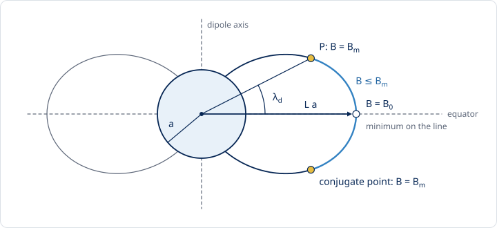
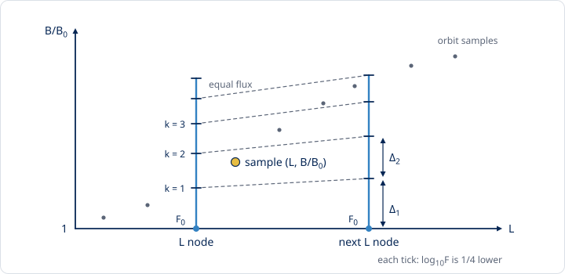
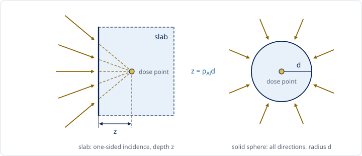
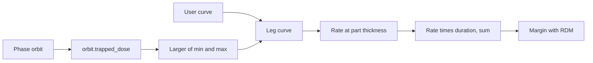

# Radiation analyses

These analyses estimate the ionising dose that trapped protons and electrons deposit in a part behind a given aluminium shield, and compare the dose accumulated over the mission with the dose the part tolerates.
They answer early design questions such as "how much shielding does this electronics box need in a 550 km orbit?" and "is the margin to the part's total dose tolerance positive?"

| ID | Purpose | Main inputs | Main outputs |
|---|---|---|---|
| `orbit.trapped_flux` | Orbit-averaged and peak flux above each energy, and mission fluence | Earth orbit, mission duration, belt maps | Flux, peak flux and fluence per map and energy |
| `orbit.trapped_dose` | Dose rate in silicon behind aluminium of a given thickness | Earth orbit, belt maps, SHIELDOSE-2 tables | Dose rate versus thickness for solar minimum and maximum |
| `orbit.total_dose` | Mission dose of each part and margin to its tolerance | Phases (durations, orbits), part shielding and tolerance | Part doses, margins, verdicts |

The environment is the NASA AP-8 (protons) and AE-8 (electrons) trapped-particle model.
The dose conversion is SHIELDOSE-2.
Both are static, empirical models (see [Limits](#limits-of-the-radiation-analyses)).
The data files are not in the repository; the analyses report them as missing inputs until `fune data fetch radiation` has installed them.
Background and data sources are in [trapped-radiation.md](../trapped-radiation.md).

## Common ground

### What is computed and in which order


*`orbit.trapped_flux` ends at the time average. `orbit.trapped_dose` continues to the dose curve. `orbit.total_dose` uses that curve for each phase.*

The [orbit conventions](orbit.md#common-ground) define epochs, frames and the daily grid.
The radiation analyses use these points:

- The orbit is sampled for one day (`daily_sampling`: span 86 400 s, step from the orbital period but at most 600 s; a one-off orbit shorter than a day is sampled over its own span).
  The demo orbit (550 km, circular, sun-synchronous) uses a 30 s step and 2 881 samples.
  A case beta override, when one applies, changes the sampled orbit as in the other orbit analyses.
- Each sample position is rotated from the inertial frame into Earth-fixed axes (ECEF) at its epoch.
  The geomagnetic field is fixed in the Earth, so the sampled day covers one full rotation of the ground track.
- Only orbits about the Earth are supported.
- The one-day average is taken to represent the whole mission.
  Orbit evolution, seasons and the solar cycle are not followed.

Data each analysis needs:

| Analysis | Belt maps (`ap8min`, `ap8max`, `ae8min`, `ae8max`) | Legacy field files (`jensen_cain_1960`, `gsfc_1966`) | `shieldose2` | `igrf14` |
|---|---|---|---|---|
| `orbit.trapped_flux` | yes | yes | no | no |
| `orbit.trapped_dose` | yes | yes | yes | no |
| `orbit.total_dose` | only when a leg has no environment table of its own | same | same | no |

The IGRF-14 file is installed with the group but the belt lookup does not use it.
It is used only by a test that compares the lookup with a published reference point.

### Geomagnetic field

AP-8 and AE-8 were built as tables in the coordinates $(L, B/B_0)$ of a specific geomagnetic field model.
They must be read with coordinates computed from the same field.
The field is therefore a spherical-harmonic model, not the tilted dipole used elsewhere in iwafune (`dipole_field_eci_t`).

Let $r$ be the geocentric distance, $\theta$ the colatitude, $\lambda$ the east longitude, and $a=6\,371\,200$ m the reference radius of the coefficient files.
The internal potential and the field are

```math
V = a\sum_{n=1}^{N}\left(\frac{a}{r}\right)^{n+1}\sum_{m=0}^{n}\left(g_n^m\cos m\lambda + h_n^m\sin m\lambda\right)P_n^m(\cos\theta),\qquad
\mathbf B = -\nabla V \tag{1}
```

| Symbol | Meaning | Unit |
|---|---|---|
| $g_n^m,\ h_n^m$ | Gauss coefficients of degree $n$ and order $m$ ($h_n^0=0$) | nT (converted to T by $10^{-9}$) |
| $P_n^m$ | Schmidt semi-normalised associated Legendre function | 1 |
| $N$ | Highest degree in the file (6 for the Jensen–Cain file) | 1 |
| $V$, $\mathbf B$ | Potential and field | nT·m, T |

The code evaluates (1) with the same recursion as the gravity field; the Schmidt-to-unnormalised conversion exists once, in `GravityTable::from_schmidt`.
A model may carry linear secular terms $\dot g,\dot h$ (nT/yr).
The production belt fields have none: each is frozen at its own epoch.

**Conversion of the two legacy files.**
Both files list rows `n m g h` in which $n$ and $m$ are one more than the true degree and order (`2 1` is $g_1^0$).
The reference radius is 6 371.2 km.

- *GSFC 12/66* uses the Schmidt convention and the IGRF sign ($g_1^0\approx-30\,401$ nT).
  Each row also gives $\dot g,\dot h$ (nT/yr) and $\ddot g,\ddot h$ (nT/yr²) at epoch 1960.0.
  The field for year 1970 uses, for every $g$ and every $h$ with $m>0$,

  ```math
  c(1970)=c + \dot c\,\Delta y + \tfrac12\,\ddot c\,\Delta y^{2},\qquad \Delta y = 10\ \mathrm{yr} \tag{2}
  ```

  The factor $\tfrac12$ is an assumption about how the file's second derivative is meant.
  Without it the dipole would change by about 3 nT of about 30 000 nT, so the field changes by about $10^{-4}$.
- *Jensen & Cain 1960* has the opposite sign ($g_1^0=+30\,411.2$ nT in the file) and uses the Chapman–Bartels "Gauss" Legendre functions.
  With the Kronecker delta $\delta_{m0}$ and the Schmidt factor $S_{nm}$, the conversion to Schmidt coefficients with the IGRF sign is

  ```math
  S_{nm}=\sqrt{\frac{(2-\delta_{m0})\,(n-m)!}{(n+m)!}},\qquad
  c_\mathrm{Schmidt}=-\,c_\mathrm{file}\,\frac{(n-m)!}{(2n-1)!!\;S_{nm}} \tag{3}
  ```

  applied to $g$ and $h$ alike, with $(2n-1)!!=1\cdot3\cdots(2n-1)$. The factor is $-1$ for $(n,m)=(1,0)$ and $(1,1)$, $-2/3$ for $(2,0)$, $-1/\sqrt3$ for $(2,1)$ and $-2/\sqrt3$ for $(2,2)$.
  For the file values $g_1^0=30\,411.2$, $g_1^1=2\,147.4$, $h_1^1=-5\,798.9$ nT, the Schmidt dipole terms are $-30\,411.2$, $-2\,147.4$ and $+5\,798.9$ nT.
  Their root sum of squares, $\sqrt{(g_1^0)^2+(g_1^1)^2+(h_1^1)^2}\approx31\,034$ nT, is the field's own equatorial dipole strength.

**Which field goes with which map.**

| Map | Particle | Solar condition (map epoch) | Field used | Field epoch |
|---|---|---|---|---|
| `ap8min` | Proton | Minimum (1964) | Jensen & Cain | 1960.0 |
| `ap8max` | Proton | Maximum (1970) | GSFC 12/66 extrapolated by (2) | 1970.0 |
| `ae8min` | Electron | Minimum (1964) | Jensen & Cain | 1960.0 |
| `ae8max` | Electron | Maximum (1970) | Jensen & Cain | 1960.0 |

This is the pairing used by SPENVIS and IRBEM.
The field is evaluated at the epoch in the last column, not at the orbit epoch.
The orbit epoch only sets the Earth rotation that turns the inertial position into ECEF.

### Field-line tracing and McIlwain's L

For a point P the aim is the shell parameter $L$ and the ratio $B/B_0$ that index the maps.
The method follows McIlwain (1961): the second adiabatic invariant $I$ of a particle that mirrors at P, with the field magnitude $B_m$ at P, is computed along the field line.
$I$ and $B_m$ then give $L$ through a function $\mathcal F$ defined for a centred dipole.



*The arc between the two mirror points (highlighted) has $B\le B_m$. In a centred dipole, $L$ is the equatorial distance in units of $a$.*

**Definitions.** With arc length $s$ along the line and $B_m=\|\mathbf B(\mathrm P)\|$,

```math
I=\int_{\mathrm{mirror\ 1}}^{\mathrm{mirror\ 2}}\sqrt{1-\frac{B(s)}{B_m}}\;ds\ \ [\mathrm m],\qquad
x=\frac{I^{3}B_m}{M},\qquad
L=\frac1a\left(\frac{\mathcal F\!\left(x^{1/3}\right)M}{B_m}\right)^{1/3} \tag{4}
```

$M=b_0a^3$ is a dipole moment (T·m³); see below for $b_0$.
$I=0$ for a point on the magnetic equator.
The second invariant is $2pI$ for a particle of momentum $p$; the constant $2p$ cancels in $L$.

**The function $\mathcal F$.**
For a centred dipole of moment $M$ the line through latitude $\lambda_d$ has $r=La\cos^2\lambda_d$ and $B=(M/r^3)\sqrt{1+3\sin^2\lambda_d}$.
Hence $L^3B/M=b(\lambda_d)$ and $I=La\,J(\lambda_d)$ with

```math
b(\lambda_d)=\frac{\sqrt{1+3\sin^2\lambda_d}}{\cos^{6}\lambda_d},\qquad
J(\lambda_d)=\int_{-\lambda_d}^{\lambda_d}\cos u\,\sqrt{1+3\sin^2u}\,\sqrt{1-\frac{b(u)}{b(\lambda_d)}}\;du \tag{5}
```

so that $I^3B/M=J^3b$.
McIlwain's $\mathcal F$ satisfies $L^3B/M=\mathcal F(I^3B/M)$ in every field, and in the dipole it follows from (5): for $v=x^{1/3}$ solve $v=J(\lambda_d)\,b(\lambda_d)^{1/3}$ for $\lambda_d$ and set $\mathcal F(v)=b(\lambda_d)$.
The code solves this numerically instead of using a polynomial fit.

- $J$ is integrated by Gauss–Chebyshev quadrature of the second kind with 48 nodes (the square-root behaviour at both ends is handled exactly).
- $\lambda_d$ is found by bisection on $[10^{-6},\,\lambda_\mathrm{hi}]$ to $10^{-13}$ rad (at most 200 iterations).
  The upper end is $\min(1.2\sqrt{v/3.3},\ \pi/2-10^{-6})$, widened to $\pi/2-10^{-6}$ if needed.
  A $v$ that needs a line beyond $\cos\lambda_d=10^{-6}$ gives no $L$.
- For $v<10^{-5}$ the series $\mathcal F=1+1.3504744\,v$ is used (slope $2\sqrt{4.5}/\pi$ from $b\approx1+4.5\lambda_d^2$ and $J\approx\sqrt{4.5}\,\pi\lambda_d^2/2$).

**Dipole moment convention.**
AP-8 and AE-8 take a fixed moment $M=0.311653\ \mathrm{G}\,R_e^3$, with the reference radius as $R_e$.
In SI this is $b_0=0.311653\times10^{-4}$ T, $M=b_0a^3$.
The equatorial field of the shell $L$ is then $B_0=b_0/L^3$.
The map coordinate is $(L,\ B/B_0)$ with $B=B_m$, so $B/B_0=B_mL^3/b_0$.
This is the default ("literature") convention.
The field's own dipole strength (about 31 034 nT for Jensen & Cain, 0.4 % less than $b_0$) is not used, so the same point has a slightly different $L$ than with the field's own moment.
The library also has a comparison convention for checking.
It takes $M$ from the field's own degree-1 terms and sets $B_0$ to the minimum of $B$ along the traced line.
The analyses never use it.

**Algorithm for one point.** Constants: DOP853 tracer with relative tolerance $10^{-10}$, absolute tolerance $10^{-4}$ m, maximum step $0.5a$ and at most 100 000 steps; the line must stay inside $16a$.

1. Evaluate $B_m$ at P. A zero or non-finite field, or $\|\mathbf r\|\ge16a$, gives no $L$.
2. Choose the sign $\sigma=\pm1$ such that $\sigma\hat{\mathbf B}$ points toward falling $B$ (central difference of $\|\mathbf B\|$ along the line, step $10^{-3}a$).
3. Integrate $d\mathbf r/ds=\sigma\hat{\mathbf B}$ from P until $d\|\mathbf B\|/ds$ changes sign (the line minimum), giving arc length $s_\mathrm{min}$.
   A line that leaves $16a$ first is open for this purpose, and gives no $L$.
4. Continue in the same direction from the minimum until $\|\mathbf B\|=B_m$ again (the conjugate mirror point), arc length $s_\mathrm{conj}$.
5. Put $S=s_\mathrm{min}+s_\mathrm{conj}$ and integrate the line again from P to the nodes $s_i=\tfrac S2(1-\cos\theta_i)$, $\theta_i=i\pi/33$, $i=1\ldots32$.
   Then $I=\dfrac S2\dfrac{\pi}{33}\sum_i\sin\theta_i\sqrt{\max(0,1-B_i/B_m)}$.
6. Compute $x$, $\mathcal F$ and $L$ by (4). A $v$ outside the range of $\mathcal F$ gives no $L$.

A sample "without $L$" is outside the model.
It counts as zero flux and is reported in `samples_without_l`.
For the demo orbit about 10.6 % of the samples (306 of 2 881) have no $L$, at high latitude where the line is open.

### Belt maps and the lookup

A map is an integer file written with Fortran format `(1X,12I6)` (NSSDC data set PT-11B).
The eight header words are:

| Word | Meaning | Value in `ap8min` |
|---|---|---|
| 1 | Map type | 2 |
| 2 | Steps per decade: $\log_{10}F$ falls by $1/\mathrm{word}_2$ per $B$ step | 4 |
| 3 | Epoch (year) | 1964 |
| 4 | Energy scale ($E=\text{word}/\mathrm{word}_4$, MeV) | 100 |
| 5 | $L$ scale | 2048 |
| 6 | $B/B_0$ scale | 2048 |
| 7 | $\log_{10}F$ scale | 1024 |
| 8 | Number of words after the header | 16 584 |

After the header comes one sub-map per energy (integral flux above $E$).
A sub-map holds one sub-sub-map per $L$ node: $[\,\text{length},\ L\cdot s_L,\ \log_{10}F_0\cdot s_F,\ \Delta_1,\Delta_2,\ldots]$.
$F_0$ is the flux at $B/B_0=1$ and the increments $\Delta_k$ (scaled by $s_B$) are the steps of $B/B_0$ at which $\log_{10}F$ has fallen by $1/4$ more:
$\log_{10}F=\log_{10}F_0-k/4$ at $B/B_0=1+\Delta_1+\dots+\Delta_k$, linear in between, and zero flux after the last increment.
Each sub-map starts with a dummy node at $L=0$ and ends with one at $L=32767/s_L$.



*An orbit sample $(L,B/B_0)$ lies between two $L$ nodes of a sub-map. Each node is a polyline in $B/B_0$.*

The lookup follows the procedure of NSSDC RADBELT (`TRARA1`, `TRARA2`), including its single-precision (`f32`) arithmetic.
It returns the integral omnidirectional flux $F(>E)$ in cm⁻² s⁻¹ for $(L,\ B/B_0,\ E)$.

1. **Scaled coordinates.** $n_L=\lfloor\min(L,15.6)\,s_L\rfloor$ and $n_B=\lfloor(\max(B/B_0,1)-1)\,s_B\rfloor$.
   The truncation to integers is part of the method.
   The log-flux step is the integer quotient $f=\lfloor\text{word}_7/\text{word}_2\rfloor$ (256 for a scale 1024 and 4 steps).
2. **Energy sub-maps.** Take the first sub-map pair $(E_1,E_2)$ whose upper energy is at least $E$.
   Below the first energy the first two sub-maps are used, and above the last energy the last two, so both ends extrapolate linearly.
3. **Within one sub-map** (`TRARA2`).
   Find the last $L$ node at or below $n_L$ and the first one above it.
   Order the two so that the one with the larger $F_0$ is second.
   Walk the two polylines together, ordered by the slope of the chord from the origin (cumulative $B$ increment, scaled $\log_{10}F$) to each break point.
   At each step the two break points, weighted by the position of $n_L$ between the nodes, give a point on an interpolated contour.
   Stop at the first interpolated point at or beyond $n_B$ and interpolate linearly in $B$ between it and the previous interpolated point.
   A node without increments counts as a contour of slope $-900\,000$.
   A path that finds no flux returns zero.
   The result divided by $s_F$ is $\log_{10}F$ for this energy.
4. **Energy interpolation.** $\log_{10}F$ is linear in $E$ (not in $\ln E$):

   ```math
   \log_{10}F(E)=\ell_1+(\ell_2-\ell_1)\,\frac{E-E_1}{E_2-E_1} \tag{6}
   ```

   If the upper sub-map has no flux at the point ($\ell_2\le0$) and a lower sub-map exists, the smaller of (6) and the line through the next lower pair is taken.
   The result is not allowed below 0.
5. **Zero rule.** $F=10^{\log_{10}F}$ if $\log_{10}F>0$, otherwise zero.
   A flux of 1 cm⁻² s⁻¹ or less is therefore reported as zero.
   Non-finite input, $L\le0$ or $E\le0$ also give zero.

**Worked lookup (synthetic map of the unit test).**
Take a map with $\log_{10}F_0=4$ at $L=1$ and $2$ at $L=3$ for 0.1 MeV, and $2$ and $1$ for 400 MeV, at $B/B_0=1$.
At $L=2$ the $L$ interpolation is halfway: $3$ at 0.1 MeV and $1.5$ at 400 MeV.
For $E=10$ MeV, (6) gives $3+(1.5-3)(10-0.1)/(400-0.1)=2.9629$, so $F=10^{2.9629}\approx918$ cm⁻² s⁻¹.

## orbit.trapped_flux — Trapped particle flux and fluence

### What it answers

How many trapped particles above each energy threshold cross a unit area per second on average in this orbit, how large the peak is, and what fluence accumulates over the mission if that average persists.

### Inputs

| Quantity | Symbol | Unit | Source in the design | Default |
|---|---|---|---|---|
| Orbit samples | $\mathbf r(t_i)$ | m | Effective `[orbit]` (a case beta is applied) | Must be given |
| Mission duration | $T$ | s | `at_least` requirement with `input = "mission_duration"` | Must be given |
| Belt maps and paired fields | — | — | `fune data fetch radiation` | Must be installed |
| Sample span and step | $S,\ \Delta t$ | s | `daily_sampling` | Analysis default (see Common ground) |

The energy thresholds are fixed lists: 0.1, 0.5, 1, 2, 5, 10, 20, 30, 50, 100, 200, 400 MeV for protons and 0.04, 0.1, 0.25, 0.5, 1, 1.5, 2, 3, 4, 5, 6, 7 MeV for electrons.

### Model and assumptions

AP-8 and AE-8 give a static, omnidirectional integral flux as a function of $(L,B/B_0,E)$.
There is one map for solar minimum (epoch 1964) and one for solar maximum (epoch 1970) for each particle, and the analysis reports all four.
The orbit samples one day, and the result is assumed to hold for the mission.

### Equations

For each map and threshold, let $F_i$ be the flux (from the lookup) at sample time $t_i$, and $S=t_N-t_0$.
Samples without $L$ have $F_i=0$.
The mean uses the trapezoid rule, the fluence multiplies the mean by the mission duration, and the nonzero fraction is the trapezoid mean of the indicator $[F_i>0]$.

```math
\bar F=\frac1S\sum_{i}\frac{(t_{i+1}-t_i)\,(F_i+F_{i+1})}{2},\qquad
\Phi=\bar F\,T,\qquad F_\mathrm{peak}=\max_i F_i \tag{7}
```

Units: $F$ in m⁻² s⁻¹ (the map's cm⁻² s⁻¹ times $10^{4}$), $\Phi$ in m⁻².

### Algorithm

1. Sample the orbit and rotate to ECEF.
2. For each of the two fields, trace $(L,B/B_0)$ at every sample (samples are traced in parallel chunks; the result equals the serial one).
3. For each map paired with the field and each threshold, look up $F_i$ for all samples.
4. Evaluate (7). Report `l_min`, `l_max` (over samples with $L$) and `samples_without_l`.
5. Order the cases as proton minimum, proton maximum, electron minimum, electron maximum.

### Checks and verdicts

There is no verdict.
A missing map, field or mission duration makes the analysis a missing input.
A non-positive mission duration or an orbit about another body is an error.

### Outputs

| Output | Unit | Meaning |
|---|---|---|
| `cases[].spectrum[].mean_flux`, `peak_flux` | m⁻² s⁻¹ | $\bar F$ and $F_\mathrm{peak}$ at threshold `energy_mev` |
| `cases[].spectrum[].fluence` | m⁻² | $\Phi$ |
| `cases[].spectrum[].time_fraction` | 1 | Fraction of the span with nonzero flux |
| `cases[].l_min`, `l_max`, `samples_without_l` | 1, 1, count | Range of $L$ and number of samples outside the model |
| `used` | — | Span, step, number of samples and mission duration |

The CLI prints flux in cm⁻² s⁻¹ and fluence in cm⁻².

### Worked example

Demo orbit: circular, 550 km, sun-synchronous (inclination 97.6°), epoch 2027-04-01, 2 881 samples at 30 s, mission duration 31 557 600 s (one Julian year).
For `ap8min` the field is Jensen & Cain; 306 samples have no $L$ and $L$ ranges from 1.003 to 15.999.
`ap8max` (GSFC field) has 309 such samples.

At 0.1 MeV the program prints for `ap8min`: mean flux 1193 cm⁻² s⁻¹, peak 157 623 cm⁻² s⁻¹, fluence $3.76\times10^{10}$ cm⁻², flux nonzero for 14.6 % of the time.
In SI the mean flux is 11 925 384.09 m⁻² s⁻¹ ($=1192.54$ cm⁻² s⁻¹).
Check of the fluence by (7): $11\,925\,384.09\ \mathrm{m^{-2}s^{-1}}\times31\,557\,600\ \mathrm{s}=3.76336501\times10^{14}$ m⁻² $=3.763\times10^{10}$ cm⁻², equal to the program's value.

### Limits

The result is for trapped particles only and for the one-day sample.
Storms, the phase of the solar cycle, secular field change and orbit evolution are not modelled.
Near the atmospheric cut-off of the proton belt (large $B/B_0$ at low $L$) the flux changes strongly with $L$ and $B/B_0$, so the coordinate definition matters (see [trapped-radiation.md](../trapped-radiation.md)).
A sample without $L$ counts as zero flux, which can lower the average at high-latitude orbits.

### Verification

- `crates/lib/analysis/src/orbit/trapped_flux/tests.rs` (`equatorial_circular_orbit_matches_hand_calculation`): an equatorial circular orbit at $L=2$ in a centred-dipole field and a synthetic map gives the analytic flux, linear interpolation in $E$, unit conversion and fluence $=\bar F T$.
- `crates/lib/astro/src/radiation/tests/nasa.rs`: the lookup reproduces the tabulated AE8MIN integral fluxes of the NASA sample output (73 values, on and off the map nodes, at $B/B_0=1$ and above; agreement within the 4-digit rounding, relative $5\times10^{-4}$) when the data are installed.
  The proton tables of that output belong to an older map; they are compared only loosely.
- `crates/lib/astro/src/geomag/lshell_tests.rs`: for a centred dipole $L$ equals the equatorial distance in units of $a$ to $10^{-7}$ and $B/B_0=\sqrt{4-3\cos^2\lambda}/\cos^6\lambda$ (`centred_dipole_l_and_b_ratio_are_analytic`).
- `crates/lib/astro/src/geomag/dipole_f.rs`: quadrature convergence, the analytic slope $2\sqrt{4.5}/\pi$ and continuity at $v=10^{-5}$.
- `crates/lib/astro/src/geomag/legacy_tests.rs`: the Jensen–Cain factors (3) against a hand calculation, the GSFC extrapolation (2) with the $\tfrac12$, and agreement of the converted 1960 coefficients with DGRF 1960 to 120 nT up to degree 4 when the data are installed.

### Source

[Analysis](../../crates/lib/analysis/src/orbit/trapped_flux.rs), [projection](../../crates/app/projection/src/orbit/trapped_flux.rs), [field expansion](../../crates/lib/astro/src/geomag/gauss.rs), [legacy files](../../crates/lib/astro/src/geomag/legacy.rs), [line tracing and L](../../crates/lib/astro/src/geomag/lshell.rs), [dipole relation](../../crates/lib/astro/src/geomag/dipole_f.rs), [belt coordinates](../../crates/lib/astro/src/radiation/position.rs), [map format](../../crates/lib/astro/src/radiation/map.rs), [lookup](../../crates/lib/astro/src/radiation/flux.rs).

## orbit.trapped_dose — Trapped particle dose versus shielding depth

### What it answers

The dose rate in silicon behind a given equivalent thickness of aluminium, split into trapped protons, trapped electrons and electron bremsstrahlung, for solar minimum and maximum.

### Inputs

| Quantity | Symbol | Unit | Source in the design | Default |
|---|---|---|---|---|
| Orbit samples | $\mathbf r(t_i)$ | m | Effective `[orbit]` | Must be given |
| Maps, fields, SHIELDOSE-2 tables | — | — | `fune data fetch radiation` | Must be installed |
| Thickness list | $d$ | mm | Analysis input, no design setting | 0.1, 0.2, 0.5, 1, 1.5, 2, 3, 4, 5, 7, 10, 15, 20 (analysis default) |
| Geometry | — | — | Analysis input, no design setting | `sphere_centre` (analysis default) |
| Proton nuclear interactions | — | — | Analysis input, no design setting | `none` (analysis default) |
| Detector | — | — | Fixed | Silicon |

A given thickness list needs at least three values that are positive and strictly increasing.
`geometry` is `sphere_centre`, `semi_infinite_slab` or `finite_slab`; `nuclear` is `none`, `local` or `local_with_neutrons`.
The output `used` records which values were defaults.

### Model and assumptions

The dose behind a shield depends on the particle spectrum, on how far each particle penetrates, and on the geometry.
SHIELDOSE-2 (Seltzer 1994) tabulates, for monoenergetic particles on aluminium, the dose versus depth for protons and for electrons including their bremsstrahlung photons.
The tables are in scaled depth, the depth divided by a range of the particle, and carry ratios that convert the dose in aluminium to the dose in the detector material.
The method integrates these kernels over the spectrum.
The depth is the areal density $z=\rho_\mathrm{Al}\,d$ with $\rho_\mathrm{Al}=2.70$ g/cm³.

Three geometries are offered.



*Slab: radiation arrives through one face and the dose is taken at depth $z$. Sphere: the point is the centre of a solid sphere of radius $d$ irradiated from all directions.*

- *Semi-infinite slab* (`semi_infinite_slab`): depth $z$ inside an infinite medium, one-sided incidence.
- *Finite slab* (`finite_slab`): the transmission face of a finite slab, one-sided incidence. For protons it equals the semi-infinite value; for electrons and bremsstrahlung it uses the finite-slab detector ratios.
- *Sphere centre* (`sphere_centre`, default): the centre of a solid sphere, all directions.

### Equations

Let $F_i$ be the orbit-averaged integral flux above $E_i$ (cm⁻² s⁻¹), from the lookup and the average (7), on the log-spaced grid described below.

**Differential spectrum.** The flux per energy between neighbouring grid points, placed at their geometric mean:

```math
j_i=\frac{F_i-F_{i+1}}{E_{i+1}-E_i},\qquad E_i^{*}=\sqrt{E_iE_{i+1}} \tag{8}
```

($j$ in cm⁻² s⁻¹ MeV⁻¹.) The energy ratio of neighbours is 1.10, so the geometric mean differs from the arithmetic midpoint by less than 0.1 %.

**Dose integral.** For slab geometries the dose rate at areal depth $z$ is

```math
D_\mathrm{slab}(z)=\frac{C}{4}\int j(E)\,w(E,z)\,E\,d\ln E \tag{9}
```

with $C=1.6021892\times10^{-10}$ Gy·g/MeV and $w(E,z)$ the dose kernel (MeV·cm²/g, detector ratio included).
The factor $\tfrac14$ turns the omnidirectional flux into the crossing rate through one face.
The kernel tables contain the factor 2 for the mean path increase of oblique incidence, so at zero depth $D_\mathrm{slab}=\tfrac12\phi\,S/\rho$ for flux $\phi$ and stopping power $S/\rho$.
The integral is done numerically in $\ln E$ (step 3 below).

**Kernels.** Let $R$ be the CSDA range of the particle in aluminium (g/cm²), $T$ the electron energy, $R_s$ the electron extrapolated range, $Y$ the bremsstrahlung yield and $A$ the electron absorption scale (all from the tables).
Writing $\tilde D$ for a tabulated depth-dose curve times the detector ratio:

- Protons: $w=E\,\tilde D_p(E,\,z/R)/R$, and $0$ if $z/R$ is above the table (the proton stops before reaching depth $z$).
- Electrons: $w=T\,\tilde D_e(T,\,z/R_s)\,A/R_s$ times the ratio, and $0$ for $z/R_s\ge2$.
- Bremsstrahlung: $w=T\,\tilde D_b(T,\,\ln(z/R))\,Y/R$ times the ratio.

**Sphere.** The sphere is derived from the semi-infinite slab curve with the straight-ahead approximation.
SHIELDOSE-2 prints this under the heading "1/2 dose at the centre of aluminium spheres", in the one-sided normalisation, so the full-sphere dose is twice the printed value:

```math
D_\mathrm{half}(z)=D_\mathrm{semi}(z)\left(1-\frac{d\ln D_\mathrm{semi}}{d\ln z}\right),\qquad
D_\mathrm{sphere}=2\,D_\mathrm{half} \tag{10}
```

At zero depth the slope is zero and $D_\mathrm{semi}=\phi S/2$, so $D_\mathrm{sphere}=\phi S$: the full sphere receives the flux $\phi$ from all directions.
For a power-law slab curve $D=Az^{-p}$ the half value is $D(1+p)$.
The kernel keeps both: `sphere_half` (the value SHIELDOSE-2 prints) and `sphere_centre()` (twice that). The analysis reports the latter.
To compare with a tool that prints the SHIELDOSE-2 sphere value unchanged, divide the `sphere_centre` values by 2, or use `semi_infinite_slab`, whose normalisation equals the printed slab value.

### Algorithm

1. **Orbit-average integral spectrum.**
   Reuse the $(L,B/B_0)$ samples of each field.
   For each species take $n=\lceil 25\log_{10}(E_\mathrm{max}/E_\mathrm{min})\rceil+1$ log-spaced energies on the range of the map (protons 0.1–400 MeV, 92 points; electrons 0.04–7 MeV, 58 points).
   Look up $F_i$ for all samples at each energy and average by the trapezoid rule (zero for samples without $L$).
2. **Differential spectrum.**
   Apply (8).
   Keep the first contiguous run of positive finite differences.
   If the run starts at the first interval, add a point at the first grid energy by extending the straight line of $\ln j$ against $\ln E$ through the first two differences (otherwise the half interval below the first midpoint would lose particles).
   The interval in which $F$ falls to zero gives $F_i/\Delta E$ with the last positive $F_i$, so the particle count is kept.
   Fewer than two positive differences, or fewer than three nodes in all, mean no particles of that species: its dose is zero.
3. **Integration grid.**
   Interpolate $\ln j$ against $\ln E$ by a natural cubic spline, and sample $E\,j$ at 1 001 log-spaced energies from the first to the last differential node (the spline is not extended beyond half a grid step).
   Multiply by the kernel at each node and integrate over $\ln E$ with Simpson's rule (SHIELDOSE-2's `INTEG`; the code also handles an even number of nodes with a 3/8-type weighting of the first six).
4. **Kernel evaluation.**
   - Protons: for each tabulated depth ratio, $\ln D$ is a natural spline in $\ln E$ (clamped to the end value beyond the table). At the incident energy the curve $\ln\tilde D(z/R)$ is a natural spline in $z/R$.
     $R$ comes from a natural spline of $\ln R$ against $\ln E$.
   - Electrons: $\ln D$ at each tabulated scaled depth is interpolated linearly in $\ln T$ (clamped at the ends); the depth curve is a natural spline in $z/R_s$. The detector ratio is first interpolated linearly in $\ln T$, then as a spline in $z/R$.
   - Bremsstrahlung: linear in $\ln T$ and linear in $\ln(z/R)$ (the end segment is extended); the ratio is linear in $\ln z$.
   - A depth below $10^{-6}$ g/cm² is set to $10^{-6}$ g/cm².
5. **Options.** `none` uses ionisation only for protons.
   `local` uses the second proton table: the proton fluence is attenuated by nuclear interactions and the energy of the charged secondaries is deposited where they are made.
   `local_with_neutrons` adds a term $E\,f_n(E)\cdot0.03\,e^{-0.03z}$ for the neutron energy fraction $f_n$ (attenuation coefficient 0.03 cm²/g).
   Options 2 and 3 are less tested than option 1.
6. **Sphere.** Apply (10) to the semi-infinite curve: fit a natural cubic spline to $\ln D$ against $\ln z$ over the initial run of positive depths (at least three, otherwise the sphere is zero), differentiate it, and apply (10). The sphere is zero beyond that run.
7. **Sum.** Add proton, electron and bremsstrahlung rates.
   Solar minimum pairs `ap8min` with `ae8min`, and solar maximum pairs `ap8max` with `ae8max`.

### Checks and verdicts

There is no verdict.
Missing maps, fields or SHIELDOSE-2 data make the analysis a missing input.
An explicit thickness list must satisfy the conditions in Inputs.

### Outputs

| Output | Unit | Meaning |
|---|---|---|
| `cases[]` (`solar`, `proton_model`, `electron_model`) | — | One case for solar minimum, one for solar maximum |
| `cases[].table[].shielding` | m | Equivalent aluminium thickness $d$ |
| `cases[].table[].protons`, `electrons`, `bremsstrahlung`, `total` | Gy/s | Dose rates in silicon; `total` is their sum |
| `used` | — | Geometry, nuclear option, detector, sources of the choices, samples, `samples_without_l` (maximum over the two fields), integration points, energy ranges and point counts, scope text |

`worst_case_table()` keeps, at each thickness, the larger total of the two cases and stops at the first thickness where it is not positive.
`orbit.total_dose` uses this table.
The CLI shows rates per Julian year.

### Worked example

Demo orbit as above, default settings.
Printed dose rates, solar minimum (`ap8min`, `ae8min`), in Gy/yr:

| Aluminium | Protons | Electrons | Bremsstrahlung | Total |
|---|---|---|---|---|
| 100 µm | 16.0 | 509 | 1.10 | 526 |
| 500 µm | 3.65 | 75.4 | 0.250 | 79.3 |
| 1.00 mm | 2.37 | 30.1 | 0.128 | 32.6 |
| 2.00 mm | 1.68 | 10.0 | 0.0632 | 11.8 |
| 5.00 mm | 1.22 | 0.774 | 0.0234 | 2.02 |
| 10.0 mm | 0.952 | 0.00777 | 0.0125 | 0.973 |

Solar maximum (`ap8max`, `ae8max`) at 1.00 mm: 1.45, 55.0, 0.256 and 56.7 Gy/yr.

In SI at 1 mm (solar minimum): $7.5012562\times10^{-8}+9.5497309\times10^{-7}+4.0582473\times10^{-9}=1.0340439\times10^{-6}$ Gy/s, the printed `total`.
Per year: $1.0340439\times10^{-6}\times31\,557\,600=32.63$ Gy, matching the 32.6 Gy/yr in the table.
The depth is $z=0.1\,\mathrm{cm}\times2.70=0.270$ g/cm².
Electrons dominate at small depth and are gone beyond about 15 mm, where the protons and bremsstrahlung remain.
The solar-maximum electron dose is larger (maximum electron map) and the solar-minimum proton dose is larger, so which case is worse depends on the depth.
At 1 mm the maximum total ($1.7975695\times10^{-6}$ Gy/s) exceeds the minimum total; at 7 mm the minimum ($3.8831728\times10^{-8}$ Gy/s) exceeds the maximum ($3.0198972\times10^{-8}$ Gy/s).

### Limits

Trapped protons, trapped electrons and bremsstrahlung only; no solar energetic protons, no galactic cosmic rays, no displacement damage, no single-event effects, and no secondaries from the spacecraft structure beyond SHIELDOSE-2's own treatment.
The shield is aluminium in one of three simple geometries; the real mass distribution around a part is not modelled.
The sphere formula is the straight-ahead approximation.
The spectrum is the one-day orbit average.
The solar-minimum and solar-maximum maps are also defined in different fields.

### Verification

- `crates/lib/analysis/src/orbit/trapped_dose/tests.rs` (`proton_dose_near_zero_depth_matches_the_integral_of_flux_times_stopping_power`): for a synthetic proton map with a closed-form flux, the dose at near-zero depth agrees within 1.5 % with $\int j\,S\,r\,dE\times1.6021892\times10^{-10}$ computed independently from the range table.
  Other tests check the default depths, the geometry choice and the worst-case table.
- `crates/lib/astro/src/radiation/shielding/tests.rs`:
  the proton kernel at near-zero depth against $\phi S/2$ for nine energies (0.1 MeV to 1 GeV, within 1 %);
  zero dose for protons that cannot cross the shield;
  the sphere value $D(1+p)$ for a power-law slab curve (`sphere_from_a_power_law_slab_curve_matches_the_analytic_derivative`);
  the exponential-spectrum sample of NBS TN 1116, whose printed integral flux $2.2719\times10^{10}$ and mean energy 28.50006 MeV are reproduced;
  differentiation of a power-law integral flux within 0.2 %;
  electrons stopping in a thick shield while bremsstrahlung remains;
  the ordering of the nuclear options.
- The reader of the SHIELDOSE-2 data file is checked against the source values, as described in [trapped-radiation.md](../trapped-radiation.md).

### Source

[Analysis](../../crates/lib/analysis/src/orbit/trapped_dose.rs), [spectrum preparation](../../crates/lib/analysis/src/orbit/trapped_dose/spectrum.rs), [types and worst-case table](../../crates/lib/analysis/src/orbit/trapped_dose/types.rs), [projection](../../crates/app/projection/src/orbit/trapped_dose.rs), [dose integral and sphere](../../crates/lib/astro/src/radiation/shielding/dose.rs), [energy grid, Simpson, differencing](../../crates/lib/astro/src/radiation/shielding/spectrum.rs), [protons](../../crates/lib/astro/src/radiation/shielding/proton.rs), [electrons](../../crates/lib/astro/src/radiation/shielding/electron.rs), [data format](../../crates/lib/astro/src/radiation/shielding/data.rs).

## orbit.total_dose — Total ionising dose

### What it answers

The dose each part accumulates over the mission behind its equivalent aluminium shielding, and whether the part's total dose tolerance covers that dose with the design margin.

### Inputs

| Quantity | Symbol | Unit | Source in the design | Default |
|---|---|---|---|---|
| Leg durations | $T_\ell$ | s | Phase `duration`; without phase durations, the requirement with `input = "mission_duration"` | Must be given for at least one usable leg |
| Dose-rate curve of a leg | $q_\ell(d)$ | Gy/s | `dose_rate_by_shielding` in the effective `[orbit]` of the leg (design or phase) | Computed trapped environment when available |
| Equivalent shielding of a part | $d$ | m | Part attribute `shielding`, else `analysis.common.radiation.default_shielding` | Part not evaluated if neither is given |
| Total dose tolerance | $D_\mathrm{tol}$ | Gy | Part attribute `tid_tolerance` | Optional (no verdict without it) |
| Radiation design margin (RDM) | $f$ | 1 | `analysis.common.radiation.design_margin` | 2.0 (analysis default, echoed in the output) |

A part enters the analysis when it has `shielding` or `tid_tolerance`.
The curve is a `curve` value with thickness (a length) as argument and dose rate as value, e.g. `fune set conditions.orbit.dose_rate_by_shielding "0.5:400 1:120 2:30 (mm -> Gy/yr)"` (see [model.md](../model.md)).
The thicknesses must be strictly increasing and the rates positive.

### Model and assumptions

Each part is a point inside a spherical aluminium shell of one equivalent thickness.
The dose rate comes from a curve of rate against thickness for each leg.
A leg is a phase when any phase has a `duration`, and otherwise a single leg: the design orbit over the mission duration.
A phase with its own `[orbit]` has its own orbit and curve.

For each leg:

1. A written `dose_rate_by_shielding` always wins (`environment_source = user_table`).
2. Otherwise, if the radiation and SHIELDOSE-2 data are installed and the leg has a duration, the curve is computed by `orbit.trapped_dose` for that leg's orbit with its defaults: at each thickness, the larger of the solar-minimum and solar-maximum totals (`computed_trapped`), ending before the first non-positive rate.
3. Otherwise the leg has no curve and is left out.



*A user curve always replaces the computed one for its leg.*

### Equations

For a part at thickness $d$ between curve nodes $(d_0,q_0)$ and $(d_1,q_1)$ of leg $\ell$, the rate is interpolated linearly in thickness and logarithmically in rate.
At the midpoint it is the geometric mean.

```math
w=\frac{d-d_0}{d_1-d_0},\qquad q_\ell(d)=q_0^{\,1-w}\,q_1^{\,w} \tag{11}
```

```math
D=\sum_{\ell}q_\ell(d)\,T_\ell,\qquad
\mathcal R=\frac{D_\mathrm{tol}}{f\,D}-1 \tag{12}
```

$w$ is dimensionless, $D$ is the part's total dose (Gy) and $\mathcal R$ is the margin (the common ratio margin of the analyses).
Outside the curve's thickness range there is no extrapolation: the rate is undefined.

### Algorithm

1. Resolve $f$ (default 2, must be positive), the legs, their durations and curves. Each curve must have positive rates and strictly increasing thicknesses.
   A leg without duration or without curve is left out and listed in `legs[].status` (`no_duration`, `no_environment`).
   At least one leg must have both, otherwise the analysis fails.
2. For each part choose the thickness: the part's `shielding`, else the default shielding, else the part is not evaluated (`no_shielding`).
3. For each included leg read $q_\ell(d)$ with (11). If $d$ is outside any included leg's curve the part is not evaluated (`outside_table`).
4. Sum $q_\ell T_\ell$ to $D$.
5. If the part has a tolerance, compute $\mathcal R$ from (12). It is undefined when $D=0$.
6. The reference shielding is the smallest thickness among the evaluated parts.
   For each leg the output gives the rate and dose at that thickness.
   The part with the smallest margin is `worst`.

### Checks and verdicts

- `dose:<part>`: with a tolerance, a margin of zero or more is pass and a negative margin is a violation (warning band 0).
  A part without a tolerance gets a dose and no verdict.
  A warning is given instead when the part has no shielding and no default, or its shielding is outside a curve.
- `phases_left_out`: warning when any leg is left out, because the totals are then lower bounds.
- `environment_source`: warning when an included leg uses a computed curve, because it covers trapped particles only (no solar energetic protons, no galactic cosmic rays) and the totals are lower bounds.

The KPI is the smallest margin.

### Outputs

| Output | Unit | Meaning |
|---|---|---|
| `legs[]` | s, Gy/s, Gy | Phase, status, duration, environment source, rate and dose at the reference thickness |
| `parts[]` | m, Gy/s, Gy, 1 | Shielding and its source, per-leg rate and dose (`phases`), `total`, `tolerance`, `margin`, `verdict`, reason if not evaluated |
| `reference_shielding`, `worst` | m, 1 | Thinnest evaluated shielding; part with the smallest margin |
| `design_margin`, `design_margin_source`, `interpolation` | 1 | RDM, whether given or default, `log_linear` |

### Worked example

The stock demo has no part with `shielding` or `tid_tolerance`, so the analysis reports a missing input (`<part>.tid_tolerance`).
For this example a private copy of the demo was changed with the CLI:

```text
fune set OBC.shielding "2.5 mm"
fune set OBC.tid_tolerance "100 Gy"
```

The demo has three phases without a user curve: `LEOP` (30 d) and `NOMINAL_OPS` (730 d) in the design orbit (550 km), and `DISPOSAL` (180 d) in a 250 km orbit.
All three use the computed curve (the program prints the `environment_source` warning), and the RDM is the default 2.

The curve of the two 550 km legs is the larger of the solar-minimum and solar-maximum totals printed by `orbit.trapped_dose` (previous section).
At 2 mm and 3 mm solar maximum is larger: $6.3428862\times10^{-7}$ and $2.7794688\times10^{-7}$ Gy/s.
The part is halfway ($w=0.5$) at 2.5 mm, so by (11)

$q=\sqrt{6.3428862\times10^{-7}\times2.7794688\times10^{-7}}=4.19879\times10^{-7}$ Gy/s,

which is the program's rate for both legs ($4.198792\times10^{-7}$ Gy/s).
The `DISPOSAL` leg is a different orbit, and its curve is not printed here; the program gives $1.384739\times10^{-7}$ Gy/s at 2.5 mm.

| Leg | Duration (s) | Rate (Gy/s) | Dose (Gy) |
|---|---|---|---|
| `LEOP` | 2 592 000 | $4.198792\times10^{-7}$ | 1.08833 |
| `NOMINAL_OPS` | 63 072 000 | $4.198792\times10^{-7}$ | 26.48262 |
| `DISPOSAL` | 15 552 000 | $1.384739\times10^{-7}$ | 2.15355 |

By (12) the total is $D=1.08833+26.48262+2.15355=29.7245$ Gy, the program's total of 29.7 Gy.
The margin is $\mathcal R=100/(2\times29.7245)-1=0.6821$ (68.2 %), and the verdict is `ok`.
The design margin demands 59.4 Gy, so the part tolerates the computed dose with a margin of 68.2 %.
Because the curve covers trapped particles only, this is a lower bound.

### Limits

A computed leg covers trapped particles and the SHIELDOSE-2 secondaries, not solar energetic protons, galactic cosmic rays, displacement damage or single-event effects.
Legs without duration or curve are omitted, so totals can be lower bounds.
The shielding is one equivalent aluminium thickness per part (a uniform spherical shell), and a part outside every curve's range is not evaluated.
The design margin is a design input, not a result of the physics.
The environment is static (no time variation of the belts, no storms).

### Verification

`crates/lib/analysis/src/orbit/total_dose/tests.rs` checks:
rate times duration with $D_\mathrm{tol}/(fD)-1$ ($10$ Gy/yr for 2 yr, tolerance 100 Gy, RDM 2 gives 1.5);
the sum over phases and the default RDM of 2;
the geometric-mean midpoint and the absence of extrapolation (`the_table_is_read_log_linearly_and_not_extrapolated`: 100 and 4 Gy/yr at 1 and 3 mm give 20 Gy/yr at 2 mm);
the default shielding and the missing-tolerance case;
omitted legs;
the worst part and a violation;
the environment source of each leg.

### Source

[Analysis](../../crates/lib/analysis/src/orbit/total_dose.rs), [checks](../../crates/lib/analysis/src/orbit/total_dose/checks.rs), [projection](../../crates/app/projection/src/orbit/total_dose.rs), [computed environment](../../crates/app/projection/src/orbit/trapped_dose.rs), [table interpolation](../../crates/lib/astro/src/math/table.rs), [output labels](../../crates/app/service/src/analysis/labels/orbit.rs).

## Limits of the radiation analyses

- The models are static: one map for solar minimum (1964) and one for solar maximum (1970) per particle, with no solar-cycle phase, no magnetic-storm variation and no secular field change.
- Solar energetic protons and galactic cosmic rays are not included, and neither is any time variation of the environment.
- AE-8 is known to be inaccurate for the outer belt and for the newest observations, and AP-8 is known to overestimate the low-energy proton flux at solar maximum in the South Atlantic Anomaly region ([trapped-radiation.md](../trapped-radiation.md)).
  The numbers are for concept design.
- Displacement damage and single-event effects are not computed.

## References

- C. E. McIlwain, *Coordinates for Mapping the Distribution of Magnetically Trapped Particles*, J. Geophys. Res., 1961. [Paper](https://doi.org/10.1029/JZ066i011p03681)
- D. M. Sawyer and J. I. Vette, *AP-8 Trapped Proton Environment for Solar Maximum and Solar Minimum*, NSSDC/WDC-A-R&S 76-06, 1976.
- J. I. Vette, *The AE-8 Trapped Electron Model Environment*, NSSDC/WDC-A-R&S 91-24, 1991.
- D. C. Jensen and J. C. Cain, *An interim geomagnetic field*, J. Geophys. Res., 1962 (the 1960 coefficients).
- J. C. Cain, W. Hendricks, R. A. Langel and W. V. Hudson, *A proposed model for the International Geomagnetic Reference Field – 1965*, J. Geomag. Geoelectr., 1967 (GSFC 12/66).
- S. Chapman and J. Bartels, *Geomagnetism*, Oxford University Press, 1940 (Gauss functions).
- S. M. Seltzer, *Updated Calculations for Routine Space-Shielding Radiation Dose Estimates: SHIELDOSE-2*, NISTIR 5477, 1994. [Report](https://nvlpubs.nist.gov/nistpubs/Legacy/IR/nistir5477.pdf)
- S. M. Seltzer, *SHIELDOSE: A Computer Code for Space-Shielding Radiation Dose Calculations*, NBS Technical Note 1116, 1980.
- [Trapped-radiation model and data notes](../trapped-radiation.md).
