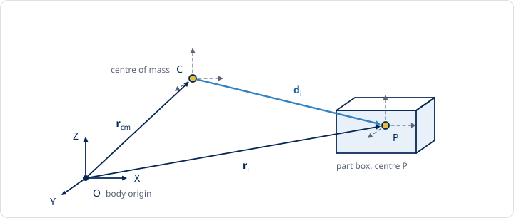
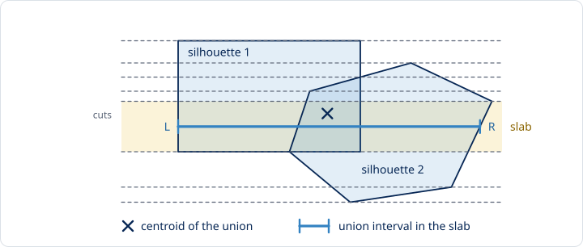
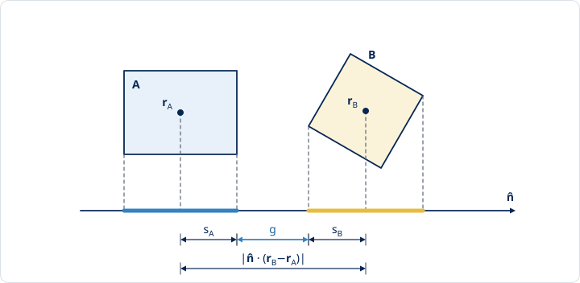
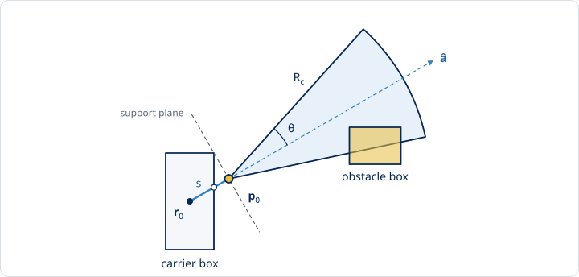
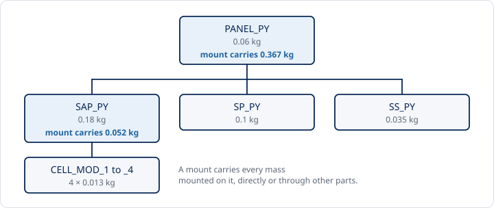
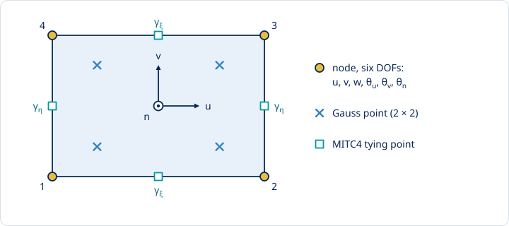
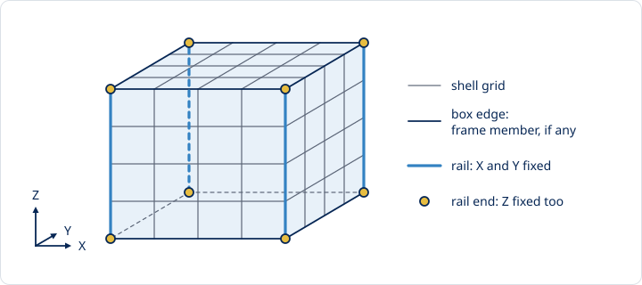
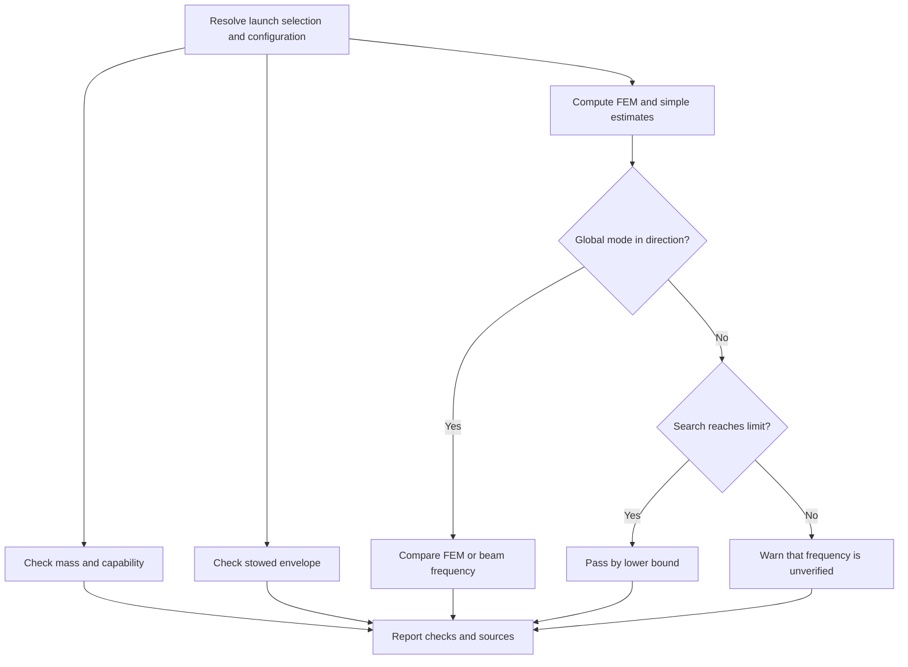

# Structure analyses

These analyses connect the part layout to mass distribution, clearances, launch loads, vibration and launcher constraints. They support early sizing and layout decisions. Every geometric result is computed from the part boxes (the `size` of each part), so it is only as good as the box approximation.

| Analysis | Purpose | Main inputs | Main outputs |
|---|---|---|---|
| `structure.mass_properties` | Compute mass and inertia | Part masses, boxes, poses | Mass, centre of mass, inertia tensor |
| `structure.external_geometry` | Measure the outer shape | Oriented part boxes | Projected areas, centroids, exposed area |
| `structure.interference` | Find box overlaps | Boxes, mount chains, tolerance | Penetrations, edge contacts, minimum clearance |
| `structure.cone_clearance` | Find obstructed cones | Boxes, axes, half-angles, range | Obstructions with distance and angle |
| `structure.static_load` | Estimate quasi-static mount loads | Masses, mount tree, load factors | Forces, bending moments, margins |
| `structure.modal_estimate` | Estimate first natural frequencies | Panel geometry, material, mounted mass | Local frequencies and applicable margins |
| `structure.modal_fem` | Resolve coupled natural modes | Panels, members, masses, supports | Frequencies, participation, optional shapes |
| `structure.launch_fit` | Compare against launch limits | Launch selection, envelope, mass and modes | Mass, size and frequency checks |

## Common ground

The right-handed spacecraft body frame is the reference for placements, inertia components, projections and clearances. The centre of a part's box is its local origin, and the box edges are `size` along the part's own axes. The mount chain composes translations and rotations into the body frame. Axial in the launch analyses means body $Z$. Lateral means $X$ or $Y$. These analyses are static geometry or launch models and use no orbit samples or attitude law.

Which placement is used depends on the analysis:

- `structure.static_load`, `structure.modal_estimate`, `structure.modal_fem` and `structure.launch_fit` are launch analyses. They take the placement from `conditions.launch.configuration`. Without it they use the base placement.
- `structure.mass_properties`, `structure.external_geometry`, `structure.interference` and `structure.cone_clearance` use the configuration of the phase of the selected case, or the base placement.
- A configuration chosen explicitly for a run overrides both rules.

See the [design model](../model.md#56-launch-vehicle-dispenser-and-launch-fit-5). A `count` represents coincident copies at the recorded pose. It scales mass, while geometry uses a single box for those copies.

The three checks that return a margin use one definition, $\mathrm{margin} = \text{capability}/\text{demand} - 1$ (`ratio_margin` in `sat_analysis::spec`). A margin is 0 or more when the capability covers the demand. If the demand is 0 the margin is infinite and is reported as absent.

## structure.mass_properties — Mass properties

### What it answers

Where is the spacecraft's centre of mass and how is its inertia distributed about that centre?

### Inputs

| Quantity | Symbol | Unit | Design data | Default |
|---|---|---|---|---|
| Unit mass and count | $m_i,N_i$ | kg, 1 | `mass`, `count` | At least one part mass must be given. Count defaults to 1. A written `mass` that cannot be read is reported as a missing input |
| Box dimensions and pose | $a_i,b_i,c_i,\mathbf r_i,\mathbf R_i$ | m, m, m, m, 1 | `size`, mount chain and configuration | Point mass without size. Origin and identity rotation for an unplaced part |
| Mass cap | $M_{\mathrm{lim}}$ | kg | Mass budget requirement, `constraint.value` | Optional |
| Centre-of-mass box, intrinsic inertia | — | m, kg·m² | Library inputs `com_box`, `inertia` | Design projection leaves both unset |

### Model and assumptions

Each part is a rigid body whose mass sits at its origin. Its own inertia is that of a uniform solid box with the part's `size`, or zero for a point mass. The library also accepts a per-unit intrinsic tensor in the part frame, which replaces the box tensor and is multiplied by the count. The output is bare part mass, including dry tank hardware. Loaded propellant comes from the separate `propulsion.mass_properties` analysis.

The total inertia is built in three steps. Each part's box tensor is rotated into body axes. It is then shifted from the part centre to the spacecraft centre of mass with the parallel-axis theorem. The shifted tensors are added.



*The inertia of each part about its own centre is rotated into body axes and shifted by the offset vector from the spacecraft centre of mass.*

### Equations

$M_i$ and $M$ are part-group and total mass in kg. $\mathbf r_{\mathrm{cm}}$ and $\mathbf d_i$ are the spacecraft centre of mass and offset to the part in m. $\mathbf I_3$ is the identity. $\mathbf J_i$ is the box tensor about the part centre in local axes and $\mathbf J$ the assembled tensor about the spacecraft centre, both in kg·m². The $\mathbf J_i$ expression is the standard inertia of a uniform rectangular box. The last term of $\mathbf J$ is the parallel-axis theorem.

```math
\begin{aligned}
M_i &= N_i m_i,\qquad M=\sum_i M_i,\qquad
\mathbf r_{\mathrm{cm}}=\frac{\sum_i M_i\mathbf r_i}{M},\quad \mathbf d_i=\mathbf r_i-\mathbf r_{\mathrm{cm}},\\
\mathbf J_i &= \frac{M_i}{12}\operatorname{diag}(b_i^2+c_i^2,\ c_i^2+a_i^2,\ a_i^2+b_i^2),\\
\mathbf J &= \sum_i\left[\mathbf R_i\mathbf J_i\mathbf R_i^{\mathsf T}
+M_i\big(\lVert\mathbf d_i\rVert^2\mathbf I_3-\mathbf d_i\mathbf d_i^{\mathsf T}\big)\right].
\end{aligned}\tag{1}
```

### Algorithm

1. Resolve mass, count and pose for parts with mass. Report unreadable written masses as missing inputs.
2. Validate items: mass and box sides must be 0 or more, and the total mass must be positive. Compute $\mathbf r_{\mathrm{cm}}$, then rotate and shift each contribution using (1). The part rotation is normalised first.
3. Diagonalise the symmetric 3 × 3 tensor with the cyclic Jacobi method. It sweeps the three off-diagonal pairs with plane rotations (at most 50 sweeps) until the off-diagonal sum is below $10^{-2}$ of machine epsilon times the largest entry. Return the principal moments in ascending order. The first two eigenvectors are columns, and the third is their cross product, so the axes are right-handed.

### Checks and verdicts

The optional `mass` check uses the un-grown total of mass × count, with no system margin. Its margin is $M_{\mathrm{lim}}-M$ in kg, and the check is `ok` if the margin is nonnegative, otherwise `violation`. This is the only check the design projection produces.

An optional library centre-of-mass box gives `ok` if every absolute offset from the box centre is within its half-extent, otherwise `violation`. Its reported margin is the smallest of the ratios (half-extent / absolute offset − 1) over the axes whose offset is nonzero.

### Outputs

| Field | Unit | Meaning |
|---|---|---|
| `summary` | kg, m, kg·m², 1 | Total mass, centre of mass, tensor, principal moments and axes |
| `items` | kg, 1, kg·m² | Group mass, fraction of total and contribution about the spacecraft centre |
| `checks` | kg or 1 | Applicable mass and position checks |

### Worked example

Run `fune -C target-wt/structure-demo analyze structure.mass_properties --json` on a private copy of `fixtures/demo-6u`. The 38 parts with a mass total 5.548 kg, with centre $(0.001615717,0.009821918,0.003231435)$ m. The mass check margin is $12-5.548=6.452$ kg.

Centre of mass, $x$ component. Most parts sit in mirror pairs about $x=0$, such as `SP_MX` and `SP_PX`, and cancel in $\sum M_i x_i$. The terms that remain, in kg·m, are:

| Part | $M_i$ (kg) | $x_i$ (m) | $M_i x_i$ |
|---|---|---|---|
| `RW_X` | 0.152 | −0.020 | −0.003040 |
| `RW_Y` | 0.150 | −0.020 | −0.003000 |
| `RW_Z` | 0.150 | 0.022 | 0.003300 |
| `SAP_PY` | 0.180 | 0.050 | 0.009000 |
| `CELL_MOD_1` to `_4` | 4 × 0.013 | 0.052 | 0.002704 |

The sum is 0.008964 kg·m, so $x_{\mathrm{cm}}=0.008964/5.548=0.001615717$ m, as printed.

Inertia, $xx$ term of `BUS_FRAME` (mass 0.62 kg, box 0.1 × 0.226 × 0.366 m, no rotation). The offset from the centre of mass is $\mathbf d=(-0.001616,-0.009822,-0.003231)$ m. By (1), $0.62(0.226^2+0.366^2)/12+0.62(0.009821918^2+0.003231435^2)=0.009559987+0.000066286=0.009626272$ kg·m², as printed. Its mass fraction is $0.62/5.548=0.111752$.

Inertia of a rotated box. `CELL_MOD_1` (0.013 kg, box 0.3018 × 0.05 × 0.0003 m) is turned 90° about $Y$, so its long side lies along body $Z$ and its local $zz$ moment becomes the body $xx$ moment: $0.013(0.3018^2+0.05^2)/12=0.000101382$ kg·m². The shift is $0.013(0.133678^2+0.003231^2)=0.000232444$ kg·m². The sum is 0.000333825 kg·m², as printed. The entire vehicle gives $J_{xx}=0.112280794$ kg·m².

### Limits

The box dimensions do not capture non-uniform mass distribution, internal cavities or offsets of a part's centre of mass. Representing repeated copies at one point omits their physical spacing. Products of inertia are exact for the boxes but only as good as the placement of each box.

### Verification

`mass_properties.rs` tests a single box, two point masses (parallel axis), nonzero products of inertia, a rotated box that swaps axes, the principal axes of a rotated rod, and count scaling with the mass check, all against hand results.

### Source

[Mass properties](../../crates/lib/analysis/src/structure/mass_properties.rs), [projection](../../crates/app/projection/src/structure.rs), [body placement](../../crates/app/projection/src/structure/body_boxes.rs), [symmetric eigenanalysis](../../crates/lib/astro/src/math/eigen.rs).

## structure.external_geometry — External geometry

### What it answers

What cross section does the vehicle present by direction, where is its projected centroid, and how much box surface is exposed?

### Inputs

| Quantity | Symbol | Unit | Design data | Default |
|---|---|---|---|---|
| Oriented boxes | $B_i$ | m | `size`, mount pose, configuration | At least one usable box must be given |
| Projection directions | $\hat{\mathbf d}$ | 1 | Body axes and standard quadrature in the analysis | 3 axes and 384 quadrature directions (analysis default) |

A part without a positive `size` is listed and left out. If no part has a box, the projection reports a missing input.

### Model and assumptions

The silhouette of one box along $\hat{\mathbf d}$ is the convex hull of its eight corners projected onto the plane through the body origin perpendicular to $\hat{\mathbf d}$. The projected area of the vehicle is the exact area of the union of these silhouettes, so boxes that hide each other are not counted twice.



*The union is measured exactly by cutting the plane into slabs at every vertex height and edge crossing.*

The centroid of the union is reported as a point in body coordinates on that plane. The aerodynamic and solar-pressure torque analyses use it as the centre of pressure for a uniform load on the silhouette. Their torque arm is the difference between this point and the centre of mass projected on the same plane.

Exposed surface area is a separate face-by-face measurement. A face is exposed where no other box covers it. A part whose eight corners lie inside another single box is internal and contributes no surface.

### Equations

$\mathcal U$ is the projected silhouette, $\mathbf x$ a point on its plane in m, $A$ its area in m² and $\mathbf c$ the centroid in m. $A_f$ is a box face area and $A_{\mathrm{covered},f}$ the area of the union of the footprints of other boxes on that face, both in m². $\theta$ and $\varphi$ are polar and azimuth angles in rad. $A(\theta,\varphi)=A(-\hat{\mathbf d})$ is equal for opposite directions, so the mean over the sphere is an integral over a hemisphere.

```math
\begin{aligned}
\mathcal U &= \bigcup_i (\mathbf I_3-\hat{\mathbf d}\hat{\mathbf d}^{\mathsf T}) B_i,\quad
A=\int_{\mathcal U}dA,\quad \mathbf c=\frac{\int_{\mathcal U}\mathbf x\,dA}{A},\\
\overline A&=\frac1{2\pi}\int_0^{2\pi}\int_0^{\pi/2} A(\theta,\varphi)\sin\theta\,d\theta\,d\varphi,\qquad
A_{\mathrm{exposed}}=\sum_f(A_f-A_{\mathrm{covered},f}).
\end{aligned}\tag{2}
```

### Algorithm

1. Project the eight box corners and form each convex hull. Sweep the polygon union in slabs separated by vertex heights and edge crossings of different polygons. In a slab each polygon is a trapezoid and their order does not change, so the union is a set of intervals. Merge the intervals in each slab and integrate area (trapezoid rule) and first moments (Simpson's rule, exact for the quadratic integrand). There is no grid and no resolution parameter. A box that lies inside another box with no tolerance is skipped, because the union hides it.
2. Evaluate the three body axes plus a product Gauss–Legendre rule on the hemisphere: 12 polar points on $[0,\pi/2]$ with the $\sin\theta$ weight, and 8 azimuth points in each of 4 quadrants ($12\times32=384$ directions). The quadrant boundaries contain the kinks of a box's projected area. Weights sum to 1 and give the mean. The minimum and maximum are taken over all 387 directions, the body axes first, and the first direction found is kept on a tie. The maximum is therefore a lower bound and the minimum an upper bound of the true extremes.
3. For exposed area, mark a box internal when another single box contains all its corners within 0.1 mm. A box of identical shape is internal only if its index is the higher. For each face of each non-internal box, cut the other non-internal boxes by the face plane. A box that crosses the plane covers its cross section. A box that touches the plane within 0.1 mm covers its contact footprint. Clip these polygons to the face and unite them. The exposed area is the face area minus the union, and a remainder of at most $10^{-12}$ of the face area counts as zero. Internal boxes neither expose faces nor cover others. Bin each exposed face by the axis along which its normal has the largest component, with its sign. A normal between two axes goes to the lower axis.

### Checks and verdicts

`external_geometry` is an `ok` summary with no area threshold or margin. Unusable boxes are listed. If no usable box exists the analysis stops with an input error.

### Outputs

| Field | Unit | Meaning |
|---|---|---|
| `projected` | m², m | Area and centroid for X, Y and Z |
| `mean_projected_area`, `min_projected`, `max_projected` | m², 1 | Directional mean and sampled extremes with directions |
| `exposed_area`, `exposed_by_direction`, `exposed_by_part` | m² | Exposed face totals |
| `internal_parts`, `skipped`, `repeated` | — | Containment and geometry diagnostics |

### Worked example

Run `fune -C target-wt/structure-demo analyze structure.external_geometry --json`. This is the base placement (the paddle `SAP_PY` is deployed). With 36 boxes, the X projection is 0.1669586 m² and its body-frame centroid is $(0,0.111321925,0.0000123983)$ m. The mean is 0.108341992 m², the sampled minimum 0.02513985 m² (along $Z$) and maximum 0.17222397 m². The direction count is $3+12(4\times8)=387$. Fifteen parts are internal, for example `BAT` inside `BUS_FRAME`.

Exposed area of one part by hand. `EPT` is a box 0.09 × 0.09 × 0.06 m centred at $(0,0.06,-0.155)$ m, so it spans $z=-0.185$ to $-0.125$ m. It is not internal because it sticks 2 mm out of `BUS_FRAME` ($z\ge-0.183$ m). Its $-z$ face (0.09 × 0.09 = 0.0081 m²) lies 1 mm outside `PANEL_MZ` ($z=-0.184$ to $-0.182$ m), which is more than the 0.1 mm tolerance, so it is fully exposed. On each of the four side faces the part of the face with $z<-0.184$ m is not covered by the frame or the panel, a strip 1 mm × 0.09 m = 0.00009 m². The $+z$ face is inside the body and covered. The total is $0.0081+4(0.00009)=0.00846$ m², as printed for `EPT`.

The six exposure bins sum to $2(0.39107510+0.11034686+0.02513750)=1.05311892$ m², which equals `exposed_area`.

### Limits

Sampled extremes bound the observed range only. A box enclosed by several boxes jointly, but by no single box, can still contribute exposed faces. The centroid assumes uniform projected loading and does not account for face-dependent coefficients. Mean projected area from 384 directions agrees with the closed form for one box to about $10^{-15}$ for an axis-aligned box and about $10^{-3}$ for a box turned at a general angle (code comments of the quadrature, from tests on 40 random orientations).

### Verification

`external_geometry/tests/report.rs` checks a single 0.3 × 0.2 × 0.1 m box: projected areas 0.02, 0.03 and 0.06 m², mean $(xy+yz+zx)/2=0.055$ m² and surface 0.22 m². `external_geometry/tests.rs` tests the hemispherical mean against that closed form for axis-aligned and rotated boxes, two boxes side by side, a plate on an edge like a deployed paddle, and invariance under rigid motion. `external_geometry/tests/exposure.rs` checks glued boxes, a panel covering a face, a rotated plate and a box piercing a face against hand-counted surfaces.

### Source

[Report](../../crates/lib/analysis/src/structure/external_geometry.rs), [geometry](../../crates/lib/analysis/src/structure/external_geometry/geometry.rs), [directions](../../crates/lib/analysis/src/structure/external_geometry/directions.rs), [exposed area](../../crates/lib/analysis/src/structure/external_geometry/exposed.rs), [polygon union](../../crates/lib/astro/src/math/planar.rs), [projection](../../crates/app/projection/src/structure/external_geometry.rs).

## structure.interference — Part interference

### What it answers

Which unrelated part boxes overlap more than the tolerance, and which shallow, slender overlaps look like edge contact?

### Inputs

| Quantity | Symbol | Unit | Design data | Default |
|---|---|---|---|---|
| Oriented boxes and mount relationships | $\mathbf r_A,\hat{\mathbf u}_{Ai},h_{Ai}$ | m, 1, m | `size`, poses, mount chains | Parts without usable boxes are skipped |
| Penetration tolerance | $\delta$ | m | `analysis.structure.interference_tolerance` | 0.0001 m (analysis default) |
| Accepted findings | — | — | `analysis.structure.acknowledged`, `finding = "interference"` | None |

### Model and assumptions

Two convex boxes are disjoint if some axis separates their projections. For boxes it is enough to test the face normals of both boxes and the cross products of their edge directions (the separating-axis theorem). The largest gap over those axes is the signed separation. A negative value is the penetration depth, and moving one box that far along the axis separates them. For disjoint boxes the largest gap is a lower bound of the true distance, exact when two faces face each other.



*On each candidate axis the gap is the centre distance minus the two projection radii.*

Pairs on one mount chain (one part is an ancestor of the other) are not judged. Siblings and parts on different branches always are. A geometric sliver along the edges of both boxes can be classified as edge contact even if its penetration exceeds the tolerance, because panel boxes are centred on the face of their mount and so overlap by half a thickness at shared corners.

### Equations

For each candidate unit axis $\hat{\mathbf n}$, box $A$ has centre $\mathbf r_A$, unit local axes $\hat{\mathbf u}_{Ai}$ and half-lengths $h_{Ai}$. Define $s_A$ as the projection radius, $g$ as the signed axis gap and $d_{\mathrm{pen}}$ as penetration, all in m. Box $B$ uses the same notation.

```math
s_A(\hat{\mathbf n})=\sum_i h_{Ai}|\hat{\mathbf n}\cdot\hat{\mathbf u}_{Ai}|,\qquad
g(\hat{\mathbf n})=|\hat{\mathbf n}\cdot(\mathbf r_B-\mathbf r_A)|-s_A-s_B,\qquad
d_{\mathrm{pen}}=\max(0,-\max_{\hat{\mathbf n}}g).
\tag{3}
```

### Algorithm

1. Enumerate unordered pairs in ID order, skipping mount-chain pairs and a pair with the same ID. For each pair, test the six face axes and the nine edge cross products with norm greater than $10^{-9}$ (normalised), up to 15 axes in all. Keep the axis with the largest gap, with the earlier (face) axis kept on a tie within $10^{-12}$ m.
2. If $d_{\mathrm{pen}}\le\delta$ the pair is not an overlap. Its gap, taken as $\max(0,g)$, is a candidate for the minimum clearance. A pair that touches or penetrates within the tolerance therefore has gap 0, and a separated pair has its positive gap. The smallest gap wins, and the first pair in ID order is kept on a tie.
3. Otherwise test for an edge contact. In the local axes of each box, take the interval of the other box's projection that overlaps the box range, with length $e_k$ along axis $k$. Let $t$ be the smaller of the two boxes' shortest sides and $\epsilon=\max(\delta,10^{-9}\,\mathrm{m})$. In both boxes the axis with the longest interval is the edge direction and the other two are the cross section. Both cross-section intervals must satisfy $e_k\le t+\epsilon$ and end at the box edge within $\epsilon$. The edge-direction length must be at least 4 times the larger cross-section interval. Finally the smaller of the two volume bounds $\prod_k e_k$ must be at most 2% of the smaller box volume.
4. Report a qualified sliver as an edge contact. Report other overlaps sorted by decreasing depth, matching acknowledged pairs (in either order).

### Checks and verdicts

`overlap:<first>:<second>` warns for each unacknowledged overlap. Acknowledged overlaps remain in the output with an `ok` check whose text starts with the reason. Edge contacts and contacts within the tolerance produce no check. If there are no overlaps the summary check `interference` is `ok`, even with fewer than two boxes. There is no violation level for a box overlap.

### Outputs

| Field | Unit | Meaning |
|---|---|---|
| `parts_judged`, `pairs_judged`, `pairs_in_mount_chain` | 1 | Counts of usable parts, comparisons and mount exclusions |
| `overlaps` | m, 1 | Penetration, separating direction and acknowledgement |
| `edge_contacts`, `min_clearance` | m | Slivers, and the smallest gap among pairs that do not overlap by more than the tolerance (touching pairs give 0) |
| `skipped`, `repeated`, `checks` | — | Coverage and verdicts |

### Worked example

Run `fune -C target-wt/structure-demo analyze structure.interference --json` (base placement). From 36 boxes and 57 mount-chain exclusions, $36(36-1)/2-57=573$ pairs are judged. There are six overlaps and twelve edge contacts.

`EPT` and `PANEL_MZ` overlap by 3.00 mm. `EPT` spans $z=-0.185$ to $-0.125$ m and `PANEL_MZ` spans $-0.184$ to $-0.182$ m. For $\hat{\mathbf n}=\hat{\mathbf z}$ the centre distance is $|-0.183-(-0.155)|=0.028$ m and the radii are $0.030$ and $0.001$ m, so $g=0.028-0.031=-0.003$ m. The $x$ and $y$ axes give gaps of about $-0.095$ and $-0.098$ m, so $z$ is the largest and $d_{\mathrm{pen}}=3.00$ mm, as printed. Moving `PANEL_MZ` along $-z$ separates them. The four sun-sensor pairs `SP_MX`–`SS_MX` and similar overlap by 5.30 mm and also warn. The 1.00 mm `SAP_PY`–`SP_PY` overlap is listed with its acknowledgement and an `ok` check.

`PANEL_MX` and `PANEL_MY` overlap by 0.75 mm along the shared edge. The overlap is 0.75 × 0.75 × 366 mm. Each cross-section interval is below $t=1.5$ mm and touches the box edge, the length is 488 times the cross section, and the volume is 0.17% of the smaller box. It is an edge contact and has no check. The minimum clearance is 0 m (first pair `PANEL_MZ`–`SAP_PY`).

### Limits

Bounding boxes can overpredict interference. Minimum clearance is a separating-axis projection gap, which can differ from the shortest Euclidean distance. The edge heuristic approximates contact and does not inspect real mating geometry. The scan represents a single placement and omits swept paths. A child that sticks out of its ancestor's box is not seen, because ancestors are not judged.

### Verification

`interference/tests.rs` checks cube penetration and axis, the tolerance boundary, the smallest clearance among non-overlapping pairs, excluded ancestors, count handling, acknowledgements, panel-corner slivers versus a sensor sunk into a panel, and input-order independence. `obb/tests.rs` and `edge_contact/tests.rs` check the separation search and the sliver rule.

### Source

[Interference analysis](../../crates/lib/analysis/src/structure/interference.rs), [pair scan](../../crates/lib/analysis/src/structure/interference/scan.rs), [box separation](../../crates/lib/analysis/src/structure/interference/obb.rs), [edge classification](../../crates/lib/analysis/src/structure/interference/edge_contact.rs), [projection](../../crates/app/projection/src/structure/interference.rs).

## structure.cone_clearance — Plume and field-of-view clearance

### What it answers

Does a spacecraft part box enter a thruster plume, sensor field of view or antenna beam? The sensor roles are `star_tracker`, `sun_sensor` and `camera`.

### Inputs

| Quantity | Symbol | Unit | Design data | Default |
|---|---|---|---|---|
| Carrier axis and half-angle | $\hat{\mathbf a},\theta$ | 1, rad | Thruster `direction` reversed and `plume_half_angle`. Sensor `boresight` and `fov_half_angle`. Antenna `boresight` and half the full half-power `beamwidth` | Must be given for a carrier to be judged |
| Carrier and obstacle boxes | $B_i$ | m | `size`, mount pose and configuration | Skip unsized obstacles. Unsized carrier uses part origin |
| Range | $R_{\mathrm c}$ | m | `analysis.structure.cone_clearance_range` | Diagonal of body-aligned bounding box of usable boxes and carrier origins (analysis default) |
| Accepted findings | — | — | `analysis.structure.acknowledged`, `finding = "cone_clearance"` | None |

A carrier without an axis, with a zero axis, without a half-angle or with a half-angle outside the open interval $(0,\pi/2)$ is listed in `skipped_carriers` and not judged.

### Model and assumptions

The cone is a circular cone with its apex at $\mathbf p_0$, cut off by a sphere of radius $R_{\mathrm c}$ about the apex. The apex is where the axis leaves the carrier's own box. The code offsets the apex from the carrier centre by the support distance of the box along the axis. For an axis along a box axis this equals the distance at which the centre ray leaves the box. For an oblique axis it is the distance to the support plane (the plane perpendicular to the axis through the farthest box corner), which can place the apex beyond the point where the centre ray leaves the box.



*The apex lies on the support plane of the carrier box. The finite cone is tested against each candidate obstacle box in the body frame.*

A nozzle or aperture is assumed to be on the box face that the axis points through. The carrier's own box and its mount-chain relatives (ancestors and parts mounted on the carrier) are not judged.

### Equations

$\mathbf p_0$ is the apex in m, $\mathbf r_0$ the carrier centre, and $\mathbf q=\mathbf x-\mathbf p_0$ the vector to a point $\mathbf x$ of an obstacle box, in m. The carrier box axes and half-lengths are $\hat{\mathbf u}_i,h_i$. A point lies in the finite cone when the second and third conditions hold.

```math
\mathbf p_0=\mathbf r_0+\hat{\mathbf a}\sum_i h_i|\hat{\mathbf a}\cdot\hat{\mathbf u}_i|,\qquad
\mathbf q\cdot\hat{\mathbf a}\ge\lVert\mathbf q\rVert\cos\theta,\qquad
\lVert\mathbf q\rVert\le R_{\mathrm c}.
\tag{4}
```

### Algorithm

1. Transform and normalise carrier axes. Skip missing or invalid axes and half-angles outside $(0,\pi/2)$. Derive the apex from (4) and exclude the carrier's own box and mount-chain relatives from its obstacle list.
2. In coordinates centred on the apex, if the apex lies inside a box, report distance and angle zero. Otherwise find the least angle between the axis and a box point. A slab ray test finds whether the forward axis hits the box, which gives angle 0. For a missed axis the least angle lies on the 12 box edges. On each edge the direction of points forms a great-circle arc, and the point nearest the axis is the projection of the axis onto the plane of the edge and the apex, or an end point.
3. If the least angle is within the half-angle plus $10^{-12}$ rad, find the nearest point of the box inside the cone. Evaluate the box vertices, the end points, the foot point nearest the apex and the roots of the quadratic $(\mathbf q\cdot\hat{\mathbf a})^2=\cos^2\theta\,\lVert\mathbf q\rVert^2$ on each edge, the foot of the perpendicular from the apex on each face plane, and the point of each face on the cone generator nearest the face normal. Keep the candidates that lie in the box and the forward cone. The smallest distance, also compared with the distance of the least-angle point, is the obstruction distance. If it exceeds $R_{\mathrm c}$ the box is not reported. The reported minimum angle uses the entire box, even where the range clips it. Sort obstructions by distance, then by part ID.

### Checks and verdicts

`obstruction:<carrier>:<part>` warns for an unacknowledged hit, including tangency within tolerance. An acknowledgement matches an ordered pair (carrier, part) and records the same hit with `ok`. An acknowledgement that names a configuration applies only when that configuration is in effect. If there are no hits the summary check `cone_clearance` is `ok`. Skipped carriers and boxes are listed. There is no violation level or signed clearance margin.

### Outputs

| Field | Unit | Meaning |
|---|---|---|
| `range`, `cones` | m, rad, 1 | Range and each cone's apex, angle and axis |
| `cones[].obstructions` | m, rad | Nearest in-cone distance, least angle and acknowledgement |
| `skipped_carriers`, `skipped`, `checks` | — | Missing data and findings |

### Worked example

Run `fune -C target-wt/structure-demo analyze structure.cone_clearance --json` (base placement). Seven cones are judged with range 0.599293125 m. Two are obstructed. For the star tracker `STT`, half-angle 10°, the axis is along $-Y$ and its box centre is at $y=-0.068$ m. The 0.09 m side of the box lies along the axis, so the support distance is $0.045$ m and the apex is at $y=-0.068-0.045=-0.113$ m, as printed. The `SP_MY` box centre is at $y=-0.115$ m and its thickness along $y$ is 0.0016 m, so its face nearest the apex is at $y=-0.115+0.0016/2=-0.1142$ m. The axis hits it there, at distance $0.1142-0.113=0.0012$ m and angle 0, matching the hit. The sun sensor `SS_PY` (half-angle 60°) is obstructed by `SAP_PY` and the four `CELL_MOD` boxes.

### Limits

Cones approximate the field, beam or plume. The boxes can overstate actual obstruction. The default range encloses carrier centres and boxes. An oblique axis can put its support-offset apex outside those bounds. The mount-chain exclusion also hides obstruction by the carrier's own mount. The model omits sidelobes, reflections, plume spread beyond the selected cone and changes between configurations.

### Verification

`cone_clearance/cone/tests.rs` checks on-axis distance, edge tangency just inside and outside the cone, a minimum on an interior face (distance 4 for a cube at $(3,2.5,0)$), a box behind the apex, radial cut-off, a thin plate face-on and edge-on, and a rotated box with no vertex inside. `cone_clearance/tests.rs` checks the apex at the carrier's own box exit, mount-chain exclusion, skipped carriers, the default range and acknowledgements.

### Source

[Cone analysis](../../crates/lib/analysis/src/structure/cone_clearance.rs), [cone geometry](../../crates/lib/analysis/src/structure/cone_clearance/cone.rs), [projection](../../crates/app/projection/src/structure/cone_clearance.rs).

## structure.static_load — Quasi-static loads

### What it answers

What forces does each mount carry under the specified launch accelerations, and how much margin remains against the entered allowable?

### Inputs

| Quantity | Symbol | Unit | Design data | Default |
|---|---|---|---|---|
| Part mass and mount | $M_i$ | kg | `mass`, `count`, mount parent | Absent mass omits the part. A root is mounted on `LV` |
| Axial and lateral load factors | $n_a,n_l$ | 1 | `conditions.launch.load_axial`, `conditions.launch.load_lateral` or catalog `launch_load_axial`, `launch_load_lateral` | Must be given |
| Yield safety factor | $s$ | 1 | `conditions.launch.safety_factor_yield` | 1.25 (analysis default) |
| Lateral allowable | $L_l$ | N | `analysis.structure.fastener_allowable` | Optional |
| Height, axial and moment allowables | $h_i,L_a,L_m$ | m, N, N·m | Library inputs `cg_height`, `allowable_axial`, `allowable_moment` | Projection supplies none. Height contributes zero by default |

### Model and assumptions

The launch accelerations act statically on the masses. Every mount carries all mass above it in the mount tree. The design path applies one lateral allowable per interface: the single `fastener_allowable` value is compared with the whole lateral force of that mount. It reads the yield factor as the sole active factor. The design's `safety_factor_ultimate` and material `yield_strength` and `ultimate_strength` do not feed this analysis.

The margin of safety uses one factored allowable for each supplied component. The load is multiplied by $s$ and compared with the allowable $L$. For several library cases, the axial and lateral loads use the separate maxima over cases, and the resultant uses the largest same-case vector length.



*The mass carried by a mount is the sum of all masses mounted above it. The values are those of the demo.*

### Equations

$g_0$ is 9.80665 m/s². $M_m$ is the subtree mass in kg at mount $m$, that is, the sum of the carried masses of the parts mounted directly on it. $F_a,F_l$ are axial and lateral force at the mount and $F_r$ the resultant force of part $i$, in N. $B_m$ is the lateral bending moment in N·m from the parts $i$ mounted directly on $m$, with carried masses $M_{i,\mathrm{sub}}$ and supplied heights $h_i$. $n_{a,k},n_{l,k}$ are load factors in case $k$. $L$ is an allowable and $D$ the unfactored demand in matching units. $\mathrm{MS}$ is the dimensionless margin of safety.

```math
\begin{aligned}
F_a&=M_m g_0\max_k|n_{a,k}|,\qquad F_l=M_m g_0\max_k|n_{l,k}|,\\
F_r&=M_i g_0\max_k\sqrt{n_{a,k}^2+n_{l,k}^2},\qquad
B_m=g_0\max_k|n_{l,k}|\sum_i M_{i,\mathrm{sub}}h_i,\\
\mathrm{MS}&=\frac{L}{sD}-1.
\end{aligned}\tag{5}
```

### Algorithm

1. Resolve launch acceleration from the conditions first, then the applicable dispenser or launcher value. Convert to multiples of $g_0$.
2. Accumulate each part's counted mass up the mount chain. Reject cycles. Compute each part's inertial forces and each interface's carried forces with (5).
3. Calculate the moment from supplied heights. For each mount compute MS for each allowable that is given and has a nonzero load, and take the minimum. The design projection supplies one launch case and no heights.

### Checks and verdicts

`interface:<mount>` exists for each mount that has an interface entry. It is `ok` for a nonnegative minimum margin and `violation` for a negative margin, with a zero warning band. With no finite margin (no allowable, or zero load) the check is `ok` and its text says "No allowable values". A mount without an interface entry has no check. In the design path every mount has an entry when `fastener_allowable` is set, and none has one otherwise.

### Outputs

| Field | Unit | Meaning |
|---|---|---|
| `items` | N | Axial, lateral and resultant force per part |
| `mounts` | kg, N, N·m, 1 | Carried mass, load components, moment and margins |
| `safety_factor`, `checks` | 1 | Applied factor and interface verdicts |

### Worked example

Run `fune -C target-wt/structure-demo analyze structure.static_load --json`. The demo applies 6 and 2 times $g_0$ and uses 1.25 as the factor. Its written ultimate factor of 1.4 has no effect on this result. The allowable is 1500 N.

The `LV` mount carries 5.548 kg. Its lateral force is $5.548\times9.80665\times2=108.8145884$ N. By (5), $1500/(1.25\times108.8145884)-1=10.0279331$, matching the `ok` margin. Its axial force is 326.4437652 N, with no axial allowable.

The `PANEL_PY` mount carries `SAP_PY` (0.18 kg plus 0.052 kg of cells), `SP_PY` (0.1 kg) and `SS_PY` (0.035 kg): $0.367$ kg. Its lateral force is $0.367\times9.80665\times2=7.1980811$ N and $\mathrm{MS}=1500/(1.25\times7.1980811)-1=165.711$, as printed.

### Limits

The model does not resolve joint stresses, load sharing among fasteners, material yield or ultimate limits, or vibration and buckling. The demo allowable is the shear load of one screw, applied to the whole lateral force of a mount. Design projection supplies no moment arms or loaded propellant.

### Verification

`static_load/tests.rs` checks a hand-calculated mount tree and moment (0.6 kg on a 0.4 kg panel on a frame at 7 g and 3 g: 41.19 N, 68.65 N, 29.42 N and 1.471 N·m), a zero-load margin that is absent, with the axial margin $50/(1.25\cdot1\cdot9.80665\cdot2)-1=1.0394$, and rejection of a mount cycle. `spec/tests.rs` checks the margin definition.

### Source

[Quasi-static loads](../../crates/lib/analysis/src/structure/static_load.rs), [projection](../../crates/app/projection/src/structure.rs), [launch values](../../crates/app/projection/src/launch.rs).

## structure.modal_estimate — Natural frequency estimate

### What it answers

What first-mode frequencies follow from idealised panel and cantilever models? Which known minimum frequencies do applicable estimates meet?

### Inputs

| Quantity | Symbol | Unit | Design data | Default |
|---|---|---|---|---|
| Panel sides and thickness | $a,b,t$ | m | Panel `size` (the two longest sides), `thickness` | Must be given |
| Elastic and mass properties | $E,\nu,\rho$ | Pa, 1, kg/m³ | `material`, `analysis.structure.material.<name>.youngs_modulus`, `poisson_ratio`, `density` in that material table | Must be given |
| Added panel mass | $m_{\mathrm{ns}}$ | kg | Direct children's `mass` and `count` | Zero with no mounted mass |
| Cantilever geometry, rigidities and masses | $L,EI,EA,m,M_t$ | m, N·m², N, kg, kg | Library `beams` | No beams projected from the design. Optional tip mass defaults to 0 kg |
| Minimum frequencies | $f_{\mathrm{req}}$ | Hz | `min_frequency_lateral`, `min_frequency_axial` (launcher or dispenser), verification requirements | No check without a limit. These limits apply to beams only, and the design projection has no beams and no panel limit |

### Model and assumptions

The panel is a uniform isotropic thin plate (Kirchhoff theory) with four simply supported edges. Directly mounted part masses are smeared uniformly over its area. The first mode is the lowest out-of-plane mode, one half-wave in each direction, whose frequency is the standard result for a simply supported rectangular plate.

The library also models a uniform Euler–Bernoulli cantilever with an optional tip point mass, without shear deformation or rotary inertia. This represents the whole vehicle as a clamped bar.

### Equations

$D$ is plate flexural rigidity in N·m, $\mu$ areal density in kg/m² and $f_{11}$ the first panel frequency in Hz. The result is Leissa's plate formula with $m=n=1$.

```math
D=\frac{Et^3}{12(1-\nu^2)},\qquad
\mu=\rho t+\frac{m_{\mathrm{ns}}}{ab},\qquad
f_{11}=\frac{\pi}{2}\left(\frac1{a^2}+\frac1{b^2}\right)\sqrt{\frac{D}{\mu}}.\tag{6}
```

For a beam with nonzero mass $m$, the lowest positive root $x$ of the frequency equation for a cantilever with a tip mass determines the lateral frequency $f_l$ in Hz. When both $EA$ and $M_t$ are present and $M_t>0$, the axial root $y$ determines $f_a$ in Hz.

```math
\begin{aligned}
0&=1+\cos x\cosh x+(M_t/m)x(\cos x\sinh x-\sin x\cosh x),&
f_l&=\frac{x^2}{2\pi}\sqrt{\frac{EI}{mL^3}},\\
0&=y\sin y-(m/M_t)\cos y,&
f_a&=\frac{y}{2\pi}\sqrt{\frac{EA}{mL}}.
\end{aligned}
```

With zero beam mass, the tip-only lateral and axial frequencies are $\sqrt{3EI/(L^3M_t)}/(2\pi)$ and $\sqrt{EA/(LM_t)}/(2\pi)$. With nonzero beam mass and zero tip mass, the lateral root is $x=1.8751$ and the axial frequency is $\sqrt{EA/(mL)}/4$. Axial frequency requires $EA$.

### Algorithm

1. Select panel-role parts and take their two longest `size` dimensions. Read plate thickness and material and sum the mass × count of directly mounted parts. Require positive plate dimensions, modulus and density, and $0\le\nu<0.5$.
2. Evaluate (6). For library beams requiring a root, bisect on $[10^{-9},1.9]$ for bending or $[10^{-9},\pi/2]$ for axial, until the bracket is no wider than $10^{-14}$ or after 200 iterations.
3. Attach the matching lower limit when supplied.

### Checks and verdicts

For a supplied limit the margin is $f/f_{\mathrm{req}}-1$, where $f$ is the estimate in Hz. It gives `violation` below zero and `ok` otherwise. The warning band is zero. The design path returns local panel rows with no requirement check.

### Outputs

| Field | Unit | Meaning |
|---|---|---|
| `results` | Hz, 1 | Frequency by element and type, optional required frequency and margin |
| `checks` | 1 | Comparisons where limits exist |

### Worked example

Run `fune -C target-wt/structure-demo analyze structure.modal_estimate --json`. For `PANEL_MX`, $a=0.366$ m, $b=0.226$ m, $t=0.0015$ m, $E=68.9\times10^9$ Pa, $\nu=0.33$ and $\rho=2700$ kg/m³. Mounted mass is $0.21+0.035=0.245$ kg. Equation (6) gives $D=68.9\times10^9(0.0015)^3/(12\times0.8911)=21.7463$ N·m and $\mu=2700\times0.0015+0.245/0.082716=7.0118$ kg/m². Then $f_{11}=\frac{\pi}{2}(7.4653+19.5787)\sqrt{21.7463/7.0118}=74.81$ Hz. The unrounded values give 74.8102603 Hz, matching the panel row.

### Limits

The first plate mode represents one simply supported plate with smeared mass. Vehicle joints, support rails and concentrated component placement can require the coupled finite-element model. The beam model has no shear deformation.

### Verification

`modal_estimate.rs` checks a simply supported square plate by hand ($D=52.37$ N·m, $\mu=5.4$ kg/m², 244.6 Hz, and a factor $1/\sqrt2$ when the mounted mass equals the plate mass), the uniform cantilever root $x=1.875104$, the tip-mass limit against the Rayleigh formula $M+33m/140$, and the frequency requirement verdict.

### Source

[Closed-form estimates](../../crates/lib/analysis/src/structure/modal_estimate.rs), [projection](../../crates/app/projection/src/structure.rs), [panel inputs](../../crates/app/projection/src/structure/panel.rs), [bisection](../../crates/lib/astro/src/math/roots.rs).

## structure.modal_fem — Finite-element modal analysis

### What it answers

What are the lowest coupled modes of the structure under the selected launch support, and which carry appreciable whole-body participation?

### Inputs

| Quantity | Symbol | Unit | Design data | Default |
|---|---|---|---|---|
| Panel geometry and elasticity | $a,b,t,E,\nu,\rho$ | m, m, m, Pa, 1, kg/m³ | Panel `size`, `thickness`, `material` and properties as in modal estimate | Must be given |
| Panel and component masses | $m$ | kg | `mass`, `count`, mount tree, `analysis.structure.modal.tie.<part>` | Panel falls back to density × thickness × area. Tie override optional |
| Frame geometry and member section | — | m | Structure part `size`, `member_width`, `member_wall`, `material`, `mass` | Absent width omits member stiffness. Solid section with no wall |
| Mesh interval and merge tolerance | $h,\delta$ | m | `analysis.structure.modal.mesh_size`, `analysis.structure.modal.joint_tolerance` | Smaller of 0.025 m and shortest panel side divided by 4. Merge tolerance 0.001 m (analysis defaults) |
| Launch support | — | — | `conditions.launch.launch_constraint`, `conditions.launch.launch_constraint_face` or corresponding catalog attributes | Must be given, including face where required |
| Requested mode count | $n$ | 1 | Library `mode_count` | 6 for standalone analysis, 12 for the launch-fit search |

Other inputs (library): `distributed_mass` (non-structural mass spread over the model in proportion to the area each node carries, filled by frames without a member section), `drilling_factor` (default 0.1), skewed panels with a box orientation, and lumped masses with a footprint.

### Model and assumptions

The finite-element method (FEM) models panel mid-surfaces with four-node flat rectangular shell elements and frame members with two-node beam elements. The model is linear and is meant for order of magnitude and trends. It does not replace a detailed model.

**Shell element.** Each node has six degrees of freedom (DOFs): translations $u,v,w$ and rotations $\theta_u,\theta_v,\theta_n$ about the local axes. The local axes $(u,v,n)$ are a cyclic permutation of the body axes, with $n$ the panel normal, so no coordinate rotation is needed for axis-aligned panels. All fields use bilinear shape functions $N_i(\xi,\eta)=(1\pm\xi)(1\pm\eta)/4$. The stiffness is the sum of four parts, each integrated with 2 × 2 Gauss points:

- membrane: bilinear plane stress, $\mathbf D_m=\frac{Et}{1-\nu^2}\left(\begin{smallmatrix}1&\nu&0\\\nu&1&0\\0&0&(1-\nu)/2\end{smallmatrix}\right)$;
- bending: Reissner–Mindlin plate with curvatures $\kappa_x=\partial\theta_v/\partial x$, $\kappa_y=-\partial\theta_u/\partial y$, $\kappa_{xy}=\partial\theta_v/\partial y-\partial\theta_u/\partial x$ and $\mathbf D_b$ as $\mathbf D_m$ with $Et^3/[12(1-\nu^2)]$;
- transverse shear: mixed interpolation of tensorial components (MITC4), with shear stiffness $k_sGt$, shear correction $k_s=5/6$ and $G=E/[2(1+\nu)]$. The covariant shear strain $\gamma_\xi$ is measured at the midpoints of the edges $\eta=\pm1$ and interpolated linearly in $\eta$, and $\gamma_\eta$ at the midpoints of the edges $\xi=\pm1$ and interpolated linearly in $\xi$. This removes the shear locking of a thin plate;
- drilling: a penalty $\gamma_dGt(\theta_n-\omega)^2$ on the difference between the normal rotation and the in-plane rotation $\omega=\tfrac12(\partial v/\partial x-\partial u/\partial y)$, with $\gamma_d=0.1$. It gives the normal rotation a stiffness. A test shows that tenfold changes of the factor change the lowest six frequencies of a box by less than 1%.



*The element used for every panel.*

**Beam element.** The two-node Euler–Bernoulli beam has six DOFs per node. Bending uses cubic Hermite shape functions. Axial and torsion use linear ones. Shear deformation is neglected. The square section is solid (area $A=w^2$, second moment $I=w^4/12$, torsion constant $J=0.1406\,w^4$) or a tube with wall $t_w$. The stiffness terms scale with $EA/L$, $EI/L^3$ and $GJ/L$.

**Mass.** The mass matrix is diagonal (lumped), not the consistent matrix. Each shell element gives a quarter of its mass to every node as translational mass, with rotary inertia $(m_e/4)t^2/12$ on each of the three rotational DOFs of the node. Beam and component masses are translational only.

**Mesh from the design data.** Panels are parts of role `panel`. The thinnest side of the box is the normal and the other two are the sides. For panels aligned with the body axes the analysis builds one common grid per axis. It collects the panel edge and mid-plane coordinates, merges values closer than the joint tolerance, and divides each interval into equal parts of at most $h$ (default $\min(\text{shortest side}/4,\,25\ \mathrm{mm})$). Nodes are the grid points that a panel occupies. Panels that share an edge or meet at a T-junction share nodes there, so they are joined rigidly. Skewed panels get their own uniform grid in the panel plane and join only where a node falls within the tolerance of an existing node. Parts of role `structure` with a `member_width` and a size aligned with the body axes become beam members. For each of the 12 box edges the existing mesh nodes on the edge are ordered along it, and neighbouring nodes are joined by a beam. An edge with fewer than two nodes is reported and not modelled. The section sits on the panel mid-plane without eccentricity.

**Masses and attachment.** A panel's mass is its `mass` if given, else density × thickness × area, spread over its elements by area. This changes only the mass matrix. A frame's `mass` is spread over its beam members in proportion to their length, half on each end node. Frame mass without represented members is distributed by tributary shell area. A component mass is tied, in order, to the panel named in `analysis.structure.modal.tie`, then to the first panel or frame with members on its mount chain, and otherwise to the nearest panel. If several panels are within the joint tolerance of the nearest distance, they share the mass equally. On a panel the mass is projected on the panel plane and added to the four nodes of the element that contains the point, with bilinear weights. A part with a body-aligned box spreads equal shares over 5 × 5 points of its projected footprint. On a frame the mass goes to the two edges that minimise the sum of the distances to the point and to the segment between the nearest points, in proportion to the projection on that segment, and then linearly to the two bracketing nodes of each edge. Masses add no stiffness, and the offset from the surface or edge and its rotary inertia are ignored.



*Shared panel nodes join the shells. The rail support fixes transverse translations at the nodes of the four axial edges and axial translation at their corners.*

**Boundary conditions.** The support type comes from `conditions.launch.launch_constraint`, else the dispenser, else the launcher. The face is read from the same source. The launch axis is body $Z$. Each type fixes DOFs of the nodes on the faces or edges of the bounding box of all nodes, within the joint tolerance:

| Type | Fixed DOFs |
|---|---|
| `base_fixed` | All six DOFs of the nodes on the selected face |
| `rails` | Both lateral translations of the nodes on the four edges parallel to $Z$, and the $Z$ translation at the eight corners |
| `tabs` | The three translations of the nodes on the two edges of the selected face that are parallel to $Z$ |
| `fixed` | The three translations of the nodes on the selected face. Rotations are free |
| `free` | None. Six rigid-body modes appear |

Types other than `rails` and `free` need a face, and a face parallel to $Z$ for `tabs`.

### Equations

$\mathbf K_e$ is an element stiffness matrix, with $\mathbf B_r,\mathbf D_r$ the strain–displacement and material matrices of term $r$. Rows and columns for translations are in m, for rotations in rad. The global $\mathbf K$ sums the element matrices after rotating each into body axes. The mass matrix $\mathbf M$ is diagonal. Let $\boldsymbol\phi$ be a mass-normalised mode, $\lambda$ its eigenvalue in s⁻² and $f$ its frequency in Hz. The generalised eigenproblem is solved on the free DOFs only.

```math
\mathbf K_e=\sum_r\int_{A_e}\mathbf B_r^{\mathsf T}\mathbf D_r\mathbf B_r\,dA,\qquad
\mathbf K\boldsymbol\phi=\lambda\mathbf M\boldsymbol\phi,\quad
\boldsymbol\phi^{\mathsf T}\mathbf M\boldsymbol\phi=1,\qquad
f=\frac{\sqrt{\max(0,\lambda)}}{2\pi}.\tag{7}
```

For a hollow square beam of outer width $w$ and wall $t_{\mathrm w}$ the torsion constant is the thin-walled closed-section approximation $J=4A_m^2t_{\mathrm w}/s$ with mean area $A_m=(w-t_{\mathrm w})^2$ and perimeter $s=4(w-t_{\mathrm w})$.

```math
\begin{array}{c|ccc}
 & A_{\mathrm b} & I_{\mathrm b} & J_{\mathrm b}\\
\mathrm{Solid} & w^2 & w^4/12 & 0.1406 w^4\\
\mathrm{Hollow} & w^2-(w-2t_{\mathrm w})^2 &
\big[w^4-(w-2t_{\mathrm w})^4\big]/12 & t_{\mathrm w}(w-t_{\mathrm w})^3
\end{array}
```

For axis $d$, $\mathbf r_d$ selects free translational DOFs on that axis. $M_{\mathrm{tot}}$ is total model mass in kg including mass at fixed DOFs. The effective modal mass fraction is

```math
\eta_d=\frac{(\mathbf r_d^{\mathsf T}\mathbf M\boldsymbol\phi)^2}{M_{\mathrm{tot}}}.
```

Because the mass at constrained nodes moves with the base, the fractions of one axis add up to at most 1 over all modes of a constrained system.

### Algorithm

1. Validate the input and build the mesh as described above: grid, nodes, joints, beam members. Assign shell and frame masses and attach component masses.
2. Choose the support and mark the fixed DOFs. A support that selects no node is an input error.
3. Assemble the element stiffness matrices (2 × 2 quadrature for shells), rotate each into body axes, remove the fixed DOFs and store the symmetric matrix in skyline form (the variable band under each column) with the diagonal mass.
4. Solve (7) for the lowest $n$ modes by shifted inverse subspace iteration with Rayleigh–Ritz projection. Choose the shift $\sigma=10^{-6}$ times the mean of $K_{ii}/M_{ii}$ over free translational DOFs, so that $\mathbf K+\sigma\mathbf M$ is positive definite even for a free structure. Factor $\mathbf K+\sigma\mathbf M$ once with the skyline $\mathbf L\mathbf D\mathbf L^{\mathsf T}$ factorisation. Start from $2n+8$ pseudo-random vectors (fixed seed, capped by the system size). Each iteration solves with the factor, projects $\mathbf K+\sigma\mathbf M$ and $\mathbf M$ onto the span, solves the small generalised eigenproblem and rotates the vectors to $\mathbf M$-orthonormal form. Stop when the relative change of the lowest $n$ eigenvalues is at most $10^{-10}$, or fail after 500 iterations. If the projected problem is degenerate, repeat with $n$ vectors. Then count the eigenvalues below the largest returned one with a Sturm count (negative pivots of $\mathbf K-\rho\mathbf M$, by Sylvester's law of inertia). If one was missed the analysis returns an error. If the same eigenvalue continues beyond the last returned one, `cluster_split` is set.
5. Classify modes below 0.01 Hz as `rigid`. Of the others, modes whose largest effective mass fraction over the three axes is below 0.05 are `local`. Classify the remainder as `axial` when the $Z$ fraction is at least the larger lateral fraction, else `lateral` along the larger lateral axis. Return the lowest frequency of each global class.

### Checks and verdicts

The standalone analysis reports modes without a launcher frequency check. Invalid material, mesh, attachments, supports or failed eigensolves yield errors. Frequency compliance is evaluated by [launch fit](#structurelaunch_fit--launch-vehicle-fit).

### Outputs

| Field | Unit | Meaning |
|---|---|---|
| `modes`, `lowest_axial`, `lowest_lateral` | Hz, 1 | Frequencies, classes, dominant axis and effective mass fractions |
| `model`, `iterations`, `cluster_split` | 1, m | Mesh size and counts (shell elements), convergence and truncation diagnostics |
| `joints`, `attachments`, `frames`, `total_mass` | 1, m, kg | Shared joints, mass assignments and represented mass |
| Optional `detail` | m, 1 | Mesh and mode displacements scaled to unit maximum translation |

### Worked example

Run `fune -C target-wt/structure-demo analyze structure.modal_fem --json`. The demo uses `STOWED` and `rails`. The mesh size is 0.025 m. The 502 nodes give $502\times6=3012$ DOFs, of which 136 are fixed, leaving $3012-136=2876$. There are 500 shell elements and, in the `BUS_FRAME` frame (hollow section 8 mm wide with a 1.5 mm wall), 116 beam members on 12 edges. The model mass is 5.548 kg. The solver converges in 8 iterations. Six modes are returned. Mode 1 has maximum effective mass fraction 0.00426875, below 0.05, so its 145.0441 Hz frequency is local. Mode 2 has $\eta_X=0.0757410$ and is the first lateral at 158.2735 Hz. Mode 4 is the first axial at 232.7674 Hz with $\eta_Z=0.0511796$.

The section of `BUS_FRAME` from (7)'s table: $A=0.008^2-0.005^2=3.9\times10^{-5}$ m², $I=(0.008^4-0.005^4)/12=2.8925\times10^{-10}$ m⁴ and $J=0.0015(0.0065)^3=4.12\times10^{-10}$ m⁴.

### Limits

Joints and restraints are idealised, rigid and linear. Frame members share shell nodes without eccentricity and omit beam shear deformation. The model uses bare mass and rigid attachments, with simplified component and frame mass distribution and no rotary inertia of offsets. Frequencies depend on mesh resolution and boundary assumptions. Skewed plates connect only where grid nodes coincide within tolerance. Without a member section the frame stiffness is missing and frequencies tend to be low.

### Verification

`modal_fem/tests/plates.rs` checks a single plate. It compares the simply supported first mode with the closed form $f_{11}$ (2% at the default mesh), its (1,2) and (2,1) modes, the effective mass of the first mode against the discrete sum and the continuum value $64/\pi^4$, mesh convergence at $a/4$, $a/8$ and $a/16$ (second order), scaling with density and thickness, and the effect of the mass position. It also compares clamped and cantilever square plates with tabulated frequency parameters $\lambda^2=35.99$ and $3.494$. The comments of these two tests say the constants were taken from memory and are unverified against the literature, so they are not independent literature checks. `modal_fem/tests/beam_element.rs` checks section properties by hand, rigid-body motion, the cantilever bending frequency with $\beta_1=1.8751$ and second-order convergence, and the axial bar $f=\sqrt{E/\rho}/(4L)$. `modal_fem/tests/frame.rs` compares a rail cantilever with beam theory (tolerance $10^{-3}$), checks mass conservation and the tie rule with hand arithmetic. `modal_fem/tests/strips.rs` compares a strip cantilever with tip mass with the exact beam and the Rayleigh formula. `modal_fem/tests/box_model.rs` tests joint counts, supports, rigid-body mode counts, monotonic frequencies under more restraints and the effect of the drilling factor. `modal_fem/tests/invariance.rs` and `skewed.rs` check that translation, axis permutation and rotation leave frequencies unchanged. The solver has its own tests in `crates/lib/astro/src/math/subspace/tests.rs`.

### Source

[FEM analysis](../../crates/lib/analysis/src/structure/modal_fem.rs), [shell](../../crates/lib/analysis/src/structure/modal_fem/shell.rs), [beam](../../crates/lib/analysis/src/structure/modal_fem/beam.rs), [mesh](../../crates/lib/analysis/src/structure/modal_fem/mesh.rs), [masses](../../crates/lib/analysis/src/structure/modal_fem/masses.rs), [supports](../../crates/lib/analysis/src/structure/modal_fem/supports.rs), [assembly](../../crates/lib/analysis/src/structure/modal_fem/assemble.rs), [classification](../../crates/lib/analysis/src/structure/modal_fem/classify.rs), [subspace solver](../../crates/lib/astro/src/math/subspace.rs), [projection](../../crates/app/projection/src/structure/modal_fem.rs).

## structure.launch_fit — Launch vehicle fit

### What it answers

Does the launch configuration meet the mass, stowed envelope and minimum global frequency constraints?

### Inputs

| Quantity | Symbol | Unit | Design data | Default |
|---|---|---|---|---|
| Launch selection | — | — | `conditions.launch.launcher`, `conditions.launch.dispenser`, `conditions.launch.configuration` | Launcher or dispenser selection required |
| Mass and growth | $M_i,g_i,M_{\mathrm{prop}}$ | kg, 1, kg | `mass`, `count`, maturity and `budget/policy.toml` `[growth]`, computed loaded propellant | 0 growth for unmatched maturity and 0 kg propellant without propulsion |
| Mass capacity | $M_{\mathrm{lim}}$ | kg | `max_payload_mass`, mass budget requirement, applicable `payload_mass_by_c3` | Compare only if a limit or applicable curve exists |
| Envelope | $L_d,S_d$ | m | `launch_envelope`, part `size` and placements, or root box when no configuration applies | Optional limit. Measurable size required if judged |
| Frequency minimum and evidence | $f_{\mathrm{req}},f_d$ | Hz | `min_frequency_lateral`, `min_frequency_axial`, verification requirements, FEM and modal estimate inputs | Separate optional limits for each direction |

### Model and assumptions

The mass budget includes growth on dry parts and the loaded propellant as a separate row without growth. With a configuration in effect, the boxes of all parts with a size define a body-axis bounding envelope. Otherwise the root part's `size` supplies the dimensions. The envelope is compared axis by axis without rotation: body $X$ with $X$, $Y$ with $Y$, $Z$ with $Z$. The comparison is of lengths, not of position within the allowed box.

A dispenser attribute takes precedence over the launcher for an envelope or a base frequency limit. Each limit may also come from a requirement, and the strictest candidate applies: the smallest mass, the largest frequency. An applicable dated transfer with departure provided by the launcher can use a payload capability curve at departure characteristic energy $C_3$ in m²/s². The curve is read piecewise linearly. The loaded propellant excludes the launcher-provided burn. The mass budget system margin does not reduce the launch limit.

### Equations

$M_{\mathrm{launch}}$ is mass in kg with growth and propellant. For axis $d$, the envelope extrema $x_{\min,d},x_{\max,d}$ are the extrema of all used box corners and $S_d$ their span in m. The three kinds of margin below are dimensionless. The frequency margin is the estimated frequency divided by the minimum, minus one.

```math
\begin{aligned}
M_{\mathrm{launch}} &= \sum_i M_i(1+g_i)+M_{\mathrm{prop}},\quad S_d=x_{\max,d}-x_{\min,d},\\
M_{\mathrm{mass}}&=M_{\mathrm{lim}}/M_{\mathrm{launch}}-1,\quad
M_{\mathrm{size},d}=L_d/S_d-1,\quad
M_{\mathrm{freq},d}=f_d/f_{\mathrm{req}}-1.
\end{aligned}\tag{8}
```

On a capability curve bracketed by $C_{3,1},C_{3,2}$, capacity is $m_1+(m_2-m_1)(C_3-C_{3,1})/(C_{3,2}-C_{3,1})$, with endpoint capacities $m_1,m_2$ in kg.

### Algorithm

1. Resolve selected launch items, criteria and active geometry. Roll up dry masses with growth and add propellant. Choose the smallest mass limit including the applicable curve. At or below the first curve point use its mass. Above the last point set a 0 kg limit and flag departure beyond capability (no extrapolation).
2. Measure the axis spans and report their centre offsets and bounding part IDs when using the boxes. Compare each span with the selected envelope.
3. Choose the largest applicable minimum frequency per direction, including verification criteria. Request 12 modes from the FEM and run the modal estimate. For each direction use the lowest global mode from the FEM first, then a whole-body beam estimate. Panel modes are local. The design projection supplies no beams.
4. If neither provides a global estimate in the direction, use a valid FEM search bound that reaches the required minimum, if available. This holds because the FEM has verified by a Sturm count that no mode below its highest returned frequency was missed, and every returned mode is classified. The projection uses the highest returned frequency as the search bound even when the eigensolver reports a cluster split. Otherwise issue an unverified warning. Report a local mode below the requirement as information.



*Launch fit judges the three constraints independently and records the evidence behind each frequency check.*

### Checks and verdicts

`mass`, `envelope:<axis>` and `frequency:<direction>` use (8). Nonnegative finite margins are `ok`, negative margins are `violation` and the warning band is zero. Beyond the capability curve is a mass violation. An unavailable or insufficient frequency search gives `warning`. Local modes and signed envelope centre offsets are diagnostic. If no check can be formed, the analysis returns an input error.

### Outputs

| Field | Unit | Meaning |
|---|---|---|
| `mass` | kg, m²/s², 1 | Bare and launch mass, selected limit, margin and capability data |
| `envelope`, `envelope_source` | m, 1 | Size, allowance, margin, bounding parts and centre offset |
| `frequencies`, `unavailable` | Hz, 1 | Estimates or search bounds, origins, margins and source diagnostics |
| `checks` | 1 | Individual verdicts |

### Worked example

Run `fune -C target-wt/structure-demo analyze structure.launch_fit --json`. In `STOWED`, the parts with growth give $\sum M_i(1+g_i)=6.2349$ kg and the loaded propellant is 0.06721868 kg, so the launch mass is 6.30211868 kg (bare 5.61521868 kg). The mass limits are 14 kg (dispenser) and 12 kg (requirement `R_MASS`), and the smaller one applies. Using (8), $12/6.302118682-1=0.904121551$, matching the mass margin.

The envelope on $X$ runs from the `SS_MX` box at $x=-0.0565$ m to the folded paddle `SAP_PY` at $x=0.0602$ m, a span of 0.1167 m. The envelope is $(0.1167,0.239,0.369)$ m against $(0.125,0.245,0.380)$ m. Mode 2 yields 158.2735 Hz against 50 Hz ($158.2735/50-1=2.1655$) and mode 4 yields 232.7674 Hz against 100 Hz. The limits are the larger of the dispenser value (45 Hz and 90 Hz) and the requirements. Both come from FEM. The 74.8103 Hz local panel mode of `PANEL_MX` from the modal estimate is recorded alongside the axial check.

### Limits

The envelope comparison uses spans, so clearance to a specific shifted interface, shape detail and insertion path require separate analysis. Frequency checks depend on the support and mode classification. A lower bound from the search range is not an estimate. Scalar payload limits and capability curves only represent the selected input conditions.

### Verification

`launch_fit/tests.rs` checks a hand-calculated fit (mass $4\times1.2+2\times2+1.5=10.3$ kg, margin $11/10.3-1$), growth, propellant without growth, curve limits and interpolation, frequency source precedence, local modes and search bounds. `launch_fit/envelope/tests.rs` checks stowed bounds and rotated part boxes. `launch_fit/capability/tests.rs` checks interpolation and curve endpoints.

### Source

[Launch fit](../../crates/lib/analysis/src/structure/launch_fit.rs), [envelope](../../crates/lib/analysis/src/structure/launch_fit/envelope.rs), [frequency selection](../../crates/lib/analysis/src/structure/launch_fit/frequency.rs), [capability curve](../../crates/lib/analysis/src/structure/launch_fit/capability.rs), [projection](../../crates/app/projection/src/launch_fit.rs).

## References

- A. W. Leissa, *Vibration of Plates*, 1969. [Published report](https://ntrs.nasa.gov/citations/19700009156).
- S. P. Timoshenko, D. H. Young and W. Weaver Jr., *Vibration Problems in Engineering*, 4th edition, 1974.
- K. J. Bathe, *Finite Element Procedures*, 1996.
- T. J. R. Hughes, *The Finite Element Method: Linear Static and Dynamic Finite Element Analysis*, 1987 (the Reissner–Mindlin plate and the lumped mass matrix).
- K. J. Bathe and E. N. Dvorkin, "A four-node plate bending element based on Mindlin/Reissner plate theory and a mixed interpolation", *International Journal for Numerical Methods in Engineering* 21, 1985 (MITC4).
