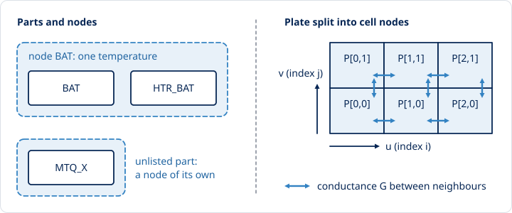
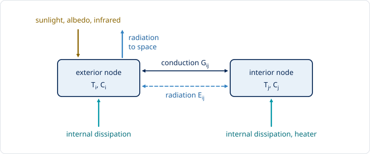
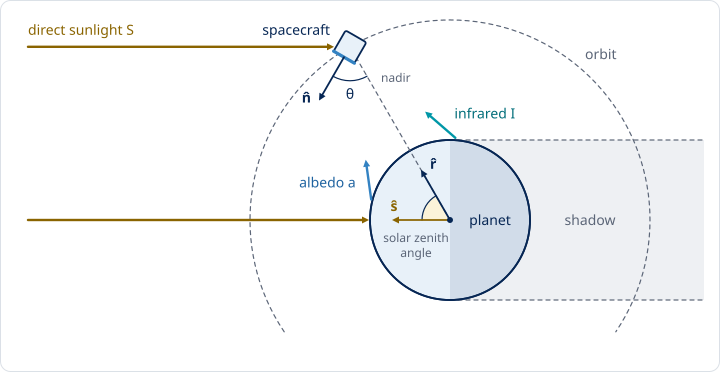
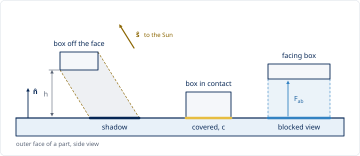
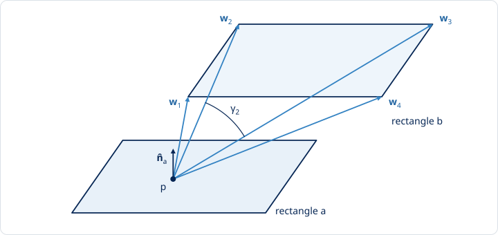
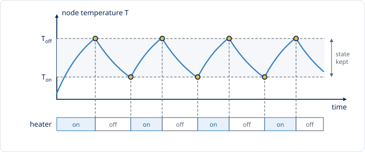
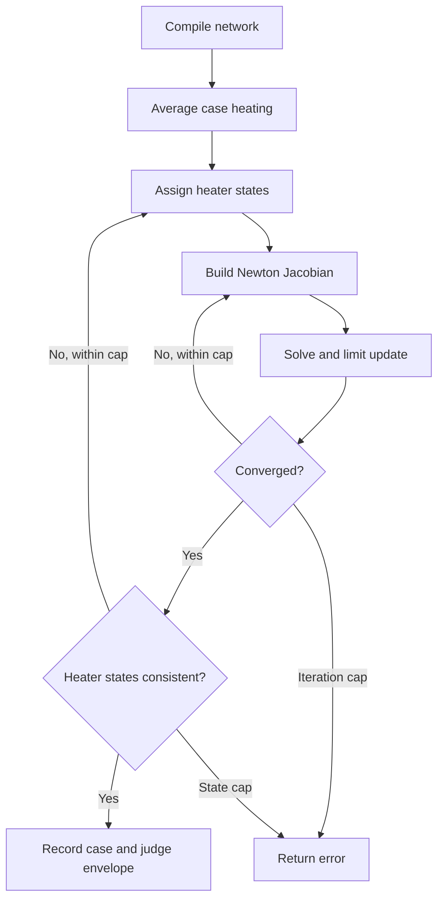
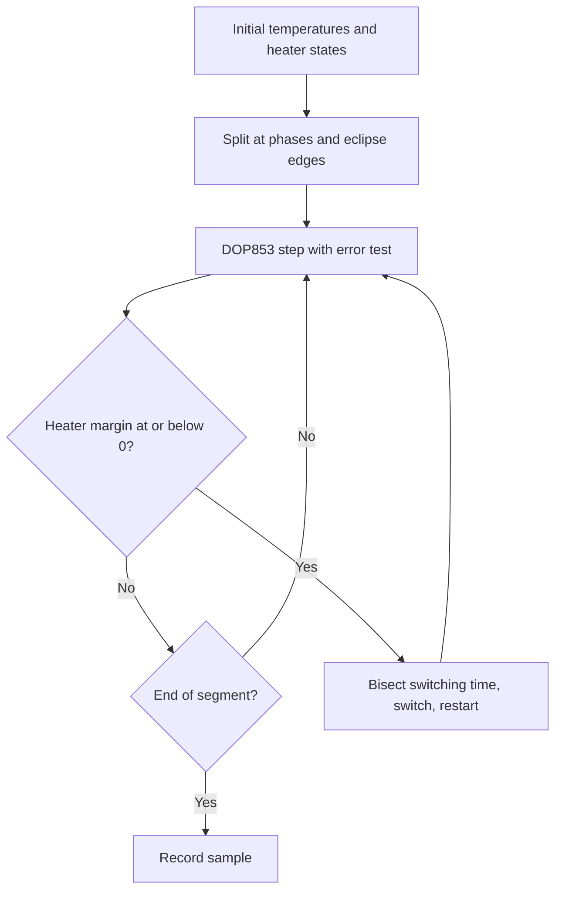

# Thermal analyses

Use these analyses to size radiating surfaces and heaters, screen component temperature limits, and estimate the temperature swing through sunlight and eclipse.

| Analysis | Purpose | Main inputs | Main outputs |
|---|---|---|---|
| `thermal.steady` | Find the equilibrium temperatures in each environment condition | Network, surface optics, orbit, attitude, mode | Node temperatures, heater duty, case envelope |
| `thermal.transient` | Follow temperatures through one selected condition | Same network, orbit history, initial temperatures | Temperature history, extrema, heater switching |

## Common ground

### Frames and signs

Normals and illumination directions use the spacecraft body frame. Surface normals point outwards, the Sun vector $\hat{\mathbf s}$ points towards the Sun, and the nadir direction points towards the central body. Heat flow into a node is positive. All fourth powers use absolute temperature in kelvin. Symbols that carry a unit are listed in the tables of each analysis.

### Orbit, attitude and cases

Both analyses build a time series of the spacecraft state (position, Sun direction, sunlit fraction, attitude) from the selected orbit. The attitude comes from the thermal condition's mode, `analysis.aocs.law.<mode>`, or the phase's `law.<mode>` override. With no thermal mode, exactly one attitude law must apply. Sun pointing keeps a designated axis towards the Sun, and nadir pointing keeps it towards the central body. See the [design model](../model.md#51-condition-selection-for-analysis-cases) and the [power analyses](power.md) for the shared orbit and attitude inputs.

The sunlit fraction $f_\odot$ is 1 in full sunlight and 0 in the umbra. By default it comes from the conical Earth-shadow model, which varies continuously through the penumbra (the overlap of the solar and planetary discs, Montenbruck and Gill). With the Sun as central body there is no eclipse ($f_\odot = 1$).

A thermal condition is one `[case.<id>]` table in `analysis/thermal.toml`. It holds the environment values (`solar_flux`, `albedo`, `planet_ir`, an optional `preset`), a `mode`, and an optional `beta`. The mode selects the attitude and the mode-average heat loads. The β angle (Sun elevation above the orbital plane) overrides the analysis case's β on orbits given by elements. Nothing else distinguishes a "hot" from a "cold" condition. A hot condition usually pairs strong heating (high flux, high albedo, short or no eclipse) with a high-dissipation mode. A cold or safe-mode condition pairs weak heating with low dissipation and a long eclipse. `thermal.steady` solves every condition. `thermal.transient` solves the one chosen by the analysis case's `thermal_case`.

The selected configuration sets the positions of the part boxes. These boxes drive obscuration, contact area, facing-surface view factors and cavity geometry.

### Network of isothermal nodes



*A node is a part or a group of parts with one temperature. A plate can be split into a grid of cell nodes.*

- **Parts to nodes.** Every part has a node of its own, named after the part, unless it is listed in `[nodes]` of `analysis/thermal.toml`. A listed part belongs to that node only, and a part cannot belong to two nodes. A node name must not equal the ID of an unlisted part.
- **Lumping.** The parts of a node share one temperature. The node capacity is $C_i=\sum_p N_p m_p c_p$ with the count $N_p$, the unit mass $m_p$ and the specific heat $c_p$ of each part. A free node needs a positive capacity. A part with zero mass in its own node makes a zero-capacity node, which `fune check` reports as the warning `thermal.zero_capacity` and which both analyses refuse as an input error. Surfaces, mounts, heat sources and heaters all use the same part-to-node map.
- **Subdivided plates.** `[subdivide.<part>]` with `u` and `v` splits one part into a uniform grid of cell nodes named `PART[i,j]` (indices start at 0). The grid lies in the plane of the two longest box dimensions, and the thinnest dimension is the normal. The in-plane axes follow the normal cyclically: normal $x$ gives $(u,v)=(y,z)$, normal $y$ gives $(z,x)$, normal $z$ gives $(x,y)$. The details are in the model assumptions of `thermal.steady`.



*The exterior node absorbs environmental heat and radiates to space. Both nodes can receive internal heat and exchange heat through the links.*

## thermal.steady — Thermal (steady state)

### What it answers

What temperature does each node reach under constant or orbit-averaged heating, and how much heater power holds the lower set point?

### Inputs

Paths beginning with `analysis.thermal` address keys in `analysis/thermal.toml`. Part attributes are resolved before projection.

| Quantity | Symbol | Unit | Design data | Default |
|---|---|---|---|---|
| Node membership | $i$ | — | `analysis.thermal.nodes.<node>` | One node per unlisted part (analysis default via projection) |
| Unit mass, count, specific heat | $m_p,N_p,c_p$ | kg, 1, J/(kg·K) | `mass`, `count`, `specific_heat` | Mass must be given, count 1 and specific heat 900 J/(kg·K) (model defaults) |
| Plate cell grid and conductivity | $n_u,n_v,k$ | 1, 1, W/(m·K) | `analysis.thermal.subdivide.<part>.u`, `.v`, part `size`, `material`, `analysis.structure.material.<name>.thermal_conductivity` | Unsplit by default. All of them must be given to subdivide |
| Surface area, outward normal, optics | $A,\hat{\mathbf n},\alpha,\epsilon$ | m², 1, 1, 1 | `area`, `normal`, `count`, `absorptivity`, `emissivity`, or `analysis.thermal.surface.<part>.<coating>` with `analysis.thermal.coating.<coating>.absorptivity` and `.emissivity` | Must be given for participating surfaces |
| Box obscuration | $\ell,c,F_{ab},e$ | 1 | `analysis.thermal.shadowing`, part `size` and placement | Enabled when boxes are available (analysis default via projection) |
| Conductance | $G_{ij},h$ | W/K, W/(m²·K) | `analysis.thermal.contact_conductance`, `analysis.thermal.conductive.<node>.<node>`, `analysis.thermal.contact_conductance_per_area` | The mount value must be given. Pair overrides and area scaling are opt-in |
| Radiative exchange area | $E_{ij}$ | m² | `analysis.thermal.radiative_coupling`, `analysis.thermal.radiative.<node>.<node>`, `analysis.thermal.enclosure.emissivity`, `analysis.thermal.view_factors.emissivity` | No radiation between mounted nodes unless written. The geometry models are opt-in |
| Environment | $S,a,I,\beta$ | W/m², 1, W/m², rad | `analysis.thermal.case.<id>.solar_flux`, `.albedo`, `.planet_ir`, `.beta`, `.preset`, orbit and mode attitude | At least one condition and an orbit must be given. See the preset table below |
| Dissipation | $\bar P_p,\bar P_{\mathrm{RF},p},f_p$ | W, W, 1 | `analysis.thermal.case.<id>.mode`, per-state `power`, `rf_output`, `heat_fraction`, `analysis.thermal.heat_node.<part>` | RF output 0 W. Heat goes to the part's node |
| Thermostat | $T_{\mathrm{on}},T_{\mathrm{off}},P_{\max}$ | K, K, W | Heater `setpoint` (`{ min, max }`), `power` in the on state, `count` | Without a `setpoint` the heater is an ordinary dissipating part. A `setpoint` and the on-state power must be given |
| Temperature limits | $L,U$ | K | `temp_survival`, `temp_op`, `temp_perf` of parts, and requirement limits on `range_low:<node>:<kind>` and `range_high:<node>:<kind>` | No check for a range that is absent |
| Margin policy | $u,b$ | K | `analysis.thermal.margin.uncertainty`, `analysis.thermal.margin.warning_band` | Analysis defaults 0 K and 5 K |
| Other inputs | | | Space temperature $T_{\mathrm{space}}$ and the heater duty warning | Library inputs without a design setting: 3 K and 0.8 |

### Model and assumptions

The model is a lumped-parameter network. Each node is isothermal. Heat enters a node from external radiation on its surfaces, from internal dissipation and from heaters. It moves between nodes by conduction and by radiation, and it leaves through the surfaces to space. The steady analysis averages the inputs over one orbit and then solves the nonlinear balance once per condition.

#### External heat on one surface

Each outer surface has an area $A$ (multiplied by its count), an outward normal $\hat{\mathbf n}$, a solar absorptivity $\alpha$ and an infrared emissivity $\epsilon$. If a coating mix is written, it replaces the part optics. Its area fractions must total 1, and $\alpha$ and $\epsilon$ are the area-weighted sums, which is exact because absorption and emission are linear in area. The surface receives three kinds of heat.



*Direct sunlight uses the Sun direction and the face normal. Albedo and infrared use the planet view factor (the angle between the normal and the nadir) and, for albedo, the Sun angle at the sub-satellite point.*

1. **Direct sunlight.** The heat is $\alpha S A$ times the cosine of the incidence angle, the sunlit fraction $f_\odot$, and the lit fraction $\ell$ of the face. $\ell$ removes the area shadowed by other parts. The flux $S$ is the written or preset value, or $S_1(\mathrm{AU}/d)^2$ with $S_1=1361$ W/m² and the Sun distance $d$ at that time.
2. **Albedo.** Reflected sunlight is $\alpha S a F_{\mathrm{body}}$ times $[\hat{\mathbf r}\cdot\hat{\mathbf s}]_+$, where $\hat{\mathbf r}$ points from the planet centre to the spacecraft. The code uses the solar zenith cosine at the sub-satellite point as a proxy for the visible, illuminated part of the whole planet. The albedo is zero on the night side and has no separate eclipse factor.
3. **Planetary infrared.** The planet emits $I$ per unit area, and the surface absorbs $\epsilon I F_{\mathrm{body}}$.

$F_{\mathrm{body}}$ is the view factor from a flat face to the planet disc, and it depends on the angle $\theta$ between $\hat{\mathbf n}$ and the nadir and on the orbit radius. The surface also radiates to space. Albedo, infrared and the radiation to space share one exposure reduction $e$ (below), while direct sunlight uses the lit fraction $\ell$ instead. The albedo and the infrared have no shadow factor because they come from a large part of the sky.

**Moon.** The lunar infrared $I$ is not uniform. The dayside is assumed to re-emit absorbed sunlight where it lands (radiative equilibrium). The nightside has a floor from a surface at 100 K with emissivity 0.95. $I$ is the larger of the two, at all solar angles.

**Presets.** A preset supplies forcing only. Written values override presets. Choose the mode, orbit and β separately.

| Preset | Solar flux (W/m²) | Earth albedo | Earth infrared (W/m²) |
|---|---:|---:|---:|
| `hot` | 1414 | 0.35 | 258 |
| `cold` | 1322 | 0.25 | 217 |
| `safe_mode` | 1322 | 0.25 | 217 |

The preset flux applies at the Earth and the Moon (bodies with a conventional Sun distance of 1 AU). The preset albedo and infrared apply at the Earth only. Without a preset the Earth defaults are albedo 0.30 and infrared 237 W/m². The Moon defaults to albedo 0.12 and the local-time infrared model. For other planets, `albedo` and `planet_ir` must be written, and a preset also needs a written `solar_flux`. A written `planet_ir` replaces the lunar model by a uniform value. About the Sun, the albedo and the planetary infrared are 0 and the flux comes from the Sun distance or a written value. Written albedo, infrared and presets are ignored there.

#### Exposure: shadows, covers and facing parts



*A box off the face shadows it along the Sun direction. A box in contact covers part of it. A parallel box with a gap blocks part of its view.*

Part boxes decide what reduces the heat on a face. A face is matched to the box face whose normal has a cosine of at least 0.999 with the written normal. If the part has no box or no matching face, the surface is left unshadowed ($\ell=e=1$). Disabling `analysis.thermal.shadowing` removes shadows, covers and facing reductions together.

- **Shadow.** For every other box, take the part in front of the face plane (a point at height $h$ above the plane, with the box rising more than 0.1 mm above it). Move each such point inside the plane by $h(\hat{\mathbf d}-\hat{\mathbf n}(\hat{\mathbf n}\cdot\hat{\mathbf d}))/(\hat{\mathbf n}\cdot\hat{\mathbf d})$ with $\hat{\mathbf d}=\hat{\mathbf s}$. The convex hull of the moved points, clipped to the face rectangle, is that box's shadow. Overlapping shadows count once. A face with $\hat{\mathbf n}\cdot\hat{\mathbf s}\le 10^{-9}$ gets no direct sunlight.
- **Contact cover.** A box covers the face where its cross-section with the face plane (taken within 0.1 mm) overlaps the face, provided the box rises above the plane. The union of all cross-sections gives the covered fraction $c$. A box that lies below the plane (the parent a part sits on), floats off it, or sits flush in the same plane does not cover by contact. A covered area exchanges nothing with the environment, so the covering box takes the light.
- **Facing box.** A box with a face parallel to the face (normals opposite, cosine at least 0.999) at a gap above 0.1 mm and overlapping in projection blocks part of the face's view of the environment. The blocked fraction is the view factor $F_{ab}$ to that box face. Facing fractions add and are capped at 1. Stacked facing boxes overcount.
- **Mounted parts.** A part mounted on the face's part (through the mount chain) that has no thermal surface of its own belongs to that surface. The face's area and optics already include it, so it is not a cover or a facing box. Only the shadow that reaches beyond its footprint counts. A mounted part with a thermal surface of its own (a solar cell on a panel) covers, faces and shades the parent like any other part. Write the parent's surface at its full area in that case, so each area is counted once.

The lit fraction and the exposure follow:

```math
\ell = 1-\frac{\left|\bigcup(\text{shadows}\cup\text{covers})\right|}{A},\qquad
c=\frac{\left|\bigcup\text{covers}\right|}{A},\qquad
e=(1-c)\Bigl(1-\min\bigl(1,\textstyle\sum_b F_{ab}\bigr)\Bigr).\tag{1}
```

Here $|\cdot|$ is the area in m². The product in $e$ avoids subtracting twice an area that is both covered and faced. The covered area is dark already in $\ell$. For a subdivided plate the same quantities are found per cell rectangle of the two broad faces, and the facing sum is capped per cell.

The view factor $F_{ab}$ between two rectangles comes from the point-to-rectangle integral below and is shown in the figure.



*For a point $p$ on rectangle a, the vectors $\mathbf w_k$ to the corners of rectangle b and the angles $\gamma_k$ between successive vectors give the exact point factor.*

#### Conduction

A mount joins a part to its parent. The conductance of one mount is the written `contact_conductance`, and several mounts between the same two nodes add. Mounts inside one node are ignored. Optionally `contact_conductance_per_area` $h$ replaces it by $h A_{\mathrm{contact}}$, where $A_{\mathrm{contact}}$ is the largest overlap area between a face of one box and an opposing face of the other whose four corners lie within 0.1 mm of the first face's plane. A mount whose box is missing or that has zero contact area keeps the fixed value, and the output lists it as a fallback. An explicit pair `conductive.<node>.<node>` replaces the mounted value of that pair (0 disconnects it).

A split plate also conducts between neighbouring cells, with $G=k\,t\,L_{\mathrm{edge}}/d_{ij}$ for plate thickness $t$ (the thinnest side), shared edge length $L_{\mathrm{edge}}$ and centre distance $d_{ij}$, all in m.

#### Radiation between nodes

Four sources give the exchange area $E_{ij}$ of a node pair. The first that applies wins: an explicit `radiative` pair (zero allowed), then the enclosure, then the cavity view factors, then the mounted default (`radiative_coupling`, one value per mounted node pair, not multiplied by the number of mounts).

- **Cavity view factors** (`[view_factors] emissivity`, one emissivity for all faces). A box that contains another box is a hollow shell. Its inward-facing walls and the outward faces of the parts inside are the faces of a cavity. Faces of the same part do not see each other, except the walls. Pairs of faces that touch (within 0.1 mm) become conduction, not radiation. Other interior boxes block lines of sight, each shrunk by 0.1 mm so grazing rays pass. For each facing pair the exchange is the two-surface grey network below, and the exchange of two nodes is the sum over their face pairs. Reflections off third faces are not counted, which is a small error at high emissivity.
- **Enclosure** (`[enclosure] emissivity`). The six faces of the root box are matched to six distinct nodes by surface normal and area (cosine at least 0.999, area within 5 %). When several nodes compete for a face, their position decides (within 5 % of the shortest box dimension of the face plane, overlapping at least half of the face). If the six faces do not map to six distinct nodes, the enclosure is skipped and the output keeps the reason. The enclosure solves the full closed six-face problem with reflections (Gebhart factors) but ignores blockers inside.

#### Dissipation and heaters

A part's mode-average power $\bar P_p$ is its state power weighted by the fraction of time in each state and by the number of units in that state (redundancy and spares included, so $\bar P_p$ is already the total for the part). $\bar P_{\mathrm{RF},p}$ is the same for the RF output, which leaves through the antenna. A part dissipates $f_p\bar P_p$ if `heat_fraction` $f_p$ is written, and otherwise $\bar P_p-\bar P_{\mathrm{RF},p}$. Heat goes to the part's node, or to the node named in `[heat_node]`.



*A thermostat heater switches on below $T_{\mathrm{on}}$ and off above $T_{\mathrm{off}}$ and keeps its state in between.*

A part with a `setpoint` is a thermostat heater and is not counted as an ordinary load. It heats the node it senses, delivering $P_{\max}=$ `count` times the on-state power when on. The thermostat is active in a mode unless the heater's state is only `off` with no other state in any fraction of time. With no mode, or no assignment for the heater, it is active. The `duty` written in the mode belongs to the power side and is ignored while the thermostat is active. There is at most one thermostat per node, and a split plate cannot carry one directly.

A steady state inside the dead band is not unique. The analysis therefore defines it as the power $P$ ($0\le P\le P_{\max}$) that holds the node at $T_{\mathrm{on}}$. The heater is `off` if the node is at or above $T_{\mathrm{on}}$ without it, `saturated` ($P=P_{\max}$, node below $T_{\mathrm{on}}$) if full power is not enough, and `regulating` otherwise.

### Equations

For node $i$, $T_i$ and $T_{\mathrm{space}}$ are temperatures in K, $C_i$ is the capacity in J/K, and $H_i$ is the net inflow in W. $Q_{\mathrm{int},i}$ and $Q_{\mathrm{htr},i}$ are the internal dissipation and heater power in W. $G_{ij}$ (W/K) and $E_{ij}$ (m²) are the symmetric conductive and radiative links, $A_s e_s$ is the exposed area of surface $s$, and $Q_s$ is the heat absorbed by surface $s$. The Stefan–Boltzmann constant $\sigma$ is $5.670374419\times10^{-8}$ W/(m²·K⁴), and the default $T_{\mathrm{space}}$ is 3 K.

```math
\begin{aligned}
C_i &= \sum_p N_p m_p c_p,\\
C_i\frac{dT_i}{dt} &= H_i = Q_{\mathrm{ext},i}+Q_{\mathrm{int},i}+Q_{\mathrm{htr},i}
+\sum_j G_{ij}(T_j-T_i)
+\sigma\sum_j E_{ij}(T_j^4-T_i^4)
-\sigma\sum_s \epsilon_s A_s e_s(T_i^4-T_{\mathrm{space}}^4),
\end{aligned}\tag{2}
```

with $Q_{\mathrm{ext},i}=\sum_s Q_s$. A node with a fixed temperature has zero derivative.

The heat absorbed by one surface combines the three inputs. Let $[x]_+=\max(0,x)$, let $\hat{\mathbf r}$ be the unit vector from the planet centre to the spacecraft, and let $F_{\mathrm{body}}$ be the planet view factor of the face.

```math
Q_s=A\left[\alpha S f_\odot [\hat{\mathbf n}\cdot\hat{\mathbf s}]_+\,\ell
+ e\,F_{\mathrm{body}}\bigl(\alpha S a[\hat{\mathbf r}\cdot\hat{\mathbf s}]_+ + \epsilon I\bigr)\right].
\tag{3}
```

The infrared flux $I$ is the written or default uniform value. For the Moon without an infrared override it is

```math
I=\max\bigl((1-a)S[\hat{\mathbf r}\cdot\hat{\mathbf s}]_+,\ 0.95\,\sigma\,(100\ \mathrm{K})^4\bigr),\tag{4}
```

and the nightside floor is $0.95\,\sigma\,(100\,\mathrm{K})^4\approx 5.39$ W/m².

For a flat face with normal angle $\theta$ to the nadir, orbit radius $r$ and planet radius $R$ (both in m), the planet half-angle is $\lambda=\arcsin(R/r)$. If $\theta\le\pi/2-\lambda$, the whole planet is in front and $F_{\mathrm{body}}=\cos\theta\,(R/r)^2$. If $\theta\ge\pi/2+\lambda$, the planet is behind the face and $F_{\mathrm{body}}=0$. In between the horizon cuts the face, and the code uses the partial-disc formula (Howell C-9) with $H=r/R$:

```math
\begin{aligned}
x&=\sqrt{H^2-1},\qquad y=-x\cos\theta/\sin\theta,\qquad z=\sqrt{[1-y^2]_+},\\
F_{\mathrm{body}}&=\operatorname{clip}_{[0,1]}\!\left[
\frac{\cos\theta\arccos(\operatorname{clip}_{[-1,1]} y)-x\sin\theta\,z}{\pi H^2}
+\frac{1}{\pi}\arctan\!\left(\frac{\sin\theta\,z}{x}\right)\right].
\end{aligned}\tag{5}
```

At or below the planet surface the code uses $[\cos\theta]_+$. For the demo orbit (550 km) a nadir-facing face has $F_{\mathrm{body}}=(6378.137/6928.137)^2=0.8475$.

The view factor between two rectangles is an average of the exact point factor. For a point $p$ on rectangle $a$ with unit normal $\hat{\mathbf n}_a$, clip rectangle $b$ to the half-space above the tangent plane of $p$, and let $\mathbf w_k$ (m) be the vectors from $p$ to the clipped polygon's vertices in cyclic order and $\gamma_k$ (rad) the angle between $\mathbf w_k$ and $\mathbf w_{k+1}$ (Nusselt's contour form). The point factor and the rectangle factor are

```math
F_{p\to b}=\operatorname{clip}_{[0,1]}\!\left(
-\frac{1}{2\pi}\sum_k\gamma_k\,\hat{\mathbf n}_a\cdot
\frac{\mathbf w_k\times\mathbf w_{k+1}}{\lVert\mathbf w_k\times\mathbf w_{k+1}\rVert}\right),
\qquad F_{ab}\approx\frac14\sum_{l,m} w_l w_m\,F_{p_{lm}\to b}\,v_{p_{lm}}.\tag{6}
```

Here $w_l$ are Gauss–Legendre weights on $[-1,1]$ and $p_{lm}$ are 10 × 10 points on $a$. $v_p$ is 1 without blockers. With cavity blockers, $v_p$ is the share of the kernel $\cos\theta_a\cos\theta_b/r^2$ that reaches $b$ unblocked, sampled on a 6 × 6 grid on $b$. The sign in (6) is chosen so that corners listed counter-clockwise from the normal side give a positive value.

Closed forms are used for the six faces of the enclosure box. For two equal rectangles $a\times b$ at distance $c$ facing each other (Howell C-11), with $X=a/c$ and $Y=b/c$,

```math
F=\frac{2}{\pi XY}\Bigl\{\ln\sqrt{\tfrac{(1+X^2)(1+Y^2)}{1+X^2+Y^2}}
+X\sqrt{1+Y^2}\arctan\tfrac{X}{\sqrt{1+Y^2}}+Y\sqrt{1+X^2}\arctan\tfrac{Y}{\sqrt{1+X^2}}-X\arctan X-Y\arctan Y\Bigr\}.\tag{7}
```

For perpendicular rectangles with a shared edge of length $l$ (Howell C-14), seen from a rectangle of width $w_1$ towards one of width $w_2$, with $W=w_1/l$, $H=w_2/l$ and $\Sigma=W^2+H^2$:

```math
F=\frac{1}{\pi W}\Bigl\{W\arctan\tfrac1W+H\arctan\tfrac1H-\sqrt{\Sigma}\arctan\tfrac1{\sqrt{\Sigma}}
+\tfrac14\ln\Bigl[\tfrac{(1+W^2)(1+H^2)}{1+\Sigma}\Bigl(\tfrac{W^2(1+\Sigma)}{(1+W^2)\Sigma}\Bigr)^{W^2}\Bigl(\tfrac{H^2(1+\Sigma)}{(1+H^2)\Sigma}\Bigr)^{H^2}\Bigr]\Bigr\}.\tag{8}
```

The code checks (7) and (8) for a cube against the tabulated 0.19982 and 0.20004. The cavity model and the enclosure then turn view factors into exchange areas in two ways.

For a single pair of grey diffuse faces seeing only each other, with $g_{ab}=A_aF_{ab}$ (m²), area $A_a$, $A_b$ and common emissivity $\epsilon$, the radiative resistances in series give

```math
E_{ab}=\left[\frac{1-\epsilon}{\epsilon A_a}+\frac1{g_{ab}}+
\frac{1-\epsilon}{\epsilon A_b}\right]^{-1}.\tag{9}
```

The cavity model evaluates (9) for each facing face pair and adds the values of the pairs between two nodes. $g_{ab}$ is computed once, from face $a$, and used for both directions. For two equal parallel faces with $F=1$, (9) reduces to $A/(2/\epsilon-1)$.

The enclosure instead solves for all six faces together. The Gebhart factor $B_{ab}$ is the fraction of energy emitted by face $a$ that is finally absorbed by face $b$ after any number of reflections. With the view-factor matrix $\mathbf F$ (from (7) and (8)), the identity $\mathbf I$ and the emissivity vector $\boldsymbol\epsilon$:

```math
(\mathbf I-\mathbf F\operatorname{diag}(1-\boldsymbol\epsilon))\mathbf B
=\mathbf F\operatorname{diag}(\boldsymbol\epsilon),
\qquad E_{ab}=\epsilon_a A_a B_{ab}.\tag{10}
```

Conduction between the cells of a split plate uses $G=k\,t\,L_{\mathrm{edge}}/d_{ij}$, so across $u$ it is $k\,t\,\Delta v/\Delta u$ and across $v$ it is $k\,t\,\Delta u/\Delta v$. Each cell has the capacity $C_{\mathrm{part}}/(n_un_v)$. External surface heat, the radiation to space and the dissipation are shared by area, except that the lit fraction, cover and facing reductions of the two broad faces are evaluated per cell rectangle. A conductive mount to an unsplit neighbour is shared by each cell's contact area with the neighbour's box, then by projected overlap, then by area. When both ends are split, the shares multiply. Radiation from view factors uses the cell-to-face factors of the pair and keeps the total.

### Algorithm

1. Compile the node and cell network, surfaces, links, capacities and thermostats, and validate the inputs. For each thermal condition build the orbit and attitude samples over one orbit. The step is the larger of 30 s and one cycle divided by 200. A one-off trajectory (no orbit period) uses its whole span.
2. At each sample evaluate (3) for every surface. Average over complete orbits with the trapezoidal rule, or over the whole span if there is no complete orbit. A library caller can also give a fixed Sun direction, nadir and altitude. The design uses the orbit average.
3. Add the mode-average dissipation. Heaters that are active start `off`. For any assumed heater states, a `regulating` node is held at $T_{\mathrm{on}}$ and a `saturated` node gets $P_{\max}$ added.
4. Solve (2) with $H_i=0$ by Newton's method. Start with every free node at 290 K and with fixed nodes at their temperature. At each iteration compute $\mathbf H$ and the Jacobian $\mathbf J=\partial\mathbf H/\partial\mathbf T$ (W/K). For $i\ne j$, $J_{ij}=G_{ij}+4\sigma E_{ij}T_j^3$, and the diagonal is $J_{ii}=-\sum_{j}\bigl(G_{ij}+4\sigma E_{ij}T_i^3\bigr)-4\sigma K_iT_i^3$, with $K_i=\sum_s\epsilon_sA_se_s$. A fixed node replaces its row by the identity and the right-hand side $T_{\mathrm{fix}}-T_i$. Solve $\mathbf J\,\Delta\mathbf T=-\mathbf H$ by Gaussian elimination with partial pivoting. A pivot at or below $10^{-14}$ times the largest absolute entry means a singular system (a node with no path to space or to a fixed node), and the analysis stops with an input error. Scale $\Delta\mathbf T$ so that its largest entry is at most 50 K, then add it and floor temperatures at 1 K.
5. Stop when the largest unscaled correction is below $10^{-9}$ K and the largest residual $|H_i|$ over free nodes is at most $10^{-6}$ times the larger of 1 W and the sum of the absolute input powers. More than 200 iterations is an error.
6. For each regulating heater, the power is minus the node's heat balance without the heater. A regulating heater with $P<0$ becomes `off`, and one with $P>P_{\max}$ becomes `saturated`. An `off` heater whose node is below $T_{\mathrm{on}}-10^{-7}$ K becomes `regulating`, and so does a `saturated` heater whose node is above $T_{\mathrm{on}}+10^{-7}$ K. Repeat from step 4 until no state changes. After $4N_{\mathrm h}+8$ passes ($N_{\mathrm h}$ heaters) the analysis stops with an error. The duty is $P/P_{\max}$.
7. Compute the node ranges and margins per case. Report the envelope over cases and the worst checks. For a split plate keep the hottest and coldest cell per side.



*The steady solve runs a Newton iteration inside the thermostat state iteration for each case.*

### Checks and verdicts

Each part has up to three ranges. Storage (`temp_survival`) is the range that does no damage when the part is off. Operating (`temp_op`) is the range where function is kept. Performance (`temp_perf`) is the range where the specified performance is met. In a case with a mode, a node's range of one kind is the intersection of the ranges of the parts to which that kind applies. Storage applies to parts with some off time and operating and performance to parts with some on time, and a part with duty or a cold spare gets all three. Without mode information, or when a part's state is undetermined, all supplied ranges apply. A requirement on `range_low:<node>:<kind>` or `range_high:<node>:<kind>` can tighten a range that parts already give, and it cannot widen it or create one.

For a node's predicted minimum and maximum $T_{\min},T_{\max}$ (K), limits $L,U$ (K), uncertainty $u$ and warning band $b$, the signed margins in K are

```math
M_{\mathrm{low}}=T_{\min}-L-u,\qquad M_{\mathrm{high}}=U-T_{\max}-u.\tag{11}
```

A margin below 0 is a `violation`, a margin from 0 up to but not including $b$ is a `warning`, and a margin of at least $b$ is `ok`. For steady state $T_{\min}=T_{\max}$ in one case. The output fields `margin_low` and `margin_high` are the raw margins before $u$. The checks `range_low:<node>:<kind>` and `range_high:<node>:<kind>` use, for each kind, the case with the smallest margin on that side. A split plate is judged by its hottest cell for the upper side and its coldest cell for the lower side, under the part's name.

`heater:<part>` is judged on the worst case: a violation if saturated, a warning if the duty is strictly above 0.8, otherwise ok. A disabled thermostat is ok. Mode evaluation warns about parts without a mode assignment or without a value for a used state, and leaves them out of the total.

`shadow_loss` warns when parts without a thermal surface intercept more than 2 % of the absorbed heat. It compares the absorbed heat with blockers that have thermal surfaces only against the absorbed heat with all blockers, and divides the increase by the second. The fraction is 0 if nothing is absorbed. Steady reports the case with the largest fraction. The design check `thermal.zero_capacity` (see Common ground) is a warning only in `fune check`.

### Outputs

| Field | Unit | Meaning |
|---|---|---|
| `cases[].nodes` | K, W | Temperature, absorbed external power, internal power (dissipation plus heater), ranges and verdict |
| `cases[].environment`, `iterations`, `residual` | W/m², K, 1, W | Resolved forcing, Newton iterations and residual of the final heater states |
| `cases[].heaters` | W, K, 1 | Capacity, power, duty, set point and state |
| `couplings`, `cases[].shadowing` | W/K, m², 1 | Link values and sources, per-surface lit, covered and exposed fractions |
| `envelope`, `checks`, optional `detail` | K, m | Node extrema across cases, verdicts, and per-cell temperatures with geometry |

### Worked example

Run `fune -C <copy of fixtures/demo-6u> analyze thermal.steady --json`. The demo writes 0.5 W/K per mount and 0.002 m² of radiation per mounted node pair. The conditions are `hot` (mode `MISSION`, 1414 W/m², albedo 0.35, infrared 258 W/m², β 60°), `cold` (mode `SAFE`, 1322 W/m², albedo 0.25, infrared 216 W/m², β 0°) and `cold_nominal` (preset `cold`, mode `NOMINAL`, infrared 217 W/m²). The written 216 W/m² overrides the preset's 217 W/m². The attitude is Sun pointing on a 550 km orbit. Every case converged in 5 Newton iterations with a residual below $3\times10^{-13}$ W.

**Battery node `BAT`, `cold` case.** `BAT` is regulated at its lower set point 293.15 K. It has no outer surface and three links: explicit 0.05 W/K to `BUS`, explicit 0.03 W/K to `PANEL_MZ`, and 0.002 m² of mounted radiation to `BUS`. The neighbours are at $T_{\mathrm{BUS}}=271.55042$ K and $T_{\mathrm{PMZ}}=268.63878$ K.

| Term | Arithmetic | W |
|---|---|---:|
| Conduction to `BUS` | $0.05\,(271.55042-293.15)$ | −1.07998 |
| Conduction to `PANEL_MZ` | $0.03\,(268.63878-293.15)$ | −0.73534 |
| Radiation to `BUS` | $\sigma\cdot0.002\,(271.55042^4-293.15^4)=1.13407\times10^{-10}\times(-1.94762\times10^{9})$ | −0.22087 |
| Sum of exchanges | | −2.03619 |

The heater must supply 2.03619 W, and the program prints 2.036190585 W. With the capacity 3 W, the duty is $2.036190585/3=0.678730195$, equal to `duty_fraction`. So inflow equals outflow within rounding.

**Panel node `PANEL_PZ`, `cold` case.** This node has one outer surface (area 0.0226 m², white paint with $\epsilon=0.85$, exposure $e=1$) and no dissipation. The orbit-average absorbed heat printed by the program is 1.19233 W. At $T=272.15895$ K the exchanges are:

| Term | W |
|---|---:|
| Conduction to `CAM` ($5.0\,(273.15-T)$, explicit) | +4.955258 |
| Conduction to `BUS` ($0.5\,(271.55042-T)$, mount) | −0.304264 |
| Radiation to `BUS` and `CAM` (mount, 0.002 m² each) | +0.003566 |
| Enclosure radiation to `PANEL_PX`, `_MX`, `_PY`, `_MY`, `_MZ` | +0.129375 |
| Radiation to space: $0.85\,\sigma\cdot0.0226\,(T^4-3^4)$, $T^4=5.48644\times10^{9}$ | −5.976261 |
| Absorbed external heat | +1.192327 |
| Sum | 0.000000 |

The terms sum to zero within $10^{-6}$ W (the unrounded values within $10^{-13}$ W). Each enclosure term is $\sigma E_{ij}(T_j^4-T^4)$ with exchange areas such as 0.006116 m² to `PANEL_PX`.

**A verdict.** In `hot`, the camera node `CAM` is at 287.455044 K. Its performance lower limit is 278.15 K. With $u=5$ K, (11) gives $287.455044-278.15-5=4.305044$ K. That is below the 5 K band, so the result is a `warning`.

### Limits

Averaging the heat over an orbit before solving a nonlinear balance removes the orbital temperature swing. The box approximation omits detailed geometry and inclined facing blockers. Stacked facing boxes can overcount the blockage. The cavity model omits reflections off third faces, and the enclosure model ignores blockers inside the box. Albedo uses a single sub-satellite Sun angle for the whole visible disc. A split plate has no through-thickness gradient and is a rectangular plate without cut-outs. Preset optics and irradiances represent design conditions, so check them against the expected mission environment.

### Verification

- `thermal_validation_equilibrium.rs` compares one- and two-sided plates and a cube with closed-form fourth-root equilibria. `thermal_validation_network.rs` checks conductive and radiative two-node balances and fixed-temperature boundaries.
- `thermal_validation_orbit.rs` checks the albedo and infrared on a nadir-facing plate against hand calculations. `thermal_validation_heliocentric.rs` checks the ellipse mean of the inverse-square flux.
- `thermal_validation_plate.rs` checks the in-plane temperature drop $Q L/(k\,t\,w)$ for a strip of length $L$ and width $w$ (m) carrying heat $Q$ (W). `steady/heater_tests.rs` checks regulating power and duty against the heat balance.
- Unit tests cover the cube view factors (0.19982 and 0.20004, `astro/src/view_factor.rs`), the two-surface enclosure $A/(1/\epsilon_1+1/\epsilon_2-1)$ (`thermal/enclosure.rs`), the lunar nadir plate (`thermal/orbit_heat.rs`) and the shading, cover and facing rules (`thermal/orbit_heat/shading_tests.rs`).

### Source

[Steady analysis](../../crates/lib/analysis/src/thermal/steady.rs), [Newton solver](../../crates/lib/analysis/src/thermal/network/newton.rs), [network](../../crates/lib/analysis/src/thermal/network.rs), [orbit heating](../../crates/lib/analysis/src/thermal/orbit_heat.rs), [environment](../../crates/lib/analysis/src/thermal/environment.rs), [planet models](../../crates/lib/analysis/src/thermal/planet.rs), [lit fraction](../../crates/lib/analysis/src/structure/external_geometry/lit.rs), [rectangle view factors](../../crates/lib/astro/src/view_factor/rect.rs), [closed-form view factors](../../crates/lib/astro/src/view_factor.rs), [enclosure](../../crates/lib/analysis/src/thermal/enclosure.rs), [cavity views](../../crates/lib/analysis/src/structure/cavity_views.rs), [design projection](../../crates/app/projection/src/thermal.rs).

## thermal.transient — Thermal (transient)

### What it answers

How do node temperatures and heater states evolve over the requested orbit span, and how close do the sampled extrema come to the temperature limits?

### Inputs

The network, geometry, optics, environment, dissipation, limits and margins are those of [thermal.steady](#thermalsteady--thermal-steady-state).

| Quantity | Symbol | Unit | Design data | Default |
|---|---|---|---|---|
| Environment selection | — | — | `cases.<id>.thermal_case`, `analysis.common.default_case`, `analysis.thermal.case.<id>` | The sole condition if there is exactly one, otherwise it must be given |
| Span | $t_{\mathrm{end}}$ | s | Orbit and `analysis.thermal.orbits` | 3 orbits, or 1 for a Sun-centred periodic orbit. A one-off trajectory uses its own span |
| Output interval | $\Delta t_{\mathrm{out}}$ | s | `analysis.thermal.time_step` | The larger of 30 s and one cycle divided by 200. For a one-off trajectory it is not made finer than this |
| Initial temperature | $T_i(0)$ | K | `analysis.thermal.initial_temperature` | The orbit-average steady solution |
| Integrator controls | — | 1, K, s | Library inputs `rel_tol`, `abs_tol`, `max_step` | $10^{-8}$, $10^{-6}$ K, no step limit |

### Model and assumptions

The design passes one heat phase from the selected condition's mode. The library also accepts repeating phases with their own modes and durations, where a missing duration is 86 400 s. Internal heat is constant in each phase. The external heat of equation (3) is evaluated inside the integrator at each trial time, from the orbit, the Sun, the attitude law and the eclipse at that time, so it is continuous between output samples. Heaters are bang-bang with hysteresis (see the figure in thermal.steady). A heater output is either full power or zero. The mode is read per phase, so a heater can be disabled in one phase.

### Equations

The integrator advances equation (2). An enabled thermostat switches on when its node falls to $T_{\mathrm{on}}$ and off when it rises to $T_{\mathrm{off}}$, and keeps its state in between. For a heater with rated heat $P_{\mathrm{on}}$ (W), total on-time $t_{\mathrm{on}}$ and simulated duration $t_{\mathrm{run}}$ (s), the duty and mean power are

```math
D=t_{\mathrm{on}}/t_{\mathrm{run}},\qquad \overline P=D\,P_{\mathrm{on}}.\tag{12}
```

The event function of the heater whose state is on is $T_{\mathrm{off}}-T_i$, and for an off heater it is $T_i-T_{\mathrm{on}}$. It is 0 when the heater has to switch. The integrator is the Dormand–Prince 8(5,3) method (DOP853, Hairer and Wanner). It takes 12 stages per step and has a 5th-order and a 3rd-order embedded error estimate. For one trial step of size $h$ (s), let $e_{3,i}$ and $e_{5,i}$ (K/s) be the 3rd- and 5th-order error combinations of the stage derivatives for state $i$. They are scaled by $s_i$ (K), and $n$ is the number of states.

```math
\begin{aligned}
s_i&=a_{\mathrm{tol}}+r_{\mathrm{tol}}\max(|T_i^{\mathrm{old}}|,|T_i^{\mathrm{new}}|),\\
N_3&=\sum_i (e_{3,i}/s_i)^2,\qquad N_5=\sum_i (e_{5,i}/s_i)^2,\\
\mathcal E&=\frac{|h|\,N_5}{\sqrt{n\,(N_5+0.01\,N_3)}}.
\end{aligned}\tag{13}
```

$\mathcal E$ is dimensionless. The two estimates are blended in (13) so that the 3rd-order one acts as a safeguard when the 5th-order one is accidentally small. If $N_5+0.01N_3=0$, the code uses 1 in its place. A step is accepted if $\mathcal E\le1$.

### Algorithm

1. Compile as for the steady analysis. Start all nodes at the written uniform temperature, or solve the orbit-average heat balance with the mean phase loads and the starting phase's heater enablement. The library also takes per-node values. A heater whose node starts below $T_{\mathrm{on}}$ starts on, and inside the dead band it starts off. The set-point separation must be at least 0.001 K.
2. Build a timeline evaluator for orbit, attitude and eclipse. Split each interval between output samples at heat-phase boundaries and at eclipse boundaries. The eclipse boundaries are found by bisecting the sunlit fraction for crossings of $10^{-9}$ and $1-10^{-9}$ between the two end samples, with a 1 µs tolerance. A segment end is evaluated 5 µs inside the segment (the midpoint for very short segments), so a jump of the sunlit fraction is never read from the wrong side.
3. Integrate (2) over each smooth segment with DOP853 and dense output. After a trial step, compute $\mathcal E$ with (13). If $\mathcal E>1$, reject the step and divide $h$ by $\min(3.003,\ \mathcal E^{0.117}/0.9)$. At most 50 rejections in a row are allowed. If accepted, the new step is $h/\mathrm{clamp}(\mathcal E^{0.117}/(0.9\,\mathcal E_{\mathrm{old}}^{0.04}),\,1/6,\,3.003)$, a proportional-integral controller with safety factor 0.9 (the exponent 0.117 is $1/8-0.2\cdot0.04$). The suggested step carries over to the next segment. One call is limited to 5 000 000 trial steps. The output interval only sets the reporting times and the segment boundaries, so error control alone chooses the integration steps. A numerically propagated orbit is tabulated once and interpolated by cubic Hermite polynomials on a grid at least as fine as the track step and the output interval. Kepler and J2 orbits are evaluated directly.
4. After each accepted step, test the smallest event margin of the active heaters. If it is at or below 0, locate the crossing by bisection on the step's dense output, with time tolerance $\max(10^{-9}h,\,10^{-13}\max(|t_0|,1))$ (s), where $t_0$ is the start of the step. Stop there, switch every heater whose node is within $10^{-5}$ K of its threshold or beyond it, and restart the integration from that state. Accumulate the on-time over the whole run and over the last cycle (or the whole run if it is shorter).
5. Finish at the requested span. The implementation has no periodic-steady-state test and does not extend the run. Starting from the orbit-average steady state removes most of the start-up transient, and comparing corresponding samples of successive orbits shows whether it has decayed. Extrema come from the output samples, and means are trapezoidal time means.



*Each smooth segment is integrated adaptively and stopped at every thermostat crossing.*

### Checks and verdicts

Range checks use (11) with the extrema $T_{\min},T_{\max}$ of the sampled series, so they follow the same rules as the steady analysis. The range selection covers the modes of all projected phases. A heater is saturated if it is enabled at the end, there is no off interval in the last cycle, it is on for some time in it, and the node's highest temperature in that window stays below $T_{\mathrm{on}}$. That is a violation. A last-cycle duty strictly above 0.8 is a warning. `shadow_loss` follows the same 2 % rule as the steady analysis, with a simple average over the samples. `plate_step:<part>` warns when the smallest cell time constant $C_i/\sum_jG_{ij}$ (conduction only) of a split plate is below 0.1 times the output interval, because the explicit method then takes many small steps. The design warnings for the modes apply as well.

### Outputs

| Field | Unit | Meaning |
|---|---|---|
| `series` | s, K, W | Sample times, node temperatures, total absorbed external heat (`absorbed`) and heater power (`heater:<part>`) |
| `nodes` | K, s | Sampled minimum, maximum, time mean, times of the extrema, range checks |
| `heaters` | 1, W, s | Full-run and last-cycle duty, mean power, switch count, longest on-period, saturation flag |
| `integration` | 1, K, s | Segment, accepted, rejected and event counts, right-hand-side evaluations, tolerances |
| `orbit_plane`, `shadowing`, `couplings`, optional `detail` | m, 1, W/K, m², K | Orbit display geometry, obscuration, link values, per-cell extrema and final field |

### Worked example

Run `fune -C <copy of fixtures/demo-6u> analyze thermal.transient --json`. The demo selects `hot_imaging` (condition `hot`, mode `MISSION`), starts all nodes at 293.15 K and runs 5 orbits of 5738.99 s sampled every 30 s. The final time is 28694.964075 s and there are 958 samples, including the end point. The integrator used 977 smooth segments, 1230 accepted and 68 rejected steps, 16 heater events and 16618 right-hand-side evaluations.

`HTR_BAT` (capacity 3 W) switched 17 times with a full-run duty of 0.3483121993 and a last-orbit duty of 0.3611319628. By (12) its mean power is $3\times0.3483121993=1.044936598$ W. `CAM` reaches a sampled maximum of 297.541419 K at 2640 s. Its performance ceiling is 303.15 K, so with $u=5$ K the upper-side margin of (11) is $303.15-297.541419-5=0.608581$ K, a `warning`. The unadjusted `margin_high` in the output is 5.608581 K.

### Limits

Output samples can miss a thermal peak between reporting times. The eclipse boundary search compares only the two end samples, so a brief eclipse inside one output interval is missed. The heater event test looks at accepted step ends, so a crossing followed by a return inside one step is missed. Strong links to small capacities and finely subdivided plates force very small explicit steps, since there is no implicit integrator. A saturated thermostat cannot hold its band. The thermostat's thermal duty is not fed back to the electrical budget.

### Verification

- `thermal_validation_integration.rs` compares nonlinear radiative cooling with the exact solution, checks eclipse entry and exit against the analytic geometry, and checks that results and heater switchings converge as the sampling interval and tolerances change.
- `transient/heater_tests.rs` compares the switching times, period and duty of a hysteretic heater with the exact first-order solution. `thermal_validation_network.rs` and `thermal_validation_plate.rs` check energy conservation.
- `thermal_validation_orbit.rs` checks that the fourth-power mean of a periodic transient equals the steady equilibrium of a single radiating node.

### Source

[Transient analysis](../../crates/lib/analysis/src/thermal/transient.rs), [simulation](../../crates/lib/analysis/src/thermal/transient/simulate.rs), [heater control](../../crates/lib/analysis/src/thermal/transient/heater_control.rs), [integration settings](../../crates/lib/analysis/src/thermal/transient/integration.rs), [orbit sampling](../../crates/lib/analysis/src/spec/sampling.rs), [orbit timeline](../../crates/lib/astro/src/timeline.rs), [timeline evaluator](../../crates/lib/astro/src/timeline/evaluator.rs), [integrators](../../crates/lib/astro/src/ode.rs), [DOP853](../../crates/lib/astro/src/ode/dop853.rs), [event location](../../crates/lib/astro/src/ode/segment.rs).

## References

- J. R. Howell, *A Catalog of Radiation Heat Transfer Configuration Factors*, 3rd edition (online, C-9, C-11 and C-14). [thermalradiation.net](https://www.thermalradiation.net/calc/index.html).
- B. Gebhart, *A New Method for Calculating Radiant Exchanges*, 1959.
- A. K. Oppenheim, *Radiation Analysis by the Network Method*, 1956 (the grey-surface radiation network behind equation (9)).
- O. Montenbruck and E. Gill, *Satellite Orbits: Models, Methods and Applications*, 2000 (conical shadow model).
- E. Hairer, S. P. Nørsett and G. Wanner, *Solving Ordinary Differential Equations I: Nonstiff Problems*, 2nd edition, 1993.
