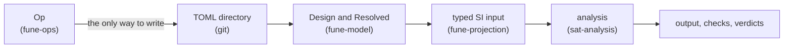
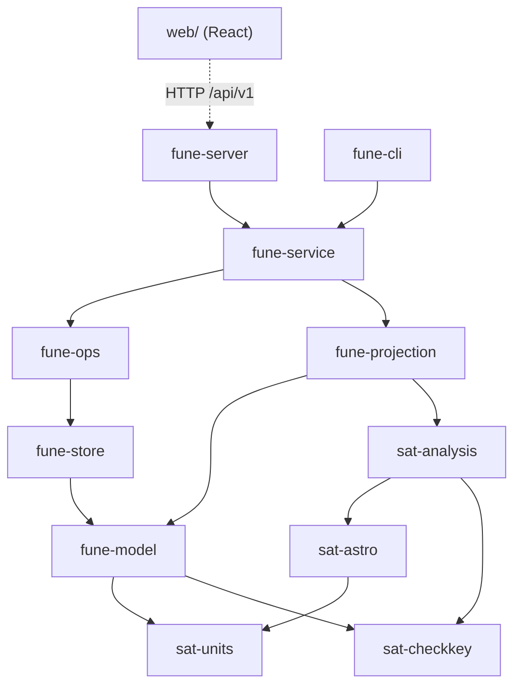
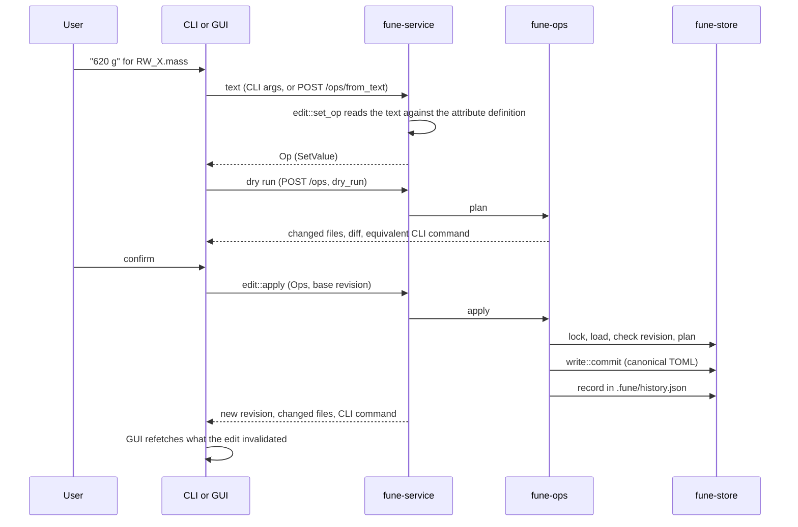
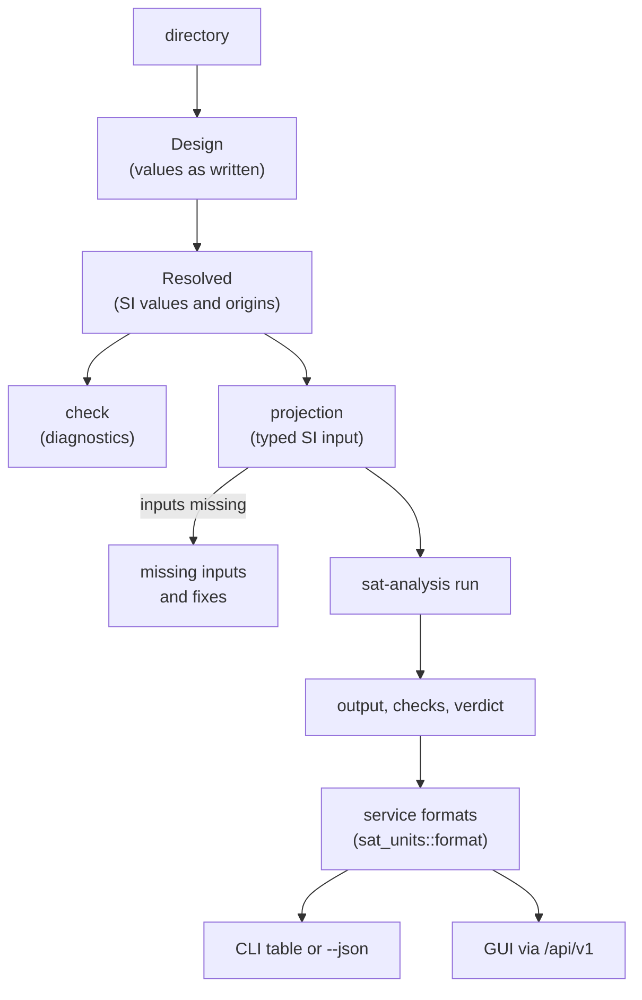

# Architecture overview

This page is a tour of how iwafune works inside. It is for contributors, and for users who want to know why they can trust a result.
It explains the ideas and follows two requests from end to end: an edit and an analysis.

It does not repeat the rule books. The precise rules are in [architecture.md](architecture.md) and [CONTRIBUTING.md](../CONTRIBUTING.md),
the list of where each feature lives is in [architecture/registry.md](architecture/registry.md), and the shape of the data is in [model.md](model.md).

## 1. The idea in one page

iwafune is a workbench for the conceptual design of small satellites. It has a command-line tool, `fune`, and a web GUI.
Three ideas hold the design together.

**Design data is files.** A satellite is one directory of TOML files, one entity per file, tracked by git.
There is no database and no hidden state. Reviews, branches and diffs are the ones you already use for code.
The directory layout is in [architecture.md §2.1](architecture.md); the demo is [fixtures/demo-6u](../fixtures/demo-6u).

**Every edit is an `Op`.** A command typed in the CLI and a click in the GUI both become a value of the `Op` type
in [fune-ops](../crates/app/ops/src/lib.rs). One function plans the edit, checks it, and writes it.
So the two front ends cannot drift apart.

**Analyses are pure functions of typed inputs.** An analysis in `sat-analysis` takes a typed SI input and returns a typed output
with checks and verdicts. It does not know the design model, it does no I/O, and it uses no random numbers.
A separate layer, `fune-projection`, builds the input from the design and says what is missing.

Terms used on this page:

| Term | Meaning |
|---|---|
| `Design` | The design as written in the files: numbers with their unit strings, sources, and positions in the files |
| `Resolved` | The same design after catalog items, kinds and per-part overrides are layered, with SI values and where each value came from |
| `Op` | One edit, as a value (set a value, create a part, place a part, and so on). The only way to change design files |
| Projection | Building the typed input of an analysis from `Resolved`, and listing what is missing |
| Check, verdict | A check is one judgement an analysis makes (a margin, a limit). Its verdict is `ok`, `warning` or `violation` |
| DTO | A data type that `fune-service` returns to the CLI and to HTTP. The TypeScript types of the GUI are generated from them |
| Registry | [registry.md](architecture/registry.md): the list of where each feature lives |

## 2. The layers

The workspace has two groups of crates. `crates/lib/*` (`sat-*`) hold physics, units and analyses and know nothing about the design model.
`crates/app/*` (`fune-*`) hold the design model, file I/O, edits and the two front ends. `web/` is the GUI and talks to the server over HTTP only.

An arrow means "depends on". The diagram leaves out arrows that follow from others (for example `sat-analysis` also uses `sat-units`),
and it leaves out `fune-report`, which depends only on `sat-units` and is used by `fune-service` for report export.
The full table is in [registry.md §1](architecture/registry.md) and is checked against `ALLOWED` in [crates/xtask/src/deps.rs](../crates/xtask/src/deps.rs).

**`sat-units`** ([lib.rs](../crates/lib/units/src/lib.rs)) is the single source of truth for units, dimensions and quantities.
It owns typed quantities, parsing of unit expressions and the display strings for quantities. It must not know anything about satellites.

**`sat-astro`** ([lib.rs](../crates/lib/astro/src/lib.rs)) holds the shared physics and mathematics: integrators (`ode`), time, orbits, celestial bodies (`ephem`),
eclipses (`shadow`), coordinate transforms (`earth`), geomagnetism, atmosphere, trapped-radiation maps, ground stations, attitude laws and the rocket equation.
It must not make analysis-specific decisions and must not read files. Large data arrives as bytes (section 6).

**`sat-checkkey`** ([lib.rs](../crates/lib/checkkey/src/lib.rs)) is a small leaf crate. It defines the format of the keys of analysis checks
(`margin:<link>@<station>`, `heater:<part>`, and so on). Both `sat-analysis`, which builds keys, and `fune-model`, which reads names back out of them, need one definition,
and neither may depend on the other.

**`sat-analysis`** ([lib.rs](../crates/lib/analysis/src/lib.rs)) holds the analyses of each subsystem and the verdict logic.
Every analysis implements the `Analysis` trait in [spec.rs](../crates/lib/analysis/src/spec.rs) and is registered once, in `catalog`.
It must not depend on any `fune-*` crate and must not do I/O.

**`fune-model`** ([lib.rs](../crates/app/model/src/lib.rs)) defines the design types (`Design`), the built-in vocabulary, resolution (`Resolved`) and checking (`check`).
It must not read or write files.

**`fune-store`** ([lib.rs](../crates/app/store/src/lib.rs)) is the only crate that reads and writes the directory.
It turns files into a `Design` and changes back into minimal TOML edits, keeps the revision (a hash of the tracked files), the write lock and the edit journal.
It must not check designs or compute physics.

**`fune-ops`** ([lib.rs](../crates/app/ops/src/lib.rs)) owns `Op`, `plan` (what would change, no writing), `apply` (write under lock and revision check),
`history` (undo and redo) and `to_cli` (the CLI command for the same edit). It must not know about HTTP or display.

**`fune-projection`** ([lib.rs](../crates/app/projection/src/lib.rs)) maps `Resolved` to the typed inputs of the analyses and lists the inputs that are missing.
It must not do physics and must not invent modelling defaults. Defaults belong to the analysis.

**`fune-service`** ([lib.rs](../crates/app/service/src/lib.rs)) holds every function that the CLI and HTTP call, and their input and output types.
It builds display strings with `sat_units::format` and puts them into the DTOs. It must not know about HTTP and must not own formatting rules.

**`fune-server`** ([lib.rs](../crates/app/server/src/lib.rs)) is the axum router for `/api/v1`, error-to-status mapping, the Host allowlist and the embedded GUI.
**`fune-cli`** ([main.rs](../crates/app/cli/src/main.rs)) parses arguments and prints tables, colours and diagnostics. Neither may contain logic.

**`web/`** ([src](../web/src)) draws data and handles interaction. It must not do physics, dimensional computation, unit conversion, verdicts or aggregation,
and must not take IDs or paths apart by splitting strings.

## 3. Life of an edit

Take the edit "set the mass of a reaction wheel to 620 g". In the CLI it is `fune set RW_X.mass "620 g"`. In the GUI it is a cell edit.

The steps:

1. **Interpret the text.** `fune_service::edit::set_op` decides whether `"620 g"` is a quantity, an integer, a vector or a per-state value by looking at the attribute definition.
   The GUI sends the same string to `POST /ops/from_text` and gets the same `Op` back. Edits that are not a path and a value use `edit::command_ops` (`POST /ops/from_command`).
   Unparsed text never reaches the store.
2. **Plan.** `fune_ops::plan` ([plan.rs](../crates/app/ops/src/plan.rs)) turns the Ops one at a time into store edits, re-reading the design each time.
   It compares `check` before and after and refuses the edit if it creates a new error. Errors that were already there do not block it. Plan never writes.
3. **Preview.** With `dry_run`, only the plan comes back: the files that would change as unified diffs, the diagnostics, and the CLI command that makes the same edit (`fune_ops::to_cli`).
   The CLI's `--dry-run` and the GUI's confirmation (`OpPreview`) show the same thing, and so does "Copy as CLI".
4. **Apply.** `fune_ops::apply` ([apply.rs](../crates/app/ops/src/apply.rs)) takes the project lock (it waits up to 5 seconds),
   loads the design, and compares the revision the caller read with the current one. A mismatch is a conflict: the CLI exits with code 3 and HTTP answers 409. Nothing is written.
5. **Write.** `fune_store::write::commit` ([commit.rs](../crates/app/store/src/write/commit.rs)) writes all changed files together. Only the lines of changed values are rewritten
   (with `toml_edit`), so comments, key order and the written unit are kept. New files are in canonical form, the same form `fune fmt` produces. Either every file changes or none does.
6. **Record.** The changed files, with their contents before and after, go to `.fune/history.json` (git-ignored). `fune undo` and `fune redo` (`POST /undo`, `POST /redo`) replay them
   under the same lock and revision check.
7. **Refetch.** The response carries the new revision. The GUI invalidates the design-derived queries (`refreshDerived` in [refresh.ts](../web/src/api/refresh.ts), the list in
   [keys.ts](../web/src/api/keys.ts)) and reads the server's new answers. The server keeps no state in memory: each read re-reads the directory
   ([workspace.rs](../crates/app/service/src/workspace.rs)), so a CLI edit and a GUI edit made at the same time cannot disagree.

### 3.1 Parity between the CLI and the GUI

The same edit made through the CLI and through HTTP must give byte-identical files. This is a rule, not a habit, and CI checks it.
The parity tests under [crates/app/cli/tests](../crates/app/cli/tests) (`parity.rs` and the `parity_*.rs` files) run the `fune` binary and the HTTP router on copies of the demo
and compare the resulting files byte by byte. `parity_text.rs` covers typed strings and `parity_command.rs` covers the arguments of noun commands.
[route_table.rs](../crates/app/cli/tests/route_table.rs) checks the route table in architecture.md against the router.

The exceptions are listed in [CONTRIBUTING.md](../CONTRIBUTING.md):

- `fune init`: the server only runs inside a project.
- `fune self-update`: it replaces the CLI binary, which a server cannot do for the person running it.
- `fune skill`: it writes an agent instruction file into the caller's directory, not design data.
- `fune fmt` and the import of a shared catalog (`catalog.lock`) are the two writes that do not go through an Op.
  They are listed with reasons in [store_writes.rs](../crates/xtask/src/store_writes.rs), and `cargo xtask check` verifies that nothing else calls `commit`.

`fune gui` (it starts the server) and the CLI-only `--from <DIR>` option of `fune data fetch` are also CLI-only, as [architecture.md §4.3](architecture.md) explains.

## 4. Life of an analysis

Running `fune analyze power.energy_balance`, or opening the Power page in the GUI, goes through these stages.

1. **Directory to `Design`.** `fune_store::load` reads the files and builds a `Design`, which keeps values as written (a number and a unit string), their sources and their positions in the files.
2. **`Design` to `Resolved`.** `fune_model::resolve` layers catalog items, kinds and per-part overrides, converts to SI, and records where each value came from.
   Configurations and defaults are applied here. Syntax and shape errors found while reading are kept in `Design::load_diagnostics`.
3. **Check.** `fune_model::check` is the one place that checks a design. `fune check`, the GUI, and the before-and-after comparison in `plan` all call it.
   Diagnostics have a severity (error, warning, info). A missing required value is a warning, so a work-in-progress design can still be saved.
4. **Projection.** `fune-projection` builds the `Input` of the chosen analysis from `Resolved` and an analysis case (`cases/<ID>.toml`).
   The table from analysis ID to projection is in one place, [dispatch.rs](../crates/app/projection/src/dispatch.rs).
   If something is missing, the analysis is not called. The result lists each missing input as a parameter path (such as `RW_X.max_momentum`) with a reason, and structured candidates to fix it
   (`fune_service::fixes`). `fune analyze` prints each one as a command with `<...>` placeholders, and the GUI uses the same candidates for its row actions.
5. **Run.** `fune_service::analysis::run_analysis` calls `sat_analysis::catalog::run_json` (or `run_typed` for typed callers).
   The analysis is a pure function `run(&Input) -> Result<Output>`.
6. **Verdicts.** The analysis returns checks. A `Check` has a key, a label, a `Verdict` (`ok`, `warning` or `violation`) and text.
   Margins are judged by `spec::margin_verdict`. The definition of a ratio margin is `spec::ratio_margin` (`capability / requirement - 1`), and numbers in verdict text use `spec::quantity_text`.
   The worst verdict becomes the headline.
7. **Format.** The service attaches the dimension of each output quantity, display names for vocabulary values, and display strings built with `sat_units::format`.
   The CLI prints a table or `--json`. HTTP returns the same DTOs.

**Cases.** An analysis case is a file in `cases/` that picks the conditions an analysis runs under (orbit, mode, phase, epoch, and so on).
When no case is given, the default case is used, and the policy for a default case is declared per analysis in `case_policy`
([case_policy.rs](../crates/app/projection/src/case_policy.rs)). One analysis can be run for several cases; the requirement compliance table does this.

**Sessions.** A request that runs many analyses (the compliance table, report export, the Power mode view) opens a `fune_service::session::Session`
([session.rs](../crates/app/service/src/session.rs)). It loads and checks the design once, then computes each analysis for each case once and reuses the typed result.
A session lives for one request or one command. It is not a cache between requests, and it never touches the on-disk cache of external data.
An unsaved draft (Ops applied without writing, `fune_service::preview`) gets its own memo inside the session.

**Source of the input.** The request chooses where the input comes from: `design` (the default, built by projection), `patched` (a JSON Merge Patch over the built input),
or `given` (the CLI's `--input`).

**Typed outputs and the web.** The DTO types are exported to TypeScript with ts-rs into [web/src/api/gen](../web/src/api/gen)
(`cargo test -p fune-service export_ts`; CI fails if the committed files differ). A renamed Rust field breaks the TypeScript build instead of leaving an empty column.

**Why the web does no physics.** The GUI is one of two front ends. If it converted units or judged margins, the CLI and the GUI could show different answers for the same design.
So the server returns formatted quantities (`Formatted`), verdicts, counts and fill ratios, and the web draws them. Typed quantity input goes through `POST /units/parse`.
`cargo xtask check` enforces the web side of this (section 7).

## 5. Units and quantities

[`sat-units`](../crates/lib/units/src/lib.rs) is a `no_std` kernel and the only place that knows what a unit is.

- **Dimensions.** `Dimension` ([dimension.rs](../crates/lib/units/src/dimension.rs)) is a vector of rational exponents over nine base dimensions, used at run time.
  [dimensions.rs](../crates/lib/units/src/dimensions.rs) holds the type-level equivalents and shared aliases.
- **Typed quantities.** `Qty<D, T>` ([typed.rs](../crates/lib/units/src/typed.rs)) is a scalar whose dimension is checked at compile time. Analysis inputs and outputs use it with SI values.
  Adding a length to a time does not compile. Making a `Qty` from a raw number is a marked escape hatch used only at boundaries.
- **Units.** `Unit` ([unit.rs](../crates/lib/units/src/unit.rs)) maps a displayed value to SI, either linearly (`SI = scale * x + offset`, so `degC` works) or logarithmically (`dB`, `dBm`, `dBW`, `mag`).
  Affine and logarithmic units are valid only on their own and are converted to a linear SI value at the boundary.
- **Parsing.** `parse_unit` and the dimension-name functions in [parse.rs](../crates/lib/units/src/parse.rs) read unit expressions.
  What a person types, such as `620 g` or `1.2 GHz`, is read by `fune_model::value` (`value_from_text`, `quantity_from_text`), which reaches `sat-units` only through `value::units`.
  `POST /units/parse` exposes the unit parsing to the GUI.
- **Display.** `sat_units::format` ([format.rs](../crates/lib/units/src/format.rs)) is the only place that formats a quantity: it picks a display unit and an SI prefix for the dimension.
  `fune-service` calls it and puts the strings in DTOs. In the web, only [web/src/quantity](../web/src/quantity) may format numbers.

The design keeps values *as written*, so `620 g` stays `g` in the file. Conversion to SI happens once, in `Resolved` (`fune_model::resolve`),
and again from SI to a display unit at the edge. `fune-projection` turns written quantities into typed SI ones with [quantity.rs](../crates/app/projection/src/quantity.rs), and the conversion itself is `sat-units`.

## 6. External data

Some data is too large, or has terms that do not allow it in git or in the binary: the JPL DE440 ephemeris, the trapped-radiation belt maps,
the geomagnetic coefficient files and the SHIELDOSE-2 tables. Others change every day, such as space weather.
None of it is in the repository or in the program. It is fetched on demand into a per-user cache.

**One table.** The data distributed with the project's releases is one typed table, `RELEASE_DATASETS` in [data.rs](../crates/app/service/src/data.rs).
Each row is a `release::Dataset` ([release.rs](../crates/app/service/src/data/release.rs)): an ID, the cache file name, where it is released, the expected size and SHA-256,
what uses it, the source and licence text shown to the user, and an installer function. Status, fetch and start-up registration are all driven by this table.
Adding a dataset means adding one row and its installer.

| ID | What it is |
|---|---|
| `de440` | JPL DE440 planetary ephemeris, converted to the format `sat-astro` reads |
| `ap8min`, `ap8max`, `ae8min`, `ae8max` | AP-8 proton and AE-8 electron belt maps for solar minimum and maximum |
| `jensen_cain_1960`, `gsfc_1966` | Older geomagnetic field models that the belt maps assume |
| `igrf14` | IGRF-14 geomagnetic coefficients |
| `shieldose2` | SHIELDOSE-2 shielding-dose tables |
| `space_weather` | Daily F10.7 and Ap table (SW-All). Not in the table above: it is fetched with `curl` and has no fixed hash |

The radiation rows (`ap8min` to `shieldose2`) can be fetched together with the group ID `radiation` (`GROUP_IDS` in [radiation.rs](../crates/app/service/src/data/radiation.rs)). See [trapped-radiation.md](trapped-radiation.md).

**Fetch with checksums.** `fune data fetch <id>` (`POST /data/{id}/fetch`) downloads the release asset with the GitHub CLI (`gh release download`, so `gh` must be installed) into a temporary directory, checks the size and SHA-256 against the row,
and only then replaces the cached file. A failed fetch leaves the old file as it was. `fune data fetch <id> --from <DIR>` installs from a directory of files with the release names,
with the same checks, for offline use. This option is CLI-only: HTTP never takes a path on the server.
Space weather is checked differently: it is downloaded with `curl`, it must parse as a table, and each fetch records the source, the fetch time and the SHA-256 in `SW-All.json`.

**The cache.** The location is `$IWAFUNE_DATA_DIR`, else `$XDG_CACHE_HOME/iwafune/data`, else `~/.cache/iwafune/data` (`cache_dir` in `data.rs`).
`fune data status` (`GET /data/status`) shows each item's state and checks its SHA-256.

**Who reads the files.** `fune_service::data` reads the files. `sat-astro` only receives bytes, parses them, and keeps them in process-wide slots
(`OnceLock` in [registry.rs](../crates/lib/astro/src/radiation/registry.rs) for the radiation data).
The CLI and the server call `install_cached_datasets` at start-up to register everything found in the cache.

**When data is missing.** Nothing crashes and nothing is guessed silently.

- Without DE440, the analytical expressions for the Sun, Moon and planets are used. With it, DE440 is used for the years 1849 to 2150 and the analytical ones outside that range. `fune data status` says which one is in use.
- Without space weather, or for dates outside the table, F10.7 and Ap fall back to the solar-activity presets, and the result says where each value came from.
  Values given by hand take precedence. The analysis result keeps the version of the table that was used.
- Without the radiation files, the trapped-flux and trapped-dose analyses report a missing input whose reason names `fune data fetch radiation`.
  `orbit.total_dose` behaves as it did before the data existed.

## 7. The single-home rule and the mechanical checks

The structural rules in [CONTRIBUTING.md](../CONTRIBUTING.md) are enforced by `cargo xtask check` ([crates/xtask](../crates/xtask/src/main.rs)). The checks are:

| Check | What it verifies |
|---|---|
| Dependency direction | Each crate depends only on the crates allowed in `ALLOWED` ([deps.rs](../crates/xtask/src/deps.rs)) |
| Module cycles | No cycle between modules of one crate ([module_cycles.rs](../crates/xtask/src/module_cycles.rs)) |
| Registry coverage | Every crate is in the registry's crate table ([registry.rs](../crates/xtask/src/registry.rs)) |
| Single home | A definition appears only in the file the registry names ([single_home.rs](../crates/xtask/src/single_home.rs), the rules in [rules.rs](../crates/xtask/src/single_home/rules.rs)); a rule that matches nothing is itself an error. The same table holds some web rules, such as `fetch(` only in the API client |
| Write entry point | Only store and ops call `write::commit` ([store_writes.rs](../crates/xtask/src/store_writes.rs)) |
| Projection defaults | No modelling default in `fune-projection` ([projection_defaults.rs](../crates/xtask/src/projection_defaults.rs)) |
| Report JSON | The report export reads typed outputs, never JSON field names ([report_json.rs](../crates/xtask/src/report_json.rs)) |
| Web rules | Reading numbers or splitting IDs and paths in strings ([web_strings.rs](../crates/xtask/src/web_strings.rs)), hard-coded colours ([web_colors.rs](../crates/xtask/src/web_colors.rs)), role and subsystem string comparisons ([web_roles.rs](../crates/xtask/src/web_roles.rs), [web_systems.rs](../crates/xtask/src/web_systems.rs)), page URLs and feature imports ([web_pages.rs](../crates/xtask/src/web_pages.rs)); together with the web rules of the single-home table (number formatting, `queryKey: [`, feedback components) |
| User text language | No Japanese in Rust string literals outside the allowlisted bilingual-name files ([english_text.rs](../crates/xtask/src/english_text.rs)) |
| Languages and names | No Python files; no file names that differ only by case ([file_names.rs](../crates/xtask/src/file_names.rs)) |
| Size | A warning, not an error, for files over 400 lines and Rust functions over 60 lines ([sizes.rs](../crates/xtask/src/sizes.rs)) |

Three examples show the bug classes behind the rules.

- **Propellant mass flow only in `sat_astro::rocket`.** If two analyses each wrote `F / (Isp * g0)`, one copy could use a different `g0` or drop a factor,
  and two budgets would quietly disagree about the same propellant. With one home there is one formula and one test.
- **Name-or-ID fallback only in `fune_model::display_name`.** If every screen composed "name (ID)" itself, each would treat an empty or ID-equal name differently.
  One function decides that an empty label shows the ID alone, and a test makes the Web's `idWithName` read the same table.
- **`write::commit` only from store and ops.** A feature that wrote a TOML file directly would skip the plan, the check for new errors, the revision check, the history record and the canonical form.
  Its edits could not be undone and would not match between the CLI and the GUI. Only `fune fmt` and the catalog lock import are allowed, with their reasons written down.

When you add a rule, add it to xtask too. When you add a feature, add one line to the registry first.

## 8. The web app

`web/` is a React SPA built with Vite, served by `fune-server` from the embedded `web/dist`. The details of the stack are in [architecture.md §5.2](architecture.md). The structure under [web/src](../web/src) is:

| Directory | Role |
|---|---|
| `routes/` | One file per page. Routes are listed in `routes.ts`, and page URLs are built only with `paths` in [lib/nav.ts](../web/src/lib/nav.ts) |
| `features/` | The content of pages. Only `features/` and `routes/` may import from it, and imports between features are limited to the allowlist `FEATURE_EDGES` |
| `analysis/` | Components that show an analysis result: the card, the KPI strip, the checks list, the table and the chart |
| `kit/` | Shared building blocks that know the product: tables, trees, panels, feedback, and the 3D scene shell |
| `ui/` | Basic widgets (Radix-based buttons, dialogs, inputs) |
| `shell/` | The frame: sidebar, header, theme and language switches, lazy route loading |
| `api/` | The HTTP client, query keys, query and mutation hooks, and the generated types |
| `quantity/` | Everything that shows or edits a quantity |
| `ops/` | Dialogs that build Ops and preview them with a dry run |
| `i18n/` | Japanese and English dictionaries |
| `lib/`, `styles/` | Helpers, navigation, colour tone, the generated CSS tokens |

- **Generated API types.** Only [web/src/api/gen](../web/src/api/gen) is used for API types. It is written by ts-rs from the Rust DTOs and is never edited by hand.
- **One HTTP client and one place for query keys.** `fetch(` appears only in [client.ts](../web/src/api/client.ts) (a failed call becomes an `ApiError` with the HTTP status, code and diagnostics).
  TanStack Query keys and the set invalidated by an edit are in [keys.ts](../web/src/api/keys.ts).
- **Dictionaries.** All text is in the dictionaries under [i18n](../web/src/i18n), `ja.ts` and `en.ts`. Tests check that both have the same entries and that no key is unused.
- **Colour from one file.** Colours are defined only in [lib/tone.ts](../web/src/lib/tone.ts). The colours in `index.css` are generated from it with `pnpm -C web tokens`, and a test checks contrast.
- **Subsystem-specific code is registered once.** Dedicated tabs, extras and preloaded chunks of a subsystem go in the typed table in
  [features/systems/dedicated.tsx](../web/src/features/systems/dedicated.tsx). No other table is keyed by subsystem (the colour and icon table `lib/systems.ts` is the exception).
  Pages ask the API's `DefsView.systems` instead of hand-writing a list.
- **Feedback conventions.** Loading, refreshing and waiting have one home in [kit/feedback](../web/src/kit/feedback): skeletons only in `Loading.tsx`,
  the animated logo mark only in that directory, and dimming of content while it refreshes through `Refreshable`. Screens use `QueryState`, `Working` and `Refreshable`.
- **The 3D scene shell.** [SceneShell](../web/src/kit/scene3d/SceneShell.tsx) provides the canvas, lights, fit-to-bounds, free orbit, view cube and camera moves.
  Placement, the thermal image and the mesh field view (`SurfaceField`) share it.

## 9. Testing and verification

- **Hand calculations.** Each analysis function has at least one test against a hand calculation or a literature value. For example `ratio_margin_by_hand` in
  [spec/tests.rs](../crates/lib/analysis/src/spec/tests.rs) checks the margin definition by hand. A refactoring must leave the demo's analysis numbers unchanged.
- **Parity tests.** The CLI and HTTP edit tests of section 3.1, and the route table test.
- **Snapshot tests.** Printed output and DTOs of the demo are kept as snapshot files:
  [crates/app/cli/tests/snapshots](../crates/app/cli/tests/snapshots) (run by `snapshots_cli.rs`) and [crates/app/service/tests/snapshots](../crates/app/service/tests/snapshots).
  A change in the output shows up as a diff in review.
- **Contract tests.** [export_ts.rs](../crates/app/service/tests/export_ts.rs) writes the TypeScript types, and CI runs `git diff --exit-code web/src/api/gen`.
  The server has its own route, error and data tests in [crates/app/server/tests](../crates/app/server/tests).
- **The demo habit.** The demo design [fixtures/demo-6u](../fixtures/demo-6u) must pass `fune check` and `fune fmt --check`, and it is edited with the CLI too.
  Before and after a refactoring, run the demo analyses and compare the numbers.
- **CI.** [ci.yml](../.github/workflows/ci.yml) runs on pushes and pull requests. On a pull request only the jobs for the changed parts run.

| Job | What it runs |
|---|---|
| `changes` | Decides which of the following jobs a pull request needs |
| `architecture` | `cargo xtask check` (always runs) |
| `rust` | `cargo fmt --all --check`, `cargo clippy --workspace --all-targets -- -D warnings`, `cargo test --workspace`, and a check that the generated TypeScript matches |
| `web` | Biome, type check, Vitest, build |
| `bundle` | On pushes only: a release build with the GUI bundled, with smoke tests of the CLI and the HTTP server on the demo |

## 10. Release and distribution

Daily work goes to `develop` through pull requests. `main` only receives pull requests from `develop`, and each one is a release.
Before that pull request, set the same version in `[workspace.package] version` in [Cargo.toml](../Cargo.toml) and `version` in [web/package.json](../web/package.json).

[release.yml](../.github/workflows/release.yml) does the rest:

- On the pull request to `main`, the `version` job checks that the two versions match and that the tag does not exist yet.
- On the push to `main`, it calls [image.yml](../.github/workflows/image.yml). That workflow builds the GUI and the Linux binary,
  checks that the binary reports the right version and serves the bundled GUI, and packs `fune-<version>-x86_64-linux-gnu.tar.gz`.
  It builds the container image from `docker/fune.Dockerfile`, runs `fune check` and `fune fmt --check` on the demo inside it, and pushes `ghcr.io/<owner>/fune:<version>` and `:latest`.
- The `macos` job builds arm64 and x86_64 binaries and joins them with `lipo` into one universal archive.
- The `release` job creates the tag `v<version>` and a GitHub Release with the archives and their SHA-256 files. Running it again on a released commit does nothing.

Tags are never created by hand. The container image is meant for CI of design-data repositories: use it as the job's container to run `fune check` without building anything.

**`fune self-update`.** The CLI can replace itself with the latest release (or a chosen version). `fune_service::self_update`
([self_update.rs](../crates/app/service/src/self_update.rs)) picks the asset for the running system, downloads it, checks its SHA-256, unpacks it, checks the new binary's `--version`,
and only then replaces the running binary. A failure replaces nothing. It is CLI-only because a server cannot replace the binary of the person running it.

## 11. Where to go next

- [architecture.md](architecture.md): the precise architecture document, with the route and CLI correspondence tables.
- [architecture/registry.md](architecture/registry.md): where each feature lives, the standard vocabulary and the change history.
- [model.md](model.md): the design data, the file formats and how conditions and cases select inputs.
- [development.md](development.md): building from source, the repository layout and the release flow.
- [CONTRIBUTING.md](../CONTRIBUTING.md): the structural rules and the workflow for changes.
- [trapped-radiation.md](trapped-radiation.md) and [report.md](report.md): two features that use external data and the report export.
- [guide/index.md](guide/index.md) and [analyses/index.md](analyses/index.md): the user guide and the analysis reference.
