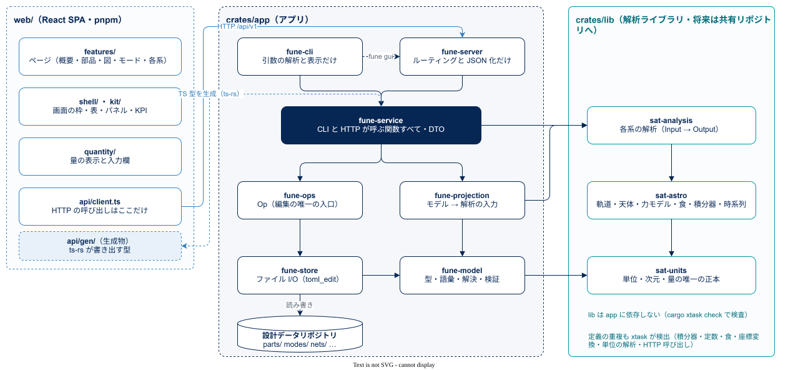

# iwafune architecture

This document describes how the code is put together today.
The shape of the design data and the file format are in [model.md](model.md), where each feature lives is in [architecture/registry.md](architecture/registry.md) (the registry),
the development rules are in [CONTRIBUTING.md](../CONTRIBUTING.md), and upcoming features are in [roadmap.md](roadmap.md) and GitHub Issues.

Conditions (orbit, ground stations, launch conditions) are in `conditions/`. `mission/` and `tables/` are directories reserved for the future #9 (mission and success criteria) and are not read at present; phases are in `phases/` ([model.md §7.10](model.md#710-phases-one-file-per-mission-phase)) and named overlays of part poses in `configurations/` ([model.md §7.11](model.md#711-configurations-named-overlays-of-part-poses)).
An analysis belongs to `sat_analysis::spec::AnalysisArea` (either a subsystem, `System`, or a condition topic, `Condition`).
The settings of a topic are placed inside the condition's file, and the concrete types will be added in #3 ([model.md §1.1](model.md#11-conditions-and-analysis-categories)).
The CLI, API and web use the same classification, and KPIs are shown per subsystem or topic. The web hides the KPIs of conditions when they are empty.

## 1. Purpose and scope

iwafune is a tool for the conceptual design of small satellites. On top of a single set of design data, it handles part selection, mass, power and data budgets, per-mode power consumption,
and analyses of AOCS, C&DH, communications, power, propulsion, structure and thermal.

- The only source of truth for design data is a git-managed directory of TOML. There is no resident server and no database.
- There are two ways to edit, the CLI (`fune`) and the Web GUI, and they can do the same things. The GUI is served by a server that `fune gui` starts locally.
- Analyses have conceptual-design accuracy and are recomputed on every call. Results are not written to the design data.
- Flight software, telemetry and command design, and operations are out of scope.

## 2. Design data

### 2.1 Directory

The design of one satellite is one directory, with `fune.toml` at its root. `fune` searches upward from the current location for `fune.toml` (the location can be given with `-C`).
One entity is one file, and the file name is the ID.

| Location | Contents |
|---|---|
| `fune.toml` | Project name, schema version, catalogs in use |
| `parts/` | Parts. Subdirectories express the product tree |
| `catalog/` | Catalog items (values and sources of purchased items, etc.) |
| `defs/attribute/`, `defs/kind/` | Project-specific attribute and kind definitions (built-in definitions are held by fune-model) |
| `modes/`, `nets/`, `harness/` | Operating modes (a table of part → state), electrical nets, harness segments |
| `maneuvers/` | Maneuvers (category, calculation stage, thrusters, previous maneuver, target orbit, constraints. The execution order is `after`) |
| `requirements/` | Requirements (statement, constraint, quantification, source, the analysis check or budget that verifies it) |
| `budget/` | Allocation and margin policy |
| `conditions/`, `analysis/`, `cases/` | Orbit and ground stations, per-subsystem analysis settings, analysis cases |
| `phases/`, `configurations/` | Mission phases, and named overlays of part poses |
| `sources/` | The ledger of sources |
| `view/` | Information that is only appearance, such as the layout of the system diagram |
| `catalog.lock` | The commit of each shared catalog in use. It is derived (written by `fune catalog fetch` and `update`) and is tracked by git |
| `.fune/` | Working files such as the write lock, the edit history (`history.json`, §2.4) and the cache of shared catalogs. `fune init` adds it to `.gitignore` |

How to write files, how values and units are expressed, and the relationships between entities are in [model.md](model.md).
The demo design data is [fixtures/demo-6u](../fixtures/demo-6u).

### 2.2 Why files

- The diff of a PR reads directly as a design change. When you change one value, only that line changes (§2.4).
- Studies can be separated by branch. Because one entity is one file, touching different parts on different branches does not conflict.
- You may also rewrite files directly in an editor. `fune fmt` brings them to canonical form and `fune check` checks them.

### 2.3 Loading and resolution

| Layer | Contents | Built by |
|---|---|---|
| Design | Values as written (numbers and unit strings), sources, positions in files | `fune_store::load` |
| Resolved | Values (SI) after layering catalog, kind and per-part overrides, and where each came from | `fune_model::resolve` |
| Analysis input | Typed SI quantities for each analysis | `fune_projection` (§6.3) |

Checking is in one place, `fune_model::check`, and `fune check`, the GUI, and both before and after an edit all go through the same function.
Diagnostics carry a severity (error, warning, info). Errors are things like a wrong unit or dimension, a reference to an ID that does not exist, or a mount cycle.
A missing required value is a warning, so a work-in-progress design can still be saved.

### 2.4 Writing

Only fune-store reads and writes files.

- With toml_edit, only the lines of changed values are rewritten. Comments, key order and the written unit (`620 g` stays `g`) are kept.
- New files and `fune fmt` are written in canonical form (within TOML 1.0, a fixed key order, aligned `=`).
- A change spanning several files is written to temporary files and then swapped in with rename. If it fails midway, the files already replaced are restored before the error is returned.
- The revision is the BLAKE3 of the tracked files (path and body). If the revision at read time differs from the current revision, nothing is written (optimistic locking).
- Concurrent writes from other processes are prevented by `.fune/lock`.
- **Edit history (undo and redo).** Every applied Op list (not a dry run) records the files it changed, with their contents before and after, in `.fune/history.json` (git-ignored; shared by the CLI and the GUI;
  `fune_store::journal` keeps the file, the position and the limits). It keeps the last 100 edits and at most 32 MiB of file contents (the oldest are dropped first). `fune undo` and `fune redo` (`POST /undo`, `POST /redo`) write the recorded contents back
  as one commit under the same lock and revision check as an edit (`fune_ops::history`): undo needs the current revision to equal the revision right after that edit, redo the one right before it. If the files were changed any other way since
  (an editor, `git checkout`, `fune fmt`, `fune catalog fetch|update`), nothing is written and the command fails with a conflict. Files the edit created are removed, deleted files are restored, and renames are reversed.
  A new edit clears the redo side. Undo and redo themselves are not new entries; they move the position. `fune fmt` and the catalog lock import are not Ops, so they are not recorded and cannot be undone.
  `fune history` (`GET /history`) lists the entries.

### 2.5 Review with branches and PRs

fune does not operate git. It only reads the branch name shown in the GUI from `.git/HEAD`; commits, pushes and PRs are done by the user.

1. Create a branch for each study (`git switch -c study/rw-4wheel`).
2. Edit with the CLI or the GUI. At the bottom of the GUI sidebar are the branch, the revision, the number of diagnostics, and a list of the edits made in this session.
   Each row of the list can be copied as a CLI command.
3. Commit and open a PR. The diff shows only the lines of the changed values.
4. Run `fune check` and `fune fmt --check` in the CI of the design data repository. If you use the container image published with each release (§8)
   as the job's container, you can use `fune` without building it. The procedure is in the [README](../README.md).

The real design data goes in a private repository for each satellite. This repository contains only demo design data.
Do not put values subject to NDAs or export control into a public repository.

## 3. Crates and dependency direction



The source of the figure is [diagrams/crate-architecture.drawio](diagrams/crate-architecture.drawio) (it can be opened in draw.io).

`sat-*` are in `crates/lib/` and `fune-*` are in `crates/app/` (`sat-units` is `crates/lib/units`).
The "May depend on" column is the same as `ALLOWED` in `crates/xtask`, and deviating from it makes `cargo xtask check` fail.

| crate | May depend on | Responsibility | Must not |
|---|---|---|---|
| `sat-units` | none | The single source of truth for units, dimensions and quantities. Typed quantities (`Qty`), display kinds (`Fraction`, `Decibel*`), display strings for quantities and units (`format`) | — |
| `sat-astro` | units | Mathematics, integrators, time, orbits, celestial bodies, eclipses, the Earth, gravity, geomagnetism, trapped-radiation belt maps, atmosphere, ground stations, attitude laws, time series, the rocket equation. Conventional defaults (`with_defaults` and the like) | Analysis-specific decisions, file I/O (large data is received as bytes) |
| `sat-checkkey` | none | The key format of analysis checks (the strings a requirement's `verify.check` points at). A leaf, so that `sat-analysis` (which builds keys) and `fune-model` (which reads names out of them) share one definition | — |
| `sat-analysis` | units, astro, checkkey | Analyses and verdicts for each subsystem. Inputs and outputs are typed SI quantities. Modeling defaults belong to the analysis (inputs are `Option`) | Depend on `fune-*`, do I/O |
| `fune-model` | units, checkkey | Design data types, built-in attributes, kinds and display names of vocabularies, resolution (Resolved), checking (check) | File I/O |
| `fune-store` | model | Reading and writing directory ⇄ Design (toml_edit, canonical form), revision, locks, the edit journal | Checking, physics computation |
| `fune-ops` | model, store | Op (the only entry point for edits), plan / apply, undo and redo (`history`), Op → CLI command (`to_cli`) | HTTP, display |
| `fune-projection` | model, units, astro, analysis, checkkey | Mapping Resolved to the input types of the analyses, and listing missing inputs | Physics computation, modeling defaults |
| `fune-report` | units | Report export: the table, figure and value data model, the SVG chart writer, the Typst module and the file layout (see [report.md](report.md)) | Knowledge of the design or the analyses, file I/O |
| `fune-service` | all of the above | All the functions that the CLI and HTTP call, and their input and output types (TS generated with ts-rs). Display strings are built with `sat_units::format` | Knowledge of HTTP, owning formatting rules itself |
| `fune-server` | service | axum routing and JSON conversion, serving the SPA, the Host allowlist | Logic |
| `fune-cli` | service, server | Argument parsing and display (tables, colors, diagnostics) of `fune`. Uses server for `fune gui` | Logic |
| `web/` | the HTTP API only | Display and interaction of the GUI | Physics computation, dimensional computation, unit conversion, interpreting IDs or paths by splitting strings |

- `crates/lib/*` are physics and analysis libraries and do not know the design model. They do not depend on `crates/app/*`.
- server and cli look only at service (cli also uses server, to start `fune gui`). They use the model and ops types that service re-exports.
- projection does not read files (it depends on neither store nor ops).
- Modules inside a crate must not form cycles either.

## 4. Editing: Op and plan / apply

### 4.1 Op

Every operation that changes the design data is expressed as a `fune_ops::Op`. Both CLI commands and GUI operations are turned into Ops before being applied.
An Op can be turned into JSON (`{ "op": "set_value", "part": "RW_X", ... }`). TS types are generated as well.

| Target | Example Ops |
|---|---|
| Parts | `CreatePart`, `RemovePart`, `RenamePart`, `RenameGroup`, `MovePart`, `SetValue`, `UnsetValue`, `SetField`, `Place`, `SetPort`, `SetMountPoint` |
| Catalog items | `CreateCatalogItem`, `SetCatalogValue`, `UnsetCatalogValue`, `SetCatalogField`, `RenameCatalogItem`, `RemoveCatalogItem` |
| Definitions | `CreateAttribute`, `UpdateAttribute`, `DeleteAttribute`, `RenameAttribute`, `CreateKind`, `UpdateKind`, `DeleteKind`, `RenameKind` (built-in definitions can be neither rewritten, renamed nor deleted. Deleting a definition that is in use is refused. A rename rewrites every reference: a kind's attribute lists and `extends`, and the `kind` and attribute values of parts and local catalog items. It is refused while a read-only shared-catalog item uses the definition) |
| Modes and nets | `CreateMode`, `RenameMode`, `SetModeStates`, `CreateNet`, `UpdateNet`, `SetNetField`, `RemoveNet`, etc. |
| Cases, sources, harness | `SetCase`, `SetSource`, `SetHarness`, and their respective deletions |
| Ground stations | `CreateGroundStation`, `RenameGroundStation` (rewrites `analysis.comm.stations`), `RemoveGroundStation` (refused while `analysis.comm.stations` lists the station). Values are written with `SetSetting` |
| Maneuvers | `CreateManeuver`, `SetManeuver`, `RemoveManeuver` (deleting reconnects the following maneuver to the preceding one) |
| Requirements | `CreateRequirement`, `SetRequirement`, `RemoveRequirement` |
| Diagrams | `SetViewLayout`, `SetViewEdge`, `UnsetViewEdge`, `ResetView` |
| Phases and configurations | `CreatePhase`, `SetPhase`, `RemovePhase`, `CreateConfiguration`, `SetConfiguration`, `RemoveConfiguration`, and their renames |
| Comm links | `CreateCommLink`, `RenameCommLink`, `RemoveCommLink` |
| Settings | `SetSetting` (values in `conditions/`, `analysis/`, `budget/`), `SetRecordField` (one field of a case, maneuver, requirement and so on) |

All Ops and their meanings are in `crates/app/ops/src/op.rs`.

### 4.2 plan and apply

- `plan` does not write. It turns the Ops one at a time into store edits, re-reading the Design each time.
  At the end it compares `check` before and after the application, and refuses if any new error has appeared. Errors that were already there do not stop an edit.
- `apply` takes the lock (waiting up to 5 seconds if another process holds it), loads, verifies the revision, builds the plan, and writes everything together.
  Either everything goes through or nothing is written.
- With `dry_run`, only the plan is returned. The CLI's `--dry-run` and the GUI's confirmation screen both show a unified diff of the files that would change.

### 4.3 Parity between the CLI and HTTP

The CLI and HTTP call the same functions of `fune-service`.

| Operation | CLI | HTTP (`/api/v1`) | service function |
|---|---|---|---|
| Apply Ops | each edit command, `fune apply ops.json` | `POST /ops` | `edit::apply` |
| Typed value string → Op | `fune set`, `fune setting set`, `fune catalog set` | `POST /ops/from_text` | `edit::set_op` |
| Path to remove → Op | `fune unset`, `fune setting unset`, `fune catalog unset` | `POST /ops/unset_from_text` | `edit::unset_op` |
| Arguments typed into a noun command → Op | `fune net set\|unset`, `fune part place`, `fune mode set\|unset`, `fune attr add\|replace`, `fune kind add\|replace`, `fune maneuver add\|set`, `fune requirement add\|set`, `fune ground add`, `fune catalog source add` | `POST /ops/from_command` | `edit::command_ops` |
| Formatting | `fune fmt [--check]` | `POST /fmt` | `format::format_design` |
| Undo / redo the last edit | `fune undo`, `fune redo` | `POST /undo`, `POST /redo` | `history::{undo, redo}` |
| Edit history | `fune history` | `GET /history` | `history::view` |
| Report tables and figures (derived files; the design is not changed) | `fune report export` | `POST /report/export` | `report::export` |

- Whether the `"620 g"` in `fune set RW_X.mass "620 g"` is read as a quantity, an integer, a vector or a per-state value is decided by the service by looking at the attribute definition.
  The GUI also turns the typed string into an Op with `/ops/from_text` and then sends it with `/ops`, so the interpretation does not split in two (the value fields of parts and catalog items,
  the settings table, the basic fields of a part, and the add-parameter dialog alike). For the value of an attribute whose definition is created in the same edit, the string is read against the design with the request's `ops` (the draft) applied.
  The paths the GUI sends are the ones the API returned (`PartRow.paths` and `field_paths`; for an attribute whose definition is created in the same edit, the `paths` of the part with the `ops` of `POST /parts/{id}` applied),
  and the Web never concatenates ID or path strings.
- Edits that are not a pair of a path and a value (a net's rail voltage, a part's placement position and attitude, the time fraction in a mode table, creating attribute and kind definitions)
  are sent as typed strings to `/ops/from_command` in the same argument shape as the CLI's noun commands (`CommandText`. `{ command: "part_place", part, on, point, position: "0 0 12 mm", … }`).
  Reading quantities, vectors, quaternions, fractions, comma-separated lists and `name=kind`, and deciding the default display name (the ID if empty), are done by the same service functions as the CLI (`edit::{command, defs}`).
  The Web does not turn typed values into numbers (`cargo xtask check` verifies `Number(` and `parseFloat(`).
- The result of an application includes the CLI command that makes the same edit (`fune_ops::to_cli`). The GUI's "Copy as CLI" uses it.
- `fune apply` accepts the same Op JSON that the GUI sends. It can also be used for bulk edits from scripts.
- You can also try an edit without writing it (`fune_service::preview`). The `ops` of `POST /analyses/{id}`, `POST /budgets/{kind}` and `POST /parts/{id}`,
  and `fune analyze --ops`, `fune budget --ops` and `fune part show --ops`, produce the analysis, budget or part view from the unsaved draft (such as an edit of the mode table).
- The only exceptions are the `--from <DIR>` option of `fune data fetch` (§6.5; HTTP deliberately takes no path on the server's machine), `fune init` (the server only runs inside a project, so it is not available over HTTP), `fune gui` (the command that starts the server), `fune self-update` (it replaces the CLI binary itself; implemented in `fune_service::self_update` and available outside a project) and `fune skill` (it writes the agent skill file into the caller's directory, not design data; implemented in `fune_service::skill` and available outside a project).

The correspondence between HTTP routes and the CLI and service (`crates/app/cli/tests/route_table.rs` checks it against `routes.rs`. When you add a route, fix this and the constant of that table).

| HTTP | CLI | service function |
|---|---|---|
| `GET /project` | `fune status` | `query::project_info` |
| `GET /design` | `fune {net,mode,case,source,harness,setting,catalog} ls`, `fune view ls` | `query::design_view` (one diagram: `query::view_layout`) |
| `GET /maneuvers` | `fune maneuver ls` | `query::maneuvers` |
| `GET /phases` | `fune phase ls` | `query::phases` |
| `GET /configurations` | `fune configuration ls` | `query::configurations` |
| `GET /requirements` | `fune requirement ls` | `query::requirements` |
| `GET /requirements/compliance` | `fune requirement compliance` | `requirements::compliance` |
| `GET /parts`, `GET` and `POST /parts/{id}` | `fune part ls`, `fune part show [--ops]` | `query::list_parts`, `query::part_view` |
| `POST /parts/{id}/place_body` | `fune part place --body-pos` | `edit::place_body` |
| `GET /values/{path}` | `fune get` | `query::get_value` |
| `GET /defs` | `fune attr ls`, `fune kind ls` | `query::defs_view` |
| `GET /diagnostics` | `fune check` | `query::check` |
| `POST /fmt` | `fune fmt` | `format::format_design` |
| `POST /undo`, `POST /redo`, `GET /history` | `fune undo`, `fune redo`, `fune history` | `history::{undo, redo, view}` |
| `POST /ops` | `fune apply` (each edit command) | `edit::apply` |
| `POST /ops/from_text`, `/ops/unset_from_text`, `/ops/from_command` | `fune set`, `fune unset`, noun commands | `edit::{set_op, unset_op, command_ops}` |
| `POST /ops/case_from_eclipse` | `fune case from-eclipse` | `edit::case_from_eclipse_op` |
| `POST /ops/maneuver_window` | `fune maneuver set-window` | `edit::maneuver_window_op` |
| `POST /ops/case_from_sun_distance` | `fune case from-sun-distance` | `edit::case_from_sun_distance_op` |
| `POST /ops/cases_from_geometry` | `fune case from-geometry` | `edit::cases_from_geometry_ops` |
| `GET /units`, `POST /units/parse`, `/units/format` | `fune units ls`, `parse`, `format` | `units::{units_catalog, parse_quantity, format_quantities}` |
| `GET /analyses`, `POST /analyses/{id}` | `fune analyze ls`, `fune analyze <ID>` | `analysis::{analysis_catalog, run_analysis}` (exit-code verdict: `analysis::fails`). `detail: true` in the request (`--detail` on the CLI) also returns the analysis's heavy optional output (`detail`, typed by `detail_type` of the list; for example the mode shapes of `structure.modal_fem`); by default it is absent |
| `GET` and `POST /budgets/{kind}` | `fune budget <kind>` | `budget::budget` (exit-code verdict: `budget::failure::fails`) |
| `POST /report/export` | `fune report export` | `report::export` (the service returns the files' contents; the CLI writes them to `--out`) |
| `GET /data/status`, `/data/space_weather`, `POST /data/{id}/fetch` | `fune data status`, `space-weather`, `fetch` | `data::{data_status, space_weather::lookup, fetch}` |
| `GET /catalog/{id}` | `fune catalog show` | `query::catalog_item` |
| `POST /catalog/fetch`, `/catalog/update` | `fune catalog fetch`, `update` | `shared_catalog::{fetch, update}` |
| `POST /system_modes/{system}` | `fune mode view <system> [--ops] [--case] [--analyzed] [--totals-only]` | `system_modes::system_modes` (exit-code verdict: `system_modes::fails`) |
| `POST /thermal/tables` | `fune thermal tables [--ops] [--case]` | `thermal_tables::thermal_tables` |

Tests verify the following.

- When the same edit is made with the `fune` executable and with HTTP, the files are byte-for-byte identical (`crates/app/cli/tests/parity.rs`, `parity_text.rs`, `parity_command.rs`).
- `--json` of `fune mode view` equals the HTTP JSON of the same route (`crates/app/cli/tests/parity_pages.rs`).
- For every kind of Op, reading the `to_cli` string back with clap returns the original Op (`crates/app/cli/src/cmd/roundtrip/`).
  When you add a kind of Op, it does not compile until you add a sample.

### 4.4 Errors and exit codes

| Category | Example | HTTP | CLI exit code |
|---|---|---|---|
| Check | An edit produces a new error | 422 | 1 |
| Invalid input | Arguments, units, the shape of an Op | 400 | 2 |
| Not found | No such part or analysis | 404 | 2 |
| Conflict | The revision differs, the lock cannot be taken, the same ID already exists | 409 | 3 |
| Other | I/O and so on | 500 | 1 |

HTTP failures are returned as `{ "error": { "code", "message" }, "diagnostics": [...] }`, and the CLI prints the same shape with `--json`.
When an unsaved draft (the `ops` of analysis, budget and part views) does not go through, it is returned with the same classification as saving (for a check failure, 422 and diagnostics).
Missing input is not an error, so both analyses and budgets return 200 with `missing` (the targets of the missing inputs, the reasons, and the `fixes` that say what would fill each).
`fune check` exits with 1 if there is an error (also for warnings with `--deny-warnings`).

The exit code of the `fune` executable follows one convention: 0 is success; 1 is "the design or the result fails" (check errors, and for reads that judge a result: a missing input, a failed run or a violation verdict) or an internal error; 2 is invalid input or not found (an error that is not a service error, such as an unreadable file passed to `--ops`, also exits with 2); 3 is a conflict.
Warnings never fail. The determination of "the result fails" is a service function, so that `--json` and the table agree and HTTP can show the same verdicts: `analysis::fails` (`fune analyze`: the run is not `ok`, or a check is a violation), `budget::failure::fails` (`fune budget`), `system_modes::fails` (`fune mode view`) and `requirements::fails` (`fune requirement compliance`).

## 5. Server and Web app

### 5.1 fune-server

`fune gui` starts the server inside the same binary and opens the browser.

- By default it listens on `127.0.0.1:3000` and opens `http://localhost:3000/`; when that port is in use and `--port` is not given, it uses the next free port. This can be changed with `--port`, `--host` and `--no-open`. There is no authentication.
- The API is under `/api/v1`. A handler only reads the arguments, calls service, and turns the result into JSON. File I/O and analyses are moved to another thread with `spawn_blocking`.
- Host allowlist: because the API can write design files, a request whose Host header is not in the allowlist is rejected with 403 (`host_not_allowed`) (a DNS rebinding defense).
  The allowed ones are `localhost`, `127.0.0.1` and `[::1]` (any port), the IP given with `--host` (except `0.0.0.0`), and the names added with `--allow-host`.
  Requests without a Host header (non-browser clients) are let through.
- CORS: only requests whose origin is localhost are allowed (GET, POST and `Content-Type`). This is so that the development Vite (on a different port) can call it.
- Bundling the SPA: `web/dist` is embedded in the binary with rust-embed. For client-side paths (such as `/design/components/RW_X`) it returns `index.html`,
  and files under `assets/` are cached for a long time. If you build without `web/dist`, it returns a page that describes the steps for building the GUI.
- The server does not remember the design and re-reads it from the directory on every request (a few ms for a few dozen files). Even if you rewrite it with the CLI, it shows in the GUI from the next request.
  Files are not watched, so the GUI re-reads when the window regains focus and after its own edits.

| Path | Contents |
|---|---|
| `GET /project`, `/design`, `/parts`, `/parts/{id}`, `/values/{path}`, `/defs`, `/diagnostics`, `/maneuvers`, `/phases`, `/configurations`, `/requirements`, `/requirements/compliance`, `/catalog/{id}` | Reads (overview and revision, the whole design, parts, one value, definitions, diagnostics, one catalog item, the list of maneuvers (in execution order; the same as `fune maneuver ls`), phases, configurations, the list of requirements and the requirement compliance table (the same as `fune requirement ls\|compliance`)) |
| `POST /ops`, `/ops/from_text`, `/ops/unset_from_text`, `/ops/from_command`, `/ops/case_from_eclipse`, `/ops/maneuver_window`, `/ops/case_from_sun_distance`, `/ops/cases_from_geometry`, `/fmt` | Edits (§4.3) |
| `POST /undo`, `POST /redo`, `GET /history` | Undo and redo the last edit, and the edit history (§2.4) |
| `POST /parts/{id}` | A part with unsaved edits (`ops`) applied without writing (the same shape as `GET`. `fune part show --ops`) |
| `POST /parts/{id}/place_body` | Converts a placement in body coordinates into a `Place` relative to the mount target and applies it |
| `GET /units`, `POST /units/parse`, `/units/format` | The list of units, parsing of input (dimension and SI conversion), display strings of SI values |
| `GET /analyses`, `POST /analyses/{id}`, `GET`/`POST /budgets/{kind}` | The list and execution of analyses, budgets (§6. The `case` and `ops` of POST specify the analysis case and the draft) |
| `POST /system_modes/{system}` | The per-subsystem mode view (values, totals and verdicts of power, C&DH, thermal and AOCS; the `ops`, `case`, `analyzed` and `summary` of the request select the draft and the view) |
| `POST /thermal/tables` | The thermal couplings (value in use, source), outer-surface coatings, coatings and node min/max temperatures, with the request's draft `ops` applied (the GUI's "Couplings and surfaces" tab) |
| `GET /data/status`, `GET /data/space_weather`, `POST /data/{id}/fetch` | Status and fetching of external data, and the space weather table (§6.5) |
| `POST /report/export` | Exports the design report |
| `POST /catalog/fetch`, `POST /catalog/update` | Fetching and updating a shared catalog |

### 5.2 Web app

`web/` is a React 19 SPA (React Router 8 in SPA mode, built with Vite). Server state is held with TanStack Query.
UI components use Tailwind CSS 4 and Radix, the system diagram uses @xyflow/react (placement and wiring use our own automatic layout in `features/diagram/`),
the 3D placement uses three, @react-three/fiber and @react-three/drei, and graphs use Recharts. Lint and formatting use Biome, and tests use Vitest.

The pages are registered in `web/src/routes.ts` and the order of the sidebar is in `web/src/lib/nav.ts`. What each page shows and how to use it is in the [GUI guide](guide/gui.md); this section keeps what decides the structure.

- **One route for every subsystem page.** `systems/:system/:tab?` serves all subsystems. The list of subsystems is not written in the Web: it comes from `DefsView.systems`, and the subsystems that have a Modes tab come from `DefsView.mode_systems`.
  The tabs are chosen from `SYSTEM_TAB_ORDER`, and everything particular to one subsystem (extra tabs, a dedicated Modes or Time series view, page actions, preloaded chunks) is one entry of `SYSTEM_REGISTRY` in `features/systems/dedicated.tsx` (`cargo xtask check` refuses a comparison with a subsystem name anywhere else).
  A subsystem page lists the parts related to that subsystem with only that subsystem's attribute columns, lets you edit them in cells, and shows the analysis results on the same page.
- **Per-subsystem mode views are computed in Rust.** `POST /system_modes/{system}` (`fune_service::system_modes`, `fune mode view <system>`) returns the values, totals and verdicts of the Modes tab, built from the existing projections and analyses. The request selects a draft (`ops`), an analysis case (`case`),
  whether the analyses run (`analyzed`; for Power it adds `SystemModeView.power`, built by running the Power analyses typed) and how many footer rows to return (`summary`).
  The values of the AOCS card (momentum accumulation, unloading frequency, MTQ unloading time, sensor field-of-view verdict) are evaluated by `fune_projection::aocs::{rw_unloading_for_mode, sensor_fov_for_mode}`.
  They take the mode explicitly, keep the orbit condition of the default case and select only the attitude law, so the case selection, inputs and numbers of the normal analyses do not change. The Web only draws what Rust returns.
- **Mode cells are edited as a draft.** The cell edits of the mode tables are kept as a draft (`features/modes/draft/draft.ts`) and sent as the arguments of `fune mode set|unset` → Op. The same draft is passed as `ops` to the views above, so totals and verdicts follow unsaved edits. Saving applies the Ops like any other edit.
- **The system diagram** can hide a subsystem: the choices are the API's `DefsView.systems`, and `DefsView.diagram_hidden_systems` says which are hidden when nothing is chosen (structure). The choice is kept in the URL as `hidden-system` (`SEARCH` in `lib/nav.ts`; it can be repeated, and empty means show all). Hiding only changes the display, never the design data.
- **Placement** is a full-screen 3D view with the product tree (`PartsTree`, the same tree as the parts page) on the left and the placement fields on the right. Selecting, mounting and positioning parts are checked and edited there. The visibility toggles and camera moves are state inside the page and are written neither to the design data nor to the URL.
  `/design/maneuvers` redirects to the Maneuvers tab of the Propulsion page.

The Web does not do the following.

- Physics computation, dimensional computation, unit conversion. Quantity input is parsed with `POST /units/parse`, and for display it uses the strings (`Formatted`) that the server builds with `sat_units::format`.
- Reading IDs or paths by splitting strings. The API returns them as structure.
- Writing API types by hand. Use only `src/api/gen/`, which ts-rs writes out from Rust (regenerate with `cargo test -p fune-service export_ts`; CI checks the diff).

The following features each have a single fixed home (xtask verifies them).

| Feature | Location |
|---|---|
| HTTP calls (`fetch(`) | `src/api/client.ts` |
| Query invalidation (`invalidateQueries`) | `src/api/` (the keys, and the range to re-read after an edit, are in `keys.ts`) |
| Number formatting (`Intl.NumberFormat`, `toFixed`, etc.) | `src/quantity/` |
| Color values | `src/lib/tone.ts` (the colors in `index.css` are generated with `pnpm -C web tokens`. A test checks contrast) |

Text goes in the Japanese and English dictionaries (`src/i18n/`). A test checks that the two dictionaries have the same entries.
During development, `pnpm -C web dev` (port 5173) proxies `/api` to `127.0.0.1:3000`, where `fune gui --no-open` runs (this can be changed with `FUNE_API`).

## 6. Analyses

### 6.1 List

| Subsystem | Steady-state | Time series |
|---|---|---|
| AOCS | `aocs.unload_time` (time needed to unload with MTQ and RCS), `aocs.slew_time` (time needed to change attitude with RW) | `aocs.rw_unloading` (disturbance torque (including thrust error; aerodynamic and solar-pressure torque from the projected area and centroid of the part boxes) and RW unloading frequency, daily propellant dumped by RCS and its ΔV equivalent), `aocs.sensor_fov` (sensor FoV and exclusion angles) |
| C&DH | `cdh.data_budget` (data volume and storage) | — |
| Communications | `comm.link_budget` (link budget) | `comm.visibility` (ground station visibility), `comm.data_throughput` (data transmitted and stored) |
| Orbit conditions | `orbit.total_dose` (total ionising dose per part from an environment table, the user's or else the computed trapped-particle table, with the margin to its tolerance; no radiation transport of its own), `orbit.trapped_flux` (orbit-averaged and peak trapped proton/electron flux and the mission fluence from AP-8/AE-8; needs the data of `fune data fetch radiation`, see [trapped-radiation.md](trapped-radiation.md)), `orbit.trapped_dose` (dose versus aluminium shielding depth from those spectra with SHIELDOSE-2; its table also serves as the environment of `orbit.total_dose` for a leg without a user table) | `orbit.eclipse_season` (beta angle and eclipse seasons), `orbit.decay` (drag decay and station keeping), `orbit.geometry` (Sun and Earth distance and angles per phase) |
| Power | `power.mode_load` (power consumption per mode), `power.solar_sunlit` (generation while sunlit), `power.sizing` (the solar array area and battery capacity needed, against the longest eclipse) | `power.orbit_generation` (on-orbit generation), `power.energy_balance` (power balance and DoD), `power.thrust_balance` (power balance during firing of numerically propagated maneuvers) |
| Propulsion | `propulsion.maneuvers` (ΔV, burn time, propellant and orbits before and after for each maneuver), `propulsion.dv_budget` (the breakdown, total and margin of ΔV by category, and the ΔV of RCS unloading), `propulsion.propellant` (wet and dry propellant and the volume margin of the tanks), `propulsion.thruster_usage` (total impulse, cumulative burn time, number of burns and the ratings), `propulsion.mass_properties` (mass and center of mass with propellant loaded and after use), `propulsion.launch_window` (departure × arrival date grid for interplanetary maneuvers, with the flyby dates optimised per cell for a transfer with swing-bys: C3, excess speeds, declination and ΔV per grid point, the minimum points and the gap of the written dates), `propulsion.transfer_check` (re-propagates each dated interplanetary transfer under the gravity of the Sun and planets: miss distance on the arrival date, closest approach, arrival excess-speed difference and the trajectory; judged only with DE440) | `propulsion.orbit_history` (the orbit history in maneuver order. For numerically propagated maneuvers, the altitude, inclination and mass of the propagation with thrust) |
| Structure | `structure.mass_properties` (mass properties), `structure.static_load` (quasi-static load), `structure.modal_estimate` (simple natural frequency. No FEM), `structure.modal_fem` (coarse finite-element modes of the whole body from axis-aligned panels, lumped masses and a support type; built from design data in the launch configuration; the support comes from the launcher or dispenser attribute `launch_constraint`), `structure.launch_fit` (mass, stowed envelope and natural frequencies against the launcher and dispenser; the whole-body frequencies come from `structure.modal_fem` first and `structure.modal_estimate` as the fallback, and the finite-element model is an optional input), `structure.interference` (overlaps between the boxes of parts; warnings only), `structure.cone_clearance` (parts inside a thruster plume cone or a sensor field-of-view cone; warnings only), `structure.external_geometry` (projected and exposed areas of the part boxes; report only) | — |
| Thermal | `thermal.steady` (multi-node steady-state temperature) | `thermal.transient` (multi-node transient temperature) |

The classification (steady-state or time series) is the `KIND` of each analysis in `sat_analysis`. The per-analysis pages, with inputs, equations and checks, are in the [analysis reference](analyses/index.md).

`fune analyze ls` and `GET /analyses` return the same list.

`structure.modal_fem` (#370, stage 2) meshes axis-aligned rectangular panels with one common grid per body axis, so panels sharing an edge or meeting at a T-junction are joined rigidly at shared nodes (the joined pairs and the panel each lumped mass was attached to are in the output).
The element is a flat 4-node shell with 6 degrees of freedom per node (bending MITC4, membrane Q4, a drilling penalty of `DRILLING_FACTOR` times G·t on the difference between the node rotation and the in-plane rotation) with a lumped diagonal mass; the lowest modes come from `sat_astro::math::lowest_modes`.
Supports are `base_fixed`, `rails`, `tabs`, `fixed` (faces, edges, points) and `free`; an unconstrained or under-constrained model still solves and its near-zero modes are reported as rigid-body modes.
Each mode carries the effective mass fraction per axis and a class (axial, lateral to the launch axis, local, rigid). It is a trend-and-order-of-magnitude tool, not a replacement for a detailed model.
From stage 3 the projection builds the input from design data (`fune_projection::structure::modal_fem`, §5.10 of `model.md`): panels, the frame's mass, lumped masses tied to panels, the support from the launch values and the `[modal]` settings.

### 6.2 The shape of an analysis

Every analysis implements `sat_analysis::spec::Analysis`.

- It has an ID (`<subsystem>.<name>`), a title and description (Japanese and English), a subsystem, steady-state or time series, the `Input` and `Output` types, and `run(&Input) -> Result<Output>`.
- `run` is a pure function and uses neither I/O nor random numbers. It does not know the design model (`fune-*`).
- Inputs and outputs are sat-units typed quantities (`Qty`), and values are SI. Fractions use `Fraction`.
- Analyses are registered in exactly one place, `sat_analysis::catalog`. `run_json`, which runs by ID and JSON input, is also here.
- Modeling defaults belong to the analysis and are `Option` in the input. Conventional values for orbital elements and ground stations are held by sat-astro's `with_defaults`.
- Time-series analyses build a time series (time, position, velocity, sun direction, shadow, body attitude) from the orbit and the attitude law with `sat_astro::timeline`, and compute on it.
  They do not run simulations that execute a control loop.

### 6.3 Assembling inputs and results

An analysis runs as follows (`fune_service::analysis::run_analysis`. `fune analyze <ID>` and `POST /analyses/{id}` call it).

1. Load the design and build Resolved (if there are `ops`, apply them without writing). A request that runs several analyses or budgets (the requirement compliance table, the report export, the Power mode view) loads and checks the design once in a `fune_service::session::Session`, which keeps the result of each analysis and budget per case and reuses it; a single analysis opens a session of its own.
2. fune-projection builds that analysis's `Input` from a context that includes the analysis case (`cases/<ID>.toml`; the default if omitted).
   The correspondence between analysis IDs and projections is in one place, `fune_projection::dispatch`.
3. If any input is missing, it returns `missing_inputs` without calling the analysis. `missing_inputs` expresses what is missing as a parameter path (`RW_X.max_momentum`, `conditions.orbit.altitude`) and a reason,
   and lists everything that was found.
   Each missing input also carries `fixes`: structured candidates for what would fill it (enter a value, add or assign a part, pick the part a field refers to, add a list item; `fune_service::fixes`, the only place that decides them). `fune analyze` (and `fune budget`, `fune mode view`) prints each candidate as a command with `<…>` placeholders (for example `fune set RW_X.max_momentum "<value>"`), and `--json` returns the same candidates; the GUI row actions use them too.
4. Run the analysis with `sat_analysis::catalog::run_json`.
5. The service collects the dimension of each quantity of the output (JSON Pointer → dimension name) and the display names of vocabulary values (enumerations), attaches display names and display units to the time series,
   lines up the verdicts inside the output, and attaches the worst verdict. An analysis does not hold display names and returns only keys (`ChannelKind`, enumeration values, `span_fallback`)
   (the Japanese and English display names are in `fune_service::analysis::labels`).

How the input is given is selected by the request's `source`. `design` (the default) builds it from the design, `patched` (JSON Merge Patch) temporarily overrides part of the built input,
and `given` (the CLI's `--input`) provides the whole input.

Verdicts are produced by the analysis. A `Check` has a key, a label, a verdict (`ok`, `warning`, `violation`) and text.
The three-level verdict on a margin is decided by `spec::margin_verdict` (the width of the warning is a named constant per analysis), and numbers inside verdict text are written with `spec::quantity_text::<dimension type>` (internally the formatting of sat-units).
The definition of a ratio margin is only `spec::ratio_margin` (`capability / requirement − 1`).
Aggregation and verdicts of budgets (mass, power, data volume) are done by `sat_analysis::budget::budget_rollup`.
The service only lines up parts and analysis results as items and assigns them to the rows of the allocation in `budget/allocation.toml`. The growth margin is decided from the part's maturity and `budget/policy.toml`.
Budgets can also specify an analysis case (the `case` of `POST /budgets/{kind}`, `fune budget --case`). Power is counted with the case's mode, and data volume only with the case's mode.
Parts that belong to no subsystem and have no explicit allocation to the part are gathered into an "Other" row (the row's `node` is null. The wording is built by the CLI and the Web).

### 6.4 sat-astro

The physics and mathematics building blocks that analyses use are in sat-astro, and each is placed in exactly one place.

| Module | Contents |
|---|---|
| `ode` | Fixed-step RK4 and adaptive-step DOP853 (a port of Hairer's `dop853.f`, with dense output). These are the only integrators |
| `orbit` | Orbital elements, propagation (Kepler, the secular term of J2, numerical integration of force models), sun-synchronous inclination, β angle. Central bodies are the Earth, Moon, Sun and planets |
| `ephem` | Positions of the Sun, Moon and planets. Analytical expressions (a truncated VSOP87A for the Sun, Meeus for the Moon, Standish's tables for planets) and, if registered, JPL DE440 |
| `force` | Gravity field (EGM96, up to degree 70; coefficients embedded), third bodies, solar radiation pressure, atmospheric drag, solid tides, relativistic corrections |
| `shadow` | Shadows (cylindrical and conical). Eclipse determination is only here |
| `earth`, `time` | ECI ⇄ ECEF, geodetic coordinates, precession, epoch and sidereal time |
| `geomag`, `atmosphere` | Geomagnetism (tilted dipole, spherical-harmonic Gauss models, McIlwain's L and B/B₀), atmospheric density (exponential atmosphere, NRLMSISE-00), daily tables of space weather (F10.7, Ap) |
| `radiation` | The AP-8 and AE-8 trapped-particle maps, the field each map is paired with, the position as (L, B/B₀), and the SHIELDOSE-2 shielding tables; the data are received as bytes and registered once per process |
| `ground` | Ground station elevation angle, pass detection, ground track |
| `attitude`, `illumination`, `timeline` | Attitude laws (sun pointing, nadir pointing, inertial fixed), solar incidence on faces, time series on orbit |
| `view_factor` | View factors between rectangles (closed forms and a numerical integration with occlusion). The only home of view factors |
| `math`, `constants`, `body`, `kepler`, `state` | Vectors, matrices, quaternions and the eigen and linear solvers; physical and celestial constants; the shared state and body types |
| `rocket`, `transfer` | The rocket equation (propellant ⇄ ΔV and burn time), ΔV of orbit transfers (two-burn at perigee and apogee, and Hohmann; plane change; bi-elliptic; Edelbaum's low thrust; Robbins' approximation of finite-burn loss) |

The input specifications (`OrbitSpec`, `GroundStation`, etc.) take typed quantities, and internal functions pass f64 SI values.
The orbit propagation that the design data passes to analyses is chosen by the `propagator` setting of the orbit condition: `kepler` (two-body only), `j2` (two-body plus the secular term of J2, the default) or `numerical` ([model.md](model.md)).

### 6.5 External data (release datasets)

Data that is too large or too restricted for git or the binary is placed in this repository's releases and fetched on demand. **A dataset is one row of a single typed table** (`RELEASE_DATASETS` in `fune_service::data`; the row type is `release::Dataset`): id, cache file name (= release asset name), repository and tag, expected SHA-256 and size, what uses it, the source/licence text shown to the user, and the installer (a function that receives the bytes and registers them with the consumer, for example sat-astro). Status, fetch, and the registration at CLI/server startup (`install_cached_datasets`) are all driven by that table, so adding a dataset is one row plus its installer. The space-weather table (§6.6) is fetched differently (daily updates, no fixed hash) and is listed after the table's rows in `fune data status`.

| ID | What it is | Release tag | Used by |
|---|---|---|---|
| `de440` | JPL DE440 planetary ephemeris, converted into a format that sat-astro reads (`de440.bin`) | `data-de440-v1` | Positions of the Sun, Moon and planets |
| `ap8min`, `ap8max`, `ae8min`, `ae8max` | AP-8 proton and AE-8 electron belt maps for solar minimum and maximum | `data-radiation-v1` | `orbit.trapped_flux` |
| `jensen_cain_1960`, `gsfc_1966` | The older geomagnetic field models that the belt maps are paired with | `data-radiation-v1` | `orbit.trapped_flux` |
| `igrf14` | IGRF-14 geomagnetic coefficients | `data-radiation-v1` | Present-day field (no analysis uses it yet) |
| `shieldose2` | SHIELDOSE-2 shielding-dose tables | `data-shielding-v1` | `orbit.trapped_dose`, `orbit.total_dose` |

The rows are in `data.rs` (`RELEASE_DATASETS`), `data/de440.rs` and `data/radiation.rs`. The radiation rows are described in [trapped-radiation.md](trapped-radiation.md).

- Fetch one with `fune data fetch <id>` (on the settings page in the GUI, `POST /data/<id>/fetch` over HTTP). Internally it calls `gh release download`, so the GitHub CLI is required.
  It downloads into a temporary directory, verifies the size and SHA-256 against the row, and then replaces the file, so a failure leaves the existing file as it is.
- The location is a per-user cache: `$IWAFUNE_DATA_DIR`, otherwise `$XDG_CACHE_HOME/iwafune/data`, otherwise `~/.cache/iwafune/data`.
- Any row of the table can also be installed from a directory that holds the file (named as in the release) with `fune data fetch <id> --from <DIR>` (a CLI-only option: HTTP does not take a path on the server, see the parity exceptions in CONTRIBUTING.md);
  the size and SHA-256 are checked as for a download. The radiation rows (`ap8min` to `shieldose2`) are also fetched together by the group id `radiation` (`GROUP_IDS` in `data/radiation.rs`).
- The CLI and the server read the cache once at startup (`install_cached_datasets`) and register it with sat-astro. The file is read by `fune_service::data`, and sat-astro only receives bytes.
- Once registered, DE440 is used for the years 1849 to 2150, and otherwise the analytical expressions are used. Which one is in use now can be seen with `fune data status` and `GET /data/status`.
- Without the radiation files, `orbit.trapped_flux` and `orbit.trapped_dose` report a missing input whose reason names `fune data fetch radiation`, and `orbit.total_dose` behaves as it did before the data existed.

### 6.6 External data (space weather)

A table for looking up NRLMSISE-00's F10.7 and Ap by date (CelesTrak's SW-All, `SW-All.csv`, about 3 MB. Observed values since 1957, daily predictions up to 45 days ahead,
and monthly predictions beyond that). Because it is updated every day, it is put neither in git nor in a release and is handled by fetching.

- Fetch it with `fune data fetch space_weather` (on the settings page in the GUI, `POST /data/space_weather/fetch` over HTTP). Internally it calls `curl`.
  It downloads into a temporary directory, verifies that it can be read as a table, and then replaces the file. The source (URL), the fetch time and the SHA-256 are recorded in `SW-All.json`.
- The location is the same per-user cache as DE440. It is read by `fune_service::data::space_weather` (`loaded`), and the interpretation of the table and the lookup by date are in
  `sat_astro::atmosphere::space_weather` (which receives bytes).
- Look-up by date is `fune data space-weather <date> [--activity low|moderate|high]` and `GET /data/space_weather?date=…&activity=…`.
  F10.7 is the previous day's observed value, the 81-day average is the centered average for that day, and Ap is the daily mean of that day (and, if the 3-hour values are complete, also the 3-hour Ap history of NRLMSISE-00).
  Values outside the table's range or blank fall back to the solar activity presets (the long-term values of ECSS-E-ST-10-04C Table 6-3), and the source of each value and the version of the table used
  (fetch time, SHA-256, and the last day of observation and prediction) are returned. The analysis keeps this version in its result. If F10.7 and Ap are given by hand (`AtmosphereModel::Nrlmsise00`), they take precedence.

### 6.7 Geomagnetic field coefficients (format of the distribution file)

`sat_astro::geomag::GaussModel` holds an internal-origin field as Gauss coefficients (Schmidt quasi-normalised, nT) at an epoch, with a secular variation. It is read from bytes by
`GaussModel::from_text_bytes` (and written back by `to_text`), so sat-astro does no file I/O. The coefficient sets of the old fields and of IGRF arrive as fetched data (§6.5). The text format of `GaussModel` is our own, one file per model:

```text
# comment (everything after # on a line is ignored; blank lines are ignored)
name: free text
epoch: 2025-01-01T00:00:00Z      # ISO 8601, required: the epoch of g and h
radius_km: 6371.2                # required: reference radius a
# n m g h [g_dot h_dot]          # nT, and nT/year; the two secular columns may be omitted (0)
1 0 -29350.0 0.0 12.0 0.0
1 1 -1410.0 4545.0 8.0 -20.0
```

Header lines are `key: value` (`name`, `epoch`, `radius_km`); every other line is one coefficient. There is no maximum-degree line: the degree is the largest `n` present (up to 50), and missing terms are 0.
The same `(n, m)` twice, `m > n`, `h` other than 0 for `m = 0`, and non-finite numbers are errors. The potential is `V = a Σ (a/r)^(n+1) (g cos mφ + h sin mφ) P_n^m(cos θ)` and `B = −∇V`;
the coefficients at time `t` are `g + ġ (t − epoch)` with the elapsed time in Julian years (extrapolation is the same linear rule).

`FieldSnapshot::l_shell` returns McIlwain's L and B/B₀ (`geomag::lshell`). L is in units of the reference radius, from the second invariant I along the field line through the point and
`L³B/M = F(I³B/M)`, where F is solved from its definition (the centred dipole), not from a published polynomial. M is the model's own degree-1 moment by default (`MomentConvention::ModelDipole`,
so a centred dipole gives L = r_eq/a exactly); a fixed equatorial strength can be given (`MomentConvention::Fixed`) when L must match maps built with a fixed moment. A line that does not close within
`max_radius_ref` (default 12) reference radii gives a typed `NoL`, not a number.

The old coefficient files of the AP-8/AE-8 maps (Jensen & Cain 1960, GSFC 12/66) and the IGRF file are read by `geomag::legacy` (`GaussModel::from_jensen_cain_bytes`, `from_gsfc1266_bytes`, `IgrfTable`);
the conversions are in [trapped-radiation.md](trapped-radiation.md). The trapped-particle maps themselves are `sat_astro::radiation`.

## 7. Mechanical checks

`cargo xtask check` (`crates/xtask`) checks the structural rules and fails if there is a violation.

| Check | Contents |
|---|---|
| Dependency direction | Whether the workspace's crates depend only on the crates allowed in the table of §3 (`ALLOWED` in `deps.rs`; dev-dependencies are not looked at) |
| Module cycles | Whether modules inside a crate form cycles (`module_cycles.rs`) |
| Registry | Whether every crate is listed in the crate table of [registry.md](architecture/registry.md) (`registry.rs`) |
| Single home | Whether definitions whose home is fixed in the registry (integrators, constants such as μ and the Earth's radius, shadows, coordinate transforms, unit parsing, analysis registration, the propellant mass flow only in `sat_astro::rocket`, the fallback from a display name to the ID only in `fune_model::display_name`, etc.) appear in no other file, and some web rules of the same kind (`fetch(` only in the API client, number formatting, `queryKey: [`, `animate-pulse`, `tracking-tight`, the feedback components, budget kinds written as literals). A rule that matches nothing under its allowed paths is itself an error (`single_home.rs`, the rules in `single_home/rules.rs`) |
| Write entry point | Whether only store and ops call `write::commit`, which writes design files (undo and redo are in `fune-ops`, replaying recorded Op results; the exceptions that do not go through an Op are `fmt` and the import of `catalog.lock`, with reasons written in an allowlist. `store_writes.rs`) |
| Projection defaults | Whether `fune-projection` writes no modelling default (`const DEFAULT_…`, or a literal number in `unwrap_or(` and `map_or(`; `projection_defaults.rs`) |
| Report JSON | Whether the report export in `fune-service` reads typed analysis outputs, not JSON by field name (`serde_json`, `.get("…")`, `.pointer("…")`, `x["…"]`; a rule that finds no report file is itself an error; `report_json.rs`) |
| Web: strings | Whether the Web splits IDs or paths on `/` or `.`, or turns typed strings into numbers with `Number(` or `parseFloat(` (`web_strings.rs`) |
| Web: colours | Whether hard-coded colours (hex values, colour names) and `color-mix(` appear outside `lib/tone.ts` (`web_colors.rs`) |
| Web: roles and subsystems | Whether the Web compares a part role or a subsystem identifier with a string (`web_roles.rs`, `web_systems.rs`) |
| Web: pages | Whether page URLs are built outside `paths` in `lib/nav.ts`, and whether `features/` is imported only by `features/` and `routes/`, with imports between features limited to the allowlist `FEATURE_EDGES` (`web_pages.rs`) |
| User text language | Whether Rust string literals hold no Japanese, outside the allowlisted files that hold bilingual name pairs (`english_text.rs`) |
| Languages and file names | Whether there are no Python files (the only languages are Rust and TypeScript), and no two file names in one directory that differ only by case (`main.rs`, `file_names.rs`) |
| Size | A warning, not an error, for files over 400 lines and Rust functions over 60 lines (data such as coefficient tables excepted; `sizes.rs`) |

When you add a rule, add it to xtask too.

CI (`.github/workflows/ci.yml`) runs on pushes to main and develop and on PRs. On a PR only the jobs for the changed parts run; pushes run everything.

| Job | Contents |
|---|---|
| changes | Decides which of the following jobs the change needs |
| architecture | `cargo xtask check` |
| rust | `cargo fmt --all --check`, `cargo clippy --workspace --all-targets -- -D warnings`, `cargo test --workspace` (including the parity tests), whether the generated TS types match Rust |
| web | Biome, type check, Vitest, build |
| bundle | On pushes only: builds a release build with the SPA bundled and tries the CLI and HTTP with the demo design data |

## 8. Branches and releases

- Day-to-day work goes into `develop`. Only PRs from `develop` go into `main`, and everything that enters `main` becomes a release.
- Before opening a PR, bump the version on `develop`. Set `[workspace.package] version` in `Cargo.toml` and `version` in `web/package.json` to the same value.
- `release.yml`
  - PR to main: checks that the two versions match and that the tag does not exist yet.
  - Push to main: calls `image.yml` to publish the container image, builds the macOS binary, and then creates the tag `v<version>` and a GitHub Release (the changes are generated automatically).
    The Release has the tar.gz of the Linux and macOS binaries and their SHA-256 attached. Re-running on an already released commit does nothing.
  - macOS binary: builds arm64 on an Apple Silicon runner (macos-15), cross-compiles x86_64, and combines them into one with `lipo`
    (`fune-<version>-universal-apple-darwin.tar.gz`). The GUI is the one that `image.yml` built. It is not notarized.
- `image.yml`: builds the SPA, builds `fune` on ubuntu-24.04 (to match glibc with the image's base), and checks that `fune --version` matches the version.
  After confirming that the binary serves the bundled GUI, it packs `fune-<version>-x86_64-linux-gnu.tar.gz` (binary, README, license).
  It builds the image with `docker/fune.Dockerfile`, passes `fune check` and `fune fmt --check` on the demo design data,
  and then pushes `ghcr.io/<owner>/fune:<version>` and `:latest`.
- Do not create tags by hand.

## 9. Going forward

Planned features are in [roadmap.md](roadmap.md) and GitHub Issues. This document describes only what exists now, and is extended when a feature is added.

The top-level division of parts is the subsystem (`parts/<subsystem ID>/`). `Design::system_of` decides it in the order of location → role → unassigned, and passes it to Resolved and the API's `PartRow.system`. The display names of subsystems and budgets are in the built-in vocabulary (Japanese and English), and the colors are held only by the mapping in the Web's `lib/systems.ts`. The key of an allocation is a subsystem or a part ID, and the limit is held by a requirement (`verify.budget`; check warns if there is none). init does not set limits.

The 3D scene shell (canvas, lights, fit-to-bounds, free orbit, view cube, camera moves) is `kit/scene3d/SceneShell`; placement, the thermal image and the mesh field view (`kit/scene3d/SurfaceField`, used for the mode shapes in the analysis row) share it. For 3D, `features/layout3d/scene.ts` builds the display dimensions from the longest side of the outline including rotation (Bounds). Provisional boxes, direction arrows, the center-of-mass sphere, the coordinate axes, the grid and the camera share the ratios of `SCENE_RATIOS`. The display reference is used only when there is neither a shape nor a spread of positions. The edit snap is the real size the user selects, and the manipulation handles and the corner gizmo have a size relative to the screen.

Like a CAD browser, the placement page shows on the left the same product tree as the parts page (`PartsTree`; the folders of `parts/` and the parent-child relations of assemblies). Pressing a part in the tree also selects it in 3D, and the view moves toward the part's outline (the orientation is kept). A part selected in 3D is also selected in the tree, and a closed folder opens. The eye icons on parts and folders show and hide the 3D boxes (for a folder, all descendants together), and the operation bar shows and hides the origin axes, the ground grid and the corner axes. All of these are state inside the page and are written neither to the design data nor to the URL (the display dimensions remain the outline including hidden parts). When narrow, the 3D, tree and placement fields stack vertically in that order, and at medium widths the tree and 3D sit side by side with the placement fields below them.
