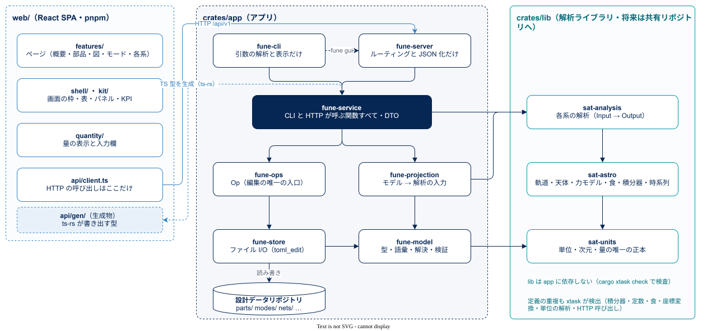

# 構成台帳（registry）

**機能の置き場所の正本。** 新しい型・関数・モジュールを作る前にここを見る。同じ機能があればそれを使い、無ければ行を足してから作る。
行を足したら「変更履歴」にも 1 行書き、レビューで照合する。

## 1. crate と依存

依存の向きは `cargo xtask check` が検査する（`crates/xtask/src/main.rs` の `ALLOWED`）。定義の重複は同じく xtask の `single_home` が検査する。

| crate | 場所 | 責務 | 依存してよい内部 crate |
|---|---|---|---|
| `sat-units` | crates/lib/units | 単位・次元・量の唯一の正本 | なし |
| `sat-astro` | crates/lib/astro | 数学・積分器・時刻・天体・力モデル・軌道・食・地球・地磁気・大気・地上局・姿勢則・入射・時系列 | sat-units |
| `sat-analysis` | crates/lib/analysis | 各系の解析（Input → Output の純粋な関数） | sat-units, sat-astro |
| `fune-model` | crates/app/model | 設計データの型・組み込みの語彙・解決・検証 | sat-units |
| `fune-store` | crates/app/store | ディレクトリ ⇄ Design（toml_edit）・revision・ロック | fune-model |
| `fune-ops` | crates/app/ops | Op・plan / apply・to_cli | fune-model, fune-store |
| `fune-projection` | crates/app/projection | Resolved → 解析の入力型・不足入力 | fune-model, sat-analysis, sat-astro, sat-units |
| `fune-service` | crates/app/service | CLI と HTTP が呼ぶ関数と入出力の型 | 上のすべて |
| `fune-server` | crates/app/server | axum のルーティング・JSON 化・SPA の配信 | fune-service |
| `fune-cli` | crates/app/cli | `fune` の引数解析と表示 | fune-service, fune-server |
| `web/` | web | 表示と操作（React SPA） | HTTP API だけ |

## 2. 機能台帳

| 機能 | 置き場所 | 備考 |
|---|---|---|
| 単位文字列の解析・次元 | `sat_units::parse_unit` / `Unit` / `Dimension` / `named_dimensions` | ここ以外で単位文字列を解析しない |
| dB ⇄ 比 | `sat_units::{ratio_to_db, db_to_ratio, apply_db_gain}` | **dB の換算はここだけ**（回線計算もこれを使う） |
| JSON に書いた量の次元 | `sat_units::take_last_dimension` | `Qty` の `Serialize` が記録する（スレッドごと）。JSON は変えない |
| 次元の表示名 | `sat_units::format::dimension_label` | 名前が無ければ SI の組立単位の式 |
| 二分法・黄金分割 | `sat_astro::math::{bisect, golden_section_max}` | **根と極値の探索はここだけ** |
| 型付きの量 | `sat_units::typed::Qty<D>` | JSON では SI の数値。TS では number |
| dB の型付き表示 | `sat_units::typed::{Decibel, DecibelWatt, DecibelPerKelvin, DecibelHertz}` | JSON は dB 数値のまま。種類を記録して format_quantity で表示 |
| 解析結果の判定集約 | `fune_service::analysis` / `sat_analysis::spec::Verdict::worst` | checks をサービスで平坦化し、CLI と Web に返す |
| 比（0〜1。% で表示） | `sat_units::typed::Fraction` | JSON では数値、TS では number。書き出すと `take_last_dimension` が種類名 `Fraction` を返し、`format_quantity(_, "Fraction")` が % で出す。**解析の出力の割合（DoD・SOC・日照率・稼働率・余裕・占有率）はこれにする**（Web が欄の名前で判断しないため） |
| 量の表示文字列（SI 接頭辞の選択） | `sat_units::format::{format_quantity, format_dimension, format_in_unit, format_number, FormattedQuantity}` | CLI と Web は service が返す表示文字列を使う。TS で単位換算しない。表示単位の候補は `display_units`、SI の組立単位の式は `si_unit_expression`。`FormattedQuantity` は整形の関数の戻り値で API には出さない（API の量の表示は `fune_service::dto::QuantityView` だけ） |
| 次元 → 次元名 | `sat_units::format::{dimension_name, canonical_dimension_name}` | Energy と Torque は同じ次元なので、整形は次元名で指定する |
| ベクトル・行列・クォータニオン | `sat_astro::math::{Vec3, Mat3, Quat}` | 演算子（Vec3 の + − × ÷、Mat3 の +）、`Mat3::{mul, inverse, outer, scale}`、`Quat::{rotate, rotate_inverse, from_matrix}`。対称行列の固有値分解（主慣性モーメント・主軸）は `Mat3::symmetric_eigen` だけ。軸まわりの回転行列は `Mat3::{rotation_x, rotation_y, rotation_z}`、球面座標の単位ベクトルは `Vec3::from_spherical`、`Quat::{from_wxyz, to_wxyz}` |
| 密行列の連立一次方程式 | `sat_astro::math::solve_dense` | 部分ピボット付き Gauss 消去。熱ネットワークの定常解など。**線形ソルバーはここだけ** |
| 積分器（固定刻み RK4・適応刻み DOP853） | `sat_astro::ode` | **積分器はここだけ**。固定刻みの格子は `ode::{step_count, step_offsets}` だけ（時系列の時刻列も使う） |
| 物理定数・天体定数 | `sat_astro::constants` | 定数の重複定義をしない |
| 元期・恒星時 | `sat_astro::time::Epoch` | JSON では ISO 8601 |
| 天体の位置（太陽・月・惑星）と μ | `sat_astro::ephem` | 太陽 VSOP87A・月 Meeus・惑星 Standish。Kepler 方程式は `kepler::solve_kepler`（orbit からも再公開）を使う。JPL DE440 は `ephem::De440::from_bytes` で読み、`ephem::install_de440` で登録（1849〜2150 年に使う。プロセス全体の唯一の状態）、出所は `ephem::source_at` |
| 軌道の中心天体（μ・半径・J2・位置） | `sat_astro::ephem::CentralBody` | `OrbitSpec::central`（既定は地球）。中心天体から見た太陽の方向は `ephem::sun_direction_from` |
| 天体の自転軸・本初子午線・天体固定座標 | `sat_astro::ephem::orientation`（`pole_eci`・`equatorial_frame`・`moon_fixed_frame`・`lunar_orientation`） | IAU WGCCRE 2015。月は秤動の周期項込み。地球の ECEF は `earth` |
| 力モデル（重力場・第三体・SRP・抗力） | `sat_astro::force` | EGM96 70 次まで。項ごとの関数 `point_mass` `j2_perturbation` `third_body_eci` `srp_eci` `drag_eci`、設定の検査 `validate`。**J2 の式は `force::zonal_j2` だけ**（`j2_perturbation` は地球・z 軸の `zonal_j2`）。**抗力の式 `F = −½ ρ (Cd·A) \|v\| v` は `force::drag_force` だけ**（`drag_eci` は `Cd·A/m` で加速度、空力トルクは `Cd·A` で力）。共回転大気に対する相対速度 `force::relative_wind_eci`、太陽輻射圧 `force::srp_pressure`（抗力・空力トルク・SRP トルクで共有） |
| 軌道要素・伝搬・周期・SSO 傾斜角・β 角 | `sat_astro::orbit` | 伝搬はここだけ。`Propagator::default()` は J2 永年項。書かれていない要素の慣例の値（離心率 `DEFAULT_ECCENTRICITY`・角度 0）は `OrbitElements::with_defaults` だけ。要素 ⇄ 状態 `elements_to_state` / `osculating_elements`、`solve_kepler`、`j2_secular_rates`。β 角から RAAN を逆算するのは `orbit::raan_for_beta` だけ（β の符号は `beta_angle_rad` と同じ）。交点の地方時 ⇄ RAAN は `orbit::{raan_from_ltan, raan_from_ltdn, ltan_from_raan}`（真太陽時）。高度 ⇄ 長半径は `orbit::{semi_major_axis_from_altitude, altitude_from_semi_major_axis}` と `OrbitSpec::altitude_m` だけ（中心天体の半径）。平均運動は `orbit::mean_motion_rad_s` |
| 地球の影（食） | `sat_astro::shadow::earth_shadow_factor` | 食の判定はここだけ。月・惑星の影は `shadow::body_shadow_factor`。中心天体の影は `shadow::central_shadow_factor`（時系列と SRP で共有）、天体の陰（月が地球の陰か）は `shadow::occulted_by` |
| ECI ⇄ ECEF・測地座標・高度・歳差 | `sat_astro::earth` | 座標変換はここだけ（`of_date_to_j2000`・`mean_obliquity_rad`・`ecliptic_to_equatorial` を含む） |
| 地磁気（傾斜双極子） | `sat_astro::geomag` | 地球以外の中心天体では 0（`geomag::field_about_eci_t`） |
| 大気密度（指数大気・NRLMSISE-00） | `sat_astro::atmosphere::{density_kg_m3, AtmosphereModel, density_exponential_kg_m3}`、`atmosphere::nrlmsise00` | 大気モデルはここだけ。抗力（`force::DragParams::atmosphere`）と空力トルクは `AtmosphereModel` を受けて `density_kg_m3` を呼ぶ |
| 地上局・見通し角・パス・斜距離 | `sat_astro::ground` | 書かれていない標高・最低仰角（0）は `GroundStation::with_defaults` だけ。仰角と高度からの斜距離は `ground::slant_range_m(中心天体の半径, 高度, 仰角)` だけ（回線計算が使う。半径は `CentralBody::radius_m`） |
| 姿勢則 → 機体姿勢 | `sat_astro::attitude` | 2 軸の合わせ込みは `align_two_axes`。既定主軸 `DEFAULT_PRIMARY_AXIS` = +Z、副軸 `DEFAULT_SECONDARY_AXIS` = +X |
| 面への太陽入射・地球の形態係数・太陽光の強さ | `sat_astro::illumination` | 電源と熱で共有（`solar_incidence`・`earth_view_factor`・`solar_flux_w_m2`） |
| 軌道上の時系列（位置・太陽・日陰・姿勢） | `sat_astro::timeline` | 時系列の解析は自前のループを書かずにこれを使う。共通の既定刻み `DEFAULT_STEP_S` = 30 s。時刻列 `sample_times`、日照率の平均 `mean_sunlit`。時系列の時間平均・累積は `timeline::{time_mean, cumulative_trapezoid}` だけ |
| 判定文中の量の文字列 | `sat_analysis::spec::quantity_text` | 換算・整形は `sat_units::format` に委譲。未知の次元は `format_number` |
| 解析の trait・情報・エラー・時系列・判定 | `sat_analysis::spec` | |
| 時系列の中の区間（日陰・侵入・可視） | `sat_astro::timeline::{Window, windows}`（`sat_analysis::spec` が再公開） | 区間の抽出はここだけ。日陰は `timeline::shadow_windows` |
| 周回ごとの切り出し・閉区間 | `sat_analysis::spec::{orbit_ranges, orbit_segment, orbit_segments}` | 周回平均・周回ごとの積算に使う。周回を閉区間 `s..=e` に直すのは `orbit_segment`、周回が無ければ全期間を 1 区間にするのは `orbit_segments`（永年成分の外挿）。実体は `spec/orbit.rs` |
| 周回平均・条件付きの時間平均・時間の割合 | `sat_analysis::spec::{orbit_mean, masked_time_mean, time_fraction}` | 台形則の時間平均（`sat_astro::timeline::time_mean`）。標本数で割る平均を書かない。**周回平均は `orbit_mean` だけ**（熱の入熱の平均も）。真の時間の割合（日照率・侵入の割合）は `time_fraction`（周回を渡さなければ全期間） |
| 日照の判定・最長の区間・期間不足の注意 | `sat_analysis::spec::{SUNLIT_THRESHOLD, is_sunlit, longest_window, short_span_check, SpanFallback}` | **日照の閾値と判定はここだけ**（電源・センサ FoV。日陰の区間は `shadow_windows` に `SUNLIT_THRESHOLD` を渡す）。最長の日陰・侵入は `longest_window`。1 周に満たない期間の注意（key `span`）は `short_span_check` |
| 判定と入力の検査の部品 | `sat_analysis::spec::{Verdict::from_ok, margin_verdict, ensure_fraction, ensure_positive, ensure_non_negative}` | 余裕の三段階判定と、割合・正値・非負の検査 |
| バジェット（質量・電力・データ量）の集計と判定 | `sat_analysis::budget::{budget_rollup, BudgetRollupRow}` | 個数 × 値、成長余裕は 1 回、判定 = 成長込み ≤ 上限 × (1 − システム余裕)。**バジェットの判定はここだけ**。解析の中で数えるだけ・上限と比べるだけのときは `budget::{counted_total, limit_check}`（行は `BudgetItem::counted`） |
| 解析の登録と ID による実行 | `sat_analysis::catalog` | 登録と実行はここだけ（run_json と型付き run_typed） |
| モードの状態と時間割合 | `sat_analysis::modes` | 電源・C&DH・熱で共有。`DUTY_TOLERANCE`（設計の検査の `fune_model::check::SHARE_TOLERANCE` と同じ値。fune-projection のテストが確かめる）・`find_mode`・`evaluate`（未割り当て・値の不足は警告して合計から除く、の方針はここだけ。一覧に無い部品の割り当てを警告するかは引数 `UnlistedParts`）。**部品の状態ごとの値の表は `modes::StateValues<D>`（`default`・`by_state`・`get`）だけ**（電源・C&DH・熱。単体値で、員数は各解析の部品の `count`） |
| 各解析 | `sat_analysis::<系>::<名前>` | 1 ファイル 1 解析。一覧は docs/architecture.md §6.1 |
| 擾乱トルク | `sat_analysis::attitude::disturbance` | 重力傾斜・空力・SRP・残留磁気。`DisturbanceSurface::from_box` が箱の最大面積 × 係数を求める。`DisturbanceSpacecraft::torques(central, &TimelineSample)`（μ・磁場・大気は中心天体のもの、風・抗力・輻射圧は `sat_astro::force`）。アンロード頻度と時系列で共有 |
| RW の組への配分（擬似逆行列）と容量 | `sat_analysis::attitude::wheels` | `RwWheel`・`WheelSet::{distribute, capacity_along}`・`DEFAULT_USABLE_FRACTION`（0.8）。台数・配置は任意 |
| 太陽電池の発電モデル | `sat_analysis::power::solar` | `SolarPanel`・`SolarArray::{panel_powers, sample_powers}`・時系列 `SolarProfile`（日照中かは `lit`。判定は `spec::is_sunlit`）・`eclipses`（`timeline::shadow_windows` に `spec::SUNLIT_THRESHOLD`）。日照時・軌道上・収支で共有 |
| 電池の充放電の積分 | `sat_analysis::power::battery` | `simulate`（`ode::rk4_linear_step` で積分、容量で切る、シャント）。電力収支が使う。`power::battery::EnergyBalanceBattery::combine` が電池容量を合計し、電圧・効率は先頭を採用 |
| モードの消費電力の集計 | `sat_analysis::power::mode_load::evaluate_mode` | `power.mode_load` と `power.energy_balance` で共有（平均と警告は `modes::evaluate`）。部品の電力は単体値 × 員数（`ModeLoadPart::power_in`） |
| 回線計算の部品（FSPL・EIRP・Eb/N0） | `sat_analysis::comm::link` | `RfLinkParams::{evaluate, eb_n0_margin_db, min_elevation_for_margin}`（斜距離は `sat_astro::ground::slant_range_m` に中心天体の半径を渡す）・`fspl_db`・`eirp_dbw`・`g_over_t_dbk`・`c_over_n0_dbhz`・`eb_over_n0_db`・`max_data_rate_bps`・要求余裕の既定値 `DEFAULT_REQUIRED_MARGIN_DB`（既定値はここだけ）。dB の換算は `sat_units::{ratio_to_db, db_to_ratio}`、閉じる仰角の探索は `sat_astro::math::bisect`。回線バジェットと送信量で共有 |
| 複数局のパスの集計 | `sat_analysis::comm::passes` | 検出は `sat_astro::ground::find_passes` だけ。ここは局をまとめて AOS 順に並べ、開始からの秒の区間・日の窓に直す（`find_all_passes`・`pass_interval`・`union_sorted`・`day_windows`）。可視と送信量で共有 |
| 熱ネットワークの解法 | `sat_analysis::thermal::network` | 型（`ThermalNetwork` ほか）。`ThermalMounts::links` が取付から並列伝導・節点対ごとの放射結合を作る。`ThermalModeLoads::evaluate` が `modes::evaluate` で単体平均電力と警告を求める。節点の熱容量と動作範囲のまとめ（`ThermalNode::{heat_capacity, operating}`）・熱収支・微分・安定な刻みの目安。定常解の Newton 法は `network::newton`（線形ソルバーは `sat_astro::math::solve_dense`）、初期値 `INITIAL_GUESS_K`（290 K。初期値はこれだけ）。定常・非定常で共有 |
| 熱環境と外面への入熱 | `sat_analysis::thermal::orbit_heat` | `ThermalEnvironment`・`ThermalExposure`。太陽・アルベド・地球赤外の吸収。入射の幾何は `sat_astro::illumination`、向きは `sat_astro::timeline`、周回平均は `spec::orbit_mean`（周回の切り出しは `spec::orbit_ranges`）。宇宙の背景温度の既定値 `DEFAULT_SPACE_TEMPERATURE_K`。定常・非定常で共有 |
| 節点の温度と動作範囲の比較 | `sat_analysis::thermal::range` | 警告の幅 `RANGE_WARNING_BAND_K`・`range_verdict`・`range_check`（判定は `spec::margin_verdict`）。**温度範囲の判定はここだけ**。定常・非定常で共有（解析どうしは参照しない） |
| 質量特性 | `sat_analysis::structure::mass_properties` | 関数 `mass_properties(&[MassPropertiesItem]) -> MassPropertiesSummary`（箱の近似＋平行軸、主慣性は `Mat3::symmetric_eigen`）。姿勢の解析が使う慣性も、projection がここを呼んで求める |
| 型付き ID と ID の規則 | `fune_model::id` | 一意性は大文字小文字を無視（`fold`）。部品・グループは `validate_node_id`（パスの予約語も禁止）。属性 ID が部品・カタログ品のフィールド名（`field_names::{PartFieldName, CatalogFieldName}`）と重なるのは `check::attribute_def_problems` の `def.reserved` だけが拒む（検査と `create_attribute` の事前検査が共有） |
| 設計データの型 | `fune_model::design` | 列挙の綴りは `enum_text!`（下の行）。service::query::enum_label は Display の綴りで引く |
| 列挙の値の綴り（serde の名前・`as_str`・`Display`・`FromStr`・値の一覧 `ALL`・`NAMES`） | `fune_model::enum_text`（`enum_text!`・`EnumText`・`EnumTextError`） | **綴りは列挙の定義の中に値ごとに 1 回だけ書く**（マクロが `#[serde(rename)]` と `as_str` などを同じ文字列から作る。`rename_all` は書かない）。手書きの match や serde_json を経由した綴り（`enum_str`）を書かない（xtask の `single_home`）。すべての値の往復は `model/tests/enum_text.rs`。`FromStr` の誤りは選べる綴りを添える（CLI の旗の誤りにそのまま出る） |
| 部品・カタログ品・ネットのフィールド名（名前の一覧と正規の順） | `fune_model::field_names`（`PartFieldName`・`CatalogFieldName`・`NetFieldName`。`design` から再公開） | **フィールド名の一覧はここだけ**（宣言の順がファイルの見出しのキーの正規の順）。型付きのフィールドの名前は `PartField::key()`・`name()`、今の値は `PartField::of(part, key)`（Catalog・Net も同じ）。パス記法（`path::parse`）・検査の `def.reserved`・`views::field_paths`・`net_field_paths` はこの一覧を引き、store の新しいファイルの見出しと 1 フィールドの書き込みは同じ `field_item` で一覧を回し（`write::{part, catalog, entities}`）、読み込みの Doc（`read::tree` の `PartDoc`・`CatalogDoc`、ネットは `Net`）のキーは一覧と同じ順（store のテスト）。ops の `fune net add|replace` の旗の順、service の打った文字列 → フィールド（`text::field_value`・`catalog::catalog_field`・`command::net_field`）もこの列挙で回す・match する |
| 書かれたままの量・値の型・出典 | `fune_model::value` | |
| 単位の窓口（app 側） | `fune_model::value::units` | 単位文字列の解析・次元の検査・SI 換算・次元の表示名（`dimension_label`）。中身は sat-units。projection の SI 換算は `Quantity::si_as` |
| 人の入力の書式（`"620 g"`・`"-20 .. 60 degC"`・`"0 0 1 mm"`・`"off,on"`）の読む向きと書く向き | `fune_model::value::text`（書く向きは `text::write`） | 読む: `parse_number_unit`・`value_from_text`・`quantity_from_text`・`setting_from_text`（今の値と同じ型。無ければ推し量る）・`list_from_text`。書く: `value_to_text`・`setting_to_text`・`number_to_text`・`number_unit_to_text`・`quantity_to_text`・`vector_to_text`・`quaternion_to_text`・`range_to_text`・`list_to_text`。**往復（書く → 読む）のテストは `value/text.rs`**。どの型で読むか（属性定義・設定の今の値）は service が決め、誤りをサービスのエラーにする。`to_cli`（fune-ops）は書く向きだけを使う |
| JSON の中の量・ベクトルの見分け | `fune_model::value::json` | `quantity_from_json`・`is_quantity_json`・`vector_from_json` |
| 設定をパス記法で読む | `fune_model::design::settings_view` | `Design::setting`・`setting_entries`・`settings_json`（キーはパス記法と同じ） |
| 組み込みの属性・種別 | `fune_model::builtin` | §3 の語彙 |
| 語彙の表示名（日英）と系の並び | `fune_model::builtin::labels` | CLI は `fune_service::query::enum_label`、Web は `web/src/api/labels.ts` の `useEnumLabel`（`GET /defs` の `labels`）で引く。i18n に写さない。状態・系（section）・列挙（budget_kind など）の `label` / `label_en`、`sections()` の順、選択肢に並べる列挙の値の順は `enum_order`（Web は `useEnumOptions`。成熟度の選択肢などの値の一覧を手で書かない）、属性 → 系は `Design::attribute_section`、role → 系・サブシステムは labels の role_system / role_subsystem。列挙の型の名前（`enum_label(ty, …)` の `ty`）と列挙の対応、すべての値に表示名があることは `model/tests/enum_labels.rs`（値の一覧は各列挙の `NAMES`） |
| 型付き解析出力の読み取り（TS） | `web/src/api/analysis-output.ts` | dispatch 由来の生成型 AnalysisOutputs を ID・成功状態で絞り込む唯一の入口 |
| パラメーターのパス記法 | `fune_model::path` | CLI と API で共通。service::query::views::parameter_paths が属性と状態のパス（`paths`）を、`views::field_paths` が部品のフィールドのパス（`PartRow.field_paths`）を DTO に添える。Web は `lib/design.ts` の `paramPath`・`findParamPath`・`fieldPath` で引くだけで、つながない（同じ編集で定義を作る属性は、その定義を書き込まずに当てた部品 `POST /parts/{id}` の `paths` から引く。`api/queries.ts` の `useDraftPart`） |
| ポートの参照（`PCDU.OUT3`）の読み書き | `fune_model::path::{PortRef, port_text}` | ネットの `source`・`master` とハーネスの `from`・`to` は読み込みで `PortRef` にする（TOML と Op の JSON は文字列のまま。`#[serde(with = "port_text")]`）。読み方は `PortRef::parse`・`FromStr`（CLI の引数も）だけ、書き方は `Display` だけ。形が違えばそのファイルの `toml.schema`。DTO（`NetView`・`HarnessView`）は構造 `{ part, port }` |
| 戻り（GND）のネットの区分 | `fune_model::design::Net::is_return` | 電源のネットで、レール電圧が 0 か、ID に `GND`・`RTN` の語（`RETURN_NET_TOKENS`）を含むもの。service が `NetView.is_return` に入れ、Web の系統図（`features/diagram/power.ts`）はこの欄だけを見る |
| 解決（Resolved） | `fune_model::resolve` | カタログ品そのものに書かれた値の解決は `resolve_catalog_item`（部品がその品の値を使うときと同じ関数を通る） |
| 検証と診断 | `fune_model::check` / `fune_model::diagnostic` | |
| 診断と不足入力の対象 | `fune_model::target::Target` | 部品 ID などは構造で持ち、文字列のパスは `Display` だけが作る（受け取る側は読み直さない）。部品の属性・フィールド・設定は `path::ParamPath`、ポートは `PortRef`、カタログ品の属性は `AttrPath` を入れる。どの部品の話かは `Target::part`（部品のファイルの中の対象だけ）。読み込みの診断の対象（ファイル → エンティティ）は `fune_store::layout::file_target` |
| ディレクトリの規約 | `fune_store::layout` | カタログの出所が書き換えられるか（`[[catalog]] path = …`）の判定は `local_catalog_dir` だけ（`catalog_location`・fune-ops・service の出所の一覧が使う） |
| 設定のパス → ファイル | `fune_store::layout::setting_location` | 唯一の対応（`locate_setting` で行も引ける） |
| プロジェクトの探索・初期化・git のブランチ名 | `fune_store::project` | `find_root`・`init`・`git_branch` |
| 読み込み・書き込み・整形 | `fune_store::{read, write, format}` | ファイル I/O はここだけ |
| 属性の値のファイル上の形 ⇄ `Value` | `fune_store::codec` | 読みと書きの両方がこれを使う |
| revision・ロック | `fune_store::{revision, lock}` | |
| Op | `fune_ops::op` | 編集の唯一の入口 |
| 変更計画・適用 | `fune_ops::{plan, apply}` | |
| Op → CLI のコマンド文字列 | `fune_ops::cli` | 引用と旗の組み立て（`cli::text`）だけを持つ。値の文字列は `fune_model::value::{value_to_text, setting_to_text, …}`、列挙は `as_str`、フィールド名は `field_names` |
| モデル → 解析の入力 | `fune_projection::<系>` | |
| 不足入力 | `fune_projection::missing` | 対象は `fune_model::Target` で直接作る（文字列を作って読み直さない）。`part` は `Target::part`、`path` は表示。「どれかの部品」は `Target::AnyPart`（部品 ID を持たない）。解析（`AnalysisRunResult.missing`）とバジェット（`BudgetView.missing`）が同じ形で返す（どちらも 200。エラーにしない） |
| 取付の連鎖 ⇄ 機体座標の位置・姿勢（合成と逆変換） | `fune_projection::pose` | sat-astro の `Quat` で合成する（`body_pose`・`mount_frame`・`body_to_mount_local`）。service もこれを呼ぶ |
| 解析 ID → 射影の対応表・型付きの出力の受け渡し・解析の入出力の TS 書き出し | `fune_projection::dispatch` | 実行は `sat_analysis::catalog`（service が呼ぶ）。AnalysisOutputs の TS 対応表も同じ表から生成。表がずれないことをテストで確かめる |
| 解析ケースの文脈（軌道・地上局・姿勢則・モード） | `fune_projection::context` | 軌道の組み立ては `OrbitSpec::new`・`semi_major_axis_from_altitude`・`raan_from_ltdn` を呼ぶだけ |
| 時系列の仕様（軌道・姿勢則・期間・刻み・β） | `fune_projection::timeline` | `TimelineSpec::new`。既定の周回数 `DEFAULT_ORBITS` はここだけ。刻みは `sat_astro::timeline::DEFAULT_STEP_S` |
| 解決済みの部品の値の取り出し・員数（示量）・成長余裕 | `fune_projection::parts` | **`count_of` が設計の員数を正規化（0 → 1）。入力に `count` がある場合は単体値と員数を渡して解析が掛ける。無い場合だけ `extensive*` で合計値を渡す。成熟度 → 成長余裕は `growth` だけ**（service のバジェットも使う）（part_qty は部品属性、quantity::qty は書かれた量）。状態ごとの値（電力・データレート）→ `modes::StateValues` は `state_values` だけ（スカラーは `default`。電源・C&DH・熱） |
| 書かれた量 → 型付きの SI 量・dB | `fune_projection::quantity` | 換算は `fune_model::value::units`・`sat_units::ratio_to_db` |
| CLI と HTTP が呼ぶ関数 | `fune_service::{query, edit, units, analysis, budget}` | |
| 保存していない編集（Op の列）を書き込まずに当てた設計 | `fune_service::preview::snapshot_with` | スナップショットの組み立ては `workspace::Snapshot::of` だけ。下書きのまま解析（依頼の `ops`）・バジェット（`POST /budgets/{kind}`、`fune budget --ops`・`fune analyze --ops`）・部品（`POST /parts/{id}`、`fune part show --ops`。`query::part_view` の `PartViewRequest`）を見るのに使う。下書きが通らなければ、どの入口も保存と同じエラーを返す（検証なら 422 と診断。解析も文字列に潰さない） |
| プロジェクトを開く・スナップショット（読み直し・診断の該当行） | `fune_service::workspace` | 読み込みは `fune_store::load` |
| サービスのエラーと分類（HTTP の状態・終了コードの元） | `fune_service::error` | fune-store・fune-ops のエラーの読み替えは `workspace::{store_error, op_error}`（保存・下書きのプレビュー・打った文字列の読み取り・整形で共通。ロックと「もうある」の分類は `store_error` だけ）。同じ ID がもうある（`AlreadyExists`）は競合（409・終了コード 3） |
| 人が打つ文字列 → Op（属性の型・設定の今の型・一覧） | `fune_service::edit::{text, catalog, place}` | **CLI も GUI もここを通す**（入口は `edit::set_op(&SetText)`・`edit::unset_op(&UnsetText)`。`item` があればカタログ品（`catalog`）、無ければ部品と設定（`text`）。GUI は `POST /ops/from_text`・`POST /ops/unset_from_text` で Op にしてから `POST /ops`。`fune set`・`fune unset`・`fune setting set|unset`・`fune catalog set`・`fune catalog unset` も同じ関数）。`SetText.ops` があれば、それを書き込まずに当てた設計（`preview::snapshot_with`）で型を決める（GUI のパラメーター追加が属性の定義と値を 1 回で作るとき）。成熟度の読み方は `edit::maturity` だけ。文字列の読み方は `fune_model::value::{value_from_text, setting_from_text, quantity_from_text, parse_number_unit}`・`path::{AttrPath, PortRef}`（部品とカタログ品のフィールド名は `field_names` の列挙で読む）。一覧の規則は `fune_model::value::list_from_text`（カンマのみ・trim・空要素除外。service は `edit::list_from_text` として再公開）、`名前=値` は `edit::pair_from_text`、図の X,Y は `edit::{xy_from_text, points_from_text}`、ネットの種類は `edit::net_kind`（どれも CLI の引数と GUI の欄で共通。web で読み直さない） |
| 名詞のコマンドに打った引数 → Op（ネットのフィールド・配置・モードの時間割合・属性定義と種別定義の作成） | `fune_service::edit::{command, defs}`（型は `dto::CommandText`・`NetSetText`・`NetUnsetText`・`PlaceText`・`ModeSetText`・`ModeCellText`・`AttrAddText`・`KindAddText`） | **CLI も GUI もここを通す**（入口は `edit::command_ops(&CommandText)`、HTTP は `POST /ops/from_command` で Op の列にしてから `POST /ops`。CLI の `fune net set|unset`・`fune part place`（`--body-pos` 以外）・`fune mode set|unset`・`fune attr add`・`fune kind add` は同じ型を作って `net_set_ops`・`net_unset_op`・`place_op`・`mode_set_op`・`attr_add_op`・`kind_add_op` を呼ぶ）。旗を省くか空の欄は旗を書かないのと同じ（`text::given`）。ネットのフィールド名 → 型付きのフィールドは `command::net_field` だけ（名前の一覧と旗の順は `NetFieldName`）。`--duty tx=0.1` は `edit::duty_from_text`、割合は `mode_set_op` が読む。定義を作るときの既定（表示名は ID、値の型は scalar）は `defs` だけ。ポートの雛形 `名前=種類` は `edit::port_template_from_text` |
| 解析の出力の量の次元（JSON Pointer → 次元名）・時系列の表示単位 | `fune_service::analysis::{dims, channels}` | `sat_units::take_last_dimension`・`sat_units::format` を使う |
| 外部データ（DE440）の取得・状態・読み込み | `fune_service::data` | ユーザーのキャッシュ。install_cached_ephemeris を CLI・HTTP 起動時に明示的に呼ぶ。GUI 設定の DataPanel も同じ API を使う。状態の SHA-256 には、同じプロセスの中でファイルの大きさと更新時刻が変わらない間は前回の結果を使う |
| 変更前後の本文 → unified diff | `fune_service::diff` | `--dry-run` と GUI の変更の確認で共通 |
| 表示用の型（DTO） | `fune_service::dto` | DiagnosticView の `target`（構造）と、それから作った `part`・`path`、NetView の PortRef と `field_paths`（`Target::net` の表示。診断の `path` と同じで、GUI の欄の名前）、MountView（取付のある部品だけ。取付先・位置・姿勢・機体座標は必ず値がある）、PartRow.paths / PartRow.field_paths / CatalogItemView.paths と SettingView.group / field、AttributeDefView.section と型付き enum（`PartRow.maturity` も `Maturity`）。TS 型の生成元。`DisplayChannel`・`DisplaySeries` は service が表示情報を添えた時系列。値の表示 `ValueView`・`ValueData` は `dto::value`（部品・カタログ品・設定で共有）。**形の取り決め**: 量の表示は `QuantityView` だけ（`/units/format` も。欄の名前は量の名前で `*_display` にしない。量でない数や文は `*_text`）。無いものは null（空文字にしない。`PartRow.kind`・`ModeRow.kind`）。未設定の値は `ValueData::Unset` と `display: null`、モード表のセルは状態と割合（`ModeRow.cells`・`shares`）、バジェットの「その他」の行は `node: null` の構造で返し、文言は CLI と Web（i18n）が作る。表示名（`label`）は無ければ ID で埋める（TreeNode・ModeHeader・CaseView・NetView・HarnessView）。ただし編集の欄の値でもあるもの（`CatalogItemView.label`・`label_en`）は書かれたまま。`DiagnosticView`・`MissingInput` の `part`・`path` は `target` から 1 か所（`workspace::with_excerpt`・`MissingInput::new`）で作るので残す: `path` は入力欄のエラーの突き合わせ（保存の失敗の診断を Web の `lib/field-errors.ts` が欄のパラメーターパスと比べる）、`part` は部品ごとの絞り込み（`PartView.diagnostics`・部品の詳細の診断） |
| 部品の置き場所（`parts/` からのディレクトリの区間） | `fune_service::query::parts`（`PartRow.dir`。中身は `fune_store::layout::dirs_for_parent`） | 区間は製品ツリーのノードの ID。Web のツリー（`kit/tree.ts` の `partsTree`）は `dir` と `DesignView.tree` の表示名を使い、ファイルのパスを分解しない |
| 設定の区分と系の対応 | `fune_service::query::settings::system_of`（`SettingView.scope`・`system`・`group`・`field`） | **設定と系の対応はここだけ**（`analysis/<系>.toml` はその系、配分は質量 → 構造・電力 → 電源・データ量 → C&DH）。Web の設定のページ・軌道のページ・系のページの設定のタブは欄だけで選ぶ（キーの接頭辞で比べない） |
| カタログ品の表示（値・パス・使っている部品・書き換えられるか・カタログ名と名前） | `fune_service::query::catalog`（`dto::CatalogItemView`、`DesignView.catalog`） | 値は部品と同じ `query::values::value_view`（解決は `fune_model::resolve::resolve_catalog_item`）、パスは `views::parameter_paths`、書き換えられるか（`editable`）は fune-ops と同じ `fune_store::layout::catalog_location`、使っている部品は `Design::catalog_part_users`、`scope`・`name` は `split_catalog_ref`。Web は ID を分解しない（`editable`・`scope`・`users` を使う）。CLI の `fune catalog ls`・`fune catalog show` も同じ型 |
| カタログの出所の一覧（名前・書き込めるか） | `fune_service::query::catalog::sources`（`dto::CatalogSourceView`、`ProjectInfo.catalogs`） | fune.toml の `[[catalog]]` の順。書き込めるかは `fune_store::layout::local_catalog_dir`。Web は出所の名前を書かず、カタログ品を作る置き先・読み取り専用の文言・ID の説明をここから作る（`features/catalog/catalog.ts` の `writableCatalogs`） |
| TS の型名の重複の検査 | `fune_service::export::names` | 書き出しのときに止める（registry §4） |
| HTTP のルーティング | `fune_server::routes` | |
| HTTP のエラーの本文・Host の許可リスト・SPA の配信 | `fune_server::{error, host, spa}` |  |
| CLI の引数・表示・診断 | `fune_cli::{args, cmd, output, diag}` | |
| API クライアント（TS） | `web/src/api/client.ts` | 型は `web/src/api/gen/`（生成物）だけ |
| 画面の枠・ナビゲーション | `web/src/shell/` | |
| ページの遅れた読み込みと先読み（ルート単位の分割・待つ間の骨組み・ナビのホバーと空き時間の先読み） | `web/src/shell/{pages.ts,preload.ts,lazy-page.ts,LazyRoute.tsx}` | `routes/` のモジュールは `LazyRoute` でページの本体を描き、`clientLoader`（`loadOnNavigate`）で本体を読み始めるだけ（読み終わっていれば待たずに描く。Suspense の 300 ms の間引きを避ける）。サイドバーはホバー・フォーカスで先読み（`preloadHandlers`、React Router の `prefetch="intent"`）、軽いページは最初のデータを取り終えたあとの空き時間に読む（`preloadIdlePages`）。待つ間の骨組みは `kit/Loading.tsx` の `SkeletonPage`。系の解析の先読みは `api/queries.ts` の `prefetchSystemAnalyses`。大きなライブラリは使う所で遅れて読む（three.js は `features/layout3d/LazyLayout3D.tsx`、recharts は `SystemTabs` の時系列タブ） |
| ロゴ（マーク・名前と説明文の字形・並べ方）と README・ファビコンの SVG | `web/src/shell/{brand-art,brand-glyphs,brand-svg}.ts`・`BrandMark.tsx`・`BrandWordmark.tsx` | 字形はヒラギノ角ゴシック（名前 W6・説明文 W4）を輪郭にしたもの（フォントそのものは入れない）。配色は `lib/tone.ts` の `brandHex`・`brandInkHex`。SVG は `pnpm -C web brand` で書き出し、テストが一致を検査する |
| ファイル階層のツリー表示・構築・絞り込み | `web/src/kit/{Tree,ViewSwitch}.tsx`・`web/src/kit/tree.ts`、各ページの `*Tree.tsx` | 部品の親子・カタログの階層、URL の表示切替、ARIA キーボード操作 |
| 一覧と詳細の表示面・ツリー列幅・詳細の欄の幅 | `web/src/kit/{DetailLayout,DetailDialog,TreePane}.tsx`・`tree-width.ts`・`use-detail-route.ts` | 全幅表のモーダル、可変幅ツリー、カードの一覧の横の可変幅の詳細（`wideList`・`DETAIL_WIDTH`）、URL 選択と幅保存 |
| 共通の部品（表・パネル・KPI・入力欄・開閉する領域） | `web/src/kit/` | 下書きのときだけ出る帯などの開閉は `kit/Reveal.tsx` |
| 量の表示と入力欄 | `web/src/quantity/` | 単位の解析は `/units/parse` に問い合わせる。入力欄の初期値の文字列（`quantityInputText`・`vectorInputText`・`numbersInputText`。API の数をそのまま並べる）は `format.ts` |
| 属性の値の表示と編集（部品・カタログ品で共通） | `web/src/quantity/{AttrValueEditor.tsx,attr-mode.ts}`、送り口は `web/src/api/ops.ts` の `useAttrEdit` | **属性の値の欄はここだけ**（部品の詳細・系のページの表・カタログ品の詳細）。編集できるかは属性定義の `value_type`・`by_state` だけで決める（`attrEditMode`: スカラー・状態ごと・表示だけ）。打った文字列とパラメーターパスをそのまま `useSetText`・`useUnsetText` に渡し、Web は `set_value` などの Op を組み立てない |
| 各ページ | `web/src/features/<ページ>/` | |
| モードの行列（状態の切替・セルの表示・時間割合の編集・足もとの合計と余裕） | `web/src/features/modes/{matrix.ts,ModeCell,ModeDutyForm,ModeBudgetRows}` | セルの電力は power.mode_load の出力、セルの文字はモード表の `cells`（状態）と `shares`（割合の `%`。API の整形）を `matrix.ts` の `savedCellText` が i18n（`modes.cellShare`・`cellWithShares`）で並べたもの。足もとの合計・使用可能電力・余裕と判定は `BudgetView.modes`（`fune_service::budget` が全体と同じ `budget_rollup` と判定で作る）。下書き（`draft.ts`）は打った時間割合の文字列のまま持ち、`draftCommand` で `fune mode set|unset` の引数にして `useCommandOps` で Op にする（下書きを当てた計算と保存で共通） |
| Op の送信・dry_run・無効化・トースト（CLI としてコピー） | `web/src/api/ops.ts` | Op を送るのはここの `useApplyOps` だけ。打った文字列の編集は `useSetText`（`/ops/from_text`）・`useUnsetText`（`/ops/unset_from_text`）で、`item` を渡すとカタログ品。属性の値の欄は `useAttrEdit`（要約の文言も）、部品のフィールドの欄（`features/components/BasicSection.tsx`）は `PartRow.field_paths` のパスで `useSetText`・`useUnsetText`。確定前に dry_run を見せるダイアログは `useTextOp` で打った文字列を Op にしてから `OpDialog` に渡す。名詞のコマンドの引数（ネットのレール・配置・モード表・属性と種別の作成）は `useCommandText`（`/ops/from_command` のあと `/ops`）・`useCommandOps`（Op にするだけ。ダイアログと下書き）。属性の作成の引数は `features/components/param-ops.ts` の `attrAddCommand`（定義ページとパラメーター追加で共通）。キーは `web/src/api/keys.ts` だけで作る |
| Op の確定前のプレビューと編集ダイアログの共通形 | `web/src/ops/` | `OpPreview`（dry_run の CLI・差分）、`OpDialog` |
| shadcn/ui のプリミティブ | `web/src/ui/` | shadcn/ui から取り込んだもの。見た目の小物は `kit/` |
| オン・オフのスイッチと切り替えボタン | `web/src/kit/{Switch,Toggle}.tsx` | チェックボックスは使わない。1 つのオン・オフは `Switch`、いくつかの中から重ねて選ぶ切り替え（系統図の層など）は `Toggle` |
| 診断・不足入力の対象 → 直しに行くページ | `web/src/lib/target-link.ts` の `targetLink` | API の `DesignTarget`（構造）だけを見る。診断のページ・概要の診断・解析の不足入力が使う |
| 色・パレット・サブシステム色・開け閉めの動き・小さな汎用関数 | `web/src/lib/` | `tone.ts`（色の値の正本。`index.css` の色と影の変数は `pnpm -C web tokens` で書き出し、test が一致・コントラスト・見分けやすさを検査）、`subsystems.ts`、`design.ts`（設計データの引き当て）、`motion.ts`（開け閉めの時間と曲線。サイドバーと保存の帯で共通） |
| 解析の出力の汎用の読み取り・欄の表示名と次元 | `web/src/features/systems/{output,fields}.ts` | 出力の形に依らず表・時系列を見つける。判定は service の checks / verdict、dB の表示も dims を使う。数の表示は `/units/format`（`web/src/quantity/use-formatted.ts`、まとめて 1 回）。換算はしない |
| 解析の出力の中の位置と JSON Pointer（TS） | `web/src/features/systems/output.ts` の `JsonPath`・`jsonPointer`・`FieldPath`（`EACH`） | 走査中は区間の列で持ち、**pointer は `jsonPointer` だけが作る**（RFC 6901 のエスケープ。service の `analysis::dims` と同じ書き方）。KPI の欄（`systems.ts`）も区間の列で書き、`dimOf` は出力をたどって当たった位置の pointer で dims を引く |
| UI の文言（日本語・英語） | `web/src/i18n/` | `useT()` / `getT()`。区分ごとの `<区分>.{ja,en}.ts`。組み込みの語彙の名前は `localized(label, label_en)` |
| コンポーネントの一覧（サブシステムの枠ごとに部品のカードを並べるタブ） | `web/src/features/components/PartsOverview.tsx` | 製品ツリー（`design.tree`）の形のまま、絞り込んだ部品（`PartRow`）を並べる。種類の名前は種別定義（`lib/design.ts` の `kindLabel`）、アイコンは `kit/RoleIcon.tsx`。タブは `?view=overview|tree|table`（`useDetailRoute` の `views`） |
| 部品の役割のアイコン | `web/src/kit/RoleIcon.tsx` | role → lucide のアイコン。知らない役割は箱 |
| 大きさのばらばらな箱を隙間少なく詰めて並べる | `web/src/lib/skyline.ts`（スカイライン法の計算）・`web/src/kit/Packed.tsx`（子の大きさと幅を測って置く） | コンポーネントの一覧のサブシステムの枠。系統図の配置（`features/diagram/layout*.ts`）は線の経路のための別の配置 |
| 製品ツリーのノードとモードの表示名（言語ごと） | `web/src/lib/design.ts` の `nodeName` / `nodeLabel` / `idWithName` | 英語は ID、日本語は表示名（無ければ ID）。選択肢の「ID（表示名）」は `idWithName`。系統図の枠・一覧・表・モードの行列の見出し・部品詳細のモード・検索が使う |
| 属性・種別の定義と表示名の引き当て（言語ごと） | `web/src/lib/design.ts` の `attrDef` / `attrLabel` / `kindDef` / `kindLabel` / `defName` / `defWithId` | **`defs.attributes`・`defs.kinds` を ID で探して名前にするのはここだけ**。`label_en` があれば英語で使う（`localized`）。定義が無ければ ID。選択肢の「ID（表示名）」は `defWithId` |
| 系統図の表示モデル・線の飛び越し | `web/src/features/diagram/{model,jumps,line-store,power}.ts` | 位置は表示だけ。手で動かした位置は `set_view_layout` |
| 型レベル次元の定義 | `sat_units::dimensions` | typed・parse・unit が共有。typed の公開名は再公開で維持 |
| 診断の位置 | `fune_model::diagnostic::Loc` | design::Loc・source_map::Loc は再公開 |
| カタログ参照の分解 | `fune_model::path::split_catalog_ref` | design::part の公開パスも維持。Web は分解せず `CatalogItemView.{scope, name}` を使う（カタログのツリーも） |
| プロジェクト作成（HTTP 例外） | `fune_service::edit::init` | サーバーは既存プロジェクト内で動くため CLI のみ。起動前の操作 |
| グラフ目盛りの数の表示 | `web/src/quantity/chart.ts` | Intl.NumberFormat は quantity/ 内だけ |
| 表示種別の名前 | `sat_units::display_kind` | format・typed・parse の共有定数 |
| 軌道の共有状態・Kepler 幾何 | `sat_astro::{state, kepler}` | orbit の公開パスは再公開で維持。force・ephem は leaf を参照 |
| 中心天体の型・定数 | `sat_astro::body` | 位置の取得メソッドは ephem に実装 |
| 設計の組み込み fallback | `fune_model::lookup` | Design の inherent methods。design は builtin を参照しない |
| ネットの型 | `fune_model::design::net` | part と system の共有型 |
| ファイル集合・TOML 共通処理 | `fune_store::{fileset, profile}` | read・write・format の共有 leaf |
| TS の生成 | `fune_service::export` | dto は型だけ。従来の dto::export_ts は再公開 |
| 設計ファイルの整形 | `fune_service::format` | CLI fmt と HTTP /fmt（check 対応） |
| CLI の共通補助 | `fune_cli::cmd::common` | read・parts・records・nouns の共有 |
| モジュール循環の検査 | `xtask::module_cycles` | production の crate / super 参照を検査 |
| Web の文字列の分解・数の読み取りの検査 | `xtask::web_strings` | テスト以外の `web/src/` で、`/`・`.` で分ける書き方（`split("/")`・`indexOf(".")` など）と、`.`・`/` で終わる接頭辞の比較（`startsWith("mission.")`）、文字列を数として読む書き方（`Number(…)`・`parseFloat(…)`・`.map(Number)`）を違反にする。入力欄でない値を読むファイルだけを `NUMBER_READERS_ALLOWED` に理由付きで置く |
| 図の線の経路・端子の側・リセット | `fune_model::design::view`（`ViewEdge`・`ViewPortSide`。側の書き方は `ViewPortSide::as_str` だけ）、`fune_ops::Op`、`fune_store::write::entities` | SetViewEdge / UnsetViewEdge / ResetView。CLI・HTTP 共通。`points` は整数のまま（`fune_store::profile::VIEW_INTEGER_KEYS`） |
| 系統図の自動配置（枠とカードの置き方の探索・端子の側・線の経路探索・候補の費用・線の無い枠・ラベル） | `web/src/features/diagram/{layout,layout-pack,layout-place,layout-estimate,layout-compact,layout-ports,layout-refine,layout-wires,layout-route,layout-route-board,layout-score,grid,labels,layout-geometry}.ts` | 条件は docs/model.md §10.4。部品の ID や名前は見ない。テストは `web/src/test/diagram-model.ts`（作り直しは `diagram-model.gen.test.ts`） |
| 系統図の線の手動編集（直交経路・線のキー・保存・元に戻す） | `web/src/features/diagram/{routes.ts,EdgeEditor.tsx,RouteControls.tsx,view-history.ts,use-undo-keys.ts}` | 線のキーは `ネット:始点の端子>終点の端子`（`routes.ts` の `waypointKey`）。保存は useApplyOps の Op だけ。配置の編集はすべて `view-history.ts` の `useViewEdits` を通し、戻す Op（`inverseOf`）を積む |

## 3. 標準の語彙（組み込みの属性と種別）

解析・projection・デモデータ・GUI が共有する取り決め。実体は `fune_model::builtin`。ここに無い属性は各プロジェクトが `defs/` に足せる。

| 属性 ID | 次元 | 主な単位 | 状態で引く | 主に使う種別 |
|---|---|---|---|---|
| `mass` | Mass | kg, g | | すべて |
| `size` | Length（ベクトル） | mm, m | | すべて（箱の外形） |
| `power` | Power | W, mW | ✓ | 電力を使うもの |
| `heat_fraction` | Dimensionless | — | | 消費電力のうち発熱になる割合（既定 1） |
| `temp_op` | Temperature（範囲） | degC, K | | すべて |
| `temp_survival` | Temperature（範囲） | degC, K | | すべて |
| `specific_heat` | SpecificHeatCapacity | J/(kg*K) | | 熱 |
| `absorptivity` / `emissivity` | Dimensionless | — | | 熱（外面） |
| `hk_rate` | DataRate | bit/s | ✓ | HK を出すもの |
| `mission_rate` | DataRate | bit/s, Mbit/s | ✓ | ミッション機器 |
| `capacity` | Energy | Wh | | battery |
| `voltage` | Voltage | V | | battery, pcdu |
| `charge_efficiency` / `discharge_efficiency` | Dimensionless | — | | battery |
| `area` | Area | m^2, cm^2 | | solar_panel, panel |
| `cell_efficiency` / `packing_factor` / `eol_factor` | Dimensionless | — | | solar_panel |
| `normal` | Dimensionless（ベクトル、部品座標） | — | | solar_panel, panel |
| `max_momentum` | AngularMomentum | N*m*s, mN*m*s | | reaction_wheel |
| `max_torque` | Torque | N*m, mN*m | | reaction_wheel |
| `spin_axis` / `axis` | Dimensionless（ベクトル、部品座標） | — | | reaction_wheel, magnetorquer |
| `max_dipole` | MagneticDipoleMoment | A*m^2 | | magnetorquer |
| `thrust` | Force | N, mN | | thruster |
| `isp` | Time | s | | thruster |
| `direction` | Dimensionless（ベクトル、部品座標） | — | | thruster |
| `boresight` | Dimensionless（ベクトル、部品座標） | — | | star_tracker, sun_sensor, camera, antenna |
| `fov_half_angle` | Angle | deg | | センサ類 |
| `exclusion_sun` / `exclusion_earth` / `exclusion_moon` | Angle | deg | | センサ類 |
| `tx_power` | Power | W | | transceiver |
| `frequency_down` / `frequency_up` | Frequency | MHz, GHz | | transceiver |
| `data_rate_down` / `data_rate_up` | DataRate | kbit/s | | transceiver |
| `antenna_gain` | Dimensionless | dB | | transceiver, antenna |
| `noise_temperature` | Temperature | K | | transceiver（受信系） |
| `storage_capacity` | Information | GB, Gbit | | obc |
| `setpoint` | Temperature（範囲） | degC | | heater |
| `thickness` | Length | mm | | panel |
| `material` | 列挙 | — | | panel |

種別（kind）の role: `obc` `pcdu` `battery` `solar_panel` `reaction_wheel` `magnetorquer` `thruster` `star_tracker` `sun_sensor` `gyro` `gps` `transceiver` `antenna` `camera` `heater` `panel` `structure`。
機器の状態の語彙は kind ごとに持つ（例: 多くは `off` / `on`、transceiver は `off` / `rx` / `tx`、reaction_wheel は `off` / `idle` / `on` / `peak`）。

## 4. 名前の規則

- TS に出す型名はワークスペース全体で一意にする（例: `OrbitState`・`GroundPass`。`State`・`Pass` のような短い名前を使わない）。
- 解析の型は `<名前>Input` / `<名前>Output`（例: `EnergyBalanceInput`）。
- 解析 ID は `<系>.<名前>`（snake_case）。
- ファイル・モジュールは snake_case、型は UpperCamelCase、TS のコンポーネントは PascalCase のファイル名。

## 5. 変更履歴

| 日時 | 変更 | 理由 |
|---|---|---|
| 2026-11-08 | 公開に向けて整理した版を初版とする | これより前の履歴は省いた |
| 2026-11-09 | 診断と不足入力の対象を `fune_model::target::Target` の型で持つ（`layout::file_target`・`web/src/lib/target-link.ts` も追加） | 文字列のパスを読み直して部品 ID を推していたため、存在しない ID（`<部品>`・`cases`）が入っていた（#21） |
| 2026-11-09 | 属性の値の欄を `quantity/AttrValueEditor`（判定は `attr-mode.ts`）と `useAttrEdit` の 1 つにした。部品の値も打った文字列のまま service に渡す（`op-values.ts` の `set_value` の組み立てを消した）。`SetText.ops`（下書きを当てて型を決める）・`useTextOp`。成熟度の選択肢は `labels.enum_order` と `useEnumOptions`。属性・種別の表示名は `lib/design.ts`。カタログの出所の一覧 `ProjectInfo.catalogs`（`local_catalog_dir`）。`fune setting unset` も `edit::unset_op`。`op_error` は `workspace` へ | 部品とカタログ品と設定で、文字列の解釈・欄・語彙の選択肢・出所の名前を 1 か所にするため（CLI と GUI の対等性） |
| 2026-11-09 | 部品の基本の欄（候補の切り替え・トレード候補の一覧・員数・成熟度）を `PartRow.field_paths`（`views::field_paths`）と `useSetText`・`useUnsetText` で送る。`POST /parts/{id}`（`PartViewRequest.ops`、`fune part show --ops`）と `useDraftPart` を足し、`lib/design.ts` の `newAttrPath` を消した（`findParamPath`・`fieldPath`）。属性 ID とフィールド名の重なり（`def.reserved`）を `check::attribute_def_problems` に移した | Web が `set_field` の Op を組み立て、新しい属性のパスを文字列でつないでいたため。フィールド名の規則を検査と `create_attribute` で 1 か所にするため（#20） |
| 2026-11-09 | ネットとハーネスの端を読み込みで `PortRef` にする（`path::port_text`。`HarnessView` も構造）。戻りのネットの区分 `Net::is_return`（`NetView.is_return`）、部品の置き場所 `PartRow.dir`、設定の `scope`・`system`（`query::settings::system_of`）。Web の JSON Pointer を `output.ts` の `jsonPointer` 1 か所にし、検査 `xtask::web_strings` を足した | Web が GND を ID の正規表現と日本語のラベルで、ツリーの見出しをファイルのパスと role の逆引きで、設定をキーの接頭辞で推し、pointer を文字列で組み立てて分解していたため（#21） |
| 2026-11-10 | DTO の形を揃えた（§2 の「表示用の型」の取り決め）: 量の表示は `QuantityView` だけ（`FormatResponse.items`・`ParsedQuantity.si`・`DataItem.size`・`BudgetView.system_margin`。`FormattedQuantity` は API に出さない）、`scale_text`、`PartRow.kind`・`ModeRow.kind` は null、`PartRow.maturity` は `Maturity`、未設定の値・モード表のセル（`ModeRow.shares`）・バジェットの「その他」の行（`node: null`）は構造、`NetView`・`HarnessView` の `label` は ID で埋める。`EntityKey::Setting` は `SettingPath`。エラーの分類: 下書きの誤りは解析でも保存と同じ（`ProjectionError::Analysis` を消した）、バジェットの入力不足は `missing`、バジェットの `case`、`AlreadyExists` は 409（`store_error` がロックと合わせて分類） | 同じ意味の値が入口ごとに違う形・違う状態で返り、英語の画面にも日本語の文言が出ていたため（#29） |
| 2026-11-10 | 名詞のコマンドに打った引数 → Op を `fune_service::edit::{command, defs}`（`CommandText`、`POST /ops/from_command`）に置き、CLI の `fune net set|unset`・`fune part place`・`fune mode set|unset`・`fune attr add`・`fune kind add` と Web のネットのレール・配置・モード表の時間割合・種別と属性の作成が同じ関数を通る。CLI の中の読み方（`--duty`・`X,Y`・`--port 名前=種類`・`--min` などの数）も service へ（`pair_from_text`・`xy_from_text`・`points_from_text`・`net_kind`・`duty_from_text`）。`NetView.field_paths`・`NetField::NAMES`、`MountView` の必ず値のある欄から `Option` を外した。`xtask::web_strings` に数の読み取りの検査を足した | Web が打った値を `Number()`・`split(",")`・`quantityOf` で読んで Op を組み立て、属性の作成の組み立てが 2 か所にあり、CLI も引数を自前で読んでいたため（#30） |
| 2026-11-10 | 解析の重複を 1 か所にした: 周回の閉区間・時間の割合・最長の区間・期間不足の注意・日照の判定を `spec`（`spec/orbit.rs`）に、熱の入熱の平均を `spec::orbit_mean` に、斜距離を `sat_astro::ground::slant_range_m`（中心天体の半径。`LinkBudgetLink.central`）に、温度範囲の判定を `thermal::range` に、Newton 法の初期値を `network::INITIAL_GUESS_K` に、抗力を `force::drag_force` に、J2 を `zonal_j2` に寄せた。状態ごとの値の表を `modes::StateValues`（電源の部品にも `count`）、`modes::evaluate` の一覧外の部品の扱いを `UnlistedParts`、バジェットの定型を `budget::{counted_total, limit_check}` にした。xtask の規則の表を `single_home/rules.rs` に分け、`.log10()` は sat-units だけの検査を足した | 同じ計算を解析ごとに書いていて、解析どうし（熱の定常 ↔ 非定常、電力収支 → 軌道上の発電、センサ FoV → 電源）が横に依存していたため（#23） |
| 2026-11-10 | 列挙の綴りを `fune_model::enum_text`（`enum_text!`）の 1 か所から出す（serde の名前・`as_str`・`Display`・`FromStr`・`ALL`・`NAMES`。手書きの match と ops の 2 つの `enum_str` を消した。`Maturity`・`ViewPortSide`・`Severity`・`SettingScope` などすべての列挙を `enum_text` のテストに入れ、表示名の有無は `enum_labels` のテスト）。部品・カタログ品・ネットのフィールド名の一覧を `fune_model::field_names`（`PartFieldName`・`CatalogFieldName`・`NetFieldName`）にし、`path::{PART_FIELDS, CATALOG_FIELDS}`・`NetField::NAMES` を消した（store の書き出し・ops の旗・service の読み方も列挙を回す。store の読み込みのキーとの一致はテスト）。値の文字列の書く向き（`value_to_text`・`setting_to_text` など）を `fune_model::value::text` に移し、読む向き（`setting_from_text`・`quantity_from_text`・`list_from_text`）と往復のテストを隣に置いた。xtask の `single_home` に `fn enum_str`・`fn value_to_text`・`fn setting_to_text`・`fn list_from_text` を足した | 同じ一覧・綴り・書式の写しが model・store・ops・service に別々にあり、一致を確かめるテストが無かったため（#22 の前半） |
