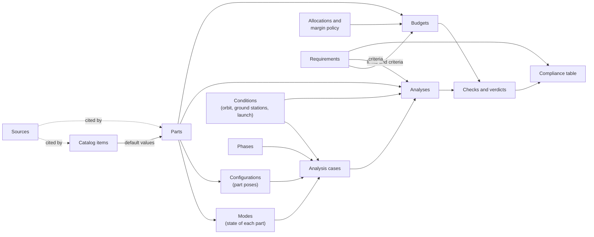
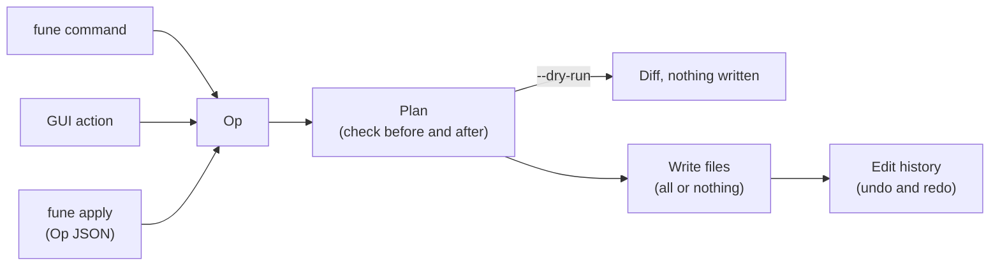

# Concepts

This page explains the ideas behind iwafune: what a design contains, how its parts relate, and how an edit becomes a verdict. Read it once, then use the [CLI guide](cli.md) and the [GUI guide](gui.md) to do things. The exact file formats are in the [data model](../model.md).

## The big picture

A design has four kinds of data: things (parts and the catalog), how they are used (modes, configurations), the situation they are in (conditions, phases, cases), and what must be true (requirements, allocations). Analyses and budgets read all of them. Checks turn the results into verdicts.



The boxes on the left, up to "Analyses" and "Budgets", are sets of TOML files that you edit. Results, checks, verdicts and the compliance table are computed from them each time and are not stored, except where you ask for an export.

## The project directory

A project is a directory with a `fune.toml` file. Everything else is optional and appears when you need it. `fune` finds the project by looking for `fune.toml` in the current directory and then in each directory above it. `-C <dir>` points it elsewhere.

| Directory or file | What lives there |
|---|---|
| `fune.toml` | Project name, schema version, the list of catalogs and the order of modes |
| `catalog.lock` | The pinned commits of shared catalogs (commit it) |
| `catalog/` | Catalog items of this project (subdirectories are allowed) |
| `parts/` | Parts. The directory tree is the product tree: `parts/<subsystem>/<ID>.toml` |
| `modes/` | One file per operating mode |
| `configurations/` | Named overlays of part poses, such as stowed and deployed |
| `conditions/` | `orbit.toml`, `launch.toml` and `ground/<ID>.toml` for ground stations |
| `phases/` | One file per mission phase |
| `cases/` | One file per analysis case |
| `analysis/` | Settings of each analysis, one file per area (for example `analysis/power.toml`), and `common.toml` |
| `requirements/` | One file per requirement |
| `budget/` | Allocations (`allocation.toml`) and margin policy (`policy.toml`) |
| `sources/` | The register of sources: datasheets, tests, judgements |
| `nets/`, `harness/` | Electrical connections and cable segments |
| `maneuvers/` | Maneuvers, in execution order |
| `defs/` | Attribute and kind definitions that your project adds |
| `.fune/` | Cache and edit history. Ignored by git |
| `exports/` | Derived output such as report tables. You may ignore it in git |

The full layout is in [data model §11](../model.md#11-directory-layout-schema-v2).

## Parts and the catalog

A **catalog item** describes a kind of component once: a reaction wheel model, a battery pack. It holds the vendor's numbers: mass, power by state, size, limits. A **part** is one use of that item in your satellite, such as `RW_X`. The part points to the item (`catalog = "local/rw_10mNms"`) and can override any value.

A part also has:

- a **kind** (for example `reaction_wheel`), which says which attributes it needs, which states it can be in and which analyses recognise it. `fune kind ls` lists the kinds. A part without a catalog item names a kind directly.
- a **mount**: which other part it sits on and at which mount point, plus an offset and an attitude. The mounts chain together, and the body-frame position of every part is derived from them.
- **ports** that connect to **nets** (power, data and RF connections).
- a **count** (identical units), a **maturity** and optional **trade candidates**.

The directory tree under `parts/` is the product tree. The top level is usually the subsystem (`aocs`, `power`, `cdh`, `comm`, `payload`, `propulsion`, `structure`, `thermal`), and deeper directories are groups and assemblies.

**Catalogs** are named. Your project has `local`, in `catalog/`. A team can keep a **shared catalog** in a separate git repository. A project lists it in `fune.toml`, pins its commit in `catalog.lock`, and refers to its items as `<name>/<ID>`. Shared items are read-only: to change one, change the shared repository, or override the value on your part. See [Shared catalogs](cli.md#shared-catalogs).

## Attributes, units, sources and notes

A value is an **attribute** of a part or a catalog item: `mass`, `power`, `max_momentum`. Each attribute has a **dimension** (mass, power, energy, …) and a list of allowed units. You write a value with a unit, and `fune` checks the dimension:

```text
fune set RW_X.mass "152 g"
```

A value can carry more than its number:

- a **source**, the ID of an entry in `sources/` (a datasheet, a measurement, an analysis, a judgement or a placeholder). The tool tracks the weakest evidence behind a value and shows an "Unsourced" mark when there is none.
- a place in the document (`--at "p.12 table 3"`) and a free **note**.
- an **uncertainty**, `min` and `max`, around the nominal value.

Some attributes are **by state**. The `power` of a reaction wheel has a value for each of `off`, `idle`, `on` and `peak`. The path is `<part>.power.<state>`.

Where a value comes from is always visible. `fune get` says `Catalog` for a catalog value, `Override` for a value on the part, and names the source. `fune unset` removes an override and brings back the catalog value.

## Modes and part states

A **mode** is how the satellite operates: nominal, imaging, downlink, safe. A mode file is a table that says, for each part, which **state** it is in. The states a part can take come from its kind (`off`, `standby`, `on`, …). A state can also have a **duty**: the fraction of time spent in other states. For example, a camera that is in `standby` with 50 % of the time `on`:

```toml
# modes/MISSION.toml (excerpt)
[states]
CAM = { state = "standby", duty = { on = 0.5 } }
OBC = { state = "on" }
```

A mode can also say a maximum duration and when it is used (for example only in sunlight). The **mode table** (`fune mode table`, the Modes page) shows all parts against all modes. Budgets and power analyses read power from it: the load of a mode is the sum of the power of every part in its state.

Adding a part adds a row to every mode, in the state `off` unless you say otherwise. A cell with no state is "unassigned", and `fune check` warns about it, because it is not treated as 0 W.

## Configurations

A **configuration** is a named overlay of part poses: *stowed* for launch, *deployed* in orbit. It stores a replacement pose for the parts that move, such as a folded solar paddle. The base placement is used when no configuration is chosen. Phases and analyses can name a configuration. The Layout page shows the satellite in a chosen configuration.

## Conditions, phases and analysis cases

**Conditions** describe the environment, not the satellite:

- `conditions/orbit.toml`: the orbit (altitude, eccentricity, inclination or sun-synchronous, epoch, propagator) and orbit-related settings such as decay and eclipse seasons.
- `conditions/ground/<ID>.toml`: ground stations with location, minimum elevation and the performance of each radio band. `fune check` rejects a latitude outside −90 to 90°, a longitude outside −180 to 360° and a minimum elevation outside 0 to 90°.
- `conditions/launch.toml`: the launch conditions, such as the launcher and dispenser.

A **phase** is a stage of the mission: launch and early operations, nominal operations, disposal. It has an order, a duration, the modes it uses and optionally a configuration. It can replace the orbit and the attitude law for the cases that name it.

An **analysis case** is a named set of conditions for an analysis. Its fields are all optional: a `mode`, a `phase`, a `side` of the uncertainty to read (`nominal`, `min` or `max`), a thermal environment, a beta angle, a number of orbits, a Sun distance and a start time `epoch`. Cases let you ask the same question under different conditions: *worst-case eclipse*, *hot while imaging*, *cold in safe mode*. Many analyses run once per case, and you compare the results.

The **default case** is `analysis.common.default_case`. When you run an analysis without naming a case, some analyses use the default case. Others look at all modes, or all conditions. See each [analysis page](../analyses/index.md).

## Requirements, allocations and margins

A **requirement** says what must be true. It has a statement, a quantity with a dimension, a constraint (`at_most`, `at_least`, `equal` or `range`), a source, the cases it applies to, and **what verifies it**: a check of an analysis or a budget. Requirements are a flat list.

The requirement does not decide its own verdict. The analysis or budget that it points to does. The **compliance table** collects the verdicts: for each requirement, the worst result over its cases. A requirement can also be **not verified**: nothing is linked, inputs are missing or the analysis failed. The table says why.

A requirement is also where a **limit** lives. A budget limit is an `at_most` requirement with `--budget mass` (or `power`, `data`). The depth-of-discharge limit of the battery is a requirement with `--analysis power.energy_balance --check dod`.

An **allocation** divides a budget over subsystems: for example, 1.6 kg of mass for AOCS. Allocations are in `budget/allocation.toml`, with a **system margin** that the total must keep. The **margin policy** in `budget/policy.toml` adds a **growth** margin to each value by maturity (off the shelf, modified, new) and a default width of uncertainty.

## Budgets

A **budget** sums an attribute over all parts: mass, power or data volume. `fune budget mass|power|data` shows a row per subsystem with the current sum, the sum with growth margin, the allocation and the margin, then the total against the limit. Power and data depend on the mode, so you can name a case: `fune budget power --case <ID>`. If an input is missing, the budget lists it, as an analysis does. See [Budgets](../analyses/budgets.md).

## Analyses, checks and verdicts

An **analysis** is a computation with an ID like `power.energy_balance`. It builds its inputs from the design, runs, and returns:

- **KPIs**: the key numbers.
- **checks**: each is a comparison of a result against a criterion, with its own **verdict**.
- an overall **verdict**.

A verdict is one of three:

| Verdict | Meaning |
|---|---|
| **ok** | The criterion is met |
| **warning** | Met, but with a note, or close to the limit |
| **violation** | Not met |

**Missing inputs.** If the design lacks something an analysis needs, the analysis does not run and does not guess. It returns the list of missing inputs, each with the reason and, where it can, the command that would fill it. The exit code of `fune analyze` is 1 in that case. The GUI shows the same list with buttons that open the right dialog. Missing inputs are normal in a design that is still growing.

**Diagnostics** are the findings of `fune check` on the design data itself, not on a result. They have three severities: *error*, *warning* and *info*. A missing required value is a warning, so a design in progress can still be saved. An error is something wrong: a unit with the wrong dimension, a reference to an ID that does not exist, a mount cycle.

## Everything is an Op

Every edit, from the CLI or the GUI, becomes an **Op**: a small, typed description of one change, such as "set this value on this part". There is no other way into the design files. This one rule gives you several features:



- **Dry run.** `--dry-run` shows the file diff an edit would make, without writing. The GUI shows the same preview in its dialogs, with the command that does the same edit ("Same operation as a command").
- **All or nothing.** An edit that touches several files is written as one. If the check after the edit shows a new error, nothing is written.
- **Conflict protection.** An edit is refused if the design changed since you read it (`--base-revision`, exit code 3).
- **Safe removal.** Removing a case, phase, mode, configuration, source or maneuver that something still refers to is refused. The message lists what refers to it, so you can change those first.
- **History.** Every applied edit is recorded, so `fune undo` and `fune redo` (or `Ctrl+Z` and `Ctrl+Y` in the GUI, `⌘Z` and `⇧⌘Z` on a Mac) work for CLI and GUI edits alike. The history keeps the last 100 edits, in `.fune/history.json`.
- **What-if.** `fune analyze` and `fune budget` accept `--ops`, a file of Ops that are applied in memory only, so you can see a result without changing the files.
- **Parity.** The same edit from the CLI and from the GUI writes the same bytes.

`fune fmt` is the one command that rewrites files outside an Op. It puts every file into canonical form (a fixed key order, aligned `=`), and keeps diffs small. It is not recorded in the history. `fune fmt --check` reports the files that would change, with exit code 1.

## Check, format and commit

Before you commit, run both:

```bash
fune check
fune fmt --check
```

`fune check` exits with 1 on an error, and with `--deny-warnings` on a warning too. Run both in CI. The [install page](install.md#container-image) shows a CI job.

Exit codes of `fune` are the same for every command: 0 is success; 1 means the design or the result fails (a check error, a missing input, a violation); 2 is invalid input or not found; 3 is a conflict.

## Where to go next

- Try it on a design: [Quickstart](quickstart.md) and [Build your first satellite](first-satellite.md).
- Look up a command: [CLI guide](cli.md).
- Look up a file or a key: [Data model](../model.md).
