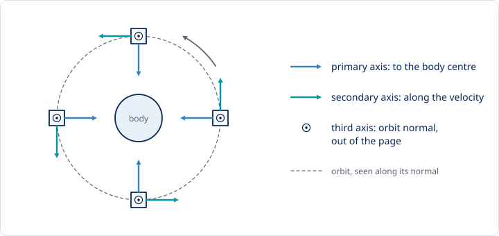
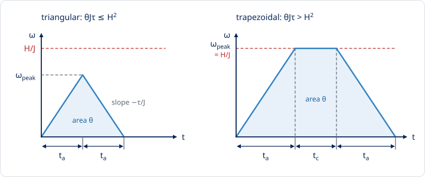
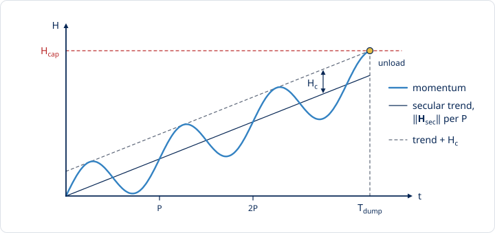
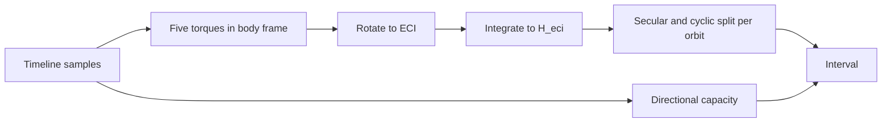
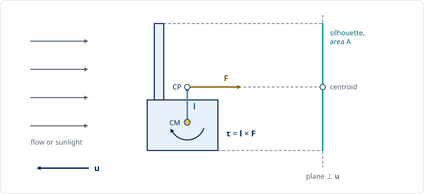

# 姿勢解析

姿勢軌道制御系（姿勢系）の解析は、概念設計で次の四つの問いに答えます。センサは太陽、中心天体、月に近づきすぎていないか。姿勢変更にどれだけ時間がかかるか。擾乱トルクはリアクションホイールをどのくらいの速さで飽和へ近づけるか。ホイールを空にするにはどれだけかかるか。FoV は視野、RW はリアクションホイール、MTQ は磁気トルカ、RCS はリアクション制御系（スラスタ）です。

| ID | 目的 | 主な入力 | 主な出力 |
|---|---|---|---|
| `aocs.sensor_fov` | 禁止角への天体の侵入を求めます | 軌道、姿勢則、センサの視線、禁止角 | 最小角、侵入区間 |
| `aocs.slew_time` | 静止間の姿勢変更時間を求めます | 慣性、ホイール、回転角 | 最も遅い軸、角速度のプロファイル |
| `aocs.rw_unloading` | 角運動量の蓄積とアンロード間隔を見積もります | 軌道、姿勢則、ホイールの上限、擾乱の入力 | 容量、周期成分の振幅、永年成分、アンロード間隔 |
| `aocs.unload_time` | 角運動量を捨てる時間を求めます | ホイールの上限、軌道、MTQ またはスラスタ | トルク、時間、推薬量 |

## 共通の前提

### 座標系・ケース・サンプル化

座標系と時刻は[軌道解析](orbit.md)の共通の前提に従います。この解析では三つの座標系を使います。ECI は中心天体を原点とする慣性系です。機体座標系は宇宙機とともに回ります。`boresight` や `spin_axis` のような部品の方向は部品座標で書かれており、有効な形態（ケースのフェーズの形態、なければ基本の形態）の取付の連鎖をたどって機体座標へ回します。部品の配置と質量特性も同じ形態から得ます。

ケースのモードが姿勢則を選びます。ケースを指定しないとき、`aocs.rw_unloading` と `aocs.sensor_fov` は `analysis.common.default_case` を使います。ケースの β 角は時間領域の解析と `aocs.unload_time` の磁場の平均で、軌道の RAAN を置き換えます。`aocs.slew_time` に軌道は要りません。

時間領域の解析は刻み $\max(30, P/200)$ s で軌道をサンプル化します。$P$ は軌道周期（s）です。期間は解析ごとに決まります。

| 解析 | 期間 |
|---|---|
| `aocs.rw_unloading` | 3 周です。太陽を回る軌道は 1 周です。一回限りの軌道は期間全体です（刻みは $P$ を期間として決めます） |
| `aocs.sensor_fov`、`aocs.unload_time` の磁場の平均 | 1 周です。一回限りの軌道は期間全体です |

### 姿勢則

各モードの姿勢則は `analysis/aocs.toml` に `analysis.aocs.law.<MODE>.*` として書きます。フェーズは `phases.<ID>.law.<MODE>.*` でモードの項目全体を置き換えられます。キー `law` は必須です。そのほかのキーは機体座標のベクトル（またはクォータニオン）で、省略でき、既定値は表のとおりです。

| `law` | キー | 既定値 | 内容 |
|---|---|---|---|
| `sun_pointing` | `axis`、`secondary` | +Z、+X | `axis` を太陽へ向けます。`secondary` を軌道面法線 $\hat{\mathbf n}=\mathbf r\times\mathbf v/\lVert\mathbf r\times\mathbf v\rVert$ にできるだけ近づけます |
| `nadir_pointing` | `axis`、`along_track` | +Z、+X | `axis` を中心天体の中心へ向けます。`along_track` を慣性速度 $\mathbf v$ にできるだけ近づけます |
| `inertial` | `orientation` | 恒等クォータニオン $(w,x,y,z)=(1,0,0,0)$ | 機体軸を ECI に対して固定します |



*ナディア指向則では、主軸が局所鉛直に、副軸が速度に沿います。機体は 1 周に 1 回転し、第三の軸は軌道面法線に沿ったままです。*

二軸の姿勢則は TRIAD 法（`sat_astro::attitude::align_two_axes`）で作ります。主ベクトル $\mathbf a$ と副ベクトル $\mathbf b$ から、次の三つ組を作ります。

```math
\hat{\mathbf x}=\hat{\mathbf a},\qquad
\hat{\mathbf y}=\frac{\hat{\mathbf x}\times\mathbf b}{\lVert\hat{\mathbf x}\times\mathbf b\rVert},\qquad
\hat{\mathbf z}=\hat{\mathbf x}\times\hat{\mathbf y}.
```

機体側の三つ組は（`axis`、`secondary` または `along_track`）から作ります。基準側の三つ組は（太陽またはナディアの方向、副軸の目標）から作ります。回転は機体側の三つ組を基準側の三つ組へ写します。主軸は厳密に合います。副軸のうち主軸に垂直な成分は主目標に垂直な目標の成分に合います。第三の軸は右手系から決まります。デモの `MISSION` 則（`axis` = +Z、`along_track` = +Y）では、円軌道で +Z がナディア、+Y が速度、+X が軌道面法線を向きます。

副軸の目標が主目標とほぼ平行なときは、別の目標に取り替えます。判定は $\lVert\hat{\mathbf u}\times\mathrm{primary}\rVert>10^{-6}$ です。`sun_pointing` の副軸の目標は $\hat{\mathbf n}$、速度方向、太陽方向に垂直な任意の方向の順に選びます。`nadir_pointing` では、$\mathbf v$、$\hat{\mathbf n}\times\hat{\mathbf g}$（軌道面法線とナディアの外積。$\hat{\mathbf g}=-\mathbf r/\lVert\mathbf r\rVert$ はナディア方向）、任意の垂直方向の順です。機体座標で `axis` と `secondary`（または `along_track`）が平行なときは、機体側の副軸に `axis` に垂直な任意の方向を使います。太陽方向は宇宙機から太陽へ向かう方向です。

### ホイールと方向別の容量

役割 `reaction_wheel` の部品は、`spin_axis`（部品座標）、`max_momentum` $h_{\max,i}$（N·m·s）、`max_torque` $\tau_{\max,i}$（N·m）を与えます。設定 `analysis.aocs.usable_momentum_fraction` $\kappa$ は、角運動量のうち使ってよい割合です。解析既定値は 0.8 で、$(0,1]$ の範囲でなければなりません。ホイール $i$ の使える角運動量は $h_i=\kappa\,h_{\max,i}$ です。

軸が 3 次元を張れば、ホイールの台数は任意です。単位スピン軸を並べた $3\times N$ 行列を $W$ とします。機体座標のベクトル $\mathbf b$（角運動量またはトルク）は、擬似逆行列 $W^+=W^\mathsf T(WW^\mathsf T)^{-1}$ を使った最小ノルム解で各ホイールへ配分します。

```math
\mathbf q=W^+\mathbf b,\qquad q_i=\hat{\mathbf a}_i\cdot(WW^\mathsf T)^{-1}\mathbf b .
```

単位方向 $\hat{\mathbf d}$ に対する配分 $q_i$ は無次元です。方向 $\hat{\mathbf d}$ に蓄えられる最大の角運動量は、最初のホイールが上限に達した時点で決まります。

```math
H_\mathrm{cap}(\hat{\mathbf d})=\min_{i:\,|q_i|>10^{-15}}\frac{h_i}{|q_i|}.
```

ある方向に出せるトルクも、$h_i$ の代わりに $\tau_{\max,i}$ を使った同じ関数で求めます。直交 3 台で $h_i=0.016$ N·m·s のとき、対角方向 $(1,1,1)/\sqrt3$ では $q_i=1/\sqrt3$ で、$H_\mathrm{cap}=0.016\sqrt3$ N·m·s です。この例は `wheels.rs` の単体テストにあります。

## aocs.sensor_fov センサの視野と禁止角

### 何に答えるか

太陽、中心天体の縁、月が、センサの視線に禁止角より近づく時間の割合と、その時刻を求めます。

### 入力

| 量 | 記号 | 単位 | 設計データ | 既定値 |
|---|---|---|---|---|
| 軌道と姿勢則 | — | — | 有効な軌道と、ケースのモードの姿勢則 | 必須 |
| 視線方向 | $\hat{\mathbf b}$ | 1 | 役割 `star_tracker`、`sun_sensor`、`camera` の部品の `boresight` | 必須 |
| 太陽の禁止角 | $\theta_\mathrm{ex,Sun}$ | rad | `exclusion_sun` | 省略すると判定しません |
| 中心天体の禁止角 | $\theta_\mathrm{ex,limb}$ | rad | `exclusion_earth` | 省略すると判定しません |
| 月の禁止角 | $\theta_\mathrm{ex,Moon}$ | rad | `exclusion_moon` | 省略すると判定しません |

そのほかの入力として、`fov_half_angle` は出力に報告するだけで、どの検査にも使いません。明るい天体を視野の外に置きたいときは、半角を禁止角に含めてください。ライブラリは侵入割合の上限 $f_\mathrm{max}$（0〜1）を受け取れますが、設計からの射影は設定しません。

### モデルと仮定

各サンプルで、視線と各天体の方向のなす角を機体座標で求めます。太陽と月は点です。中心天体は球で、宇宙機から円盤に見え、縁はその円盤の端です。

なす角が禁止角を下回ると侵入です。ただし条件が二つあります。太陽は、サンプルの日照率が 0.5 以上のときだけ数えます（`SUNLIT_THRESHOLD`）。蝕の最中の太陽は侵入になりません。月は、宇宙機から月への線が中心天体を通らないときだけ数えます。縁は常に数えます。縁の角が負なら、視線は円盤の内側にあります。

この解析は宇宙機の構造を見ません。宇宙機自身の部品による視線の遮りは、[structure.cone_clearance](structure.md)が静的に判定します。同じ `boresight` と `fov_half_angle` を読みますが、二つの解析は互いに入力を渡しません。

### 式

$\hat{\mathbf s}$、$\hat{\mathbf g}$、$\hat{\mathbf m}$ は、機体座標で、宇宙機から太陽、中心天体の中心（ナディア）、月へ向かう単位方向です。$r$ は中心天体の中心から宇宙機までの距離、$R$ は天体半径で、どちらも m です。角度はすべて rad です。

```math
\theta_\mathrm{Sun}=\angle(\hat{\mathbf b},\hat{\mathbf s}),\qquad
\theta_\mathrm{limb}=\angle(\hat{\mathbf b},\hat{\mathbf g})-\arcsin\frac{R}{\max(r,R)},\qquad
\theta_\mathrm{Moon}=\angle(\hat{\mathbf b},\hat{\mathbf m}).
```

$\theta_\mathrm{limb}$ の第 2 項は、円盤の見かけの角半径です。距離 $r$ から見た球の標準的な結果です。

### アルゴリズム

1. 時系列（1 周、刻み $\max(30,P/200)$ s）を作ります。各サンプルで、軌道、天体暦、姿勢則から $\hat{\mathbf s}$、$\hat{\mathbf g}$、$\hat{\mathbf m}$ と二つの条件を求めます。
2. センサごと、天体ごとに角度の時系列を求めます。各時系列は出力にも保存します。
3. 禁止角のある天体について、条件が満たされ $\theta<\theta_\mathrm{ex}$ のサンプルに印を付けます。
4. 天体ごとの侵入割合は全期間にわたる 0/1 の印の時間平均（台形則）です。区間は印の連続したサンプルの並びで、端はサンプル時刻です。最長の区間も報告します。最小角は、条件が閉じていたサンプルも含めた全サンプルの最小値です。
5. センサごとに、判定した全天体の印の論理和で手順 4 を繰り返します。

### 検査と判定

検査はセンサごとに 1 つで、`intrusion:<sensor>` です。上限がない場合（設計からの射影）は、侵入がなければ `ok`、侵入割合が正なら `warning` です。ライブラリの上限 $f_\mathrm{max}$ がある場合は、上限以下なら `ok`、超えれば `violation` で、余裕は $f_\mathrm{max}/f_\mathrm{intrusion}-1$ です。侵入がゼロなら余裕は出ません。

### 出力

| 出力 | 単位 | 意味 |
|---|---|---|
| `sensors[].targets[]` | rad、1、s | 天体ごとの禁止角、最小角、侵入割合、最長の侵入、区間 |
| `sensors[].intrusion_fraction`、`intrusions` | 1、s | 天体の和集合での期間に対する割合と、まとめた区間 |
| `series` | rad | 角度の時系列 `<sensor>:sun`、`<sensor>:earth_limb`、`<sensor>:moon` |

### 計算例

コマンドは `fune -C <デモの複製> analyze aocs.sensor_fov --json` です。既定のケース `hot_imaging` は `MISSION` モード（`axis` +Z、`along_track` +Y のナディア指向則）で、高度 550 km の太陽同期軌道を使います。$a=6928137$ m、$P=5738.992815$ s です。

スタートラッカ `STT` の視線は $-Y$ で、地球の禁止角は 0.4363323 rad（25°）です。ナディア指向則では +Z がナディアを向くので、$-Y$ は全サンプルでナディアに垂直です。つまり $\angle(\hat{\mathbf b},\hat{\mathbf g})=\pi/2$ です。$R=6378137$ m として、次のようになります。

```math
\arcsin\frac{6378137}{6928137}=\arcsin 0.9206136=1.1696490\ \mathrm{rad},\qquad
\theta_\mathrm{limb}=\frac{\pi}{2}-1.1696490=0.4011474\ \mathrm{rad}\ (22.98^\circ).
```

プログラムが出す縁の最小角は 0.4011474 rad で、禁止角の 0.4363323 rad を下回るので、全サンプルに印が付きます。印の区間は 0 から 5738.992815 s までで、割合は $5738.99/5738.99=1$ です。検査は `Intrusion 100 %` と出し、判定は `warning` です。`STT` の太陽と月の最小角は 1.0472 rad と 0.9045 rad で、禁止角の 0.6981 rad と 0.1745 rad を上回ります。視線が軌道面内にあるので、太陽の最小角はケースの β 角（60°）に近い値になります。

### 限界

サンプルの刻みが短い区間の分解能を制限します。1 サンプルだけ印が付いた区間の長さはゼロですが、台形則の割合ではおよそ 1 刻み分が数えられます。太陽と月は点、縁は球として扱い、太陽と月の方向は天体暦から得ます。構造による遮りはここでは扱いません。ほかの中心天体では、その天体の半径を使います。

### 検証

`aocs/sensor_fov/tests.rs` は、高度 500 km の縁の角を手計算（$\arcsin(6378.137/6878.137)$）で導き、太陽指向のセンサを日照率と照合し、ナディアを見る場合と判定の規則を確かめます。

### ソース

[解析](../../../crates/lib/analysis/src/aocs/sensor_fov.rs)、[射影](../../../crates/app/projection/src/aocs.rs)、[姿勢則](../../../crates/lib/astro/src/attitude.rs)、[時系列](../../../crates/lib/astro/src/timeline.rs)。

## aocs.slew_time 姿勢変更の時間

### 何に答えるか

ホイールのトルクと使える角運動量で制限した、機体の各軸まわりの静止間の回転時間を求め、最も遅い軸を報告します。

### 入力

| 量 | 記号 | 単位 | 設計データ | 既定値 |
|---|---|---|---|---|
| 回転角 | $\theta$ | rad | `analysis.aocs.slew_angle`（180° 以下） | 必須 |
| 慣性テンソル | $\mathbf I$ | kg·m² | 有効な形態での部品の質量特性 | 必須 |
| ホイール | $h_i$、$\tau_{\max,i}$ | N·m·s、N·m | ホイールの属性と `usable_momentum_fraction`（共通の前提を参照） | ホイールの値は必須、割合は 0.8 |
| 時間の上限 | $T_\mathrm{req}$ | s | `verify.analysis = "aocs.slew_time"`、`verify.check = "slew_time"` の `at_most` の要求 | なければ判定しません |

慣性テンソルは部品ごとの慣性の和です。各部品は、`size` と質量を持つ一様な直方体とみなし（対角成分は $m(b^2+c^2)/12$）、機体座標へ回して、平行軸の定理で重心へ移します。寸法のない部品は点質量です。部品の原点を、箱の中心と部品の重心とみなします。ライブラリは回転軸を明示して受け取れますが、設計からの射影は機体の $X$、$Y$、$Z$ を評価します。

### モデルと仮定

宇宙機は固定した軸まわりに、静止から静止まで回ります。その軸まわりにホイールが出せる最大のトルクで加速し、必要ならホイールの角運動量が許す最大の角速度で等速に回り、同じトルクで減速します。ホイールは角運動量ゼロから始めます。結果はこのプロファイルでの最短時間で、最適化した操作ではありません。



*角速度が角運動量で決まる上限に達するのは、台形のプロファイルだけです。*

### 式

単位軸 $\hat{\mathbf e}$ に対し $J=\hat{\mathbf e}^\mathsf T\mathbf I\hat{\mathbf e}$（kg·m²）とします。$\tau$ と $H$ は、ホイールの組が $\hat{\mathbf e}$ に沿って出せるトルクと角運動量です。共通の前提の $H_\mathrm{cap}$ を、上限に $\tau_{\max,i}$ と $h_i$ を使って求めた値です。$t_\mathrm{a}$ は加速時間（減速時間も同じ）、$t_\mathrm{c}$ は等速の時間、$\omega_\mathrm{peak}$ は最大角速度です。

トルク $\tau$ で加速すると $\omega=\tau t/J$ です。角度 $\theta$ を回るには、角速度を時間で積分した値が $\theta$ に等しくなければなりません。等速の区間がなければ $\theta=\tau t_\mathrm{a}^2/J$ です。ピークでのホイールの角運動量は $J\omega_\mathrm{peak}=\tau t_\mathrm{a}$ で、$H$ を超えられません。ここから二つの場合が出ます。

```math
(t_\mathrm a,t_\mathrm c,\omega_\mathrm{peak})=
\begin{cases}
\left(\sqrt{\theta J/\tau},\;0,\;\tau t_\mathrm a/J\right), & \theta J\tau\le H^2\quad\text{(triangular)}\\[4pt]
\left(H/\tau,\;\theta J/H-H/\tau,\;H/J\right), & \theta J\tau>H^2\quad\text{(trapezoidal)}
\end{cases}
\qquad T=2t_\mathrm a+t_\mathrm c .
```

$\theta=H^2/(J\tau)$ では二つの場合が同じ $T=2H/\tau$ を与えるので、時間は連続です。台形では $T=\theta J/H+H/\tau$ です。

### アルゴリズム

1. $0<\theta\le\pi$ を確かめます（許容誤差は $10^{-9}$ rad です）。ホイールの擬似逆行列と、上限のベクトル $\tau_{\max,i}$、$h_i$ を作ります。
2. 軸ごとに $J$ を求め、ホイールの組の方向別の容量から $\tau$ と $H$ を求めます。
3. $\theta J\tau\le H^2$ でプロファイルを選び、$t_\mathrm a$、$t_\mathrm c$、$\omega_\mathrm{peak}$、$T$ を計算します。
4. すべての軸を報告します。最悪の軸は $T$ が最大の軸です。

### 検査と判定

`slew_time` に結び付けた `at_most` の要求が設計にあれば、検査 `slew_time` が最悪の軸の時間と $T_\mathrm{req}$ を比べます。上限以下なら `ok`、超えれば `violation` で、余裕は $T_\mathrm{req}/T-1$ です。要求がなければ検査は出ず、警告の幅もありません。

### 出力

| 出力 | 単位 | 意味 |
|---|---|---|
| `axes[]`、`worst` | — | 軸ごとの名前、軸ベクトル、プロファイル |
| `moment_of_inertia`、`torque`、`momentum` | kg·m²、N·m、N·m·s | その軸の $J$、$\tau$、$H$ |
| `accel_time`、`coast_time`、`time`、`peak_rate` | s、s、s、rad/s | $t_\mathrm a$、$t_\mathrm c$、$T$、$\omega_\mathrm{peak}$ |

### 計算例

コマンドは `fune -C <デモの複製> analyze aocs.slew_time --json` です。回転角は 90°、つまり $\theta=\pi/2$ rad で、要求は 120 s です。3 台のホイールは $X$、$Y$、$Z$ に沿い、各 0.01 N·m·s と 0.001 N·m で、$\kappa=0.8$ です。各機体軸に沿ったベクトルは 1 台のホイールがすべて受け持つので、$\tau=0.001$ N·m、$H=0.008$ N·m·s です。

最も遅い軸は $X$ で、$J=I_{xx}=0.1122807943$ kg·m² です。プロファイルの判定は次のとおりです。

```math
\theta J\tau=1.5707963\times0.1122807943\times0.001=1.7637\times10^{-4}>H^2=6.4\times10^{-5},
```

したがって台形です。続いて次の値が出ます。

```math
t_\mathrm a=\frac{0.008}{0.001}=8\ \mathrm s,\qquad
t_\mathrm c=\frac{\theta J}{H}-t_\mathrm a=\frac{0.1763703}{0.008}-8=14.04628\ \mathrm s,\qquad
T=2(8)+14.04628=30.04628\ \mathrm s,
```

また $\omega_\mathrm{peak}=H/J=0.07125$ rad/s です。プログラムは 30.0462824 s を出します。$Y$ 軸と $Z$ 軸は 23.568 s と 16.694 s です。120 s に対する余裕は $120/30.046-1=2.994$ です。

### 限界

モデルは、両端で角速度がゼロで、軸が固定であると仮定します。軸間のジャイロ結合、軸外のトルク、擾乱、ホイールの摩擦とトルクの立ち上がり、整定時間は含みません。主軸でない軸まわりの回転は $J=\hat{\mathbf e}^\mathsf T\mathbf I\hat{\mathbf e}$ だけを使います。ホイールは開始時に空とみなします。

### 検証

`aocs/slew_time/tests.rs` は、台形の場合を手計算（$J=0.1$ で 27.635 s）で、三角形の場合を手計算（8.3554 s）で確かめます。さらに、$\theta=H^2/(J\tau)$ での両者の接点と、対角軸での射影した慣性と配分した容量も確かめます。`aocs/wheels.rs` は擬似逆行列による配分を確かめます。

### ソース

[解析](../../../crates/lib/analysis/src/aocs/slew_time.rs)、[ホイール](../../../crates/lib/analysis/src/aocs/wheels.rs)、[質量特性](../../../crates/lib/analysis/src/structure/mass_properties.rs)、[射影](../../../crates/app/projection/src/aocs.rs)。

## aocs.rw_unloading RW アンロードの頻度

### 何に答えるか

擾乱トルクは角運動量をホイールへ送り込みます。一部は 1 周で平均して消え、一部は積み上がります。この解析は、周期成分がホイールの容量をどれだけ使うか、残りがどれだけの速さで積み上がるか、したがってどのくらいの頻度でアンロードが要るかを見積もります。

### 入力

| 量 | 記号 | 単位 | 設計データ | 既定値 |
|---|---|---|---|---|
| 軌道と姿勢則 | — | — | 有効な軌道と、ケースのモードの姿勢則 | 必須 |
| 慣性テンソル | $\mathbf I$ | kg·m² | 質量特性（`aocs.slew_time` を参照） | 必須 |
| ホイールと使える割合 | $h_i$、$\tau_{\max,i}$、$\kappa$ | N·m·s、N·m、1 | 共通の前提を参照 | ホイールの値は必須、$\kappa=0.8$ |
| 抗力係数 | $C_\mathrm D$ | 1 | `analysis.aocs.drag_coefficient` | なければ空力トルクを除きます |
| 反射係数 | $C_\mathrm R$ | 1 | `analysis.aocs.srp_coefficient` | なければ太陽輻射圧トルクを除きます |
| 投影面積 | $A_\mathrm D$、$A_\mathrm R$ | m² | `analysis.aocs.aero_area`、`analysis.aocs.srp_area` | サンプルごとに部品の箱から求めます |
| 圧力中心のずれ | $\mathbf l_\mathrm D$、$\mathbf l_\mathrm R$ | m | `analysis.aocs.cp_offset_aero`、`analysis.aocs.cp_offset_srp`（機体座標） | サンプルごとに部品の箱から求めます |
| 残留双極子 | $\mathbf m$ | A·m² | `analysis.aocs.residual_dipole`（機体座標） | 0（解析既定値。磁気トルクを考えません） |
| スラスタの擾乱 | $f_i$、$\mathbf r_i$、$\mathbf F_i$ | 1、m、N | 役割 `thruster` の部品、その配置、モードがその部品を状態 `on` に置く時間の割合 | なし |

そのほかの入力として、スラスタの部品があると、1 日の推薬を求めるために `rcs` のブロック（スラスタ、重心、質量）が加わります。ライブラリは、要求するアンロード間隔、大気モデル（既定は指数大気）、大気密度の倍率（既定は 1）も受け取れます。設計からの射影は、大気モデルと密度の倍率を設定せず、間隔の要求も渡しません。係数がなければその項を除くので、$C_\mathrm D=2.2$ を仮定する `orbit.decay` とは扱いが異なります。

### モデルと仮定

モデルは慣性系で角運動量を追います。各サンプルで、五つの擾乱トルク（後述）を機体座標で足し合わせ、ECI へ回して積分します。その積分値が、ホイールが吸収すべき角運動量です。機体の角速度（ナディア指向則の軌道角速度など）による機体自身の角運動量 $\mathbf I\boldsymbol\omega$ は、一定とみなして含めません。

完全な 1 周で、ECI の角運動量は正味でいくらか増えます。これが永年成分です。その増加の直線のまわりで振動する成分が周期成分です。ホイールはいつでも周期成分の振幅を保持できなければならないので、永年成分の成長に使えるのは容量の残りだけです。その残りを使い切ると、ホイールをアンロードします。



*角運動量は永年の傾向のまわりで振動します。傾向に周期成分の振幅を加えた値が、使える容量に達するとアンロードが必要です。*



### 擾乱トルク

トルクはすべて重心まわりで、機体座標、単位は N·m です。共通の記号は次のとおりです。$\mathbf r$ は中心天体の中心からの位置（m）、$\mu$ は中心天体の重力定数（m³/s²）、$\mathbf v_\mathrm{rel}$ は回転する大気に対する速度（m/s）、$\rho$ は密度（kg/m³）、$\hat{\mathbf s}$ は太陽への単位ベクトル、$\mathbf B$ は磁束密度（T）、$\mathbf r_\mathrm{CM}$ は重心です。

重力傾斜トルク。中心天体の重力は宇宙機の中で変化するので、質量分布が球対称でなければトルクを受けます。宇宙機の大きさを $r$ で割った量の 1 次までで、次の式です。

```math
\boldsymbol\tau_\mathrm{gg}=\frac{3\mu}{\lVert\mathbf r\rVert^{5}}\,\mathbf r\times(\mathbf I\mathbf r).
```

これは教科書の結果です（Wertz）。$\mathbf r$ が主軸に沿うとゼロになります。トルクは慣性乗積を含む完全なテンソル $\mathbf I$ で計算するので、主軸が傾いていればナディア指向則でもトルクが出ます。$\mathbf I$ は宇宙機の、$\mu$ は中心天体の値です。

空力トルク。キャノンボール面の抗力が圧力中心に働き、力は相対風に沿います。

```math
\mathbf F_\mathrm D=-\tfrac12\rho\,C_\mathrm D A_\mathrm D\,\lVert\mathbf v_\mathrm{rel}\rVert\,\mathbf v_\mathrm{rel},\qquad
\boldsymbol\tau_\mathrm D=\mathbf l_\mathrm D\times\mathbf F_\mathrm D .
```

密度は測地高度での静的な指数大気（Vallado 表 8-4。28 層、1000 km より上は外挿）で、太陽活動は考えません。風は地球と共回転する大気に対する $\mathbf v-\boldsymbol\omega_E\times\mathbf r$ を機体座標へ回したものです。大気のモデルは地球にしかありません。ほかの中心天体ではトルクはゼロです。

太陽輻射圧トルク。係数が 1 つのキャノンボールモデルです。力は常に太陽の線に沿って太陽と反対向きで、鏡面反射と拡散反射は分けません。

```math
P_\odot=\nu\,\frac{S_0}{c}\left(\frac{d_0}{d_\odot}\right)^{2},\qquad
\mathbf F_\mathrm R=-P_\odot\,C_\mathrm R A_\mathrm R\,\hat{\mathbf s},\qquad
\boldsymbol\tau_\mathrm R=\mathbf l_\mathrm R\times\mathbf F_\mathrm R .
```

$S_0=1361$ W/m²、$d_0=1.495978707\times10^{11}$ m で、$c$ は光速、$d_\odot$ は太陽までの距離です。$P_\odot$ は完全に吸収する面（$C_\mathrm R=1$）にかかる圧力に等しい値です。$\nu\in[0,1]$ は円錐影モデルの日照率で、本影ではゼロ、半影では小数になります（Montenbruck and Gill）。$\nu=0$ ならトルクはゼロで、投影は計算しません。

残留磁気トルク。固定した双極子 $\mathbf m$ が地磁気の中にあるときのトルクです。

```math
\boldsymbol\tau_\mathrm B=\mathbf m\times\mathbf B,\qquad
\mathbf B=B_0\left(\frac{R_E}{r}\right)^{3}\left[3(\hat{\mathbf m}_E\cdot\hat{\mathbf r})\hat{\mathbf r}-\hat{\mathbf m}_E\right].
```

磁場は傾いた中心双極子（`sat_astro::geomag`）で、赤道表面で $B_0=3.12\times10^{-5}$ T、$R_E=6378137$ m です。双極子の軸 $\hat{\mathbf m}_E$ は地球固定座標で固定され、北緯 80.65°、経度 −72.68° の地磁気北極と反対を向き、地球とともに回ります。ほかの中心天体では磁場はゼロです。

スラスタの推力誤差。モードで噴射するスラスタは、推力の線が重心を外れていれば平均のトルクを生みます。

```math
\boldsymbol\tau_\mathrm{thrust}=\sum_i f_i\,(\mathbf r_i-\mathbf r_\mathrm{CM})\times\mathbf F_i .
```

$f_i$ は、モードが状態 `on` に割り当てる時間の割合（`duty` を含む）、$\mathbf r_i$ は取付位置、$\mathbf F_i$ は推力ベクトルです。その向きは部品の `direction` の単位ベクトルです。平均のトルクは機体座標で一定です。

投影面積と腕。設定が $A$ と $\mathbf l$ を与えていれば、コードはその値を使います。面積と腕は別々に置き換えられます。与えていなければ、サンプルごとに部品の箱（`size` を持つすべての部品を、有効な形態で配置したもの）の和集合を、方向 $\mathbf u$ に沿って投影します。$\mathbf u$ は、抗力では風の方向、太陽輻射圧では太陽の方向です。$A$ はシルエットの和集合の厳密な面積で、重なりは 1 度だけ数えます。圧力中心はそのシルエットの図心で、$\mathbf l$ は（図心 $-\mathbf r_\mathrm{CM}$）のうち $\mathbf u$ に垂直な成分です。$\mathbf u$ に沿う成分は力と平行で、トルクを生みません。面積も箱もなければ、入力の誤りです。腕が書かれておらず箱からも求められなければ、ゼロです。



*シルエット面は、流れまたは太陽の方向に垂直です。トルクの腕はその方向に垂直な、重心から図心までのずれです。*

### 式

$\boldsymbol\tau_\mathrm{ECI}$ は ECI に回した合計のトルクです。$\mathbf H(t)$ は $\mathbf H(0)=0$ から積算した慣性系の角運動量、$t_j$ と $t_{j+1}$ は軌道 $j$ と次の軌道の最初のサンプルの時刻です。軌道 $j$ の長さは $T_j=t_{j+1}-t_j$、$\Delta\mathbf H_j=\mathbf H(t_{j+1})-\mathbf H(t_j)$ で、$P$ は軌道周期（一回限りの軌道では期間）です。

```math
\mathbf H(t)=\int_0^t\boldsymbol\tau_\mathrm{ECI}(u)\,du \tag{1}
```

```math
\mathbf H_\mathrm{sec}=\frac1{N_\mathrm{orb}}\sum_j\frac{P}{T_j}\,\Delta\mathbf H_j,\qquad
H_\mathrm c=\max_j\max_{t\in[t_j,t_{j+1}]}\left\lVert\mathbf H(t)-\mathbf H(t_j)-\frac{t-t_j}{T_j}\Delta\mathbf H_j\right\rVert \tag{2}
```

$\mathbf H_\mathrm{sec}$ は 1 周あたりの角運動量の平均増加量（1 周期あたりの N·m·s）、$H_\mathrm c$ は周期成分の振幅、$N_\mathrm{orb}$ は使った軌道の数です。$\hat{\mathbf h}_\mathrm{sec}=\mathbf H_\mathrm{sec}/\lVert\mathbf H_\mathrm{sec}\rVert$ とし、$\mathbf R_k$ をサンプル $k$ での ECI から機体座標への回転とします。容量は全姿勢にわたる方向別の容量（共通の前提）の最小値です。

```math
H_\mathrm{cap}=\min_k H_\mathrm{cap}\!\left(\mathbf R_k\hat{\mathbf h}_\mathrm{sec}\right),\qquad
T_\mathrm{dump}=\frac{H_\mathrm{cap}-H_\mathrm c}{\lVert\mathbf H_\mathrm{sec}\rVert}\,P . \tag{3}
```

式 (3) は、傾向に振動分を足した値が容量を満たすまで、傾向が上昇できることを表します。アンロードの間の周回数は $(H_\mathrm{cap}-H_\mathrm c)/\lVert\mathbf H_\mathrm{sec}\rVert$ です。

### アルゴリズム

1. 時系列（3 周、太陽を回る軌道では 1 周、一回限りの軌道では期間全体。刻み $\max(30,P/200)$ s）を作ります。各サンプルで五つの項のトルクを機体座標で求めます。それを合計し、ECI へ回します。
2. 式 (1) をゼロから積分します。4 次のルンゲ・クッタ法の刻み（`rk4_linear_step`）を使い、サンプルの間ではトルクを線形に変化させます。この場合は台形則による積分と一致します。$\mathbf H$ を機体座標へ戻し、擬似逆行列でトルクとともにホイールへ配分します。
3. サンプルを完全な周回に切ります。周回 $k$ は、$t_0+kP-10^{-6}P$ 以上の最初のサンプルから始まり、各区間は終端のサンプルを次の周回と共有します。式 (2) から $\mathbf H_\mathrm{sec}$ と $H_\mathrm c$ を計算します。完全な周回がなければ、全期間を 1 区間とし、傾向を $P/T$ 倍して 1 周期分へ換算します。
4. $H_\mathrm{cap}$ を計算します。$\mathbf H_\mathrm{sec}$ がゼロなら、機体軸 $\pm X,\pm Y,\pm Z$ に沿った容量の最小値を使います。
5. 間隔を計算します。$H_\mathrm{cap}-H_\mathrm c\le0$ なら間隔は 0 です。そうでなく $\lVert\mathbf H_\mathrm{sec}\rVert\le10^{-12}\max(H_\mathrm{cap},10^{-30})$（下限は N·m·s）なら、アンロードは要らず、有限の間隔はありません。それ以外は式 (3) を使います。1 日あたりのアンロード回数は $86400/T_\mathrm{dump}$ で、間隔がなければ 0、間隔が 0 なら未設定です。
6. どれかのホイールが $\kappa h_{\max,i}$ を超えた最初のサンプル（`first_saturation`）、全体の角運動量のピーク、ホイールごとのトルクのピークを記録します。スラスタがあれば、1 日の推薬を求めます。$H_\mathrm{day}=\lVert\mathbf H_\mathrm{sec}\rVert\times86400/P$ を `aocs.unload_time` の 6 方向の規則で捨て、噴射するスラスタの実効排気速度 $v_e=\sum F/\sum(F/(I_\mathrm{sp}g_0))$ と宇宙機の質量 $m_0$ から $\Delta v_\mathrm{day}=v_e\ln\bigl(m_0/(m_0-m_\mathrm{day})\bigr)$（ロケット方程式）を得ます。

### 検査と判定

- `momentum_capacity` は、間隔が 0 のとき、つまり周期成分だけで使える容量を満たすときに `violation` です。そうでなければ `ok` で、$H_\mathrm c/H_\mathrm{cap}$ を示します。
- `torque_margin` の余裕は $1/u_{\max}-1$ です。$u_{\max}$ は、ホイールのうち、ピークのトルクと `max_torque` の比が最大のものです。余裕が 0 以上なら `ok`、負なら `violation` です（警告の幅は 0）。擾乱がなければ出ません。
- `unload_interval` は、ライブラリが要求を与えたときだけあります。永年成分のアンロードが不要か、間隔が要求以上なら合格で、余裕は間隔/要求 − 1 です。
- `environment_models` は、地球以外の中心天体で、空力の面か 0 でない双極子が与えられたときに出ます。大気も磁場もない天体（月）では `ok`、あるのにモデルがない天体（火星の大気、木星の磁場）では `warning` で、ゼロのトルクは過小評価かもしれません。
- `rcs_direction` は、スラスタがあり、最悪として選んだ方向で、捨てる角運動量に逆らうトルクを出せるスラスタがないとき `violation` です。

### 出力

| 出力 | 単位 | 意味 |
|---|---|---|
| `disturbances[]` | N·m | 各トルクの大きさのピークと時間平均 |
| `peak_disturbance` | N·m | 合計のトルクの大きさのピーク |
| `secular_per_orbit`、`secular_per_orbit_eci` | N·m·s | $\lVert\mathbf H_\mathrm{sec}\rVert$ と、ECI でのベクトル |
| `cyclic_amplitude`、`capacity`、`peak_momentum` | N·m·s | $H_\mathrm c$、$H_\mathrm{cap}$、機体座標での $\lVert\mathbf H\rVert$ のピーク |
| `unload_interval`、`unloads_per_day`、`first_saturation` | s、1/d、s | 式 (3) の結果、その 1 日あたりの回数、上限を超えたホイールのある最初のサンプル |
| `wheels[]` | — | ホイールごとの角運動量とトルクのピークと、その利用率 |
| `surfaces[]` | m²、m | 各面の出どころ（書かれた値か箱から出した値）、面積の範囲、最大の腕 |
| `rcs_unloading` | N·m·s、kg、m/s | スラスタがあるときの、1 日の角運動量、推薬、$\Delta v$ |
| `series` | N·m、N·m·s | トルクの大きさ、機体座標の角運動量、ホイールの角運動量 |

### 計算例

コマンドは `fune -C <デモの複製> analyze aocs.rw_unloading --json` です。既定のケースは `hot_imaging`（モード `MISSION`、ナディア指向則、β 角 60°）で、軌道はセンサの計算例と同じです。完全な 3 周を使います。スラスタはありません。

最悪の重力傾斜トルク。ナディア指向則では、機体軸が局所鉛直に対して固定され、軌道は円なので、全サンプルで $\mathbf r_\mathrm{body}=-r\hat{\mathbf z}$ で、トルクの大きさは一定です（印字されたピークと平均が一致します）。質量特性のテンソルは $I_{xz}=-3.3475\times10^{-4}$ kg·m²、$I_{yz}=-4.3306\times10^{-4}$ kg·m² です。$\hat{\mathbf z}\times\mathbf I\hat{\mathbf z}=(-I_{yz},\,I_{xz},\,0)$ なので、次のようになります。

```math
\frac{3\mu}{r^3}=\frac{3\times3.986004418\times10^{14}}{(6928137)^3}=\frac{1.1958013\times10^{15}}{3.325442\times10^{20}}=3.595917\times10^{-6}\ \mathrm{s^{-2}},
```

```math
\lVert\boldsymbol\tau_\mathrm{gg}\rVert=3.595917\times10^{-6}\sqrt{(4.3306\times10^{-4})^2+(3.3475\times10^{-4})^2}
=3.595917\times10^{-6}\times5.47360\times10^{-4}=1.9683\times10^{-9}\ \mathrm{N\,m}.
```

プログラムが出すピークは $1.96826\times10^{-9}$ N·m です。デモはほぼ対称なので、トルクは小さくなります。最大の項は残留磁気トルク（ピーク $8.39\times10^{-7}$ N·m）で、合計のピークは $8.38\times10^{-7}$ N·m です。

アンロード間隔の 1 例。印字された値は $H_\mathrm{cap}=0.0080550663$、$H_\mathrm c=0.0011382686$、$\lVert\mathbf H_\mathrm{sec}\rVert=0.0006262517$ N·m·s で、$P=5738.992815$ s です。ECI の成分 $(2.4514,\,5.6701,\,-1.0291)\times10^{-4}$ から $\lVert\mathbf H_\mathrm{sec}\rVert=6.2625\times10^{-4}$ が出ます。容量が 1 台分の上限 0.008 N·m·s をわずかに上回るのは、最悪の姿勢で永年成分の方向の 99.3 % が 1 台のホイール軸に載るからです（$0.008/0.0080551=0.9932$）。式 (3) から次の値を得ます。

```math
T_\mathrm{dump}=\frac{0.0080550663-0.0011382686}{0.0006262517}\times5738.992815=11.0448\times5738.99=63385.8\ \mathrm s,
```

これは 11.04 周、あるいは $86400/63385.8=1.3631$ 回/日です。周期成分は容量の 14.1 % を使います。3 周のうちにホイールは飽和せず（`first_saturation` は null）、ホイールのトルクの余裕は 1527 です（利用率は 0.065 %）。

`surfaces` は面積と腕を部品の箱から出します。空力の面積は 0.0390 から 0.0493 m² の範囲で、腕は最大 5.8 mm です。太陽輻射圧の面積は 0.1450 から 0.1665 m² で、腕は最大 93.5 mm です。

### 限界

永年成分の速さは代表的な周回と、角運動量ゼロからの開始から外挿したものです。トレースにアンロードの計画は含まれません。指数大気は太陽活動に依存しないので、抗力トルクは大きな倍率でずれることがあります。太陽輻射圧は係数 1 つで扱います。磁場のモデルは中心双極子です。箱のシルエットは表面の近似で、冗長なホイールの組は最小ノルム配分を使います。機体自身の回転による角運動量は含みません。設計から大気密度の倍率は設定できません。

### 検証

`aocs/disturbance.rs` には、重力傾斜（45° の場合。$\tfrac{3\mu}{2r^3}\lvert I_z-I_y\rvert$）、抗力（$F=-\tfrac12\rho C_\mathrm DAv^2$）、太陽輻射圧、磁気トルク、推力誤差の手計算があります。`aocs/rw_unloading/tests.rs` は、一定トルクの積分、$at+b\sin(2\pi t/T)$ の永年成分と周期成分の分離、アンロード間隔の手計算（28 周、156 800 s）を確かめます。さらに、対称なナディア指向の宇宙機がアンロードを要さないこと、日照中の永年トルク、ホイールのピラミッド配置でのナディア指向の慣性乗積、軌道面法線まわりの空力トルクと推力誤差のトルク、RCS の 1 日あたりの推薬と $\Delta v$ も確かめます。`aocs/rw_unloading/geometry_tests.rs` は、投影面積と腕、および書かれた値がそれらを置き換えることを確かめます。`aocs/disturbance/environment.rs` は、月、火星、木星での判定を確かめます。

### ソース

[解析](../../../crates/lib/analysis/src/aocs/rw_unloading.rs)、[トレースと永年成分の分離](../../../crates/lib/analysis/src/aocs/rw_unloading/trace.rs)、[RCS の項](../../../crates/lib/analysis/src/aocs/rw_unloading/rcs.rs)、[トルク](../../../crates/lib/analysis/src/aocs/disturbance.rs)、[面積と腕](../../../crates/lib/analysis/src/aocs/disturbance/surface.rs)、[射影](../../../crates/app/projection/src/aocs.rs)。

## aocs.unload_time 角運動量のアンロード時間

### 何に答えるか

ホイールの使える角運動量を、磁気トルカとスラスタで捨てるのにかかる時間を見積もります。

### 入力

| 量 | 記号 | 単位 | 設計データ | 既定値 |
|---|---|---|---|---|
| 捨てる角運動量 | $H$ | N·m·s | ホイールの `max_momentum` の最大値に `usable_momentum_fraction` を掛けた値 | ライブラリは明示した値を受け取れます |
| MTQ の軸と双極子 | $\hat{\mathbf a}_i$、$m_i$ | 1、A·m² | 役割 `magnetorquer` の部品の `axis` と `max_dipole` | MTQ には必須 |
| 平均の磁場 | $\bar B$ | T | 1 周で平均した地磁気の大きさ | 軌道から計算します |
| MTQ の有効率 | $\eta$ | 1 | `analysis.aocs.unload_dipole_fraction` | 0.5（解析既定値） |
| スラスタ | $F_i$、$I_{\mathrm{sp},i}$、$\mathbf r_i$、$\hat{\mathbf d}_i$ | N、s、m、1 | 役割 `thruster` の部品の `thrust`、`isp`、`direction`、配置と、質量特性の重心 | RCS には必須 |

### モデルと仮定

MTQ。双極子 $\mathbf m$ の磁気トルカは、$\mathbf B$ に垂直なトルク $\mathbf m\times\mathbf B$ を出します。$\mathbf B$ に沿う $\mathbf m$ の成分は何も生まず、$\mathbf B$ の向きは軌道上で変わります。解析はこれを模擬しません。平均の有効率 $\eta$（粗い値として既定は 0.5）をトルクに掛け、軌道平均の磁場の大きさを使います。向きによらず使える双極子は、MTQ の組の最も弱い機体軸の値です。

RCS。捨てる角運動量に逆らうトルクを出せるスラスタは、すべて全推力で同時に噴射します。この選び方はオン・オフだけのスラスタでトルクを最大にします。パルス幅は調整せず、ほかの軸まわりのトルクと正味の力も打ち消しません。それらは報告します。

中心天体に磁場のモデルがなければ、MTQ は評価しません。磁場がない天体（月、金星、火星）では、MTQ で角運動量を捨てられません。磁場があってモデルがない天体（木星）では警告だけを出します。どちらの場合も RCS の結果は残します。

### 式

$\hat{\mathbf a}_i$ は MTQ $i$ の単位軸、$\hat{\mathbf e}_k$ は機体の単位軸です。$\hat{\mathbf h}$ は蓄えられた角運動量の単位方向、$\hat{\mathbf d}=-\hat{\mathbf h}$ はトルクを働かせる方向です。スラスタのトルクは $\boldsymbol\tau_i=(\mathbf r_i-\mathbf r_\mathrm{CM})\times\mathbf F_i$（N·m）、$\dot m_i=F_i/(I_{\mathrm{sp},i}g_0)$ は質量流量（kg/s）です。

```math
m_\mathrm{eff}=\min_{k\in\{x,y,z\}}\sum_i m_i\,|\hat{\mathbf a}_i\cdot\hat{\mathbf e}_k|,\qquad
T_\mathrm{MTQ}=\frac{H}{\eta\,m_\mathrm{eff}\,\bar B}
```

```math
T_\mathrm{RCS}=\frac{H}{\sum_i\max(0,\boldsymbol\tau_i\cdot\hat{\mathbf d})},\qquad
m_\mathrm{used}=T_\mathrm{RCS}\sum_{i:\,\boldsymbol\tau_i\cdot\hat{\mathbf d}>0}\dot m_i .
```

和 $\sum_i m_i|\hat{\mathbf a}_i\cdot\hat{\mathbf e}_k|$ は、組が機体軸 $k$ に出せる最大の双極子です。3 軸にわたる最小値はどの方向でも使える双極子（下限）です。平均の磁場は $\bar B=\frac1P\int\lVert\mathbf B\rVert\,dt$ で、`aocs.rw_unloading` と同じ傾いた双極子のモデルから求めます。

### アルゴリズム

1. $H$ を決めます。$\lVert\mathbf B\rVert$ を 1 周にわたって台形則で、刻み $\max(30,P/200)$ s で平均し、最小値と最大値も記録します。MTQ がなければ省きます。
2. 中心天体に磁場のモデルがなければ、MTQ を省いて理由を記録します。あれば $m_\mathrm{eff}$ と $T_\mathrm{MTQ}$ を計算します。周回数は $T_\mathrm{MTQ}/P$ です。
3. スラスタがあれば、6 方向 $\hat{\mathbf h}=\pm X,\pm Y,\pm Z$（またはライブラリが明示した方向）を、上の規則で評価します。
4. `worst` として報告する最悪の方向は、方向にわたる最大値で選びます。正のトルク成分を持つスラスタがない方向には時間がなく、無限大として扱います。したがってコードは、捨てられない方向があればそれを最初に選び、なければ最も長い時間の方向を選びます。捨てられない方向が複数あれば、順序 $+X,-X,+Y,-Y,+Z,-Z$ の最後のものを報告します。

### 検査と判定

- `rcs_direction` は、最悪の方向を捨てられないとき `violation` です。
- `mtq_field_model` は MTQ を省いたときに加わります。RCS が 6 方向すべてを捨てられれば `ok` です。天体に磁場がなく、RCS が磁場の欠けを補えなければ `violation` です。磁場があってモデルがなく、RCS が補えなければ `warning` です。
- `mtq_time` と `rcs_time` は、ライブラリが時間の上限を与えたときだけあります。時間が上限以下なら `ok` で、余裕は上限/時間 − 1 です。方向を捨てられなければ、余裕は −1 で `violation` です。設計からの射影は上限を与えません。

### 出力

| 出力 | 単位 | 意味 |
|---|---|---|
| `momentum`、`usable_momentum_fraction` | N·m·s、1 | $H$ と $\kappa$ |
| `mtq` | T、A·m²、N·m、s | 磁場の平均・最小・最大、$m_\mathrm{eff}$、$\eta$、トルク $\eta m_\mathrm{eff}\bar B$、$T_\mathrm{MTQ}$、周回数 |
| `rcs.directions[]`、`rcs.worst` | N·m、N、s、kg | 方向ごとの $\hat{\mathbf d}$ に沿ったトルク、軸外のトルク、正味の力、時間、推薬、噴射するスラスタ |
| `mtq_field_gap` | — | MTQ を省いた理由と、RCS が補えるか |

### 計算例

コマンドは `fune -C <デモの複製> analyze aocs.unload_time --json` です。デモには $X$、$Y$、$Z$ に 0.2 A·m² の MTQ が 3 台あるので、$m_\mathrm{eff}=0.2$ A·m² です。角運動量は $H=0.01\times0.8=0.008$ N·m·s、$\eta=0.7$ です。軌道平均の磁場は $\bar B=3.745580\times10^{-5}$ T です（最小 2.434、最大 $4.868\times10^{-5}$ T）。

```math
\eta m_\mathrm{eff}\bar B=0.7\times0.2\times3.745580\times10^{-5}=5.2438\times10^{-6}\ \mathrm{N\,m},\qquad
T_\mathrm{MTQ}=\frac{0.008}{5.2438\times10^{-6}}=1525.6\ \mathrm s=25.4\ \mathrm{min}.
```

これは 0.266 周です。デモにスラスタはないので、報告に RCS の部分はありません。

### 限界

平均磁場による近似は、軌道に沿ったアンロードの計画を考えません。$\eta$ は 1 つの数で、磁場の向きから計算しません。最も弱い軸の双極子は、方向別の能力の保守的な近似です。RCS の規則は、軸外のトルクと正味の力を打ち消さずに報告します。噴射するスラスタの正味の力は報告しますが、速度変化には換算しません。捨てる角運動量はホイール 1 台の使える分で、`aocs.rw_unloading` で積み上がった擾乱ではありません。

### 検証

`aocs/unload_time/tests.rs` は、MTQ の時間を手計算（30 µT で 3333.3 s）で、RCS の時間と推薬（10 s、$1.6995\times10^{-4}$ kg）を手計算で確かめます。腕に重心を使うこと、正の成分を持つスラスタの選択、捨てられない最悪の方向、傾けた配置の有効な双極子、軌道平均の磁場の範囲、磁場のモデルがない場合も確かめます。

### ソース

[解析](../../../crates/lib/analysis/src/aocs/unload_time.rs)、[RCS](../../../crates/lib/analysis/src/aocs/unload_time/rcs.rs)、[磁場の欠け](../../../crates/lib/analysis/src/aocs/unload_time/field_gap.rs)、[スラスタのトルク](../../../crates/lib/analysis/src/aocs/thrusters.rs)、[射影](../../../crates/app/projection/src/aocs.rs)。

## 参考文献

- J. R. Wertz (ed.), *Spacecraft Attitude Determination and Control*, 1978（重力傾斜トルクと擾乱のモデル）。
- D. A. Vallado, *Fundamentals of Astrodynamics and Applications*, 4th ed., 2013（指数大気、表 8-4）。
- O. Montenbruck and E. Gill, *Satellite Orbits*, 2000（円錐影モデル）。
- B. Wie, *Space Vehicle Dynamics and Control*, 1998（静止間の姿勢変更）。
- G. P. Sutton and O. Biblarz, *Rocket Propulsion Elements*, 9th ed., 2016（ロケット方程式）。
- [設計モデル](../../model.md)。
