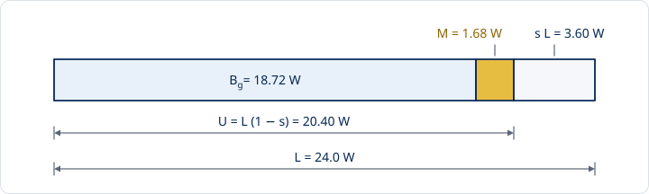
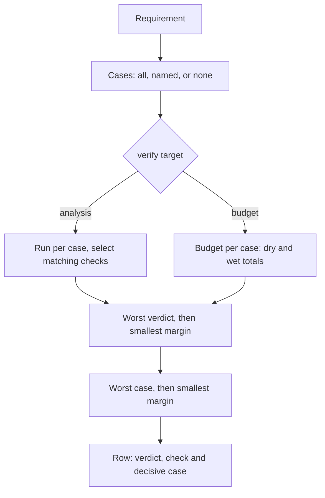

# バジェットの解析

バジェットは設計全体にわたって 1 つの量を合計し、限度と比べます。適合表は要求ごとにバジェットと解析の判定を集めます。どちらも `fune analyze` の一覧にある解析ではなく、それぞれ専用のコマンドがあります。

| 入口 | 目的 | 主な入力 | 主な出力 |
|---|---|---|---|
| `fune budget mass` | 乾燥質量と推薬込みの質量を追う | 部品の質量、員数、成長余裕、積む推薬 | 配分ごとの行、乾燥と湿潤の合計、余裕 |
| `fune budget power` | モード別の消費電力を追う | モードの負荷、成長余裕、電力の配分 | 選んだモード、配分ごとの行、全モードの余裕 |
| `fune budget data` | 1 日に生成するデータを追う | データレート、モードの割合、データの配分 | 1 日の量と余裕 |
| `fune requirement compliance` | 要求を判定する | 制約、確認先、量化したケース | 要求ごとの判定、決め手の判定とケース |

## 共通の前提

バジェットはケースで解決した入力を使います。質量では、ケースの `side` が、部品の不確かな質量のうち公称・最小・最大のどの側を読むかを選びます。電力では、ケースのモードが、合計するモードを選びます。データでは、ケースのモードが 1 日全体のモードになります。ケースにモードが無いときは、`analysis.power.mode_share` のモードの割合を使います。適合に使う解析は[解析の入口のページ](index.md#共通の前提)で説明するとおり、自分でケースと配置を解決します。

4 つの設計ファイルがバジェットに入力を与えます。

- バジェットの限度は `verify.budget = "<kind>"` を持つ要求の `at_most` 制約です。複数の要求があれば、最も小さい限度を使います。組み込みの限度はありません。限度が無ければ、バジェットは合計を出すだけで判定を出さず、`fune check` が警告します（`budget.limit_unset`）。
- システム余裕は `budget/allocation.toml` の `[<kind>].system_margin` に書く割合で、システム担当が限度から取り置きます。0 以上 1 未満でなければなりません。その種類の表がファイルに無ければ 0 です。
- 配分は `budget/allocation.toml` の `[<kind>.alloc]` に書き、サブシステム、組立品、部品に目標値を割り当てます。キーはサブシステムの ID か部品の ID です。同じ種類のバジェットの配分だけを読みます。
- 成長余裕は設計が成熟するにつれて予想される増加に備えて見積もりに加える割合です。`budget/policy.toml` の `[growth]` が部品の成熟度（`off_the_shelf`、`modified`、`new`）ごとに 1 つの割合を与えます。成熟度を持たない部品や、表に無い成熟度の部品は、成長余裕 0 です。

同じポリシーファイルの `[uncertainty]` と `[harness].allowance` はバジェットの入力ではありません。不確かさの幅は熱の温度判定の既定の余裕です。`fune check` はハーネスの余裕（0 から 1 の割合）を検査しますが、どのバジェットの合計もそれを読みません。

## バジェットの集計

### 何に答えるか

設計は使用可能な限度のどれだけを占めているか。各配分はどれだけ使われているか。余裕はどれだけ残っているか。

### 入力

| 量 | 記号 | 単位 | 設計データの出どころ | 既定値 |
|---|---|---|---|---|
| 部品の質量 | $v_i$ | kg | 部品の属性 `mass`（ケースの側）。`mass` の無い部品は `uncounted` に載せ、数えない | 数えるには必ず与える |
| モードでの部品の日照平均電力 | $v_i$ | W | [モード負荷](power.md#powermode_load-モード別消費電力)の結果。員数は含み済み | そのモードで値の無い部品は `uncounted` に載せる |
| 部品の 1 日のデータ量 | $v_i$ | bit | [`cdh.data_budget`](comm.md#cdhdata_budget-データ量とストレージ)の結果。1 日の HK とミッションデータの合計で、員数は含み済み | — |
| 員数 | $n_i$ | 1 | 部品の `count`（質量のみ。電力とデータは、集計済みの値に 1 を使う） | 1 |
| 成長余裕 | $g_i$ | 1 | `budget/policy.toml` の `[growth]`（部品の成熟度ごと）。データと積む推薬は 0 | 0 |
| システムの限度 | $L$ | kg, W, bit | `verify.budget` を持つ `at_most` 要求のうち最も厳しいもの | なし。無ければシステムの判定は出ない |
| システム余裕 | $s$ | 1 | `budget/allocation.toml` の `[<kind>].system_margin` | 0 |
| 配分 | $L_j$ | kg, W, bit | 行 $j$ の `[<kind>.alloc]` の項目 | 任意 |

### モデルと仮定

質量バジェットは部品の乾燥質量を合計します。設計が推進系を持つときは、`propulsion.propellant` に従って積む推薬を成長余裕なしの別の行として示し、推薬込み（湿潤）の合計をもう 1 つ出します。電力バジェットは 1 つのモードでの部品の、成長余裕を含めた日照平均の負荷を合計します。ケースにモードがあればそのモードを使います。無ければ、成長余裕を含めた合計が最大のモードを使い、全モードの合計も示します。データバジェットはケースのモードかモードの割合に従って部品の 1 日のデータ量を合計します。

行は配分を持つサブシステム、組立品、部品です。部品は次のうち最初に当てはまるものに入ります。部品自身の配分、配分を持つ最も近い上位の組立品、その部品のサブシステム、最後に `Other` の行です。行は配分ファイルの順、配分の無い行、`Other` の順に並べます。どの部品も使わない配分にも行はあります。

データバジェットは 1 日の生成量をデータの限度と比べます。`cdh.data_budget` の保持期間はこの比較には入りません。[`cdh.data_budget`](comm.md#cdhdata_budget-データ量とストレージ)のストレージ判定は 1 日の生成量に保持期間を掛けるので、同じストレージ要求を二つの見方で見ると、結果が異なることがあります。



*デモの電力バジェット（モード `DOWNLINK`）の限度 L は成長余裕を含めた合計、余裕、システム余裕 s·L に分かれます。使用可能量 U は L からシステム余裕を引いたものです。*

### 式

$B$ は現在の合計、$B_\mathrm{g}$ は成長余裕を含めた合計、$U$ は使用可能量、$M$ は余裕です。単位は $v_i$ と同じです。行 $j$ について、$B_{\mathrm{g},j}$ はその行の項目の和です。

```math
B=\sum_i n_i v_i,\qquad B_\mathrm{g}=\sum_i n_i v_i(1+g_i),\qquad
U=L(1-s),\qquad M=U-B_\mathrm{g},\qquad M_j=L_j-B_{\mathrm{g},j}
\tag{1}
```

成長余裕は項目ごとに 1 回だけ掛けます。システム余裕は限度に 1 回だけ掛け、配分には掛けません。配分の合計が $U$ を超えるシステムは、`fune check` が報告します（`budget.over_allocated`）。

### アルゴリズム

1. ケースを解決し、項目の値を集めます。電力バジェットは `power.mode_load` を 1 回実行し、その出力から合計と全モードの行を作ります。
2. 上で説明したとおり、各項目を行へ割り当てます。行はまず配分から作ります。
3. すべての項目と各行について、$B$ と $B_\mathrm{g}$ を合計します。システムの限度を選び、$U$ と $M$ を求め、各配分に対する $M_j$ を求めます。
4. 積む推薬が得られれば、成長余裕 0、員数 1 の項目として乾燥の項目に加えます。同じ $U$ に対して、湿潤の合計と余裕を求めます。

### 検査と判定

バジェットはどこでも同じ 1 つの規則で判定します。余裕（$M$ または $M_j$）は、使用可能量から成長余裕を含めた合計を引いた値です。余裕が 0 以上なら `ok`、負なら `violation` です。警告の段階はありません。配分の無い行は `ok` と表示し、余裕はありません。どの要求も限度を決めていなければ、システムの判定はありません。

行の判定はシステムの判定を変えません。システムが `ok` でも、行が違反になることはあります。`fune budget` は、入力が不足しているとき、またはシステムの合計が違反のときに、終了コード 1 で終わります。質量では、推薬込みの合計も対象です。

`uncounted` は値が無いために合計から外した部品を挙げます（0 として数えるのではありません）。`missing` は集計を妨げる入力を挙げます。質量の表示では、推薬の行を計算できないとき、`propellant` が `no_propulsion`、`missing`、`failed` のどれかを報告します。

### 出力

| 出力 | 単位 | 意味 |
|---|---|---|
| `total`, `margin`, `limit`, `system_margin` | kg, W, bit; 1 | $B_\mathrm{g}$, $M$, $L$, $s$ |
| `rows` | kg, W, bit | 行ごとに、現在値 $B$、成長余裕を含む $B_\mathrm{g}$、配分、余裕、判定 |
| `mode`, `modes` | W | 電力バジェットが使ったモード、および全モードの合計、使用可能量、余裕 |
| `propellant` | kg | 積む推薬、湿潤の合計とその余裕・判定、タンク |
| `limit_requirement`, `verdict`, `uncounted`, `missing`, `notes` | — | 限度を決めた要求、システムの判定、外した部品、不足入力、注記 |

### 計算例

デモのプロジェクトで `fune budget mass`、`fune budget power`、`fune budget data` を実行します。ケースを使うには `--case <ID>` を、構造化された出力には `--json` を付けます。

**質量。** 部品の合計は 5.548 kg です。成長余裕を含めた乾燥の合計は 6.2349 kg です。質量要求 `R_MASS` は限度を 12 kg とし、システム余裕は 10 % です。したがって $U=12\times0.9=10.8$ kg、$M=10.8-6.2349=4.5651$ kg です。推進剤タンクには 0.067219 kg を積むので、湿潤の合計は $6.2349+0.067219=6.302119$ kg、湿潤の余裕は $10.8-6.302119=4.497881$ kg です。`aocs` の行は現在 1.042 kg、成長余裕を含めて 1.0981 kg で、配分は 1.6 kg なので、$M_j=1.6-1.0981=0.5019$ kg です。

**電力。** ケースのモードが無いので、成長余裕を含めた合計が最大のモードは `DOWNLINK` で、18.72275 W です。限度は 24 W（`R_POWER`）、システム余裕は 15 % なので、$U=24\times0.85=20.4$ W、$M=20.4-18.72275=1.67725$ W です。`comm` の行は 11.27425 W で、配分 3 W に対して違反（−8.27425 W）ですが、システムの合計は `ok` です。

**データ。** 1 日のデータ量は 22132224000 bit（2.766528 GB）で、[データバジェットの計算例](comm.md#cdhdata_budget-データ量とストレージ)によるものです。限度は 8 GB（`R_STORAGE`）、システム余裕は 20 % なので、$U=8\times0.8=6.4$ GB、$M=6.4-2.766528=3.633472$ GB です。

### 限界

バジェットは値を足し合わせるだけです。ピーク負荷、発電量、電池の推移、保持するデータはモデル化していません。これらには専用の解析が要ります。質量の合計は質量を持つ部品と推薬の結果に左右されます。配分の余裕にはシステム余裕を含めません。データバジェットは 1 日の生成量を限度と比べ、保持期間は考えません。

### 検証

`budget.rs` の `mass_budget_by_hand` は質量バジェットの成長余裕、員数、システム余裕、余裕、判定を手計算で確かめ、`counted_helpers_by_hand` は数え上げの補助関数を確かめます。サービスのテスト `budget_propellant.rs` と `budget_uncounted.rs` は推薬の行と数えなかった部品を扱います。`requirements_compliance.rs` は適合でのバジェットの限度を使います。

### ソース

[集計](../../../crates/lib/analysis/src/budget.rs)、[バジェットのサービス](../../../crates/app/service/src/budget.rs)、[電力のモード選択](../../../crates/app/service/src/budget/power.rs)、[積む推薬](../../../crates/app/service/src/budget/propellant.rs)、[限度と基準](../../../crates/app/model/src/design/criteria.rs)、[配分の検査](../../../crates/app/model/src/check/budget.rs)。

## 要求の適合

### 何に答えるか

要求ごとに、設計は要求を満たしているか。どのケースとどの判定が答えを決めているか。

### 入力

| 量 | 設計データの出どころ | 既定値 |
|---|---|---|
| 制約 | `requirements/<ID>.toml` の `[constraint]`（`at_most`、`at_least`、`equal`、`range`） | 数値の基準には必ず与える |
| 確認先 | `verify.analysis` と任意の `verify.check`、または `verify.budget` | 任意。確認先の無い要求は未確認 |
| ケース | `quantify.all_cases = true`、または `quantify.cases = [...]` | 確認先自身の既定のケース |
| 設計の入力 | 最上位の `input`（例: `mission_duration`） | 任意 |

### モデルと仮定

要求の各ケースはそれぞれ単独で判定します。適合表は測った値を制約と再び比べることはしません。解析かバジェットが出した判定を読むだけです。

判定の基準は要求が持ちます。複数の要求が 1 つの基準を共有するとき、解析とバジェットは最も厳しいものを使います。各要求を自分の制約で判定するため、適合表は基準を共有するほかの要求を除いた下書きの設計で確認先を実行します。何も保存しません。そのため、厳しい要求が満たされていれば緩い要求も満たされ、厳しい要求が違反でも、緩い要求がそれで落ちることはありません。

判定のキーは 2 つが等しいか、要求のキーの後に `:` か `@` が続くとき、一致します。例えば `margin` はすべての `margin:<link>@<station>` に当たり、`margin:s_down` は link `s_down` のすべての局に当たります。判定のキーが無ければ、その解析のすべての判定が対象です。キーは実行時に作られることがあるので、その存在は実行が出した判定に対して確かめます。

### 式

適合には新しい式はありません。2 つの順位を比べます。1 つ目は判定の順位で、悪い順に `violation`、未確認、`warning`、`ok` です。2 つ目は判定の余裕（[余裕](index.md#結果の読み方)を参照）で、余裕が小さいほど厳しく、余裕が無いものは有限の余裕より後に置きます。バジェットの余裕は[バジェットの集計](#バジェットの集計)の式 (1) の $M$、つまり使用可能量から合計を引いた値です。

### アルゴリズム



1. ケースを並べます。`all_cases = true` なら `cases/` のすべてのケースを ID の順に使い、`cases = [...]` なら指名したケースを書かれた順に使います。どちらも無いとき、または `cases/` が空のときは、ケースを明示せずに 1 回実行します。
2. ケースごとに、基準を共有するほかの要求を除き、確認先の結果を実行するか再利用します。ケースが存在しなければ、そのケースは未確認です（`unknown_target`）。
3. 解析では、キーが一致する判定を選びます。最も悪い判定を取り、その中で余裕が最小のものを取ります。余裕が等しいとき、または両方に無いときは、先に出たものを残します。余裕を持つ判定は、持たない判定より前に置きます。
4. バジェットでは、候補は推薬込みの合計（質量で、数えられているとき）と乾燥の合計です。最も悪い判定を取り、その中で余裕が小さいものを取ります。
5. ケースを最も悪い判定（`violation`、未確認、`warning`、`ok`）、次に余裕の最小、次に先のケースの順で並べます。勝ったケースが決め手のケースで、その判定とメッセージが行のものになります。

### 検査と判定

行の判定は決め手のケースの判定です。いずれかのケースを確認できなければ、要求は `ok` になりません。未確認の行には理由が付きます。

| 理由 | 意味 |
|---|---|
| `no_link` | 要求が解析もバジェットも指名していない |
| `design_input` | 要求は解析の入力を与えるもので、確認するものが無い |
| `missing_inputs` | 解析かバジェットの入力が足りない（`detail` に列挙）、またはバジェットに限度が無い |
| `failed` | 解析が失敗した |
| `key_not_produced` | 解析は動いたが、そのキーの判定を出さなかった（出た判定のキーは `detail` に載る） |
| `unknown_target` | 解析、バジェット、またはケースが存在しない |

`fune requirement compliance` は違反の要求があれば終了コード 1 で終わります。`--deny-unverified` を付けると、未確認の行でも失敗とします。警告では失敗しません。

### 出力

| 出力 | 意味 |
|---|---|
| `verdict`, `reason`, `detail` | 行の判定と、根拠が欠けるときの理由と詳細 |
| `value`, `margin`, `check` | バジェットの合計、決め手の判定かバジェットの余裕、決め手の判定（キー、ラベル、持ち主） |
| `decisive_case`, `cases` | 行を決めたケースと、ケースごとの結果 |
| `summary` | 要求の数と、判定ごとの数 |

GUI では Overview のバジェットのパネルで合計、配分、限度を決めた要求を読みます。Requirements を開いて `Compliance` タブを選ぶと、判定、確認した判定、ケースを見られます。

### 計算例

デモには 16 件の要求があります。`fune requirement compliance` は ok 11 件、警告 1 件、違反 1 件、未確認 3 件を報告します。

- `R_LINK_MARGIN` は `verify.check = "margin"` を持ち、`margin:uhf_down@TOKYO_GS`、`margin:s_down@TOKYO_GS`、`margin:uhf_up@TOKYO_GS` に当たります。3 つとも `ok` です。決め手の判定は余裕が最小の `uhf_down` で、3.05 dB です。
- `R_STORAGE` は `verify.budget = "data"`、限度 8 GB、`quantify.cases = ["eclipse_worst", "hot_imaging"]` を持ちます。`hot_imaging` ではモードが 1 日中 `MISSION` なので、データは 54.066528 GB です。余裕は $8(1-0.20)-54.066528=-47.666528$ GB で、報告される −381332224000 bit にあたります。もう一方のケースは `ok` なので、`hot_imaging` が決め手のケースで、行は違反です。
- `R_DEPLOY` は確認先を持たず（`no_link`）、`R_MISSION` は解析の入力を与え（`design_input`）、`R_THRUST_POWER` は入力 `maneuvers` が不足しています。

### 限界

適合表が報告するのは、選んだ確認先とケースの根拠です。複数のキーに当たる判定は、キーの余裕が同じ種類のときだけ比べられます。それが問題になるときは、具体的なキーを使います。解析全体に当たる要求では、単位の異なる余裕が同順位の決着に混ざることがあります。下書きで除いた要求は保存されないので、適合表が設計を編集することはありません。

### 検証

サービスの `requirements/tests.rs` は最悪のケースの選択（`the_worst_case_decides_and_unverified_outranks_a_warning`）、同じ判定の中での余裕の順（`among_equal_verdicts_the_smallest_margin_decides`）、失敗の数え方を確かめます。`tests/requirements_compliance.rs` は、デモと、ケース、判定のキー、バジェット要求を持つ設計で表を実行します。`the_link_margin_row_shows_the_tightest_link`、`a_budget_row_names_the_deciding_case`、`each_row_is_judged_against_its_own_constraint_when_limits_overlap` を含みます。

### ソース

[適合のサービス](../../../crates/app/service/src/requirements.rs)、[基準](../../../crates/app/model/src/design/criteria.rs)、[余裕の順序](../../../crates/lib/analysis/src/spec/check.rs)、[適合の統合テスト](../../../crates/app/service/tests/requirements_compliance.rs)。

## 参考文献

- [設計モデル: 要求と適合表](../../model.md#79-requirements-one-file-per-requirement-and-the-compliance-table)。
- [設計モデル: 配分と余裕のポリシー](../../model.md#8-allocations-and-margin-policy-budget)。
- [解析の入口のページ](index.md)。
