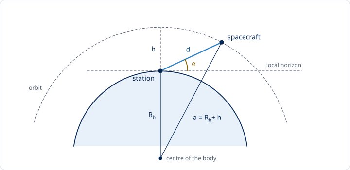
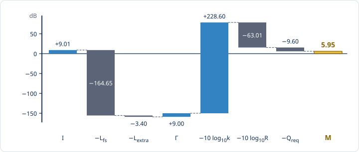

# 通信の解析

通信の解析は無線回線とそれが運ぶデータについて三つの問いに答えます。回線は最悪の距離で十分な余裕を持って成立するか。地上局はいつ衛星と交信できるか。ダウンリンクは、衛星が生成して保存するデータを運べるか。データの生成と保存のモデルは指令・データ処理（CDH）が持つため、このページでは `cdh.data_budget` も扱います。

| ID | 目的 | 主な入力 | 主な出力 |
|---|---|---|---|
| `comm.link_budget` | 無線回線を見積もる | 周波数、利得、損失、軌道、データレート | 回線余裕、電力束密度、支持できるレート |
| `comm.visibility` | 地上局との交信区間を求める | 軌道、局の座標とマスク | パス、交信時間、空白時間 |
| `comm.data_throughput` | 送信量と生成量を比べる | パス、回線設定、1 日の生成量 | 送信可能量、送信量、未送信データ |
| `cdh.data_budget` | データ保存量を見積もる | 部品のレート、モードの割合、保持期間 | 1 日のデータ量、必要容量 |

## 共通の前提

**軌道。** 三つの通信解析は `conditions/orbit.toml` の軌道か、ケースに適用されるフェーズの軌道を読みます。衛星の状態は慣性系で伝播します。地上局に対しては地球中心の座標に直し（月や惑星を回る衛星は、その天体の位置を足します）、地球固定座標へ回転します。

**ケース。** 明示したケースはフェーズの軌道を選べます。`comm.visibility` と `comm.data_throughput` はケースの `epoch`（探索窓の開始）と `beta` も読みます。要素で与えた軌道では、`beta` が昇交点赤経を置き換えます。`comm.link_budget` はフェーズの軌道を使いますが、ケースの epoch と beta は使いません。余裕は期間全体の最悪値なので、地球距離の窓は常に軌道の元期から始まります。

**地上局。** 地上局は `analysis.comm.stations` で選びます。リストが空か無ければ、`conditions/ground/` のすべての局を使います。局は測地緯度、経度、高度（既定は参照楕円体上 0 m）と最低仰角（マスク。既定 0 rad）で表します。

**余裕。** dB の余裕は差です。比の余裕は `能力 / 要求 − 1` です。判定と余裕の定義は[解析の入口のページ](index.md#結果の読み方)にあります。

## comm.link_budget 回線設計

### 何に答えるか

回線と地上局の組ごとに、回線が働くべき最遠の距離でエネルギー対雑音密度の余裕がどれだけ残るか。ダウンリンクでは、最近の距離で地表の電力束密度がどれだけ強いか。

### 入力

以下で `link` は `analysis.comm.link.<name>`、`band` は `conditions.ground.<ID>.link.<band>` を指します。link の表には `direction`（`down` か `up`）、`part`（送受信機）、`band` があります。解析は link の帯域の設定を持つ局と link のすべての組を評価します。1 組が結果の 1 行になります。

| 量 | 記号 | 単位 | 設計データの出どころ | 既定値 |
|---|---|---|---|---|
| 搬送波周波数とビットレート | $f,R$ | Hz, bit/s | 送受信機の `frequency_down`, `data_rate_down`（下り）、`frequency_up`, `data_rate_up`（上り） | 必ず与える |
| 送信電力 | $P_\mathrm{tx}$ | W | 下り: 送受信機の `tx_power`。上り: `band.tx_power` | 必ず与える |
| 送信・受信アンテナ利得 | $G_\mathrm{tx},G_\mathrm{rx}$ | dBi | 衛星側: `link.antenna` の部品の `antenna_gain`、無ければ送受信機の `antenna_gain`。地上側: `band.antenna_gain` | 必ず与える。`g_over_t` を持つ下りの帯域は地上側の利得を省略できる |
| 給電損失 | $L_\mathrm{tx},L_\mathrm{rx}$ | dB | 衛星側: `link.line_loss`。地上側: `band.line_loss`。向きで送信側と受信側に割り当てる | 各 0 dB（解析の既定値） |
| システム雑音温度 | $T$ | K | 下り: `band.noise_temperature`。上り: 送受信機の `noise_temperature` | G/T を与えない限り必ず与える |
| 受信系の G/T | $\Gamma$ | dB/K | 下りのみ: `band.g_over_t` | 任意。あれば利得・損失・温度から求めた値の代わりに使う |
| 経路損失と実装損失 | $L_\mathrm{atm},L_\mathrm{pol},L_\mathrm{point},L_\mathrm{impl}$ | dB | `link.atmospheric_loss`, `link.polarization_loss`, `link.pointing_loss`, `link.implementation_loss` | 各 0 dB（解析の既定値） |
| 所要エネルギー対雑音密度 | $Q_\mathrm{req}$ | dB | `link.ebn0_required` | 必ず与える |
| 要求余裕 | $M_\mathrm{req}$ | dB | `verify.check` が `margin`、`margin:<link>`、`margin:<link>@<station>` の `at_least` 要求のうち最も厳しいもの | 3 dB（解析の既定値） |
| 軌道半径と天体半径 | $a,R_\mathrm{b}$ | m | 軌道の長半径と中心天体の半径 | 軌道は必ず与える |
| 仰角マスク | $e$ | rad | 局の `min_elevation` | 0 rad（解析の既定値） |
| 距離の窓 | $T_\mathrm{span}$ | s | `input = "mission_duration"` の要求 | 365.25 日（解析の既定値）。1 回限りの軌道はその期間 |
| 占有帯域と基準帯域 | $B_\mathrm{occ},B_\mathrm{ref}$ | Hz | `link.occupied_bandwidth`, `link.pfd_reference_bandwidth` | 占有帯域は任意。基準帯域は 4000 Hz（解析の既定値） |
| 束密度の限度 | $F_\mathrm{lim}$ | dBW/m²（基準帯域あたり） | `verify.check` が `pfd`、`pfd:<link>`、`pfd:<link>@<station>` の `at_most` 要求のうち最も厳しいもの | なし。無ければ PFD の判定を作らない |

### モデルと仮定

解析は標準的なリンク方程式を使います。送信機は等価等方輻射電力（EIRP）を放射します。EIRP は送信電力に送信利得を掛け、給電損失を引いたものです。信号は球面状に広がり、受信アンテナがその一部を受けます。これらをまとめると自由空間損失（FSPL）になり、電力比で $(4\pi d f/c)^2$ です（Friis, 1946）。受信系は利得をシステム雑音温度で割った G/T で表します。地上の帯域が G/T を直接与えるときは、その値を使い、地上局の利得、給電損失、温度は要りません。受信した搬送波電力を雑音電力密度 $kT$ で割ると、搬送波対雑音密度 $C/N_0$ になります。これをビットレートで割ると、ビットあたりのエネルギー対雑音密度 $E_b/N_0$ です。$E_b/N_0$ が変調と符号化が必要とする値 $Q_\mathrm{req}$（目標ビット誤り率に対する設計入力）を超えれば、回線は成立します。

大気、偏波の不整合、指向、実装の損失は設計が与える固定値です。解析はこれらを計算しません。

距離のモデルは軌道によって二つを使い分けます。

- 地球周回（中心天体が地球で、軌道が長半径を持つ）：局のマスク仰角での斜距離で回線を判定します。最近の距離は天頂の距離で、高度に等しくなります。
- 地心距離（中心天体が月・惑星・太陽、または状態ベクトルやラグランジュ点の軌道のように長半径を持たない）：距離は地球中心から衛星までの距離で、窓の中でサンプル化します。サンプルの最大距離で回線を判定し、最小距離は最良の場合の値に使います。



*地球周回モデルの球面の幾何です。仰角 e での斜距離 d、天体半径 R_b、軌道半径 a、高度 h を示します。`comm.visibility` のパス探索は代わりに実際の見通し線を使います。*

### 式

**斜距離。** 半径 $R_\mathrm{b}$ の球の天体と、高度 $h=a-R_\mathrm{b}$ の衛星について、天体中心、局、衛星がつくる三角形に余弦定理を使うと、仰角 $e$（rad）に対して次の式を得ます。

```math
d(e)=\sqrt{(R_\mathrm{b}+h)^2-R_\mathrm{b}^2\cos^2 e}-R_\mathrm{b}\sin e
\tag{1}
```

最遠の距離はマスク仰角での $d(e)$ です。最近は $d(\pi/2)=h$ です。地心距離のモデルでは、距離は $d=\lVert\mathbf r_\mathrm{b/E}+\mathbf r_\mathrm{sc/b}\rVert$ です。地球に対する中心天体の位置と、その天体に対する衛星の位置の和で、単位は m です。

**dB のリンク方程式。** $c=299792458$ m/s、$k=1.380649\times10^{-23}$ J/K とします。$I$ は EIRP（dBW）、$L_\mathrm{fs}$ と $L_\mathrm{extra}$ は損失（dB）、$N=C/N_0$ は dBHz、$Q=E_b/N_0$ と余裕 $M$ は dB です。各 $10\log_{10}$ は表の単位で測った引数の数値に対して取ります（$P_\mathrm{tx}$ は W、$T$ は K、$R$ は bit/s、$k$ は J/K）。

```math
\begin{aligned}
I &= 10\log_{10}P_\mathrm{tx}+G_\mathrm{tx}-L_\mathrm{tx} &&\tag{2}\\
L_\mathrm{fs} &= 20\log_{10}\!\left(4\pi d f/c\right) &&\tag{3}\\
L_\mathrm{extra} &= L_\mathrm{atm}+L_\mathrm{pol}+L_\mathrm{point}+L_\mathrm{impl} &&\tag{4}\\
\Gamma &= G_\mathrm{rx}-L_\mathrm{rx}-10\log_{10}T \quad \text{(unless G/T is given)} &&\tag{5}\\
N &= I-L_\mathrm{fs}-L_\mathrm{extra}+\Gamma-10\log_{10}k &&\tag{6}\\
Q &= N-10\log_{10}R,\qquad M=Q-Q_\mathrm{req} &&\tag{7}
\end{aligned}
```

式 (3) は振幅比の dB 値の 2 倍です。$(4\pi d f/c)^2$ が電力比だからです。式 (6) の $-10\log_{10}k$ は 228.599 dB です。式 (6) は $C/N_0=\mathrm{EIRP}\cdot(G/T)/(L_\mathrm{fs}L_\mathrm{extra}\,k)$ を dB で書いたものです。



*デモの S バンド下りについて、式 (2) から (7) の符号つきの項をそれぞれの基準での dB で示します（dBW、dB、dB/K、dB(1/(J/K))、dB(bit/s)）。棒の高さは縮尺どおりで、合計は余裕 M の 5.95 dB になります。*

**支持できるレート、光の伝搬時間、電力束密度。** $R_\mathrm{max}$ は要求余裕 $M_\mathrm{req}$ を残せる最大のビットレート（bit/s）です。$\tau$ は片道の光の伝搬時間（s）です。$F$ は基準帯域あたりの電力束密度（dBW/m²）です。

```math
R_\mathrm{max}=10^{(N-Q_\mathrm{req}-M_\mathrm{req})/10},\qquad
\tau=d/c,\qquad
F=I-10\log_{10}(4\pi d^2)-10\log_{10}\max\!\left(1,\frac{B_\mathrm{occ}}{B_\mathrm{ref}}\right)
\tag{8}
```

$F$ の最後の項は EIRP のうち基準帯域に入る割合です。下限を 0 に切っているので、基準帯域より狭い信号や、占有帯域が未指定の場合は、割り戻しの効果を見込みません（安全側）。$F$ は式 (2) の EIRP から大気、偏波、指向、実装の損失を引かずに使い、最近の距離で求めます。最悪値です。

### アルゴリズム

1. 組をつくります。link はその帯域の設定を持つ選択済みの局のそれぞれと組にします。どの局にもその帯域が無い link や、必要な無線の値が欠けている link は、不足入力として報告します。
2. 距離を求めます。高度を持つ地球周回ではマスク仰角と天頂で式 (1) を評価します。地心距離のモデルでは軌道の元期から窓 $T_\mathrm{span}$ にわたって地球中心距離をサンプル化します。1 回限りの軌道は自分の長さを窓とし、周期的な軌道はミッション期間か 365.25 日を使います。サンプルの刻みは 30 s、$T_\mathrm{cycle}/200$、$T_\mathrm{span}/50000$ のうち最大のもの（ただし $T_\mathrm{span}$ まで）です。$T_\mathrm{cycle}$ は軌道周期か 1 回限りの軌道の長さです。弧の連鎖が切り替わる時刻（スイングバイ）はサンプルに加えます。サンプルの最大・最小の距離はサンプルの間を詰めずにそのまま使います。
3. 組ごとに、大きいほうの距離で式 (2) から (7) を評価します。下りでは小さいほうの距離で式 (8) の $F$ を評価します。地心距離のモデルでは小さいほうの距離でも余裕、$R_\mathrm{max}$、$\tau$ を評価します。
4. 地心距離のモデルでは太陽・地球・探査機の角（SEP。地球で見た太陽と探査機の方向のなす角）を求め、サンプルの最小を取ります。この最小をサンプルの最小のまわりの区間で黄金分割探索により詰めます。区間はスイングバイの時刻で分けます。探索は区間ごとに最大 60 回の反復で、時間の許容は与えません。しきい値 3° を下回る時間はサンプルの間を直線で補間して積算します。

### 検査と判定

- `margin:<link>@<station>` には式 (7) の余裕 $M$ が付きます。$M<0$ なら違反、$0\le M<M_\mathrm{req}$ なら警告、$M\ge M_\mathrm{req}$ なら合格です。要求余裕 $M_\mathrm{req}$ は警告の境目にだけ使います。0 との比較は達成した $E_b/N_0$ から所要値を引いた差で行います。
- `pfd:<link>@<station>` は限度が与えられた下りにだけあります。余裕は $F_\mathrm{lim}-F$ です。負なら違反、1 dB 未満なら警告、それ以外は合格です。
- `solar_conjunction` は地心距離のモデルを使う link があるときにあります。SEP の最小が 3° 未満なら警告、そうでなければ合格です。付く余裕は SEP の最小を 3° で割って 1 を引いた値です。3° のしきい値は解析の既定値で、設定はありません。

### 出力

| 出力 | 単位 | 意味 |
|---|---|---|
| `slant_range`, `range_min`, `range_min_epoch`, `range_max_epoch` | m, epoch | 遠い距離と近い距離。時刻は地心距離のモデルのときだけ |
| `distance_model` | — | `earth_orbit` か `earth_to_body` |
| `eirp_dbw`, `fspl_db`, `extra_loss_db`, `g_over_t_dbk` | dBW, dB, dB, dB/K | 遠い距離での項 $I$, $L_\mathrm{fs}$, $L_\mathrm{extra}$, $\Gamma$ |
| `c_over_n0_dbhz`, `eb_n0_db`, `required_eb_n0_db`, `margin_db` | dBHz, dB, dB, dB | $N$, $Q$, $Q_\mathrm{req}$, $M$ |
| `max_data_rate`, `light_time` | bit/s, s | 遠い距離での $R_\mathrm{max}$ と $\tau$ |
| `margin_db_at_range_min`, `max_data_rate_at_range_min`, `light_time_min` | dB, bit/s, s | 近い距離での同じ量（地心距離のモデルのみ） |
| `pfd_dbw_m2`, `pfd_limit_db`, `pfd_margin_db` | dBW/m²（基準帯域あたり）, dB | $F$、限度、余裕（下り） |
| `solar_conjunction` | rad, epoch, s | しきい値、SEP の最小とその時刻、しきい値を下回る時間 |

### 計算例

デモの link `s_down` は `TOKYO_GS` への S バンドの下りです。送受信機は 2 W、6.5 dBi、2245 MHz、2 Mbit/s です。link の給電損失は 0.5 dB、大気損失 0.4 dB、偏波損失 0.5 dB、指向損失 1.0 dB、実装損失 1.5 dB で、所要値は 9.6 dB です。局は G/T = 9 dB/K、マスク 10° です。軌道半径は 6928137 m、地球半径は 6378137 m、高度は 550 km です。

1. 式 (1) に $e=10°$ を入れると $d=1815652.17$ m、天頂は 550000 m です。
2. $I=10\log_{10}2+6.5-0.5=9.0103$ dBW。
3. $L_\mathrm{fs}=20\log_{10}(4\pi\times1815652.17\times2.245\times10^9/299792458)=164.6528$ dB。
4. $L_\mathrm{extra}=0.4+0.5+1.0+1.5=3.4$ dB。
5. $N=9.0103-164.6528-3.4+9+228.5992=78.5567$ dBHz、$Q=78.5567-63.0103=15.5464$ dB。
6. $M=15.5464-9.6=5.9464$ dB。`R_LINK_S` の要求 3 dB を上回るので、判定は合格です。
7. $R_\mathrm{max}=10^{(78.5567-9.6-3)/10}=3.94$ Mbit/s。
8. 550000 m での $F$ は$10\log_{10}(4\pi\,550000^2)=125.7994$ dB、$10\log_{10}(2\,\mathrm{MHz}/4\,\mathrm{kHz})=26.9897$ dB なので、$F=9.0103-125.7994-26.9897=-143.7788$ dBW/m²（4 kHz あたり）です。要求 `R_PFD` の架空のデモ限度は −135 dB なので、余裕は 8.78 dB です。

UHF の下り `uhf_down`（437.25 MHz、9.6 kbit/s）は G/T を与えていないので、式 (5) を使います。$\Gamma=14-2-10\log_{10}600=-15.78$ dB/K で、余裕は 3.05 dB です。わずかな差で合格します。余裕が 0 から 3 dB の間なら警告になります。上りの `uhf_up` の余裕は 20.19 dB です。

### 限界

- 球面の見積もりは平均高度と 1 つのマスク角を使います。軌道の離心率と地球の扁平は考慮しません。
- 地心距離のモデルでは、距離は局ではなく地球の中心までです。差は最大で地球半径ほどで、月で約 1.7 %、火星以遠では 0.01 % 以下です。極値はサンプルの極値です。サンプルの間にある最近接や最遠は見落とします。太陽周回の巡航では、遠い距離が相対で約 $2\times10^{-4}$ 短くなることがあります。
- ビットレートを固定すると、近い側の余裕は遠い側の余裕より $20\log_{10}(d_\mathrm{max}/d_\mathrm{min})$ dB 大きくなります。
- 太陽との合の判定は幾何だけです。太陽付近での受信雑音の上昇と屈折はモデル化していません。
- 変動する大気損失や降雨損失、アンテナの追尾動特性、干渉は対象外です。

### 検証

`link_budget/tests.rs` の `hand_calculated_downlink` は下りの EIRP、FSPL、$C/N_0$、余裕を手計算と比べます。`comm/link.rs` の単体テストは 437 MHz・1000 km の自由空間損失（145.25 dB）、600 km での電力束密度（−140.53 dBW/m²、4 kHz あたり）、ボルツマン定数の dB 値を確かめます。`link_budget/deep_space_tests.rs` はレートの距離の 2 乗に反比例する変化（`doubling_the_distance_costs_6_db_and_a_factor_of_four_in_rate`）、1 AU の光の伝搬時間（499 s）、近い距離と遠い距離、合の警告を確かめます。

### ソース

[リンク方程式](../../../crates/lib/analysis/src/comm/link.rs)、[回線設計](../../../crates/lib/analysis/src/comm/link_budget.rs)、[距離モデル](../../../crates/lib/analysis/src/comm/link_budget/range.rs)、[合](../../../crates/lib/analysis/src/comm/link_budget/conjunction.rs)、[地球距離のサンプル化](../../../crates/lib/astro/src/ground/earth_range.rs)、[射影](../../../crates/app/projection/src/comm.rs)。

## comm.visibility 地上局の可視

### 何に答えるか

衛星はいつ各局のマスクより上にあるか。交信はどれだけ続き、途切れはどれだけ続くか。

### 入力

| 量 | 記号 | 単位 | 設計データの出どころ | 既定値 |
|---|---|---|---|---|
| 軌道、開始時刻、beta | — | epoch, rad | `conditions/orbit.toml` かフェーズの軌道。ケースの `epoch` と `beta` | 軌道は必ず与える。開始は軌道の元期かケースの epoch |
| 緯度、経度 | $\phi,\lambda$ | rad | `conditions.ground.<ID>.latitude`, `conditions.ground.<ID>.longitude` | 必ず与える |
| 局の高度、マスク | $h_\mathrm{st},e_\mathrm{min}$ | m, rad | 局の `altitude`, `min_elevation` | 0 m と 0 rad（解析の既定値） |
| 探索窓と刻み | $T,\Delta t$ | s | 軌道から求める | $T=86400$ s（1 回限りの軌道でそれより短ければその長さ）。$\Delta t=\min(600,\max(30,T_\mathrm{cycle}/200))$ s |

### モデルと仮定

局は参照楕円体（WGS84）の上、局の高度の位置にあります。局所の上方向は楕円体の法線です。衛星の仰角がマスク以上のとき、衛星は見えています。地球以外の天体を回る軌道では、その天体が見通しを遮ることもあります。天体の球（赤道半径）が局から衛星までの線分と交わると、見通しは遮られます。地球周回では地平線がすでに視線を遮るので、追加の判定はしません。屈折と地形はモデル化していません。

### 式

$\boldsymbol\rho$ は地球固定座標での衛星位置から局位置を引いたベクトル（m）です。$\hat{\mathbf u}$ は局所の上方向です。掩蔽では、$d_\mathrm{seg}$ は遮る天体の中心から見通し線分までの最短距離、$R_\mathrm{b}$ はその半径、$d_\mathrm{b}$ は局から天体中心までの距離です（すべて m）。

```math
e=\arcsin\!\left(\operatorname{clamp}\!\left(\frac{\boldsymbol\rho\cdot\hat{\mathbf u}}{\lVert\boldsymbol\rho\rVert},-1,1\right)\right),\qquad
m_\mathrm{occ}=\frac{d_\mathrm{seg}-R_\mathrm{b}}{d_\mathrm{b}}
\tag{1}
```

探索の水準は地球周回では $e$、天体が遮りうるときは $\min(e,\,e_\mathrm{min}+m_\mathrm{occ})$ です。衛星が天体の陰にいる間は $m_\mathrm{occ}$ が負になり、水準がマスクより下がります。水準が $e_\mathrm{min}$ 以上の間、衛星は見えています。伝播した状態の間の補間には 3 次 Hermite 補間を使います。$s=(t-t_0)/h$ として、次の式です。

```math
\mathbf r(t)=(2s^3-3s^2+1)\mathbf r_0+h(s^3-2s^2+s)\mathbf v_0+(-2s^3+3s^2)\mathbf r_1+h(s^3-s^2)\mathbf v_1
\tag{2}
```

$h$ は 2 つの状態 $(\mathbf r_0,\mathbf v_0)$, $(\mathbf r_1,\mathbf v_1)$（慣性系の位置と速度）の間隔です。

### アルゴリズム

1. 窓 $T$ にわたって刻み $\Delta t$ で軌道をサンプル化します。窓は軌道の元期かケースの epoch から始まります。ケースの beta があれば、先に軌道をそれに合わせて調整します。
2. 伝播した状態の間では式 (2) で慣性系の位置を補間し、評価時刻の地球固定系へ変換します。伝播は 1 回だけ行います。
3. サンプルの水準を順に調べます。水準がマスクの下から上へ変わる所でパスが始まり（AOS）、上から下へ変わる所で終わります（LOS）。各交差は水準に対する二分法で詰めます。窓の始めや終わりで開いたままのパスは、窓の端で切ります。
4. 短いパスは 2 つのサンプルの間に収まることがあります。マスクより下のサンプルの水準が局所最大のとき、そのまわりの区間で黄金分割探索をして真のピークを求めます。ピークがマスクより上なら、二分法で 2 つの交差を求めてパスとして残します。
5. 各パスについて、AOS と LOS の間で黄金分割探索をして、最大仰角の時刻と値を求めます。二分法と黄金分割探索は、区間が 0.001 s より狭くなるか、最大 200 回の反復で止めます。
6. パスを AOS の順に並べます。局ごとにはパスの継続時間を合計します。全局を合わせた結果では重なる区間を先に結合し、同時の交信を二重に数えないようにします。パスは AOS の日に数え、継続時間は日の境界で分けます。最大の空白には最初の交信より前と最後の交信より後の空白も含めます。

### 検査と判定

可視は幾何を報告するもので、合否の判定はありません。入力の不足と計算エラーは実行の状態に引き続き出ます。

### 出力

| 出力 | 単位 | 意味 |
|---|---|---|
| `passes` | epoch, rad, s | パスごとに、局、AOS、LOS、最大仰角の時刻、最大仰角、継続時間 |
| `stations`, `combined` | 回数, s, rad | 局ごと、および全局合計のパス数、交信時間の合計、1 日あたりの交信時間、平均と最長のパス、最大の空白、最大仰角 |
| `days` | 回数, s | 日ごとのパス数と交信時間 |

### 計算例

デモは高度 550 km の太陽同期軌道を 30 s 刻みで 86400 s 伝播します。`TOKYO_GS` は北緯 35.7126°、東経 139.762°、高度 40 m で、マスクは 10° です。解析はパスを 3 つ見つけます。

| パス | AOS (UTC) | LOS (UTC) | 継続時間 (s) | 最大仰角 |
|---|---|---|---|---|
| 1 | 00:36:08.548 | 00:41:21.932 | 313.38409 | 16.84° |
| 2 | 02:10:06.460 | 02:16:58.695 | 412.23450 | 28.57° |
| 3 | 12:51:44.575 | 12:59:41.233 | 476.65833 | 80.29° |

継続時間の合計は $313.38409+412.23450+476.65833=1202.27692$ s で、報告される交信時間の合計（1 日 20.04 分）と一致します。最大の空白はパス 3 の終わりから窓の終わりまでの $86400-46781.233=39618.77$ s です。最初の空白は 2168.5 s、パス 2 と 3 の間は 38085.9 s です。値はプログラムの表示どおりに丸めています。

### 限界

- 屈折、地形、マスク以外の水平線の遮蔽はモデル化していません。
- サンプルの水準がすべてマスクより下で、局所最大もない短いパスは、見落とすことがあります。探索の許容は補間した軌道に対するもので、伝播の誤差は含みません。
- 窓は 1 日です。軌道が繰り返さない限り、パスも繰り返しません。1 日が地上軌跡の繰り返し周期を代表するとは限りません。

### 検証

`ground/tests.rs` の `equatorial_passes_match_closed_form` は赤道のパスを閉じた式と比べます。月の裏側にいる月周回機が掩蔽されること（`moon_orbiter_behind_the_moon_is_occulted`）と、天頂・水平線・月での斜距離も確かめます。`visibility.rs` では、`gaps_include_edges` が空白の規則を手計算で確かめ、`combined_does_not_double_count` が、同じ位置の 2 局の交信時間が 1 局分になることを確かめます。

### ソース

[可視](../../../crates/lib/analysis/src/comm/visibility.rs)、[パスの集計](../../../crates/lib/analysis/src/comm/passes.rs)、[地上の幾何と探索](../../../crates/lib/astro/src/ground.rs)、[射影](../../../crates/app/projection/src/comm.rs)。

## comm.data_throughput ダウンリンクの送信可能量と未送信データ

### 何に答えるか

選んだダウンリンクは、衛星が 1 日に生成するデータを運べるか。未送信のデータはどれだけ残るか。

### 入力

| 量 | 記号 | 単位 | 設計データの出どころ | 既定値 |
|---|---|---|---|---|
| ダウンリンクのレートと無線設定 | $R$ | bit/s | `analysis.comm.data_downlink` が link を指名する。送受信機の `data_rate_down` と、[回線設計](#commlink_budget-回線設計)の無線設定 | `data_downlink` が無ければ名前順で最初の下り |
| 要求余裕 | $M_\mathrm{req}$ | dB | 下りの帯域を持つ局の `margin` 基準のうち最大（最も厳しい）もの | 3 dB（解析の既定値） |
| 探索窓 | $T,\Delta t$ | s | 可視と同じ | 可視と同じ既定値 |
| 1 日の生成量 | $G$ | bit/day | `cdh.data_budget` の `total_per_day` | 計算できること |
| パスの使用可能な割合、初期の未送信量 | $u,B_0$ | 1, bit | 型つき入力 `usable_pass_fraction`, `initial_backlog` | 1 と 0 bit（解析の既定値）。設計の射影は設定しない |
| ストレージ容量 | $C$ | bit | 型つき入力 `storage_capacity` | 任意。設計の射影は設定しない |

### モデルと仮定

送信可能量に数えるのは 1 本のダウンリンクだけです。ほかの下りは通知に名前だけ出します。下りの帯域の設定を持たない局は数えません。データは一定の速度 $g=G/D$ で生成されます。交信中、送信機は有効レート $Ru$ で送り、待っているデータと、その時点で生成されるデータの両方を送れます。交信のない間は、待ちデータが $g$ で増えます。送信機は同時に 1 台しか働かないので、2 局が同時に見えるときは、先に始まったパスが区間を取り、後のパスは前のパスが終わった後の時間だけを得ます。

待ちデータを模擬する前に、各局を要求余裕で下りが成立する仰角より上に絞ります。これはフルレート $R$ での[回線設計](#commlink_budget-回線設計)の式 (2) から (7) と、その節の式 (1) の斜距離から求めます。

### 式

$D=86400$ s は 1 日です。$t_i$ はパス $i$ に割り当てた時間（s）、$B$ は未送信量（bit）です。継続時間 $\delta t$（s）の区間で、レートは交信中が $r=Ru$、それ以外が $r=0$ です。$V_\mathrm{sent}$ はその区間で送ったデータ（bit）です。

```math
V_\mathrm{cap/day}=\frac{Ru\sum_i t_i}{T/D},\qquad
V_\mathrm{sent}=\min(r\,\delta t,\;B+g\,\delta t),\qquad
B_\mathrm{next}=B+g\,\delta t-V_\mathrm{sent}
\tag{1}
```

`downlink_margin` として表示する 1 日の余裕は、比 $V_\mathrm{cap/day}/G-1$ です。`capacity` 判定の余裕とは別の量です。

### アルゴリズム

1. フルレート $R$ で、局ごとに成立する仰角を求めます。高度を持つ地球周回では水平線と天頂で余裕を評価します。天頂で要求を満たさなければ、回線は成立しません。水平線で満たせば、成立する仰角は 0 です。それ以外は仰角を二分法で求めます（最大 100 回の反復、許容 $10^{-12}$ rad）。地心距離のモデルでは窓の中でサンプル化した最大の地球距離で余裕を評価します。このとき回線は水平線から成立するか、成立しないかのどちらかです。
2. 成立しない局と、帯域の設定を持たない局を除きます。残った局のマスクを自分のマスクと成立する仰角の大きいほうへ引き上げます。これらの局のパスを求め、可視と同じく AOS の順に並べます。
3. 各パスに、直前に割り当てたパスが終わった後の時間を割り当てます。完全に重なったパスには時間を割り当てません。
4. 式 (1) で待ちデータを模擬します。区間は日の境界で分けます。パスの中で待ちデータが空になる頂点は記録します。
5. 1 日あたりの送信可能量、送信量、最終の未送信量、最大の未送信量（記録した頂点での最大）を報告します。

### 検査と判定

- `link_closes` は成立する局が 1 つもなければ違反です。成立する局が 1 つ以上あれば、成立しない局ごとに警告を出し、その局は数えません。この警告の判定キーには局の名前が入ります。
- 通知 `downlinks_not_counted`（ok）が数えなかったダウンリンクを挙げます。
- `capacity` は 1 日の送信可能量と 1 日の生成量を比べます。付く余裕は予備を見込まない送信可能量 − 生成量（bit）です。負なら違反、それ以外は ok です。
- `storage` はストレージ容量が与えられたときだけあります。余裕は容量 − 最大の未送信量です。負なら違反、それ以外は ok です。

### 出力

| 出力 | 単位 | 意味 |
|---|---|---|
| `link_closure`, `station_closures` | rad | 全体と局ごとの成立状況。`closes_above`（仰角つき）、`never_closes`、`not_evaluated`、`no_band_settings` |
| `passes`, `days` | s, bit | パスごとに、割り当て時間と送信可能量。日ごとに、生成量、送信可能量、送信量、日末の未送信量 |
| `capacity_per_day`, `generated_per_day` | bit/day | 公称の供給と需要 |
| `downlink_margin` | 1 | $V_\mathrm{cap/day}/G-1$ |
| `max_backlog`, `final_backlog`, `series` | bit | 最大と最終の未送信量、各頂点での未送信量 |

### 計算例

名前順で最初の下りは `s_down`（2 Mbit/s）で、`uhf_down` は数えません。要求余裕は 3 dB です。成立する仰角は 0.0252701 rad（1.448°）です。この仰角で回線設計の式 (1) は $d=2548900$ m、$L_\mathrm{fs}=167.5992$ dB を与えます。余裕は $78.5567-(167.5992-164.6528)-63.0103-9.6=3.000$ dB になります。局のマスクは 10° で 1.448° より高いので、マスクは 10° のままで、パスは可視の計算例と同じです。割り当て時間は 1202.2769 s で、$2000000\times1202.2769165=2404553833$ bit/day（約 301 MB）です。生成量は 22132224000 bit/day（`cdh.data_budget` による）です。交信中のレート（2 Mbit/s）は生成レート（256160 bit/s）より高いのですが、3 つのパスのどれでも待ちデータは空にならないので、送信可能量はすべて使われます。そのため最終の未送信量は $22132224000-2404553833=19727670167$ bit です。待ちデータは 1 日の終わりに最大になるので、これは `max_backlog` でもあります。`capacity` の余裕は −19727670167 bit で、判定は違反です。`downlink_margin` は $2404553833/22132224000-1=-0.8914$ です。

### 限界

- 生成は一様で、下りのレートは一定です。レート適応と局の運用計画はモデル化していません。
- 成立の判定は局ごとに 1 つの仰角のしきい値で行います。
- 模擬した待ちデータはストレージ容量で制限しません。設計からの実行はストレージ容量を渡さないので、`storage` 判定は作られません。設計のストレージの評価は `cdh.data_budget` が与えます。

### 検証

`data_throughput/tests.rs` の `backlog_hand_calculation` は待ちデータを手計算と比べ、`capacity_is_rate_times_assigned_time` は送信可能量を確かめます。重なる局（`two_stations_are_counted_without_double_counting`）、成立によるマスクの変化（`link_closure_raises_min_elevation`、`station_links_close_per_station`）、月周回機の地心距離での成立（`moon_orbiter_closure_uses_the_earth_distance`）も確かめます。成立する仰角そのものは `comm/link.rs` の `min_elevation_uses_the_central_body_radius` が確かめます。

### ソース

[送信量](../../../crates/lib/analysis/src/comm/data_throughput.rs)、[成立](../../../crates/lib/analysis/src/comm/data_throughput/closure.rs)、[待ちデータの推移](../../../crates/lib/analysis/src/comm/data_throughput/backlog.rs)、[判定](../../../crates/lib/analysis/src/comm/data_throughput/checks.rs)、[射影](../../../crates/app/projection/src/comm/throughput.rs)。

## cdh.data_budget データ量とストレージ

### 何に答えるか

衛星は 1 日にどれだけのハウスキーピング（HK）データとミッションデータを生成するか。地上へ降ろせるまでデータを保持するのに、どれだけのストレージが要るか。

### 入力

| 量 | 記号 | 単位 | 設計データの出どころ | 既定値 |
|---|---|---|---|---|
| 1 台あたりのデータレート | $r_{i,s}$ | bit/s | 部品の属性 `hk_rate` と `mission_rate`（状態ごと） | 少なくとも 1 つの部品にレートが必要 |
| モードの割り当て | — | — | `modes/<ID>.toml`: 部品の状態、デューティ、稼働台数、予備の状態 | レートを持つのにモードへ割り当てが無い部品は、そのモードでは 0 として数え、警告する |
| モードの割合 | $w_m$ | 1 | `analysis.power.mode_share.<mode>`。モードを持つケースでは、そのモードが割合 1 | 必ず与える |
| HK のオーバーヘッド | $o$ | 1 | `analysis.cdh.packet_overhead` | 0（解析の既定値） |
| ミッションデータの圧縮 | $q$ | 1 | `analysis.cdh.compression_ratio`（圧縮後 / 圧縮前） | 1（解析の既定値） |
| ストレージと予備 | $C,s$ | bit, 1 | `obc` の役割を持つ部品の `storage_capacity` に `count` を掛けたもの。`analysis.cdh.storage_margin` は空けておく割合 | 容量は必ず与える。予備は 0.20（解析の既定値） |
| 保持期間 | $T_\mathrm{ret}$ | s | `analysis.cdh.retention` | 必ず与える |
| 下りの量 | $V_\mathrm{down}$ | bit/day | 型つきの解析入力 `downlink_per_day` | 設計の射影は設定しない |

### モデルと仮定

各部品には状態ごとのデータレートがあります。部品がどの状態にあるか、どのデューティで何台かは、[モード負荷](power.md#powermode_load-モード別消費電力)と同じようにモードの定義が決めます。これでモード内での部品の平均レート $\bar r_{im}$ が得られます。各モードの時間の割合で重み付けすると、1 日の平均になります。どのモードにも割り当てない時間はデータを生成しないものとし、警告で知らせます。圧縮率はミッションデータの流れに掛けます。パケットのオーバーヘッドは HK に加える割合です。

必要なストレージは、衛星が下りを送れない間、期間 $T_\mathrm{ret}$ にわたって生成されるデータです。データバジェットの表示（`fune budget data`、[バジェット](budgets.md)を参照）は、部品ごとの 1 日の生成量を足し合わせてデータの限度と比べます。この解析のストレージの判定は 1 日の生成量に保持期間を掛けます。二つは別の問いに答えていて、保持期間はバジェットの表示には入りません。

### 式

部品 $i$ とモード $m$ について、状態 $s'$ は時間の割合 $f_{ims'}$（デューティ）、台数 $n_{ims'}$、レート $r_{ims'}$ を持ちます（レートは bit/s）。$\bar r_{im}$ はモード $m$ での部品 $i$ の重み付きレート（bit/s）です。$G_\mathrm{HK}$ と $G_\mathrm{mission}$ は 1 日の量（bit）、$B_\mathrm{req}$ は必要容量（bit）です。$m_\mathrm{store}$ はストレージの余裕、$m_\mathrm{warn}$ はその警告の境目です。$D=86400$ s です。

```math
\begin{aligned}
\bar r_{im}&=\sum_{s'}f_{ims'}\,n_{ims'}\,r_{ims'} &&\tag{1}\\
G_\mathrm{HK}&=D\,(1+o)\sum_{m,i}w_m\,\bar r_{im,\mathrm{HK}},\qquad
G_\mathrm{mission}=D\,q\sum_{m,i}w_m\,\bar r_{im,\mathrm{mission}} &&\tag{2}\\
B_\mathrm{req}&=(G_\mathrm{HK}+G_\mathrm{mission})\,T_\mathrm{ret}/D &&\tag{3}\\
m_\mathrm{store}&=C/B_\mathrm{req}-1,\qquad m_\mathrm{warn}=\frac{s}{1-s} &&\tag{4}
\end{aligned}
```

$m_\mathrm{warn}$ は $B_\mathrm{req}\le(1-s)C$ を求めると得られます。ストレージが割合 $s$ を空けておくということです。$s=0.2$ なら $m_\mathrm{warn}=0.25$ です。

### アルゴリズム

1. 役割が `obc` の部品について、搭載ストレージ $C$ を合計し、パラメーターを検査します。モードの割合の合計は 1 を超えてはいけません（許容 $10^{-9}$）。
2. 割合を持つモードごとに、式 (1) で各部品の平均レートを求めます。状態や値が決まらない部品は除外し、警告を返します。
3. 係数 $(1+o)$ と $q$ を掛け、$w_m$ で重み付けし、式 (2) で 1 日の量に換算します。
4. 式 (3) で $B_\mathrm{req}$ を、式 (4) で $m_\mathrm{store}$ を求めます。$V_\mathrm{down}$ が与えられていれば、収支 $V_\mathrm{down}-(G_\mathrm{HK}+G_\mathrm{mission})$ を求めます。

### 検査と判定

- `mode_shares` は割合の合計が 1 より $10^{-9}$ を超えて小さいときに警告です。1 より上にその許容を超えれば入力エラーです。
- 状態と割り当てについての警告は、モードごと、流れごとに出ます。キーは `hk:<kind>:<mode>` と `mission:<kind>:<mode>` の形で、`<kind>` は `unassigned` か `missing_value` です。
- `storage_margin` には $m_\mathrm{store}$ が付きます。0 未満なら違反、0 以上 $m_\mathrm{warn}$ 未満なら警告、それ以外は ok です。$B_\mathrm{req}$ が 0 なら比を取れず、判定は ok です。
- `downlink` は $V_\mathrm{down}$ が与えられたときにあります。余裕は $V_\mathrm{down}$ から 1 日の生成量を引いた値（bit）です。負なら違反です。

### 出力

| 出力 | 単位 | 意味 |
|---|---|---|
| `hk_per_day`, `mission_per_day`, `total_per_day`, `average_rate` | bit/day, bit/s | 1 日の生成量とその平均レート |
| `modes`, `parts` | bit/s, bit/day | モードごとの HK とミッションのレート（係数を掛けた後）、部品ごとの 1 日の量と割合 |
| `storage_capacity`, `storage_required`, `capacity_margin` | bit, bit, 1 | $C$, $B_\mathrm{req}$, $m_\mathrm{store}$ |
| `storage_reserve`, `required_capacity_margin` | 1 | $s$ と $m_\mathrm{warn}$ |
| `downlink_balance_per_day` | bit/day | $V_\mathrm{down}$ が与えられたときの下りの余剰 |

### 計算例

デモでは、各モードで電源が入っている部品の HK レートの合計は $2000+500+1000+3\times200+1000+500=5600$ bit/s です（OBC、GPS、PCDU、リアクションホイール 3 台、スタートラッカー、UHF 送受信機）。パケットのオーバーヘッドは 0.1 なので、3 つのモードのそれぞれで HK レートは $5600\times1.1=6160$ bit/s です。カメラは動作中に 20 Mbit/s を出します。`MISSION` では時間の半分だけ動作し、圧縮率は 0.5 なので、ミッションのレートは $20\times10^6\times0.5\times0.5=5\times10^6$ bit/s です。モードの割合は 0.1（`DOWNLINK`）、0.05（`MISSION`）、0.85（`NOMINAL`）です。

$G_\mathrm{HK}=86400\times6160=532224000$ bit、$G_\mathrm{mission}=86400\times0.05\times5\times10^6=21600000000$ bit です。1 日の合計は 22132224000 bit（2.77 GB）です。保持期間は 3 日なので $B_\mathrm{req}=66396672000$ bit です。OBC は 8 GB = 64000000000 bit を持つので、$m_\mathrm{store}=64000000000/66396672000-1=-0.03610$ です。余裕が 0 未満なので、判定は違反です。

### 限界

これは平均レートによる保持のモデルなので、交信がいつ起きるかは考慮しません。交信の窓を使うのは[送信量の解析](#commdata_throughput-ダウンリンクの送信可能量と未送信データ)です。各モードのデータ量は固定レートから求めるので、待ち行列、ファイルシステムのオーバーヘッド、ストレージの冗長は含みません。

### 検証

`cdh/data_budget/tests.rs` に `hand_calculated_budget`、`compression_and_overhead`、`rates_and_storage_use_per_unit_counts`、`storage_verdict_follows_the_reserve`、`redundant_data_rates_by_hand` があります。集計、流れごとの係数、判定の境目、稼働台数と予備台数のレートを、手計算と比べて確かめます。

### ソース

[CDH の計算](../../../crates/lib/analysis/src/cdh/data_budget.rs)、[モードごとのレート](../../../crates/lib/analysis/src/cdh/data_budget/mode_rates.rs)、[射影](../../../crates/app/projection/src/cdh.rs)。

## 参考文献

- Harald T. Friis, *A Note on a Simple Transmission Formula*, Proceedings of the IRE 34(5), 1946.
- James R. Wertz and Wiley J. Larson (eds.), *Space Mission Analysis and Design*, 3rd edition, Microcosm Press and Kluwer, 1999.
- David A. Vallado, *Fundamentals of Astrodynamics and Applications*, 4th edition, 2013.
- [設計モデル](../../model.md#54a-communication-settings-analysiscommtoml)。
