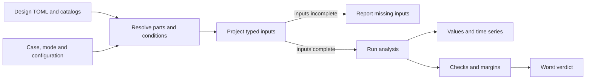
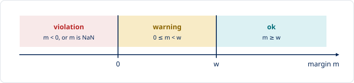

# 解析

解析は決まった物理モデルか工学モデルで、1 つの設計上の問いに答えます。設計データ（TOML ファイルのディレクトリ）を読んで結果を計算し、モデルが基準を判定できるときは、判定つきのチェックも返します。このページでは解析に共通する事項を説明し、すべての解析を一覧にします。各分野のページに、式とアルゴリズムがあります。

## 解析の実行のしかた

設計はファイルのまま計算へ渡されません。まず射影が設計（部品、選んだモードの状態での部品の属性、条件、ケース）を解決します。次に、選んだ解析のために型つきの入力を作ります。線形の量は SI 単位に変換します。回線の損失のような対数の量には、専用のデシベル型があります。解析が必要とする値が見つからなければ、射影は止まり、設計のパスと理由を不足入力として報告します。見つかれば計算が走り、出力（定常の値か時系列）とチェックを返します。



*射影が設計と計算をつなぎます。判定を出すのはチェックです。*

解析は定常（1 組の値）か時系列（時間にわたる値。たとえば複数周回）のどちらかです。種類は `fune analyze ls` に出ます。

## 共通の前提

**ケース。** ケースはモードとミッションのフェーズを選べます。また、epoch、太陽の beta 角、周回数、太陽距離、読む不確かさの側（`nominal`、`min`、`max`）を上書きできます。各解析は自分のモデルに関わる欄だけを読みます。モードは部品の状態、デューティ、稼働台数を割り当てます。姿勢則はモードに従えます。フェーズは自分の軌道、姿勢則、配置を持てます。

**既定のケース。** 明示した `--case` が優先されます。それが無いとき、`analysis.common.default_case` は `power.orbit_generation`、`aocs.rw_unloading`、`aocs.sensor_fov`、`thermal.transient` に対してケース全体を選びます。`power.energy_balance` と `power.sizing` に対しては最上位の姿勢則のためのモードだけを与えます。ほかの解析はケースが無いときに自分の振る舞いを適用します。

**配置。** 配置（configuration）は基準の設計の上に部品の姿勢を重ねたものです。明示した `--configuration` が優先されます。無いときは、`structure.launch_fit`、`structure.static_load`、`structure.modal_estimate`、`structure.modal_fem` が `conditions/launch.toml` に書かれた配置を使います。ほかの解析は、有効なケースのフェーズの配置を使います。何も選ばれていなければ、基準の姿勢を使います。解決と設定キーは[設計データのモデル](../../model.md)と[設計の考え方](../../guide/concepts.md)にあります。

## 結果の読み方

- `status` は実行の状態です。`missing_inputs` は射影が与えられなかった入力の設計パスと理由を挙げます。`failed` は計算エラーを報告します。`ok` は計算が走ったことを示します。
- 各チェックにはキー、ラベル、メッセージ、判定があります。合格は `ok` と書きます。ほかの判定は `warning` と `violation` です。チェックがあるとき、全体の判定は `violation`、`warning`、`ok` の順で最も悪いものです。
- チェックには有限の余裕を付けられます。余裕は判定の元になった数値です。余裕が小さいほど厳しく、負の余裕は基準に対する不足です。余裕はチェックごとの尺度で表します。デシベルの差、SI 単位の差、または下の無次元の比です。情報だけのチェックと、根拠が無いことを知らせる警告には、余裕がありません。

能力 $C$ と需要 $D$ が同じ単位のとき、比の余裕 $m$ は無次元です。

```math
m = C/D-1
```

たとえば $m=0.25$ は能力が需要の 1.25 倍であることを意味します。有限でない比（0 での除算を含む）は余裕を作らず、比の判定は余裕が無いことを `ok` として扱います。

多くのチェックは余裕 $m$ を警告のしきい値 $w$（2 段階のチェックでは 0）で判定に直します。



*余裕 m と警告のしきい値 w による判定です。余裕が NaN なら違反です。*

合否だけの 2 段階のチェックは真を `ok`、偽を `violation` にします。解析によっては独自のチェックの論理を使い、各解析のページがそれを説明します。適合表は余裕を小さい順に並べ、余裕の無いものを有限の余裕より後ろに置きます。[バジェットと適合](budgets.md)を参照してください。補助関数は [spec.rs](../../../crates/lib/analysis/src/spec.rs)、順序は [check.rs](../../../crates/lib/analysis/src/spec/check.rs) にあります。

## 解析の実行

設計のディレクトリで `fune analyze <id>` を実行します。使える ID は `fune analyze ls` で一覧にできます。入力、出力、チェック、判定を構造化して得るには `--json` を付けます。たとえば `fune analyze power.energy_balance --case eclipse_worst --json` は名前を指したケースを実行します。入力が足りないとき、実行が失敗したとき、チェックが違反のときは、コマンドは終了コード 1 で終わります。グラフィカルユーザーインターフェース（GUI）ではサブシステムか条件のページを開き、`Analysis case` で選択肢を選び、`Recompute` でそのページの解析を再実行します。ページには入力、結果の表、グラフ、チェックが出ます。

## 解析の一覧

姿勢・軌道制御系（姿勢系）と指令・データ処理（CDH）はサブシステムの名前です。放射線の解析の ID は接頭辞が `orbit` です。種類は S が定常、T が時系列です。

| 分野 | 解析 ID | 種類 | 計算するもの |
|---|---|---|---|
| [姿勢系](aocs.md) | `aocs.rw_unloading` | T | リアクションホイールのアンローディング頻度 |
| | `aocs.sensor_fov` | T | センサの視野と排除角 |
| | `aocs.slew_time` | S | スルーの所要時間 |
| | `aocs.unload_time` | S | 角運動量のアンローディングの所要時間 |
| [CDH](comm.md) | `cdh.data_budget` | S | データの生成とストレージ |
| [通信](comm.md) | `comm.link_budget` | S | 回線の性能と余裕 |
| | `comm.visibility` | T | 地上局のパス |
| | `comm.data_throughput` | T | ダウンリンクの送信可能量と未送信データ |
| [軌道](orbit.md) | `orbit.decay` | T | 抗力による減衰と軌道維持 |
| | `orbit.eclipse_season` | T | beta 角と蝕の季節 |
| | `orbit.geometry` | T | ミッションの幾何 |
| [電源](power.md) | `power.mode_load` | S | モード別の負荷 |
| | `power.solar_sunlit` | S | 姿勢ごとの日照中の発電 |
| | `power.orbit_generation` | T | 発電と蝕の履歴 |
| | `power.energy_balance` | T | 電池の充電状態とエネルギー収支 |
| | `power.sizing` | S | 必要なパネル面積と電池容量 |
| | `power.thrust_balance` | T | 噴射中の電池の収支 |
| [推進](propulsion.md) | `propulsion.dv_budget` | S | Δv バジェット |
| | `propulsion.launch_window` | S | 遷移の日付とコスト |
| | `propulsion.maneuvers` | S | マヌーバの結果 |
| | `propulsion.mass_properties` | S | 推薬込みの質量特性 |
| | `propulsion.orbit_history` | T | 各マヌーバ後の軌道 |
| | `propulsion.propellant` | S | 推薬とタンクの見積もり |
| | `propulsion.thruster_usage` | S | スラスタの作動時間と力積 |
| | `propulsion.transfer_check` | S | 複数の重力源を考慮した遷移の伝播 |
| [放射線](radiation.md) | `orbit.total_dose` | S | 部品のトータルドーズ |
| | `orbit.trapped_dose` | S | 遮蔽の深さに対する捕捉粒子の線量 |
| | `orbit.trapped_flux` | S | 捕捉粒子のフラックスとフルエンス |
| [構造](structure.md) | `structure.cone_clearance` | S | プルームと視野のクリアランス |
| | `structure.external_geometry` | S | 外表面と投影面積 |
| | `structure.interference` | S | 部品の干渉 |
| | `structure.launch_fit` | S | ロケットとディスペンサへの適合 |
| | `structure.mass_properties` | S | 質量、重心、慣性 |
| | `structure.modal_estimate` | S | 固有振動数の推定 |
| | `structure.modal_fem` | S | 有限要素法による固有振動数 |
| | `structure.static_load` | S | 準静的荷重 |
| [熱](thermal.md) | `thermal.steady` | S | 定常温度 |
| | `thermal.transient` | T | 温度の履歴 |

[バジェットと適合](budgets.md)は質量、電力、データの集計と要求の表を扱います。これらは別の入口（`fune budget` と `fune requirement compliance`）で、`fune analyze ls` には出ません。

## 参考文献

[解析のレジストリ](../../../crates/lib/analysis/src/catalog.rs)、[ケース選択の方針](../../../crates/app/projection/src/case_policy.rs)、[捕捉放射線のモデル](../../trapped-radiation.md)。
