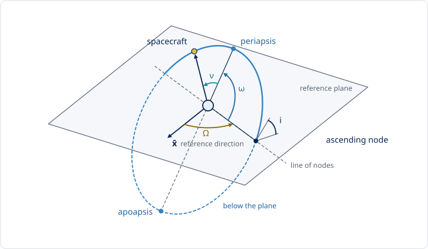
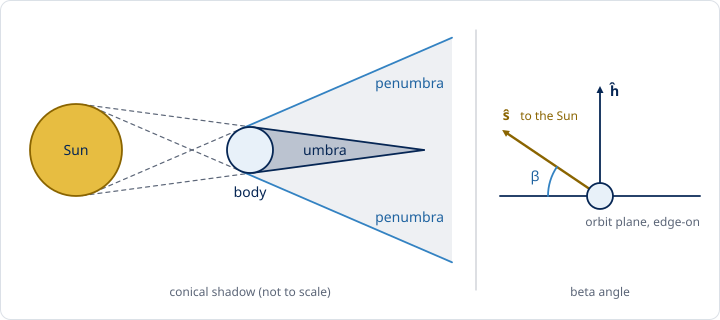
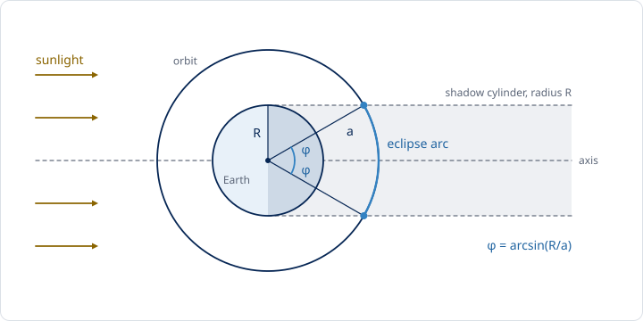
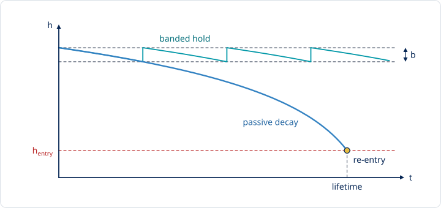

# 軌道解析

宇宙機が太陽と地球に対してどこにいるか、ミッション中に食に入る時間がどれだけあるか、大気抵抗のもとで軌道がどれだけ持つかを求める解析です。
電源、熱、AOCS、通信、放射線のページが前提にする軌道、時刻、影の規約もここで定めます（[共通の前提](#共通の前提)を参照してください）。

| ID | 目的 | 主な入力 | 主な出力 |
|---|---|---|---|
| `orbit.geometry` | ミッション中の幾何条件の極値を求めます | フェーズの軌道と期間 | 太陽・地球距離、角度、光の伝搬時間 |
| `orbit.eclipse_season` | 最長の食と β 角の範囲を求めます | 軌道要素、ミッション期間 | 本影・半影時間、β 角の極値 |
| `orbit.decay` | 高度低下と軌道維持を見積もります | 地球周回軌道、抗力面積、質量 | 軌道寿命、高度履歴、年間 ΔV |

## 共通の前提

### 時刻と元期

`Epoch` は J2000.0（2000-01-01T12:00:00）からの経過秒を浮動小数点数で保持します。
文字列は ISO 8601 で読みます。形式は `YYYY-MM-DD` で、`Thh:mm:ss[.fff]` と `Z` を続けて書けます。日付だけなら 00:00 とみなします。

モデルは協定世界時（UTC）、地球時（TT）、太陽系重心力学時（TDB）を区別せず、うるう秒も無視します。
約 69 s の差は太陽方向で約 0.0008° に当たります。DE440 の読み取りだけはTT とみなした時刻に TDB − TT の主要項（最大 1.7 ms）を加えます。
グリニッジ平均恒星時（GMST）は IAU 1982 の多項式で求め、UT1 は UTC とみなします。

### 座標系

- 地球中心慣性座標系（ECI）の軸は J2000 の平均赤道と平均春分点です。ほかの天体を回る軌道を含め、モデル内の軌道状態はすべてこの軸で表します。
  他の天体を回る軌道では原点をその天体の中心に移すだけで、軸は変えません。
- 地球中心地球固定座標系（ECEF）は、ECI の $z$ 軸まわりに GMST だけ回転した座標系です。この回転に歳差、章動、極運動は含めません。
- 測地緯度、経度、高さは WGS84 楕円体で求めます。
- 機体座標系は宇宙機の姿勢に従います。姿勢則は [AOCS のページ](aocs.md)で説明します。

### 軌道の定義



*$\Omega$ は基準方向から昇交点まで、$\omega$ は軌道面内で昇交点から近点まで測ります。*

| 記号 | 意味 | 単位 |
|---|---|---|
| $a,p,R$ | 軌道長半径、半通径、天体基準半径 | m |
| $e,J_2$ | 離心率、重力場の二次帯状係数 | 1 |
| $i,\Omega,\omega,M,E$ | 軌道傾斜角、昇交点赤経（RAAN）、近点引数、平均近点角、離心近点角 | rad |
| $\mu,n$ | 重力定数、平均運動 | m³/s², rad/s |

軌道は `conditions/orbit.toml` から読みます。フェーズに `[orbit]` テーブルがあれば、設計の軌道をそのテーブルが丸ごと置き換えます。
キー `source` が軌道の出どころを選びます。値は `elements`（既定）、`state`、`libration`、`transfer` です。

要素の軌道（`source = "elements"`）の入力は、`epoch`、`central`（中心天体。既定は地球）、大きさを表す `semi_major_axis` または中心天体の赤道半径からの `altitude`、軌道面を表す `inclination` または `sun_synchronous = true` です。
`eccentricity`、`raan`、`arg_perigee`、`mean_anomaly` を書かなければ 0 です。これらは元期の平均要素です。
`inclination` と `raan` を明示すれば、導出した値よりそちらを優先します。

太陽同期軌道では、地球に限り `sun_synchronous = true` が傾斜角を決めます。選ぶのは、式 (1) の $J_2$ による昇交点の移動率 $\dot\Omega$ が太陽の平均運動 $n_\odot=2\pi/(365.2422\ \mathrm{d})$ に等しくなる傾斜角です。
$\dot\Omega=n_\odot$ とおいて $\cos i$ について解くと次の式になります。

```math
\cos i=-\frac{n_\odot}{\tfrac32\,n\,J_2\,(R/p)^2}\tag{2}
```

軌道長半径が大きすぎて $|\cos i|>1$ になると解はありません。地球以外の中心天体では`inclination` を直接書いてください。

太陽同期軌道の設計では、降交点地方時（LTDN）か昇交点地方時（LTAN）を固定するのがふつうです。
キー `ltdn` には `"HH:MM"` を書き、`raan` を書かないときに使われます。ライブラリは LTAN と LTDN のどちらも換算でき、対象は地球だけです。
地方時は真太陽時です。太陽の赤経 $\alpha_\mathrm{Sun}$（rad）は、ほかの太陽方向と同じ天体暦（DE440 が導入済みならそれ）から求めるため、最大 ±16 min の均時差を含みます。
$t_\mathrm{AN},t_\mathrm{DN}$ を時間（h、$0\le t<24$）で表すと次のとおりです。

```math
t_\mathrm{AN}=(t_\mathrm{DN}+12)\bmod24,\qquad
\Omega=\left(\alpha_\mathrm{Sun}+ (t_\mathrm{AN}-12)\,\pi/12\right)\bmod 2\pi\tag{3}
```

12:00 の交点は平均太陽と同じ赤経にあり、地方時 1 時間は RAAN の 15° に当たります。RAAN は元期の値に固定されます。その後の太陽同期軌道は平均太陽に追従するので、見かけの地方時は均時差の分だけ動きます。

状態ベクトルの軌道（`source = "state"`）のキーは、`epoch`、`central`、`position`、`velocity`（中心天体基準で ECI 軸）と、元期からの一回限りの期間 `span` です。この軌道は周期的でなく、要素も高度も持ちません。

秤動点またはハロー軌道（`source = "libration"`）のキーは、`primary`、`secondary`、`point`（`l1` から `l5`）、`epoch` です。L1 または L2 のハロー軌道には `amplitude_z` と `branch`（既定は `north`）も書きます。
この軌道は円制限三体問題（CR3BP）の周期軌道を天体暦の上に載せたもので、力モデルによる伝搬ではありません。
ハロー軌道は 3 次の Richardson 近似から始め、状態遷移行列を使った微分修正で周期軌道にします。
修正した 1 周期を 400 区間の表にし、三次 Hermite 補間で読みます。
各時刻で、天体暦から得た主天体まわりの副天体の実際の状態が、長さの単位、角速度、回転軸を決めます。これで回転座標系の状態を ECI に写します。
軌道の原点は副天体です。軌道維持は見積もりません。

遷移軌道（`source = "transfer"`）では、キー `maneuver` が日付つきの `[transfer]` を持つマヌーバを指します。軌道はそのマヌーバの巡航弧のうち 2 天体の影響圏の間を Lambert 問題で求めたものです。
詳しくは [`propulsion.maneuvers`](propulsion.md) と[設計モデル](../../model.md)を参照してください。

ケプラー要素を必要とする解析（`orbit.eclipse_season` と `orbit.decay`）は、`elements` 以外の 3 つの出どころには適用できません。
その場合は `source` を不足入力として報告します。

### 伝搬器

キー `propagator` は `kepler`、`j2`（既定）、`numerical` を選びます。

二体伝搬（`kepler`）では平均近点角を $M=M_0+nt$ で進め、ケプラー方程式 $M=E-e\sin E$ を Newton 法で解きます。$M$ は $[0,2\pi)$ に正規化し、初期値は $e<0.8$ なら $E=M$、それ以外は $E=\pi$ です。補正量が $10^{-14}$ rad を下回るか 50 回に達すると反復を止めます。

$J_2$ 永年項の伝搬（`j2`）では軌道長半径、離心率、軌道傾斜角を固定し、$\Omega$、$\omega$、$M$ だけを式 (1) の永年変化率で動かします（Vallado の式 9-41）。短周期項は扱いません。
地球以外の天体を回る軌道では、元期の天体赤道座標系で変化率を求め、結果を ECI に戻します。自転軸の向きは元期の値で固定します。

```math
\begin{aligned}
n&=\sqrt{\mu/a^3},\quad p=a(1-e^2),\quad k=nJ_2(R/p)^2\\
\dot\Omega&=-\tfrac32 k\cos i,\qquad
\dot\omega=\tfrac34 k(5\cos^2i-1)\\
\dot M&=n+\tfrac34 k\sqrt{1-e^2}(3\cos^2i-1)
\end{aligned}\tag{1}
```

標本化に使う軌道周期は平均近点角の変化を含めた周期ではなく、ケプラー周期 $2\pi/n$ です。両者の差は $\tfrac34 k\sqrt{1-e^2}\,|3\cos^2i-1|/n$ で、高度 550 km では 0.1 % 未満です。

数値伝搬（`numerical`）は Cowell 法です。$\dot{\mathbf r}=\mathbf v$、$\dot{\mathbf v}=\sum_k\mathbf a_k$ を、8 次の適応型 Dormand–Prince 法 DOP853 で積分し、密出力を使うので、1 回の積分で要求したすべての時刻の状態が得られます。
相対許容誤差は $10^{-11}$、絶対許容誤差は状態の SI 単位で $10^{-6}$、刻み数の上限は 2,000,000、最大刻みは 600 s です（太陽中心の軌道では 86,400 s）。
以下の記号で、$\mathbf r$ と $\mathbf v$ は中心天体基準の位置（m）と速度（m/s）、$\hat{\mathbf p}$ は中心天体の自転軸の単位ベクトル、$q=\mathbf r\cdot\hat{\mathbf p}$（m）です。第三体の位置は中心天体基準で $\mathbf r_b$（m）、重力定数は $\mu_b$（m³/s²）です。
第三体の項は座標原点の加速度を差し引いており、これが間接項です。

```math
\begin{aligned}
\mathbf a_0&=-\mu\mathbf r/\|\mathbf r\|^3,\\
\mathbf a_{J_2}
&=-\frac{3J_2\mu R^2}{2\|\mathbf r\|^5}
 \left[\left(1-\frac{5q^2}{\|\mathbf r\|^2}\right)\mathbf r+2q\hat{\mathbf p}\right],\\
\mathbf a_b
&=\mu_b\left[\frac{\mathbf r_b-\mathbf r}{\|\mathbf r_b-\mathbf r\|^3}
 -\frac{\mathbf r_b}{\|\mathbf r_b\|^3}\right].
\end{aligned}\tag{4}
```

力モデルには70 次までの地球重力場モデル EGM96 の調和項、太陽輻射圧、地球大気抵抗、固体地球潮汐、相対論の項も入れられます。推力は `propulsion.maneuvers` の推力つき伝搬が加えます。
解析からこれらの項は選べません。状態ベクトルの軌道には中心天体で決まる次の既定の力を使います。

| 中心天体 | 既定の力 |
|---|---|
| 地球 | 点質量と $J_2$、第三体として太陽と月 |
| 月または惑星 | その天体の点質量と $J_2$、第三体として太陽と地球 |
| 太陽 | 太陽と水星から海王星までの惑星の点質量、および地球（地球の重力定数のみで月は含めない） |

大気抵抗、太陽輻射圧、EGM96、潮汐、相対論は含みません。
要素の軌道に `propagator = "numerical"` を書いても効果はありません。軌道は `j2` として伝搬され、`fune check` が警告します（`setting.not_applied`）。
数値伝搬は要素を接触要素として読むので、同じ数値でも別の軌道になります。

### 太陽・月・惑星の位置

天体の位置は `sat_astro::ephem` だけが返します。返すのは光行差と光の伝搬時間の補正をしない幾何位置で、軸は ECI です。

- 解析式はつねに使えます。太陽には地球の VSOP87A 級数の切り詰めを、月には Meeus の第 47 章の級数を、惑星には Standish の平均軌道要素（表 1、適用範囲は 1800 年から 2050 年）を使います。
  J2000 の前後 50 年について、DE440 に対する誤差はモジュールの説明に書かれています。太陽方向は最大 0.0006°、月方向は最大 0.005° で、火星の位置の誤差は $10^5$ km 級です。
- DE440 は任意で、JPL の DE440 天体暦をデータセット `de440`（`fune data fetch de440`）から読みます。範囲は 1849 年から 2150 年です。
  範囲内の時刻にはこれを使います。範囲外の時刻と、データセットが未導入の場合は解析式を使います。
  どちらを使ったかは、`orbit.geometry` が区間ごとに `ephemeris` で報告します（区間の始めと終わりの両方が範囲内のときだけ `de440` です）。
  日付つきの惑星間遷移は解析式の範囲 1800 年から 2050 年の外の日付を、DE440 が覆わない限り受け付けません。

### 食のモデル



*β 角は軌道面から測ります。内側の境界は本影、外側の境界は半影の端です。*

食の判定は `sat_astro::shadow` だけが行います。中心天体（地球、月、惑星）は赤道半径の球とみなします。
中心天体以外による食を扱うのは秤動点の軌道だけで、地球・月系の点では地球も影を作ります（2 つの日照率の小さいほうを使います）。

既定は円錐影モデルです。宇宙機から見て、太陽と掩蔽する天体は視半径 $\alpha$ と $\rho$ の円盤で、中心は $c$ だけ離れています。

```math
\alpha=\arcsin\frac{R_\odot}{d_\odot},\qquad
\rho=\arcsin\frac{R_b}{d_b},\qquad
c=\arccos\frac{\mathbf d_\odot\cdot\mathbf d_b}{d_\odot d_b}\tag{5}
```

$\mathbf d_\odot$ と $\mathbf d_b$ は宇宙機から太陽と天体の中心へ向かうベクトル（m）で、長さは $d_\odot$ と $d_b$ です。$R_\odot=6.957\times10^8$ m、$R_b$ は天体の半径です。
日照率 $f$ は太陽円盤のうち隠されない部分の割合です。

```math
f=\begin{cases}
1, & c\ge\alpha+\rho\\
0, & c\le\rho-\alpha\\
1-\rho^2/\alpha^2, & c\le\alpha-\rho\\
1-A_\cap/(\pi\alpha^2), & \text{otherwise}
\end{cases}\qquad
A_\cap=\alpha^2\arccos\frac{c^2+\alpha^2-\rho^2}{2c\alpha}+\rho^2\arccos\frac{c^2+\rho^2-\alpha^2}{2c\rho}-\tfrac12\sqrt{(-c+\alpha+\rho)(c+\alpha-\rho)(c-\alpha+\rho)(c+\alpha+\rho)}\tag{6}
```

場合分けは上から順に、全日照、本影（$f=0$）、環状食（天体が太陽より小さい場合）、2 つの円盤が部分的に重なる半影（$0<f<1$）です。$A_\cap$ は 2 つの円盤が重なるレンズ形の面積です（Montenbruck と Gill の 3.4.2 節）。
宇宙機が天体の内側にあれば $f=0$、太陽の半径の内側にあれば $f=1$ です。太陽まわりでは影はありません。

円柱影モデルは 2 値です。宇宙機が夜側（$\mathbf r\cdot\hat{\mathbf s}<0$）にあり、太陽と天体を結ぶ軸からの距離が $R_b$ より小さければ $f=0$、それ以外は $f=1$ です。
半径 $a$ の円軌道では地球の視半径が $\rho=\arcsin(R/a)$ で、円柱影から下の計算例で使う食の半角が得られます。



*$\beta=0$ のときの軌道法線方向から見た図です。軌道が夜側にあり、太陽と地球を結ぶ軸から $R$ 以内にある間は影の中にいます。軸の両側にそれぞれ半角 $\varphi=\arcsin(R/a)$ の範囲です。*

### β 角

符号つきの β 角は太陽方向と軌道面のなす角です。

```math
\beta=\arcsin(\hat{\mathbf h}\cdot\hat{\mathbf s})\tag{7}
```

$\hat{\mathbf s}$ は中心天体から太陽への単位ベクトル、$\hat{\mathbf h}$ は軌道面の単位法線です。太陽が角運動量の側にあるとき β は正です。
解析的な地球軌道では対象時刻の $i,\Omega$（永年変化を含む）から $\hat{\mathbf h}=(\sin i\sin\Omega,\,-\sin i\cos\Omega,\,\cos i)$ を求めます。
数値伝搬と地球以外の軌道では、$\mathbf r\times\mathbf v$ を正規化したものが $\hat{\mathbf h}$ です。太陽中心の軌道には β 角がありません。

太陽の赤経 $\alpha$ と赤緯 $\delta$ を使うと、式 (7) は $\sin\beta=\cos\delta\sin i\sin(\Omega-\alpha)+\sin\delta\cos i$ になります。
傾斜角を決めると $\sin\beta$ は $\sin\delta\cos i\mp\cos\delta\sin i$ の範囲を動きます。これが、その日付と傾斜角で取れる β 角の範囲を与えます。
ケースの `beta` の上書きも同じ関係を使います。要求した $\beta$ が元期に成り立つよう RAAN を置き換え、$\Omega-\alpha$ が $[-90^\circ,90^\circ]$ にある解（昇交点が昼側）を選びます。元期からその日付までの $J_2$ による移動は差し引いて戻します。
届かない β 角は入力エラーで、取れる範囲を示します。上書きが使えるのは要素の軌道だけです。

### 軌道の標本化

時系列の解析（電源、熱、AOCS、通信）は、格子を `OrbitSampling` という 1 つの記述で共有します。内容は軌道、期間、刻み、任意の β 角です。
既定値は `analysis::spec::sampling` にあり、格子は $0,\Delta t,2\Delta t,\dots$ で、最後は必ず期間にちょうど合わせます。格子が 5,000,000 点を超えるとエラーです。

| 標本化 | 期間 | 刻み $\Delta t$ |
|---|---|---|
| 時系列（通常） | 書かれた周回数（既定は 3）に周期 $P$ を掛けた長さ。一回限りの軌道は全期間。周回数のない太陽中心の軌道は 1 周 | $\max(30\ \mathrm{s},P/200)$ |
| 軌道平均 | 1 周 | 同じ |
| 日次（地上局） | 86,400 s。一回限りの軌道がそれより短ければその期間 | $\min(600\ \mathrm{s},\max(30\ \mathrm{s},P/200))$ |

周期的な軌道の $P$ はケプラー周期で、一回限りの軌道の $P$ はその期間です。設計が刻み（熱の `time_step`）を書いたときは、周期的な軌道ではそのまま使い、一回限りの軌道では既定の刻みより細かくしません。
標本は時刻ごとに、式 (6) の日照率、宇宙機の位置、太陽方向も与えます。

ケースは使うフェーズ（その軌道と形態）の選択、`beta` の指定（上を参照）、開始時刻 `epoch`、太陽を回る円軌道の `sun_distance` を指定できます。
ケースの `epoch` は要素をその日付まで進め（`j2` なら永年変化を含む）、季節、β 角、太陽距離をその日付のものにします。
`orbit.eclipse_season` と `orbit.decay` はこれらの上書きを無視します。回線の最遠距離のような最悪条件の計算も `epoch` を読みません。

### 最悪日

`orbit.geometry` と `orbit.eclipse_season` はケースを実行すべき日付を見つけます。CLI はその日付をケースに変えます。

- `fune case from-eclipse <ID> --at longest|beta_min` は、最長の食の日か β 角が最小の日の β 角を保存し、説明に日付を書きます。
- `fune case from-geometry --phase <ID>` は、区間内で太陽距離が最大の日、最小の日、地球距離が最大の日を `epoch` とするケースを保存します。
- `fune case from-sun-distance` は、太陽まわりの定常解析のために円軌道の上書きを書きます。

日付の精度はそれを求めた解析の精度と同じです（各解析の「限界」を参照してください）。

### デモ軌道の昇交点移動の計算例

デモの軌道（`fixtures/demo-6u`）は、高度 550 km の円軌道で、`sun_synchronous = true`、`ltdn = "10:30"`、元期は 2027-04-01 です。このとき $a=6378137+550000=6928137$ m、$p=a$ で、次のようになります。

- $n=\sqrt{\mu/a^3}=\sqrt{3.986004\times10^{14}/(6928137)^3}=1.09482\times10^{-3}$ rad/s となり、$P=2\pi/n=5738.99$ s です。
- $(R/a)^2=0.847536$ なので、$k=nJ_2(R/p)^2=1.09482\times10^{-3}\times1.082627\times10^{-3}\times0.847536=1.00456\times10^{-6}$ rad/s です。
- 太陽の平均運動は $n_\odot=2\pi/(365.2422\times86400)=1.991064\times10^{-7}$ rad/s（1 日あたり $0.985647^\circ$）です。
- 式 (2) から $\cos i=-1.991064\times10^{-7}/(1.5\times1.00456\times10^{-6})=-0.132134$ となり、$i=97.5930^\circ$ です。プログラムが出力する $i=1.703318$ rad と同じ値です。
- 式 (1) から $\dot\Omega=-1.5\times1.00456\times10^{-6}\times(-0.132134)=+1.99106\times10^{-7}$ rad/s で、1 日あたり $0.985647^\circ$ です。365.2422 d では $360.000^\circ$ になり、昇交点は平均太陽に追従します。

同じ入力から、近点引数の永年変化率 $\dot\omega=\tfrac34k(5\cos^2i-1)=-3.40^\circ$/日も求まりますが、円軌道では影響しません。
ファイルの RAAN については式 (3) で $t_\mathrm{DN}=10.5$ h から $t_\mathrm{AN}=22.5$ h となり、$\Omega=\alpha_\mathrm{Sun}+157.5^\circ$ です。2027-04-01 の $\alpha_\mathrm{Sun}=9.80^\circ$ を使うと RAAN は $167.30^\circ$（$2.91996$ rad）で、プログラムの入力値と一致します。

### 共通の前提のソース

[元期](../../../crates/lib/astro/src/time.rs)、[永年変化率](../../../crates/lib/astro/src/orbit/analytic.rs)、[軌道要素と太陽同期傾斜角](../../../crates/lib/astro/src/orbit.rs)、[地方時](../../../crates/lib/astro/src/orbit/local_time.rs)、[β 角](../../../crates/lib/astro/src/orbit/beta.rs)、[数値伝搬](../../../crates/lib/astro/src/orbit/numerical.rs)、[力モデル](../../../crates/lib/astro/src/force.rs)、[天体暦](../../../crates/lib/astro/src/ephem.rs)、[秤動点](../../../crates/lib/astro/src/orbit/synodic.rs)、[影](../../../crates/lib/astro/src/shadow.rs)、[時系列の標本化](../../../crates/lib/astro/src/timeline.rs)、[既定の格子](../../../crates/lib/analysis/src/spec/sampling.rs)、[軌道の入力変換](../../../crates/app/projection/src/context/orbit.rs)、[軌道の出どころの入力変換](../../../crates/app/projection/src/context/orbit_source.rs)。

## orbit.geometry ミッション幾何

### 何に答えるか

ミッションの区間ごとに、地球と太陽までの距離の極値、太陽・地球・探査機の角（SEP）の最小値、片道の光の伝搬時間の最大値を求めます。

### 入力

| 量 | 記号 | 単位 | 設計データ | 既定値 |
|---|---|---|---|---|
| 軌道と元期 | $\mathbf r,t_0$ | m, date | フェーズの `[orbit]` または `conditions.orbit` | 必須 |
| 区間の期間 | $T$ | s | フェーズの `duration` | 周期軌道では 1 周（解析の既定） |

### モデルと仮定

区間はフェーズごとにフェーズの順に 1 つずつです。フェーズがない設計では、設計の軌道が 1 区間になります。区間の軌道はそのフェーズで有効な軌道で、出どころは問いません。選んだケースが区間を選ぶことはありません。
各区間はその軌道の元期から始まります。
期間は、軌道が一回限りの期間を持てばそれ、なければフェーズの `duration`（書かれていれば）、それもなければ 1 周です。どれを使ったかは出力の `span_basis`（`one_off`、`phase_duration`、`one_cycle`）が示します。

宇宙機と太陽の位置は地心 ECI 軸で表します。宇宙機の位置は中心天体の地心位置に相対位置を足したものです。
中心天体までの距離には軌道半径をそのまま使います。大きな 2 つの位置を引き算して低軌道の精度を落とさないためです。

### 式

$\mathbf x$ と $\mathbf s$ を地心基準の宇宙機と太陽の位置（m）、$\angle$ を 2 つのベクトルのなす角（rad）、$c=299792458$ m/s とします。
SEP は地球での太陽と探査機のなす角で、SPE は探査機での太陽と地球のなす角です。
太陽・地球・探査機の三角形では $\theta_\mathrm{SEP}+\theta_\mathrm{SPE}+\theta_\mathrm{S}=\pi$ が成り立ちます。$\theta_\mathrm{S}$ は太陽での角です。

```math
d_\mathrm{Earth}=\|\mathbf x\|,\quad d_\mathrm{Sun}=\|\mathbf s-\mathbf x\|,\quad
\theta_\mathrm{SEP}=\angle(\mathbf s,\mathbf x),\quad
\theta_\mathrm{SPE}=\angle(\mathbf s-\mathbf x,-\mathbf x),\quad \tau=d_\mathrm{Earth}/c\tag{8}
```

太陽を回る軌道では$d_\mathrm{Sun}$ に軌道半径を使います。

### アルゴリズム

1. 上のとおり期間 $T$ を決め、終点を含めて $T/720$ の刻みで標本化します。この刻みが `sample_step` です。
2. 標本時刻まで軌道を伝搬し、各時刻で式 (8) を評価します。
3. 各量について、最小と最大の標本を選びます。それぞれの標本の前後の区間 $[t_{i-1},t_{i+1}]$ で黄金分割探索を 60 回反復して詰め、試行時刻ごとに幾何を厳密に評価します。
   標本の値のほうが良ければ標本の値を残します。巡航弧の連鎖では探索区間を弧の境界で分け、境界も候補にします。
4. 区間の始めと終わりの両方が DE440 の範囲内なら暦を `de440`、そうでなければ `analytic` と報告します。

### 検査と判定

判定はありません。区間が空の場合と期間が正でない場合は入力エラーです。

### 出力

| 出力 | 単位 | 意味 |
|---|---|---|
| `sun_distance`, `earth_distance` | m | 最小値と最大値（それぞれ日付つき） |
| `sep_min` | rad | 太陽・地球・探査機の角の最小値（日付つき） |
| `light_time_max` | s | 片道の光の伝搬時間の最大値（日付つき） |
| `series` | m, rad | 区間の始めからの時間に対する太陽距離、地球距離、SEP、SPE |
| `span`, `span_basis`, `sample_step` | s | 区間の期間、その決め方、刻み |
| `phase`, `central`, `start`, `ephemeris` | | 区間の識別と使った暦 |

### 計算例

デモの `LEOP` 区間は、フェーズの `duration` が 30 d = 2,592,000 s なので、刻みは $2592000/720=3600$ s です。
軌道半径は $6378137+550000=6928137$ m で、軌道上のどこでも地球距離に等しくなります。プログラムも最小値と最大値を同じ値で出します（差は 2 nm）。
光の伝搬時間は $6928137/299792458=0.02310978$ s で、`light_time_max` に一致します。太陽距離は $1.4945019\times10^{11}$ m から $1.5070834\times10^{11}$ m の範囲で、$1\ \mathrm{AU}\,(1\pm0.0167)$ に軌道半径の ± を加えた範囲に収まります。

円軌道では、1 周のあいだに太陽方向と衛星方向のなす角が取る最小値は $|\beta|$ です。`sep_min` は 2027-04-30T23:00:38Z に 0.310826 rad です。
`orbit.eclipse_season` の β 角はその時刻に 0.312526 rad（2027-04-30T00:00Z）と 0.310754 rad（2027-05-01T00:00Z）の間を補間して 0.31082 rad です。2 つの解析は一致します。

### 限界

探索は、極値の標本の前後の区間に極値が 1 つだけあると仮定します。標本の刻みより速い変動は分解できないので、長い区間の低軌道では地球・太陽間の角が粗く標本化されます。
地球周回軌道の SEP は1 周ごとに一巡する地心方向の差なので、合の指標にはなりません。

### 検証

`orbit/geometry/tests.rs` の `leo_one_cycle` は円軌道の地球半径、光の伝搬時間、太陽距離の範囲を確認します。`heliocentric_leg_bounds_and_consistency` は太陽周回軌道の範囲を、`span_rule` は期間の優先順位を確認します。
幾何そのものは `timeline/geometry/tests.rs` で試験します（角の和や余弦定理など）。

### ソース

[解析](../../../crates/lib/analysis/src/orbit/geometry.rs)、[幾何の評価器](../../../crates/lib/astro/src/timeline/geometry.rs)、[極値の探索](../../../crates/lib/astro/src/timeline/geometry/extremes.rs)、[入力変換](../../../crates/app/projection/src/orbit.rs)。

## orbit.eclipse_season β 角と食の季節変化

### 何に答えるか

ミッション中に β 角と本影・半影の時間がどう変わるかと、最長の食になる日付を求めます。

### 入力

| 量 | 記号 | 単位 | 設計データ | 既定値 |
|---|---|---|---|---|
| 要素の軌道 | — | — | 有効な `[orbit]` | 必須 |
| ミッション期間 | $T$ | s | `input = "mission_duration"` の `at_least` 要求 | 必須 |
| 季節刻み | $\Delta t$ | s | `conditions.orbit.eclipse_season.step` | 86,400 s（解析の既定） |
| 軌道履歴 | — | — | 数値伝搬するマヌーバ | ない場合は一定の軌道 |

### モデルと仮定

各標本日では1 周のあいだ太陽を空間に固定します。標本日の太陽位置をその 1 周のすべての点に使い、影は式 (6) で求めます。
中心天体は球です。ケースの `beta` と `epoch` は無視し、軌道そのものを使います。
月周回機が地球に隠される食と、地球周回機が月に隠される食は数えません。

### 式

1 周の標本時刻 $t_j$（s）で、宇宙機が選んだ影の状態にいれば $I_j=1$、そうでなければ 0 とします。和は台形則で、$P$ はケプラー周期（s）です。

```math
T_I=P\,\frac{\sum_j(t_{j+1}-t_j)(I_j+I_{j+1})/2}{t_N-t_0},\qquad
T_\mathrm{eclipse}=T_\mathrm{umbra}+T_\mathrm{penumbra}\tag{9}
```

本影は $f\le0$ の状態、半影は $0<f<1$ の状態で、環状食も含みます。軌道の格子は $t_N-t_0=P$ を覆うので、係数 $P/(t_N-t_0)$ は 1 です。

半径 $a$ の円軌道で太陽を固定した場合、円柱影モデルには閉じた形があります（上の図、Montenbruck と Gill の 3.4.1 節）。

```math
T_\mathrm{cyl}=\frac{P}{\pi}\arccos\frac{\sqrt{a^2-R^2}}{a\cos\beta}\tag{10}
```

$|\beta|\ge\arcsin(R/a)$ では 0 です。高度 550 km の軌道では、円錐影の結果との差は 0 s から 30 s です。

### アルゴリズム

1. ミッションを 0 から $T$ まで $\Delta t$ ごとに、終点を含めて標本化します（最後の刻みは端数でもかまいません）。伝搬するマヌーバがあれば、`propulsion.maneuvers` の軌道履歴から各日付で有効な軌道を求めます。
2. 各日付で、その日付の軌道から式 (7) の $\beta$ を求めます。
3. その日付から 1 周を $\max(5\ \mathrm{s},P/1200)$ の刻みで伝搬します（周期 6,000 s までは 5 s）。太陽はその日付の位置を使い、各点で式 (6) の $f$ を求めます。
4. 式 (9) で本影と半影の時間を足し上げます。
5. 最長の食（本影と半影の和）、最小の $\beta$、最大の $\beta$ を選びます。同値なら最初の標本です。
6. 食がまったくない日付を数え、食なしの指標を季節の格子上で台形則により積分して、食なしの期間を推定します。

### 検査と判定

判定はありません。太陽中心の軌道と、正でないミッション期間は入力エラーです。`mission_duration` の要求がない場合と、軌道が要素の軌道でない場合は、不足入力として報告します。

### 出力

| 出力 | 単位 | 意味 |
|---|---|---|
| `points` | date, rad, s | 各日付の β 角と 1 周あたりの本影・半影の時間 |
| `longest`, `max_eclipse_duration` | date, s | 本影と半影の和が最長の標本 |
| `beta_min`, `beta_max` | rad | 符号つき β 角の最小値と最大値（日付つき） |
| `eclipse_free_samples`, `eclipse_free_duration` | count, s | 食のない日付の数と、食なしの推定期間 |
| `step`, `shadow_step`, `fixed_sun_per_orbit` | s | 季節刻み、1 周内の刻み、太陽固定の近似を示すフラグ |
| `series` | rad, s | 時間に対する β 角、本影、半影 |

### 計算例

デモの高度 550 km の太陽同期軌道とミッション期間 31,557,600 s では、β 角は 0.281730 rad（2027-06-02）から 0.454015 rad（2028-02-10）の範囲です。最長の標本は 2027-05-20T00:00:00Z で、$\beta=0.286739$ rad（$16.429^\circ$）、本影 2,100 s、半影 20 s、合計 2,120 s、すなわち 35.33 min です。

式 (10) で確かめます。地球の視半径は $\rho=\arcsin(R/a)=\arcsin(6378137/6928137)=67.016^\circ$ で、$\cos\rho=\sqrt{a^2-R^2}/a=0.390475$ です。
$\cos\beta=0.959171$ なので、逆余弦の引数は $0.390475/0.959171=0.407094$ となり、$\varphi=65.977^\circ$ です。
$P=5738.99$ s を使うと、円柱影では $T_\mathrm{cyl}=P\varphi/180^\circ=2103.6$ s です。
太陽の視半径は $\alpha=0.2633^\circ$（1.012 AU のとき）です。本影は太陽円盤が完全に隠れる $\rho-\alpha$ で終わり、半影は $\rho+\alpha$ で終わります。同じ式の $\rho$ をこれらに置き換えると、本影は 2094.8 s、本影と半影の合計は 2112.4 s です。
プログラムの 2,100 s と 2,120 s は、5 s の格子の範囲でこれらと一致します。各境界は最も近い標本に置かれるためです。

### 限界

境界の分解能は 1 周内の刻みで決まり、最長の食の日付の分解能は季節刻みで決まります。
1 周分の窓はその日の衛星の位相から始まり、長さはケプラー周期 $P$ です。平均近点角はこれよりわずかに速く進むため、高度 550 km では 1 周のうち最大約 4 s が窓から漏れます。
短い食や半影は、日付の間に隠れることがあります。極値は標本の中から選び、標本の間は探しません。

### 検証

`orbit/eclipse_season/tests.rs` の `cylindrical_shadow_matches_hand_calculation` は$\beta=0^\circ,30^\circ,60^\circ$ で式 (10) を確認し、円錐影の本影が 30 s 以内で一致することも確認します。`no_eclipse_above_critical_beta` は、$|\beta|>\arcsin(R/a)$ で食が見つからないことを確認します。
`sso_year_and_solar_precession` は $\dot\Omega=0.9856^\circ$/日と 1 年の 367 標本を、`lunar_orbit_eclipse_season` は月周回軌道の手計算を、`extrema_ties_and_eclipse_free_duration_by_hand` は同値の扱いと時間積分を確認します。
`astro` では、`timeline/tests.rs` の `eclipse_fraction_at_550_km_beta_zero` と `shadow.rs` が影の関数を、`orbit/tests.rs` が β 角、太陽同期傾斜角、昇交点の移動率を試験します。

### ソース

[解析](../../../crates/lib/analysis/src/orbit/eclipse_season.rs)、[影](../../../crates/lib/astro/src/shadow.rs)、[β 角](../../../crates/lib/astro/src/orbit/beta.rs)、[入力変換](../../../crates/app/projection/src/orbit.rs)。

## orbit.decay 大気抵抗による高度低下と軌道維持

### 何に答えるか

推力を使わないときに軌道がどれだけ持つか、高度がどれだけの速さで下がるか、高度を保つのに必要な ΔV はいくらかを、低・中・高の太陽活動と、宇宙天気の表があればその日付どおりの活動について見積もります。

### 入力

| 量 | 記号 | 単位 | 設計データ | 既定値 |
|---|---|---|---|---|
| 地球周回の要素軌道 | — | — | 有効な `[orbit]` | 必須 |
| 質量 | $m$ | kg | 部品の質量特性 | 必須 |
| 抗力面積 | $A$ | m² | `conditions.orbit.decay.drag_area` または寸法を持つ部品の箱 | 箱の和集合の平均投影面積（解析の既定） |
| 抗力係数 | $C_\mathrm D$ | 1 | `analysis.aocs.drag_coefficient` | 2.2（解析の既定） |
| 積分期間 | $T_\mathrm{span}$ | s | `decay.span` | 25 ユリウス年（解析の既定） |
| 再突入高度 | $h_\mathrm{entry}$ | m | `decay.reentry_altitude` | 120,000 m（解析の既定） |
| 許容高度低下 | $b$ | m | `decay.band` | 連続維持（解析の既定） |
| 維持期間 | $T_\mathrm{hold}$ | s | `input = "mission_duration"` の要求 | 1 ユリウス年（解析の既定） |
| 廃棄寿命の上限 | $T_\mathrm{max}$ | s | `orbit.decay` の判定基準 `max_lifetime` | 任意 |
| 推薬とスラスタ | — | kg, s | [推進解析](propulsion.md) | 任意 |
| 日付別の太陽活動 | — | sfu, 1 | 導入済みの `space_weather` データセット | プリセットは常に計算 |

`decay` のキーは `conditions/orbit.toml` にあります（`conditions.orbit.decay.<key>`）。質量は有効な形態の合計です。1 ユリウス年は $Y=31557600$ s です。

### モデルと仮定

抗力が衛星を減速させ、軌道が縮みます。モデルは軌道エネルギーの損失を通して軌道長半径 $a$ を追跡します。
エネルギーに関する Gauss 形式の惑星方程式 $\dot a=2a^2(\mathbf v\cdot\mathbf a_\mathrm D)/\mu$ が瞬間の変化率を与え、解析はこれを二体軌道の 1 周で平均します。
積に現れる速度 $\mathbf v$ は慣性速度です。抗力が軌道にする仕事は慣性系で測るからです。一方、抗力加速度 $\mathbf a_\mathrm D$ は、地球とともに回る大気に対する相対速度で求めます。
これは、密度一定の円軌道で使われる一般的な式の代わりになります。大気が回転せず密度が一定なら 2 つは一致します。そのとき $\mathbf v\cdot\mathbf a_\mathrm D=-\rho v^3/(2\mathcal B)$、$v=\sqrt{\mu/a}$ で、$\dot a=-\rho\sqrt{\mu a}/\mathcal B$ という King-Hele の形になります。
ここでは密度が緯度、地方太陽時、季節によって周回中に変わります。また大気の回転は円軌道なら相対速度を係数 $(1-\omega_\mathrm Ea\cos i/v)^2$ だけ変え、デモの高度 550 km では 1.8 % です。

離心率、近地点引数、軌道傾斜角、抗力面積は固定します。$\Omega$ は $J_2$ の変化率で動かします。地球の昼側の密度の膨らみが軌道面の地方時に依存するからです。
モデルが対象とするのは、高度およそ 180 km から 1,000 km の地球の近円軌道です。

大気の密度は経験モデル NRLMSISE-00 から求めます。評価する位置は測地座標（WGS84）で、日付は通日、時刻は世界時、地方時は平均地方太陽時 $\mathrm{UT}+\lambda/15^\circ$ です。
入力する太陽と地磁気の指標は、前日の 10.7 cm 太陽電波フラックス $F_{10.7}$、その 81 日平均 $\bar F_{10.7}$（どちらも太陽電波フラックス単位 sfu）、日平均の Ap 指数です。解析は Ap を 1 日 1 つの値として渡し、3 時間ごとの履歴は使いません。

- プリセットは常に計算します。低・中・高活動は ECSS-E-ST-10-04C の表 6-3 にある長期の固定値で、$(F_{10.7},\bar F_{10.7},\mathrm{Ap})$ は $(65,65,0)$、$(140,140,15)$、$(250,250,45)$ です。積分の全期間で一定とします。
- データセット `space_weather`（CelesTrak の SW-All 表。`fune data fetch space_weather`）が導入済みなら、4 つ目の条件 `dated` が 27 日ごとに日付で値を引き、直前の標本の値を保持します。
  $F_{10.7}$ は前日（UTC）の観測値、$\bar F_{10.7}$ は 81 日の中心平均（欠けていれば直前 81 日の平均）、Ap は日平均です。
  観測値、補間値、予測値は出所つきで出力に残ります。表の外や欠けた値では、フラックスと Ap がそれぞれ独立に中活動のプリセットへ戻ります。
  結果には表の版も記録します。



*自然減衰では高度が再突入高度まで下がります。幅を指定した軌道維持では、高度が幅 $b$ だけ下がるたびに初期高度へ戻します。*

### 式

$\mathcal B$ は弾道係数（kg/m²）、$\rho$ は密度（kg/m³）、$\mathbf v$ は慣性速度（m/s）、$\boldsymbol\omega_\mathrm{Earth}$ は ECI の $z$ 軸に沿う地球の角速度（rad/s）、$\mathbf v_\mathrm{rel}$ は地球とともに回る大気に対する速度です。
山括弧は 1 周の時間平均、$\mathbf a_\mathrm D$ は抗力加速度（m/s²）、$h_\mathrm p$ は近地点高度（m）です。

```math
\begin{aligned}
\mathcal B&=m/(C_\mathrm DA),&
\mathbf v_\mathrm{rel}&=\mathbf v-\boldsymbol\omega_\mathrm{Earth}\times\mathbf r,\\
\mathbf a_\mathrm D&=-\rho\|\mathbf v_\mathrm{rel}\|\mathbf v_\mathrm{rel}/(2\mathcal B),&
\dot a&=2a^2\langle\mathbf v\cdot\mathbf a_\mathrm D\rangle/\mu,\\
h_\mathrm p&=a(1-e)-R,&
\dot V_\mathrm{hold}&=-\langle\hat{\mathbf v}\cdot\mathbf a_\mathrm D\rangle,\\
\Delta v_\mathrm{yr}&=\Delta v_\mathrm{hold}\,Y/T_\mathrm{hold},&
\dot\Omega&=-\tfrac32 nJ_2(R/p)^2\cos i
\end{aligned}\tag{11}
```

$\dot V_\mathrm{hold}$ は、抗力の進行方向成分を打ち消す ΔV の率（m/s²）で、$\Delta v_\mathrm{hold}$ はそれを維持期間にわたって積分した値です。
推薬があるときに推薬が与えられる ΔV は、湿潤質量 $m_0$、使える推薬量 $m_\mathrm p$、比推力 $I_\mathrm{sp}$ を使ったロケット方程式で表します。

```math
\Delta v_\mathrm{avail}=I_\mathrm{sp}\,g_0\ln\frac{m_0}{m_0-m_\mathrm p},\qquad
T_\mathrm{hold,life}=\frac{\Delta v_\mathrm{avail}}{\Delta v_\mathrm{yr}}\,Y\tag{12}
```

### アルゴリズム

1. 抗力面積は、`drag_area` が書かれていればその値を使います。書かれていなければ、有効な形態の部品の箱の和集合について、平均の投影面積を求めます。全方向の平均は半球での求積で、極角に Gauss–Legendre の 12 点、方位角に 4 象限それぞれ 8 点を使い、合計 384 方向です。
   各方向で箱の輪郭を合成し、重なりは 1 度だけ数えます。同じ関数を `structure.external_geometry` も使います。凸な箱 1 つなら、平均は表面積の 4 分の 1 です。
2. 軌道平均は次のように求めます。ある $a$、$\Omega$、日付に対し、初期の離心率、軌道傾斜角、近地点引数で二体軌道を 1 周伝搬します。$M=0$ から始め、1 周を等時間間隔の 12 刻みで標本化します（両端を含めて 13 点）。
   各点で密度、$\mathbf v_\mathrm{rel}$、$\mathbf a_\mathrm D$、$\mathbf v\cdot\mathbf a_\mathrm D$、$-\hat{\mathbf v}\cdot\mathbf a_\mathrm D$ を求め、台形則で平均します。
3. 高度低下では状態 $(a,\Omega,\Delta v)$ を古典的な 4 次の Runge–Kutta 法で積分します。刻みは、直前の変化率で 1 刻みの低下が 1,000 m 以下になるように決め、600 s から 10 d の範囲、期間の終わり、次の 27 日ごとの宇宙天気の標本のうち最も近いものまでに制限します。
   近地点高度は離心率を固定した $h_\mathrm p=a(1-e)-R$ です。1 刻みの中で $h_\mathrm{entry}$ に達したら、線形補間で交差時刻を求めます。その時刻が寿命で、`reentry_epoch` は元期に寿命を足したものです。
   期間内に再突入しなければ `lifetime` は出力されません。高度の時系列には平均高度 $a-R$ を少なくとも 10 d おきに記録し、交差点と最後の点は必ず残します。刻み数の上限は 200,000 です。
4. 維持は初期の $a$ から維持期間だけ別に積分します。幅がなければ $\dot a$ を 0 にするので高度は保たれ、$\Delta v$ は $\int\langle-\hat{\mathbf v}\cdot\mathbf a_\mathrm D\rangle\,dt$ として積算されます。
   幅があるときは $a$ が低下し、$a\le a_0-b$ になった刻みの終わりに $a_0$ へ戻します（瞬時の引き上げ）。この引き上げの回数も数えます。1 刻みの低下は $b/4$ までに制限します。ΔV は進行方向の抗力の積分で、引き上げの 1 次近似です。
   年間 ΔV は $\Delta v_\mathrm{yr}=\Delta v_\mathrm{hold}Y/T_\mathrm{hold}$ です。幅があるときは、引き上げの回数、平均間隔、1 回あたりの平均 ΔV も出力します。
5. 推薬は、推進系のデータがあれば `propulsion.propellant` の値から軌道維持の推薬を取ります。区分が `station_keeping` でスラスタを名指すマヌーバがあれば、名指されたスラスタのうち比推力が最も低いものと、そのマヌーバが使う推薬を使います。
   スラスタを名指すマヌーバがなく、スラスタを持つ推薬群がちょうど 1 つなら、その群の最も低い比推力と使える推薬量を使います。湿潤質量は乾燥質量に搭載推薬を足した値です。推薬群をまたいだ換算はしません。決められなければ、スラスタは未確定となり、`station_keeping_thruster` が警告します。
   維持寿命は式 (12) で求めます。

### 検査と判定

- `near_circular` は $e>0.01$ で警告します。離心率を追跡しないので、このとき寿命は粗い見積もりです。
  初期の近地点が再突入高度以下の場合と、中心天体が地球以外の場合は入力エラーです。
- `lifetime_vs_mission` は、ミッション期間があるときだけ働きます。各条件の寿命（再突入しなければ期間を下限として）のうち最短のものがミッション期間を下回れば警告します。余裕はその最短値をミッション期間で割って 1 を引いた値です。
  ミッション期間より短い積分期間で再突入しなければ、寿命を確認できないというメッセージになります。
- `propellant_life` は、ミッション期間があり、使える軌道維持の推薬があるときに、各条件のうち最短の維持寿命をミッション期間と比べます。短ければ警告します。余裕は最短の維持寿命をミッション期間で割って 1 を引いた値です。
- `max_lifetime` は、判定基準があるときだけ働きます。`dated` の条件があればそれを、なければ `moderate` のプリセットを使います。太陽周期を考えない低活動のプリセットは使いません。寿命が上限以内なら ok です。
  寿命が上限より長い場合と、上限に届く期間まで再突入しない場合は違反です。上限より短い期間で再突入しなければ警告です。余裕は上限を寿命（または下限）で割って 1 を引いた値です。

### 出力

結果は条件ごと（`low`、`moderate`、`high`、利用できれば `dated`）に `cases` へ入り、使った値は `used` に入ります。

| 出力 | 単位 | 意味 |
|---|---|---|
| `lifetime`, `reentry_epoch` | s, date | 近地点が $h_\mathrm{entry}$ に達する時間と日付。期間内に達しなければ出力なし |
| `decay_per_day`, `initial_decay_rate` | m, m/s | 元期の 1 日あたりの高度低下と、元期の変化率 $-\dot a$ |
| `decay_first_year`, `final_altitude` | m | 最初の 1 年の高度低下（それより前に再突入すれば再突入まで）と、最後の高度 |
| `initial_density` | kg/m³ | 元期の軌道平均の密度 |
| `series` | m | 平均高度の履歴 |
| `station_keeping` | m/s, s | 年間 ΔV と合計 ΔV、引き上げの回数と間隔、1 回あたりの ΔV、推薬寿命 |
| `used` | | 抗力係数と面積（出どころつき）、期間、再突入高度、維持期間、幅、推薬、スラスタ、使える ΔV、軌道の標本数、最大刻み |

### 計算例

デモは質量 5.548 kg、$C_\mathrm D=2.2$、箱から求めた抗力面積 0.108342 m²、高度 550 km の太陽同期軌道（2027-04-01）です。弾道係数は $\mathcal B=5.548/(2.2\times0.108342)=23.276$ kg/m² です。
本体の箱だけの平均投影面積は $\tfrac12(0.1\times0.226+0.226\times0.366+0.366\times0.1)=0.0710$ m² で、太陽電池パネルを含む和集合の 0.108 m² より小さくなります。

高活動のプリセットで、プログラムの初期密度は $1.829\times10^{-12}$ kg/m³ です。大気の回転を含めた King-Hele の形は
$\dot a\approx-\rho\sqrt{\mu a}\,(1-\omega_\mathrm Ea\cos i/v)^2/\mathcal B$ です。$\sqrt{\mu a}=5.2551\times10^{10}$ m²/s、$v=7585$ m/s、$\cos i=-0.132134$、$\omega_\mathrm Ea=505.2$ m/s を使うと、係数は $(1+66.76/7585)^2=1.0177$ で、

```math
\dot a\approx-\frac{1.829\times10^{-12}\times5.2551\times10^{10}}{23.276}\times1.0177=-4.202\times10^{-3}\ \mathrm{m/s}
```

プログラムは $\dot a=-4.2074\times10^{-3}$ m/s を出力し、差は 0.12 % です。残る差は、密度が周回中に変わることと、大気の回転の係数が 1 次の形であることによります。
1 日では $0.0042074\times86400=363.5$ m で、出力の `decay_per_day` と同じです。高活動のプリセットの寿命は 21,011,503 s = 243.19 d です。`decay_first_year` が 430,000 m なのは、1 年たたないうちに再突入する（550 km から 120 km まで）ためです。
寿命はチェックのメッセージにも現れ、`lifetime_vs_mission` の余裕は $243.19/365.25-1=-0.334$ で警告になります。高活動の条件が1 年のミッションより前に再突入するためです。

中活動のプリセットでは、初期の低下量が 66.98 m/日、寿命が 93,695,309 s = 2.97 年です（再突入は 2030-03-20）。スケールハイト $H$ が一定の指数大気では、寿命はおよそ $H/|\dot a_0|$ です。この値から $H\approx66.98\ \mathrm{m/d}\times1084.4\ \mathrm d=72.6$ km が逆算されます。これは桁を確かめる検算で、手計算による再現ではありません。
年間の維持 ΔV は中活動のプリセットで 11.6039 m/s、高活動で 63.1960 m/s です。高活動の値が初期の変化率に 1 年を掛けた値より小さいのは、維持の積分が元期の密度ではなく 1 年を通した密度（季節と昇交点の移動）を使うからです。
デモの推進系のデータでは、使える ΔV は 137.570 m/s（スラスタ `EPT`、推薬 0.06526 kg）です。したがって中活動の維持寿命は $137.570/11.6039=11.855$ 年（374,132,849 s）です。`max_lifetime` は中活動のプリセットを使います（この実行には日付別のデータがありません）。2.97 年に対して上限は 25.0 年で、余裕は $25.0/2.97-1=7.42$ です。

### 限界

軌道平均が前提とするのは、高度およそ 180 km から 1,000 km の近円軌道です。離心率、近地点引数、抗力面積は固定なので、姿勢の変化（タンブリングや太陽電池パネルの角度の変化）は、書く面積に含めてください。
再突入の直前の数日は粗い結果です。刻みは 600 s 以上で、近地点高度が約 180 km を下回ると、1 周の平均は向きません。
維持は進行方向の抗力の積分と瞬時の引き上げで表し、推力の設計ではありません。バーン時間のようなスラスタ側の制約は検査しません。
太陽活動は一定のプリセットか、27 日間保持する表の値です。日ごとの変動は追わず、表より先の予測値（やプリセット）には、太陽周期の予報に特有の不確かさがあります。
面積は箱による近似です。面積と抗力係数 $C_\mathrm D=2.2$（自由分子流の箱形の衛星の慣例値。Vallado の 8.6.2 節）が、密度モデルとともに不確かさの大半を占めます。

### 検証

`orbit/decay/tests.rs` の試験は次のとおりです。

- `equatorial_rates_match_king_hele_by_hand` は、指数大気中の赤道円軌道について、密度、$\dot a$、打ち消す推力を、$\dot a=-\rho\,\mathcal B^{-1}\sqrt{\mu a}\,(1-\omega_\mathrm Ea/v)^2$ と $\tfrac12\rho\,\mathcal B^{-1}(v-\omega_\mathrm Ea)^2$ に $10^{-5}$ で照合します。幅つきの 1 年の維持が 10 % 以内で合うことも確認します。
- `one_box_gives_a_quarter_of_the_surface` は、箱の面積を 1.5 m² と 0.039 m² に照合します。`mean_area_is_the_union_of_the_boxes` と `a_written_drag_area_wins_over_the_boxes` は面積の規則を確認します。
- `cubesat_lifetime_at_500_km_is_a_few_years` と `iss_like_decay_is_kilometres_per_month` は公表値との桁を確認します。`dated_weather_matches_the_same_preset` は、日付で引いた値がプリセットと一致することを確認します。
- `propellant_life_and_checks` と `orbit/decay/station_keeping_tests.rs` は推薬群の選択と使える ΔV を手計算の質量に照合します。

天体側の関数は `atmosphere/space_weather/tests.rs` と `atmosphere/nrlmsise00/tests.rs` で試験します。

### ソース

[解析](../../../crates/lib/analysis/src/orbit/decay.rs)、[軌道平均](../../../crates/lib/analysis/src/orbit/decay/rates.rs)、[積分](../../../crates/lib/analysis/src/orbit/decay/simulate.rs)、[宇宙天気の列](../../../crates/lib/analysis/src/orbit/decay/weather.rs)、[推薬](../../../crates/lib/analysis/src/orbit/decay/propellant.rs)、[判定](../../../crates/lib/analysis/src/orbit/decay/checks.rs)、[宇宙天気](../../../crates/lib/astro/src/atmosphere/space_weather.rs)、[抗力](../../../crates/lib/astro/src/force/terms.rs)、[抗力面積](../../../crates/lib/analysis/src/structure/external_geometry/directions.rs)、[入力変換](../../../crates/app/projection/src/orbit.rs)。

## 参考文献

- O. Montenbruck and E. Gill, *Satellite Orbits*, Springer, 2000.
- D. A. Vallado, *Fundamentals of Astrodynamics and Applications*, 4th ed., 2013.
- D. King-Hele, *Satellite Orbits in an Atmosphere*, Blackie, 1987.
- J. M. Picone et al., *NRLMSISE-00 empirical model of the atmosphere: Statistical comparisons and scientific issues*, 2002. [論文](https://doi.org/10.1029/2002JA009430)
- R. S. Park et al., *The DE440 and DE441 Planetary and Lunar Ephemerides*, 2021. [論文](https://ssd.jpl.nasa.gov/doc/Park.2021.AJ.DE440.pdf)
- J. Meeus, *Astronomical Algorithms*, 2nd ed., 1998.
- ECSS-E-ST-10-04C, *Space environment*, 2008.
- D. L. Richardson, *Analytic construction of periodic orbits about the collinear points*, Celestial Mechanics 22, 1980.
