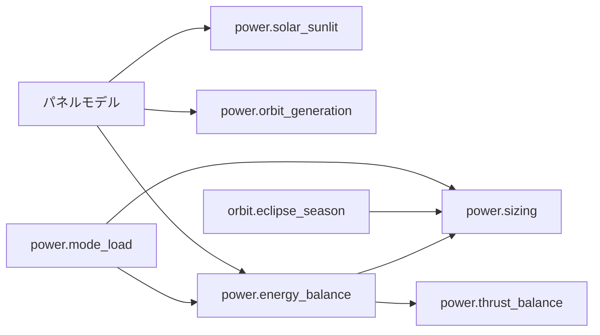
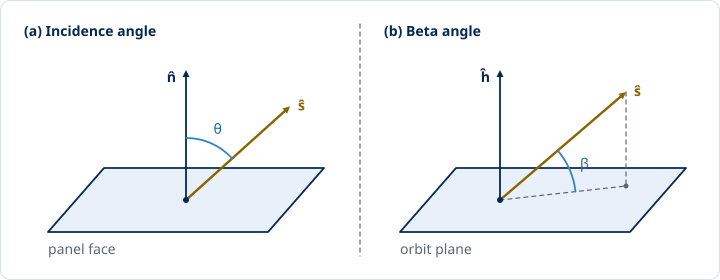
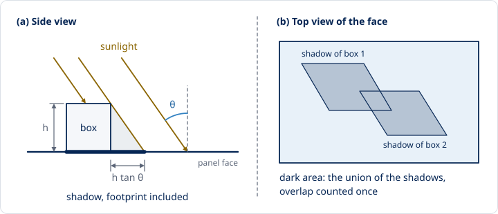
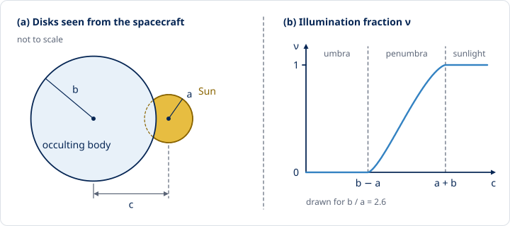
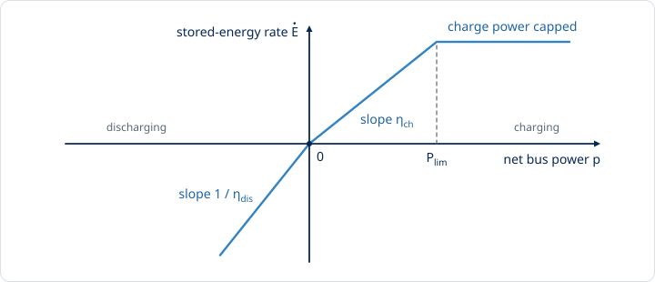
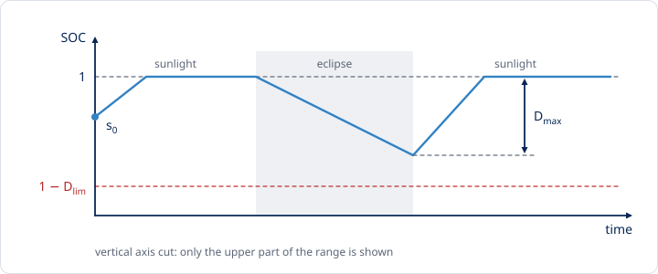
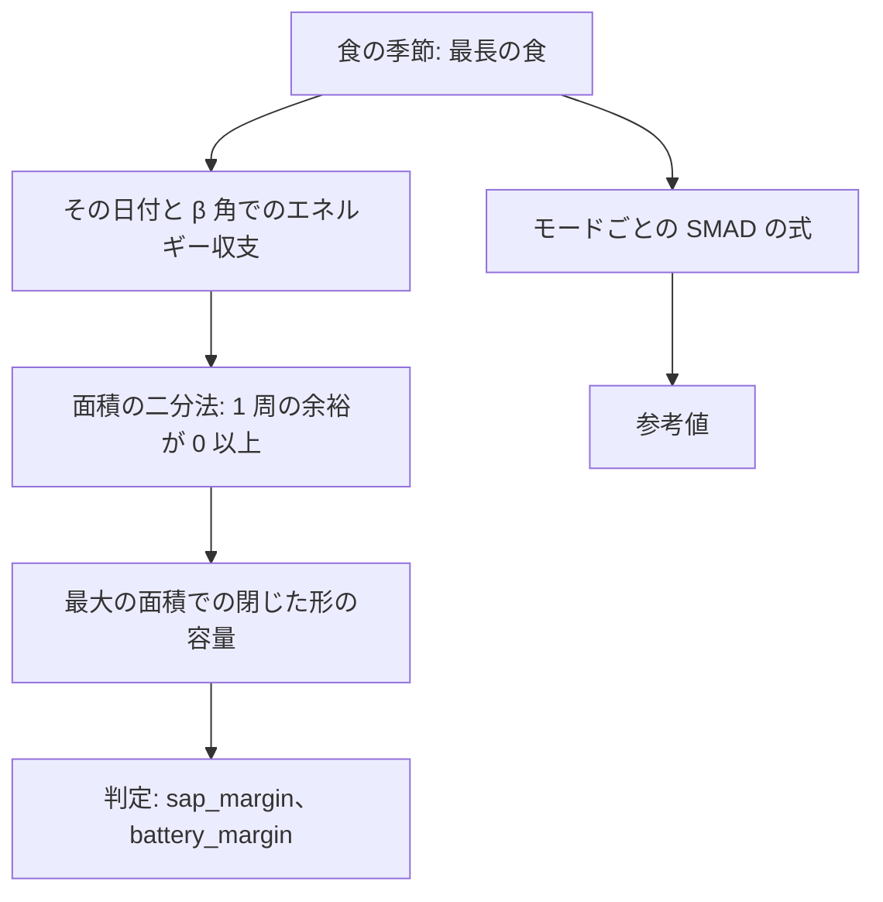

# 電源解析

電源解析は概念設計で次の4つの問いに答えます。各運用モードはどれだけの電力を使うか。太陽電池パネルは日照中と1周回を通じてどれだけ発電するか。電池は許容放電深度に収まるか。太陽電池アレイと電池はどれだけの大きさが必要か。

| ID | 目的 | 主な入力 | 主な出力 |
|---|---|---|---|
| `power.mode_load` | モードごとの平均負荷とピーク負荷 | 状態別電力、時間割合、員数、成長余裕 | モード・部品・グループ別の負荷 |
| `power.solar_sunlit` | 姿勢則ごとの日照中のパネル出力 | パネル、部品の箱、軌道、姿勢則 | パネル・モード別の BOL と EOL の電力 |
| `power.orbit_generation` | 食と半影を含む発電 | パネル、軌道、姿勢則、影のモデル | 発電の履歴、周回平均、食の長さ |
| `power.energy_balance` | 電池の充電状態とエネルギー余裕 | 発電、モード負荷、電池、運用の並び | 充電状態、放電深度、エネルギー余裕 |
| `power.sizing` | 必要なパネル面積と電池容量 | 最長の食、負荷、パネル、効率、ミッション期間 | 必要面積、必要容量、余裕 |
| `power.thrust_balance` | マヌーバの噴射中の電池収支 | 噴射モード、デューティ、日照中のみの指定、電池 | マヌーバごとの収支 |

解析は互いに積み上がっています。発電の数値はすべて 1 つのパネルモデルから出し、エネルギー収支の電池モデルをサイジングと噴射中の収支が再利用します。



## 共通の前提

### 座標系と姿勢則

パネルの法線はそのパネルを持つ部品の座標系で与えます。選択した形態が各部品を配置し、法線は機体座標系に変換されます。姿勢則は各サンプルでの機体座標系から慣性座標系（ECI）への回転を与えるものです。機体座標系での太陽方向 $\hat{\mathbf s}$ は慣性系の太陽方向をこの回転で逆に戻したものです。

姿勢則は `analysis.aocs.law.<mode>` から読みます。フェーズに `[law.<mode>]` があれば、そのモードについては設計側の指定を置き換えます。種類は次の 3 つです。

- `sun_pointing` は機体軸 `axis` を太陽に向けます。副軸 `secondary` は軌道面法線に合わせます。軌道面法線が太陽方向とほぼ平行（外積のノルムが $10^{-6}$ 未満）のときは、速度方向を使います。
- `nadir_pointing` は `axis` を中心天体の方向に向けます。副軸 `along_track` は速度方向に合わせます。速度方向が天底方向とほぼ平行なときは、軌道面法線と天底方向の外積を使います。
- `inertial` は固定のクォータニオン `orientation` を保ちます。

最初の 2 つの姿勢則では主軸を厳密に合わせます。副軸は主軸の条件のもとでできるだけ近づけます。回転は機体軸から作る右手系の基底と、目標方向から作る右手系の基底から求めます。ほかに指定がなければ、主軸は +Z、副軸は +X、慣性固定の回転は恒等回転です。モードを指定しておらず、設計に姿勢則がちょうど 1 つでもない場合は、姿勢則を不足入力として報告します。

### β角

太陽 β 角 $\beta$ は太陽方向と軌道面のなす符号付きの角度です。軌道面の単位法線 $\hat{\mathbf h}$（軌道角運動量の向き）を使うと、$\sin\beta=\hat{\mathbf h}\cdot\hat{\mathbf s}$ です。入射角 $\theta$ はパネル法線 $\hat{\mathbf n}$ と太陽のなす角で、$\cos\theta=\hat{\mathbf n}\cdot\hat{\mathbf s}$ です。



*左はパネル法線と太陽のなす入射角 $\theta$、右は太陽と軌道面のなす β 角です。*

解析ケースでは `beta` を指定できます。指定すると、軌道の元期でその β 角になるように、昇交点赤経を置き換えます。これが使えるのはケプラー要素で与えた軌道だけです。ほかの軌道の与え方では入力エラーで解析が止まります。

### 軌道のサンプリング

時系列の解析は $0,\Delta t,2\Delta t,\dots$ の時刻で軌道をサンプリングし、最後のサンプルはちょうど解析期間の終わりに置きます。刻みは次の式です。

```math
\Delta t=\max\left(30\ \mathrm{s},\ T/200\right)
\tag{1}
```

$T$ は軌道周期（s）です。周期 100 分までの軌道では 30 s になります。期間は $N$ 周で、$N$ はケースの `orbits`、なければ `analysis.power.orbits`、それもなければ 3 です。0 は 1 として扱います。太陽を回る軌道では何も書かなければ 1 です。周回を繰り返さない軌道（巡航の弧など）は期間全体を解き、式 (1) の $T$ はその期間になります。`power.solar_sunlit` だけは例外で、常に 1 周を使います。

### 照度と食

各サンプルは中心天体の影から求めた照度率 $\nu$（0 から 1）を持ちます（`power.orbit_generation` を参照してください）。$\nu\ge0.5$ のサンプルを日照中、それ以外を食とします。この閾値は電源の解析すべてで共通です。食の区間は食のサンプルが連続した範囲です。区間の始まりと終わりは最初と最後の食のサンプルの時刻なので、$n$ 個のサンプルからなる区間の長さは $(n-1)\,\Delta t$ です。報告する食の長さはサンプル値であり、最大で 1 刻みほど短く出ることがあります。

### 周回平均

周回平均は解析期間のうち回り切った周回を対象にします。周回 $j$ は $t_0+jT\le t<t_0+(j+1)T$ のサンプルで、許容は $10^{-6}T$ です。周回の最後のサンプルは次の周回の最初のサンプルでもあり、台形則の区間は閉じています。平均は回り切ったすべての周回の台形積分の和を、合計時間で割った値です。解析期間に回り切った周回がなければ、期間全体を平均し、出力に `span_fallback` の印を付けます。サービスはこれを `span` の警告にしますが、周回を繰り返さない軌道では `ok` の通知にとどめます。

### 符号

発電と負荷は W 単位の大きさで表します。正味のバス電力は発電から負荷を引いた値です。電池モデルでは正味電力が正なら充電、負なら放電です。

## power.mode_load モード別消費電力

### 何に答えるか

各モードが日照中と食中に平均でどれだけの電力を使うか、また状態ごとのピークを足し合わせた値はいくらかに答えます。

### 入力

| 量 | 記号 | 単位 | 設計データの出どころ | 既定値 |
|---|---|---|---|---|
| 1 台の状態別電力 | $p_{is}$ | W | 部品の属性 `power`（カタログ値または上書き値）を状態ごとに | 時間割合が正の状態には必要 |
| 状態の時間割合 | $f_{is}$ | 1 | `modes/<ID>.toml` の `state`（基本状態）と部品ごとの `duty`、任意の `[eclipse]` | 基本状態が残りの時間を取る |
| 状態ごとの台数 | $n_{is}$ | 1 | 部品の `count` と `redundancy`、モードの `active` と `spare_state` | `count` は 1、全台稼働 |
| 成長余裕 | $g_i$ | 1 | 部品の `maturity` を `budget/policy.toml` の `[growth]` で引く | 0 |

そのほかの入力として、型付きの入力に `default_growth_margin`（既定 0）があり、部品に余裕が書かれていないときに使います。

### モデルと仮定

モードは各部品に基本状態を割り当て、`duty` の表でほかの状態の時間割合を与えます。基本状態は残りの時間を取ります。時間の中での順序は扱わず、結果は時間平均です。

冗長のある部品には予備機があります。稼働機 $a$ 台は duty の配分に従い、予備機の $N-a$ 台は全時間にわたって 1 つの状態に置きます。コールド予備の状態は `off` です。ウォーム予備はモードの `spare_state` を使います。それがなければ、部品の状態の語彙にある `standby`、`idle` のうち最初に見つかったものを使います。予備機は常に負荷に加わります。

`[eclipse]` の表はそこに書いた部品の割当全体を、食のあいだだけ置き換えます。フィールドごとの併合はしません。日照中の割当を持たない部品がそこにあっても無視します。書かれていない部品は日照中の割当のままです。

割当のない部品や、使う状態の電力値がない部品は、0 W として数えません。合計から外して報告します。

### 式

部品 $i$ の状態の一覧は稼働機について $n_{is}=a_i$ の duty の状態と基本状態、予備機について $f_{is}=1$、$n_{is}=N_i-a_i$ の予備状態からなります。基本状態の割合は $f_{i,\mathrm{base}}=\max\left(0,\,1-\sum f_{is}\right)$ です。

```math
\bar P_i=\sum_s f_{is}\,n_{is}\,p_{is},\qquad
P_\mathrm{mode}=\sum_i \bar P_i,\qquad
P_\mathrm{g}=\sum_i (1+g_i)\,\bar P_i
\tag{2}
```

$\bar P_i$ は部品の平均電力、$P_\mathrm{mode}$ は部品の合計、$P_\mathrm{g}$ は成長余裕込みの合計で、単位はいずれも W です。ピークは各部品について、$f_{is}>0$ の状態のうち稼働機の電力が最大のものに予備機の電力を足します。

```math
P_\mathrm{peak}=\sum_i (1+g_i)\left(\max_{s:\,f_{is}>0}\,a_i\,p_{is}\;+\;(N_i-a_i)\,p_{i,\mathrm{spare}}\right)
\tag{3}
```

式 (3) はすべての部品が同じ瞬間に最大の状態にあると仮定します。これは上限の見積もりであり、予測ではありません。

### アルゴリズム

1. モードと部品ごとに状態の一覧を作ります。範囲 0〜1 を外れた duty の割合、duty にも書かれた基本状態、$1+10^{-9}$ を超える合計、`count` を超える `active`、冗長のない `active`、語彙にない予備状態は入力エラーにします。
2. 式 (2) で $\bar P_i$ を求めます。値が欠けた部品と割当のない部品は除外して報告します。
3. 部品の平均を、全体とグループ（部品の系統）ごとに合計します。成長余裕込みの合計も同じように求めます。
4. 日照中の割当から、式 (3) のピークを求めます。
5. モードに `[eclipse]` の項目があれば、その割当に置き換えてステップ 1〜3 を繰り返し、食中の合計を求めます。項目がなければ、食中の合計は日照中と同じです。ピークとグループの合計は常に日照中の割当で求めます。

### 検査と判定

判定の基準は適用しません。合計が不完全であることを示す警告のキーが 3 つあります。`unassigned`（モードで割当のない部品）、`missing_value`（必要な状態の電力値がない）、`unknown_part`（`power` 属性のない部品を割当が指している）です。上のステップ 1 の検査は入力エラーです。配分との比較は[電力バジェット](budgets.md)で判定します。

### 出力

| 出力 | 単位 | 意味 |
|---|---|---|
| `total`、`total_with_growth` | W | 日照中の平均負荷（成長余裕なしと込み） |
| `total_eclipse`、`total_eclipse_with_growth` | W | 食中の平均負荷 |
| `peak_with_growth` | W | 部品のピークの合計 (3) |
| `parts[]` | W | 部品ごとの状態、割合、電力、平均、成長余裕、予備機の電力 |
| `groups[]` | W | グループごとの合計と成長余裕込みの合計 |
| `unassigned`、`missing_power` | — | 合計から外した部品 |

### 計算例

デモのモード `DOWNLINK` には `[eclipse]` の表がないので、日照中と食中の負荷は等しくなります。次の部品が電力を使います（残りは `off` で 0 W です）。

| 部品 | 状態の割合 | 1 台の電力 | $\bar P_i$ | $g_i$ | $(1+g_i)\bar P_i$ |
|---|---|---|---|---|---|
| `STX` | `tx` 1 | 9.5 W | 9.5 W | 0.10 | 10.45 W |
| `UHF_TRX` | `rx` 0.9、`tx` 0.1 | 0.45 W、3.8 W | 0.785 W | 0.05 | 0.82425 W |
| `HTR_CAM` | `off` 0.8、`on` 0.2 | 0 W、7 W | 1.4 W | 0.05 | 1.47 W |

`UHF_TRX` は $0.9\times0.45+0.1\times3.8=0.405+0.38=0.785$ W です。電力を使う 10 部品を合計すると、プログラムが出力する $P_\mathrm{mode}=17.305$ W になります（残りは `GPS` 0.9 W、`HTR_BAT` 0.3 W、`OBC` 0.65 W、`PCDU` 0.35 W、`RW` 3 台で各 0.6 W、`SS` 4 台で各 0.13 W、`STT` 1.1 W です）。各部品の成長余裕を掛けた合計は $P_\mathrm{g}=18.72275$ W です。

ピーク (3) はヒーターの `on` の電力（3 W と 7 W）と `UHF_TRX` の `tx` の電力（3.8 W）を使い、それぞれに成長余裕を掛けて 3.15 W、7.35 W、3.99 W になります。ほかの部品は状態が 1 つです。合計は 30.6035 W です。

### 限界

duty の割合は周回の中での時刻を与えません。平均を上回るピークは時間のどこにも置けず、ピークの合計はすべての部品のピークが重なると仮定しています。食に依存する負荷は `[eclipse]` による置き換えでしか表せません。結果は成長余裕とケースの値の側のほかに不確かさを持ちません。

### 検証

`mode_load/tests.rs` は手計算の和と次の項目を照合します。duty の配分と成長余裕（`duty_and_growth_by_hand`）、コールド予備とウォーム予備（`cold_and_warm_units_by_hand`）、duty に従う稼働機と並ぶ一定の予備負荷、食中の置き換えとその継承（`eclipse_parts_population_duty_growth_and_inheritance_by_hand`）、値のない部品を 0 とせず報告する規則です。

### ソース

[crates/lib/analysis/src/power/mode_load.rs](../../../crates/lib/analysis/src/power/mode_load.rs)、[crates/lib/analysis/src/modes.rs](../../../crates/lib/analysis/src/modes.rs)（状態、予備機、duty）、[crates/app/projection/src/power.rs](../../../crates/app/projection/src/power.rs)。

## power.solar_sunlit 日照時の発電

### 何に答えるか

姿勢則ごとに、衛星が日照中のあいだ、各太陽電池パネルがバスに届ける電力に答えます。

### 入力

| 量 | 記号 | 単位 | 設計データの出どころ | 既定値 |
|---|---|---|---|---|
| パネル面積 | $A_i$ | m² | `solar_panel` 部品の属性 `area` に `count` を掛けた値 | 必須 |
| パネル法線 | $\hat{\mathbf n}_i$ | 1 | 属性 `normal`（部品座標）を機体座標に変換 | 必須 |
| セル効率 | $\eta_i$ | 1 | `cell_efficiency` | 必須 |
| 実装率 | $k_i$ | 1 | `packing_factor` | 1 |
| 寿命末期の係数 | $\ell_i$ | 1 | `eol_factor` | 1 |
| バスへの変換効率 | $\eta_\mathrm{bus}$ | 1 | `analysis.power.conversion_efficiency` | 1 |
| 日射強度 | $S$ | W/m² | 太陽定数を各サンプルの太陽距離で換算 | 距離が不明なら 1 au で 1361 W/m² |
| 太陽方向 | $\hat{\mathbf s}$ | 1 | 各モードの軌道と姿勢則から、機体座標系で | 軌道と姿勢則は必須 |
| 部品の箱 | — | m | 各部品の属性 `size`、形態による配置 | 箱があれば遮蔽を有効にする |

そのほかの入力として、`analysis.power.shadowing = false` で遮蔽を切ります。型付きの入力では軌道の代わりに固定の `solar_flux` や機体座標系の太陽方向 1 つを渡せます。

### モデルと仮定

各パネルは片面の平板です。電力は日射強度に、太陽に向く面積（射影係数 $\cos\theta$）、セル効率、実装率、劣化係数、変換効率を掛けた値です。セル温度は影響せず、寿命初期（BOL）に専用のセルモデルはありません。寿命末期（EOL）は BOL に係数 $\ell_i$ を掛けただけです。

この解析はすべてのサンプルで全日照（$\nu=1$）とします。姿勢だけが結果を変えるようにするためです。平均は日照中のサンプルだけで取ります。食は `power.orbit_generation` が扱います。

機体の部品がパネルに影を落とすことがあります。太陽は平行光線の点光源、各部品は不透明な箱とします。パネル面の影の割合を箱から求め、パネルの電力に日照割合を掛けます。セル面はパネルの部品自身の箱の面のうち、書かれたパネル法線に合うもの（余弦が 0.999 以上）です。



*面より高い箱の輪郭は光線に沿ってずれます。ずれた輪郭の和集合が面上の箱の接地面を含めて暗い面積です。*

規則は次のとおりです。箱が面に影を落とすのは面の平面より $10^{-4}$ m を超えて高い部分だけです。面と同じ高さに並ぶ箱（隣のパネル、セルの下の構体パネル）は影を落とさず、箱は自分の面に影を落としません。面に取り付けた部品は影の凸包が接地面を含むので、その下の面積を暗くします。重なった影は 1 回だけ数えます。法線がどの箱の面にも合わないパネルは影を数えず、`shadowing.unshadowed` に載せます。

### 式

日射強度は 1 au の距離 $d_0$ での太陽定数 $S_0=1361$ W/m² から、太陽距離 $d$ に応じて決まります。

```math
S=S_0\left(\frac{d_0}{d}\right)^{2}
\tag{4}
```

面の平面から高さ $h$ にある箱の点は、光線の面内成分に沿って横にずれて平面に影を落とします。単位の太陽方向 $\hat{\mathbf s}$ と面の法線 $\hat{\mathbf n}$ を使うと、面の座標での点 $\mathbf q$ の影は次の式です。

```math
\mathbf q'=\mathbf q-h\,\frac{\hat{\mathbf s}-(\hat{\mathbf n}\cdot\hat{\mathbf s})\,\hat{\mathbf n}}{\hat{\mathbf n}\cdot\hat{\mathbf s}}
\tag{5}
```

箱の影は平面より上にある部分の点をずらした凸包です。凸包の頂点は平面より上にある箱の角と、箱の辺が平面を横切る点です。凸包は面の長方形で切り取ります。$A_\mathrm{dark}$ は切り取ったすべての凸包の和集合の面積、$A_\mathrm{face}$ は面の面積です。

```math
f_{\mathrm{lit},i}=1-\frac{A_\mathrm{dark}}{A_\mathrm{face}}
\tag{6}
```

バス側のパネル電力（W）は次の式です。

```math
P_i=S\,A_i\,\eta_i\,k_i\,\ell_i\,\eta_\mathrm{bus}\;\max\left(0,\cos\theta_i\right)\,\nu\,f_{\mathrm{lit},i},\qquad \cos\theta_i=\hat{\mathbf n}_i\cdot\hat{\mathbf s}
\tag{7}
```

BOL では $\ell_i=1$、この解析では $\nu=1$ です。$\hat{\mathbf n}\cdot\hat{\mathbf s}\le10^{-9}$ の掠める光は $f_\mathrm{lit}=0$ とします（裏面も同じです）。

### アルゴリズム

1. 姿勢則を持つモードごとに、式 (1) の刻みで 1 周分のサンプルを作ります。ケースの `beta` を適用します。
2. 各サンプルで、太陽方向を機体座標系に回します。式 (4) で、サンプルの太陽距離から $S$ を求めます。
3. パネルごとに、面の平面より $10^{-4}$ m を超えて高い箱を探します。式 (5) で射影し、凸包を取って面で切り取り、和集合の面積を求めます。0 または 1 から相対で $10^{-12}$ 以内の割合は、0 または 1 にします。
4. BOL と EOL について、式 (7) で $P_i$ を求めます。
5. 日照中（$\nu\ge0.5$）のサンプルで、台形則により平均を取ります。平均は $\int P\,m\,dt\,/\int m\,dt$ で、$m$ は日照中なら 1、それ以外は 0 です。日照中のサンプルでの EOL 合計電力の最小と最大も記録します。各パネルの法線と太陽のなす角の平均も記録します。

### 検査と判定

判定の基準は適用しません。法線がゼロベクトル、パネル ID の重複、0〜1 を外れた効率や係数、負の面積は入力エラーです。

### 出力

| 出力 | 単位 | 意味 |
|---|---|---|
| `cases[].bol`、`eol` | W | アレイの日照中の平均電力（BOL と EOL） |
| `cases[].eol_min`、`eol_max` | W | 日照中のサンプルでの EOL 電力の最小と最大 |
| `cases[].panels[]` | W、rad | パネルごとの BOL と EOL の平均電力、`mean_sun_angle` |
| `cases[].sunlit_samples` | 1 | 使ったサンプル数 |
| `cases[].shadowing` | 1 | パネルごとの日照割合（平均、最小、サンプル数）と影を落とす部品 |

### 計算例

デモのケース `NOMINAL` は +X 軸を太陽に向けます。軌道の元期は 2027-04-01 で、太陽距離は $d=0.99904$ au なので、式 (4) から $S=1361/0.99904^2=1363.63$ W/m² です。セルは $\eta=0.295$、バスへの変換効率は 0.9、EOL 係数は 0.88 です。

モジュール `CELL_MOD_1` は $A=0.01509$ m²、$k=1$、法線は +X で、$\cos\theta=1$ です。影はありません。

```math
P=1363.63\times0.01509\times0.295\times1\times0.9=5.4632\ \mathrm{W}
```

プログラムの出力は 5.463227 W（BOL）です。$5.4632\times0.88=4.8076$ W は出力の 4.807640 W（EOL）と一致します。

パネル `SP_PX` は $A=0.0827$ m²、$k=0.73$ です。パネル上の太陽センサ（面の上に立つ 0.03 m × 0.03 m の箱）が、その下の面積に影を作ります。面の面積は $0.226\times0.366=0.082716$ m² なので、式 (6) から $f_\mathrm{lit}=1-0.0009/0.082716=0.989119$ です。プログラムも同じ平均日照割合を報告します。したがって次のようになります。

```math
P=1363.63\times0.0827\times0.295\times0.73\times0.9\times0.989119=21.619\ \mathrm{W}
```

これはプログラムの 21.619074 W と一致します。法線が +X のパネルは 4 つのモジュールと `SP_PX` です。アレイの合計は BOL で $4\times5.463227+21.619074=43.471982$ W、$\times0.88$ の EOL で 38.255344 W です。サンプルした EOL 電力の最小と最大は 38.2521 W と 38.2572 W です。周回中に衛星の太陽からの距離がわずかに変わるためです。

天底指向の姿勢則（`MISSION`、`DOWNLINK`）では、日照中の平均電力は BOL で 19.29 W に下がります。機体座標系での太陽方向が周回中に回るためです。

### 限界

遮蔽は日照面積に比例して電力を減らします。セル単位の部分的な影響、バイパスダイオードの挙動、ミスマッチ、反射光、効率の温度依存は含みません。太陽は点なので、部品の影に半影はありません。面がどの箱にも合わないパネルは影なしとして扱います。太陽が掠める向きの結果は面の一致判定 0.999 と許容 $10^{-4}$ m に敏感です。

### 検証

`solar.rs` は 1 m² のパネルの垂直入射での式（1 m² × 0.3 × 1361 W/m² = 408.3 W、EOL は 326.64 W）、60° での余弦則、裏面、照度率 0.5、変換効率と日射強度の上書きを検証します。`solar_sunlit.rs` は垂直入射と斜めの入射（45° で 2 面が当たると 577.4 W）を検証します。`solar/shading_tests.rs` は影のある発電が影なしの発電に日照割合を掛けた値に等しいこと、遮蔽を切ると従来の数値に厳密に戻ること、面と同じ高さに乗るセルが影にならないことを検証します。

### ソース

[crates/lib/analysis/src/power/solar_sunlit.rs](../../../crates/lib/analysis/src/power/solar_sunlit.rs)、[crates/lib/analysis/src/power/solar.rs](../../../crates/lib/analysis/src/power/solar.rs)（パネルモデル）、[crates/lib/analysis/src/structure/external_geometry/lit.rs](../../../crates/lib/analysis/src/structure/external_geometry/lit.rs)（面の影）、[crates/lib/astro/src/illumination.rs](../../../crates/lib/astro/src/illumination.rs)、[crates/lib/analysis/src/spec/sampling.rs](../../../crates/lib/analysis/src/spec/sampling.rs)、[crates/app/projection/src/power.rs](../../../crates/app/projection/src/power.rs)。

## power.orbit_generation 軌道上の発電

### 何に答えるか

食と半影を含めて、アレイが 1 周回のあいだにどれだけ発電するか、最長の食がどれだけ続くかに答えます。

### 入力

| 量 | 記号 | 単位 | 設計データの出どころ | 既定値 |
|---|---|---|---|---|
| アレイ | — | — | `power.solar_sunlit` と同じパネルの入力 | 同じ既定値 |
| 軌道と期間 | $T$ | s | ケースの軌道、`orbits` | 3 周。軌道は必須 |
| 姿勢則 | — | — | ケースのモードの `analysis.aocs.law.<mode>` | 必須 |
| β 角 | $\beta$ | rad | ケースの `beta` | 軌道の記述どおり |
| 影のモデル | — | — | 型付きの入力 | 円錐影 |
| 寿命 | — | — | 型付きの入力 | 主な時系列は EOL |

### モデルと仮定

中心天体は太陽光をさえぎります。衛星から見ると、太陽は角半径 $a$ の円盤、中心天体は角半径 $b$ の円盤に見えます。照度率 $\nu$ は太陽円盤のうち中心天体に覆われない部分の割合です。これが円錐影のモデルで、既定です。半影を扱うので、$\nu$ は 0 から 1 のあいだで連続的に変わります。



*照度率 $\nu$ は太陽円盤のうち覆われない部分の割合に等しくなります。$c\le b-a$ で 0、$c\ge a+b$ で 1、その間で変化します。*

円筒影は型付きの入力で選べる別のモデルです。影は天体の半径を持ち太陽方向に沿って天体の背後に伸びる円筒です。円筒の内側のサンプルは $\nu=0$、それ以外は $\nu=1$ です。設計データから作る入力は常に円錐影を使います。

軌道に別の影を作る天体が定義されていれば、$\nu$ は中心天体の係数とその天体の係数の小さいほうです。太陽を回る軌道に影はありません。

軌道の影と部品の影は別です。$\nu$ は式 (7) の入射に掛かり、パネル面の日照割合 $f_\mathrm{lit}$ がさらに掛かります。

### 式

パネル電力はサンプルごとの $\nu$ を使った式 (7) です。衛星から見た角半径は次の式です。

```math
a=\arcsin\frac{R_\odot}{d_\odot},\qquad b=\arcsin\frac{R_\mathrm{b}}{d_\mathrm{b}}
\tag{8}
```

$R_\odot=6.957\times10^{8}$ m、$R_\mathrm{b}$ は天体の半径（地球は $6\,378\,137$ m）、$d_\odot$ と $d_\mathrm{b}$ は太陽と天体の中心までの距離（m）です。$c$ は 2 つの方向のなす角です。照度率は 2 つの円盤の重なり面積 $A_\cap$ から求めます。

```math
\nu=\begin{cases}
0 & d_\mathrm{b}\le R_\mathrm{b}\ \text{or}\ c\le b-a\\
1-\dfrac{b^{2}}{a^{2}} & c\le a-b\\
1 & c\ge a+b\\
1-\dfrac{A_\cap}{\pi a^{2}} & \text{otherwise}
\end{cases}
\tag{9}
```

$c\le a-b$ の場合は天体が太陽より小さく見えるとき（金環の幾何）にだけ起こります。2 つの円盤の重なり面積は次の式です（Montenbruck と Gill、2000、3.4.2 節）。

```math
A_\cap=a^{2}\arccos\frac{c^{2}+a^{2}-b^{2}}{2ca}+b^{2}\arccos\frac{c^{2}+b^{2}-a^{2}}{2cb}-\frac12\sqrt{(-c+a+b)(c+a-b)(c-a+b)(c+a+b)}
\tag{10}
```

アレイの電力は $P_\mathrm{gen}(t)=\sum_i P_i(t)$ です。周回平均 $\bar P$ は共通の前提で述べた規則に従います。$T$ を周期（周回を繰り返さない軌道では期間）として、次のとおりです。

```math
E_\mathrm{orbit}=\bar P\,T,\qquad
\bar P_\mathrm{sun}=\frac{\int P_\mathrm{gen}\,m\,dt}{\int m\,dt}
\tag{11}
```

$m$ は日照中のサンプルで 1、それ以外で 0 です。

### アルゴリズム

1. 軌道を伝搬し、式 (1) の刻みでサンプリングします。各サンプルで、姿勢則から姿勢を、機体座標系での太陽方向を、式 (9) から (11) で $\nu$ を求めます。
2. 各サンプルで、BOL と EOL のパネル電力 (7) を求め、パネルについて合計します。
3. 回り切った周回と周回平均を求めます（共通の前提）。$\bar P$（BOL と EOL）、$\bar P_\mathrm{sun}$、全サンプルでのピーク $\max_t P_\mathrm{gen}$、選んだ寿命（既定は EOL）での $E_\mathrm{orbit}$ を求めます。
4. $\nu<0.5$ から食の区間を求めます。最長の区間、回り切った周回の日照割合、平均に占める各パネルの割合を報告します。

### 検査と判定

発電に判定の基準は適用しません。解析期間が 1 周より短く、平均が期間全体にわたるときは、サービスが `span` の警告を付けます。

### 出力

| 出力 | 単位 | 意味 |
|---|---|---|
| `orbit_average`、`orbit_average_bol`、`orbit_average_eol` | W | 選んだ寿命、BOL、EOL の周回平均発電 |
| `sunlit_average`、`peak` | W | 日照中のサンプルの平均発電と、全サンプルでの最大 |
| `energy_per_orbit`、`period` | J、s | 選んだ寿命での $\bar P\,T$ と周期 |
| `sunlit_fraction`、`complete_orbits` | 1 | 日照時間の割合と、回り切った周回の数 |
| `max_eclipse_duration`、`eclipses` | s | 最長の食とすべての区間 |
| `panels[]` | W、1 | パネルごとの周回平均と割合 |
| `series` | s、W、1 | `generation`、`sunlit`、パネルごとの `panel:<id>` |
| `shadowing` | 1 | 部品の影を適用したときの、パネルの日照割合の統計 |

### 計算例

既定のデモのケースは $\beta=60°$、15 周、刻み 30 s です。姿勢は +Z を天底に向ける天底指向です。軌道は $a=6\,928\,137$ m で、$h=550$ km、$T=5738.9928$ s です。

$\beta=60°$ の円筒影の食の割合は $\arccos\left(\sqrt{h^2+2R_Eh}/(a\cos\beta)\right)/\pi$ です。$\sqrt{h^2+2R_Eh}=2.7052\times10^{6}$ m、$a\cos\beta=3.4641\times10^{6}$ m なので、$\arccos(0.78095)/\pi=0.21474$、$0.21474\times5738.99=1232$ s です。プログラムが報告するサンプル上の最長の食は 1230 s で、30 s 刻みの食のサンプル 42 個の区間です。両者は 1 刻み以内で一致します。日照の閾値 $\nu=0.5$ は半影の中央にあり、円筒影の縁に近いためです。区間の長さは最初から最後の食のサンプルまでなので、最大で 1 刻みほど短く出ることがあります。

プログラムは EOL の周回平均 27.0523186 W と BOL の平均 30.7413 W を出力します。比は共通の EOL 係数 0.88 です。1 周あたりの発電量は次のとおりです。

```math
E_\mathrm{orbit}=27.0523186\ \mathrm{W}\times5738.992815\ \mathrm{s}=155\,253.06\ \mathrm{J}
```

これは出力の `energy_per_orbit` と等しくなります。日照割合は 0.78428、日照中の平均発電は 34.449 W、ピークは 36.853 W です。

### 限界

食の境界とピークはサンプル値なので、刻みに依存します。軌道はその軌道自身の伝搬方法で伝搬します。式 (9) の太陽は円盤モデルを除けば点です。大気、アルベドの入力、地球からの反射光は、パネルに当たりません。解析期間が 1 周より短いときの `energy_per_orbit` は、期間の平均を 1 周に外挿した値です。

### 検証

`orbit_generation.rs` は次の項目を検証します。人工的な発電履歴と手計算の和（`synthetic_profile_by_hand`）、太陽指向の低軌道と円筒影の食の割合 $\arccos\left(\sqrt{h^2+2R_Eh}/(r\cos\beta)\right)/\pi$ の 1 % 以内の一致（`sun_pointing_leo_against_cylindrical_eclipse_formula`）、$\beta=0$ での最長の食（`beta_zero_gives_the_longest_eclipse`）、短い期間での代替集計、太陽を回る 0.7、1.0、1.5 au の軌道での、太陽距離の 2 乗に反比例する発電です。`crates/lib/astro/src/shadow.rs` のテストは 2 つの影モデルの日照点と本影点、半影の単調性を検証します。

### ソース

[crates/lib/analysis/src/power/orbit_generation.rs](../../../crates/lib/analysis/src/power/orbit_generation.rs)、[crates/lib/analysis/src/power/solar.rs](../../../crates/lib/analysis/src/power/solar.rs)、[crates/lib/astro/src/timeline.rs](../../../crates/lib/astro/src/timeline.rs)、[crates/lib/astro/src/shadow.rs](../../../crates/lib/astro/src/shadow.rs)、[crates/lib/analysis/src/spec/orbit.rs](../../../crates/lib/analysis/src/spec/orbit.rs)（平均）、[crates/lib/analysis/src/spec/sampling.rs](../../../crates/lib/analysis/src/spec/sampling.rs)。

## power.energy_balance エネルギー収支と DoD

### 何に答えるか

各運用モードと計画したモードの並びについて、電池が許容放電深度（DoD）に収まるか、各周回が取り出した以上のエネルギーを戻すかに答えます。

### 入力

| 量 | 記号 | 単位 | 設計データの出どころ | 既定値 |
|---|---|---|---|---|
| 発電 | $P_\mathrm{gen}$ | W | モードの姿勢則での `power.orbit_generation`（EOL） | そこと同じ入力 |
| 負荷（日照中と食中） | $P_\mathrm{load}$ | W | 成長余裕込みの `power.mode_load` | そこと同じ入力 |
| 容量 | $C$ | J | `battery` 部品の属性 `capacity` に `count` を掛けた値。部品は加算 | 必須 |
| 電圧 | $V$ | V | 属性 `voltage` | 必須 |
| 充電効率と放電効率 | $\eta_\mathrm{ch},\eta_\mathrm{dis}$ | 1 | `charge_efficiency`、`discharge_efficiency` | 1 |
| 初期の充電状態 | $s_0$ | 1 | `analysis.power.initial_soc` | 1 |
| 許容 DoD | $D_\mathrm{lim}$ | 1 | `power.energy_balance` の `dod` で検証する `at_most` の要求 | 必須 |
| 充電電力の上限 | $P_\mathrm{lim}$ | W | 型付きの入力 `max_charge_power`（設計データでは設定しない） | 上限なし |

そのほかの入力は次のとおりです。`analysis.power.base_mode`（継続時間に制限のあるモードの下に敷くモード。なければ並びの最初のモード）、`analysis.power.active_sequence`、`[[sequence]]`、`[sequences.<name>]`（`anchor` を持つモードの並び）、モードの `max_duration`、`when`、`start`、型付きの `load_growth`（既定は成長余裕を含める）です。

### モデルと仮定

電池は 1 つの集中電池として扱います。容量と充電電力の上限は加算します（上限のない電池が 1 つあれば上限はなくなります）。電圧、効率、初期の充電状態、DoD の上限は先頭の電池から取ります。これらが電池ごとに違うときは出力に `battery_mismatch` の警告を 1 回だけ付けます。

正味のバス電力は発電から負荷を引いた値です。正のときは効率 $\eta_\mathrm{ch}$ で、充電電力の上限まで充電します。負のときは放電し、電池のエネルギーは負荷を $\eta_\mathrm{dis}$ で割った分だけ減ります。エネルギーは 0 から $C$ のあいだに保ちます。満充電では余った電力をシャントに捨て、空では不足分を供給できません。



*蓄積エネルギーの変化率は正味電力に対して区分的に線形です。0 の折れ点で 2 つの効率が切り替わります。*

負荷はモードの日照中または食中の平均負荷です。モードを選ばなければ、すべてのモードを評価します。モードを指定したケースはそのモードだけを評価します。各モードは姿勢則を持っていれば発電に自分の姿勢則を使います。評価する運用は 3 つです。

- 連続: モードを解析期間ずっと続けます。
- 継続時間の制限あり: `max_duration` を持つモードを、基本のモードの上で 1 回だけその時間続けます。最悪の開始時刻を探します。
- 並び: モードの並びを解析期間にわたって繰り返します。

ケースの欄（`max_dod`、`orbits`、`series` など）は、常に連続の運用を表します。判定には `evaluation` に書かれた運用を使います。



*電池は日照中に満充電で、食のあいだ一定の割合で放電し、食のあとで再充電します。最大 DoD は満充電の水準から最低の充電状態までの深さです。*


### 式

$p$ は正味のバス電力（W）、$\dot E$ は蓄積エネルギーの変化率（W）で、どちらも同じ時刻の値です。

```math
p=P_\mathrm{gen}-P_\mathrm{load},\qquad
\dot E=\begin{cases}
\eta_\mathrm{ch}\,\min(p,\,P_\mathrm{lim}) & p>0\\[2pt]
p/\eta_\mathrm{dis} & p\le0
\end{cases}
\tag{12}
```

サンプル $t_k$ と $t_{k+1}$ のあいだでは、正味電力を両端の値の線形補間とします。$\Delta E_k$ は刻みごとの、切る前のエネルギー増分です。サンプル間隔 $\Delta t_k$ 全体に対する 4 次ルンゲ・クッタ（RK4）の 1 刻みは、次の式になります。

```math
\Delta E_k=\frac{\Delta t_k}{6}\left[\dot E(0)+4\,\dot E(\tfrac12)+\dot E(1)\right]
\tag{13}
```

$\dot E(w)$ は刻みの中の位置 $w$ での補間した正味電力に対する式 (12) の値です。式 (13) はシンプソン則です。変化率が蓄積エネルギーに依存しないので、RK4 の中間の 2 段が一致します。蓄積エネルギー $E_k$、充電状態 $s_k$、最大 DoD は次のとおりです。

```math
E_0=s_0C,\qquad E_{k+1}=\operatorname{clamp}\left(E_k+\Delta E_k,\,0,\,C\right),\qquad s_k=\frac{E_k}{C},\qquad D_\mathrm{max}=1-\min\left(1,\ \min_k s_k\right)
\tag{14}
```

回り切った周回 $j$ が、サンプル $a_j$ から $b_j$（次の周回の最初のサンプル）にわたるとき、切る前の増分を 1 周期に換算したものが、1 周あたりのエネルギー余裕です。

```math
M_j=\frac{T}{t_{b_j}-t_{a_j}}\sum_{k=a_j}^{b_j-1}\Delta E_k,\qquad M=\min_j M_j
\tag{15}
```

増分を切らないので、$M$ は容量に依存せず、電池の効率を含みます。

### アルゴリズム

1. 電池を合成します。必要な姿勢則ごとに発電の履歴を作ります（姿勢則ごとに 1 つ作って使い回します）。`power.orbit_generation` と同じ影の係数と部品の影の係数を使います。
2. モードごとに、`power.mode_load` で日照中と食中の負荷を求めます。各サンプルで、$\nu\ge0.5$ なら日照中の負荷、そうでなければ食中の負荷を使います。型付きの入力では一定の負荷や、日照中と食中で別のモードの組も使えます。
3. 各サンプルで $p$ を求め、式 (12) と (13) で積分します。サンプル間隔ごとに RK4 を 1 刻みだけ進め、刻みの終わりでエネルギーを 0 と $C$ に切ります (14)。サンプルごとに充電、放電、シャントの電力を記録します。エネルギーが 0 のサンプルで放電があれば、電池を枯渇としてマークします。
4. 回り切った周回ごとに、式 (15) の $M_j$、最小の充電状態、最終の充電状態を求めます。$M$ は最小の $M_j$ とします。最も深い充電状態、$D_\mathrm{max}$、1 回の食での最大の SOC の低下（食の直前のサンプルから、次に日照になるサンプルまでの最低のサンプルまで）を報告します。
5. `max_duration` を持ち、基本のモードが別にあるモードでは、基本のモードを連続で動かし、その上に開始 $t_k$ からその長さの窓でモードを入れます。窓には $t_k\le t<t_k+\text{継続時間}$ のサンプルが入り、窓の中ではモードの負荷とモード自身の発電を使います。開始の候補は解析期間の終わりの「周期 + 継続時間 + 周期」前から始まる 1 周分のサンプルです（それが期間の始めより前なら期間の始めから）。ほかのサンプルがあれば最初のサンプルは除きます。`start` があれば、食入りまたは食明けにオフセットを足した時刻に開始を固定します。`when` があれば、窓全体が日照中または食中に収まる開始だけを使います。各開始について、その 1 つ前のサンプルから積分し直します。最悪の開始はその時点以降の充電状態が最も低いものです。判定の DoD はそこから測ります（`max_dod_from_start`）。余裕は窓の 1 つ前のサンプルから始まる 1 周期ぶんの増分の和で、最後の増分は時間の割合で按分します。
6. 並びでは区間を解析期間にわたって繰り返します。サンプル $k$ のモードは $(t_k-t_\mathrm{origin})\bmod T_\mathrm{seq}$ が入る区間のモードです。起点は解析の始め、または最初の食入りか食明けにアンカーのオフセットを足した時刻です。その出来事が起きなければ、`sequence_anchor` の警告を出し、起点を解析の始めにします。

### 検査と判定

| 検査 | 比べるもの | 合格 | 違反 |
|---|---|---|---|
| `dod` | $D_\mathrm{max}$ と $D_\mathrm{lim}$ | $D_\mathrm{max}\le D_\mathrm{lim}+10^{-12}$ | それ以外 |
| `energy_balance` | $M$ と 0 | $M\ge0$ | $M<0$ |
| `depleted` | サンプルで電池が空のまま正味電力が負 | 出ない | 出る |

`dod` に付く余裕は $D_\mathrm{lim}/D_\mathrm{max}-1$ で、許容内で合格した場合は 0 を下限にします。`energy_balance` の余裕は J 単位の $M$ です。解析期間に回り切った周回がなければ、`energy_balance` は警告になり、期間全体の収支は `energy_margin_over_span` に出ます。`battery_mismatch`、`sequence_anchor`、`timing` の警告（要求した開始や窓を置けない場合で、周回全体の探索に戻ります）も出ることがあります。解決できないモードの入力はモード負荷の警告として出ます。

### 出力

| 出力 | 単位 | 意味 |
|---|---|---|
| `cases[]`、`sequence`、`by_max_duration` | — | 連続、並び、継続時間制限ありの評価 |
| `min_soc`、`final_soc`、`max_dod`、`max_eclipse_dod` | 1 | 最低と最終の充電状態、$D_\mathrm{max}$、1 回の食での最大の SOC の低下 |
| `energy_margin_per_orbit` | J | $M$ |
| `orbit_average_generation`、`orbit_average_load`、`orbit_average_balance` | W | 周回平均。収支は電池の損失を含まない |
| `peak_charge_power`、`peak_discharge_power`、`peak_discharge_current` | W、A | ピーク（電流はピーク電力を $V$ で割った値） |
| `orbits[]` | J、1 | 周回ごとの発電、負荷、余裕、最小と最終の充電状態 |
| `series` | s、W、1 | `generation`、`load`、`soc`、`charge_power`、`discharge_power`、`shunt_power` |

### 計算例

デモの電池は $C=162\,000$ J、$s_0=0.90$、$\eta_\mathrm{ch}=0.95$、$\eta_\mathrm{dis}=0.97$、$D_\mathrm{lim}=0.30$ です。軌道は変更しておらず（ケースの β 角なし）、最初の 900 s が食で、その後の食の区間は 2040 s から 2070 s です。`NOMINAL` モードの負荷は日照中も食中も 8.58985 W です。太陽指向の姿勢則での発電は日照中で 38.253 W です。

食の刻みでは $p=-8.58985$ W なので、式 (12) から $\dot E=-8.58985/0.97$、式 (13) から $\Delta E=-8.58985\times30/0.97=-265.665$ J です。日照中の刻みは $p=38.2533-8.58985=29.6635$ W で、$\Delta E=0.95\times29.6635\times30=845.41$ J です。どちらも出力の時系列と一致します。

充電状態が最も低くなるのは最初の食の終わりで、30 刻みののちです。$E=0.90\times162\,000-30\times265.665=137\,830$ J です。したがって $s=137\,830/162\,000=0.85080$ で、出力の `min_soc` 0.8508027 と一致します。$D_\mathrm{max}=1-0.8508027=0.1491973$ で、0.30 を下回ります。`dod` の余裕は $0.30/0.1491973-1=1.0108$ です。

1 回の食（2070 s）での最大の低下は $8.58985\times2070/0.97/162\,000=0.11315$ です。出力の `max_eclipse_dod` は 0.11312 で、半影の縁がわずかに電力を出すためです。1 周あたりのエネルギー余裕は $M=84\,188.68$ J（15 周のうち最小）で、検査に合格します。

連続の `DOWNLINK`（18.72275 W、天底指向）では、電池が空になります。このモードは `max_duration` が 15 分なので、判定は `NOMINAL` の上での継続時間制限ありの運用を使います。192 個の開始のうち最悪のものは $\min s=0.8297695$、$D_\mathrm{max}=0.1702$、$M=75\,184.7$ J で、合格します。`evaluation` の欄と検査の文には各判定がどの運用に基づくかが書かれています。

### 限界

モデルは集中したエネルギー貯蔵です。セルの電圧や電流の動特性、温度の影響、容量の劣化、一定の効率を超えるコンバータの損失は含みません。サンプルごとの充電、放電、シャントの電力は、そのサンプルのエネルギーから決めますが、エネルギーは各刻みの終わりで切ります。食の出入りと窓の開始の分解能はサンプルの刻みです。duty の割合は平均として扱うので、モード内の短い大電力は見えません。最悪の開始はサンプルした開始の中での最悪です。

### 検証

`battery.rs` は定常放電（満充電から 9.5 W を 600 s 引くと、$\eta_\mathrm{dis}=0.95$ を通して 6000 J 減る）、効率を含む充電と満充電での切り捨て、厳密な線形の変化（100 s で 0 から −19 W に下がると 1000 J 減る）、閉じた形の容量（`required_capacity_by_hand`）とそのシミュレーションとの逆の関係、枯渇の印を検証します。`energy_balance/tests.rs` は手計算での放電、食での低下、電池の合成を検証します。`energy_balance/tests/operation.rs` は 2 つのモードの並び、継続時間制限ありの窓、最悪の開始を手計算で検証します。`energy_balance/tests/timing.rs` は固定の開始と窓の中の開始、並びのアンカーを検証します。

### ソース

[crates/lib/analysis/src/power/energy_balance.rs](../../../crates/lib/analysis/src/power/energy_balance.rs)、[crates/lib/analysis/src/power/battery.rs](../../../crates/lib/analysis/src/power/battery.rs)（集中電池、RK4 の 1 刻み）、[crates/lib/analysis/src/power/energy_balance/case.rs](../../../crates/lib/analysis/src/power/energy_balance/case.rs)、[crates/lib/analysis/src/power/energy_balance/duration.rs](../../../crates/lib/analysis/src/power/energy_balance/duration.rs)、[crates/lib/analysis/src/power/energy_balance/timing.rs](../../../crates/lib/analysis/src/power/energy_balance/timing.rs)、[crates/lib/analysis/src/power/energy_balance/sequence.rs](../../../crates/lib/analysis/src/power/energy_balance/sequence.rs)、[crates/lib/analysis/src/power/energy_balance/verdict.rs](../../../crates/lib/analysis/src/power/energy_balance/verdict.rs)、[crates/lib/astro/src/ode.rs](../../../crates/lib/astro/src/ode.rs)、[crates/app/projection/src/power.rs](../../../crates/app/projection/src/power.rs)。

## power.sizing 電源サイジング

### 何に答えるか

ミッションで最も長い食のもとで、すべての運用モードを支えるには、太陽電池アレイと電池がどれだけの大きさが必要かに答えます。解析は教科書『Space Mission Analysis and Design』（SMAD）の形の閉じた式による見積もりと、エネルギー収支を使う時系列の見積もりを出します。時系列の値が得られるときは判定にそちらを使います。

### 入力

| 量 | 記号 | 単位 | 設計データの出どころ | 既定値 |
|---|---|---|---|---|
| 軌道とミッション寿命 | $T$、$y$ | s、yr | 軌道、`input = "mission_duration"` の `at_least` の要求 | ミッション期間は必須 |
| 季節のサンプリング刻み | — | s | `conditions.orbit.eclipse_season.step` | 1 d |
| パネル、電池、モード、姿勢則 | — | — | これまでの解析と同じ。`dod` の要求 | 同じ規則 |
| 日照経路の効率 | $X_\mathrm{d}$ | 1 | `analysis.power.sizing.sunlit_efficiency` | `analysis.power.conversion_efficiency`、なければ 0.8 |
| 食の経路の効率 | $X_\mathrm{e}$ | 1 | `analysis.power.sizing.eclipse_efficiency` | 0.6 |
| 電池の効率 | $X_\mathrm{bat}$ | 1 | `analysis.power.sizing.battery_efficiency` | 先頭の電池の放電効率 |
| 年あたりの劣化 | $a_\mathrm{yr}$ | 1/yr | `analysis.power.sizing.annual_degradation` | 0 |
| 固有の劣化 | $k_\mathrm{inh}$ | 1 | `analysis.power.sizing.inherent_degradation` | 1 |
| 電池の組数 | $N_\mathrm{bat}$ | 1 | `analysis.power.sizing.battery_strings` | 1 |
| 太陽距離 | $d$ | m | `analysis.power.sizing.sun_distance` | 地球と月は 1 au、それ以外はミッション中の最大距離 |

そのほかの入力として、`analysis.power.sizing.bus_voltage` とパネルの属性 `cell_voltage`、`cell_current` を与えると、セルの直列数と並列数を出します。ケースに `mode` があれば、そのモードだけを見積もります。なければ全モードを見積もり、時系列の側ではモードの並びも見積もります。

### モデルと仮定

ミッションで最も長い食が見積もりの条件になります。`orbit.eclipse_season` はミッションを季節の刻みでサンプリングします。サンプルした各日について、太陽を 1 周のあいだ固定し、円錐影で食（本影と半影の合計）を測ります。1 周内の影は $\max(5\ \mathrm{s},T/1200)$ ごとにサンプリングします。数値伝搬のマヌーバがあれば、各日に有効な軌道を使います。食が最も長いサンプルから、食の時間 $t_\mathrm{e}$、日付、β 角が決まります。日照時間は $t_\mathrm{d}=T-t_\mathrm{e}$ です。太陽を回る軌道は食の季節がないので、見積もれません。

2 つの側とも、成長余裕込みのモード負荷（日照中は $P_\mathrm{d}$、食中は $P_\mathrm{e}$）を使います。負荷の値が欠けたモードがあれば、必要量を過小に見積もるので解析を止めます。

SMAD の側は発電を 1 つの一定の日照中の値、負荷を一定とみなします。電池は経路効率 $X_\mathrm{e}$ と電池効率を通して食中の負荷を支えます。日射強度は見積もり用の太陽距離で固定し、バスへの変換効率は $X_\mathrm{d}$ に置き換えます。入射は `power.orbit_generation` による姿勢則の日照中の平均を、垂直入射の電力で割った値です。

時系列の側は最長の食の日付と β 角でエネルギー収支を動かします。姿勢則、部品の影、継続時間に制限のある運用、並びはそのまま使います。発電は試す面積と設計面積の比で拡大縮小します。個々のパネルは大きさを変えず、影の割合は現在の配置のままです。日射強度はサンプルの太陽距離から、バスへの変換効率はアレイの値を使います。



### 式

$y$ を設計寿命（年）として、劣化係数は $k_\mathrm{life}=(1-a_\mathrm{yr})^{y}\,k_\mathrm{inh}$ です。垂直入射、EOL、バスへの変換前、見積もり用の日射強度でのパネル電力を $P_\mathrm{ref}$（W）とします。パネルの総面積は $A_\mathrm{des}$ です。入射係数 $k_\mathrm{inc}$ はモードの姿勢則での日照中の平均発電を $P_\mathrm{ref}$ で割った値で、どちらもバスへの変換前です。単位面積あたりの発電は次の式です。

```math
\rho=\frac{P_\mathrm{ref}}{A_\mathrm{des}}\,k_\mathrm{life}\,k_\mathrm{inc}
\tag{16}
```

SMAD の側での必要発電、必要面積、電池の必要総容量は次のとおりです。

```math
P_\mathrm{req}=\frac{P_\mathrm{e}t_\mathrm{e}/X_\mathrm{e}+P_\mathrm{d}t_\mathrm{d}/X_\mathrm{d}}{t_\mathrm{d}},\qquad
A_\mathrm{req}=\frac{P_\mathrm{req}}{\rho},\qquad
C_\mathrm{req}=\frac{P_\mathrm{e}t_\mathrm{e}}{D_\mathrm{lim}\,X_\mathrm{bat}}
\tag{17}
```

式 (17) は SMAD の形です。アレイは日照中の負荷を支え、食中に使ったエネルギーを再充電する必要があり、電池は許容 DoD の範囲で食中のエネルギーを保持します。1 組あたりの容量は $C_\mathrm{req}/N_\mathrm{bat}$ です。

時系列の側では必要面積は、運用のエネルギー余裕 (15) が 0 以上になる最小の $A$ です。容量は式 (13) の切る前の増分 $\Delta E_k$ から閉じた形で求めます。$X_k=\sum_{j<k}\Delta E_j$ を累積和とし、$X_0=0$ とします。電池が最初に満充電なら、満充電の水準からの不足は $d_k=\max\left(d_0-X_k,\ \max_{1\le j\le k}X_j-X_k\right)$ で、$d_0=(1-s_0)C$ です。すべての $k$ で $d_k\le D_\mathrm{lim}C$ を要求すると、次の式になります。

```math
C_\mathrm{req}=\max\left(\frac{D_\mathrm{drop}}{D_\mathrm{lim}},\ \frac{\max\left(0,-\min_k X_k\right)}{D_\mathrm{lim}-(1-s_0)}\right),\qquad D_\mathrm{drop}=\max_k\left(\max_{1\le j\le k}X_j-X_k\right)
\tag{18}
```

$D_\mathrm{drop}$ はそれ以前の頂点からの最も深い低下（J）です。第 2 項は $-\min_k X_k>0$ のときだけ適用し、$D_\mathrm{lim}>1-s_0$ が必要です。$-\min_kX_k>0$ で $D_\mathrm{lim}\le1-s_0$ なら、容量を決められず、解析は SMAD に戻ります。導出は電池が空にならないことを仮定しており、見積もった容量ではこれが成り立ちます。

### アルゴリズム

1. ミッション期間にわたって食の季節を計算します。食（本影と半影）が最長のサンプルを取ります。食の時間が $t_\mathrm{e}$、$t_\mathrm{d}=T-t_\mathrm{e}$ です。
2. 仮定を決めます。効率、$k_\mathrm{life}$、電池の組数、太陽距離（書かれた値、なければ地球と月は 1 au、それ以外はミッション中の最大の太陽距離）です。寿命 $y$ はミッション期間をユリウス年（365.25 日）で表した値です。同じ期間が季節の走査の長さです。
3. モードごとに $k_\mathrm{inc}$（姿勢則が同じモードは共有）を求め、式 (16) と (17) を計算します。面積と容量を決めるモードはそれぞれ値が最大のモードです（`area_mode`、`capacity_mode`）。
4. 時系列の側です。最長の食の日付と β 角で、エネルギー収支の入力を作ります。満充電から始まり、空にならない試験用の電池を使います（容量は $2P_\mathrm{max}\,\text{期間}/\eta_\mathrm{dis}+1$ J。$P_\mathrm{max}$ は最大の負荷です）。運用ごと（継続時間の制限とタイミングを持つ各モード、全モードを見積もるときは並びも）に、最小の面積を二分法で求めます。
   - 面積 0 で余裕 $M$ を評価します。$M\ge0$ なら面積は 0 です。
   - そうでなければ、上端をそのモードの SMAD の面積（それが 0 なら 1 m²）にします。$M\ge0$ になるまで 2 倍にします。評価は全体で最大 40 回です。
   - 区間幅が上端の $10^{-4}$ 以下になるまで二分します。余裕が 0 以上の上端を採ります。
   - 試す発電は単位の発電に $A/A_\mathrm{des}\cdot k_\mathrm{life}$ を掛けたものです。
5. 必要面積は運用の中で最大の値です。その面積で各運用を回し直し、設計の初期の充電状態と DoD の上限を使って式 (18) で容量を求めます。必要容量は最大の値で、1 組あたりの値はそれを $N_\mathrm{bat}$ で割ります。
6. 時系列の側で判定できないとき（期間に回り切った周回がない、容量を決められないなど）は、判定に SMAD を使い、`time_series` の警告を付けます。
7. セルの数は `bus_voltage` と、すべてのパネルのセルの属性がそろい、EOL 係数が同じ場合に求めます。直列数は $\lceil V_\mathrm{bus}/V_\mathrm{cell}\rceil$、並列数は $\lceil I_\mathrm{req}/(I_\mathrm{cell}\,k_\mathrm{EOL}\,k_\mathrm{life}\,k_\mathrm{inc})\rceil$ で、$I_\mathrm{req}=P_\mathrm{req}/V_\mathrm{bus}$ は SMAD の必要発電から求めます。

### 検査と判定

`sap_margin` と `battery_margin` は設計値を、選んだ基準の必要値と比べます。余裕は設計値を必要値で割って 1 を引いた値です。負なら違反、0 以上なら合格です（警告の幅は 0 です）。必要値が 0 のときは余裕が定義できず、検査は合格になります。モードごとの検査 `mode_checks` も、モードごとに同じ判定をします。SMAD の値を使うときは `time_series` が警告になり、電池が違えば `battery_mismatch` の警告も出ます。ユーザーインターフェースでは KPI の名前は `Solar Cells margin` と `Battery margin` です。

### 出力

| 出力 | 単位 | 意味 |
|---|---|---|
| `required_area`、`required_capacity`、`required_capacity_per_string` | m²、J、J | 選んだ基準での必要な大きさ |
| `design_area`、`design_capacity` | m²、J | 搭載している大きさ |
| `sap_margin`、`battery_margin` | 1 | 設計値を必要値で割って 1 を引いた値 |
| `area_mode`、`capacity_mode`、`basis` | — | 決定した運用と基準（`time_series` か `smad`） |
| `smad` | W、m²、J | 決定したモードの SMAD の必要量 |
| `time_series` | m²、J、1 | 使った日付と β 角、運用ごとの面積、容量、評価回数 |
| `modes[]` | — | モードごとの負荷、入射係数、SMAD と時系列の値、その比 |
| `sunlit_duration`、`eclipse_duration`、`longest` | s | $t_\mathrm{d}$、$t_\mathrm{e}$、最長の食のサンプル |
| `used` | — | 使った仮定とその出どころ |
| `strings`、`shadowed` | — | セルの数、部品の影を含むか |

### 計算例

ミッションは 1 年です。最長の食は 2027-05-20、$\beta=0.2867$ rad で、本影 2100 s と半影 20 s なので、$t_\mathrm{e}=2120$ s、$t_\mathrm{d}=5738.9928-2120=3618.9928$ s です。日照経路の効率は 0.9（`conversion_efficiency` から）、$X_\mathrm{e}=0.6$、$X_\mathrm{bat}=0.97$、$D_\mathrm{lim}=0.30$ です。

`DOWNLINK` の負荷は日照中も食中も 18.72275 W です。式 (17) から次のとおりです。

```math
P_\mathrm{req}=\frac{18.72275\times2120/0.6+18.72275\times3618.9928/0.9}{3618.9928}=\frac{66\,154.7+75\,285.6}{3618.9928}=39.083\ \mathrm{W}
```

```math
C_\mathrm{req}=\frac{18.72275\times2120}{0.30\times0.97}=136\,399.4\ \mathrm{J}
```

面積については 1361 W/m² でのアレイの垂直入射の EOL 電力は $P_\mathrm{ref}=1361\times0.295\times0.88\times0.229414=81.056$ W です。0.229414 m² はパネルの $A_ik_i$ の和です。設計面積は $A_\mathrm{des}=0.29896$ m² です。$k_\mathrm{life}=1$、`DOWNLINK` の入射係数 $k_\mathrm{inc}=0.231778$ を使うと、式 (16) から $\rho=81.056/0.29896\times0.231778=62.84$ W/m²、$A_\mathrm{req}=39.083/62.84=0.6219$ m² です。どちらもプログラムの `smad` の値（必要面積 0.62193 m²、容量 136 399.42 J）と一致します。

同じモードでも、時系列の側ははるかに小さい値（0.1602182 m²、97 403.87 J）になります。搭載しているアレイは 0.29896 m²、電池は 162 000 J です。選ばれた `time_series` の基準での余裕は面積が +0.866、容量が +0.663 です。SMAD の値を使うと、面積の余裕は −0.519 になります。SMAD の側はアレイから食中の負荷までの往復を $X_\mathrm{e}=0.6$ と仮定しており、電池モデルの $0.95\times0.97$ よりかなり低く、食中のエネルギーをアレイの要求にも加えるためです。`DOWNLINK` の二分法は 18 回評価しました。

### 限界

サンプルしたミッションの日のうち最長の食が条件を決め、太陽は 1 周のあいだ固定です。時系列の側には 1 周以上の期間と、要素または伝搬履歴で与えた軌道が必要です。必要面積はすべてのパネルを同じ比で拡大縮小します。個々のパネルの大きさや影の割合は再計算しません。SMAD の側は日照中の平均を 1 つだけ使うので、日照中の電力不足（天底指向の固定パネルなど）は見えません。セルの数は電圧と電流の見積もりで、ストリングの接続構成、温度変化、電圧の劣化は含みません。

### 検証

`sizing/tests.rs` は SMAD の式を手計算（`smad_by_hand`）と、姿勢ごとの入射係数、太陽距離に対する拡大縮小、モードごとの検査で検証します。`sizing/tests/series.rs` は時系列の値を、太陽指向での手計算（`sun_pointing_matches_hand_calculation_and_smad`）、SMAD が過小になる場合（`zenith_panel_on_nadir_pointing_where_smad_underestimates`）、見積もった設計が前向きのエネルギー収支ですべての運用に合格すること（`sized_design_passes_every_judged_operation`）で検証します。`battery.rs` は閉じた形の容量 (18) を手計算とシミュレーションで検証します。

### ソース

[crates/lib/analysis/src/power/sizing.rs](../../../crates/lib/analysis/src/power/sizing.rs)、[crates/lib/analysis/src/power/sizing/calculate.rs](../../../crates/lib/analysis/src/power/sizing/calculate.rs)（SMAD、仮定、セルの数）、[crates/lib/analysis/src/power/sizing/modes.rs](../../../crates/lib/analysis/src/power/sizing/modes.rs)、[crates/lib/analysis/src/power/sizing/series.rs](../../../crates/lib/analysis/src/power/sizing/series.rs)（二分法）、[crates/lib/analysis/src/power/sizing/judge.rs](../../../crates/lib/analysis/src/power/sizing/judge.rs)、[crates/lib/analysis/src/power/battery.rs](../../../crates/lib/analysis/src/power/battery.rs)（`required_capacity`）、[crates/lib/analysis/src/orbit/eclipse_season.rs](../../../crates/lib/analysis/src/orbit/eclipse_season.rs)、[crates/app/projection/src/power/sizing.rs](../../../crates/app/projection/src/power/sizing.rs)。

## power.thrust_balance 噴射中のエネルギー収支

### 何に答えるか

低推力の軌道上昇のように、多くの周回にわたって噴射するマヌーバの電気負荷を、電池が支えられるかに答えます。

### 入力

| 量 | 記号 | 単位 | 設計データの出どころ | 既定値 |
|---|---|---|---|---|
| 噴射のモード | — | — | `maneuvers/<ID>.toml` の `method = "propagated"` と `constraints.mode` | そのようなマヌーバが 1 つ以上必要 |
| 日照中のみの指定 | — | — | `constraints.sunlit_only` | false |
| デューティ | $u$ | 1 | `constraints.duty` | 1 |
| 基本のモード | — | — | `analysis.power.base_mode`、なければ有効な並びの最初のモード | 噴射が日照中のみ、または $u<1$ のとき必要 |
| 電池、発電、負荷 | — | — | `power.energy_balance` と同じ | 同じ規則 |

### モデルと仮定

解析はマヌーバごとに負荷のパターンを作り、そのパターンでエネルギー収支を動かします。マヌーバやスラスタは伝搬しません。噴射中の負荷は噴射のモードが与え、スラスタが休む間の負荷は基本のモードが与えます。

- 連続で制限なしの噴射（$u=1$、日照中のみの指定なし）: 噴射のモードを常に動かします。
- 日照中のみの噴射: 日照中は噴射のモードを動かし、食中は基本のモードの食中の負荷を適用します。$u<1$ でも、日照中のサンプルでは噴射のモードを全デューティで適用します。保守側の扱いで、`duty_as_full_sunlit` と報告します。
- 制限なしの噴射で $u<1$: 1 周を、噴射のブロックと、そのあとの基本のモードのブロックの並びにします。`duty_as_block_per_orbit` と報告します。1 つの連続したブロックは 1 周に噴射を散らすより電池を深く放電させます。

最初の 2 つのパターンは発電にケースのモード（ケースを選ばなければ既定のケース）の姿勢則を使います。ブロックのパターンは各ブロックのモードが姿勢則を持っていれば、その姿勢則を使います。

### 式

収支は上の負荷のパターンで式 (12) から (15) を使います。ブロックのパターンではブロックの長さ（s）は次のとおりです。

```math
t_\mathrm{on}=u\,T,\qquad t_\mathrm{base}=(1-u)\,T
\tag{19}
```

$T$ は周期（周回を繰り返さない軌道では期間）です。

### アルゴリズム

1. `method = "propagated"` で `constraints.mode` を持つマヌーバを選びます。$0<u\le1$ を外れたデューティは拒否します。
2. 噴射が日照中のみ、または $u<1$ なら、基本のモードを探します。なければ入力エラーで止めます。
3. 負荷のパターンを作ります。日照中のみの噴射では日照中に噴射のモード、食中に基本のモードを使います。日照中のみの指定がなく $u<1$ なら、噴射のモードを $t_\mathrm{on}$、基本のモードを $t_\mathrm{base}$ だけ続ける並びを作ります。それ以外では噴射のモードを常に使います。
4. パターンごとに `power.energy_balance` を動かし、その検査と時系列をマヌーバに付け、注記を加えます。

### 検査と判定

検査はエネルギー収支のものです。解析期間を通した連続の運用としてパターンを評価した、`dod`、`energy_balance`、`depleted` です。注記 `duty_as_full_sunlit` と `duty_as_block_per_orbit` はどの近似を適用したかを示します。

### 出力

| 出力 | 単位 | 意味 |
|---|---|---|
| `thrusts[].maneuver`、`mode`、`base_mode` | — | マヌーバ、噴射のモード、休止中のモード |
| `thrusts[].sunlit_only`、`duty`、`note` | 1 | 使った入力と、適用した近似 |
| `thrusts[].balance` | W、J、1 | エネルギー収支のケース 1 つ分（負荷、余裕、充電状態、検査、時系列） |

### 計算例

標準のデモはマヌーバが数値伝搬を使わないので `missing_inputs` を返します。私的なコピーで、`RAISE` を `method = "propagated"`、`constraints.mode = "DOWNLINK"`、`constraints.duty = 0.5` に変え、`sunlit_only = true` は残しました。基本のモードは `NOMINAL`（並びの最初のモード）です。

注記は `duty_as_full_sunlit` で、`DOWNLINK` を日照中に全デューティで適用します。負荷は日照中が 18.72275 W、食中が 8.58985 W（`NOMINAL` の食中の負荷）です。日照割合は 0.63879 なので、平均負荷は $0.63879\times18.72275+0.36121\times8.58985=15.0626$ W です。上位の天底指向の姿勢則での平均発電は 10.8247 W です。平均の収支は $10.8247-15.0626=-4.2379$ W で、電池の損失を除いた 1 周あたり $-4.2379\times5738.99=-24\,322$ J です。放電を 0.97 で割り、充電に 0.95 を掛けるので、出力の 1 周あたりのエネルギー余裕はさらに負の $-25\,497.77$ J になります。電池は空になり、`dod`、`energy_balance`、`depleted` の検査はすべて違反になります。

### 限界

この電気的な代理計算はマヌーバを伝搬せず、個々のパルスも追いません。日照中のみの噴射でデューティが 1 未満のときは、日照中を全デューティで扱うので、負荷を過大に見積もります。制限なしの噴射では連続したブロックは保守側のケースです。負荷のパターンはどの周回でも同じなので、噴射中の軌道の少しずつの変化は見えません。

### 検証

`thrust_balance/tests.rs` は日照中のみの噴射が日照中に噴射して食中に休むこと（`sunlit_only_fires_in_sunlight_and_rests_in_eclipse`）、デューティが 1 未満のときに平均負荷がデューティで重みづけした負荷に等しいブロックの並びになること（`duty_runs_a_block_sequence_with_the_average_load`）、基本のモードがなければ誤りになること（`a_base_mode_is_needed_when_the_thruster_rests`）を検証します。

### ソース

[crates/lib/analysis/src/power/thrust_balance.rs](../../../crates/lib/analysis/src/power/thrust_balance.rs)、[crates/app/projection/src/power/thrust.rs](../../../crates/app/projection/src/power/thrust.rs)。

## 参考文献

- James R. Wertz and Wiley J. Larson, eds., *Space Mission Analysis and Design*, 3rd edition, Microcosm Press and Kluwer Academic Publishers, 1999. 電源サイジングの式 (17) はこの形に従います。
- Oliver Montenbruck and Eberhard Gill, *Satellite Orbits: Models, Methods and Applications*, Springer, 2000. 3.4.2 節は、式 (8) から (10) の円錐影モデルを与えます。
- データモデルの[電源サイジングと設計設定](../../model.md#55-reverse-computed-power-sizing-powersizing)。
