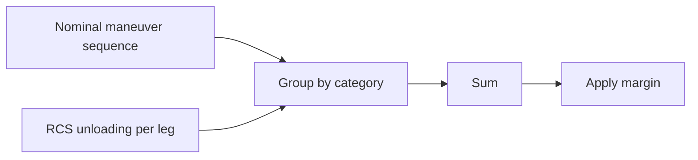
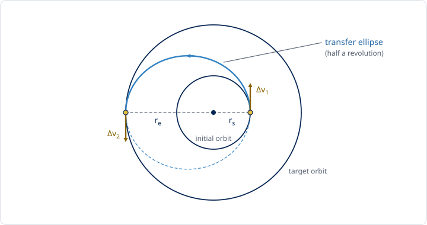
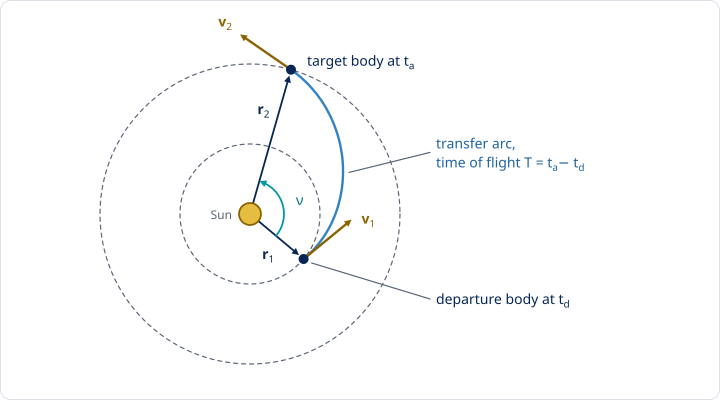
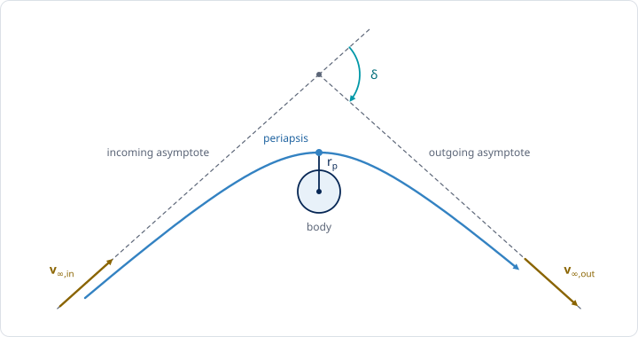
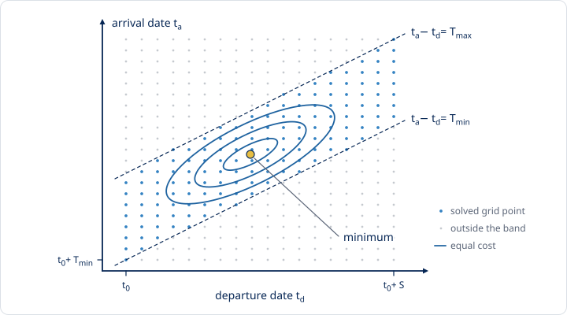

# 推進解析

推進解析は概念設計で次の4つの問いに答えます。ミッションにはどれだけの速度増分（ΔV）が要るか。遷移にはいくらかかり、どの日付で行うか。推薬をどれだけ積み、タンクに収まるか。推薬を使うにつれて、スラスタの使用量、軌道、質量特性はどう変わるか。

| ID | 目的 | 主な入力 | 主な出力 |
|---|---|---|---|
| `propulsion.dv_budget` | 区分ごとに ΔV を足し、マージンを掛ける | マヌーバ、直接書いた余裕、リアクション制御のアンロード | 公称と、マージン込みの ΔV |
| `propulsion.maneuvers` | 噴射と遷移を 1 つずつ計算する | 初期軌道、目標軌道、日付、スラスタ | 噴射、遷移時間、噴射時間、推薬 |
| `propulsion.transfer_check` | 日付つきの惑星間巡航を伝播し直す | 日付つきの遷移 | 到着のずれ、最接近、速度の差 |
| `propulsion.launch_window` | 出発と到着の日付を探索する | 天体の組、フライバイ、探索の設定 | 日付の格子、最小の点 |
| `propulsion.orbit_history` | マヌーバの順に軌道をたどる | 初期軌道、マヌーバ | 日付つきの軌道区間と質量 |
| `propulsion.propellant` | 推薬とタンクの大きさを決める | マヌーバ、マージン、タンク | 積載量、残留、容積の余裕 |
| `propulsion.thruster_usage` | 使用量をスラスタの定格と比べる | 設計の噴射、定格 | インパルス、噴射時間、噴射回数 |
| `propulsion.mass_properties` | 推薬を質量特性に加える | 部品、タンクの位置、積載量 | 寿命初期と寿命末期の質量、重心、慣性 |

噴射中に使える電力は [`power.thrust_balance`](power.md) で解析します。ここでは繰り返しません。

## 共通の前提

### すべての解析に共通する入力

- 最初の軌道は設計の軌道（`conditions/orbit.toml`）で、ケプラー要素に直して使います。時刻、慣性軸、伝播法は[軌道の共通の前提](orbit.md)にあります。
- マヌーバは `maneuvers/` のファイルです。実行順は `Design::ordered_maneuvers` で決まります。`after` のないマヌーバが ID 順に先頭に並び、続くマヌーバは `after` でつなぎます。データモデルは[設計モデル §7.7](../../model.md)にあります。
- 乾燥質量は `analysis.propulsion.dry_mass` です。設定がなければ部品の質量特性の総質量を使います。`propulsion.mass_properties` の乾燥側は常に部品の項目から求めます。
- スラスタは役割 `propulsion_thruster` の部品と、マヌーバが `thruster` で指す部品です。`thrust`（N）と `isp`（s）は必須です。タンクは役割 `propellant_tank` の部品で、`tank_volume` が必須です。
- `thruster` のないマヌーバは ΔV だけを求めます。推薬と噴射時間は求めません（注記 `no_thruster`）。
- 設定は `analysis.propulsion.dry_mass`、`dv_margin`（既定 0.10）、`residual_fraction`（既定 0.03）、`[launch_window]` の表です。既定値は projection ではなく `crates/lib/analysis/src/propulsion/input.rs` に置いてあります。

### ロケット方程式と推薬流量の置き場所

スラスタは有効排気速度 $v_\mathrm e$ で推薬を噴き出します。質量が $m_0$ から $m_1$ に減る機体に運動量保存を当てると、ツィオルコフスキーの式が得られます（Curtis 第 11 章、Vallado 第 6 章）。SI 単位では次のとおりです。

```math
v_\mathrm e = g_0 I_\mathrm{sp},\quad
\Delta v = v_\mathrm e \ln\frac{m_0}{m_1},\quad
m_\mathrm p = m_0\left(1-e^{-\Delta v/v_\mathrm e}\right),\quad
\dot m_\mathrm p = \frac{F}{v_\mathrm e},\quad
t_\mathrm b = \frac{m_\mathrm p}{\dot m_\mathrm p}.
\tag{1}
```

| 記号 | 意味 | 単位 |
|---|---|---|
| $g_0$ | 標準重力加速度 9.80665 | m/s² |
| $I_\mathrm{sp}$ | 比推力 | s |
| $v_\mathrm e$ | 有効排気速度 | m/s |
| $m_0,m_1,m_\mathrm p$ | 噴射前の質量、噴射後の質量、使った推薬 | kg |
| $F$ | 推力 | N |
| $\dot m_\mathrm p$ | 推薬の質量流量（正） | kg/s |
| $t_\mathrm b$ | 噴射時間 | s |

式 (1) は [`crates/lib/astro/src/rocket.rs`](../../../crates/lib/astro/src/rocket.rs) の `exhaust_velocity`、`delta_v`、`propellant_for`、`burn_time`、`mass_flow_kg_s` に 1 回だけ書いてあります。$g_0$ の値は `sat_astro::constants::G0` です。「推薬の質量流量 $F/(I_\mathrm{sp}g_0)$ は `sat_astro::rocket` だけに置く」という規則は `cargo xtask check` が検査します。列の計算、[姿勢系](aocs.md) のアンロード推薬の見積もり、推力つきの数値伝播はどれもこれらの関数を呼びます。

### マヌーバの列と 2 つのマージン

`propulsion.launch_window` 以外の解析は同じ列の計算（`sequence.rs`）を使います。launch_window は計画の関数を直接呼びます。列の計算はマヌーバを順に当て、噴射のたびに質量を減らします。モードは 2 つあります。

| モード | ΔV の倍率 $s$ | 残留割合 $f_\mathrm r$ | 使う解析 |
|---|---|---|---|
| 公称 | 1 | 0 | `propulsion.maneuvers`、`propulsion.dv_budget`、`propulsion.orbit_history`、`propulsion.transfer_check` |
| 設計 | $1+f_\mathrm{dv}$ | `residual_fraction` | `propulsion.propellant`、`propulsion.thruster_usage`、`propulsion.mass_properties`（`propulsion.propellant` 経由） |

設計モードでは、ΔV が $\Delta v_i$ の噴射ごとに $m_\mathrm p = m(1-e^{-s\Delta v_i/v_\mathrm e})$ を使います。ΔV のマージン $f_\mathrm{dv}$ は噴射 1 回ごとに掛かり、有限噴射の損失、フライバイの噴射、直接書いた余裕も対象です。有限噴射の損失の見積もりは倍率を掛ける前の ΔV で行います。`propulsion.dv_budget` ではマージンが合計に掛かり、計算したアンロードの ΔV も含みます（その解析の節を参照）。推薬の解析はアンロードの ΔV をこの倍率に含めません。アンロードの推薬は別に足します。

初期質量は入力ではありません。列の最後に残る質量が乾燥質量に残留推薬を足した値になるように、初期質量 $m_0$ を求めます。残留推薬は使った推薬の $f_\mathrm r$ 倍です。

```math
m_\mathrm{end}=m_\mathrm d+f_\mathrm r\,(m_0-m_\mathrm{end})
\;\Rightarrow\;
m_\mathrm{end}=\frac{m_\mathrm d+f_\mathrm r m_0}{1+f_\mathrm r}.
\tag{2}
```

アルゴリズムは次のとおりです。

1. $m_0=m_\mathrm d$ とします。
2. $m_0$ から式 (1) で噴射を順に当て、最後の質量を $m_1$ とします。
3. 式 (2) から目標 $m_\mathrm{end}$ を求めます。$|m_1-m_\mathrm{end}|\le10^{-12}m_0$ なら終了します。
4. そうでなければ $m_0\leftarrow m_0\,m_\mathrm{end}/m_1$ と更新して繰り返します。200 回で収束しないとき、または質量が有限でなくなったときは、「The propellant mass does not converge」の誤りにします。

数値伝播（`propagated`）のマヌーバがあると、列の計算は 2 回走ります。1 回目は解析的な見積もりで公称の列を作り、各数値伝播マヌーバの直前の質量を決めます。2 回目はその質量から推力を伝播し、伝播で得た ΔV、所要時間、最終軌道で、そのマヌーバの見積もりを置き換えます。そのうえで列を解き直します。数値伝播マヌーバの推薬は積分の結果ではなく、伝播した ΔV から式 (1) で求めます。質量が一致していれば両者は一致します。

## propulsion.dv_budget ΔV バジェット

### 何に答えるか

ミッションに必要な ΔV を、目的の区分（軌道投入、軌道維持、アンロード、廃棄、その他）ごとに求めます。マージンと、スラスタでリアクションホイールをアンロードするときの推定コストも含みます。

### 入力

| 量 | 記号 | 単位 | 設計データでの出どころ | 既定値 |
|---|---|---|---|---|
| マヌーバ（公称の列） | $\Delta v_i$ | m/s | `maneuvers/` の `category`、`method`、目標または `delta_v` | マヌーバが 1 つ以上必要 |
| マージン | $f_\mathrm{dv}$ | 1 | `analysis.propulsion.dv_margin` | 0.10（解析の既定値） |
| アンロードの区間 | $T_j$ | s | フェーズの `duration`、なければミッション期間 | 任意 |
| アンロードの環境、RCS のスラスタ | | | [RW アンロード](aocs.md)と同じ。スラスタは役割 `thruster` の部品 | 任意 |

### モデルと仮定

直接書いた `delta_v` は余裕です。軌道は変えず、その `category` にそのまま数えます。スラスタによる RW のアンロードは ΔV 換算です。RW の運動量を捨てるためにスラスタが燃やす推薬を、式 (1) で ΔV に直したものです。並進の指令ではありません。



*計算したアンロード分は区分 `unloading` に書いた余裕へ加算します。*

### 式

区間 $j$（期間のあるフェーズ、またはミッション全体）ごとに、姿勢系が 1 日あたりの代表の ΔV $u_j$（m/s 毎日）を出します。$\mathbf H_\mathrm{sec}$ は周期 $P$ の 1 周回に溜まる永年の角運動量、$T_\mathrm{day}=86400$ s とします。

```math
H_\mathrm{day}=\frac{\lVert\mathbf H_\mathrm{sec}\rVert\,T_\mathrm{day}}{P},\qquad
u_j=v_\mathrm{e,eff}\ln\frac{m_\mathrm{sc}}{m_\mathrm{sc}-m_\mathrm{day}},\qquad
v_\mathrm{e,eff}=\frac{\sum_i F_i}{\sum_i F_i/v_{\mathrm e,i}} .
\tag{3}
```

$H_\mathrm{day}$ は 1 日に捨てる運動量（N·m·s）です。$m_\mathrm{day}$ は同時に噴射するスラスタが 1 日に使う推薬（kg）で、[姿勢系のアンロード時間](aocs.md)と同じ方法で求めます。$m_\mathrm{sc}$ は姿勢系の入力にある機体の質量で、和は噴射するスラスタについて取ります。合計は次のとおりです。

```math
\Delta v_\mathrm{total}=\sum_i\Delta v_i+\sum_j u_j\frac{T_j}{T_\mathrm{day}},\qquad
\Delta v_\mathrm{design}=(1+f_\mathrm{dv})\,\Delta v_\mathrm{total}.
\tag{4}
```

各 $\Delta v_i$ はマヌーバの公称値です。`finite_burn` のマヌーバでは有限噴射の損失を含みます。

### アルゴリズム

1. 公称の列を解きます（共通の前提を参照）。行は区分ごとにまとめ、軌道投入、軌道維持、アンロード、廃棄、その他の順に並べます。
2. 設計に役割 `thruster` の部品があれば、区間ごとに `aocs.rw_unloading` を 1 回評価します。区間は、期間のあるフェーズがあればフェーズの順です。なければ、設計の軌道とミッション期間の 1 区間です。区間ごとに機体の ±x、±y、±z の 6 方向を試します。どのスラスタも捨てられない方向があれば、それが最悪の方向です。なければ、最も時間のかかる方向を最悪とします。その方向の 1 日の推薬から式 (3) で $u_j$ を求め、区間の寄与は $u_jT_j/T_\mathrm{day}$ です。
3. 数えた区間のアンロード ΔV を、行 `unloading` に足します。期間のない区間は一覧に載せますが数えません。最悪の方向に使えるスラスタがない区間も数えず、警告を出します。
4. 行を合計し、式 (4) でマージンを掛けます。各行には合計に対する割合も付きます。

### 検査と判定

総量の上限はないので、合格や違反の判定はありません。次の項目が付くことがあります。

- `propulsion.maneuvers` と同じ、日付つきの遷移とフライバイの警告。
- `unloading_direction`（警告）: 区間で最悪の方向に捨てられません。
- `unloading_note`: アンロードを足さなかった理由です。`no_rcs`（`thruster` の部品がない）、`unloading_inputs_missing`、`no_mission_duration`、`not_unloadable`（どの区間も捨てられない）があります。

### 出力

| 出力 | 単位 | 意味 |
|---|---|---|
| `rows[]` | m/s、1 | 区分、ΔV、合計に対する割合、マヌーバ ID、RCS アンロードを含むか |
| `total`、`margin`、`margin_delta_v`、`total_with_margin` | m/s、1 | 合計、マージン、マージン分、マージン込みの合計 |
| `unloading` | 各種 | 区間ごとの運動量、最悪の方向、推薬、ΔV |
| `dated_transfers`、`checks` | 各種 | 日付つきの遷移の結果と警告 |

### 計算例

デモ（`fixtures/demo-6u`）には `RAISE`（軌道投入）と `DEORBIT`（廃棄）があります。アンロード用の `thruster` の部品がないので、報告は `unloading_note = "no_rcs"` です。プログラムは 27.22332863 m/s と 97.84039482 m/s を出力し、予算は式 (4) に従います。

```math
\Delta v_\mathrm{total}=27.22332863+97.84039482=125.06372345\ \mathrm{m/s},\qquad
\Delta v_\mathrm{design}=1.10\times125.06372345=137.57009579\ \mathrm{m/s}.
```

割合は 21.77 % と 78.23 % です。プログラムは `total_with_margin` を 137.570096 m/s と出力します。

### 限界

- アンロードの推定は外乱の環境を区間ごとに 1 回評価し、区間の長さで拡大します。
- ΔV 換算には姿勢系の入力にある機体の質量を使います。この質量は区間の中で一定です。
- 直接書いたアンロードの余裕と、計算したアンロードの ΔV は、同じ行に両方数えます。
- 推力の不釣り合いによる並進は ΔV に含めません。

### 検証

`propulsion/tests.rs::dv_budget_sums_by_category_with_the_default_margin` が、区分ごとの合計と既定のマージンを確かめます。`propulsion/unloading_tests.rs::hundred_days_of_a_micro_newton_metre_by_hand` は、一定のトルクが 100 日続いたときの ΔV を手計算で導きます。`dv_budget_total_and_margin_include_the_computed_unloading` は、アンロードを含めた式 (4) を確かめます。

### ソース

[dv_budget.rs](../../../crates/lib/analysis/src/propulsion/dv_budget.rs)、[unloading.rs](../../../crates/lib/analysis/src/propulsion/unloading.rs)、[rcs.rs](../../../crates/lib/analysis/src/aocs/rw_unloading/rcs.rs)、[projection](../../../crates/app/projection/src/propulsion.rs)。

## propulsion.maneuvers マヌーバ

### 何に答えるか

マヌーバごとに、ΔV、経過時間、噴射時間、推薬、前後の軌道を順に求めます。マージンも残留推薬も含まない公称の列です。

### 入力

| 量 | 記号 | 単位 | 設計データでの出どころ | 既定値 |
|---|---|---|---|---|
| 初期軌道 | | | 設計の軌道（ケプラー要素） | 必須 |
| 目標軌道 | $r_\mathrm p,r_\mathrm a,i$ | m、m、rad | `target.altitude`、`target.perigee_altitude`、`target.apogee_altitude`、`target.inclination`（高度は中心天体の半径から） | 書かない要素は前のまま |
| 計算の段階 | | | `method`: `impulsive`、`finite_burn`、`low_thrust`、`propagated` | 必須 |
| 中間の遠地点 | $r_\mathrm b$ | m | `via_altitude` | 任意（インパルス、有限噴射） |
| 直接書いた余裕 | $\Delta v$ | m/s | `delta_v`（目標、`via_altitude`、`transfer` とは併用不可） | 任意 |
| スラスタ | $F,I_\mathrm{sp}$ | N、s | `thruster`、部品の `thrust`、`isp` | `propagated` では必須 |
| 推力つき飛行の制約 | | | `[constraints]`: `sunlit_only`、`duty`、`steering`（`propagated` のみ）、`mode`（`power.thrust_balance` が使う） | `sunlit_only` は off、`duty` は 1、`steering` は tangential |
| 目標の天体 | | | `target.body` | 前と同じ天体 |
| 遷移の日付 | | | `transfer.departure`、`transfer.arrival`、`transfer.departure_by` | 日付なしならホーマンのパッチドコニック。`departure_by` は `spacecraft` |
| フライバイ | $h_\mathrm{min}$ | m | `[[transfer.flybys]]` の `body`、`date`、`min_altitude`、`powered` | `powered = true`。最小高度は水星 200 km、金星・地球・火星 300 km で、巨大惑星には既定がない |

`propagated` 以外の方式では `[constraints]` のキーは無視され、`ignored_constraints` に載ります。

### モデルと仮定

モデルは 5 つの部分からなります。

軌道。軌道は近地点半径、遠地点半径、傾斜角で持ちます。近点線は揃っているとみなすので、昇交点赤経は変わらず、噴射はすべて近点か遠点での接線方向です。目標には書いた要素だけを当てます。`altitude` は近地点と遠地点の両方を決めます。

インパルスと有限噴射の遷移。計画は近点・遠点の間で接線方向の 2 回噴射を使います。出発の近地点から目標の遠地点へ向かう経路と、出発の遠地点から目標の近地点へ向かう経路を試し、安い方を選びます。円から円ならホーマン遷移です。傾斜角の変更は速度の小さい半径の大きい側の噴射に合わせます。`via_altitude` を書くとバイエリプティック遷移になり、噴射は 3 回で、軌道面の変更は中間の遠地点で行います。中間の遠地点は出発と目標の遠地点半径以上でなければなりません。$10^{-9}$ m/s 以下の噴射は捨てます。`finite_burn` のマヌーバには、噴射の間に掃く弧の損失を足します（式 7）。



*遷移楕円は 2 つの近点・遠点の半径を結び、両端で接線方向に噴射します。*

低推力。Edelbaum の式は遷移を 2 つの軌道の長半径に等しい半径の円軌道どうしのらせんとして扱います。離心率が $10^{-3}$ を超える軌道があると、結果に注記 `low_thrust_circular_approximation` が付きます。時間は噴射時間で、`via_altitude` は無視します。

推力つきの数値伝播。推力を軌道と一緒に積分します。状態は位置、速度、質量、積んだ ΔV です。力モデルは最初の軌道の伝播法に合わせます（点質量、J2、数値伝播の力の設定）。推力は `steering` で決まる向きに働き、質量は $F/v_\mathrm e$ で減ります。

- `tangential`（既定）は速度の向きです。傾斜角も変えるときは、Edelbaum の偏揺れ角で軌道面の外へ傾けます。面外成分の符号は緯度引数 $u$ の $\cos u$ に従います。
- `inertial` は固定の向きで、始めの進行方向です。軌道を下げるときは逆向きになります。
- `duty` $d$ はここまでの時間のうち、噴射した時間が噴射してよい時間の $d$ 倍（に制御の刻みの半分を加えた値）を超えないようにします。
- `sunlit_only` は、円錐影モデルの日照率が 0.5（`SUNLIT_THRESHOLD`）以上のときだけ噴射を許します。

噴射するかどうかと面外の符号は、60 s の制御の刻みの始めに決め、刻みの間は保ちます。

停止の観測量。推力つきの伝播は長半径と傾斜角の両方ではなく、1 つの観測量で止まります。コードは 2 つの ΔV の必要量を比べます。長半径の変化 $|v_0-v_1|$ と、面の変化 $\tfrac\pi2 v_0|\Delta i|$ です。前者が後者以上なら、平均の長半径が目標を横切ったところで止まります。そうでなければ、接触傾斜角が目標を横切ったところで止まります。選ばれなかった要素は検査しません。偏揺れ角の規則に従っている間は、Edelbaum の式で 2 つの変化が同時に完了するので、この扱いと整合します。別の規則に従うときや摂動があるときは、選ばれなかった要素が目標からずれて終わることがあります。

天体間の遷移（パッチドコニック）。`target.body` が現在の中心天体と違えば、遷移はパッチドコニックです。2 つの天体の軌道は円で同一平面とみなします。兄弟の天体（地球と火星）の間では、太陽中心の部分がホーマン遷移です。親子（地球と月）の間では、遷移楕円は親のまわりにあります。脱出と捕獲は、パーキング軌道と捕獲軌道の近点での噴射で、超過速度 $v_\infty$ の双曲線上で行います。傾斜角の変更は無視します（`plane_change_ignored`）。対応するのは `impulsive` と `finite_burn` だけです。日付があれば、太陽中心の部分は代わりに Lambert の弧になります（次項）。出発と捕獲の噴射は、入力に書いた軌道の近点で行います。

日付つきの遷移と Lambert の問題。`transfer` を書くと、ΔV は Lambert の問題から求めます。2 つの位置は`departure` の出発天体と `arrival` の目標天体のもので、暦から取ります（DE440 を入れてあれば DE440、なければ解析式で、`ephemeris` に出どころが出ます）。Lambert の問題は2 つの位置 $\mathbf r_1,\mathbf r_2$ を、指定した飛行時間 $T$ で通る、親のまわりの円錐曲線を求める問題です。ここで解くのは周回数 0 の順行の解で、順行は黄道の北に対して決めます。複数周回の解は使えません。各弧は普遍変数の定式化（Curtis アルゴリズム 5.2、Vallado アルゴリズム 58）で解きます。超過速度は弧の端点の速度から天体の速度を引いたもので、$C_3=|\mathbf v_{\infty,\mathrm{dep}}|^2$ です。出発の赤緯は$\mathbf v_{\infty,\mathrm{dep}}$ と出発天体の赤道のなす角です。



*太陽のまわりで $\mathbf r_1$ と $\mathbf r_2$ を通る弧が、飛行時間に対する $\mathbf v_1$ と $\mathbf v_2$ を決めます。遷移角 $\nu$ は順行の向きに測ります。*

スイングバイ。`[[transfer.flybys]]` があると、遷移は Lambert の弧の連鎖になります。弧は連続する天体の組（出発、日付順のフライバイ、到着）ごとに 1 本です。連続する天体は互いに違わなければなりません。フライバイ天体での入りと出の超過速度は、フライバイの日の 2 本の弧の速度から天体の速度を引いたものです。フライバイは瞬間的なパッチです。影響圏の中の時間と双曲線の弧は扱わず、天体は点とみなします。



*双曲線は超過速度を $\delta$ だけ曲げます。必要な近点半径 $r_\mathrm p$ は、$\delta$ と 2 つの超過速度から決まります。*

超過速度 $v_\infty$、近点半径 $r_\mathrm p$ の双曲線は、離心率が $e=1+r_\mathrm pv_\infty^2/\mu$ で、速度を $2\arcsin(1/e)$ だけ曲げます（Curtis §8.10）。動力つきのフライバイでは両側の速さが違うことがあるので、片側ごとに半偏向角を数えます。偏向角 $\delta$ は入りと出の超過速度のなす角です。近点半径は、2 つの半偏向角の和が $\delta$ になる値です。近点での噴射は速さを入りの双曲線の値から出の双曲線の値へ変えます。$\delta$ が最小の近点半径 $R+h_\mathrm{min}$（天体の半径に最小高度を足した値）で得られる偏向より大きければ、そのフライバイは実現できません。その場合、モデルは最小半径で通過し、足りない偏向を出の超過速度の変更（足りない角の弦）として費用に数えます。最適化した軌道ではなく、費用の粗い見積もりです。

`powered = false` にすると、近点の噴射と足りない偏向の ΔV は、ΔV、推薬、バジェットから外れます。動力なしと宣言したフライバイで 2 つの超過速度が違うと、数えなかった噴射の量を警告に示します。

### 式

軌道の速さと噴射。重力定数 $\mu$（m³/s²）、半径 $r$ と長半径 $a$（m）に対し、$v(r,a)$ は軌道の速さです（ビスビバ方程式（vis-viva））。速さを $v_1\to v_2$ に変え、速度の向きを $\theta$ 回す噴射の ΔV は、余弦定理で求めます。

```math
v(r,a)=\sqrt{\mu\left(\frac2r-\frac1a\right)},\qquad
\Delta v=\sqrt{v_1^2+v_2^2-2v_1v_2\cos\theta}.
\tag{5}
```

速さだけを変える場合（$\theta=0$）は $|v_2-v_1|$ です。速さ $v$ のまま軌道面だけを変える場合は $2v\sin(\theta/2)$ です。半径 $r_\mathrm s$ から $r_\mathrm e$ への 2 回噴射の遷移では、面の角度 $\theta=|\Delta i|$ を半径の大きい側の噴射に合わせます（$r_\mathrm e\ge r_\mathrm s$ なら 2 回目、そうでなければ 1 回目）。もう一方は速さだけの変更です。遷移時間は遷移楕円の周期の半分 $\pi\sqrt{a_\mathrm t^3/\mu}$ です。バイエリプティック遷移では2 つの楕円の半周期を足します。

低推力（Edelbaum 1961）。円軌道の速さを $v_0=\sqrt{\mu/a_0}$、$v_1=\sqrt{\mu/a_1}$ とします。

```math
\Delta v_\mathrm{low}=\sqrt{v_0^2+v_1^2-2v_0v_1\cos\left(\tfrac\pi2\Delta i\right)} .
\tag{6}
```

有限噴射（Robbins 1966）。向きを固定した噴射が噴射半径での円軌道の平均運動 $n=\sqrt{\mu/r^3}$ で弧 $\phi=nt_\mathrm b$ を掃くので、推力のうち速度方向の成分だけが役に立ちます。理想の ΔV に係数を掛けます。弧が小さいときは級数を使います。

```math
\Delta v_\mathrm{finite}=\Delta v_\mathrm{ideal}\,\kappa(\phi),\qquad
\kappa=\begin{cases}1+(\phi/2)^2/6,&|\phi/2|<10^{-6}\\[2pt](\phi/2)/\sin(\phi/2),&\text{otherwise.}\end{cases}
\tag{7}
```

$t_\mathrm b$ は推薬で決まり、推薬は ΔV で決まるので、両者は一緒に解きます（アルゴリズムを参照）。

Lambert（普遍変数 $z$）。$r_1=\lVert\mathbf r_1\rVert$、$r_2=\lVert\mathbf r_2\rVert$、遷移角 $\nu$、Stumpff 関数 $C(z)$ と $S(z)$ を使います。

```math
\begin{aligned}
A_\mathrm L&=\sin\nu\sqrt{\frac{r_1r_2}{1-\cos\nu}},\qquad
y(z)=r_1+r_2+A_\mathrm L\,\frac{zS(z)-1}{\sqrt{C(z)}},\\
0&=\left(\frac{y}{C}\right)^{3/2}S+A_\mathrm L\sqrt y-\sqrt\mu\,T,\\
f&=1-\frac y{r_1},\quad g=A_\mathrm L\sqrt{\frac y\mu},\quad \dot g=1-\frac y{r_2},\\
\mathbf v_1&=\frac{\mathbf r_2-f\,\mathbf r_1}{g},\qquad
\mathbf v_2=\frac{\dot g\,\mathbf r_2-\mathbf r_1}{g}.
\end{aligned}
\tag{8}
```

角度は $\nu=\arccos(\hat{\mathbf r}_1\cdot\hat{\mathbf r}_2)$ です。法線まわりの $\mathbf r_1\times\mathbf r_2$ の向きが要求した向きと逆なら、$2\pi-\nu$ に置き換えます。$A_\mathrm L$ と $y$ は長さ（m）、$z$ は無次元、$T$ は s です。$f$ と $\dot g$（無次元）、$g$（s）はラグランジュ係数です。

出発、到着、捕獲。超過速度は $\mathbf v_{\infty,\mathrm{dep}}=\mathbf v_1-\mathbf v_\mathrm{body,dep}$、$\mathbf v_{\infty,\mathrm{arr}}=\mathbf v_2-\mathbf v_\mathrm{body,arr}$ です。近点半径 $r_\mathrm p$ の軌道から出る、またはその軌道へ入る噴射の費用は、双曲線の近点速度とその点の軌道速度の差です（Curtis §8.7）。

```math
C_3=\lVert\mathbf v_{\infty,\mathrm{dep}}\rVert^2,\qquad
v_\mathrm p=\sqrt{v_\infty^2+\frac{2\mu}{r_\mathrm p}},\qquad
\Delta v_\mathrm{esc/cap}=\left|v_\mathrm p-v(r_\mathrm p,a_\mathrm{orbit})\right|.
\tag{9}
```

$\mu$ は出る天体、または捕獲する天体のものです。$a_\mathrm{orbit}$ はパーキング軌道または捕獲軌道の長半径です。

フライバイ。超過速度を $v_\mathrm{in},v_\mathrm{out}$、最小半径を $r_\mathrm{min}=R+h_\mathrm{min}$、天体の重力定数を $\mu$ とします。

```math
\begin{aligned}
\delta&=\angle(\mathbf v_{\infty,\mathrm{in}},\mathbf v_{\infty,\mathrm{out}}),\qquad
\delta(r_\mathrm p)=\arcsin\frac1{1+r_\mathrm pv_\mathrm{in}^2/\mu}+\arcsin\frac1{1+r_\mathrm pv_\mathrm{out}^2/\mu},\\
\delta_\mathrm{max}&=\delta(r_\mathrm{min}),\qquad
\Delta v_\mathrm{flyby}=\left|\sqrt{v_\mathrm{out}^2+\tfrac{2\mu}{r_\mathrm p}}-\sqrt{v_\mathrm{in}^2+\tfrac{2\mu}{r_\mathrm p}}\right|,\\
\Delta v_\mathrm{short}&=2v_\mathrm{out}\sin\frac{\delta-\delta_\mathrm{max}}2\quad(\delta>\delta_\mathrm{max}).
\end{aligned}
\tag{10}
```

$v_\mathrm{in}=v_\mathrm{out}=v_\infty$ のとき、条件 $\delta(r_\mathrm p)=\delta$ から $r_\mathrm p=(\mu/v_\infty^2)\,(1/\sin(\delta/2)-1)$ となり、$\Delta v_\mathrm{flyby}=0$ です。近点の噴射が $10^{-3}$ m/s 以下のフライバイを、弾道的とみなします（`BALLISTIC_DV_M_S`）。

### アルゴリズム

1. マヌーバを順にたどります。最初は初期軌道から始め、各マヌーバを直前のマヌーバが残した軌道から計画します。直接書いた `delta_v` は軌道の計算を省きます。現在の軌道の長半径での 1 回の噴射（`impulsive`）か、連続噴射（`low_thrust`）で、軌道は変わりません。`propagated` は直接書いた `delta_v` と併用できず、`fune check` は `finite_burn` も断ります（`maneuver.delta_v_method`）。
2. 日付のない天体間の遷移は、2 つの天体の円軌道間のホーマン遷移と、脱出・捕獲の噴射（式 9）を使います。
3. 日付つきの遷移は次の順で解きます。
   1. 各節点の日付で天体の位置を読みます。速度はその日付の前後 ±60 s での暦の中心差分です。
   2. 連鎖の各弧を式 (8) で解きます。変数 $z$ は区間 $[-4\pi^2,\,4\pi^2(1-10^{-12})]$ で二分し、反復は最大 400 回です。$y<0$ または時間の残差が負の刻みでは、下限を上げます。区間の幅が $10^{-13}(1+|z|)$ より小さくなれば止めます。$y>0$ で、時間の残差が $10^{-6}\sqrt\mu\,T$ 以下のときだけ解を採用します。そうでなければ「universal variable did not converge」で失敗します。2 点が親の中心と一直線上にあって面が決まらないときも、解を断ります。
   3. 両端の $\mathbf v_{\infty}$、$C_3$、赤緯と、式 (9) の噴射を求めます。`departure_by = "launcher"` でなければ、最初の噴射はパーキング軌道の近点での脱出噴射です。最後の噴射は目標軌道の近点での捕獲噴射です。`departure_by = "launcher"` では脱出噴射を数えませんが、$C_3$、$v_\infty$、赤緯は打ち上げの要求として結果に残ります。
   4. フライバイごとに、$\ln r_\mathrm p$ を区間 $[-6.9,\,41.4]$ で二分して $r_\mathrm p$ を求めます。許容は $10^{-14}$、反復は最大 300 回です。偏向角が $10^{-9}$ rad 以下なら曲がらない通過として扱い、$r_\mathrm p$ は無限大で、速さの差だけを噴射します。実現できるフライバイは式 (10) を使います。実現できないものは $r_\mathrm{min}$ を使い、$\Delta v_\mathrm{short}$ を加えます。フライバイの噴射は出発と捕獲の間にある、フライバイ天体での噴射としてマヌーバに足します。足すのは、`powered` が真で合計が $10^{-9}$ m/s を超えるときだけです。`powered = false` では $\Delta v_\mathrm{flyby}$ と $\Delta v_\mathrm{short}$ の両方を外します。
4. 理想の噴射を順に推薬へ直します。`impulsive` では、各噴射が ΔV で、その時点の質量に式 (1) を当てます。`finite_burn` では、噴射ごとに損失を解きます。まず $\Delta v=\Delta v_\mathrm{ideal}$ とし、式 (1) で $m_\mathrm p$ と $t_\mathrm b$ を求め、噴射半径の $n=\sqrt{\mu/r^3}$ から $\phi=nt_\mathrm b$ を求めて、$\Delta v\leftarrow\Delta v_\mathrm{ideal}\,\kappa(\phi)$ と更新します。連続する値の差が $10^{-9}$ m/s 未満になるまで、最大 100 回繰り返します。$\phi>\pi$ のとき、または収束しないときは理想の ΔV を使い、注記 `finite_burn_arc` が警告します。有限噴射の遷移時間は慣性飛行の時間に、最初と最後の噴射時間の半分ずつを足したものです（噴射を近点・遠点の中心に置くため）。フライバイの噴射のように飛行の途中にある噴射は数えません。`low_thrust` は 1 回の連続した ΔV で、遷移時間は噴射時間に等しくなります。
5. `propagated` は次の順で処理します。
   1. Edelbaum の見積もり（式 6）と、公称の列の質量から始めます。
   2. 状態、質量、積んだ ΔV を、DOP853（相対許容 $10^{-11}$、絶対許容 $10^{-6}$、最大刻み 600 s）で 60 s の制御の刻みごとに積分します。制御は刻みの間保ちます。
   3. 上で述べたとおり停止の観測量を選び、刻みごとに検査します。目標を横切った刻みでは観測量の線形補間で刻みを切り、その比率までもう一度積分します。
   4. 目標に着いたとき、または時間の上限で止めます。上限は 86 400 s と $3\,\Delta v_\mathrm{ideal}\,m_0/F$ の大きい方を、デューティで割り、`sunlit_only` では 2 倍にした値です。上限で止まると、注記 `propagation_not_reached` が、届いたところまでの状態であることを示します。
   5. 所要時間、噴射時間、積んだ ΔV、推薬と、終わりの平均要素（J2 では周回平均の要素）を報告します。

### 検査と判定

次はすべて警告です。

| 検査 | 条件 |
|---|---|
| `dated_transfer_plane` | 出発の赤緯の大きさがパーキング軌道の傾斜角を超える。面の変更は数えない。`departure_by = "launcher"` では出ない |
| `dated_transfer_timing` | 前のマヌーバを最初の元期から続けて並べると、終わりが `departure` より後になる。打ち上げ機の出発では出ない |
| `swing_by_turn` | 必要な偏向が、最小高度での最大の偏向を超える。足りない偏向を数えるのは、フライバイが動力ありのときだけ |
| `swing_by_unpowered` | `powered = false` で、フライバイが実現でき、数えなかった近点の噴射が $10^{-3}$ m/s を超える |
| `finite_burn_arc` | 有限噴射の噴射が軌道の半周を超えるので、損失を見積もっていない |

注記 `propagation_not_reached` は、時間の上限で止まったことを示します。入力が不正なときは誤りになります。兄弟でも親子でもない目標天体、`low_thrust` や `propagated` の天体間の遷移、暦の外の日付、出発より後でない到着、解けない Lambert の問題、スラスタのない `propagated` のマヌーバが該当します。

### 出力

| 出力 | 単位 | 意味 |
|---|---|---|
| `maneuvers[].burns[]` | m、m/s、s、m/s | 噴射する天体からの高度、損失込みの ΔV、噴射時間、超過速度（天体間の噴射） |
| `delta_v`、`ideal_delta_v` | m/s | 有限噴射の損失込みの ΔV と、損失を除いた ΔV |
| `transfer_time`、`burn_time`、`propellant` | s、s、kg | 遷移の経過時間、噴射の時間、推薬 |
| `mass_before`、`mass_after` | kg | マヌーバの前後の質量 |
| `before`、`after` | m、m、rad | 近地点と遠地点の高度、傾斜角 |
| `dated_transfer` | 各種 | 飛行時間、$C_3$、$v_\infty$、赤緯、暦の出どころ、`flybys[]`（偏向、近点、噴射、実現可否） |
| `propagation` | 各種 | 始め、所要時間、噴射時間と割合、ΔV、終わりの要素、`reached` |
| `total_delta_v`、`total_propellant`、`initial_mass` | m/s、kg、kg | 列の合計。初期質量は乾燥質量に公称の推薬を足したもの |

### 計算例

数値には $\mu=3.986004418\times10^{14}$ m³/s²、$R_\mathrm E=6\,378\,137$ m と、`fixtures/demo-6u` のデモを使います。乾燥質量は 5.548 kg、スラスタ `EPT` は $F=1.2$ mN、$I_\mathrm{sp}=1200$ s です。デモは高度 550 km の円軌道から始まり、`RAISE`（`low_thrust`、600 km まで）のあと、`DEORBIT`（`impulsive`、近地点を 250 km まで）が続きます。

低推力の軌道上昇。半径は $a_0=6\,928\,137$ m と $a_1=6\,978\,137$ m で、傾斜角は変わらないので、式 (6) は $v_0-v_1$ になります。

```math
\sqrt{\mu/6928137}-\sqrt{\mu/6978137}=7585.0885-7557.8652=27.2233\ \mathrm m/s .
```

プログラムは 27.22332863 m/s を出力します。

ホーマン型の噴射。上昇のあとの軌道は$r_\mathrm a=6\,978\,137$ m の円軌道です。`DEORBIT` は近地点を $r_\mathrm p=6\,628\,137$ m に下げます。目標軌道の長半径は $a=(r_\mathrm p+r_\mathrm a)/2=6\,803\,137$ m です。どちらの候補経路も遠地点での 1 回の噴射になり、速さの変化は式 (5) から求めます。

```math
v_\mathrm{circ}=\sqrt{\tfrac{\mu}{6978137}}=7557.8652,\quad
v_\mathrm{apo}=\sqrt{\mu\left(\tfrac2{6978137}-\tfrac1{6803137}\right)}=7460.0248,\quad
\Delta v=97.8404\ \mathrm m/s .
```

プログラムは 97.84039482 m/s を出力します。比較として、同じ 550 km と 600 km の円軌道の間の完全なホーマン遷移は $13.6239+13.5994=27.2232$ m/s で、式 (6) と 4 桁で一致します。

ロケット方程式による推薬。$v_\mathrm e=1200\times9.80665=11\,767.98$ m/s です。列は乾燥質量で終わるので、$m=5.548$ kg から逆にたどります。

```math
m_0^{\mathrm{DEORBIT}}=5.548\,e^{97.84039/11767.98}=5.594319\ \mathrm{kg},\qquad
m_\mathrm p=5.594319-5.548=0.046319\ \mathrm{kg}.
```

プログラムは `DEORBIT` の `propellant` を 0.0463190204 kg、`mass_before` を 5.5943190204 kg と出力します。`RAISE` も同じ手順で $5.594319\,e^{27.22333/11767.98}=5.607276$ kg、推薬は 0.012957 kg です。合計は 0.059276 kg です。噴射時間 $t_\mathrm b=m_\mathrm pv_\mathrm e/F$ は、`DEORBIT` で $0.046319\times11767.98/0.0012=454\,234$ s になります。

日付つきの遷移。日付つきのモデルを示すため、デモの `DEORBIT` を、`RAISE` の後ろの `MARS` に置き換えたコピーを使います（`--body mars --altitude "300 km" --depart 2028-12-10T00:00:00Z --arrive 2029-09-25T00:00:00Z`）。DE440 を入れてあれば（`fune data fetch de440`）、プログラムは `dated_transfer` に飛行時間 24 969 600 s（289 日）、$C_3=12\,092\,443\ \mathrm{m^2/s^2}$、$v_{\infty,\mathrm{dep}}=3477.419$ m/s を出力します。高度 600 km の円のパーキング軌道（$r=6\,978\,137$ m）からの脱出噴射は、式 (9) から求めます。

```math
\sqrt{3477.419^2+2\mu/6978137}-\sqrt{\mu/6978137}=11\,239.889-7557.865=3682.023\ \mathrm m/s .
```

出力される値は 3682.0234 m/s です。高度 300 km の火星の円軌道への捕獲噴射では、$\mu_\mathrm M=4.282837\times10^{13}$ m³/s²、$r=3\,696\,190$ m、$v_{\infty,\mathrm{arr}}=3171.190$ m/s を使い、$5764.615-3403.993=2360.622$ m/s で、出力と一致します。DE440 がなければ解析式の暦を使うので、数値は少し変わります。

フライバイ。手計算で確かめたフライバイは、金星（$\mu=3.24859\times10^{14}$ m³/s²、$R=6051.8$ km）で両側とも $v_\infty=5$ km/s、偏向 $\delta=60^\circ$ のもので、`ballistic_turn_of_sixty_degrees_matches_hand_calculation` の例です。$\sin30^\circ=0.5=1/(1+r_\mathrm pv_\infty^2/\mu)$ から $r_\mathrm p=\mu/v_\infty^2=12\,994\,360$ m で、高度は 6943 km、近点の噴射はありません。既定の最小高度 300 km での最大偏向は $2\arcsin(1/(1+6\,351\,800\times25\times10^6/\mu))=84.4^\circ$ なので、このフライバイは実現できます。動力つきで $v_\mathrm{in}=5$ km/s、$v_\mathrm{out}=7$ km/s、$r_\mathrm p=10^4$ km の場合、式 (10) から $\sqrt{49\times10^6+2\mu/r_\mathrm p}-\sqrt{25\times10^6+2\mu/r_\mathrm p}=10\,675.76-9485.35=1190.41$ m/s で、偏向は $57.90^\circ$ です。

### 限界

- インパルスの計画は近点線を揃え、昇交点赤経と近地点引数は扱いません。軌道面の変更は 1 回の噴射にしか合わせません。
- 日付のない天体間の遷移は、円で同一平面の軌道間のホーマンの見積もりです。軌道面の変更も打ち上げの窓も含みません。
- 日付つきの遷移はパッチドコニックです。影響圏は点で、フライバイは瞬間的です。使うのは周回数 0 の順行の Lambert の弧だけです。
- 解析的な低推力（式 6）は `sunlit_only` と `duty` を守りません。守るのは `propagated` だけです。
- 有限噴射のモデルは向きを固定した噴射の一次の損失です。半周を超える弧のステアリング損失や重力損失は扱いません。
- 推力つきの伝播は 1 つの観測量しか検査せず、もう一方の要素は目標からずれて終わることがあります。`propagated` は天体間の遷移には使えません。
- J2 の伝播は平均の長半径を目標とします。短周期項を除くので、終わりの接触半径は異なることがあります。

### 検証

- `propulsion/tests.rs`: `impulsive_raise_matches_hohmann_and_the_rocket_equation`、`low_thrust_uses_edelbaum`、`finite_burn_adds_a_loss`。
- `astro/src/transfer/tests.rs`: 高度 400 km から 550 km へのホーマン、バイエリプティック、手計算の面の変更、`deorbit_lowers_perigee_with_one_burn`、`edelbaum_by_hand`、`finite_burn_factor_by_hand`。
- `astro/src/transfer/dated_tests.rs`: `lambert_matches_vallado_example_7_5`、`dated_transfer_matches_curtis_example_8_8`（超過速度 3.1651 km/s と 2.8852 km/s と、解析式の暦のため 0.015 km/s 以内で一致）、`hyperbolic_periapsis_dv_matches_hand_calculation`。
- `astro/src/transfer/flyby_tests.rs`: 60° の弾道的な偏向、動力つきの速さの差、足りない偏向の弦。
- `propulsion/dated_tests.rs` と `swing_by_tests.rs`: 超過速度からの日付つきの噴射の手計算、打ち上げ機による出発、フライバイの計上、`an_unpowered_flyby_is_not_counted_and_warns_when_the_speeds_differ`。
- `astro/src/orbit/powered/tests.rs` と `propulsion/propagated_tests.rs`: 同一面のらせんと、上昇と面の変更を合わせた場合が Edelbaum に一致します。`sunlit_only` では時間が延び、デューティ 0.5 で噴射が半分になり、J2 の上昇は平均の長半径で止まります。

### ソース

[maneuvers.rs](../../../crates/lib/analysis/src/propulsion/maneuvers.rs)、[plan.rs](../../../crates/lib/analysis/src/propulsion/plan.rs)、[sequence.rs](../../../crates/lib/analysis/src/propulsion/sequence.rs)、[flight.rs](../../../crates/lib/analysis/src/propulsion/flight.rs)、[dated.rs](../../../crates/lib/analysis/src/propulsion/dated.rs)、[flyby.rs](../../../crates/lib/analysis/src/propulsion/flyby.rs)、[transfer.rs](../../../crates/lib/astro/src/transfer.rs)、[patched.rs](../../../crates/lib/astro/src/transfer/patched.rs)、[lambert.rs](../../../crates/lib/astro/src/transfer/lambert.rs)、[dated.rs（astro）](../../../crates/lib/astro/src/transfer/dated.rs)、[flyby.rs（astro）](../../../crates/lib/astro/src/transfer/flyby.rs)、[powered.rs](../../../crates/lib/astro/src/orbit/powered.rs)、[thrust.rs](../../../crates/lib/astro/src/force/thrust.rs)、[rocket.rs](../../../crates/lib/astro/src/rocket.rs)、[projection](../../../crates/app/projection/src/propulsion.rs)。

## propulsion.transfer_check 遷移の多体の確認

### 何に答えるか

Lambert の弧は太陽のまわりの二体の解です。ほかの惑星が探査機を引っ張っても、巡航は目標天体に届くでしょうか。

### 入力

| 量 | 記号 | 単位 | 設計データでの出どころ | 既定値 |
|---|---|---|---|---|
| 日付つきの遷移 | | | `[transfer]` のあるマヌーバ | なし。結果は空の一覧 |
| 暦 | | | 日付を覆う DE440 があれば DE440 | 解析式（数値は出すが判定しない） |

### モデルと仮定

巡航は出発の日の出発天体の中心から、Lambert の出発速度で始めます。太陽のまわりを、太陽と惑星の点質量の重力のもとで伝播します。出発天体と到着天体の重力は入れません。両端の影響圏の中はパッチドコニックの噴射が代わりを務め、狙いの点に点質量を置くと狙った軌道が特異になるためです。地球は端でなければ第三体として入れ、地球自身の重力定数だけを使います（月は含めません）。フライバイのある遷移は脚ごとに確認します。各脚は自分の Lambert の速度から始まり、脚はつなぎません（注記 `legs_not_chained`）。したがってずれは、天体の中心を狙った軌道を、ほかの惑星がどれだけ押すかを表します。フライバイの設計ではありません。

### 式

探査機の位置を $\mathbf r(t)$、目標天体の位置を $\mathbf r_\mathrm b(t)$（m）とし、距離を $d$ とします。影響圏（Laplace）は天体の軌道半径 $a_\mathrm b$ と、重力定数 $\mu_\mathrm b$、$\mu_\mathrm{parent}$ から求めます。

```math
d(t)=\lVert\mathbf r(t)-\mathbf r_\mathrm b(t)\rVert,\qquad
r_\mathrm{SOI}=a_\mathrm b\left(\frac{\mu_\mathrm b}{\mu_\mathrm{parent}}\right)^{2/5},\qquad
\mathcal R=\frac{r_\mathrm{SOI}}{d}-1 .
\tag{11}
```

ずれは到着の日の $d$ です。最接近は $d(t)$ の最小値です。

### アルゴリズム

1. 日付つきの遷移を `propulsion.maneuvers` と同じに解きます（Lambert の連鎖）。
2. 出発の状態を、太陽のまわりで DOP853（相対許容 $10^{-11}$、絶対許容 $10^{-6}$、最大刻み 1 日）で伝播します。出力の時刻は出発から到着まで 21 600 s の間隔（到着の日が最後の点）で、暦が覆っていれば到着の 10 日後までも含みます。
3. 最接近を求めます。$d$ の粗い最小を取り、その両隣の間を等間隔の 401 点で伝播し直します。細かい最小とその両隣の距離の 2 乗に放物線を当て、頂点を取ります。最小が探した期間の端のままなら、注記 `closest_approach_at_end` が示します。
4. 到着の日の状態を取ります。ずれのベクトルは探査機の位置から天体の位置を引いたものです。伝播した到着の超過速度は、探査機の速度から天体の速度を引いたもので、Lambert の値と比べます。
5. 出発から到着までの軌跡を、約 120 点（探査機と 2 つの天体の黄道面 $x,y$ と、到着天体までの距離）で返します。

### 検査と判定

暦が DE440 のとき（`judged`）だけ判定します。

| 検査 | 合格 | 警告 |
|---|---|---|
| `transfer_check_arrival_miss` | ずれ $\le r_\mathrm{SOI}$ | ずれ $>r_\mathrm{SOI}$。目標への補正か軌道修正が要る（ΔV には数えない） |
| `transfer_check_closest_approach` | 最接近 $\le r_\mathrm{SOI}$ | 補正なしでは影響圏に届かない |

各検査の余裕は式 (11) の $\mathcal R$ で、ずれまたは最接近を $d$ とします。余裕は報告しますが、判定は決めません。解析式の暦では、暦の誤差（火星で約 $10^5$ km）がずれと同程度なので、数値は出しますが判定しません（`analytic_ephemeris_not_judged`）。

### 出力

| 出力 | 単位 | 意味 |
|---|---|---|
| `transfers[]` | | 遷移ごと。フライバイがあれば脚（`leg`）ごと |
| `miss_distance`、`arrival_soi_radius`、`miss_in_soi_radii` | m、m、1 | 到着時のずれと影響圏 |
| `closest_approach_distance`、`closest_approach_time`、`closest_approach_epoch` | m、s、日付 | 最接近 |
| `v_inf_arrival_lambert`、`v_inf_arrival_propagated`、`v_inf_arrival_difference` | m/s | 到着の超過速度と、ベクトルの差の大きさ |
| `perturbers`、`notes`、`checks`、`series` | | 第三体、注記、判定、軌跡 |

### 計算例

標準のデモは地球軌道のマヌーバだけなので、`transfers` は空です。`MARS` を足したコピー（`propulsion.maneuvers` を参照）は、DE440 で判定されます。プログラムは火星の $r_\mathrm{SOI}=577\,239\,190$ m（$a_\mathrm b$ は火星の軌道半径、$\mu_\mathrm M/\mu_\mathrm{Sun}=3.2\times10^{-7}$）、ずれ 30 060 476 m、最接近 21 880 757 m（到着の日の 1.8 時間前）を出力します。余裕は $\mathcal R=577\,239\,190/30\,060\,477-1=18.2026$ と $577\,239\,190/21\,880\,757-1=25.3811$ で、どちらも合格です。伝播した到着の超過速度は 3173.289 m/s で、Lambert の 3171.190 m/s との差は 3.99 m/s です。第三体は水星、金星、木星、土星、天王星、海王星です。地球と火星は端です。

### 限界

- 各脚は独立した巡航です。目標への補正、捕獲の軌道、フライバイ天体の影響圏の中の飛行は扱いません。
- 最接近の探索は上に述べた期間に限ります。
- 月は別の第三体として入れません。

### 検証

`propulsion/transfer_check_tests.rs` の `arrival_v_inf_follows_the_lambert_transfer`、`verdict_rule_compares_miss_and_closest_approach_with_the_soi`（境界を含む）、軌跡のテストがあります。`astro/src/transfer/cruise/tests.rs` の `sun_only_propagation_reproduces_lambert_arrival` は、エネルギーと角運動量の保存も確かめます。`astro/src/orbit/approach.rs` には、直線運動の最接近のテストがあります。

### ソース

[transfer_check.rs](../../../crates/lib/analysis/src/propulsion/transfer_check.rs)、[cruise.rs](../../../crates/lib/astro/src/transfer/cruise.rs)、[approach.rs](../../../crates/lib/astro/src/orbit/approach.rs)、[projection](../../../crates/app/projection/src/propulsion.rs)。

## propulsion.launch_window 打ち上げの窓（日付の探索）

### 何に答えるか

惑星間遷移は、どの出発日と到着日の組が、ΔV でも $C_3$ でも最も安いでしょうか。格子はポークチョッププロットの元の数値です。

### 入力

| 量 | 記号 | 単位 | 設計データでの出どころ | 既定値 |
|---|---|---|---|---|
| 天体の組、フライバイ、パーキング軌道と捕獲軌道 | | | 同じ親を回る天体を `target.body` に持つマヌーバと、任意の `[[transfer.flybys]]` | そのような目標のないマヌーバは空の結果 |
| 出発の窓の始め | $t_0$ | 日付 | `analysis.propulsion.launch_window.departure_start` | 書かれた出発の日から窓の半分を引いた日。なければ最初の軌道の元期 |
| 出発の窓の長さ | $S$ | s | `departure_span` | 会合周期 1 つ分 |
| 飛行時間の範囲 | $T_\mathrm{min},T_\mathrm{max}$ | s | `time_of_flight_min`、`time_of_flight_max` | ホーマン時間の 0.5 倍と 1.5 倍。フライバイがあれば、書かれた飛行時間の 0.5 倍と 1.5 倍 |
| 軸ごとの点の数 | $N_\mathrm d,N_\mathrm a$ | 1 | `departure_steps`、`arrival_steps` | 100。フライバイ 1、2、3 回で 60、36、20 |

### モデルと仮定

格子の点ごとに、その日付でマヌーバの計画を呼びます。そのため、各点の数値はその日付をマヌーバに書いたときの `propulsion.maneuvers` と同じです。報告する ΔV は理想の値（`ideal_delta_v`）で、脱出、フライバイの噴射、捕獲の合計から、有限噴射の損失を除いたものです。パーキング軌道はマヌーバの前の軌道で、日付を外した状態で計算します。格子の軸は出発と到着です。飛行時間が範囲に入る点だけを解きます。



*飛行時間の範囲に入る格子点が、費用の曲面をサンプル化します。等高線と最小の点は模式です。*

フライバイがあれば、格子点ごとにフライバイの日付も最適化し、報告する最小は全日付で詰めます（アルゴリズムを参照）。探索は局所的で、決定的です。

### 式

出発 $t_\mathrm d$ と到着 $t_\mathrm a$（s）、天体の軌道周期 $P_1,P_2$、2 つの天体間のパッチドコニック遷移のホーマン時間 $T_\mathrm H$ とします。

```math
T_\mathrm{min}\le t_\mathrm a-t_\mathrm d\le T_\mathrm{max},\qquad
S_\mathrm{syn}=\left|\frac1{P_1}-\frac1{P_2}\right|^{-1},\qquad
(T_\mathrm{min},T_\mathrm{max})=(0.5,\,1.5)\,T_\mathrm H .
\tag{12}
```

フライバイがあれば、範囲の基準時間は $T_\mathrm H$ ではなく、マヌーバに書かれた飛行時間 $t_\mathrm a-t_\mathrm d$ です。

コードの会合周期は各天体の軌道半径 $a$ から $n=\sqrt{\mu_\mathrm{parent}/a^3}$ を求めた $2\pi/|n_1-n_2|$ です。既定の窓の長さ $S$ は $S_\mathrm{syn}$ です。最小化する量 $J$ は、動力なしと宣言したフライバイがあると、報告する ΔV と一致しません。

```math
J=\Delta v_\mathrm{counted}+\sum_{k\in\text{unpowered}}\Delta v_{\mathrm{flyby},k},
\tag{13}
```

$\Delta v_\mathrm{counted}$ は、脱出、動力ありのフライバイ、捕獲の噴射です。報告する ΔV は動力なしのフライバイの項を除いた $\Delta v_\mathrm{counted}$ です。$J$ で探索すると、入りと出の超過速度が揃う日付へ探索が向かい、動力なしという仮定が成り立ちます。

### アルゴリズム

1. 軸を作ります。出発の点は$t_0$ から $S$ の幅を $N_\mathrm d$ 点で等間隔に分けた日付です。到着の点は$t_0+T_\mathrm{min}$ から $S+(T_\mathrm{max}-T_\mathrm{min})$ の幅を $N_\mathrm a$ 点で等間隔に分けた日付です。日付はすべて整数秒に丸めます。各軸は 2 点以上で、格子の点は最大 250 000、フライバイがあれば 10 000 です。探索するフライバイは最大 3 回です。会合周期とホーマン時間も報告します。
2. 飛行時間が $[T_\mathrm{min},T_\mathrm{max}]$ に入る格子点を解きます。解けない点（暦の外の日付、ほぼ正反対の位置、双曲線にならない場合）には値がありません。
3. 直接の遷移はここまでです。ΔV の最小と $C_3$ の最小は格子の最良の点です。1 点も解けなければ、最初の誤りを返します。
4. $k\le3$ 回のフライバイがあれば、フライバイの日付を選びながら格子点を解きます。
   1. 種は出発と到着の間の区間を等分した格子です（フライバイ 1 回で 24 点、2 回で 14 点から増加順に選ぶ 91 組、3 回で 10 点から選ぶ 120 組）。書かれたフライバイの日付も、順序が 3600 s 以上の間隔で保たれていれば種に加えます。最小高度で偏向できないフライバイを含む種は捨てます。
   2. 実現できる最良の種（$J$ で選ぶ）から、フライバイの日付だけを動かすコンパス探索を行います。刻みは床の 16 倍から始めて 4 回半分にし、床まで下げます。床は 3600 s と、種の間隔を 16 で割った値の大きい方です。評価は最大 200 回です。動く先は動力なしのフライバイの足りない偏向の ΔV も含む目安の値で決めるので、実現できる範囲の縁をたどれます。残す結果は、実現できて $J$ が最小のものです。
   3. 実現できる日付が 1 つもない点は値なしとして、`infeasible_cells` に数えます。
5. 最小を詰めます（フライバイがあるときだけ）。格子上の $J$ の局所最小（8 近傍のどれ以下でもある点）から、小さい順に最大 6 つ取ります。それぞれについて次を行います。
   1. 全部の日付（出発、フライバイ、到着）を動かすコンパス探索を行います。各軸を $-1$、$0$、$+1$ 刻みで動かし（全部の日付が一緒に動く向きを含む $3^n-1$ 方向）、最初に改善する向きを採り、どれも改善しなければ刻みを半分にします。床は 3600 s で、初期の刻みは床に、細かい方の格子間隔に届く最小の 2 のべき乗を掛けた値です。評価は最大 1500 回で、探索は出発の窓と飛行時間の範囲の内側にとどまります。
   2. 固定の種による乱数の摂動で、決定的に仕上げます。8 段で、半径は 8 日から始めて段ごとに半分にし（最後は 1.5 時間）、1 段で最大 500 回、全体で 1500 回評価します。改善した点が新しい中心になります。
   3. 初期の刻みを 8 時間にして、同じ床と上限で 2 回目のコンパス探索を行います。
   4. 動力なしのフライバイがあれば、最後に床 1 s（初期の刻み 4096 s）で、最大 3000 回のコンパス探索を行います。整数秒で書き出した日付が、報告した残差を再現するようにするためです。

   最良の詰めた点は、$J$ が高くなければ、格子の最小に置き換わります。
6. $C_3$ の最小は常に格子の最良の点で、詰めません。日付が書かれたマヌーバでは、`written` がその点と、最小に対する超過分を報告します。

### 検査と判定

探索は判定ではなく注記を出します。

| 注記 | 意味 |
|---|---|
| `analytic_ephemeris` | 一部の日付が解析式の暦を使う。最小の日付が数日ずれることがある |
| `declination_above_inclination` | 最小の点の出発の漸近線が、数えていない面の変更を要する |
| `minimum_at_grid_edge` | 最小が格子の端または解けない点に接する。窓を広げると下がるかもしれない |
| `written_dates_unsolved`、`written_flyby_infeasible` | マヌーバに書いた日付が解けない、または書いたフライバイが十分に曲がれない |
| `unpowered_flyby_not_ballistic` | 最良の点でも動力なしのフライバイの噴射が $10^{-3}$ m/s を超える。報告する ΔV はその分だけ小さい |
| `refinement_incomplete` | 詰めが評価の上限で止まった |

### 出力

| 出力 | 単位 | 意味 |
|---|---|---|
| `windows[].grid` | 日付、各種 | `departures`、`arrivals` と、層 `delta_v`（m/s）、`c3`（m²/s²）、`v_inf_departure`、`v_inf_arrival`（m/s）、`departure_declination`（rad）。行優先で、出発が行、到着が列 |
| `minimum_delta_v`、`minimum_c3`、`written` | 各種 | 各点と、書かれた点およびその最小に対する超過分 |
| `span`、`synodic_period`、`hohmann_time`、`evaluated_cells`、`solved_cells` | | 実際に使った探索の範囲 |
| `flyby_search` | 回数、m/s | 連鎖を解いた回数、実現できなかった回数、詰めの評価回数、`unpowered_residual` |
| `points` | | 同じ点を平らな表にしたもの |

### 計算例

デモには惑星間のマヌーバがないので、`windows` は空です。`MARS` のコピー（`propulsion.maneuvers` を参照。書かれた日付は 2028-12-10 と 2029-09-25）は、DE440 で次の結果になります。

- ホーマン時間は $T_\mathrm H=22\,366\,454$ s で、$T_\mathrm{min}=11\,183\,227$ s、$T_\mathrm{max}=33\,549\,680$ s です（$T_\mathrm H$ の 0.5 倍と 1.5 倍）。
- 会合周期は 67 385 828 s（779.9 日）です。窓は書かれた出発の日を中心にし、2027-11-16T00:51:26Z に始まり 2030-01-03T23:08:34Z に終わります。出発の間隔は $67\,385\,828/99=680\,665$ s（7.88 日）です。
- 10 000 の格子点のうち 2452 点が飛行時間の範囲に入り、すべて解けます。
- ΔV の最小は 5807.69 m/s で、出発は 2028-11-20T07:18:58Z、到着は 2029-09-21T02:28:45Z です。飛行時間は 26 334 587 s で、範囲の内側です。$C_3$ は $3040.587^2=9\,245\,169\ \mathrm{m^2/s^2}$ です。
- $C_3$ の最小は 9 022 918 m²/s²（$3003.817^2$）で、出発は 2028-11-28、到着は 2029-10-01、ΔV は 5835.64 m/s です。
- 書かれた日付は 6042.65 m/s、$C_3=12\,092\,443$ なので、最小に対して 234.95 m/s、3 069 525 m²/s² 高くなります。

### 限界

- 格子は指定した範囲と窓だけを覆います。詰めは局所的で、結果は大域的な最小の証明ではありません。格子がどの谷を見つけるかを決めます。モデルの文書はフライバイの試験例で、24、60、100 点のとき 8.26、7.95、7.97 km/s と報告しています。
- 実現可否はパッチドコニックで判定します。フライバイの天体とオプションは書かれたとおりで、探索は天体を選びません。
- Lambert の弧は周回数 0 です。解析式の暦では、日付が DE440 と数日ずれることがあります。

### 検証

`propulsion/launch_window/tests.rs` の `grid_points_equal_the_maneuvers_analysis_for_those_dates`、`minimum_points_are_minima_of_the_grid`、`refining_around_the_minimum_gains_no_more_than_the_grid_bound`、`minimum_c3_lies_in_the_hohmann_range` があります。`launch_window/flyby_tests.rs` には `the_minimum_equals_the_maneuvers_analysis_at_those_dates`、`an_unpowered_flyby_is_driven_to_ballistic_dates_or_noted`、`sampled_neighbours_of_the_minimum_improve_by_under_a_tenth_of_a_percent` があります。`launch_window/chain.rs` には、種の組の数（24、91、120）と方向の数の単体テストがあります。

### ソース

[launch_window.rs](../../../crates/lib/analysis/src/propulsion/launch_window.rs)、[axes.rs](../../../crates/lib/analysis/src/propulsion/launch_window/axes.rs)、[cell.rs](../../../crates/lib/analysis/src/propulsion/launch_window/cell.rs)、[grid.rs](../../../crates/lib/analysis/src/propulsion/launch_window/grid.rs)、[chain.rs](../../../crates/lib/analysis/src/propulsion/launch_window/chain.rs)、[projection](../../../crates/app/projection/src/propulsion/launch_window.rs)。

## propulsion.orbit_history 軌道の推移

### 何に答えるか

公称のマヌーバの列のなかで、各時刻に探査機はどの軌道にいて、質量はいくらでしょうか。

### 入力

| 量 | 記号 | 単位 | 設計データでの出どころ | 既定値 |
|---|---|---|---|---|
| 初期軌道と元期 | | 日付 | 設計の軌道 | 必須 |
| マヌーバ | | | `maneuvers/`、実行順 | `propulsion.maneuvers` と同じ |

### モデルと仮定

最初のマヌーバは最初の軌道の元期に始まります。次のマヌーバは前のマヌーバが終わったときに始まり、待ち時間はありません。数値伝播でないマヌーバは、遷移時間のあとに終わり、目標の長半径、離心率、傾斜角の軌道に移ります。角度の要素（昇交点赤経、近地点引数、平均近点角）は、前の軌道をその時刻まで進めた値です。`propagated` のマヌーバは積分の結果に従い、要素は積分した状態から取ります。

### 式

マヌーバ $j$ に対し、それ以前の各マヌーバ $i$ の遷移時間を $T_i$（数値伝播では積分の所要時間）とします。区間の始めの時刻（最初の元期からの s）と、区間の軌道の高度（m）は次のとおりです。

```math
t_j=\sum_{i<j}T_i,\qquad h_\mathrm p=a(1-e)-R,\qquad h_\mathrm a=a(1+e)-R .
\tag{14}
```

### アルゴリズム

1. 公称の列を解き、最初の軌道を区間 0 とします。
2. 数値伝播でないマヌーバごとに、終わりの時刻まで進め、目標の $a$、$e$、$i$ を持つ軌道の区間を足します。ほかの要素は前の軌道をその時刻に進めた値です。推薬を求めていれば、質量はマヌーバのあとの質量です。
3. 数値伝播のマヌーバごとに、保存した状態（約 1 周回に 1 つ。`thrusting` の印を付けます）の区間を足し、そのあとに、終わりの要素（J2 では周回平均）から最後の区間を足します。
4. 時系列は各区間の始めの高度、傾斜角、質量を出します。ある時刻の引き当ては、その時刻以前に始まった最後の区間を使います。

### 検査と判定

ありません。マヌーバの入力が不正なら解析は失敗します。

### 出力

| 出力 | 単位 | 意味 |
|---|---|---|
| `history.segments[]` | s、各種 | 始めの時刻、マヌーバ、`thrusting`、質量、軌道 |
| `maneuvers_end` | s | 最後のマヌーバの終わり |
| `propagated` | | 数値伝播したマヌーバの ID |
| `series` | s、m、rad、kg | `altitude`（平均の長半径から半径を引いた値）、`inclination`、`mass` |

### 計算例

`RAISE` の低推力の噴射は 127 060.231 s で、`DEORBIT` はインパルスで遷移時間が 0 なので、区間は同じ時刻に始まります。プログラムは区間の始めを 0、127 060.23098、127 060.23098 s と出力します。したがって $t_2=127060.23098+0$ で、`maneuvers_end` は 127 060.23098 s です。最後の区間は $a=6\,803\,137$ m、$e=0.025723$ なので、式 (14) から $h_\mathrm p=6\,803\,137\times0.974277-6\,378\,137=250\,000$ m、$h_\mathrm a=600\,000$ m です。時系列の平均高度は 425 km です。区間の始めの質量は 5.60728、5.59432、5.54800 kg です。

### 限界

推移が並べるのは、離散的な解析的変化と、サンプル化した推力つきの弧です。マヌーバ間の待ち時間は計画しません。日付つきの遷移は遷移時間を通してしか反映しません。

### 検証

`propulsion/propagated_tests.rs::orbit_history_follows_the_propagated_raise` が、推移が積分した上昇に従い、途中の区間を持つことを確かめます。`history.rs` には引き当ての単体テストがあります。

### ソース

[orbit_history.rs](../../../crates/lib/analysis/src/propulsion/orbit_history.rs)、[history.rs](../../../crates/lib/analysis/src/propulsion/history.rs)、[flight.rs](../../../crates/lib/analysis/src/propulsion/flight.rs)。

## propulsion.propellant 推薬

### 何に答えるか

設計の列のためにどれだけの推薬を積み、使わずに残る量はいくらで、タンクに収まるでしょうか。

### 入力

| 量 | 記号 | 単位 | 設計データでの出どころ | 既定値 |
|---|---|---|---|---|
| 乾燥質量とマヌーバ | $m_\mathrm d$ | kg | `analysis.propulsion.dry_mass`、または部品の総質量と、マヌーバの列 | 必須 |
| ΔV のマージン | $f_\mathrm{dv}$ | 1 | `analysis.propulsion.dv_margin` | 0.10（解析の既定値） |
| 残留割合 | $f_\mathrm r$ | 1 | `analysis.propulsion.residual_fraction` | 0.03（解析の既定値） |
| タンクの容積 | $V$ | m³ | 役割 `propellant_tank` の部品の `tank_volume` | 必須 |
| 推薬の名前と密度 | $\rho$ | kg/m³ | タンクの `propellant`、`propellant_density`、スラスタの `propellant` | 容積の検査には密度が要る |
| スラスタが取るタンク | | | 役割 `propulsion_thruster` または RCS の `thruster` の部品の属性 `tank` | 書かなければ、同じ推薬の任意のタンク |
| RCS のアンロード | | | `propulsion.dv_budget` と同じ。RCS のスラスタがタンクを指すと供給される | 任意 |

### モデルと仮定

設計の列はマージンと残留を含めて式 (1) を当てます（共通の前提を参照）。残留は、マヌーバが使った推薬の割合 $f_\mathrm r$ で、タンクと配管に残ります。推薬は名前ごとにまとめます。設計に名前が 1 種類しかなければ、名前のないスラスタとタンクもその推薬とみなします。

タンクを指す（`tank`）スラスタは、推薬をすべてそのタンクから取ります。指さないスラスタはその推薬のタンクのうち、どのスラスタにも指されていないタンクから取ります。すべて指されていれば、すべてのタンクから取ります。積載量はそれらのタンクに容積の比で分けます。残留は各スラスタの積載量に足すので、1 つのスラスタだけが使うタンクは、そのスラスタが使う推薬の $(1+f_\mathrm r)$ 倍を積みます。

RCS のスラスタで RW をアンロードする推薬は、RCS のスラスタがタンクを指したときだけ含めます（`thruster_tanks` の場合）。アンロードの見積もりの区間ごとの推薬は、噴射するスラスタに質量流量 $F/v_\mathrm e$ の比で分け、各スラスタの取り分は、そのスラスタが指すタンクに入ります。タンクを指さないスラスタの分は、どのタンクにも入りません。アンロードの積載量には $(1+f_\mathrm r)$ を掛けてタンクの積載量に足し（`unloading_propellant`）、`loaded_propellant` と `wet_mass` にも入ります。`usable_propellant` と `residual_propellant` はマヌーバだけの値なので含めず、質量の列にも入れません。`propellant.rs` のモジュールコメントはアンロードの推薬を含めないと今も書いていますが、コードは上のとおり含めます。

### 式

マヌーバの使う推薬（設計モード）を $m_\mathrm u$、残留を $m_\mathrm r$、すでに $(1+f_\mathrm r)$ を掛けたアンロードの積載量を $m_\mathrm{unl}$、タンクの積載質量を $m_\mathrm{load}$、密度を $\rho$、容積を $V$ とします。

```math
m_\mathrm r=f_\mathrm r\,m_\mathrm u,\qquad
m_\mathrm{load}=m_\mathrm u+m_\mathrm r+m_\mathrm{unl},\qquad
V_\mathrm{req}=\frac{m_\mathrm{load}}{\rho},\qquad
\mathcal R_V=\frac{V}{V_\mathrm{req}}-1 .
\tag{15}
```

`wet_mass` は、列の初期質量 $m_0$（乾燥質量に使う推薬と残留を足した値）に、アンロードの積載量を足した値です。

### アルゴリズム

1. 公称の列（`nominal_propellant` 用）と、設計の列（倍率 $1+f_\mathrm{dv}$、残留 $f_\mathrm r$）を解きます。
2. スラスタごとに、使う推薬に $(1+f_\mathrm r)$ を掛けた値を、そのスラスタの積載量とします。スラスタまたはタンクに名前がなければ、設計の中の唯一の名前を使います。
3. 各スラスタの積載量を、上のとおり、指されたタンクか、その推薬のタンクの集まりへ振り分けます。タンクの一覧にないタンクを指すと誤りです。
4. RCS のスラスタがタンクを指し、アンロードの入力があれば、アンロードの推薬を上のとおりタンクごとに振り分けます。
5. 推薬の組（その推薬のタンクすべて）ごとに、タンクの中で最初に見つかった密度で $V_\mathrm{req}$ と $\mathcal R_V$ を求めます。入力はマヌーバの積載量だけです。タンクごとにはそのタンクの密度で、アンロードの積載量を含む $m_\mathrm{load}$ と $\mathcal R_V$ を求めます。タンクごとの判定は、指されたタンクが 1 つ以上ある組についてだけ出します。

### 検査と判定

余裕の判定は、0 未満が違反、0.10（`TANK_MARGIN_WARNING`）未満が警告、それ以外は合格です。

| 検査 | 条件 |
|---|---|
| `tank_volume`（組、およびスラスタがタンクを指すときはタンクごと） | 上の余裕 $\mathcal R_V$ |
| `tank` | 違反。推薬が要るのに、その推薬を入れるタンクがない |
| `density` | 警告。推薬が要りタンクもあるが、どれにも密度がなく、容積を検査しない |
| `thruster` | 警告。スラスタのないマヌーバがあり、その推薬を求めない |
| `tank_unused` | 警告。スラスタに指されたタンクがあるのに、このタンクはどれにも指されていない |
| `unloading_tank` | 警告。RCS のスラスタがタンクを指すが、アンロードの入力がない |

### 出力

| 出力 | 単位 | 意味 |
|---|---|---|
| `nominal_propellant` | kg | 公称の列の推薬 |
| `usable_propellant`、`residual_propellant` | kg | 設計で使う推薬と、使わずに残る推薬 |
| `loaded_propellant`、`unloading_propellant`、`wet_mass` | kg | 積載の合計（使う推薬、残留、アンロードの積載量）、そのうちアンロード分、乾燥質量に積載量を足した値 |
| `groups[]` | kg、m³、1 | 推薬ごとの、スラスタ、タンク、必要な質量と容積、タンクの容積、余裕 |
| `tanks[]` | kg、m³、1 | タンクごとの、スラスタ、`maneuver_propellant`、`unloading_propellant`、`loaded`、`capacity`（容積に密度を掛けた値）、余裕 |

### 計算例

既定のマージン 0.10 と残留 0.03、$m_\mathrm d=5.548$ kg、$v_\mathrm e=11\,767.98$ m/s、公称の $\Delta v=125.06372$ m/s とします。設計の $\Delta v$ は $1.1\times125.06372=137.57010$ m/s です。$x=137.57010/11767.98=0.0116902$、$\phi=e^x-1=0.0117588$ とします。式 (2) から $m_0=m_\mathrm{end}e^x$、$m_\mathrm u=m_0-m_\mathrm{end}$ で、$m_\mathrm{end}=m_\mathrm d+f_\mathrm rm_\mathrm u$ なので、$m_\mathrm u=m_\mathrm d\phi/(1-f_\mathrm r\phi)$ となります。

```math
m_\mathrm u=\frac{5.548\times0.0117588}{1-0.03\times0.0117588}=0.0652609\ \mathrm{kg},\quad
m_\mathrm r=0.03\,m_\mathrm u=0.0019578\ \mathrm{kg}.
```

プログラムは 0.06526085655 kg と 0.00195782570 kg を出力し、積載質量は $0.06721868$ kg です。タンク `XE_TANK`（キセノン、1400 kg/m³、80 mL）では $V_\mathrm{req}=0.06721868/1400=4.80133\times10^{-5}$ m³、$\mathcal R_V=8\times10^{-5}/4.80133\times10^{-5}-1=0.66620$ で、合格です。ウェット質量は 5.61521868 kg です。

### 限界

- 容積とバルク密度は、書かれた値のまま使います。ullage、加圧剤、温度、タンクの形は扱いません。
- タンクを指さなければ、RCS のアンロードの推薬はどのタンクにも入りません。`propulsion.dv_budget` に ΔV として現れるだけです。
- 組ごとの容積の検査はマヌーバの積載量だけを使います。アンロードの積載量が入るのは、タンクごとの行だけです。
- スラスタのないマヌーバには推薬がありません。

### 検証

`propulsion/tests.rs` の `propellant_with_margin_and_residual_by_hand`、`a_small_tank_is_a_violation` があります。`propulsion/tank_tests.rs` は、別々のタンク、名前のないスラスタが指されていないタンクから取る場合、共有タンク、タンクを指さないときの従来の容積比の振り分け、一覧にないタンクの拒否を確かめます。`propulsion/unloading_tests.rs` には `unloading_propellant_goes_to_the_tanks_the_firing_thrusters_name` と `a_named_tank_without_unloading_inputs_is_warned` があります。`propulsion/written_tests.rs` は、余裕とロケット方程式を確かめます。

### ソース

[propellant.rs](../../../crates/lib/analysis/src/propulsion/propellant.rs)、[sequence.rs](../../../crates/lib/analysis/src/propulsion/sequence.rs)、[tank_load.rs](../../../crates/lib/analysis/src/propulsion/tank_load.rs)、[unloading.rs](../../../crates/lib/analysis/src/propulsion/unloading.rs)、[tank_refs.rs](../../../crates/app/projection/src/propulsion/tank_refs.rs)、[projection](../../../crates/app/projection/src/propulsion.rs)。

## propulsion.thruster_usage スラスタの使い方

### 何に答えるか

設計の列は各スラスタの定格を超えるインパルス、噴射時間、噴射回数を使うでしょうか。

### 入力

| 量 | 記号 | 単位 | 設計データでの出どころ | 既定値 |
|---|---|---|---|---|
| 設計の列 | | | `propulsion.propellant` と同じ | 必須 |
| 定格 | | N·s、s、回数 | スラスタの部品の `rated_total_impulse`、`rated_firing_time`、`rated_firings` | 任意 |
| 最小インパルスビット | | N·s | `min_impulse_bit` | 表示だけ |

### モデルと仮定

設計の列を使うので、どの噴射にも ΔV のマージンが掛かります。噴射の噴射時間は`propagated` のマヌーバでも、推薬を推力 $F$ で出し切る時間（式 1）です。1 回の噴射は、`impulsive` または `finite_burn` のマヌーバの噴射 1 つです。`low_thrust` と `propagated` のマヌーバは、連続した 1 回の噴射として数えます。スラスタのないマヌーバは、どのスラスタにも数えません。

### 式

スラスタの噴射 $i$ について、推薬を $m_{\mathrm p,i}$、噴射時間を $t_{\mathrm b,i}$ とします。

```math
T=\sum_it_{\mathrm b,i},\qquad J=FT=\sum_im_{\mathrm p,i}v_\mathrm e,\qquad
\mathcal R=\frac{Q_\mathrm{rated}}{Q_\mathrm{used}}-1 .
\tag{16}
```

$J$ は総インパルス（N·s）、$T$ は累積の噴射時間（s）で、$Q$ は $J$、$T$、噴射回数のどれかを表します。

### アルゴリズム

1. 設計の列を解きます。
2. スラスタごとに、そのマヌーバを集めます。噴射時間を足し（インパルスはそれに $F$ を掛けた値）、噴射回数を数えます。
3. 与えられた定格ごとに、$\mathcal R$ と判定を求めます。

### 検査と判定

`total_impulse`、`firing_time`、`firings`（表示名は "Total impulse"、"Cumulative burn time"、"Number of burns"）は、$\mathcal R<0$ なら違反、$0\le\mathcal R<0.25$（`RATING_MARGIN_WARNING`）なら警告、それ以外は合格です。定格がなければ検査はありません。使用量が 0 なら余裕は定義されず、検査は合格です。

### 出力

| 出力 | 単位 | 意味 |
|---|---|---|
| `thrusters[].total_impulse`、`firing_time`、`firings` | N·s、s、回数 | スラスタごとの使用量 |
| `*_margin`、`checks` | 1 | 余裕と判定 |
| `maneuvers`、定格の値、`min_impulse_bit` | | そのスラスタを使うマヌーバと定格 |

### 計算例

`EPT`（$F=0.0012$ N、$I_\mathrm{sp}=1200$ s）が両方のマヌーバで噴射します。設計の推薬は 0.06526086 kg なので、$T=0.06526086\times11767.98/0.0012=639\,990.38$ s、$J=FT=0.0012\times639\,990.38=767.98845$ N·s です。プログラムは `firing_time` を 639 990.37892 s、`total_impulse` を 767.98845 N·s と出力し、噴射は 2 回です。余裕はインパルスで $2500/767.98845-1=2.25526$、時間で $7.2\times10^6/639\,990.38-1=10.2502$、回数で $5000/2-1=2499$ で、すべて合格です。

### 限界

推定は累積の値です。連続噴射の中のパルスは分けず、熱サイクルも評価しません。定格に対する余裕は寿命の予測ではありません。`min_impulse_bit` は表示だけです。

### 検証

`propulsion/tests.rs::thruster_usage_against_ratings` が、合計と余裕を確かめます。

### ソース

[thruster_usage.rs](../../../crates/lib/analysis/src/propulsion/thruster_usage.rs)、[sequence.rs](../../../crates/lib/analysis/src/propulsion/sequence.rs)、[projection](../../../crates/app/projection/src/propulsion.rs)。

## propulsion.mass_properties 推薬を含む質量特性

### 何に答えるか

タンクに推薬を積んだとき（寿命初期、BOL）と、計画した推薬を使ったあと（寿命末期、EOL）の、質量、重心、慣性です。

### 入力

| 量 | 記号 | 単位 | 設計データでの出どころ | 既定値 |
|---|---|---|---|---|
| 乾燥側の部品 | $m_i,\mathbf r_i,\mathbf I_i$ | kg、m、kg·m² | 有効な形態の部品の質量特性（`structure.mass_properties` と同じ） | 必須 |
| タンクの積載量 | | kg | `propulsion.propellant` の `tanks[].loaded` | 計算する |
| タンクの位置 | $\mathbf r_\mathrm t$ | m | タンクの部品の重心 | 乾燥側の重心。警告つき |

### モデルと仮定

各タンクは積載量を、タンクの部品の重心にある点質量として持ちます。乾燥質量は`analysis.propulsion.dry_mass` ではなく、乾燥側の項目の部品の合計です。BOL では、各タンクが積載質量（マヌーバとアンロード）を持ちます。EOL では各タンクの積載量に、残留をマヌーバの積載推薬で割った比 $m_\mathrm r/(m_\mathrm u+m_\mathrm r)$ を掛けます。マヌーバの推薬がなければ比は 0 です。アンロードの積載量にも同じ比を掛けます。同じ残留割合を持つためです。

### 式

項目 $i$（乾燥側の部品と推薬の点質量）について、総質量 $M$、重心 $\mathbf r_\mathrm{CM}$、偏差 $\mathbf d_i=\mathbf r_i-\mathbf r_\mathrm{CM}$、単位行列 $\mathbf 1$ とします。慣性テンソルは重心まわり（kg·m²）です。$\mathbf I_i$ は項目自身の慣性を機体座標系に回したものです（外形のある項目は箱の慣性、与えられたテンソル、点質量は 0）。

```math
M=\sum_im_i,\qquad
\mathbf r_\mathrm{CM}=\frac{\sum_im_i\mathbf r_i}{M},\qquad
\mathbf I=\sum_i\left[\mathbf I_i+m_i\left(\lVert\mathbf d_i\rVert^2\mathbf 1-\mathbf d_i\mathbf d_i^\mathsf T\right)\right].
\tag{17}
```

最後の項は平行軸の定理です。

### アルゴリズム

1. 部品の項目から、式 (17) で乾燥側の特性を求めます。
2. `propulsion.propellant` を実行します。タンクごとに、BOL は `loaded`、EOL は `loaded` に上の比を掛けた値です。位置はそのタンクの ID を持つ項目の位置です。なければ乾燥側の重心に置き、警告します。
3. BOL と EOL のそれぞれで、積載量が正のタンクごとに、点質量の項目 `<tank>:propellant` を足し、式 (17) を計算し直します。主慣性モーメントと主軸は、対称テンソルの固有値分解で求めます。
4. 重心の移動はBOL と EOL の重心の差のノルムです。

### 検査と判定

ここには質量特性の上限はありません。`tank_position` は警告で、タンクが質量特性の項目にないときに出ます。

### 出力

| 出力 | 単位 | 意味 |
|---|---|---|
| `dry`、`bol`、`eol` | kg、m、kg·m² | 総質量、重心、テンソル、主慣性モーメントと主軸 |
| `tanks[]` | kg、m | 推薬の点質量ごとの `bol`、`eol`、`position` |
| `com_shift` | m | BOL と EOL の重心の距離 |

### 計算例

デモの乾燥質量は 5.548 kg で、重心は $(1.6157,\,9.8219,\,3.2314)$ mm です。`XE_TANK` は $(0,\,0.06,\,-0.09)$ m にあり、BOL で 0.06721868 kg、EOL で 0.00195783 kg を積みます（比は $0.0019578/0.0672187=0.029126=0.03/1.03$）。BOL は $M=5.548+0.06721868=5.61521868$ kg で、$y$ 座標は $(5.548\times0.0098219+0.06721868\times0.06)/5.61521868=0.0104226$ m です。EOL は $M=5.549957826$ kg、$y=0.0098396$ m です。プログラムはこれらの質量と $y$ の値を出力します。移動は $\lVert\mathbf r_\mathrm{BOL}-\mathbf r_\mathrm{EOL}\rVert=0.001230227$ m です。

### 限界

点質量のモデルは流体の分布、スロッシング、充填形状の変化を扱いません。タンク本体は乾燥側の項目に入っています。タンクの推薬自身の慣性はありません。

### 検証

`propulsion/mass_properties.rs::bol_and_eol_center_of_mass_by_hand` が、BOL と EOL の重心を、手計算の式と比 0.03/1.03 で確かめます。`propulsion/tank_tests.rs::center_of_mass_with_two_tanks_at_different_positions` は、2 つのタンクを確かめます。乾燥側の質量特性の和は`structure.mass_properties` の下でテストしています。

### ソース

[mass_properties.rs](../../../crates/lib/analysis/src/propulsion/mass_properties.rs)、[構造の質量特性](../../../crates/lib/analysis/src/structure/mass_properties.rs)、[projection](../../../crates/app/projection/src/propulsion.rs)、[ラベル](../../../crates/app/service/src/analysis/labels/propulsion.rs)。

## 参考文献

- D. A. Vallado, *Fundamentals of Astrodynamics and Applications*, 4th ed., 2013（ビスビバ方程式と合成噴射 §6.3 と §6.4、Lambert の問題 Algorithm 58 と Example 7-5、惑星間遷移 §12.4）。
- H. D. Curtis, *Orbital Mechanics for Engineering Students*, 3rd ed., 2014（Algorithm 5.2、Examples 5.2 と 8.8、パッチドコニック §8.6 から §8.10）。
- T. N. Edelbaum, "Propulsion Requirements for Controllable Satellites", *ARS Journal* 31(8), 1961.
- H. M. Robbins, "An Analytical Study of the Impulsive Approximation", *AIAA Journal* 4(8), 1966.
