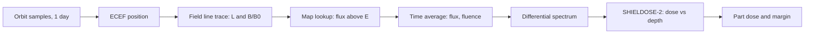
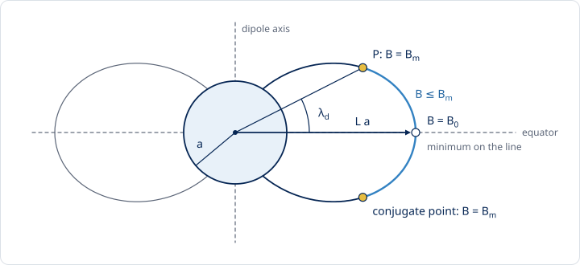
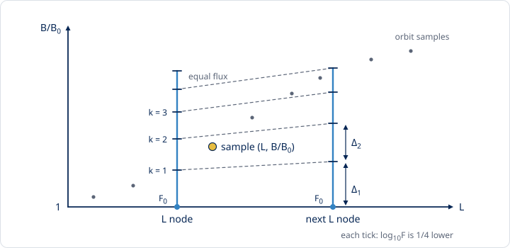
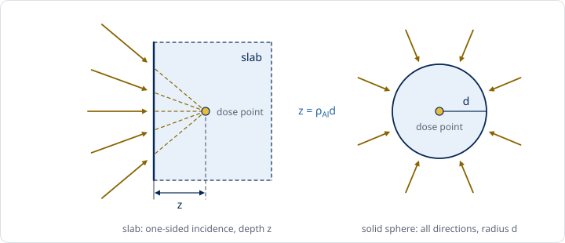
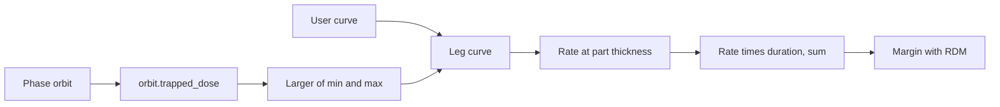

# 放射線解析

この解析群は、捕捉された陽子と電子がアルミニウムの遮蔽の内側にある部品に与える電離線量を見積もり、ミッション中に積算した線量を部品の許容線量と比べます。
概念設計の初期に、「高度 550 km の軌道で、この電子機器の箱にはどれだけの遮蔽が要るか」「部品の許容線量に対する余裕は正か」といった問いに答えます。

| ID | 目的 | 主な入力 | 主な出力 |
|---|---|---|---|
| `orbit.trapped_flux` | エネルギーしきい値ごとの軌道平均フラックス、ピークフラックス、ミッションのフルエンス | 地球周回軌道、ミッション期間、放射線帯のマップ | マップとエネルギーごとのフラックス、ピークフラックス、フルエンス |
| `orbit.trapped_dose` | 指定した厚さのアルミニウムの内側にあるシリコンの線量率 | 地球周回軌道、放射線帯のマップ、SHIELDOSE-2 の表 | 太陽活動の極小期と極大期の、厚さに対する線量率 |
| `orbit.total_dose` | 部品ごとのミッション線量と、許容線量に対する余裕 | フェーズ（期間と軌道）、部品の遮蔽厚さと許容線量 | 部品の線量、余裕、判定 |

環境モデルは NASA の AP-8（陽子）と AE-8（電子）の捕捉粒子モデルです。
線量の換算には SHIELDOSE-2 のデータも必要です。
どちらも静的な経験モデルです（[放射線解析の限界](#放射線解析の限界)を参照）。
データファイルはリポジトリに含まれません。
`fune data fetch radiation` で入れるまで、解析は入力不足として報告します。
背景とデータの出典は [trapped-radiation.md](../../trapped-radiation.md) にあります。

## 共通の前提

### 計算の流れ



*`orbit.trapped_flux` は時間平均で終わります。`orbit.trapped_dose` は線量曲線まで進みます。`orbit.total_dose` はその曲線をフェーズごとに使います。*

エポック、座標系、1 日のサンプル格子は[軌道解析の共通事項](orbit.md)で定めています。
放射線解析は次の点を共有します。

- 軌道は 1 日分をサンプル化します（`daily_sampling`）。
  期間は 86 400 s で、刻みは軌道周期から決め、最大 600 s です。1 日より短い一回限りの軌道はその期間だけをサンプル化します。
  デモの軌道（高度 550 km、円軌道、太陽同期）では、刻みが 30 s でサンプルは 2 881 点です。
  ケースの β 角の上書きがあれば、ほかの軌道解析と同じくサンプル化する軌道を変えます。
- 各サンプルの位置はそのエポックで慣性系から地球固定座標系（ECEF）へ回します。
  地磁気は地球に固定されているので、1 日のサンプルで地上軌跡が地球を 1 周します。
- 地球周回軌道だけに対応します。
- 1 日の平均がミッション全体を代表するとみなします。
  軌道の経年変化、季節、太陽周期は追いません。

各解析が必要とするデータは次のとおりです。

| 解析 | 放射線帯のマップ（`ap8min`、`ap8max`、`ae8min`、`ae8max`） | 旧来の磁場ファイル（`jensen_cain_1960`、`gsfc_1966`） | `shieldose2` | `igrf14` |
|---|---|---|---|---|
| `orbit.trapped_flux` | 要 | 要 | 不要 | 不要 |
| `orbit.trapped_dose` | 要 | 要 | 要 | 不要 |
| `orbit.total_dose` | 区間に独自の環境表がないときだけ要 | 同左 | 同左 | 不要 |

IGRF-14 のファイルはデータ群と一緒に入りますが、放射線帯の引きでは使いません。
公開された基準点と引きを比べる試験だけが使います。

### 地磁気

AP-8 と AE-8 は特定の地磁気モデルの座標 $(L, B/B_0)$ で作った表です。
同じ磁場から求めた座標で読む必要があります。
そのため磁場は球面調和関数のモデルで、iwafune のほかの解析が使う傾斜双極子（`dipole_field_eci_t`）ではありません。

$r$ を地心距離、$\theta$ を余緯度、$\lambda$ を東経、$a=6\,371\,200$ m を係数ファイルの基準半径とします。
内部起源のポテンシャルと磁場は次のとおりです。

```math
V = a\sum_{n=1}^{N}\left(\frac{a}{r}\right)^{n+1}\sum_{m=0}^{n}\left(g_n^m\cos m\lambda + h_n^m\sin m\lambda\right)P_n^m(\cos\theta),\qquad
\mathbf B = -\nabla V \tag{1}
```

| 記号 | 意味 | 単位 |
|---|---|---|
| $g_n^m,\ h_n^m$ | 次数 $n$、位数 $m$ のガウス係数（$h_n^0=0$） | nT（$10^{-9}$ を掛けて T にする） |
| $P_n^m$ | Schmidt 準正規化した陪ルジャンドル関数 | 1 |
| $N$ | ファイルの最高次数（Jensen–Cain のファイルでは 6） | 1 |
| $V$、$\mathbf B$ | ポテンシャルと磁場 | nT·m、T |

コードは式 (1) を重力場と同じ漸化式で評価します。Schmidt から非正規化への換算は `GravityTable::from_schmidt` の 1 か所だけにあります。
モデルは線形の永年変化項 $\dot g,\dot h$（nT/yr）を持てます。
放射線帯に使う磁場にはこの項がなく、どれも自分のエポックに固定されています。

**2 つの旧来ファイルの換算。**
どちらのファイルも `n m g h` の行を並べ、$n$ と $m$ は真の次数と位数より 1 大きい値です（`2 1` が $g_1^0$）。
基準半径は 6 371.2 km です。

- GSFC 12/66 は Schmidt 規約で、符号は IGRF と同じです（$g_1^0\approx-30\,401$ nT）。
  各行にはエポック 1960.0 での $\dot g,\dot h$（nT/yr）と $\ddot g,\ddot h$（nT/yr²）もあります。
  1970 年の磁場ではすべての $g$ と、$m>0$ のすべての $h$ について次の値を使います。

  ```math
  c(1970)=c + \dot c\,\Delta y + \tfrac12\,\ddot c\,\Delta y^{2},\qquad \Delta y = 10\ \mathrm{yr} \tag{2}
  ```

  係数 $\tfrac12$ はファイルの 2 階微分の意味についての仮定です。
  これを外すと双極子は約 30 000 nT のうち約 3 nT 変わり、磁場の変化は約 $10^{-4}$ です。
- Jensen & Cain 1960 は符号が逆で（ファイルでは $g_1^0=+30\,411.2$ nT）、ルジャンドル関数に Chapman–Bartels の「ガウス」関数を使います。
  クロネッカーのデルタ $\delta_{m0}$ と Schmidt 係数 $S_{nm}$ を使うと、IGRF の符号の Schmidt 係数への換算は次のとおりです。

  ```math
  S_{nm}=\sqrt{\frac{(2-\delta_{m0})\,(n-m)!}{(n+m)!}},\qquad
  c_\mathrm{Schmidt}=-\,c_\mathrm{file}\,\frac{(n-m)!}{(2n-1)!!\;S_{nm}} \tag{3}
  ```

  これを $g$ にも $h$ にも同様に適用します。$(2n-1)!!=1\cdot3\cdots(2n-1)$ です。係数は $(n,m)=(1,0)$ と $(1,1)$ で $-1$、$(2,0)$ で $-2/3$、$(2,1)$ で $-1/\sqrt3$、$(2,2)$ で $-2/\sqrt3$ です。
  ファイルの値が $g_1^0=30\,411.2$、$g_1^1=2\,147.4$、$h_1^1=-5\,798.9$ nT なら、Schmidt の双極子項は $-30\,411.2$、$-2\,147.4$、$+5\,798.9$ nT です。
  この二乗和平方根 $\sqrt{(g_1^0)^2+(g_1^1)^2+(h_1^1)^2}\approx31\,034$ nT がこの磁場自身の赤道面の双極子強度です。

**マップと磁場の組。**

| マップ | 粒子 | 太陽活動（マップのエポック） | 使う磁場 | 磁場のエポック |
|---|---|---|---|---|
| `ap8min` | 陽子 | 極小（1964） | Jensen & Cain | 1960.0 |
| `ap8max` | 陽子 | 極大（1970） | 式 (2) で外挿した GSFC 12/66 | 1970.0 |
| `ae8min` | 電子 | 極小（1964） | Jensen & Cain | 1960.0 |
| `ae8max` | 電子 | 極大（1970） | Jensen & Cain | 1960.0 |

この組は SPENVIS と IRBEM が使うものと同じです。
磁場は軌道のエポックではなく、表の最後の列のエポックで評価します。
軌道のエポックは慣性系の位置を ECEF へ直す地球の自転を決めるだけです。

### 磁力線の追跡と McIlwain の L

点 P について、マップを引く殻パラメータ $L$ と比 $B/B_0$ を求めます。
方法は McIlwain（1961）に従います。P でミラーする粒子の第 2 断熱不変量 $I$ を、P の磁場の大きさ $B_m$ とともに磁力線に沿って計算します。
$I$ と $B_m$ から、中心双極子について定義した関数 $\mathcal F$ を通して $L$ が決まります。



*強調した 2 つのミラー点の間の弧では $B\le B_m$ です。中心双極子では、$L$ は赤道面の距離を $a$ で割った値です。*

**定義。** 磁力線に沿った弧長を $s$、$B_m=\|\mathbf B(\mathrm P)\|$ とすると、次のとおりです。

```math
I=\int_{\mathrm{mirror\ 1}}^{\mathrm{mirror\ 2}}\sqrt{1-\frac{B(s)}{B_m}}\;ds\ \ [\mathrm m],\qquad
x=\frac{I^{3}B_m}{M},\qquad
L=\frac1a\left(\frac{\mathcal F\!\left(x^{1/3}\right)M}{B_m}\right)^{1/3} \tag{4}
```

$M=b_0a^3$ は双極子モーメント（T·m³）です。$b_0$ は後述します。
磁気赤道上の点では $I=0$ です。
運動量 $p$ の粒子の第 2 不変量は $2pI$ で、定数 $2p$ は $L$ では消えます。

**関数 $\mathcal F$。**
モーメント $M$ の中心双極子では、緯度 $\lambda_d$ を通る磁力線は $r=La\cos^2\lambda_d$、$B=(M/r^3)\sqrt{1+3\sin^2\lambda_d}$ です。
したがって $L^3B/M=b(\lambda_d)$ で、$I=La\,J(\lambda_d)$ となります。

```math
b(\lambda_d)=\frac{\sqrt{1+3\sin^2\lambda_d}}{\cos^{6}\lambda_d},\qquad
J(\lambda_d)=\int_{-\lambda_d}^{\lambda_d}\cos u\,\sqrt{1+3\sin^2u}\,\sqrt{1-\frac{b(u)}{b(\lambda_d)}}\;du \tag{5}
```

よって $I^3B/M=J^3b$ です。
McIlwain の $\mathcal F$ は、どの磁場でも $L^3B/M=\mathcal F(I^3B/M)$ を満たします。双極子では式 (5) から決まります。$v=x^{1/3}$ に対して $v=J(\lambda_d)\,b(\lambda_d)^{1/3}$ を $\lambda_d$ について解き、$\mathcal F(v)=b(\lambda_d)$ とします。
コードは多項式の近似式ではなく、この解を数値で求めます。

- $J$ は 48 節点の第 2 種 Gauss–Chebyshev 求積で積分します（両端の平方根の特異性を厳密に扱えます）。
- $\lambda_d$ は $[10^{-6},\,\lambda_\mathrm{hi}]$ の二分法で $10^{-13}$ rad まで求めます（反復は最大 200 回）。
  上端は $\min(1.2\sqrt{v/3.3},\ \pi/2-10^{-6})$ で、足りなければ $\pi/2-10^{-6}$ まで広げます。
  $\cos\lambda_d=10^{-6}$ の磁力線を超える $v$ には、$L$ が求まりません。
- $v<10^{-5}$ では級数 $\mathcal F=1+1.3504744\,v$ を使います（傾きの $2\sqrt{4.5}/\pi$ は、$b\approx1+4.5\lambda_d^2$ と $J\approx\sqrt{4.5}\,\pi\lambda_d^2/2$ から出ます）。

**双極子モーメントの規約。**
AP-8 と AE-8 は固定のモーメント $M=0.311653\ \mathrm{G}\,R_e^3$ を使い、基準半径を $R_e$ とします。
SI では $b_0=0.311653\times10^{-4}$ T、$M=b_0a^3$ です。
殻 $L$ の赤道面の磁場は $B_0=b_0/L^3$ になります。
マップの座標は $(L,\ B/B_0)$ で、$B=B_m$ なので $B/B_0=B_mL^3/b_0$ です。
これが既定の「文献」規約です。
磁場自身の双極子強度（Jensen & Cain で約 31 034 nT で、$b_0$ より 0.4 % 小さい）は使いません。そのため、磁場自身のモーメントを使う場合とは同じ点の $L$ が少し違います。
ライブラリには確認用の比較規約もあります。
この規約は $M$ を磁場自身の次数 1 の項から取り、$B_0$ を追跡した磁力線に沿った $B$ の最小値にします。
解析は比較規約を使いません。

**1 点の計算手順。** 定数は次のとおりです。追跡には DOP853 を使い、相対許容誤差 $10^{-10}$、絶対許容誤差 $10^{-4}$ m、最大刻み $0.5a$、最大 100 000 ステップとします。磁力線は $16a$ の内側にとどまる必要があります。

1. P で $B_m$ を評価します。磁場が 0 か有限でない場合と、$\|\mathbf r\|\ge16a$ の場合は、$L$ が求まりません。
2. $\sigma\hat{\mathbf B}$ が $B$ の減る向きを指すように、符号 $\sigma=\pm1$ を選びます（磁力線に沿った $\|\mathbf B\|$ の中心差分で、刻みは $10^{-3}a$ です）。
3. P から $d\|\mathbf B\|/ds$ の符号が変わる点（磁力線上の最小）まで $d\mathbf r/ds=\sigma\hat{\mathbf B}$ を積分し、弧長 $s_\mathrm{min}$ を得ます。
   先に $16a$ を出る磁力線はここでは開いた磁力線として扱い、$L$ は求まりません。
4. 最小点から同じ向きに、$\|\mathbf B\|=B_m$ に戻る点（共役ミラー点）まで進み、弧長 $s_\mathrm{conj}$ を得ます。
5. $S=s_\mathrm{min}+s_\mathrm{conj}$ とし、P から節点 $s_i=\tfrac S2(1-\cos\theta_i)$、$\theta_i=i\pi/33$、$i=1\ldots32$ まで磁力線を再び積分します。
   すると $I=\dfrac S2\dfrac{\pi}{33}\sum_i\sin\theta_i\sqrt{\max(0,1-B_i/B_m)}$ です。
6. 式 (4) で $x$、$\mathcal F$、$L$ を計算します。$v$ が $\mathcal F$ の範囲外なら、$L$ は求まりません。

「$L$ なし」のサンプルはモデルの外です。
フラックス 0 として数え、`samples_without_l` に報告します。
デモの軌道では、サンプルの約 10.6 %（2 881 点のうち 306 点）に $L$ がありません。磁力線が開く高緯度のサンプルです。

### 放射線帯のマップと引き方

マップは Fortran の書式 `(1X,12I6)` で書いた整数のファイルです（NSSDC データセット PT-11B）。
見出しの 8 語は次のとおりです。

| 語 | 意味 | `ap8min` の値 |
|---|---|---|
| 1 | マップの種類 | 2 |
| 2 | 1 桁あたりの刻み数。$B$ の 1 刻みごとに $\log_{10}F$ が $1/\mathrm{word}_2$ だけ下がる | 4 |
| 3 | エポック（年） | 1964 |
| 4 | エネルギーの倍率（$E=\text{word}/\mathrm{word}_4$、MeV） | 100 |
| 5 | $L$ の倍率 | 2048 |
| 6 | $B/B_0$ の倍率 | 2048 |
| 7 | $\log_{10}F$ の倍率 | 1024 |
| 8 | 見出しのあとの語数 | 16 584 |

見出しのあとに、エネルギーごとのサブマップ（$E$ を超える積分フラックス）が続きます。
サブマップは $L$ の節点ごとのサブサブマップを並べたもので、サブサブマップは $[\,\text{長さ},\ L\cdot s_L,\ \log_{10}F_0\cdot s_F,\ \Delta_1,\Delta_2,\ldots]$ です。
$F_0$ は $B/B_0=1$ でのフラックスです。増分 $\Delta_k$（$s_B$ 倍）は、$\log_{10}F$ がさらに $1/4$ 下がる $B/B_0$ の刻み幅です。
$B/B_0=1+\Delta_1+\dots+\Delta_k$ で $\log_{10}F=\log_{10}F_0-k/4$ となり、その間は直線で結びます。最後の増分より先ではフラックス 0 です。
各サブマップは $L=0$ の仮の節点で始まり、$L=32767/s_L$ の仮の節点で終わります。



*軌道サンプル $(L,B/B_0)$ はサブマップの 2 つの $L$ 節点の間にあります。各節点は $B/B_0$ 方向の折れ線です。*

引きは NSSDC RADBELT（`TRARA1`、`TRARA2`）の手順に従い、単精度（`f32`）の演算まで合わせています。
$(L,\ B/B_0,\ E)$ に対して、全方向の積分フラックス $F(>E)$ を cm⁻² s⁻¹ で返します。

1. **倍率をかけた座標。** $n_L=\lfloor\min(L,15.6)\,s_L\rfloor$、$n_B=\lfloor(\max(B/B_0,1)-1)\,s_B\rfloor$ とします。
   整数への切り捨ても手順の一部です。
   対数フラックスの刻みは整数の商 $f=\lfloor\text{word}_7/\text{word}_2\rfloor$ です（倍率 1024、4 刻みなら 256）。
2. **エネルギーのサブマップ。** 上側のエネルギーが $E$ 以上になる最初のサブマップの対 $(E_1,E_2)$ を取ります。
   最初のエネルギーより下では最初の 2 つのサブマップを、最後のエネルギーより上では最後の 2 つを使うので、両端では線形に外挿します。
3. **1 つのサブマップの中**（`TRARA2`）。
   $n_L$ 以下の最後の $L$ 節点と、$n_L$ を超える最初の節点を見つけます。
   $F_0$ の大きい方が 2 番目になるように並べます。
   2 本の折れ線を、原点から各折れ点への弦（累積した $B$ の増分と、倍率をかけた $\log_{10}F$）の傾きの順に、一緒にたどります。
   各段階で、$n_L$ が節点の間のどこにあるかで重みをつけた 2 つの折れ点から、補間した等高線上の点が 1 つ決まります。
   補間した点が $n_B$ に初めて届いた（または超えた）ところで止め、その点と 1 つ前の補間点の間を $B$ について線形に補間します。
   増分のない節点は傾き $-900\,000$ の等高線として扱います。
   フラックスの見つからない経路は 0 を返します。
   結果を $s_F$ で割ると、このエネルギーの $\log_{10}F$ になります。
4. **エネルギー補間。** $\log_{10}F$ は $E$ について線形です（$\ln E$ についてではありません）。

   ```math
   \log_{10}F(E)=\ell_1+(\ell_2-\ell_1)\,\frac{E-E_1}{E_2-E_1} \tag{6}
   ```

   上のサブマップのその点にフラックスがなく（$\ell_2\le0$）、1 つ下のサブマップがあれば、式 (6) と、その下の対を通る直線の値のうち小さい方を取ります。
   結果は 0 を下回らないようにします。
5. **0 の規則。** $\log_{10}F>0$ なら $F=10^{\log_{10}F}$、そうでなければ 0 です。
   つまり、1 cm⁻² s⁻¹ 以下のフラックスは 0 と報告します。
   入力が有限でない場合、$L\le0$、$E\le0$ のときも 0 です。

**引きの計算例（単体試験の合成マップ）。**
$B/B_0=1$ で、0.1 MeV の $\log_{10}F_0$ が $L=1$ で 4、$L=3$ で 2、400 MeV で同じく 2 と 1 になるマップを考えます。
$L=2$ では $L$ の補間がちょうど中間なので、0.1 MeV で 3、400 MeV で 1.5 です。
$E=10$ MeV では式 (6) から $3+(1.5-3)(10-0.1)/(400-0.1)=2.9629$ となり、$F=10^{2.9629}\approx918$ cm⁻² s⁻¹ です。

## orbit.trapped_flux 捕捉粒子のフラックスとフルエンス

### 何に答えるか

この軌道で、各エネルギーしきい値を超える捕捉粒子が単位面積を毎秒平均して何個通るか、ピークがどれだけか、その平均がミッション中続くとフルエンスがどれだけになるかです。

### 入力

| 量 | 記号 | 単位 | 設計での出どころ | 既定値 |
|---|---|---|---|---|
| 軌道サンプル | $\mathbf r(t_i)$ | m | 有効な `[orbit]`（ケースの β 角を適用） | 必須 |
| ミッション期間 | $T$ | s | `input = "mission_duration"` の `at_least` 要求 | 必須 |
| 放射線帯のマップと組の磁場 | — | — | `fune data fetch radiation` | 導入が必要 |
| サンプルの期間と刻み | $S,\ \Delta t$ | s | `daily_sampling` | 解析の既定（共通の前提を参照） |

エネルギーしきい値は固定の一覧です。陽子は 0.1、0.5、1、2、5、10、20、30、50、100、200、400 MeV、電子は 0.04、0.1、0.25、0.5、1、1.5、2、3、4、5、6、7 MeV です。

### モデルと仮定

AP-8 と AE-8 は $(L,B/B_0,E)$ の関数として、静的な全方向積分フラックスを与えます。
粒子ごとに、太陽活動の極小期（エポック 1964）のマップと極大期（エポック 1970）のマップが 1 つずつあり、解析は 4 つすべてを報告します。
軌道は 1 日分をサンプル化し、結果がミッション全体に成り立つと仮定します。

### 式

マップとしきい値ごとに、サンプル時刻 $t_i$ のフラックス（引きの結果）を $F_i$、$S=t_N-t_0$ とします。
$L$ のないサンプルでは $F_i=0$ です。
平均は台形則で求め、フルエンスは平均にミッション期間を掛け、0 でない割合は指示量 $[F_i>0]$ の台形則の平均です。

```math
\bar F=\frac1S\sum_{i}\frac{(t_{i+1}-t_i)\,(F_i+F_{i+1})}{2},\qquad
\Phi=\bar F\,T,\qquad F_\mathrm{peak}=\max_i F_i \tag{7}
```

単位は、$F$ が m⁻² s⁻¹（マップの cm⁻² s⁻¹ に $10^{4}$ を掛けたもの）、$\Phi$ が m⁻² です。

### アルゴリズム

1. 軌道をサンプル化し、ECEF に回します。
2. 2 つの磁場のそれぞれで、すべてのサンプルの $(L,B/B_0)$ を追跡します（サンプルは塊に分けて並列に追跡し、結果は直列の場合と同じです）。
3. 磁場に組むマップとしきい値ごとに、全サンプルの $F_i$ を引きます。
4. 式 (7) を評価します。`l_min`、`l_max`（$L$ のあるサンプルについて）と `samples_without_l` を報告します。
5. ケースは陽子の極小、陽子の極大、電子の極小、電子の極大の順に並べます。

### 検査と判定

判定はありません。
マップ、磁場、ミッション期間のどれかがなければ、解析は入力不足になります。
ミッション期間が正でない場合と、ほかの天体の周回軌道は誤りです。

### 出力

| 出力 | 単位 | 意味 |
|---|---|---|
| `cases[].spectrum[].mean_flux`、`peak_flux` | m⁻² s⁻¹ | しきい値 `energy_mev` での $\bar F$ と $F_\mathrm{peak}$ |
| `cases[].spectrum[].fluence` | m⁻² | $\Phi$ |
| `cases[].spectrum[].time_fraction` | 1 | フラックスが 0 でない期間の割合 |
| `cases[].l_min`、`l_max`、`samples_without_l` | 1、1、個数 | $L$ の範囲と、モデルの外のサンプル数 |
| `used` | — | 期間、刻み、サンプル数、ミッション期間 |

CLI はフラックスを cm⁻² s⁻¹、フルエンスを cm⁻² で表示します。

### 計算例

デモの軌道は円軌道、高度 550 km、太陽同期（軌道傾斜角 97.6°）、エポック 2027-04-01 で、30 s 刻みの 2 881 サンプルです。ミッション期間は 31 557 600 s（ユリウス年 1 年）です。
`ap8min` の磁場は Jensen & Cain で、$L$ のないサンプルは 306 点、$L$ は 1.003 から 15.999 までです。
`ap8max`（GSFC の磁場）では、$L$ のないサンプルが 309 点です。

0.1 MeV で、プログラムは `ap8min` について次を表示します。平均フラックスは 1193 cm⁻² s⁻¹、ピークは 157 623 cm⁻² s⁻¹、フルエンスは $3.76\times10^{10}$ cm⁻²、フラックスが 0 でない時間は 14.6 % です。
SI では平均フラックスが 11 925 384.09 m⁻² s⁻¹（$=1192.54$ cm⁻² s⁻¹）です。
式 (7) でフルエンスを確かめます。$11\,925\,384.09\ \mathrm{m^{-2}s^{-1}}\times31\,557\,600\ \mathrm{s}=3.76336501\times10^{14}$ m⁻² $=3.763\times10^{10}$ cm⁻² で、プログラムの値と一致します。

### 限界

結果は捕捉粒子だけを対象にし、1 日のサンプルに基づきます。
磁気嵐、太陽周期の位相、磁場の永年変化、軌道の経年変化はモデル化していません。
陽子帯の大気のカットオフの近く（低い $L$ で $B/B_0$ が大きい領域）では、フラックスが $L$ と $B/B_0$ で大きく変わるので、座標の定義が結果に効きます（[trapped-radiation.md](../../trapped-radiation.md) を参照）。
$L$ のないサンプルはフラックス 0 と数えるので、高緯度を通る軌道では平均が下がることがあります。

### 検証

- `crates/lib/analysis/src/orbit/trapped_flux/tests.rs`（`equatorial_circular_orbit_matches_hand_calculation`）は、中心双極子の磁場と合成のマップで、$L=2$ の赤道円軌道が解析的なフラックス、$E$ についての線形補間、単位換算、フルエンス $=\bar F T$ を与えることを確かめます。
- `crates/lib/astro/src/radiation/tests/nasa.rs` は、データが入っていれば、NASA のサンプル出力にある AE8MIN の積分フラックスの表（73 値。マップの節点の上と外、$B/B_0=1$ とそれより大きい値）を引きが再現することを確かめます。一致は 4 桁の丸めの内（相対 $5\times10^{-4}$）です。
  そのサンプル出力の陽子の表は古いマップのもので、ゆるく比べるだけです。
- `crates/lib/astro/src/geomag/lshell_tests.rs` は、中心双極子で $L$ が赤道面の距離を $a$ で割った値と $10^{-7}$ まで一致し、$B/B_0=\sqrt{4-3\cos^2\lambda}/\cos^6\lambda$ となることを確かめます（`centred_dipole_l_and_b_ratio_are_analytic`）。
- `crates/lib/astro/src/geomag/dipole_f.rs` は、求積の収束、解析的な傾き $2\sqrt{4.5}/\pi$、$v=10^{-5}$ での連続性を確かめます。
- `crates/lib/astro/src/geomag/legacy_tests.rs` は、Jensen–Cain の係数 (3) の手計算との一致、GSFC の外挿 (2) の $\tfrac12$ の扱い、換算した 1960 年の係数と DGRF 1960 の次数 4 までの 120 nT 以内の一致（データが入っているとき）を確かめます。

### ソース

[解析](../../../crates/lib/analysis/src/orbit/trapped_flux.rs)、[射影](../../../crates/app/projection/src/orbit/trapped_flux.rs)、[磁場の展開](../../../crates/lib/astro/src/geomag/gauss.rs)、[旧来のファイル](../../../crates/lib/astro/src/geomag/legacy.rs)、[磁力線の追跡と L](../../../crates/lib/astro/src/geomag/lshell.rs)、[双極子の関係式](../../../crates/lib/astro/src/geomag/dipole_f.rs)、[放射線帯の座標](../../../crates/lib/astro/src/radiation/position.rs)、[マップの形式](../../../crates/lib/astro/src/radiation/map.rs)、[引き](../../../crates/lib/astro/src/radiation/flux.rs)。

## orbit.trapped_dose 捕捉粒子の線量と遮蔽の深さ

### 何に答えるか

アルミニウムの等価厚さの内側にあるシリコンの線量率を、捕捉陽子、捕捉電子、電子の制動放射に分けて、太陽活動の極小期と極大期について求めます。

### 入力

| 量 | 記号 | 単位 | 設計での出どころ | 既定値 |
|---|---|---|---|---|
| 軌道サンプル | $\mathbf r(t_i)$ | m | 有効な `[orbit]` | 必須 |
| マップ、磁場、SHIELDOSE-2 の表 | — | — | `fune data fetch radiation` | 導入が必要 |
| 厚さの一覧 | $d$ | mm | 解析の入力。設計の設定はありません | 0.1、0.2、0.5、1、1.5、2、3、4、5、7、10、15、20（解析の既定） |
| 幾何 | — | — | 解析の入力。設計の設定はありません | `sphere_centre`（解析の既定） |
| 陽子の核相互作用 | — | — | 解析の入力。設計の設定はありません | `none`（解析の既定） |
| 検出器 | — | — | 固定 | シリコン |

厚さの一覧を与えるときは、正で厳密に増える値を 3 つ以上並べます。
`geometry` は `sphere_centre`、`semi_infinite_slab`、`finite_slab` のどれかで、`nuclear` は `none`、`local`、`local_with_neutrons` のどれかです。
出力の `used` に、どの値が既定だったかを記録します。

### モデルと仮定

遮蔽の内側の線量は、粒子のスペクトル、各粒子がどこまで入るか、幾何で決まります。
SHIELDOSE-2（Seltzer 1994）は、アルミニウム中の単色粒子について、深さに対する線量を、陽子と、電子およびその制動放射光子について表にしています。
表は縮約した深さ、つまり深さを粒子の飛程で割った量で作ってあり、アルミニウムの線量を検出器の材料の線量に換算する比も持ちます。
この方法はこれらの核をスペクトルで積分します。
深さは面密度 $z=\rho_\mathrm{Al}\,d$ で、$\rho_\mathrm{Al}=2.70$ g/cm³ です。

幾何は 3 通りです。



*板は放射線が片面から入り、深さ $z$ の点の線量を取ります。球は半径 $d$ の中実の球の中心で、全方向から照射されます。*

- 半無限の板（`semi_infinite_slab`）は、無限に広い媒質の中の深さ $z$ で、片面から入射します。
- 有限の板（`finite_slab`）は、有限の板の透過面で、片面から入射します。陽子では半無限の値と同じで、電子と制動放射では有限の板の検出器比を使います。
- 球の中心（`sphere_centre`、既定）は、中実の球の中心で、全方向から入射します。

### 式

$F_i$ を、後述の対数等間隔の格子上での、軌道平均の積分フラックス（エネルギー $E_i$ を超える分、cm⁻² s⁻¹）とします。引きと式 (7) の平均から得ます。

**微分スペクトル。** 隣り合う格子点の間のエネルギーあたりのフラックスを、それらの幾何平均のエネルギーに置きます。

```math
j_i=\frac{F_i-F_{i+1}}{E_{i+1}-E_i},\qquad E_i^{*}=\sqrt{E_iE_{i+1}} \tag{8}
```

（$j$ は cm⁻² s⁻¹ MeV⁻¹ です。）隣り合うエネルギーの比は 1.10 なので、幾何平均と算術平均の中点の差は 0.1 % 未満です。

**線量の積分。** 板の幾何では、面密度 $z$ での線量率は次のとおりです。

```math
D_\mathrm{slab}(z)=\frac{C}{4}\int j(E)\,w(E,z)\,E\,d\ln E \tag{9}
```

$C=1.6021892\times10^{-10}$ Gy·g/MeV で、$w(E,z)$ は線量の核（MeV·cm²/g、検出器比を含む）です。
係数 $\tfrac14$ は全方向のフラックスを片面を通る横断率に直します。
核の表には、斜め入射の平均経路の伸びを表す係数 2 が入っているので、深さ 0 ではフラックス $\phi$ と質量阻止能 $S/\rho$ に対して $D_\mathrm{slab}=\tfrac12\phi\,S/\rho$ です。
積分は $\ln E$ について数値で行います（後述の手順 3）。

**核。** $R$ をアルミニウム中の粒子の CSDA 飛程（g/cm²）、$T$ を電子のエネルギー、$R_s$ を電子の外挿飛程、$Y$ を制動放射の収率、$A$ を電子の吸収スケールとします（すべて表から取ります）。
深さ線量の表の曲線に検出器比を掛けたものを $\tilde D$ と書きます。

- 陽子は $w=E\,\tilde D_p(E,\,z/R)/R$ で、$z/R$ が表の範囲を超えると 0 です（陽子が深さ $z$ に届く前に止まります）。
- 電子は $w=T\,\tilde D_e(T,\,z/R_s)\,A/R_s$ に比を掛けた値で、$z/R_s\ge2$ では 0 です。
- 制動放射は $w=T\,\tilde D_b(T,\,\ln(z/R))\,Y/R$ に比を掛けた値です。

**球。** 球は半無限の板の曲線から直進近似で導きます。
SHIELDOSE-2 はこの値を「アルミニウムの球の中心の 1/2 線量」という見出しで片面の規格化のまま印刷するので、球全体の線量は印刷値の 2 倍です。

```math
D_\mathrm{half}(z)=D_\mathrm{semi}(z)\left(1-\frac{d\ln D_\mathrm{semi}}{d\ln z}\right),\qquad
D_\mathrm{sphere}=2\,D_\mathrm{half} \tag{10}
```

深さ 0 では傾きが 0 で $D_\mathrm{semi}=\phi S/2$ なので、$D_\mathrm{sphere}=\phi S$ になります。球全体はフラックス $\phi$ を全方向から受けます。
べき乗の板の曲線 $D=Az^{-p}$ では、半分の値が $D(1+p)$ です。
核は 2 つの値を保持します。`sphere_half`（SHIELDOSE-2 が印刷する値）と、その 2 倍の `sphere_centre()` です。解析が報告するのは後者です。
SHIELDOSE-2 の球の値をそのまま印刷するツールと比べるには、`sphere_centre` の値を 2 で割るか、規格化が印刷された板の値に等しい `semi_infinite_slab` を使います。

### アルゴリズム

1. **軌道平均の積分スペクトル。**
   各磁場の $(L,B/B_0)$ サンプルを再利用します。
   粒子ごとに、マップの範囲で $n=\lceil 25\log_{10}(E_\mathrm{max}/E_\mathrm{min})\rceil+1$ 個の対数等間隔のエネルギーを取ります（陽子は 0.1–400 MeV で 92 点、電子は 0.04–7 MeV で 58 点）。
   各エネルギーで全サンプルの $F_i$ を引き、台形則で平均します（$L$ のないサンプルは 0 です）。
2. **微分スペクトル。**
   式 (8) を適用します。
   差分が正で有限な最初の連続区間だけを残します。
   その区間が最初の区間から始まる場合は、先頭の 2 つの差分を通る $\ln j$ 対 $\ln E$ の直線を延ばして、最初の格子エネルギーに点を加えます（加えないと、最初の中点より下の半区間の粒子が失われます）。
   $F$ が 0 に落ちる区間には、最後の正の $F_i$ を使って $F_i/\Delta E$ を与えるので、粒子数は保たれます。
   正の差分が 2 区間に満たない場合と、節点が全部で 3 つに満たない場合は、その粒子がないものとして線量を 0 にします。
3. **積分の格子。**
   $\ln j$ を $\ln E$ の自然 3 次スプラインで補間し、最初から最後の微分節点までの 1 001 個の対数等間隔のエネルギーで $E\,j$ をサンプル化します（スプラインは半格子分を超えて延ばしません）。
   各節点で核を掛け、$\ln E$ について Simpson 則で積分します（SHIELDOSE-2 の `INTEG` です。節点数が偶数のときは、先頭の 6 点に 3/8 則型の重みを使う処理もコードにあります）。
4. **核の評価。**
   - 陽子は表にある深さ比ごとに $\ln D$ を $\ln E$ の自然スプラインで補間します（表の端より外は端の値に固定します）。入射エネルギーでは曲線 $\ln\tilde D(z/R)$ を $z/R$ の自然スプラインにします。
     $R$ は $\ln R$ 対 $\ln E$ の自然スプラインから得ます。
   - 電子は表にある縮約した深さごとに $\ln D$ を $\ln T$ について線形に補間し（端は固定）、深さの曲線は $z/R_s$ の自然スプラインです。検出器比はまず $\ln T$ について線形に補間し、次に $z/R$ のスプラインで補間します。
   - 制動放射は $\ln T$ について線形、$\ln(z/R)$ について線形です（端の区間は延ばします）。比は $\ln z$ について線形です。
   - $10^{-6}$ g/cm² より浅い深さは、$10^{-6}$ g/cm² にします。
5. **オプション。** `none` は陽子の電離だけを使います。
   `local` は 2 番目の陽子の表を使います。陽子のフルエンスは核相互作用で減衰し、荷電二次粒子のエネルギーは生成した場所で付与されます。
   `local_with_neutrons` は、中性子のエネルギー割合 $f_n$ について、項 $E\,f_n(E)\cdot0.03\,e^{-0.03z}$ を加えます（減衰係数は 0.03 cm²/g）。
   オプション 2 と 3 は、オプション 1 より試験が少なくなっています。
6. **球。** 半無限の曲線に式 (10) を適用します。正の深さの最初の連続区間（3 点以上、足りなければ球は 0）で $\ln D$ 対 $\ln z$ に自然 3 次スプラインを当てて微分し、式 (10) を適用します。その区間より先では球は 0 です。
7. **合計。** 陽子、電子、制動放射の線量率を足します。
   太陽活動の極小期は `ap8min` と `ae8min`、極大期は `ap8max` と `ae8max` の組です。

### 検査と判定

判定はありません。
マップ、磁場、SHIELDOSE-2 のデータのどれかがなければ、解析は入力不足になります。
厚さの一覧を明示する場合は、入力の欄の条件を満たす必要があります。

### 出力

| 出力 | 単位 | 意味 |
|---|---|---|
| `cases[]`（`solar`、`proton_model`、`electron_model`） | — | 太陽活動の極小期と極大期の 1 ケースずつ |
| `cases[].table[].shielding` | m | アルミニウムの等価厚さ $d$ |
| `cases[].table[].protons`、`electrons`、`bremsstrahlung`、`total` | Gy/s | シリコンの線量率。`total` はその和 |
| `used` | — | 幾何、核相互作用のオプション、検出器、各選択の出どころ、サンプル数、`samples_without_l`（2 つの磁場の最大）、積分点数、エネルギー範囲と点数、対象の説明文 |

`worst_case_table()` は、厚さごとに 2 つのケースの合計の大きい方を取り、正でなくなる最初の厚さで打ち切ります。
`orbit.total_dose` がこの表を使います。
CLI は線量率をユリウス年あたりで表示します。

### 計算例

軌道は上と同じで、既定の設定です。
太陽活動の極小期（`ap8min`、`ae8min`）で、プログラムが表示する線量率は次のとおりです（Gy/yr）。

| アルミニウム | 陽子 | 電子 | 制動放射 | 合計 |
|---|---|---|---|---|
| 100 µm | 16.0 | 509 | 1.10 | 526 |
| 500 µm | 3.65 | 75.4 | 0.250 | 79.3 |
| 1.00 mm | 2.37 | 30.1 | 0.128 | 32.6 |
| 2.00 mm | 1.68 | 10.0 | 0.0632 | 11.8 |
| 5.00 mm | 1.22 | 0.774 | 0.0234 | 2.02 |
| 10.0 mm | 0.952 | 0.00777 | 0.0125 | 0.973 |

太陽活動の極大期（`ap8max`、`ae8max`）の 1.00 mm では、1.45、55.0、0.256、56.7 Gy/yr です。

SI で 1 mm（極小期）では$7.5012562\times10^{-8}+9.5497309\times10^{-7}+4.0582473\times10^{-9}=1.0340439\times10^{-6}$ Gy/s で、表示される `total` です。
1 年あたりでは $1.0340439\times10^{-6}\times31\,557\,600=32.63$ Gy となり、表の 32.6 Gy/yr に一致します。
深さは $z=0.1\,\mathrm{cm}\times2.70=0.270$ g/cm² です。
浅いところでは電子が支配的で、約 15 mm より厚いところでは電子が消え、陽子と制動放射が残ります。
極大期の電子の線量は大きく（電子の極大期のマップ）、極小期の陽子の線量は大きいので、どちらのケースが悪いかは深さで変わります。
1 mm では極大期の合計（$1.7975695\times10^{-6}$ Gy/s）が極小期の合計を超えます。7 mm では極小期（$3.8831728\times10^{-8}$ Gy/s）が極大期（$3.0198972\times10^{-8}$ Gy/s）を超えます。

### 限界

対象は捕捉陽子、捕捉電子、制動放射だけです。太陽高エネルギー粒子、銀河宇宙線、はじき出し損傷、シングルイベント効果は含みません。SHIELDOSE-2 自身の扱いを超える機体構造からの二次粒子も含みません。
遮蔽は 3 つの単純な幾何のアルミニウムで、部品のまわりの実際の質量分布はモデル化していません。
球の式は直進近似です。
スペクトルは 1 日の軌道平均です。
太陽活動の極小期と極大期のマップは、定義された磁場も異なります。

### 検証

- `crates/lib/analysis/src/orbit/trapped_dose/tests.rs`（`proton_dose_near_zero_depth_matches_the_integral_of_flux_times_stopping_power`）は、フラックスが閉じた式で書ける合成の陽子マップで、ほぼ深さ 0 の線量が飛程の表から独立に計算した $\int j\,S\,r\,dE\times1.6021892\times10^{-10}$ と 1.5 % 以内で一致することを確かめます。
  ほかの試験が既定の深さ、幾何の選択、最悪ケースの表を確かめます。
- `crates/lib/astro/src/radiation/shielding/tests.rs` の内容は次のとおりです。
  ほぼ深さ 0 の陽子の核が 9 つのエネルギー（0.1 MeV から 1 GeV）で $\phi S/2$ と 1 % 以内で一致します。
  遮蔽を通れない陽子の線量は 0 です。
  べき乗の板の曲線に対する球の値が $D(1+p)$ になります（`sphere_from_a_power_law_slab_curve_matches_the_analytic_derivative`）。
  NBS TN 1116 の指数スペクトルの例について、印刷された積分フラックス $2.2719\times10^{10}$ と平均エネルギー 28.50006 MeV を再現します。
  べき乗の積分フラックスの微分は 0.2 % 以内で一致します。
  厚い遮蔽で電子が止まり、制動放射が残ります。
  核相互作用のオプションの大小関係も確かめます。
- SHIELDOSE-2 のデータファイルの読み取りは、[trapped-radiation.md](../../trapped-radiation.md) にあるとおり、元の値と照合してあります。

### ソース

[解析](../../../crates/lib/analysis/src/orbit/trapped_dose.rs)、[スペクトルの準備](../../../crates/lib/analysis/src/orbit/trapped_dose/spectrum.rs)、[型と最悪ケースの表](../../../crates/lib/analysis/src/orbit/trapped_dose/types.rs)、[射影](../../../crates/app/projection/src/orbit/trapped_dose.rs)、[線量の積分と球](../../../crates/lib/astro/src/radiation/shielding/dose.rs)、[エネルギー格子、Simpson 則、差分](../../../crates/lib/astro/src/radiation/shielding/spectrum.rs)、[陽子](../../../crates/lib/astro/src/radiation/shielding/proton.rs)、[電子](../../../crates/lib/astro/src/radiation/shielding/electron.rs)、[データ形式](../../../crates/lib/astro/src/radiation/shielding/data.rs)。

## orbit.total_dose 総線量

### 何に答えるか

各部品がミッション中に、等価アルミニウム遮蔽の内側で受ける線量と、部品の総線量の許容が設計余裕を含めてその線量を覆うかどうかです。

### 入力

| 量 | 記号 | 単位 | 設計での出どころ | 既定値 |
|---|---|---|---|---|
| 区間の期間 | $T_\ell$ | s | フェーズの `duration`。フェーズに期間がなければ、`input = "mission_duration"` の要求 | 使える区間が 1 つ以上で必須 |
| 区間の線量率曲線 | $q_\ell(d)$ | Gy/s | その区間（設計またはフェーズ）の有効な `[orbit]` にある `dose_rate_by_shielding` | 使えるときは計算した捕捉粒子の環境 |
| 部品の等価遮蔽 | $d$ | m | 部品の属性 `shielding`、なければ `analysis.common.radiation.default_shielding` | どちらもなければ部品を評価しない |
| 総線量の許容 | $D_\mathrm{tol}$ | Gy | 部品の属性 `tid_tolerance` | 任意（なければ判定なし） |
| 放射線の設計余裕（RDM） | $f$ | 1 | `analysis.common.radiation.design_margin` | 2.0（解析の既定。出力に記録） |

部品は `shielding` か `tid_tolerance` を持つと解析の対象になります。
曲線は、引数が厚さ（長さ）、値が線量率の `curve` 値です。たとえば `fune set conditions.orbit.dose_rate_by_shielding "0.5:400 1:120 2:30 (mm -> Gy/yr)"` と書きます（[model.md](../../model.md) を参照）。
厚さは厳密に増え、線量率は正である必要があります。

### モデルと仮定

各部品は 1 つの等価厚さのアルミニウム球殻の内側にある点とみなします。
線量率は区間ごとの厚さに対する線量率の曲線から得ます。
どれかのフェーズに `duration` があれば区間はフェーズで、なければ区間は 1 つで、設計の軌道のミッション期間全体です。
独自の `[orbit]` を持つフェーズは独自の軌道と曲線を持ちます。

区間ごとに次の順で決めます。

1. 書かれた `dose_rate_by_shielding` が常に優先します（`environment_source = user_table`）。
2. なければ、放射線帯と SHIELDOSE-2 のデータが入っていて区間に期間があるとき、その区間の軌道について `orbit.trapped_dose` が既定の設定で曲線を計算します。厚さごとに太陽活動の極小期と極大期の合計の大きい方を取り（`computed_trapped`）、最初の正でない線量率の手前で終えます。
3. それもなければ区間は曲線を持たず、除外されます。



*利用者の曲線はその区間の計算した曲線に常に取って代わります。*

### 式

区間 $\ell$ の曲線の節点 $(d_0,q_0)$ と $(d_1,q_1)$ の間にある厚さ $d$ の部品では、線量率を厚さについて線形に、線量率について対数で補間します。
中点では幾何平均になります。

```math
w=\frac{d-d_0}{d_1-d_0},\qquad q_\ell(d)=q_0^{\,1-w}\,q_1^{\,w} \tag{11}
```

```math
D=\sum_{\ell}q_\ell(d)\,T_\ell,\qquad
\mathcal R=\frac{D_\mathrm{tol}}{f\,D}-1 \tag{12}
```

$w$ は無次元、$D$ は部品の総線量（Gy）、$\mathcal R$ は余裕（解析に共通の比の余裕）です。
曲線の厚さの範囲の外では外挿せず、線量率は定義されません。

### アルゴリズム

1. $f$（既定 2、正であること）、区間、その期間と曲線を決めます。各曲線は、線量率が正で、厚さが厳密に増える必要があります。
   期間か曲線のない区間は除外し、`legs[].status`（`no_duration`、`no_environment`）に載せます。
   期間と曲線の両方を持つ区間が 1 つ以上なければ、解析は失敗します。
2. 部品ごとに厚さを選びます。部品の `shielding`、なければ既定の遮蔽、それもなければ評価しません（`no_shielding`）。
3. 含める区間ごとに、式 (11) で $q_\ell(d)$ を読みます。含めるどれかの区間の曲線の外に $d$ がある場合は、部品を評価しません（`outside_table`）。
4. $q_\ell T_\ell$ を足して $D$ にします。
5. 部品に許容があれば、式 (12) で $\mathcal R$ を計算します。$D=0$ のときは定義されません。
6. 基準の遮蔽は評価した部品のうち最も薄い厚さです。
   区間ごとに、その厚さでの線量率と線量を出力します。
   余裕が最小の部品が `worst` です。

### 検査と判定

- `dose:<part>` は、許容があれば、余裕が 0 以上で合格、負で違反です（警告の幅は 0）。
  許容のない部品には線量だけを出し、判定は付けません。
  部品に遮蔽も既定もない場合と、遮蔽が曲線の外にある場合は、代わりに警告を出します。
- `phases_left_out` は、除外した区間があるときの警告です。そのとき総線量は下限になります。
- `environment_source` は、含めた区間に計算した曲線があるときの警告です。計算した曲線は捕捉粒子だけを対象にし（太陽高エネルギー陽子も銀河宇宙線もありません）、総線量は下限になります。

KPI は最小の余裕です。

### 出力

| 出力 | 単位 | 意味 |
|---|---|---|
| `legs[]` | s、Gy/s、Gy | フェーズ、状態、期間、環境の出どころ、基準の厚さでの線量率と線量 |
| `parts[]` | m、Gy/s、Gy、1 | 遮蔽とその出どころ、区間ごとの線量率と線量（`phases`）、`total`、`tolerance`、`margin`、`verdict`、評価しなかった場合はその理由 |
| `reference_shielding`、`worst` | m、1 | 評価した最も薄い遮蔽、余裕が最小の部品 |
| `design_margin`、`design_margin_source`、`interpolation` | 1 | RDM、与えた値か既定か、`log_linear` |

### 計算例

標準のデモには `shielding` や `tid_tolerance` を持つ部品がないので、解析は入力不足（`<part>.tid_tolerance`）を報告します。
この例ではデモの私的なコピーを CLI で次のように変更しました。

```text
fune set OBC.shielding "2.5 mm"
fune set OBC.tid_tolerance "100 Gy"
```

デモには、利用者の曲線を持たないフェーズが 3 つあります。設計の軌道（高度 550 km）の `LEOP`（30 d）と `NOMINAL_OPS`（730 d）、高度 250 km の軌道の `DISPOSAL`（180 d）です。
3 つとも計算した曲線を使い（プログラムは `environment_source` の警告を出します）、RDM は既定の 2 です。

高度 550 km の 2 つの区間の曲線は、`orbit.trapped_dose` が表示する極小期と極大期の合計のうち大きい方です（前の節）。
2 mm と 3 mm では極大期が大きく、$6.3428862\times10^{-7}$ と $2.7794688\times10^{-7}$ Gy/s です。
部品は 2.5 mm でちょうど中間（$w=0.5$）にあるので、式 (11) から次のとおりです。

$q=\sqrt{6.3428862\times10^{-7}\times2.7794688\times10^{-7}}=4.19879\times10^{-7}$ Gy/s

これが、2 つの区間についてプログラムが出す線量率（$4.198792\times10^{-7}$ Gy/s）です。
`DISPOSAL` は別の軌道で、その曲線はここには示しません。プログラムは 2.5 mm で $1.384739\times10^{-7}$ Gy/s を出します。

| 区間 | 期間（s） | 線量率（Gy/s） | 線量（Gy） |
|---|---|---|---|
| `LEOP` | 2 592 000 | $4.198792\times10^{-7}$ | 1.08833 |
| `NOMINAL_OPS` | 63 072 000 | $4.198792\times10^{-7}$ | 26.48262 |
| `DISPOSAL` | 15 552 000 | $1.384739\times10^{-7}$ | 2.15355 |

式 (12) から、総線量は $D=1.08833+26.48262+2.15355=29.7245$ Gy で、プログラムの総線量 29.7 Gy と一致します。
余裕は $\mathcal R=100/(2\times29.7245)-1=0.6821$（68.2 %）で、判定は `ok` です。
設計余裕を掛けると 59.4 Gy が必要で、部品は計算した線量を 68.2 % の余裕で許容します。
曲線は捕捉粒子だけを対象にするので、これは下限です。

### 限界

計算した区間が扱うのは、捕捉粒子と SHIELDOSE-2 の二次粒子です。太陽高エネルギー陽子、銀河宇宙線、はじき出し損傷、シングルイベント効果は扱いません。
期間か曲線のない区間は除外されるので、総線量は下限になることがあります。
遮蔽は部品ごとに 1 つの等価アルミニウム厚さ（一様な球殻）で、どの曲線の範囲の外にもある部品は評価しません。
設計余裕は設計の入力で、物理の結果ではありません。
環境は静的です（放射線帯の時間変化も、嵐もありません）。

### 検証

`crates/lib/analysis/src/orbit/total_dose/tests.rs` は次を確かめます。
線量率と期間の積、および $D_\mathrm{tol}/(fD)-1$（10 Gy/yr を 2 年、許容 100 Gy、RDM 2 で 1.5）。
フェーズにわたる和と、RDM の既定値 2。
幾何平均の中点と、外挿しないこと（`the_table_is_read_log_linearly_and_not_extrapolated`。1 mm で 100、3 mm で 4 Gy/yr なら 2 mm で 20 Gy/yr）。
既定の遮蔽と、許容のない場合。
除外した区間。
最悪の部品と違反。
区間ごとの環境の出どころ。

### ソース

[解析](../../../crates/lib/analysis/src/orbit/total_dose.rs)、[検査](../../../crates/lib/analysis/src/orbit/total_dose/checks.rs)、[射影](../../../crates/app/projection/src/orbit/total_dose.rs)、[計算した環境](../../../crates/app/projection/src/orbit/trapped_dose.rs)、[表の補間](../../../crates/lib/astro/src/math/table.rs)、[出力ラベル](../../../crates/app/service/src/analysis/labels/orbit.rs)。

## 放射線解析の限界

- モデルは静的です。粒子ごとに、太陽活動の極小期（1964）のマップと極大期（1970）のマップが 1 つずつあり、太陽周期の位相、磁気嵐による変動、磁場の永年変化はありません。
- 太陽高エネルギー陽子と銀河宇宙線は含みません。環境の時間変化も含みません。
- AE-8 は外帯と最新の観測に対して不正確なことが知られています。AP-8 は、南大西洋異常域で太陽活動の極大期の低エネルギー陽子フラックスを過大評価することが知られています（[trapped-radiation.md](../../trapped-radiation.md)）。
  数値は概念設計向けです。
- はじき出し損傷とシングルイベント効果は計算しません。

## 参考文献

- C. E. McIlwain, *Coordinates for Mapping the Distribution of Magnetically Trapped Particles*, J. Geophys. Res., 1961. [Paper](https://doi.org/10.1029/JZ066i011p03681)
- D. M. Sawyer and J. I. Vette, *AP-8 Trapped Proton Environment for Solar Maximum and Solar Minimum*, NSSDC/WDC-A-R&S 76-06, 1976.
- J. I. Vette, *The AE-8 Trapped Electron Model Environment*, NSSDC/WDC-A-R&S 91-24, 1991.
- D. C. Jensen and J. C. Cain, *An interim geomagnetic field*, J. Geophys. Res., 1962 (the 1960 coefficients).
- J. C. Cain, W. Hendricks, R. A. Langel and W. V. Hudson, *A proposed model for the International Geomagnetic Reference Field – 1965*, J. Geomag. Geoelectr., 1967 (GSFC 12/66).
- S. Chapman and J. Bartels, *Geomagnetism*, Oxford University Press, 1940 (Gauss functions).
- S. M. Seltzer, *Updated Calculations for Routine Space-Shielding Radiation Dose Estimates: SHIELDOSE-2*, NISTIR 5477, 1994. [Report](https://nvlpubs.nist.gov/nistpubs/Legacy/IR/nistir5477.pdf)
- S. M. Seltzer, *SHIELDOSE: A Computer Code for Space-Shielding Radiation Dose Calculations*, NBS Technical Note 1116, 1980.
- [捕捉放射線のモデルとデータのノート](../../trapped-radiation.md)
