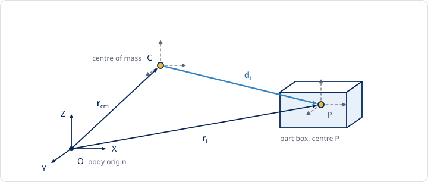
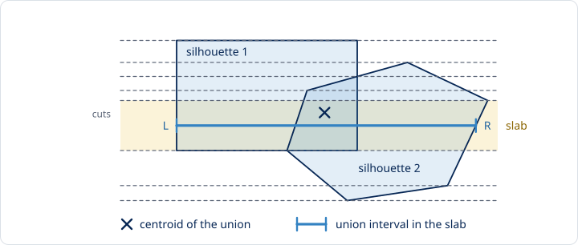
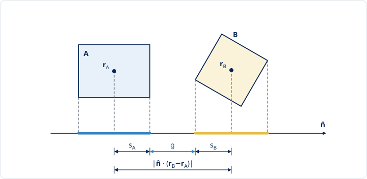
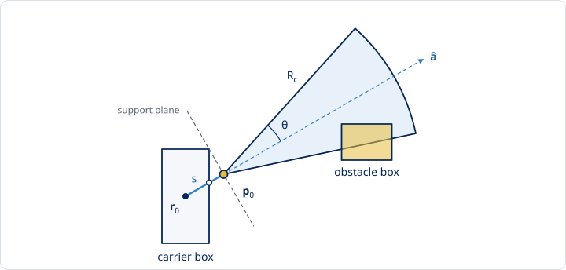
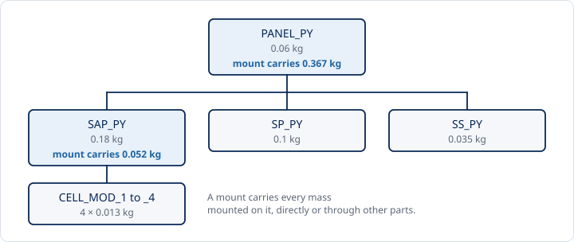
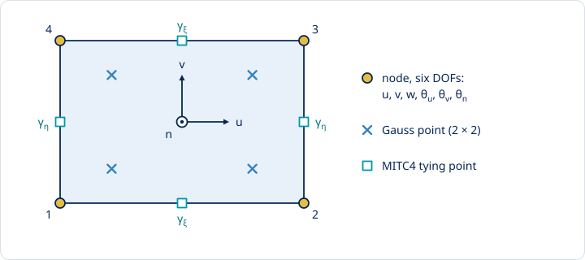
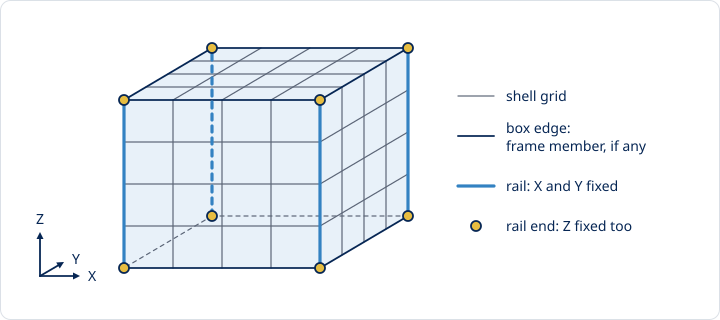
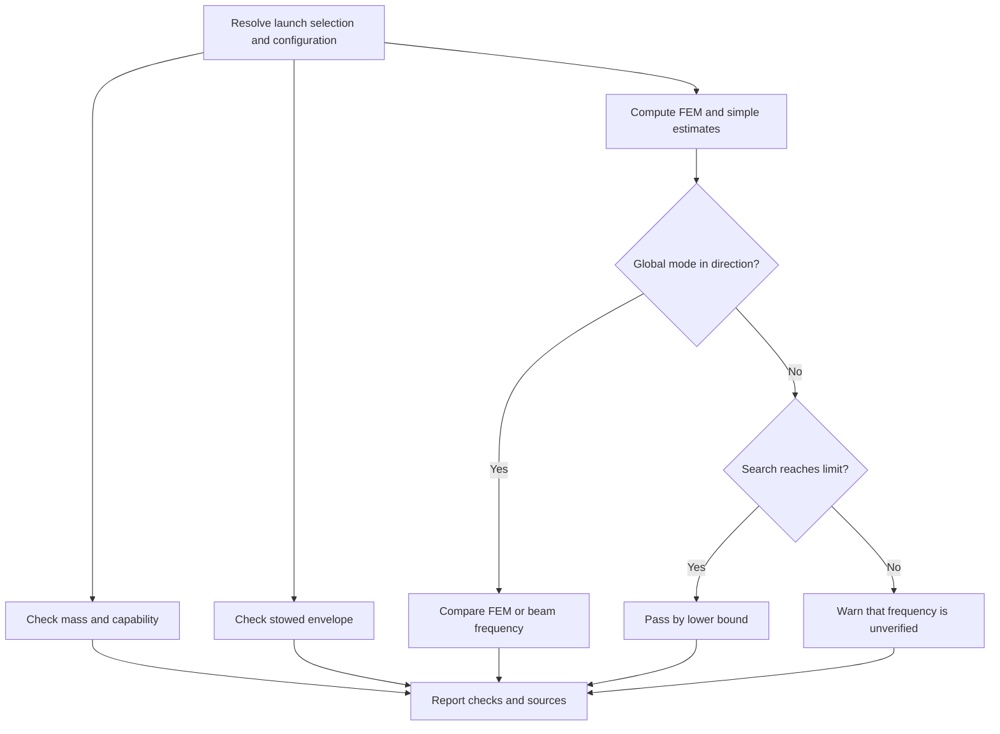

# 構造解析

部品の配置から、質量分布、干渉、打ち上げ荷重、振動、打ち上げ機やディスペンサーの制約への適合を求める解析です。概念設計の初期に、寸法や配置を決める判断を支えます。幾何の結果はすべて部品の箱（各部品の `size`）から計算するので、箱による近似の精度がそのまま結果の精度になります。

| 解析 | 目的 | 主な入力 | 主な出力 |
|---|---|---|---|
| `structure.mass_properties` | 質量と慣性を求めます | 部品の質量、箱、配置 | 質量、重心、慣性テンソル |
| `structure.external_geometry` | 外形を測ります | 向き付きの部品箱 | 投影面積と図心、露出面積 |
| `structure.interference` | 箱の重なりを調べます | 箱、取付の連鎖、許容差 | 重なり深さ、縁の接触、最小すき間 |
| `structure.cone_clearance` | 円錐内の遮りを調べます | 箱、軸、半頂角、距離上限 | 遮りの距離と角度 |
| `structure.static_load` | 取付部の準静的荷重を見積もります | 質量、取付ツリー、荷重倍数 | 力、曲げモーメント、安全余裕 |
| `structure.modal_estimate` | 一次固有振動数を見積もります | 板の形状、材料、取付質量 | 局所の固有振動数、該当する余裕 |
| `structure.modal_fem` | 連成した固有モードを求めます | 板、部材、質量、拘束 | 固有振動数、有効質量比、任意のモード形状 |
| `structure.launch_fit` | 打ち上げ条件と比べます | 打ち上げの選択、外形、質量、モード | 質量、寸法、固有振動数の判定 |

## 共通の前提

配置、慣性の各成分、投影、すき間は、右手系の機体座標で表します。部品の局所原点は箱の中心で、箱の辺は部品自身の軸に沿った `size` です。取付の連鎖に沿って平行移動と回転を合成し、機体座標にします。打ち上げ解析では機軸が機体の $Z$ 軸、横方向が $X$ 軸または $Y$ 軸です。これらの解析は静的な幾何か打ち上げ時のモデルなので、軌道のサンプル点も姿勢則も使いません。

どの配置を使うかは解析ごとに違います。

- `structure.static_load`、`structure.modal_estimate`、`structure.modal_fem`、`structure.launch_fit` は打ち上げ解析です。配置は `conditions.launch.configuration` から取ります。指定がなければ基本配置です。
- `structure.mass_properties`、`structure.external_geometry`、`structure.interference`、`structure.cone_clearance` は、選んだケースのフェーズの形態を使います。ケースがなければ基本配置です。
- 実行時に形態を明示すると、どちらの規則よりも優先されます。

[設計モデル](../../model.md#56-launch-vehicle-dispenser-and-launch-fit-5)も参照してください。員数（`count`）は、記録した姿勢に重ねて置いた同じ部品の個数です。質量には員数を掛け、幾何ではその個数分を 1 個の箱で表します。

余裕を返す検査はすべて同じ定義 $\mathrm{margin} = \text{capability}/\text{demand} - 1$ を使います（`sat_analysis::spec` の `ratio_margin`）。能力が要求を満たすと余裕は 0 以上です。要求が 0 なら余裕は無限大で、出力では値なしになります。

## structure.mass_properties 質量特性

### 何に答えるか

機体の重心はどこにあり、その重心まわりで慣性がどう分布しているかを求めます。

### 入力

| 量 | 記号 | 単位 | 設計データ | 既定値 |
|---|---|---|---|---|
| 単体質量と員数 | $m_i,N_i$ | kg, 1 | `mass`、`count` | 1 部品以上の質量が必須。員数は 1。書かれた `mass` が読めなければ不足入力として報告 |
| 箱の寸法と配置 | $a_i,b_i,c_i,\mathbf r_i,\mathbf R_i$ | m, m, m, m, 1 | `size`、取付の連鎖、形態 | 寸法がなければ質点。配置がなければ原点、回転なし |
| 質量上限 | $M_{\mathrm{lim}}$ | kg | 質量バジェットの要求 `constraint.value` | 任意 |
| 重心の許容箱、固有慣性 | — | m, kg·m² | ライブラリの `com_box`、`inertia` | 設計からの射影では両方とも未設定 |

### モデルと仮定

各部品は剛体で、質量は部品の原点にあるとします。部品自身の慣性は、`size` の均質な中実の箱か、寸法がなければ質点のもの（慣性 0）です。ライブラリは部品座標系での単体あたりの固有慣性テンソルも受け取れます。この場合は箱のテンソルの代わりに使い、員数を掛けます。出力の質量は乾燥状態のタンクを含む部品そのものの質量です。搭載推薬は別の解析 `propulsion.mass_properties` で扱います。

全体の慣性は 3 段階で求めます。まず各部品の箱のテンソルを機体軸に回します。次に平行軸の定理で、部品の中心から機体の重心まわりへ移します。最後にそれらを足し合わせます。



*各部品の中心まわりの慣性を機体軸に回し、機体の重心からのオフセットベクトルの分だけ移します。*

### 式

$M_i$ と $M$ は部品群の質量と総質量（kg）です。$\mathbf r_{\mathrm{cm}}$ と $\mathbf d_i$ は機体の重心と、そこから部品までのオフセット（m）です。$\mathbf I_3$ は単位行列です。$\mathbf J_i$ は部品中心まわりの箱のテンソル（局所軸）、$\mathbf J$ は機体の重心まわりに組み立てたテンソルで、どちらも単位は kg·m² です。$\mathbf J_i$ の式は均質な直方体の標準的な慣性です。$\mathbf J$ の最後の項が平行軸の定理です。

```math
\begin{aligned}
M_i &= N_i m_i,\qquad M=\sum_i M_i,\qquad
\mathbf r_{\mathrm{cm}}=\frac{\sum_i M_i\mathbf r_i}{M},\quad \mathbf d_i=\mathbf r_i-\mathbf r_{\mathrm{cm}},\\
\mathbf J_i &= \frac{M_i}{12}\operatorname{diag}(b_i^2+c_i^2,\ c_i^2+a_i^2,\ a_i^2+b_i^2),\\
\mathbf J &= \sum_i\left[\mathbf R_i\mathbf J_i\mathbf R_i^{\mathsf T}
+M_i\big(\lVert\mathbf d_i\rVert^2\mathbf I_3-\mathbf d_i\mathbf d_i^{\mathsf T}\big)\right].
\end{aligned}\tag{1}
```

### アルゴリズム

1. 質量を持つ部品について、質量、員数、配置を求めます。書かれた質量が読めなければ、不足入力として報告します。
2. 項目を検証します。質量と箱の辺は 0 以上で、総質量は正でなければなりません。$\mathbf r_{\mathrm{cm}}$ を求め、式 (1) で各寄与を回して移します。部品の回転は先に正規化します。
3. 対称な 3 × 3 テンソルを、巡回ヤコビ法で対角化します。3 組の非対角成分に平面回転を順に掛けていき（最大 50 掃引）、非対角成分の和が、最大成分に機械イプシロンを掛けた値の $10^{-2}$ 以下になるまで続けます。主慣性モーメントは昇順で返します。固有ベクトルは最初の 2 本を列とし、3 本目はその外積にするので、主軸は右手系です。

### 検査と判定

任意の `mass` 検査は、員数を掛けた質量の成長余裕なしの合計を使い、システム余裕は掛けません。余裕は kg 単位の $M_{\mathrm{lim}}-M$ で、0 以上なら `ok`、負なら `violation` です。設計からの射影が作る検査はこれだけです。

ライブラリの重心許容箱は任意です。箱の中心からの各軸のずれの絶対値が半幅以内なら `ok`、そうでなければ `violation` です。報告する余裕は、ずれが 0 でない軸について（半幅 ÷ ずれの絶対値 − 1）を求め、その最小値です。

### 出力

| 項目 | 単位 | 意味 |
|---|---|---|
| `summary` | kg, m, kg·m², 1 | 総質量、重心、テンソル、主慣性モーメントと主軸 |
| `items` | kg, 1, kg·m² | 部品群の質量、全体に占める割合、機体の重心まわりの寄与 |
| `checks` | kg または 1 | 該当する質量と位置の検査 |

### 計算例

`fixtures/demo-6u` の私的な複製に対して `fune -C target-wt/structure-demo analyze structure.mass_properties --json` を実行します。質量を持つ 38 部品の合計は 5.548 kg で、重心は $(0.001615717,0.009821918,0.003231435)$ m です。質量検査の余裕は $12-5.548=6.452$ kg です。

重心の $x$ 成分を求めます。大半の部品は `SP_MX` と `SP_PX` のように $x=0$ について鏡像の対になっていて、$\sum M_i x_i$ では打ち消し合います。残る項は次のとおりです。単位は kg·m です。

| 部品 | $M_i$ (kg) | $x_i$ (m) | $M_i x_i$ |
|---|---|---|---|
| `RW_X` | 0.152 | −0.020 | −0.003040 |
| `RW_Y` | 0.150 | −0.020 | −0.003000 |
| `RW_Z` | 0.150 | 0.022 | 0.003300 |
| `SAP_PY` | 0.180 | 0.050 | 0.009000 |
| `CELL_MOD_1` から `_4` | 4 × 0.013 | 0.052 | 0.002704 |

合計は 0.008964 kg·m なので、$x_{\mathrm{cm}}=0.008964/5.548=0.001615717$ m となり、出力と一致します。

慣性は、`BUS_FRAME`（質量 0.62 kg、箱 0.1 × 0.226 × 0.366 m、回転なし）の $xx$ 項で確かめます。重心からのオフセットは $\mathbf d=(-0.001616,-0.009822,-0.003231)$ m です。式 (1) より $0.62(0.226^2+0.366^2)/12+0.62(0.009821918^2+0.003231435^2)=0.009559987+0.000066286=0.009626272$ kg·m² で、出力と一致します。質量の割合は $0.62/5.548=0.111752$ です。

回した箱の慣性も確かめます。`CELL_MOD_1`（0.013 kg、箱 0.3018 × 0.05 × 0.0003 m）は $Y$ 軸まわりに 90° 回してあり、長辺が機体の $Z$ 軸に沿います。局所の $zz$ モーメントが機体の $xx$ モーメントになるので、$0.013(0.3018^2+0.05^2)/12=0.000101382$ kg·m² です。移動の項は $0.013(0.133678^2+0.003231^2)=0.000232444$ kg·m² で、合計は 0.000333825 kg·m² となり、出力と一致します。機体全体の $J_{xx}$ は 0.112280794 kg·m² です。

### 限界

箱の寸法からは質量分布の不均一、内部の空洞、部品の重心の偏りは分かりません。同じ点に重ねて表した員数分は実際の間隔を省いています。慣性乗積は箱に対しては厳密ですが、結果の精度は各箱の配置の精度までです。

### 検証

`mass_properties.rs` のテストが、手計算の結果と比べています。対象は単一の箱、2 つの質点（平行軸の定理）、0 でない慣性乗積、軸を入れ替える回転した箱、回転した棒の主軸、員数の掛け算と質量検査です。

### ソース

[質量特性](../../../crates/lib/analysis/src/structure/mass_properties.rs)、[射影](../../../crates/app/projection/src/structure.rs)、[機体座標への配置](../../../crates/app/projection/src/structure/body_boxes.rs)、[対称行列の固有値分解](../../../crates/lib/astro/src/math/eigen.rs)

## structure.external_geometry 外形

### 何に答えるか

方向ごとに機体がどれだけの断面積を見せるか、投影の図心はどこか、箱の表面がどれだけ露出しているかを求めます。

### 入力

| 量 | 記号 | 単位 | 設計データ | 既定値 |
|---|---|---|---|---|
| 向き付きの箱 | $B_i$ | m | `size`、取付の配置、形態 | 使える箱が 1 つ以上必須 |
| 投影方向 | $\hat{\mathbf d}$ | 1 | 機体軸と、解析内の標準的な求積方向 | 3 軸と 384 個の求積方向（解析の既定値） |

正の `size` を持たない部品は、一覧に載せて計算から外します。箱が 1 つもなければ、射影が不足入力として報告します。

### モデルと仮定

1 つの箱を $\hat{\mathbf d}$ に沿って見た輪郭は、8 つの角を、機体原点を通り $\hat{\mathbf d}$ に垂直な平面へ投影した点の凸包です。機体の投影面積はこれらの輪郭の和集合の厳密な面積です。箱どうしが隠し合う部分は 2 度数えません。



*平面を、すべての頂点の高さと辺の交点で帯に切り、和集合を厳密に測ります。*

和集合の図心はその平面上の機体座標の点として報告します。空力トルクと太陽輻射圧トルクの解析は、この図心を、輪郭に一様な荷重がかかるときの圧力中心として使います。トルクの腕はこの点と、同じ平面に投影した重心との差です。

露出面積は面ごとに別に測ります。ほかの箱に覆われていない部分が露出です。8 つの角がすべて別の 1 つの箱の中にある部品は内部の部品とし、表面に寄与させません。

### 式

$\mathcal U$ は投影した輪郭、$\mathbf x$ はその平面上の点（m）、$A$ はその面積（m²）、$\mathbf c$ は図心（m）です。$A_f$ は箱の面の面積、$A_{\mathrm{covered},f}$ はその面で、ほかの箱の接地面の和集合が覆う面積で、どちらも m² です。$\theta$ と $\varphi$ は極角と方位角（rad）です。$A(\theta,\varphi)=A(-\hat{\mathbf d})$ は反対向きでも等しいので、全球の平均は半球の積分で求まります。

```math
\begin{aligned}
\mathcal U &= \bigcup_i (\mathbf I_3-\hat{\mathbf d}\hat{\mathbf d}^{\mathsf T}) B_i,\quad
A=\int_{\mathcal U}dA,\quad \mathbf c=\frac{\int_{\mathcal U}\mathbf x\,dA}{A},\\
\overline A&=\frac1{2\pi}\int_0^{2\pi}\int_0^{\pi/2} A(\theta,\varphi)\sin\theta\,d\theta\,d\varphi,\qquad
A_{\mathrm{exposed}}=\sum_f(A_f-A_{\mathrm{covered},f}).
\end{aligned}\tag{2}
```

### アルゴリズム

1. 箱の 8 つの角を投影し、それぞれ凸包を作ります。多角形の和集合は頂点の高さと、異なる多角形の辺どうしの交点の高さで帯に分けて掃引します。1 つの帯の中では各多角形が台形で、順序も入れ替わりません。そのため和集合は区間の集まりになります。各帯で区間を併合し、面積は台形公式、1 次モーメントは被積分関数が 2 次式なので正確なシンプソン公式で積分します。格子も刻み幅の調整値もありません。許容差なしで別の箱の内側にある箱は、和集合に隠れるので省きます。
2. 3 本の機体軸に加えて、半球上の積型ガウス・ルジャンドル則で評価します。極角は $[0,\pi/2]$ の 12 点（重み $\sin\theta$ つき）、方位角は 4 つの象限それぞれ 8 点で、合計 $12\times32=384$ 方向です。箱の投影面積の折れ目は象限の境界上にあります。重みの和は 1 で、これで平均を求めます。最小値と最大値は 387 方向すべてから取り、機体軸が先で、同じ値なら先に見つけた方向を残します。したがって最大値は真の最大値の下限、最小値は真の最小値の上限です。
3. 露出面積はほかの 1 つの箱がすべての角を 0.1 mm 以内で含む箱を内部とします。形が同一の箱は番号が大きいほうだけを内部とします。内部でない各箱の各面について、ほかの内部でない箱を面の平面で切ります。平面を横切る箱は断面で覆い、平面に 0.1 mm 以内で接する箱は接触面で覆います。これらの多角形を面で切り取って和集合にします。露出面積は面の面積から和集合を引いた値です。残りが面の面積の $10^{-12}$ 以下なら 0 とみなします。内部の箱は面を露出させず、ほかを覆いもしません。露出した面は法線の成分が最大の軸と符号で振り分け、2 つの軸で成分が並ぶ法線は番号の小さい軸に入れます。

### 検査と判定

`external_geometry` は `ok` の要約だけで、面積のしきい値も余裕もありません。使えない箱は一覧に出します。使える箱が 1 つもなければ、解析は入力エラーで止まります。

### 出力

| 項目 | 単位 | 意味 |
|---|---|---|
| `projected` | m², m | X、Y、Z の面積と図心 |
| `mean_projected_area`、`min_projected`、`max_projected` | m², 1 | 方向平均と、サンプル方向での最小値と最大値（方向つき） |
| `exposed_area`、`exposed_by_direction`、`exposed_by_part` | m² | 露出面積の合計 |
| `internal_parts`、`skipped`、`repeated` | — | 内部判定と幾何の診断 |

### 計算例

`fune -C target-wt/structure-demo analyze structure.external_geometry --json` を実行します。基本配置なので、パドル `SAP_PY` は展開した状態です。箱は 36 個で、X 方向の投影面積は 0.1669586 m²、機体座標の図心は $(0,0.111321925,0.0000123983)$ m です。平均は 0.108341992 m²、サンプルの最小は 0.02513985 m²（$Z$ 方向）、最大は 0.17222397 m² です。方向数は $3+12(4\times8)=387$ です。内部の部品は 15 個で、たとえば `BAT` は `BUS_FRAME` の内部です。

1 つの部品の露出面積を手計算で確かめます。`EPT` は 0.09 × 0.09 × 0.06 m の箱で、中心が $(0,0.06,-0.155)$ m なので、$z=-0.185$ から $-0.125$ m に広がります。`BUS_FRAME`（$z\ge-0.183$ m）から 2 mm はみ出しているため、内部ではありません。$-z$ 面（0.09 × 0.09 = 0.0081 m²）は `PANEL_MZ`（$z=-0.184$ から $-0.182$ m）の 1 mm 外側にあり、許容差 0.1 mm を超えるので、全面が露出します。4 つの側面では$z<-0.184$ m の部分だけがフレームにもパネルにも覆われず、幅 1 mm × 0.09 m = 0.00009 m² の帯になります。$+z$ 面は機体の内側にあり覆われます。合計は $0.0081+4(0.00009)=0.00846$ m² で、`EPT` の出力と一致します。

6 つの露出面積の合計は $2(0.39107510+0.11034686+0.02513750)=1.05311892$ m² で、`exposed_area` と等しくなります。

### 限界

サンプルから得た最小値と最大値は観測した範囲の境界にすぎません。複数の箱で合わせて囲まれていても、単一の箱には囲まれていない箱は、露出した面を持つことがあります。図心は投影面への一様な荷重を仮定し、面ごとに異なる係数は扱いません。384 方向の平均投影面積は1 つの箱の閉じた式と、軸に平行な箱で約 $10^{-15}$、任意の角度に回した箱で約 $10^{-3}$ の範囲で一致します（求積のコードコメントによる。ランダムな 40 通りの向きでのテスト）。

### 検証

`external_geometry/tests/report.rs` は、0.3 × 0.2 × 0.1 m の単一の箱を調べます。投影面積は 0.02、0.03、0.06 m²、平均は $(xy+yz+zx)/2=0.055$ m²、表面積は 0.22 m² です。`external_geometry/tests.rs` は、半球の平均を、軸に平行な箱と回した箱の閉じた式と比べます。ほかに、隣り合う 2 つの箱、展開パドルのように辺に付けた板、剛体運動への不変性も調べます。`external_geometry/tests/exposure.rs` は、貼り合わせた箱、面を覆うパネル、回した板、面を貫く箱を、手で数えた表面積と比べます。

### ソース

[報告](../../../crates/lib/analysis/src/structure/external_geometry.rs)、[幾何](../../../crates/lib/analysis/src/structure/external_geometry/geometry.rs)、[方向の組](../../../crates/lib/analysis/src/structure/external_geometry/directions.rs)、[露出面積](../../../crates/lib/analysis/src/structure/external_geometry/exposed.rs)、[多角形の和集合](../../../crates/lib/astro/src/math/planar.rs)、[射影](../../../crates/app/projection/src/structure/external_geometry.rs)

## structure.interference 部品の干渉

### 何に答えるか

関係のない部品の箱のうち、許容差を超えて重なるものはどれか。また、浅くて細長い重なりのうち、縁の接触に見えるものはどれかを調べます。

### 入力

| 量 | 記号 | 単位 | 設計データ | 既定値 |
|---|---|---|---|---|
| 向き付きの箱と取付関係 | $\mathbf r_A,\hat{\mathbf u}_{Ai},h_{Ai}$ | m, 1, m | `size`、配置、取付の連鎖 | 使える箱のない部品は対象外 |
| 貫入の許容差 | $\delta$ | m | `analysis.structure.interference_tolerance` | 0.0001 m（解析の既定値） |
| 承知済みの所見 | — | — | `analysis.structure.acknowledged`、`finding = "interference"` | なし |

### モデルと仮定

凸な 2 つの箱はある軸の上で射影が離れていれば、互いに離れています。箱の場合は両方の箱の面法線と、辺の方向どうしの外積だけを調べれば十分です（分離軸定理）。これらの軸での最大のすき間が符号つきの分離量です。負の値は貫入深さで、その軸に沿って一方の箱をその量だけ動かせば分離します。離れている箱では最大のすき間は真の距離の下限で、2 つの面が向き合うときは一致します。



*各候補軸でのすき間は、中心間の距離から 2 つの射影半径を引いた値です。*

同じ取付の連鎖にある組（一方が他方の祖先）は判定しません。兄弟や別の枝にある部品は常に判定します。パネルの箱は取付先の面に中心を置くので、共有する角で板厚の半分ずつ重なります。そのため、両方の箱の縁に沿った細長い切れ端は、貫入が許容差を超えていても、縁の接触に分類されることがあります。

### 式

候補となる各単位軸 $\hat{\mathbf n}$ について、箱 $A$ は中心 $\mathbf r_A$、単位局所軸 $\hat{\mathbf u}_{Ai}$、半長 $h_{Ai}$ を持ちます。$s_A$ は射影半径、$g$ は符号つきの軸方向のすき間、$d_{\mathrm{pen}}$ は貫入で、単位はすべて m です。箱 $B$ にも同じ記法を使います。

```math
s_A(\hat{\mathbf n})=\sum_i h_{Ai}|\hat{\mathbf n}\cdot\hat{\mathbf u}_{Ai}|,\qquad
g(\hat{\mathbf n})=|\hat{\mathbf n}\cdot(\mathbf r_B-\mathbf r_A)|-s_A-s_B,\qquad
d_{\mathrm{pen}}=\max(0,-\max_{\hat{\mathbf n}}g).
\tag{3}
```

### アルゴリズム

1. 順序のない組を ID 順に列挙します。取付の連鎖にある組と、同じ ID の組は除きます。各組について、6 本の面の軸と、ノルムが $10^{-9}$ を超える 9 本の辺の外積（正規化したもの）を調べ、合計で最大 15 軸です。すき間が最大の軸を残し、$10^{-12}$ m 以内で同じなら先の（面の）軸を残します。
2. $d_{\mathrm{pen}}\le\delta$ なら、その組は重なりではありません。$\max(0,g)$ とした値を、最小すき間の候補にします。接している組や許容差以内の貫入の組は、すき間が 0 になり、離れている組は正のすき間になります。最小のすき間が選ばれ、同じ値なら ID 順で先の組を残します。
3. そうでなければ、縁の接触かどうかを調べます。それぞれの箱の局所軸ごとに、相手の箱の射影のうち箱の範囲と重なる区間を取り、軸 $k$ に沿った長さを $e_k$ とします。$t$ は 2 つの箱の最短辺のうち小さいほう、$\epsilon=\max(\delta,10^{-9}\,\mathrm{m})$ です。両方の箱で、区間が最も長い軸を縁の方向、残る 2 軸を断面とします。断面の 2 つの区間はどちらも $e_k\le t+\epsilon$ を満たし、箱の端から $\epsilon$ 以内で終わらなければなりません。縁の方向の長さは断面の長いほうの区間の 4 倍以上必要です。最後に、2 つの体積の上限 $\prod_k e_k$ のうち小さいほうが、小さいほうの箱の体積の 2 % 以下でなければなりません。
4. 条件を満たす切れ端は縁の接触として報告します。ほかの重なりは貫入が深い順に並べ、承知済みの組（どちらの順序でも）と照合します。

### 検査と判定

`overlap:<first>:<second>` は、承知されていない重なりごとに警告します。承知済みの重なりは理由で始まる文を付けた `ok` の検査つきで、出力に残ります。縁の接触と、許容差以内の接触には検査がありません。重なりがなければ、箱が 2 つ未満でも、要約の検査 `interference` は `ok` です。箱の重なりには違反の水準がありません。

### 出力

| 項目 | 単位 | 意味 |
|---|---|---|
| `parts_judged`、`pairs_judged`、`pairs_in_mount_chain` | 1 | 使える部品、比較した組、取付の連鎖で除いた組の数 |
| `overlaps` | m, 1 | 貫入、分離方向、承知の有無 |
| `edge_contacts`、`min_clearance` | m | 細長い切れ端と、許容差を超えて重ならない組の最小すき間（接している組は 0） |
| `skipped`、`repeated`、`checks` | — | 対象の範囲と判定 |

### 計算例

`fune -C target-wt/structure-demo analyze structure.interference --json` を実行します（基本配置）。36 個の箱と、取付の連鎖で除いた 57 組から、判定した組は $36(36-1)/2-57=573$ です。重なりは 6 件、縁の接触は 12 件です。

`EPT` と `PANEL_MZ` は 3.00 mm 重なっています。`EPT` は $z=-0.185$ から $-0.125$ m、`PANEL_MZ` は $-0.184$ から $-0.182$ m に広がります。$\hat{\mathbf n}=\hat{\mathbf z}$ では、中心間の距離が $|-0.183-(-0.155)|=0.028$ m、射影半径が $0.030$ m と $0.001$ m なので、$g=0.028-0.031=-0.003$ m です。$x$ 軸と $y$ 軸のすき間は約 $-0.095$ m と $-0.098$ m なので、$z$ 軸が最大で、$d_{\mathrm{pen}}=3.00$ mm となり、出力と一致します。`PANEL_MZ` を $-z$ 方向へ動かせば分離します。`SP_MX` と `SS_MX` のような 4 つの太陽センサの組は 5.30 mm 重なり、同様に警告されます。1.00 mm の `SAP_PY` と `SP_PY` の重なりは、承知の記録と `ok` の検査つきで残ります。

`PANEL_MX` と `PANEL_MY` は、共有する縁に沿って 0.75 mm 重なります。重なりは 0.75 × 0.75 × 366 mm です。断面の区間はどちらも $t=1.5$ mm 未満で箱の端に接し、長さは断面の 488 倍、体積は小さいほうの箱の 0.17 % です。したがって縁の接触で、検査はありません。最小すき間は 0 m です（最初の組は `PANEL_MZ` と `SAP_PY`）。

### 限界

外接する箱は干渉を過大に見積もることがあります。最小すき間は分離軸方向の射影すき間で、最短のユークリッド距離とは異なることがあります。縁の接触の判定は経験則で、実際の嵌合形状は見ません。1 つの配置を走査するだけで、掃引の経路は扱いません。子が祖先の箱からはみ出しても祖先との組は判定しないので見えません。

### 検証

`interference/tests.rs` は、立方体の貫入と軸、許容差の境界、重ならない組の最小すき間、除外した祖先、員数の扱い、承知、パネルの角の切れ端とパネルにめり込んだセンサ、入力順序への非依存を調べます。`obb/tests.rs` と `edge_contact/tests.rs` は、分離量の探索と切れ端の規則を調べます。

### ソース

[干渉の解析](../../../crates/lib/analysis/src/structure/interference.rs)、[組の走査](../../../crates/lib/analysis/src/structure/interference/scan.rs)、[箱の分離](../../../crates/lib/analysis/src/structure/interference/obb.rs)、[縁の接触の分類](../../../crates/lib/analysis/src/structure/interference/edge_contact.rs)、[射影](../../../crates/app/projection/src/structure/interference.rs)

## structure.cone_clearance 噴流と視野の遮り

### 何に答えるか

機体の部品の箱がスラスタの噴流、センサの視野、アンテナのビームのいずれかに入っていないかを調べます。対象のセンサの役割は `star_tracker`、`sun_sensor`、`camera` です。

### 入力

| 量 | 記号 | 単位 | 設計データ | 既定値 |
|---|---|---|---|---|
| 担い手の軸と半頂角 | $\hat{\mathbf a},\theta$ | 1, rad | スラスタは `direction` の反転と `plume_half_angle`。センサは `boresight` と `fov_half_angle`。アンテナは `boresight` と、半値全幅 `beamwidth` の半分 | 判定する担い手には必須 |
| 担い手と遮る側の箱 | $B_i$ | m | `size`、取付の配置、形態 | 寸法のない遮る側は対象外。寸法のない担い手は部品原点を使う |
| 距離上限 | $R_{\mathrm c}$ | m | `analysis.structure.cone_clearance_range` | 使える箱と担い手の原点を含む、機体軸に平行な箱の対角線（解析の既定値） |
| 承知済みの所見 | — | — | `analysis.structure.acknowledged`、`finding = "cone_clearance"` | なし |

軸がない、軸が 0、半頂角がない、半頂角が開区間 $(0,\pi/2)$ の外にある担い手は、`skipped_carriers` に載せて判定しません。

### モデルと仮定

円錐は頂点 $\mathbf p_0$ を持つ円錐で、頂点を中心とする半径 $R_{\mathrm c}$ の球で切り取ります。頂点は軸が担い手自身の箱から出る点です。コードでは担い手の中心から、軸方向の箱の支持距離だけ離れた点を頂点とします。軸が箱の軸に沿うときは中心を通る線が箱から出る距離に等しくなります。軸が斜めのときは支持平面（箱の最も遠い角を通り軸に垂直な平面）までの距離です。このため、頂点が、中心を通る線が箱から出る点よりも先になることがあります。



*頂点は担い手の箱の支持平面上にあります。有限の円錐を、機体座標で候補となる遮る側の箱ごとに判定します。*

噴射口や受光面は軸が通る箱の面にあるとみなします。担い手自身の箱と、その取付の連鎖にある部品（祖先と、担い手に取り付けた部品）は判定しません。

### 式

$\mathbf p_0$ は頂点（m）、$\mathbf r_0$ は担い手の中心、$\mathbf q=\mathbf x-\mathbf p_0$ は遮る側の箱の点 $\mathbf x$ へのベクトル（m）です。担い手の箱の軸と半長を $\hat{\mathbf u}_i,h_i$ とします。2 つ目と 3 つ目の条件を満たす点が、有限の円錐の中にあります。

```math
\mathbf p_0=\mathbf r_0+\hat{\mathbf a}\sum_i h_i|\hat{\mathbf a}\cdot\hat{\mathbf u}_i|,\qquad
\mathbf q\cdot\hat{\mathbf a}\ge\lVert\mathbf q\rVert\cos\theta,\qquad
\lVert\mathbf q\rVert\le R_{\mathrm c}.
\tag{4}
```

### アルゴリズム

1. 担い手の軸を変換して正規化します。軸がない、軸が不正、半頂角が $(0,\pi/2)$ の外にあるものは飛ばします。式 (4) から頂点を求め、担い手自身の箱と取付の連鎖にある部品を、遮る側の一覧から除きます。
2. 頂点を原点とした座標で、頂点が箱の内側にあれば、距離も角度も 0 と報告します。そうでなければ、軸と箱の点とのなす最小の角度を求めます。前方の軸が箱に当たるかをスラブ法で調べ、当たれば角度は 0 です。当たらなければ、最小の角度は箱の 12 本の辺の上にあります。各辺の点の方向は大円の弧になり、軸に最も近い点は、軸を、辺と頂点を含む平面に射影した方向か、辺の端点です。
3. 最小の角度が半頂角に $10^{-12}$ rad を足した値以内なら、箱のうち円錐の内側にある最も近い点を探します。候補は次のとおりです。箱の頂点と端点、各辺の上で頂点に最も近い点、各辺と円錐面の交点（2 次方程式 $(\mathbf q\cdot\hat{\mathbf a})^2=\cos^2\theta\,\lVert\mathbf q\rVert^2$ の根）、頂点から各面の平面へ下ろした垂線の足、各面のうち面の法線に最も近い円錐の母線上の点です。箱の内側かつ前方の円錐の内側にある候補を残し、その最小の距離を、最小の角度の点の距離とも比べて、遮りの距離とします。この距離が $R_{\mathrm c}$ を超えれば、その箱は報告しません。報告する最小の角度は距離上限で箱が切られる場合でも、箱全体で求めた値です。遮りは距離順、同じ距離なら部品 ID 順に並べます。

### 検査と判定

`obstruction:<carrier>:<part>` は、承知されていない命中ごとに警告します。許容差以内の接線も命中です。承知は順序つきの組（担い手、部品）に一致し、同じ命中を `ok` で記録します。形態を指定した承知はその形態が有効なときだけ適用されます。命中がなければ、要約の検査 `cone_clearance` は `ok` です。判定しなかった担い手と箱は一覧に出します。違反の水準も符号つきのすき間の余裕もありません。

### 出力

| 項目 | 単位 | 意味 |
|---|---|---|
| `range`、`cones` | m, rad, 1 | 距離上限と、各円錐の頂点、角度、軸 |
| `cones[].obstructions` | m, rad | 円錐内で最も近い距離、最小の角度、承知の有無 |
| `skipped_carriers`、`skipped`、`checks` | — | 欠けたデータと所見 |

### 計算例

`fune -C target-wt/structure-demo analyze structure.cone_clearance --json` を実行します（基本配置）。7 つの円錐を判定し、距離上限は 0.599293125 m です。遮られているのは 2 つです。スタートラッカ `STT`（半頂角 10°）は、軸が $-Y$ 方向で、箱の中心が $y=-0.068$ m にあります。箱の 0.09 m の辺が軸に沿うので支持距離は $0.045$ m で、頂点は $y=-0.068-0.045=-0.113$ m となり、出力と一致します。`SP_MY` の箱の中心は $y=-0.115$ m、$y$ 方向の厚みは 0.0016 m なので、頂点に最も近い面は $y=-0.115+0.0016/2=-0.1142$ m です。軸はここに当たり、距離は $0.1142-0.113=0.0012$ m、角度は 0 で、命中の出力と一致します。太陽センサ `SS_PY`（半頂角 60°）は、`SAP_PY` と 4 つの `CELL_MOD` の箱に遮られます。

### 限界

円錐は視野、ビーム、噴流の近似です。箱は実際の遮りを過大に見せることがあります。既定の距離上限は担い手の中心と箱を囲む範囲です。軸が斜めだと、支持距離でずらした頂点が、その範囲の外に出ることがあります。取付の連鎖を除くので、担い手自身の取付先による遮りも見えません。サイドローブ、反射、選んだ円錐を超える噴流の広がり、形態による変化は扱いません。

### 検証

`cone_clearance/cone/tests.rs` は、軸上の距離、円錐の内外ぎりぎりでの辺の接線、面の内部での最小（$(3,2.5,0)$ の立方体で距離 4）、頂点の後ろの箱、距離上限での打ち切り、面を向けた薄板と辺を向けた薄板、頂点がどの角も内側にない回した箱を調べます。`cone_clearance/tests.rs` は、担い手自身の箱の出口にある頂点、取付の連鎖の除外、判定しなかった担い手、既定の距離上限、承知を調べます。

### ソース

[円錐の解析](../../../crates/lib/analysis/src/structure/cone_clearance.rs)、[円錐の幾何](../../../crates/lib/analysis/src/structure/cone_clearance/cone.rs)、[射影](../../../crates/app/projection/src/structure/cone_clearance.rs)

## structure.static_load 準静的荷重

### 何に答えるか

指定した打ち上げ時の加速度で、各取付部がどれだけの力を受け持ち、入力した許容値に対してどれだけ余裕が残るかを求めます。

### 入力

| 量 | 記号 | 単位 | 設計データ | 既定値 |
|---|---|---|---|---|
| 部品の質量と取付先 | $M_i$ | kg | `mass`、`count`、取付の親 | 質量がなければ部品を除く。根の取付先は `LV` |
| 軸方向と横方向の荷重倍数 | $n_a,n_l$ | 1 | `conditions.launch.load_axial`、`conditions.launch.load_lateral`、またはカタログの `launch_load_axial`、`launch_load_lateral` | 必須 |
| 降伏の安全率 | $s$ | 1 | `conditions.launch.safety_factor_yield` | 1.25（解析の既定値） |
| 横方向の許容値 | $L_l$ | N | `analysis.structure.fastener_allowable` | 任意 |
| 高さ、軸方向と曲げモーメントの許容値 | $h_i,L_a,L_m$ | m, N, N·m | ライブラリの `cg_height`、`allowable_axial`、`allowable_moment` | 射影は与えない。高さの寄与は既定で 0 |

### モデルと仮定

打ち上げ時の加速度が質量に静的に作用するとします。各取付部は取付ツリーでその先にあるすべての質量を受け持ちます。設計経路では取付部ごとに横方向の許容値を 1 つ使います。`fastener_allowable` の単一の値を、その取付部の横方向の力全体と比べます。降伏の安全率だけを有効な係数として読みます。設計の `safety_factor_ultimate` と、材料の `yield_strength`、`ultimate_strength` は、この解析に入りません。

安全余裕は与えた成分ごとに、係数をかけた許容値を 1 つ使って求めます。荷重に $s$ を掛けて、許容値 $L$ と比べます。ライブラリで複数のケースを与えたときは、軸方向と横方向の荷重はケースごとの最大値を別々に取り、合力は、同じケースのベクトルの大きさの最大値を使います。



*取付部が受け持つ質量は、その先に取り付けたすべての質量の和です。値はデモのものです。*

### 式

$g_0$ は 9.80665 m/s² です。$M_m$ は取付部 $m$ の下の部分木の質量（kg）で、その取付部に直接取り付けた部品の受け持つ質量の和です。$F_a,F_l$ は取付部の軸方向と横方向の力、$F_r$ は部品 $i$ の合力で、単位は N です。$B_m$ は、$m$ に直接取り付けた部品 $i$ による横方向の曲げモーメント（N·m）で、受け持つ質量が $M_{i,\mathrm{sub}}$、与えた高さが $h_i$ です。$n_{a,k},n_{l,k}$ はケース $k$ の荷重倍数です。$L$ は許容値、$D$ は係数を掛けない要求で、単位は同じです。$\mathrm{MS}$ は無次元の安全余裕です。

```math
\begin{aligned}
F_a&=M_m g_0\max_k|n_{a,k}|,\qquad F_l=M_m g_0\max_k|n_{l,k}|,\\
F_r&=M_i g_0\max_k\sqrt{n_{a,k}^2+n_{l,k}^2},\qquad
B_m=g_0\max_k|n_{l,k}|\sum_i M_{i,\mathrm{sub}}h_i,\\
\mathrm{MS}&=\frac{L}{sD}-1.
\end{aligned}\tag{5}
```

### アルゴリズム

1. 打ち上げ加速度はまず条件から求め、なければ該当するディスペンサーか打ち上げ機の値を使います。$g_0$ の倍数に換算します。
2. 各部品の員数を掛けた質量を、取付の連鎖に沿って上へ積算します。循環は拒否します。式 (5) で、各部品の慣性力と各取付部の受け持つ力を求めます。
3. 与えた高さからモーメントを求めます。各取付部で、与えられていて荷重が 0 でない許容値のそれぞれについて MS を求め、最小値を取ります。設計からの射影は打ち上げのケースを 1 つ与え、高さは与えません。

### 検査と判定

`interface:<mount>` は、取付部の項目がある取付部ごとにあります。最小の余裕が 0 以上なら `ok`、負なら `violation` で、警告の幅は 0 です。有限の余裕がない（許容値がないか、荷重が 0）ときは `ok` で、文は "No allowable values" です。取付部の項目がない取付部には検査がありません。設計経路では`fastener_allowable` を設定すると全取付部に項目があり、設定しなければどの取付部にもありません。

### 出力

| 項目 | 単位 | 意味 |
|---|---|---|
| `items` | N | 部品ごとの軸方向、横方向、合力 |
| `mounts` | kg, N, N·m, 1 | 受け持つ質量、荷重成分、モーメント、余裕 |
| `safety_factor`、`checks` | 1 | 適用した安全率と取付部の判定 |

### 計算例

`fune -C target-wt/structure-demo analyze structure.static_load --json` を実行します。デモは $g_0$ の 6 倍と 2 倍を適用し、安全率は 1.25 です。書かれた終局の係数 1.4 はこの結果に影響しません。許容値は 1500 N です。

`LV` の取付部は 5.548 kg を受け持ちます。横方向の力は $5.548\times9.80665\times2=108.8145884$ N です。式 (5) より $1500/(1.25\times108.8145884)-1=10.0279331$ となり、`ok` の余裕と一致します。軸方向の力は 326.4437652 N で、軸方向の許容値はありません。

`PANEL_PY` の取付部は、`SAP_PY`（0.18 kg とセル 0.052 kg）、`SP_PY`（0.1 kg）、`SS_PY`（0.035 kg）を受け持ち、合計 $0.367$ kg です。横方向の力は $0.367\times9.80665\times2=7.1980811$ N で、$\mathrm{MS}=1500/(1.25\times7.1980811)-1=165.711$ となり、出力と一致します。

### 限界

継手の応力、締結具の間の荷重分担、材料の降伏や終局の限界、振動や座屈は扱いません。デモの許容値はねじ 1 本のせん断荷重で、取付部の横方向の力全体と比べています。設計からの射影はモーメントの腕も搭載推薬も与えません。

### 検証

`static_load/tests.rs` は、手計算した取付ツリーとモーメントを調べます。0.6 kg を 0.4 kg のパネルに付け、そのパネルをフレームに付けて、機軸 7 g、横 3 g にしたときの 41.19 N、68.65 N、29.42 N、1.471 N·m です。荷重が 0 のときに余裕が値なしになることと、そのときの軸方向の余裕 $50/(1.25\cdot1\cdot9.80665\cdot2)-1=1.0394$、取付の循環の拒否も調べます。`spec/tests.rs` は、余裕の定義を調べます。

### ソース

[準静的荷重](../../../crates/lib/analysis/src/structure/static_load.rs)、[射影](../../../crates/app/projection/src/structure.rs)、[打ち上げ条件の値](../../../crates/app/projection/src/launch.rs)

## structure.modal_estimate 固有振動数の見積もり

### 何に答えるか

理想化した板と片持ち梁のモデルから、一次の固有振動数はいくつになるか。該当する見積もりは既知の最低固有振動数を満たすかを調べます。

### 入力

| 量 | 記号 | 単位 | 設計データ | 既定値 |
|---|---|---|---|---|
| 板の辺と厚さ | $a,b,t$ | m | パネルの `size`（長いほうの 2 辺）、`thickness` | 必須 |
| 弾性と質量の特性 | $E,\nu,\rho$ | Pa, 1, kg/m³ | `material`、その材料表の `analysis.structure.material.<name>.youngs_modulus`、`poisson_ratio`、`density` | 必須 |
| 板に加える質量 | $m_{\mathrm{ns}}$ | kg | 直接の子の `mass` と `count` | 取り付けた質量がなければ 0 |
| 片持ち梁の形状、剛性、質量 | $L,EI,EA,m,M_t$ | m, N·m², N, kg, kg | ライブラリの `beams` | 設計から射影する梁はない。先端質量の既定値は 0 kg |
| 最低固有振動数 | $f_{\mathrm{req}}$ | Hz | `min_frequency_lateral`、`min_frequency_axial`（打ち上げ機かディスペンサー）、検証の要求 | 下限がなければ検査なし。この下限は梁にだけ適用され、設計からの射影は梁も板の下限も持たない |

### モデルと仮定

板は、4 辺を単純支持した一様な等方性の薄板（キルヒホッフ理論）です。直接取り付けた部品の質量は面積に一様に塗り広げます。一次モードは各方向に半波長 1 つの最低次の面外モードで、その振動数は、単純支持の長方形板の標準的な結果です。

ライブラリは先端に点質量を持てる一様なオイラー・ベルヌーイの片持ち梁も扱います。せん断変形と回転慣性はなく、機体全体を固定端の棒として表します。

### 式

$D$ は板の曲げ剛性（N·m）、$\mu$ は面密度（kg/m²）、$f_{11}$ は板の一次振動数（Hz）です。結果は、$m=n=1$ とした Leissa の板の式です。

```math
D=\frac{Et^3}{12(1-\nu^2)},\qquad
\mu=\rho t+\frac{m_{\mathrm{ns}}}{ab},\qquad
f_{11}=\frac{\pi}{2}\left(\frac1{a^2}+\frac1{b^2}\right)\sqrt{\frac{D}{\mu}}.\tag{6}
```

梁の質量 $m$ が 0 でないとき、先端質量つきの片持ち梁の振動数方程式の最小の正の根 $x$ から、横方向の振動数 $f_l$（Hz）が決まります。$EA$ と $M_t$ がともにあり $M_t>0$ のときは、軸方向の根 $y$ から $f_a$（Hz）が決まります。

```math
\begin{aligned}
0&=1+\cos x\cosh x+(M_t/m)x(\cos x\sinh x-\sin x\cosh x),&
f_l&=\frac{x^2}{2\pi}\sqrt{\frac{EI}{mL^3}},\\
0&=y\sin y-(m/M_t)\cos y,&
f_a&=\frac{y}{2\pi}\sqrt{\frac{EA}{mL}}.
\end{aligned}
```

梁の質量が 0 のとき、先端質量だけの横方向と軸方向の振動数は、$\sqrt{3EI/(L^3M_t)}/(2\pi)$ と $\sqrt{EA/(LM_t)}/(2\pi)$ です。梁の質量が 0 でなく先端質量が 0 のときは、横方向の根は $x=1.8751$、軸方向の振動数は $\sqrt{EA/(mL)}/4$ です。軸方向の振動数には $EA$ が必要です。

### アルゴリズム

1. 役割が板の部品を選び、`size` の長いほうの 2 辺を取ります。板厚と材料を読み、直接取り付けた部品の質量 × 員数を合計します。板の寸法、弾性率、密度は正で、$0\le\nu<0.5$ でなければなりません。
2. 式 (6) を評価します。根が必要なライブラリの梁では曲げは $[10^{-9},1.9]$、軸方向は $[10^{-9},\pi/2]$ で二分法を使い、区間の幅が $10^{-14}$ 以下になるまで、または 200 回まで繰り返します。
3. 与えられていれば、対応する下限を付けます。

### 検査と判定

下限があれば、余裕は $f/f_{\mathrm{req}}-1$ です。$f$ は見積もり（Hz）です。負なら `violation`、そうでなければ `ok` で、警告の幅は 0 です。設計経路は要求の検査なしで、局所の板の行を返します。

### 出力

| 項目 | 単位 | 意味 |
|---|---|---|
| `results` | Hz, 1 | 要素と種類ごとの振動数、任意の要求値と余裕 |
| `checks` | 1 | 下限がある場合の比較 |

### 計算例

`fune -C target-wt/structure-demo analyze structure.modal_estimate --json` を実行します。`PANEL_MX` は、$a=0.366$ m、$b=0.226$ m、$t=0.0015$ m、$E=68.9\times10^9$ Pa、$\nu=0.33$、$\rho=2700$ kg/m³ です。取り付けた質量は $0.21+0.035=0.245$ kg です。式 (6) より $D=68.9\times10^9(0.0015)^3/(12\times0.8911)=21.7463$ N·m、$\mu=2700\times0.0015+0.245/0.082716=7.0118$ kg/m² で、$f_{11}=\frac{\pi}{2}(7.4653+19.5787)\sqrt{21.7463/7.0118}=74.81$ Hz です。丸めない値で計算すると 74.8102603 Hz となり、板の行と一致します。

### 限界

一次の板のモードは質量を塗り広げた単純支持の板 1 枚を表します。機体の継手、支持レール、集中した部品の配置には、連成した有限要素モデルが必要になることがあります。梁のモデルにはせん断変形がありません。

### 検証

`modal_estimate.rs` は、単純支持の正方形板を手計算で調べます（$D=52.37$ N·m、$\mu=5.4$ kg/m²、244.6 Hz。取り付けた質量が板の質量に等しいと $1/\sqrt2$ 倍になること）。ほかに、一様な片持ち梁の根 $x=1.875104$、先端質量の極限とレイリーの式 $M+33m/140$ との比較、振動数要求の判定を調べます。

### ソース

[閉じた式による見積もり](../../../crates/lib/analysis/src/structure/modal_estimate.rs)、[射影](../../../crates/app/projection/src/structure.rs)、[板の入力](../../../crates/app/projection/src/structure/panel.rs)、[二分法](../../../crates/lib/astro/src/math/roots.rs)

## structure.modal_fem 有限要素法による固有値解析

### 何に答えるか

選んだ打ち上げ時の支持のもとで、構造の連成した最低次のモードは何か。そのうち、機体全体の参加が大きいものはどれかを求めます。

### 入力

| 量 | 記号 | 単位 | 設計データ | 既定値 |
|---|---|---|---|---|
| 板の形状と弾性 | $a,b,t,E,\nu,\rho$ | m, m, m, Pa, 1, kg/m³ | パネルの `size`、`thickness`、`material`、物性は modal_estimate と同じ | 必須 |
| 板と部品の質量 | $m$ | kg | `mass`、`count`、取付ツリー、`analysis.structure.modal.tie.<part>` | 板は密度 × 厚さ × 面積で代用。tie の上書きは任意 |
| フレームの形状と部材の断面 | — | m | 構体部品の `size`、`member_width`、`member_wall`、`material`、`mass` | 幅がなければ部材の剛性を省く。肉厚がなければ中実断面 |
| 要素の大きさと併合の許容差 | $h,\delta$ | m | `analysis.structure.modal.mesh_size`、`analysis.structure.modal.joint_tolerance` | 0.025 m と最短の板の辺の 1/4 のうち小さいほう。併合の許容差は 0.001 m（解析の既定値） |
| 打ち上げ時の支持 | — | — | `conditions.launch.launch_constraint`、`conditions.launch.launch_constraint_face`、または対応するカタログの属性 | 必須。必要なら面も指定 |
| 求めるモード数 | $n$ | 1 | ライブラリの `mode_count` | 単独の解析は 6、打ち上げ適合の探索は 12 |

そのほかの入力（ライブラリ）は次のとおりです。`distributed_mass` は、各節点が受け持つ面積に比例してモデル全体に配る非構造質量で、部材の断面がないフレームが使います。`drilling_factor`（既定値 0.1）、箱の姿勢を持つ斜めのパネル、外形つきの集中質量もあります。

### モデルと仮定

有限要素法（FEM）では、パネルの中央面を 4 節点の平らな長方形シェル要素に、フレームの部材を 2 節点の梁要素に分けます。モデルは線形で、桁と傾向を見るためのものです。詳細なモデルの代わりにはなりません。

シェル要素は次のとおりです。各節点の自由度（DOF）は 6 つで、並進 $u,v,w$ と、局所軸まわりの回転 $\theta_u,\theta_v,\theta_n$ です。局所軸 $(u,v,n)$ は機体軸の巡回置換で、$n$ がパネルの法線なので、軸に平行なパネルでは座標の回転が要りません。すべての場に双一次の形状関数 $N_i(\xi,\eta)=(1\pm\xi)(1\pm\eta)/4$ を使います。剛性は 4 つの部分の和で、それぞれ 2 × 2 のガウス点で積分します。

- 膜: 双一次の平面応力で、$\mathbf D_m=\frac{Et}{1-\nu^2}\begin{psmallmatrix}1&\nu&0\\\nu&1&0\\0&0&(1-\nu)/2\end{psmallmatrix}$ です。
- 曲げ: ライスナー・ミンドリン板で、曲率は $\kappa_x=\partial\theta_v/\partial x$、$\kappa_y=-\partial\theta_u/\partial y$、$\kappa_{xy}=\partial\theta_v/\partial y-\partial\theta_u/\partial x$、$\mathbf D_b$ は $\mathbf D_m$ の $Et$ を $Et^3/[12(1-\nu^2)]$ に替えたものです。
- 横せん断: テンソル成分の混合補間（MITC4）で、せん断剛性は $k_sGt$、せん断補正係数は $k_s=5/6$、$G=E/[2(1+\nu)]$ です。共変せん断ひずみ $\gamma_\xi$ は辺 $\eta=\pm1$ の中点で測って $\eta$ 方向に線形補間し、$\gamma_\eta$ は辺 $\xi=\pm1$ の中点で測って $\xi$ 方向に線形補間します。これで薄板のせん断ロッキングを防ぎます。
- ドリリング: 法線まわりの回転と、面内の回転 $\omega=\tfrac12(\partial v/\partial x-\partial u/\partial y)$ との差への罰金項 $\gamma_dGt(\theta_n-\omega)^2$ で、$\gamma_d=0.1$ です。法線まわりの回転に剛性を与えます。テストでは係数を 10 倍または 1/10 にしても、箱の最低 6 つの振動数は 1 % 未満しか変わりません。



*すべてのパネルに使う要素です。*

梁要素は節点あたり 6 自由度の 2 節点オイラー・ベルヌーイ梁です。曲げは 3 次のエルミート形状関数、軸とねじりは線形の形状関数を使い、せん断変形は無視します。正方形断面は中実（断面積 $A=w^2$、断面二次モーメント $I=w^4/12$、ねじり定数 $J=0.1406\,w^4$）か、肉厚 $t_w$ の角パイプです。剛性の項は $EA/L$、$EI/L^3$、$GJ/L$ に比例します。

質量行列は整合質量行列ではなく、対角の集中質量です。各シェル要素は質量の 4 分の 1 を並進質量として各節点に与え、節点の 3 つの回転自由度にそれぞれ回転慣性 $(m_e/4)t^2/12$ を与えます。梁と部品の質量は並進だけです。

設計データからのメッシュは次のように作ります。パネルは役割が `panel` の部品です。箱の最も薄い辺が法線で、残る 2 辺が板の辺です。機体軸に平行なパネルでは軸ごとに共通の格子を 1 つ作ります。パネルの縁と中央面の座標を集め、併合の許容差より近い値をまとめ、各区間を、大きさ $h$ 以下（既定値は $\min(\text{最短の辺}/4,\,25\ \mathrm{mm})$）の等しい部分に分けます。節点はパネルが占める格子点です。縁を共有するパネルや T 字に接するパネルは、そこで節点を共有するので、剛に結合します。斜めのパネルはパネルの面内に独自の一様な格子を持ち、既存の節点から許容差以内に節点が落ちる所だけで結合します。役割が `structure` で `member_width` があり、`size` が機体軸に平行な部品は、梁の部材になります。箱の 12 本の辺それぞれで、辺の上にある既存のメッシュ節点を辺に沿って並べ、隣り合う節点を梁でつなぎます。節点が 2 つ未満の辺は報告して、モデルにしません。断面はパネルの中央面に載り、偏心はありません。

質量と取り付けは次のとおりです。パネルの質量は与えられていれば `mass`、なければ密度 × 厚さ × 面積で、要素の面積に比例して配ります。これは質量行列だけを変えます。フレームの `mass` は、部材の長さに比例して部材に配り、両端の節点に半分ずつ置きます。部材のないフレームの質量は受け持つシェルの面積に比例して全体に配ります。部品の質量はまず `analysis.structure.modal.tie` で指定したパネルに、次に取付の連鎖で最初に見つかる、パネルか部材のあるフレームに、どちらもなければ最も近いパネルに取り付けます。最も近い距離から併合の許容差以内に複数のパネルがあれば、質量を等分します。パネルでは質量をパネルの面に投影し、その点を含む要素の 4 節点に、双一次の重みで足します。機体軸に平行な箱を持つ部品は投影した外形の 5 × 5 の点に等しい質量を配ります。フレームでは点までの距離と、最も近い 2 点を結ぶ線分までの距離の和が最小になる 2 本の辺を選び、その線分への射影の位置に比例して質量を配り、各辺では、挟む 2 節点に線形に配ります。質量は剛性を加えず、面や辺からのずれと、そのずれの回転慣性は無視します。



*共有する節点でパネルのシェルを結合します。レール支持は、軸方向の 4 本の辺の節点で横方向の並進を、その角で軸方向の並進を固定します。*

境界条件は次のとおりです。支持の種類は `conditions.launch.launch_constraint`、なければディスペンサー、なければ打ち上げ機から取ります。面は種類と同じ出所から読みます。機軸は機体の $Z$ 軸です。各種類はすべての節点を囲む箱の面や辺の上にある節点の自由度を、併合の許容差以内で固定します。

| 種類 | 固定する自由度 |
|---|---|
| `base_fixed` | 選んだ面の節点の 6 自由度すべて |
| `rails` | $Z$ に平行な 4 本の辺の節点の横方向 2 並進と、8 つの角の $Z$ 並進 |
| `tabs` | 選んだ面のうち $Z$ に平行な 2 本の辺の節点の 3 並進 |
| `fixed` | 選んだ面の節点の 3 並進。回転は自由 |
| `free` | なし。剛体モードが 6 つ現れる |

`rails` と `free` 以外は面が必要で、`tabs` では $Z$ に平行な面が必要です。

### 式

$\mathbf K_e$ は要素の剛性行列で、$\mathbf B_r,\mathbf D_r$ は項 $r$ のひずみ・変位行列と材料行列です。並進に当たる行と列の単位は m、回転は rad です。全体の $\mathbf K$ は、各要素の行列を機体軸に回してから足し合わせます。質量行列 $\mathbf M$ は対角です。$\boldsymbol\phi$ は質量で正規化したモード、$\lambda$ はその固有値（s⁻²）、$f$ は振動数（Hz）です。一般化固有値問題は自由な自由度だけで解きます。

```math
\mathbf K_e=\sum_r\int_{A_e}\mathbf B_r^{\mathsf T}\mathbf D_r\mathbf B_r\,dA,\qquad
\mathbf K\boldsymbol\phi=\lambda\mathbf M\boldsymbol\phi,\quad
\boldsymbol\phi^{\mathsf T}\mathbf M\boldsymbol\phi=1,\qquad
f=\frac{\sqrt{\max(0,\lambda)}}{2\pi}.\tag{7}
```

外側の幅が $w$、肉厚が $t_{\mathrm w}$ の中空の正方形梁のねじり定数は、薄肉閉断面の近似 $J=4A_m^2t_{\mathrm w}/s$ です。平均面積は $A_m=(w-t_{\mathrm w})^2$、周長は $s=4(w-t_{\mathrm w})$ です。

```math
\begin{array}{c|ccc}
 & A_{\mathrm b} & I_{\mathrm b} & J_{\mathrm b}\\
\mathrm{Solid} & w^2 & w^4/12 & 0.1406 w^4\\
\mathrm{Hollow} & w^2-(w-2t_{\mathrm w})^2 &
\big[w^4-(w-2t_{\mathrm w})^4\big]/12 & t_{\mathrm w}(w-t_{\mathrm w})^3
\end{array}
```

軸 $d$ について、$\mathbf r_d$ はその軸上の自由な並進の自由度を選ぶベクトルです。$M_{\mathrm{tot}}$ は、固定した自由度の質量を含むモデル全体の質量（kg）です。有効質量比は次のとおりです。

```math
\eta_d=\frac{(\mathbf r_d^{\mathsf T}\mathbf M\boldsymbol\phi)^2}{M_{\mathrm{tot}}}.
```

拘束した節点の質量は基礎と一緒に動くので、拘束のある系では、1 つの軸の有効質量比を全モードで足すと 1 以下になります。

### アルゴリズム

1. 入力を検証し、前述のとおりメッシュ（格子、節点、継手、梁の部材）を作ります。シェルとフレームの質量を割り当て、部品の質量を取り付けます。
2. 支持を選び、固定する自由度に印を付けます。節点を 1 つも選ばない支持は入力エラーです。
3. 要素の剛性行列を組み立て（シェルは 2 × 2 の求積）、機体軸に回し、固定した自由度を除いて、対称行列をスカイライン形式（各列の下の可変バンド）で、対角の質量とともに保存します。
4. 式 (7) の最低 $n$ 個のモードを、レイリー・リッツ射影つきのシフト付き逆部分空間反復で解きます。シフトは自由な並進の自由度での $K_{ii}/M_{ii}$ の平均の $10^{-6}$ 倍の $\sigma$ にします。こうすると、拘束のない構造でも $\mathbf K+\sigma\mathbf M$ が正定値になります。$\mathbf K+\sigma\mathbf M$ はスカイラインの $\mathbf L\mathbf D\mathbf L^{\mathsf T}$ 分解で 1 回だけ分解します。$2n+8$ 本の擬似乱数ベクトル（シードは固定、系の大きさが上限）から始めます。各反復で、分解を使って解き、$\mathbf K+\sigma\mathbf M$ と $\mathbf M$ を部分空間へ射影し、小さな一般化固有値問題を解いて、ベクトルを $\mathbf M$ 正規直交の形に回します。最低 $n$ 個の固有値の相対変化が $10^{-10}$ 以下になれば停止し、500 回で収束しなければ失敗とします。射影した問題が縮退したときは$n$ 本のベクトルでやり直します。その後、返した最大の固有値より下にある固有値の数を、スツルム数（$\mathbf K-\rho\mathbf M$ の負のピボットの数、シルヴェスターの慣性法則）で数えます。取りこぼしがあれば、解析はエラーを返します。最後に返した固有値と同じ固有値が続くときは、`cluster_split` を立てます。
5. 0.01 Hz 未満のモードを `rigid` に分類します。ほかのモードのうち、3 軸の有効質量比の最大値が 0.05 未満のものは `local` です。残りは$Z$ の比が横方向の大きいほうの比以上なら `axial`、そうでなければ、横方向の大きいほうの軸に沿う `lateral` に分類します。全体モードの種類ごとに、最も低い振動数を返します。

### 検査と判定

単独の解析は打ち上げ機の振動数の検査なしでモードを報告します。材料、メッシュ、取り付け、支持が不正な場合や、固有値の計算が失敗した場合は、エラーを返します。振動数の適合は[打ち上げ適合](#structurelaunch_fit-打ち上げ適合)で判定します。

### 出力

| 項目 | 単位 | 意味 |
|---|---|---|
| `modes`、`lowest_axial`、`lowest_lateral` | Hz, 1 | 振動数、分類、支配的な軸、有効質量比 |
| `model`、`iterations`、`cluster_split` | 1, m | メッシュの大きさと数（シェル要素）、収束と打ち切りの診断 |
| `joints`、`attachments`、`frames`、`total_mass` | 1, m, kg | 共有した継手、質量の取り付け、表現した質量 |
| 任意の `detail` | m, 1 | メッシュと、最大並進を 1 にそろえたモードの変位 |

### 計算例

`fune -C target-wt/structure-demo analyze structure.modal_fem --json` を実行します。デモは `STOWED` と `rails` を使い、要素の大きさは 0.025 m です。502 節点から $502\times6=3012$ 自由度で、そのうち 136 が固定なので、残りは $3012-136=2876$ です。シェル要素は 500 個、フレーム `BUS_FRAME`（幅 8 mm、肉厚 1.5 mm の中空断面）の 12 本の辺に 116 個の梁部材があります。モデルの質量は 5.548 kg で、ソルバーは 8 回の反復で収束します。6 つのモードを返します。モード 1 の有効質量比の最大値は 0.00426875 で 0.05 未満なので、145.0441 Hz は局所モードです。モード 2 は $\eta_X=0.0757410$ で、158.2735 Hz が最初の横モードです。モード 4 は 232.7674 Hz の最初の軸モードで、$\eta_Z=0.0511796$ です。

`BUS_FRAME` の断面は、式 (7) の表から $A=0.008^2-0.005^2=3.9\times10^{-5}$ m²、$I=(0.008^4-0.005^4)/12=2.8925\times10^{-10}$ m⁴、$J=0.0015(0.0065)^3=4.12\times10^{-10}$ m⁴ です。

### 限界

継手と拘束は理想化した剛で線形のものです。フレームの部材は偏心なしにシェルの節点を共有し、梁のせん断変形を省いています。質量は素の質量で、取り付けは剛、部品とフレームの質量配分は簡略化しており、ずれの回転慣性もありません。振動数はメッシュの細かさと境界条件の仮定に依存します。斜めの板は格子の節点が許容差内で一致する所だけで結合します。部材の断面がなければ、フレームの剛性が入らず、振動数は低めに出る傾向があります。

### 検証

`modal_fem/tests/plates.rs` は、板 1 枚を調べます。単純支持の一次モードを閉じた式 $f_{11}$ と比べ（既定のメッシュで 2 %）、(1,2) と (2,1) のモード、一次モードの有効質量を離散和と連続体の値 $64/\pi^4$ と比べます。ほかに、$a/4$、$a/8$、$a/16$ でのメッシュの収束（2 次）、密度と板厚によるスケーリング、質量の位置の影響も調べます。四辺固定と片持ちの正方形板も振動数パラメータの表の値 $\lambda^2=35.99$ と $3.494$ と比べます。この 2 つのテストのコメントには、定数を記憶から取ったもので、文献では確かめていないと書かれています。したがって、文献との独立した検証とは言えません。`modal_fem/tests/beam_element.rs` は、断面の特性を手計算で調べ、剛体運動、$\beta_1=1.8751$ の片持ち梁の曲げ振動数と 2 次の収束、軸方向の棒の $f=\sqrt{E/\rho}/(4L)$ も調べます。`modal_fem/tests/frame.rs` は、レールの片持ちを梁理論と比べ（許容差 $10^{-3}$）、質量保存と取り付けの規則を手計算で確かめます。`modal_fem/tests/strips.rs` は、先端質量つきの帯の片持ちを、厳密な梁の式とレイリーの式と比べます。`modal_fem/tests/box_model.rs` は、継手の数、支持、剛体モードの数、拘束を増やしたときの振動数の単調性、ドリリング係数の影響を調べます。`modal_fem/tests/invariance.rs` と `skewed.rs` は、平行移動、軸の入れ替え、回転で振動数が変わらないことを調べます。ソルバーのテストは `crates/lib/astro/src/math/subspace/tests.rs` にあります。

### ソース

[FEM の解析](../../../crates/lib/analysis/src/structure/modal_fem.rs)、[シェル](../../../crates/lib/analysis/src/structure/modal_fem/shell.rs)、[梁](../../../crates/lib/analysis/src/structure/modal_fem/beam.rs)、[メッシュ](../../../crates/lib/analysis/src/structure/modal_fem/mesh.rs)、[質量](../../../crates/lib/analysis/src/structure/modal_fem/masses.rs)、[支持](../../../crates/lib/analysis/src/structure/modal_fem/supports.rs)、[組み立て](../../../crates/lib/analysis/src/structure/modal_fem/assemble.rs)、[分類](../../../crates/lib/analysis/src/structure/modal_fem/classify.rs)、[部分空間ソルバー](../../../crates/lib/astro/src/math/subspace.rs)、[射影](../../../crates/app/projection/src/structure/modal_fem.rs)

## structure.launch_fit 打ち上げ適合

### 何に答えるか

打ち上げ時の形態は質量、収納時の外形、全体の最低固有振動数の制約を満たすかを調べます。

### 入力

| 量 | 記号 | 単位 | 設計データ | 既定値 |
|---|---|---|---|---|
| 打ち上げの選択 | — | — | `conditions.launch.launcher`、`conditions.launch.dispenser`、`conditions.launch.configuration` | 打ち上げ機かディスペンサーの選択が必須 |
| 質量と成長余裕 | $M_i,g_i,M_{\mathrm{prop}}$ | kg, 1, kg | `mass`、`count`、成熟度と `budget/policy.toml` の `[growth]`、計算した搭載推薬 | 該当しない成熟度は成長余裕 0、推進系がなければ推薬 0 kg |
| 質量の能力 | $M_{\mathrm{lim}}$ | kg | `max_payload_mass`、質量バジェットの要求、該当する `payload_mass_by_c3` | 上限か該当する曲線があるときだけ比較 |
| 外形 | $L_d,S_d$ | m | `launch_envelope`、部品の `size` と配置、形態がなければ根の箱 | 上限は任意。判定するときは測れる寸法が必須 |
| 振動数の下限と根拠 | $f_{\mathrm{req}},f_d$ | Hz | `min_frequency_lateral`、`min_frequency_axial`、検証の要求、FEM と modal_estimate の入力 | 方向ごとに独立した任意の下限 |

### モデルと仮定

質量バジェットには乾燥部品の成長余裕と、成長余裕なしの別の行として搭載推薬が入ります。形態が有効なときは、`size` を持つすべての部品の箱から、機体軸に平行な外接の外形を作ります。そうでなければ、根の部品の `size` が寸法です。外形は回転せずに軸ごとに比べます。機体の $X$ は $X$、$Y$ は $Y$、$Z$ は $Z$ と比べます。比べるのは長さで、許容される箱の中での位置ではありません。

外形や基本の振動数の下限はディスペンサーの属性が打ち上げ機より優先します。各上限は要求から来ることもあり、最も厳しい候補が適用されます。質量は最小のもの、振動数は最大のものです。出発を打ち上げ機が受け持つ日付つきの遷移では、出発時の特性エネルギー $C_3$（m²/s²）での搭載能力の曲線を使えます。曲線は区分線形に読みます。搭載推薬は打ち上げ機が受け持つ燃焼を含みません。質量バジェットのシステム余裕は打ち上げの上限を下げません。

### 式

$M_{\mathrm{launch}}$ は、成長余裕と推薬を含む質量（kg）です。軸 $d$ について、外形の端 $x_{\min,d},x_{\max,d}$ は、使ったすべての箱の角の端で、$S_d$ はその幅（m）です。次の 3 種類の余裕は無次元です。振動数の余裕は見積もりの振動数を下限で割って 1 を引いた値です。

```math
\begin{aligned}
M_{\mathrm{launch}} &= \sum_i M_i(1+g_i)+M_{\mathrm{prop}},\quad S_d=x_{\max,d}-x_{\min,d},\\
M_{\mathrm{mass}}&=M_{\mathrm{lim}}/M_{\mathrm{launch}}-1,\quad
M_{\mathrm{size},d}=L_d/S_d-1,\quad
M_{\mathrm{freq},d}=f_d/f_{\mathrm{req}}-1.
\end{aligned}\tag{8}
```

打ち上げ機の能力の曲線で、$C_{3,1},C_{3,2}$ に挟まれる範囲では、能力は $m_1+(m_2-m_1)(C_3-C_{3,1})/(C_{3,2}-C_{3,1})$ です。$m_1,m_2$ は両端の能力（kg）です。

### アルゴリズム

1. 選んだ打ち上げの項目、基準、有効な幾何を求めます。乾燥質量に成長余裕を掛けて足し上げ、推薬を加えます。該当する曲線を含めて、最小の質量上限を選びます。曲線の最初の点以下の C3 では最初の点の質量を使います。最後の点を超える C3 では上限を 0 kg にし、打ち上げ機の能力を超える出発だと印を付けます（外挿はしません）。
2. 箱を使う場合は軸ごとの幅を測り、その中心のずれと、端を決める部品の ID を報告します。各幅を選んだ外形と比べます。
3. 方向ごとに、検証の基準も含めて、適用できる最大の最低振動数を選びます。FEM に 12 モードを求めさせ、modal_estimate も実行します。各方向で、FEM の最も低い全体モードを最優先し、次に機体全体の梁の見積もりを使います。板のモードは局所です。設計からの射影は梁を与えません。
4. その方向に全体の見積もりがどちらからも得られなければ、下限に届く有効な FEM の探索の上端があれば、それを使います。FEM は返した最大の振動数より下に、取りこぼしたモードがないことをスツルム数で確かめており、返したモードはすべて分類済みなので、これが成り立ちます。射影は固有値ソルバーが cluster split を報告する場合でも、返した最大の振動数を探索の上端に使います。それもなければ、未検証の警告を出します。下限を下回る局所モードは情報として報告します。



*打ち上げ適合は 3 つの制約を独立に判定し、各振動数の検査の根拠を記録します。*

### 検査と判定

`mass`、`envelope:<axis>`、`frequency:<direction>` は式 (8) を使います。有限の余裕が 0 以上なら `ok`、負なら `violation` で、警告の幅は 0 です。能力の曲線を超える場合は質量の違反です。振動数の見積もりや探索が得られない、または不十分な場合は `warning` です。局所モードと、符号つきの外形の中心のずれは診断用です。検査を 1 つも作れなければ、解析は入力エラーを返します。

### 出力

| 項目 | 単位 | 意味 |
|---|---|---|
| `mass` | kg, m²/s², 1 | 素の質量と打ち上げ時の質量、選んだ上限、余裕、能力のデータ |
| `envelope`、`envelope_source` | m, 1 | 寸法、許容値、余裕、端を決める部品、中心のずれ |
| `frequencies`、`unavailable` | Hz, 1 | 見積もりか探索の上端、出所、余裕、出所の診断 |
| `checks` | 1 | 個別の判定 |

### 計算例

`fune -C target-wt/structure-demo analyze structure.launch_fit --json` を実行します。`STOWED` で、成長余裕のある部品から $\sum M_i(1+g_i)=6.2349$ kg、搭載推薬は 0.06721868 kg なので、打ち上げ時の質量は 6.30211868 kg（素の質量は 5.61521868 kg）です。質量の上限は 14 kg（ディスペンサー）と 12 kg（要求 `R_MASS`）で、小さいほうが適用されます。式 (8) より $12/6.302118682-1=0.904121551$ となり、質量の余裕と一致します。

$X$ 方向の外形は、`SS_MX` の箱の $x=-0.0565$ m から、折り畳んだパドル `SAP_PY` の $x=0.0602$ m までで、幅は 0.1167 m です。外形は $(0.1167,0.239,0.369)$ m で、許容値は $(0.125,0.245,0.380)$ m です。モード 2 は 158.2735 Hz で、下限 50 Hz に対して $158.2735/50-1=2.1655$ です。モード 4 は 232.7674 Hz で、下限 100 Hz に対するものです。下限はディスペンサーの値（45 Hz と 90 Hz）と要求のうち大きいほうです。どちらも FEM が根拠です。modal_estimate の `PANEL_MX` の 74.8103 Hz の局所モードは、軸方向の検査と並べて記録されます。

### 限界

外形の比較は幅を使うので、ずらした特定の接合面とのすき間、形状の細部、挿入経路は別の解析が必要です。振動数の検査は支持とモードの分類に依存します。探索範囲から得る下界は見積もりではありません。スカラーの搭載質量の上限と能力の曲線は、選んだ入力条件だけを表します。

### 検証

`launch_fit/tests.rs` は、手計算した適合（質量 $4\times1.2+2\times2+1.5=10.3$ kg、余裕 $11/10.3-1$）、成長余裕、成長余裕なしの推薬、曲線の上限と補間、振動数の出所の優先順位、局所モード、探索の上端を調べます。`launch_fit/envelope/tests.rs` は、収納時の外形と、回した部品の箱を調べます。`launch_fit/capability/tests.rs` は、補間と曲線の端点を調べます。

### ソース

[打ち上げ適合](../../../crates/lib/analysis/src/structure/launch_fit.rs)、[外形](../../../crates/lib/analysis/src/structure/launch_fit/envelope.rs)、[振動数の選択](../../../crates/lib/analysis/src/structure/launch_fit/frequency.rs)、[能力の曲線](../../../crates/lib/analysis/src/structure/launch_fit/capability.rs)、[射影](../../../crates/app/projection/src/launch_fit.rs)

## 参考文献

- A. W. Leissa, *Vibration of Plates*, 1969. [公開された報告書](https://ntrs.nasa.gov/citations/19700009156)
- S. P. Timoshenko, D. H. Young and W. Weaver Jr., *Vibration Problems in Engineering*, 4th edition, 1974.
- K. J. Bathe, *Finite Element Procedures*, 1996.
- T. J. R. Hughes, *The Finite Element Method: Linear Static and Dynamic Finite Element Analysis*, 1987（ライスナー・ミンドリン板と集中質量行列）
- K. J. Bathe and E. N. Dvorkin, "A four-node plate bending element based on Mindlin/Reissner plate theory and a mixed interpolation", *International Journal for Numerical Methods in Engineering* 21, 1985（MITC4）
