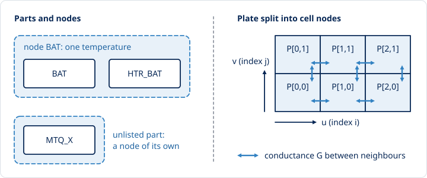
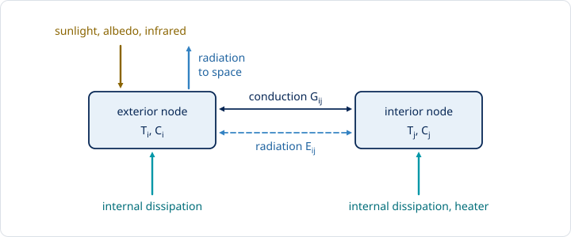
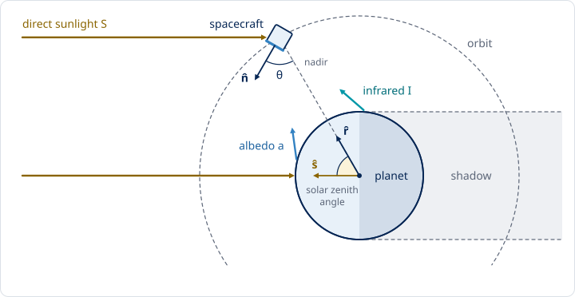
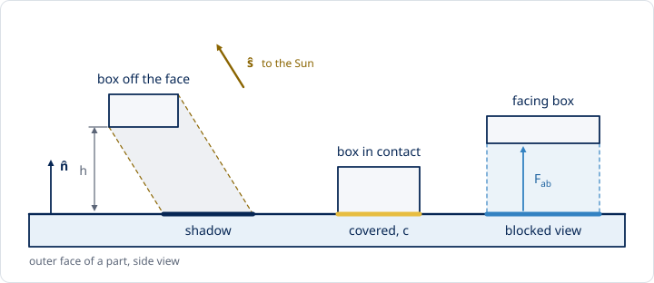
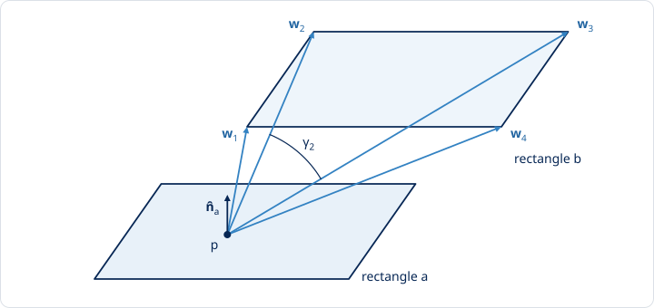
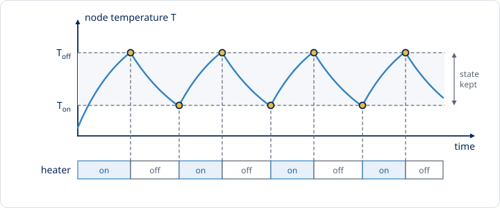
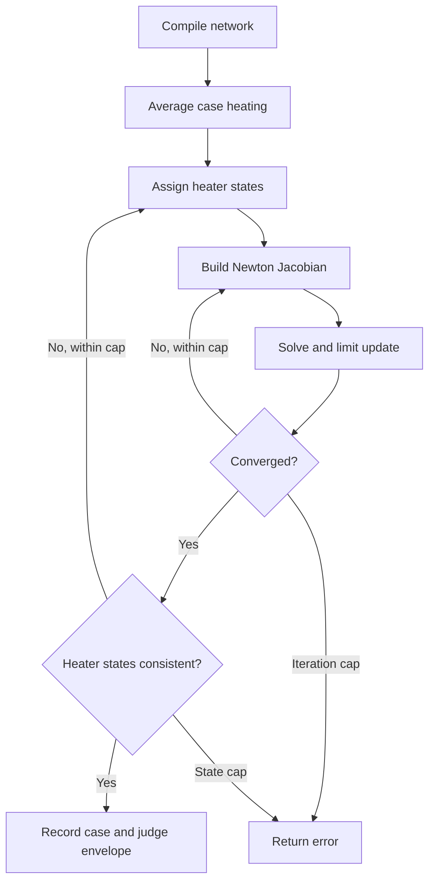
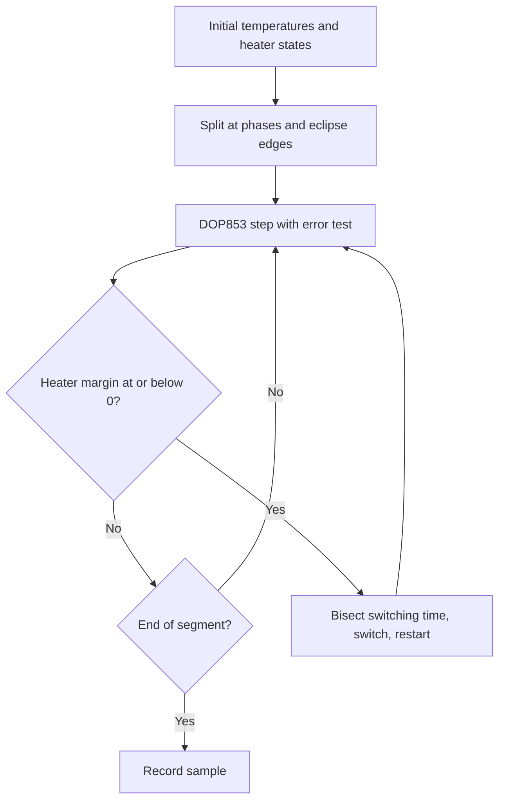

# 熱解析

放熱面やヒータの大きさを決め、部品の温度限度を確かめ、日照と食を通したときの温度の振れ幅を見積もるために使います。

| 解析 | 目的 | 主な入力 | 主な出力 |
|---|---|---|---|
| `thermal.steady` | 各環境条件での平衡温度を求めます | 熱ネットワーク、表面の光学特性、軌道、姿勢、モード | 節点温度、ヒータのデューティ、ケース間の包絡 |
| `thermal.transient` | 選んだ 1 つの条件で温度の時間変化を追います | 同じ熱ネットワーク、軌道履歴、初期温度 | 温度履歴、極値、ヒータの切り替え |

## 共通の前提

### 座標系と符号

面の法線と光の向きは機体座標系で表します。法線は外向きで、太陽ベクトル $\hat{\mathbf s}$ は太陽へ向かい、ナディア方向は中心天体へ向かいます。節点へ入る熱流を正とし、4 乗の量にはケルビンの絶対温度を使います。単位を持つ記号は各解析の表に載せています。

### 軌道、姿勢、ケース

どちらの解析も選んだ軌道から機体の状態（位置、太陽方向、日照率、姿勢）の時系列を作ります。姿勢は熱条件のモードに対応する `analysis.aocs.law.<mode>` か、フェーズの `law.<mode>` で上書きした則から決まります。熱モードがないときは、適用できる姿勢則が 1 つだけ必要です。太陽指向は指定した軸を太陽へ向け続け、ナディア指向は同じ軸を中心天体へ向け続けます。軌道と姿勢の共通の入力は、[設計モデル](../../model.md#51-condition-selection-for-analysis-cases)と[電源解析](power.md)を参照してください。

日照率 $f_\odot$ は全日照で 1、本影で 0 です。既定では円錐影モデルで求め、半影では連続的に変わります（太陽円盤と惑星円盤の重なりの面積比。Montenbruck と Gill）。中心天体が太陽のときは食がなく、$f_\odot = 1$ です。

熱条件は `analysis/thermal.toml` の `[case.<id>]` 表 1 つです。表には環境の値（`solar_flux`、`albedo`、`planet_ir`、任意の `preset`）、`mode`、任意の `beta` を書きます。モードが姿勢とモード平均の発熱を決めます。β 角（軌道面に対する太陽の仰角）は、軌道要素で与えた軌道で解析ケースの β を上書きします。「高温」と「低温」を区別するものは、これ以外にありません。高温条件には、強い入熱（高い太陽光強度、高いアルベド、短いか無い食）と発熱の多いモードを組み合わせるのが普通です。低温条件やセーフモード条件には、弱い入熱と少ない発熱と長い食を組み合わせます。`thermal.steady` は全条件を解き、`thermal.transient` は解析ケースの `thermal_case` で選んだ 1 条件を解きます。

選んだ形態が部品の箱の位置を決めます。この箱から、遮蔽、接触面積、向き合う面の形態係数、空洞の幾何を求めます。

### 等温節点のネットワーク



*節点は、1 つの温度を持つ部品または部品の集まりです。板は格子状のセル節点に分けられます。*

- 部品と節点の対応: `analysis/thermal.toml` の `[nodes]` に書かない部品は部品と同じ名前の節点を 1 つずつ持ちます。書いた部品はその節点にだけ属し、2 つの節点には属せません。節点名は書いていない部品の ID と同じにできません。
- 集約: 節点に属する部品は 1 つの温度を共有します。節点の熱容量は $C_i=\sum_p N_p m_p c_p$ で、$N_p$ は員数、$m_p$ は 1 台の質量、$c_p$ は比熱です。自由節点の熱容量は正でなければなりません。質量が 0 の部品が自分だけの節点を作ると熱容量 0 の節点になります。`fune check` はこれを警告 `thermal.zero_capacity` として示し、どちらの解析も入力の誤りとして拒否します。外面、取付、発熱源、ヒータは同じ部品と節点の対応を使います。
- 分割した板: `[subdivide.<part>]` に `u` と `v` を書くと、1 つの部品が `PART[i,j]`（添字は 0 から）という名のセル節点の一様な格子に分かれます。格子は箱の長い 2 辺の平面にあり、最も薄い辺が法線です。面内の軸は法線から巡回順に決まります。法線が $x$ なら $(u,v)=(y,z)$、$y$ なら $(z,x)$、$z$ なら $(x,y)$ です。詳細は `thermal.steady` のモデルと仮定にあります。



*外面の節点は環境から熱を吸収し、宇宙へ放射します。どちらの節点も内部発熱を受け、結合を通して熱を交換します。*

## thermal.steady 定常熱解析

### 何に答えるか

一定の入熱、または軌道平均の入熱のもとで、各節点がどの温度に落ち着くか、また下側の設定温度を保つのにヒータ電力がどれだけ要るかを求めます。

### 入力

`analysis.thermal` で始まるパスは`analysis/thermal.toml` のキーを指します。部品の属性は射影の前に解決します。

| 量 | 記号 | 単位 | 設計データ | 既定値 |
|---|---|---|---|---|
| 節点への所属 | $i$ | — | `analysis.thermal.nodes.<node>` | 書いていない部品は 1 部品 1 節点（射影が持つ解析の既定） |
| 質量、員数、比熱 | $m_p,N_p,c_p$ | kg、1、J/(kg·K) | `mass`、`count`、`specific_heat` | 質量は必須。員数は 1、比熱は 900 J/(kg·K)（モデルの既定） |
| 板のセル格子と熱伝導率 | $n_u,n_v,k$ | 1、1、W/(m·K) | `analysis.thermal.subdivide.<part>.u`、`.v`、部品の `size`、`material`、`analysis.structure.material.<name>.thermal_conductivity` | 既定では分割しない。分割するときはすべて必須 |
| 面積、外向き法線、光学特性 | $A,\hat{\mathbf n},\alpha,\epsilon$ | m²、1、1、1 | `area`、`normal`、`count`、`absorptivity`、`emissivity`。または `analysis.thermal.surface.<part>.<coating>` と `analysis.thermal.coating.<coating>.absorptivity`、`.emissivity` | 外面になる部品では必須 |
| 箱による遮蔽 | $\ell,c,F_{ab},e$ | 1 | `analysis.thermal.shadowing`、部品の `size` と配置 | 箱があれば有効（射影が持つ解析の既定） |
| 伝導 | $G_{ij},h$ | W/K、W/(m²·K) | `analysis.thermal.contact_conductance`、`analysis.thermal.conductive.<node>.<node>`、`analysis.thermal.contact_conductance_per_area` | 取付の値は必須。節点対の上書きと面積比例は任意 |
| 放射の交換面積 | $E_{ij}$ | m² | `analysis.thermal.radiative_coupling`、`analysis.thermal.radiative.<node>.<node>`、`analysis.thermal.enclosure.emissivity`、`analysis.thermal.view_factors.emissivity` | 書かなければ取付で結ばれた節点間の放射はない。幾何モデルは任意 |
| 環境 | $S,a,I,\beta$ | W/m²、1、W/m²、rad | `analysis.thermal.case.<id>.solar_flux`、`.albedo`、`.planet_ir`、`.beta`、`.preset`、軌道とモードの姿勢 | 条件と軌道が少なくとも 1 つ必要。プリセットの表を参照 |
| 発熱 | $\bar P_p,\bar P_{\mathrm{RF},p},f_p$ | W、W、1 | `analysis.thermal.case.<id>.mode`、状態ごとの `power`、`rf_output`、`heat_fraction`、`analysis.thermal.heat_node.<part>` | RF 出力は 0 W。熱は部品の節点へ入る |
| サーモスタット | $T_{\mathrm{on}},T_{\mathrm{off}},P_{\max}$ | K、K、W | ヒータの `setpoint`（`{ min, max }`）、オン状態の `power`、`count` | `setpoint` がないヒータは通常の発熱部品。`setpoint` とオン状態の電力は必須 |
| 温度限度 | $L,U$ | K | 部品の `temp_survival`、`temp_op`、`temp_perf`、`range_low:<node>:<kind>` と `range_high:<node>:<kind>` への要求の限度 | 範囲がなければ判定しない |
| マージンの方針 | $u,b$ | K | `analysis.thermal.margin.uncertainty`、`analysis.thermal.margin.warning_band` | 解析の既定は 0 K と 5 K |
| その他の入力 | | | 宇宙の温度 $T_{\mathrm{space}}$、ヒータのデューティ警告 | 設計の設定はなく、ライブラリの入力。既定は 3 K と 0.8 |

### モデルと仮定

モデルは集中定数のネットワークです。各節点は等温で、外面への外部放射、内部発熱、ヒータから熱が入ります。熱は節点の間を伝導と放射で移り、面から宇宙へ出ていきます。定常解析は入熱を 1 軌道で平均し、条件ごとに非線形の熱収支を 1 回解きます。

#### 1 つの面への外部入熱

外面は面積 $A$（員数を掛けたもの）、外向き法線 $\hat{\mathbf n}$、太陽光の吸収率 $\alpha$、赤外の放射率 $\epsilon$ を持ちます。表面材の組み合わせを書いたときは、それが部品の光学特性に代わります。面積割合の合計は 1 でなければならず、$\alpha$ と $\epsilon$ は面積で重みづけした和です。吸収も放射も面積に線形なので、この和は厳密です。面は 3 種類の熱を受けます。



*直達日射は太陽方向と面の法線から決まります。アルベドと赤外は惑星の形態係数（法線とナディアの角）から決まり、アルベドにはさらに直下点での太陽の角が効きます。*

1. 直達日射: 吸収する熱は $\alpha S A$ に、入射角の余弦、日照率 $f_\odot$、面の日照割合 $\ell$ を掛けた値です。$\ell$ はほかの部品の影になる面積を除きます。太陽光強度 $S$ は、書いた値かプリセットの値、またはその時刻の太陽距離 $d$ から求めた $S_1(\mathrm{AU}/d)^2$ です。$S_1=1361$ W/m² です。
2. アルベド: 反射した太陽光は $\alpha S a F_{\mathrm{body}}$ に $[\hat{\mathbf r}\cdot\hat{\mathbf s}]_+$ を掛けた値です。$\hat{\mathbf r}$ は惑星中心から機体へ向かいます。コードは見えている照射域を含む惑星全体の代わりに、直下点の太陽天頂角の余弦を使います。夜側ではアルベドが 0 になり、アルベド専用の食の係数はありません。
3. 惑星の赤外: 惑星は単位面積あたり $I$ を放射し、面は $\epsilon I F_{\mathrm{body}}$ を吸収します。

$F_{\mathrm{body}}$ は、平らな面から惑星円盤を見る形態係数です。法線とナディアのなす角 $\theta$ と、軌道半径から決まります。面は宇宙へも放射します。アルベド、赤外、宇宙への放射は 1 つの露出の低減係数 $e$（後述）を共有し、直達日射は代わりに日照割合 $\ell$ を使います。アルベドと赤外は空の広い範囲から来るので、影の係数を持ちません。

月: 月の赤外 $I$ は一様ではありません。昼側は、吸収した太陽光がその場で再放射される（放射平衡）と仮定します。夜側には、温度 100 K、放射率 0.95 の面が出す放射の下限があります。$I$ は両者の大きいほうで、どの太陽角でも同じです。

プリセット: プリセットが与えるのは入熱の値だけです。書いた値はプリセットより優先します。モード、軌道、β は別に選びます。

| プリセット | 太陽光強度 (W/m²) | 地球のアルベド | 地球の赤外 (W/m²) |
|---|---:|---:|---:|
| `hot` | 1414 | 0.35 | 258 |
| `cold` | 1322 | 0.25 | 217 |
| `safe_mode` | 1322 | 0.25 | 217 |

プリセットの太陽光強度は地球と月（太陽距離の慣例値が 1 AU の天体）で使います。プリセットのアルベドと赤外は地球だけで使います。プリセットがなければ、地球の既定値はアルベド 0.30、赤外 237 W/m² です。月の既定値はアルベド 0.12 と、地方時で変わる赤外のモデルです。ほかの惑星では `albedo` と `planet_ir` を書く必要があり、プリセットを使うなら `solar_flux` も書きます。`planet_ir` を書くと、月のモデルは一様な値に代わります。太陽を中心にするときは、アルベドと惑星の赤外が 0 で、太陽光強度は太陽距離か書いた値から決まります。書いたアルベド、赤外、プリセットは使いません。

#### 露出: 影、覆い、向き合う部品



*面から離れた箱は太陽方向に沿って面に影を落とします。接触する箱は面の一部を覆います。隙間を置いて平行に向き合う箱は、面の視野の一部をふさぎます。*

面への入熱を減らすものは、部品の箱で決まります。面は、書いた法線との余弦が 0.999 以上になる箱の面に対応づけます。部品に箱がない、または対応する面がないときは、その面を影なしとして扱います（$\ell=e=1$）。`analysis.thermal.shadowing` を無効にすると、影、覆い、向き合いの低減がまとめて外れます。

- 影: 面の平面の手前（箱が平面より 0.1 mm を超えて出ている）にある、ほかの箱の部分を取ります。その部分の点は平面からの高さを $h$ として、$h(\hat{\mathbf d}-\hat{\mathbf n}(\hat{\mathbf n}\cdot\hat{\mathbf d}))/(\hat{\mathbf n}\cdot\hat{\mathbf d})$ だけ面内へずらします。ここで $\hat{\mathbf d}=\hat{\mathbf s}$ です。ずらした点の凸包を面の長方形で切り取ったものが、その箱の影です。重なる影は 1 度だけ数えます。$\hat{\mathbf n}\cdot\hat{\mathbf s}\le 10^{-9}$ の面は直達日射を受けません。
- 接触する覆い: 面の平面と箱の断面（0.1 mm 以内で取る）が面に重なり、箱が平面より上に出ているとき、その箱は面を覆います。全断面の和集合が覆われた割合 $c$ を与えます。平面の下にある箱（部品が載る親）、平面から浮いた箱、同じ平面に並ぶ箱は、接触では覆いません。覆われた面積は環境と熱を交換せず、覆う箱が光を受け止めます。
- 向き合う箱: 面と平行な面（法線が逆向きで、余弦が 0.999 以上）を持ち、隙間が 0.1 mm を超え、投影で重なる箱は面から環境への視野の一部をふさぎます。ふさぐ割合はその箱の面への形態係数 $F_{ab}$ です。向き合う箱の割合は足し合わせて、1 で打ち切ります。積み重なった箱ではふさぐ割合を多く見積もります。
- 取り付けられた部品: 面の部品に（取付の連鎖をたどって）取り付けられ、自分の熱の外面を持たない部品は、その面の一部です。面の面積と光学特性にその部品が含まれているので、覆いにも向き合う箱にも数えず、その外へ伸びる影だけを数えます。自分の熱の外面を持つ取り付けられた部品（パネルの上の太陽電池）は、ほかの部品と同じように、親を覆い、親に向き合い、親に影を落とします。この場合、親の面は全面積で書き、各面積を 1 度ずつ数えるようにします。

日照割合と露出は次のとおりです。

```math
\ell = 1-\frac{\left|\bigcup(\text{shadows}\cup\text{covers})\right|}{A},\qquad
c=\frac{\left|\bigcup\text{covers}\right|}{A},\qquad
e=(1-c)\Bigl(1-\min\bigl(1,\textstyle\sum_b F_{ab}\bigr)\Bigr).\tag{1}
```

ここで $|\cdot|$ は面積（m²）です。$e$ の積は覆われていて、しかも向き合われている面積を二重に引かないためです。覆われた面積は$\ell$ の中ですでに暗い面積です。分割した板では同じ量を 2 つの広い面のセルの長方形ごとに求め、向き合う箱の和はセルごとに 1 で打ち切ります。

2 つの長方形の間の形態係数 $F_{ab}$ は、後述の点から長方形への積分で求め、図に示します。



*長方形 a 上の点 $p$ から、長方形 b の角へのベクトル $\mathbf w_k$ と、続く 2 つのベクトルの間の角 $\gamma_k$ から、点の形態係数が厳密に決まります。*

#### 伝導

取付は部品を親につなぎます。1 つの取付の伝導は書いた `contact_conductance` です。同じ 2 節点の間に複数の取付があれば足し合わせます。同じ節点の中の取付は無視します。任意で `contact_conductance_per_area` の $h$ を書くと、これが $h A_{\mathrm{contact}}$ に代わります。$A_{\mathrm{contact}}$ は、一方の箱の面と、向き合う他方の箱の面（4 つの角が最初の面の平面から 0.1 mm 以内にあるもの）との重なりの面積のうち、最大のものです。箱がない取付や接触面積が 0 の取付は固定の値のままで、出力にその取付が代替として載ります。明示した節点対 `conductive.<node>.<node>` はその対の取付の値に代わります（0 で切り離します）。

分割した板は隣り合うセルの間も伝導します。板厚 $t$（最も薄い辺）、共有する辺の長さ $L_{\mathrm{edge}}$、中心間の距離 $d_{ij}$（すべて m）から、$G=k\,t\,L_{\mathrm{edge}}/d_{ij}$ です。

#### 節点間の放射

節点対の交換面積 $E_{ij}$ には 4 つの出どころがあり、最初に当てはまるものを使います。順に、明示した `radiative` の対（0 も可）、外殻、空洞の形態係数、取付の既定値（`radiative_coupling`。取付で結ばれた節点対に 1 つの値で、取付の数は掛けません）です。

- 空洞の形態係数（`[view_factors] emissivity`。全面で 1 つの放射率）: ほかの箱を含む箱は中空の殻とみなします。殻の内向きの壁と、中にある部品の外向きの面が、空洞の面です。同じ部品の面どうしは壁を除いて互いに見えません。接する面の対（0.1 mm 以内）は放射でなく伝導です。そのほかの内部の箱は視線をさえぎり、かすめる光線が通るように、各箱を 0.1 mm 縮めます。向き合う面の対ごとに、下の灰色 2 面の抵抗網で交換面積を求め、2 つの節点の交換面積はその面の対の値の和です。第三の面での反射は数えません。放射率が高ければ誤差は小さくなります。
- 外殻（`[enclosure] emissivity`）: 根の箱の 6 面を、面の法線と面積（余弦 0.999 以上、面積の差 5 % 以内）で、6 つの別々の節点に対応づけます。複数の節点が 1 つの面を争うときは、位置で決めます（面の平面から箱の最短の辺の 5 % 以内で、面と半分以上重なる）。6 面が 6 つの別々の節点に決まらなければ、外殻は使わず、理由を出力に残します。外殻は反射を含む閉じた 6 面の問題全体を解きますが、内側のさえぎりは無視します。

#### 発熱とヒータ

部品のモード平均電力 $\bar P_p$ は、状態ごとの電力に、各状態の時間の割合と、その状態の台数（冗長と予備を含む）を掛けて足した値です。したがって $\bar P_p$ は、すでに部品全体の合計です。$\bar P_{\mathrm{RF},p}$ は RF 出力について同じ量で、アンテナから出ていきます。`heat_fraction` の $f_p$ を書けば発熱は $f_p\bar P_p$、書かなければ $\bar P_p-\bar P_{\mathrm{RF},p}$ です。熱は部品の節点か、`[heat_node]` に書いた節点へ入ります。



*サーモスタット付きヒータは$T_{\mathrm{on}}$ を下回るとオンになり、$T_{\mathrm{off}}$ を上回るとオフになります。その間は状態を保ちます。*

`setpoint` を持つ部品はサーモスタット付きヒータで、通常の発熱としては数えません。ヒータは温度を測る節点を暖め、オンのときに `count` 掛けるオン状態の電力 $P_{\max}$ を出します。サーモスタットは、ヒータの状態がモードの中で `off` だけのときを除いて働きます。モードがない、またはヒータの割り当てがないときも働きます。モードに書いた `duty` は電源側の見積りで、サーモスタットが働く間は使いません。サーモスタットは 1 節点に 1 つまでで、分割した板に直接は置けません。

不感帯の中には、一意の定常状態がありません。そこで定常解析は節点を $T_{\mathrm{on}}$ に保つ電力 $P$（$0\le P\le P_{\max}$）を定常状態と定義します。ヒータなしで節点が $T_{\mathrm{on}}$ 以上なら `off`、全電力でも足りなければ `saturated`（$P=P_{\max}$、節点は $T_{\mathrm{on}}$ 未満）、それ以外は `regulating` です。

### 式

節点 $i$ について、$T_i$ と $T_{\mathrm{space}}$ は温度（K）、$C_i$ は熱容量（J/K）、$H_i$ は正味の流入（W）です。$Q_{\mathrm{int},i}$ と $Q_{\mathrm{htr},i}$ は内部発熱とヒータ電力（W）です。$G_{ij}$（W/K）と $E_{ij}$（m²）は対称な伝導と放射の結合で、$A_s e_s$ は面 $s$ の露出した面積、$Q_s$ は面 $s$ が吸収する熱です。ステファン・ボルツマン定数 $\sigma$ は $5.670374419\times10^{-8}$ W/(m²·K⁴)、$T_{\mathrm{space}}$ の既定は 3 K です。

```math
\begin{aligned}
C_i &= \sum_p N_p m_p c_p,\\
C_i\frac{dT_i}{dt} &= H_i = Q_{\mathrm{ext},i}+Q_{\mathrm{int},i}+Q_{\mathrm{htr},i}
+\sum_j G_{ij}(T_j-T_i)
+\sigma\sum_j E_{ij}(T_j^4-T_i^4)
-\sigma\sum_s \epsilon_s A_s e_s(T_i^4-T_{\mathrm{space}}^4),
\end{aligned}\tag{2}
```

ここで $Q_{\mathrm{ext},i}=\sum_s Q_s$ です。温度を固定した節点の微分は 0 です。

1 つの面が吸収する熱は、3 つの入熱を合わせたものです。$[x]_+=\max(0,x)$ とし、$\hat{\mathbf r}$ を惑星中心から機体への単位ベクトル、$F_{\mathrm{body}}$ を面の惑星形態係数とします。

```math
Q_s=A\left[\alpha S f_\odot [\hat{\mathbf n}\cdot\hat{\mathbf s}]_+\,\ell
+ e\,F_{\mathrm{body}}\bigl(\alpha S a[\hat{\mathbf r}\cdot\hat{\mathbf s}]_+ + \epsilon I\bigr)\right].
\tag{3}
```

赤外の放射束 $I$ は書いた値か既定の一様な値です。赤外の上書きがない月では、

```math
I=\max\bigl((1-a)S[\hat{\mathbf r}\cdot\hat{\mathbf s}]_+,\ 0.95\,\sigma\,(100\ \mathrm{K})^4\bigr),\tag{4}
```

で、夜側の下限は $0.95\,\sigma\,(100\,\mathrm{K})^4\approx 5.39$ W/m² です。

平らな面の法線がナディアとなす角を $\theta$、軌道半径を $r$、惑星半径を $R$（どちらも m）とすると、惑星の見込み半角は $\lambda=\arcsin(R/r)$ です。$\theta\le\pi/2-\lambda$ なら惑星全体が面の前にあり、$F_{\mathrm{body}}=\cos\theta\,(R/r)^2$ です。$\theta\ge\pi/2+\lambda$ なら惑星が面の裏にあり、$F_{\mathrm{body}}=0$ です。その間では地平線が面を横切り、コードは部分円盤の式（Howell C-9）を $H=r/R$ で使います。

```math
\begin{aligned}
x&=\sqrt{H^2-1},\qquad y=-x\cos\theta/\sin\theta,\qquad z=\sqrt{[1-y^2]_+},\\
F_{\mathrm{body}}&=\operatorname{clip}_{[0,1]}\!\left[
\frac{\cos\theta\arccos(\operatorname{clip}_{[-1,1]} y)-x\sin\theta\,z}{\pi H^2}
+\frac{1}{\pi}\arctan\!\left(\frac{\sin\theta\,z}{x}\right)\right].
\end{aligned}\tag{5}
```

惑星の表面以下では $[\cos\theta]_+$ を使います。デモの軌道（高度 550 km）でナディアを向く面は、$F_{\mathrm{body}}=(6378.137/6928.137)^2=0.8475$ です。

2 つの長方形の形態係数は厳密な点の係数の平均です。長方形 $a$ 上の点 $p$ で単位法線を $\hat{\mathbf n}_a$ とし、長方形 $b$ を $p$ の接平面より上の半空間で切り取ります。$\mathbf w_k$（m）を、$p$ から切り取った多角形の頂点へ周回順に向かうベクトル、$\gamma_k$（rad）を $\mathbf w_k$ と $\mathbf w_{k+1}$ の間の角とします（Nusselt の輪郭の形）。点の係数と長方形の係数は次のとおりです。

```math
F_{p\to b}=\operatorname{clip}_{[0,1]}\!\left(
-\frac{1}{2\pi}\sum_k\gamma_k\,\hat{\mathbf n}_a\cdot
\frac{\mathbf w_k\times\mathbf w_{k+1}}{\lVert\mathbf w_k\times\mathbf w_{k+1}\rVert}\right),
\qquad F_{ab}\approx\frac14\sum_{l,m} w_l w_m\,F_{p_{lm}\to b}\,v_{p_{lm}}.\tag{6}
```

ここで $w_l$ は $[-1,1]$ のガウス・ルジャンドル重みで、$p_{lm}$ は $a$ 上の 10 × 10 の点です。$v_p$ は、さえぎりがなければ 1 です。空洞のさえぎりがあるときは、核 $\cos\theta_a\cos\theta_b/r^2$ のうち、さえぎられずに $b$ へ届く割合で、$b$ 上の 6 × 6 の格子でサンプル化します。(6) の符号は、法線の側から反時計回りに並べた角が正の値を与えるように選んでいます。

外殻の箱の 6 面には閉じた式を使います。同じ大きさ $a\times b$ の 2 つの長方形が距離 $c$ で向き合うとき（Howell C-11）、$X=a/c$、$Y=b/c$ として、

```math
F=\frac{2}{\pi XY}\Bigl\{\ln\sqrt{\tfrac{(1+X^2)(1+Y^2)}{1+X^2+Y^2}}
+X\sqrt{1+Y^2}\arctan\tfrac{X}{\sqrt{1+Y^2}}+Y\sqrt{1+X^2}\arctan\tfrac{Y}{\sqrt{1+X^2}}-X\arctan X-Y\arctan Y\Bigr\}.\tag{7}
```

です。共有する辺の長さが $l$ で直交する 2 つの長方形では（Howell C-14）、幅 $w_1$ の長方形から幅 $w_2$ の長方形を見るとして、$W=w_1/l$、$H=w_2/l$、$\Sigma=W^2+H^2$ とし、

```math
F=\frac{1}{\pi W}\Bigl\{W\arctan\tfrac1W+H\arctan\tfrac1H-\sqrt{\Sigma}\arctan\tfrac1{\sqrt{\Sigma}}
+\tfrac14\ln\Bigl[\tfrac{(1+W^2)(1+H^2)}{1+\Sigma}\Bigl(\tfrac{W^2(1+\Sigma)}{(1+W^2)\Sigma}\Bigr)^{W^2}\Bigl(\tfrac{H^2(1+\Sigma)}{(1+H^2)\Sigma}\Bigr)^{H^2}\Bigr]\Bigr\}.\tag{8}
```

です。コードは (7) と (8) を、立方体について表の値 0.19982 と 0.20004 に照らして確かめています。空洞のモデルと外殻のモデルは、形態係数を 2 通りの方法で交換面積にします。

互いだけを見る灰色拡散面の 1 対では、$g_{ab}=A_aF_{ab}$（m²）、面積 $A_a$、$A_b$、共通の放射率 $\epsilon$ として、直列の放射抵抗から次式が得られます。

```math
E_{ab}=\left[\frac{1-\epsilon}{\epsilon A_a}+\frac1{g_{ab}}+
\frac{1-\epsilon}{\epsilon A_b}\right]^{-1}.\tag{9}
```

空洞のモデルは向き合う面の対ごとに (9) を求め、2 つの節点の間にある対の値を足します。$g_{ab}$ は面 $a$ から 1 度だけ求め、両方向に使います。$F=1$ で向き合う同じ大きさの平行な面では、(9) は $A/(2/\epsilon-1)$ になります。

外殻は 6 面をまとめて解きます。Gebhart 係数 $B_{ab}$ は、面 $a$ が放射したエネルギーのうち、何度反射しても最終的に面 $b$ が吸収する割合です。形態係数の行列 $\mathbf F$（(7) と (8) から得ます）、単位行列 $\mathbf I$、放射率ベクトル $\boldsymbol\epsilon$ を使うと、

```math
(\mathbf I-\mathbf F\operatorname{diag}(1-\boldsymbol\epsilon))\mathbf B
=\mathbf F\operatorname{diag}(\boldsymbol\epsilon),
\qquad E_{ab}=\epsilon_a A_a B_{ab}.\tag{10}
```

です。

分割した板のセルの間の伝導は $G=k\,t\,L_{\mathrm{edge}}/d_{ij}$ で、$u$ 方向では $k\,t\,\Delta v/\Delta u$、$v$ 方向では $k\,t\,\Delta u/\Delta v$ です。各セルの熱容量は $C_{\mathrm{part}}/(n_un_v)$ です。外面の入熱、宇宙への放射、発熱は面積の割合で配ります。ただし、2 つの広い面の日照割合、覆い、向き合いの低減はセルの長方形ごとに求めます。分割していない隣の部品への取付の伝導は、各セルと隣の箱の接触面積の割合で配り、決められなければ投影の重なり、それも決められなければ面積の割合で配ります。両端が分割した板なら、割合の積です。形態係数から出した放射は、その対のセルと面の形態係数の割合で配り、合計は保ちます。

### アルゴリズム

1. 節点とセルのネットワーク、外面、結合、熱容量、サーモスタットを組み立て、入力を検査します。熱条件ごとに、1 軌道分の軌道と姿勢のサンプルを作ります。刻みは30 s と 1 周期の 200 分の 1 の大きいほうです。1 回限りの軌道（周期のない軌道）では、全期間を使います。
2. 各サンプルで、すべての面について (3) を計算します。完全な周回があればその範囲で、なければ全期間で、台形則により平均します。ライブラリの呼び出しでは固定の太陽方向、ナディア、高度も与えられます。設計は軌道平均を使います。
3. モード平均の発熱を足します。働いているヒータは `off` から始めます。仮定したヒータの状態ごとに、`regulating` の節点は $T_{\mathrm{on}}$ に固定し、`saturated` の節点には $P_{\max}$ を加えます。
4. $H_i=0$ とした (2) を Newton 法で解きます。自由節点はすべて 290 K、固定節点はその温度から始めます。各反復で $\mathbf H$ とヤコビ行列 $\mathbf J=\partial\mathbf H/\partial\mathbf T$（W/K）を求めます。$i\ne j$ では $J_{ij}=G_{ij}+4\sigma E_{ij}T_j^3$、対角は $J_{ii}=-\sum_{j}\bigl(G_{ij}+4\sigma E_{ij}T_i^3\bigr)-4\sigma K_iT_i^3$ で、$K_i=\sum_s\epsilon_sA_se_s$ です。固定節点は行を単位行列に、右辺を $T_{\mathrm{fix}}-T_i$ に置き換えます。$\mathbf J\,\Delta\mathbf T=-\mathbf H$ を、部分ピボット選択つきのガウス消去法で解きます。ピボットが成分の絶対値の最大の $10^{-14}$ 倍以下なら、系が特異（宇宙にも固定節点にも熱の逃げ道がない節点がある）なので、入力の誤りとして止めます。$\Delta\mathbf T$ は最大の成分が 50 K 以下になるように縮め、温度に足したあと、下限を 1 K にします。
5. 縮める前の補正の最大が $10^{-9}$ K 未満で、自由節点の残差 $|H_i|$ の最大が、1 W と入力電力の絶対値の和の大きいほうの $10^{-6}$ 倍以下になったら止めます。反復が 200 回を超えれば誤りです。
6. 各 `regulating` ヒータの電力はそのヒータを除いた節点の熱収支の符号を反転した値です。$P<0$ の `regulating` は `off` に、$P>P_{\max}$ のものは `saturated` に移します。節点が $T_{\mathrm{on}}-10^{-7}$ K を下回る `off` のヒータと、節点が $T_{\mathrm{on}}+10^{-7}$ K を上回る `saturated` のヒータは`regulating` に移します。状態が変わらなくなるまで手順 4 から繰り返します。$4N_{\mathrm h}+8$ 回（$N_{\mathrm h}$ はヒータの数）で収まらなければ、誤りとして止めます。デューティは $P/P_{\max}$ です。
7. ケースごとに節点の範囲とマージンを求めます。ケース間の包絡と最悪の検査を報告します。分割した板では側ごとに最も高いセルと最も低いセルを残します。



*定常の解法はケースごとに、サーモスタットの状態の反復の中で Newton 反復を回します。*

### 検査と判定

部品の温度範囲は最大 3 種類です。保管（`temp_survival`）は、停止中の部品に損傷を与えない範囲です。動作（`temp_op`）は、機能が保たれる範囲で、性能（`temp_perf`）は、規定の性能を満たす範囲です。モードのあるケースでは、節点のある種類の範囲は、その種類を適用する部品の範囲の共通部分です。保管はオフの時間がある部品に、動作と性能はオンの時間がある部品に適用し、デューティや冷予備のある部品には 3 種類すべてを適用します。モードの情報がないとき、または部品の状態が決まらないときは、与えた範囲すべてを適用します。`range_low:<node>:<kind>` や `range_high:<node>:<kind>` への要求は、部品がすでに与えている範囲を厳しくできますが、広げることも新しく作ることもできません。

節点の予測最低温度と予測最高温度を $T_{\min},T_{\max}$（K）、限度を $L,U$（K）、不確かさを $u$、警告の幅を $b$ とすると、符号つきのマージン（K）は次のとおりです。

```math
M_{\mathrm{low}}=T_{\min}-L-u,\qquad M_{\mathrm{high}}=U-T_{\max}-u.\tag{11}
```

マージンが 0 未満なら `violation`、0 以上 $b$ 未満なら `warning`、$b$ 以上なら `ok` です。定常では 1 つのケースで $T_{\min}=T_{\max}$ です。出力の `margin_low` と `margin_high` は$u$ を引く前の生のマージンです。検査 `range_low:<node>:<kind>` と `range_high:<node>:<kind>` は種類ごとに、その側でマージンが最も小さいケースを使います。分割した板は上側を最も高いセル、下側を最も低いセルで、部品の名前のもとに判定します。

`heater:<part>` は最悪のケースで判定します。飽和していれば違反、デューティが 0.8 を厳密に超えれば警告、それ以外は `ok` です。サーモスタットが無効なら `ok` です。モードの評価は、モードへの割り当てがない部品や、使う状態の値がない部品について警告し、合計から除きます。

`shadow_loss` は、熱の外面を持たない部品がさえぎる入熱が、吸収される熱の 2 % を超えたときに警告します。熱の外面を持つさえぎる部品だけを数えた吸収熱と、すべてのさえぎる部品を数えた吸収熱を比べ、後者に対する増加分の割合を求めます。何も吸収しないときは割合が 0 です。定常は、割合が最大のケースを報告します。設計の検査 `thermal.zero_capacity`（共通の前提を参照）は`fune check` の警告だけです。

### 出力

| 項目 | 単位 | 意味 |
|---|---|---|
| `cases[].nodes` | K、W | 温度、吸収した外部入熱、内部入熱（発熱とヒータ）、範囲、判定 |
| `cases[].environment`、`iterations`、`residual` | W/m²、K、1、W | 解いた入熱の値、Newton 反復の回数、最終のヒータ状態での残差 |
| `cases[].heaters` | W、K、1 | 容量、電力、デューティ、設定温度、状態 |
| `couplings`、`cases[].shadowing` | W/K、m²、1 | 結合の値と出どころ、面ごとの日照割合、覆われた割合、露出の割合 |
| `envelope`、`checks`、任意の `detail` | K、m | ケース間の節点の極値、判定、セルごとの温度と幾何 |

### 計算例

`fixtures/demo-6u` の複製で `fune -C <複製> analyze thermal.steady --json` を実行します。デモは取付 1 つあたり 0.5 W/K、取付で結ばれた節点対あたり 0.002 m² の放射を書いています。条件は `hot`（モード `MISSION`、1414 W/m²、アルベド 0.35、赤外 258 W/m²、β 60°）、`cold`（モード `SAFE`、1322 W/m²、アルベド 0.25、赤外 216 W/m²、β 0°）、`cold_nominal`（プリセット `cold`、モード `NOMINAL`、赤外 217 W/m²）です。書いた 216 W/m² はプリセットの 217 W/m² に優先します。姿勢は太陽指向で、軌道は高度 550 km です。どのケースも Newton 反復 5 回で収束し、残差は $3\times10^{-13}$ W 未満でした。

電池の節点 `BAT`、`cold` ケース: `BAT` は下側の設定温度 293.15 K に保たれています。外面はなく、結合は 3 つです。`BUS` への明示の 0.05 W/K、`PANEL_MZ` への明示の 0.03 W/K、`BUS` への取付の放射 0.002 m² です。隣の節点の温度は $T_{\mathrm{BUS}}=271.55042$ K、$T_{\mathrm{PMZ}}=268.63878$ K です。

| 項 | 計算 | W |
|---|---|---:|
| `BUS` への伝導 | $0.05\,(271.55042-293.15)$ | −1.07998 |
| `PANEL_MZ` への伝導 | $0.03\,(268.63878-293.15)$ | −0.73534 |
| `BUS` への放射 | $\sigma\cdot0.002\,(271.55042^4-293.15^4)=1.13407\times10^{-10}\times(-1.94762\times10^{9})$ | −0.22087 |
| 交換の合計 | | −2.03619 |

ヒータが 2.03619 W を出す必要があり、プログラムの出力は 2.036190585 W です。容量が 3 W なので、デューティは $2.036190585/3=0.678730195$ で、`duty_fraction` と一致します。したがって、流入と流出は丸めの範囲で釣り合っています。

パネルの節点 `PANEL_PZ`、`cold` ケース: この節点には外面が 1 つ（面積 0.0226 m²、白色塗装で $\epsilon=0.85$、露出 $e=1$）あり、発熱はありません。プログラムが出す軌道平均の吸収熱は 1.19233 W です。$T=272.15895$ K での交換は次のとおりです。

| 項 | W |
|---|---:|
| `CAM` への伝導（$5.0\,(273.15-T)$、明示） | +4.955258 |
| `BUS` への伝導（$0.5\,(271.55042-T)$、取付） | −0.304264 |
| `BUS` と `CAM` への放射（取付、各 0.002 m²） | +0.003566 |
| `PANEL_PX`、`_MX`、`_PY`、`_MY`、`_MZ` への外殻の放射 | +0.129375 |
| 宇宙への放射: $0.85\,\sigma\cdot0.0226\,(T^4-3^4)$、$T^4=5.48644\times10^{9}$ | −5.976261 |
| 吸収した外部入熱 | +1.192327 |
| 合計 | 0.000000 |

項の合計は $10^{-6}$ W の範囲で 0 になります（丸める前の値では $10^{-13}$ W の範囲です）。外殻の各項は $\sigma E_{ij}(T_j^4-T^4)$ で、`PANEL_PX` への交換面積は 0.006116 m² などです。

判定の例: `hot` ケースで、カメラの節点 `CAM` は 287.455044 K です。性能の下限は 278.15 K です。$u=5$ K として (11) から $287.455044-278.15-5=4.305044$ K となり、5 K の幅を下回るので、結果は `warning` です。

### 限界

非線形の熱収支を解く前に入熱を軌道で平均するので、軌道に沿った温度の振れは出ません。箱による近似は細かい幾何と、傾いた向き合う遮蔽物を省いています。積み重なった向き合う箱は、さえぎりを多く見積もることがあります。空洞のモデルは第三の面での反射を省き、外殻のモデルは箱の内側のさえぎりを無視します。アルベドは見えている円盤全体に対して 1 つの直下点の太陽角を使います。分割した板は厚さ方向の勾配を持たず、切り欠きのない長方形の板です。プリセットの光学特性と放射照度は設計条件の代表値なので、想定するミッション環境に照らして確かめてください。

### 検証

- `thermal_validation_equilibrium.rs` は、片面と両面の平板と立方体を、閉じた式による 4 乗根の平衡と比べます。`thermal_validation_network.rs` は、伝導と放射の 2 節点の釣り合いと、温度固定の境界を確かめます。
- `thermal_validation_orbit.rs` は、ナディアを向く平板のアルベドと赤外を手計算と比べます。`thermal_validation_heliocentric.rs` は、逆 2 乗の太陽光強度の楕円上の平均を確かめます。
- `thermal_validation_plate.rs` は、長さ $L$、幅 $w$（m）の帯が熱量 $Q$（W）を運ぶときの面内の温度降下 $Q L/(k\,t\,w)$ を確かめます。`steady/heater_tests.rs` は、制御中の電力とデューティを熱収支と比べます。
- 単体テストは立方体の形態係数（0.19982 と 0.20004、`astro/src/view_factor.rs`）、2 面の外殻の $A/(1/\epsilon_1+1/\epsilon_2-1)$（`thermal/enclosure.rs`）、月のナディアを向く平板（`thermal/orbit_heat.rs`）、影、覆い、向き合いの規則（`thermal/orbit_heat/shading_tests.rs`）を扱います。

### ソース

[定常解析](../../../crates/lib/analysis/src/thermal/steady.rs)、[Newton 法](../../../crates/lib/analysis/src/thermal/network/newton.rs)、[ネットワーク](../../../crates/lib/analysis/src/thermal/network.rs)、[軌道上の入熱](../../../crates/lib/analysis/src/thermal/orbit_heat.rs)、[環境](../../../crates/lib/analysis/src/thermal/environment.rs)、[惑星モデル](../../../crates/lib/analysis/src/thermal/planet.rs)、[日照割合](../../../crates/lib/analysis/src/structure/external_geometry/lit.rs)、[長方形の形態係数](../../../crates/lib/astro/src/view_factor/rect.rs)、[閉じた式の形態係数](../../../crates/lib/astro/src/view_factor.rs)、[外殻](../../../crates/lib/analysis/src/thermal/enclosure.rs)、[空洞の形態係数](../../../crates/lib/analysis/src/structure/cavity_views.rs)、[設計からの射影](../../../crates/app/projection/src/thermal.rs)。

## thermal.transient 非定常熱解析

### 何に答えるか

指定した軌道の期間に、節点温度とヒータの状態がどう変わるか、またサンプルの極値が温度限度にどこまで近づくかを求めます。

### 入力

熱ネットワーク、幾何、光学特性、環境、発熱、限度、マージンは、[thermal.steady](#thermalsteady-定常熱解析)と同じです。

| 量 | 記号 | 単位 | 設計データ | 既定値 |
|---|---|---|---|---|
| 環境の選択 | — | — | `cases.<id>.thermal_case`、`analysis.common.default_case`、`analysis.thermal.case.<id>` | 条件が 1 つだけならその条件。そうでなければ必須 |
| 期間 | $t_{\mathrm{end}}$ | s | 軌道と `analysis.thermal.orbits` | 3 周。太陽を中心とする周期的な軌道では 1 周。1 回限りの軌道ではその期間 |
| 出力の間隔 | $\Delta t_{\mathrm{out}}$ | s | `analysis.thermal.time_step` | 30 s と 1 周期の 200 分の 1 の大きいほう。1 回限りの軌道ではこれより細かくしない |
| 初期温度 | $T_i(0)$ | K | `analysis.thermal.initial_temperature` | 軌道平均の定常解 |
| 積分器の制御 | — | 1、K、s | ライブラリの入力 `rel_tol`、`abs_tol`、`max_step` | $10^{-8}$、$10^{-6}$ K、刻みの上限なし |

### モデルと仮定

設計は選んだ条件のモードから、発熱のフェーズを 1 つ渡します。ライブラリはそれぞれのモードと長さを持つ繰り返しのフェーズも受け付け、長さを省けば 86 400 s です。内部発熱は各フェーズの中で一定です。式 (3) の外部入熱は積分器の試行時刻ごとに、その時刻の軌道、太陽、姿勢則、食から求めるので、出力のサンプルの間も連続です。ヒータはヒステリシスつきのオンオフ制御です（thermal.steady の図を参照）。出力は全電力か 0 のどちらかです。モードはフェーズごとに読むので、あるフェーズでヒータを無効にできます。

### 式

積分器は式 (2) を進めます。有効なサーモスタットは、節点が $T_{\mathrm{on}}$ まで下がるとオンになり、$T_{\mathrm{off}}$ まで上がるとオフになって、その間は状態を保ちます。定格の発熱を $P_{\mathrm{on}}$（W）、オンだった時間の合計を $t_{\mathrm{on}}$、模擬した時間を $t_{\mathrm{run}}$（s）とすると、デューティと平均電力は次のとおりです。

```math
D=t_{\mathrm{on}}/t_{\mathrm{run}},\qquad \overline P=D\,P_{\mathrm{on}}.\tag{12}
```

オンのヒータのイベント関数は $T_{\mathrm{off}}-T_i$、オフのヒータでは $T_i-T_{\mathrm{on}}$ です。これが 0 になるとヒータが切り替わります。積分器は Dormand–Prince 8(5,3) 法（DOP853。Hairer と Wanner）で、1 刻みに 12 段を使い、5 次と 3 次の埋め込みの誤差推定を持ちます。大きさ $h$（s）の試行の刻みについて、状態 $i$ の段の微分の 3 次と 5 次の誤差の組み合わせを $e_{3,i}$、$e_{5,i}$（K/s）とします。これらを $s_i$（K）で規格化し、$n$ を状態の数とします。

```math
\begin{aligned}
s_i&=a_{\mathrm{tol}}+r_{\mathrm{tol}}\max(|T_i^{\mathrm{old}}|,|T_i^{\mathrm{new}}|),\\
N_3&=\sum_i (e_{3,i}/s_i)^2,\qquad N_5=\sum_i (e_{5,i}/s_i)^2,\\
\mathcal E&=\frac{|h|\,N_5}{\sqrt{n\,(N_5+0.01\,N_3)}}.
\end{aligned}\tag{13}
```

$\mathcal E$ は無次元です。(13) で 2 つの推定を混ぜるのは、5 次の推定がたまたま小さいときに、3 次の推定が安全策として働くようにするためです。$N_5+0.01N_3=0$ のときは、コードがその代わりに 1 を使います。$\mathcal E\le1$ なら刻みを受理します。

### アルゴリズム

1. 定常解析と同じに組み立てます。すべての節点を書いた一様な温度から始めるか、フェーズの平均発熱と最初のフェーズのヒータの有効・無効を使って軌道平均の熱収支を解いた温度から始めます。ライブラリは節点ごとの値も受け付けます。節点が $T_{\mathrm{on}}$ を下回って始まるヒータはオンで始まり、不感帯の中ではオフで始まります。設定温度の差は 0.001 K 以上が必要です。
2. 軌道、姿勢、食の評価器を作ります。出力のサンプルの間の区間を、発熱のフェーズの境と食の境で分けます。食の境は、両端のサンプルの間で日照率が $10^{-9}$ と $1-10^{-9}$ を横切る時刻を、許容 1 µs の二分法で求めます。区間の端では区間の内側 5 µs の時刻で評価する（ごく短い区間なら中点）ので、日照率の跳びを反対側から読むことはありません。
3. 滑らかな区間ごとに、(2) を DOP853 と密出力で積分します。試行の刻みのあとに (13) で $\mathcal E$ を求めます。$\mathcal E>1$ なら刻みを棄却し、$h$ を $\min(3.003,\ \mathcal E^{0.117}/0.9)$ で割ります。棄却は連続で 50 回までです。受理したときの新しい刻みは $h/\mathrm{clamp}(\mathcal E^{0.117}/(0.9\,\mathcal E_{\mathrm{old}}^{0.04}),\,1/6,\,3.003)$ で、安全係数 0.9 の比例・積分制御です（指数 0.117 は $1/8-0.2\cdot0.04$ です）。提案した刻みは次の区間へ引き継ぎます。1 回の呼び出しの試行は 5 000 000 刻みまでです。出力の間隔は報告の時刻と区間の境を決めるだけで、積分の刻みは誤差の制御だけが選びます。数値伝播の軌道は 1 度だけ表にし、軌道の追跡の刻みと出力の間隔の細かいほうと同じかそれより細かい格子の上で、3 次エルミート多項式で補間します。ケプラー軌道と J2 軌道は直接評価します。
4. 受理した刻みのたびに、働いているヒータのイベントの余裕の最小値を調べます。0 以下なら、その刻みの密出力に対する二分法で交差の時刻を求めます。時刻の許容は $\max(10^{-9}h,\,10^{-13}\max(|t_0|,1))$（s）で、$t_0$ は刻みの始まりです。そこで止め、節点が閾値の $10^{-5}$ K 以内か、それを越えているヒータをすべて切り替え、その状態から積分をやり直します。オン時間は全体と、最後の 1 周期（走行がそれより短ければ全体）について積算します。
5. 指定した期間で終わります。実装は周期的な定常状態の判定を持たず、期間を延ばしません。軌道平均の定常状態から始めると、立ち上がりの過渡の大半は除かれます。連続する軌道の対応するサンプルを比べると、それが減衰したかどうかが分かります。極値は出力のサンプルから、平均は台形則の時間平均から求めます。



*滑らかな区間ごとに適応積分し、サーモスタットが交差するたびに止めます。*

### 検査と判定

範囲の検査はサンプルの時系列の極値 $T_{\min},T_{\max}$ を使って (11) で行うので、定常解析と同じ規則です。範囲の選択には、投影したすべてのフェーズのモードが入ります。ヒータが飽和しているのは、最後に有効であり、最後の周期にオフの区間がなく、その間にオンの時間があり、その窓の節点の最高温度が $T_{\mathrm{on}}$ を下回るときです。これは違反です。最後の周期のデューティが 0.8 を厳密に超えれば警告です。`shadow_loss` は定常解析と同じ 2 % の規則で、サンプルの単純平均を使います。`plate_step:<part>` は、分割した板の最小のセルの時定数 $C_i/\sum_jG_{ij}$（伝導だけ）が出力の間隔の 0.1 倍を下回るときに警告します。そのとき陽解法は多数の小さい刻みを取るからです。モードについての設計の警告も同じく適用されます。

### 出力

| 項目 | 単位 | 意味 |
|---|---|---|
| `series` | s、K、W | サンプルの時刻、節点温度、外部入熱の合計（`absorbed`）、ヒータ電力（`heater:<part>`） |
| `nodes` | K、s | サンプルの最小、最大、時間平均、極値の時刻、範囲の検査 |
| `heaters` | 1、W、s | 全体と最後の周期のデューティ、平均電力、切り替えの回数、最長のオンの期間、飽和のフラグ |
| `integration` | 1、K、s | 区間、受理、棄却、イベントの数、右辺の評価回数、許容誤差 |
| `orbit_plane`、`shadowing`、`couplings`、任意の `detail` | m、1、W/K、m²、K | 軌道の表示用の幾何、遮蔽、結合の値、セルごとの極値と最終の分布 |

### 計算例

`fixtures/demo-6u` の複製で `fune -C <複製> analyze thermal.transient --json` を実行します。デモは `hot_imaging`（条件 `hot`、モード `MISSION`）を選び、すべての節点を 293.15 K から始め、5738.99 s の軌道を 5 周、30 s ごとのサンプルで解きます。最終時刻は 28694.964075 s で、終点を含めて 958 個のサンプルがあります。積分器は滑らかな区間 977 個、受理した刻み 1230 個、棄却した刻み 68 個、ヒータのイベント 16 回、右辺の評価 16618 回を使いました。

`HTR_BAT`（容量 3 W）は 17 回切り替わり、全体のデューティは 0.3483121993、最後の周のデューティは 0.3611319628 でした。(12) から平均電力は $3\times0.3483121993=1.044936598$ W です。`CAM` は 2640 s にサンプルの最大 297.541419 K に達します。性能の上限は 303.15 K なので、$u=5$ K では (11) の上側のマージンが $303.15-297.541419-5=0.608581$ K となり、`warning` です。出力の調整前の `margin_high` は 5.608581 K です。

### 限界

出力のサンプルは報告の時刻の間にある温度の頂点を逃すことがあります。食の境の探索は両端のサンプルだけを比べるので、1 つの出力の間隔の中に収まる短い食は見つかりません。ヒータのイベントの判定は受理した刻みの端を見るので、1 刻みの中で交差してすぐ戻る場合は見つかりません。熱容量の小さい節点への強い結合や、細かく分割した板では陰的な積分器がないため、非常に小さい陽解法の刻みが必要になります。飽和したサーモスタットは、その帯を保てません。サーモスタットの熱としてのデューティは、電力収支へ戻しません。

### 検証

- `thermal_validation_integration.rs` は、非線形の放射冷却を厳密解と比べ、食の出入りを解析的な幾何と照らし、サンプルの間隔と許容誤差を変えたときに、結果とヒータの切り替えが収束することを確かめます。
- `transient/heater_tests.rs` は、ヒステリシスつきヒータの切り替えの時刻、周期、デューティを、1 次遅れの厳密解と比べます。`thermal_validation_network.rs` と `thermal_validation_plate.rs` は、エネルギーの保存を確かめます。
- `thermal_validation_orbit.rs` は、周期的な過渡の 4 乗の平均が放射する 1 節点の定常平衡に等しいことを確かめます。

### ソース

[非定常解析](../../../crates/lib/analysis/src/thermal/transient.rs)、[シミュレーション](../../../crates/lib/analysis/src/thermal/transient/simulate.rs)、[ヒータの制御](../../../crates/lib/analysis/src/thermal/transient/heater_control.rs)、[積分の設定](../../../crates/lib/analysis/src/thermal/transient/integration.rs)、[軌道のサンプル化](../../../crates/lib/analysis/src/spec/sampling.rs)、[軌道の時系列](../../../crates/lib/astro/src/timeline.rs)、[時系列の評価器](../../../crates/lib/astro/src/timeline/evaluator.rs)、[積分器](../../../crates/lib/astro/src/ode.rs)、[DOP853](../../../crates/lib/astro/src/ode/dop853.rs)、[イベントの位置の決定](../../../crates/lib/astro/src/ode/segment.rs)。

## 参考文献

- J. R. Howell, *A Catalog of Radiation Heat Transfer Configuration Factors*, 第 3 版（オンライン、C-9、C-11、C-14）。[thermalradiation.net](https://www.thermalradiation.net/calc/index.html)
- B. Gebhart, *A New Method for Calculating Radiant Exchanges*, 1959.
- A. K. Oppenheim, *Radiation Analysis by the Network Method*, 1956（式 (9) の基になる灰色面の放射ネットワーク）
- O. Montenbruck and E. Gill, *Satellite Orbits: Models, Methods and Applications*, 2000（円錐影モデル）
- E. Hairer, S. P. Nørsett and G. Wanner, *Solving Ordinary Differential Equations I: Nonstiff Problems*, 第 2 版, 1993.
