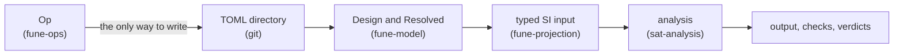
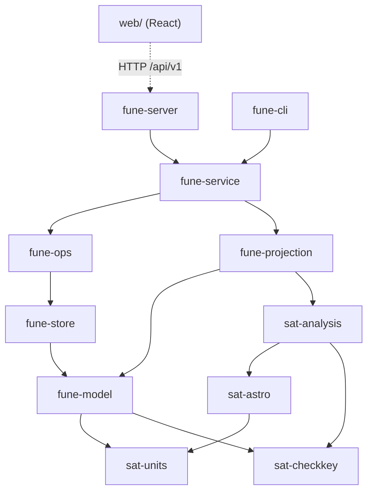
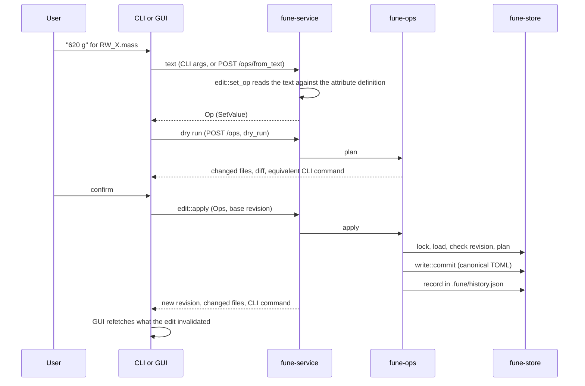
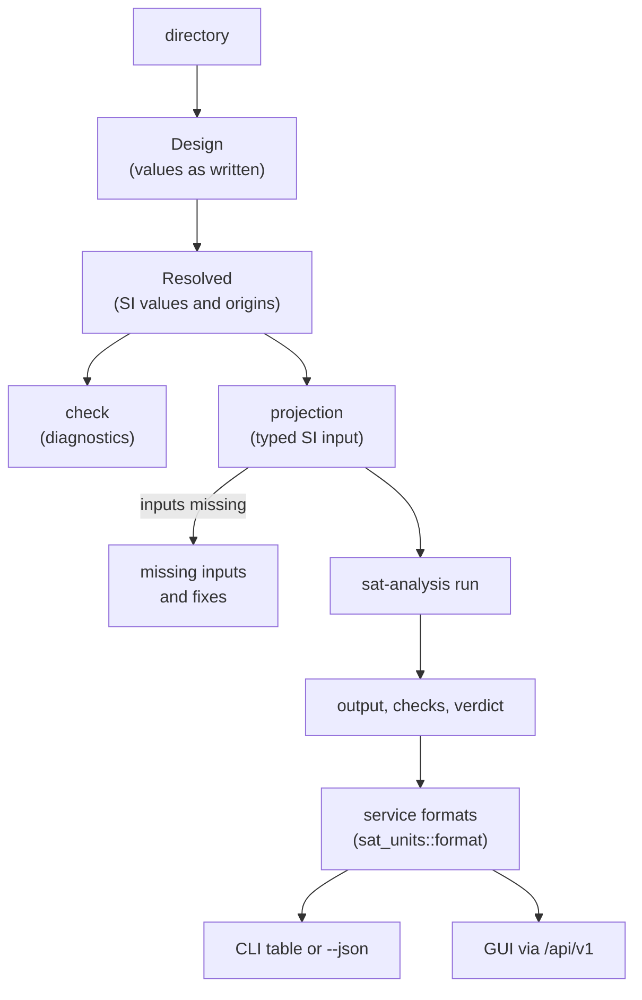

# アーキテクチャの概要

このページは、iwafune の内部がどう動いているかをたどる案内です。コントリビューターと、結果をなぜ信頼してよいのかを知りたい利用者に向けて書いています。
考え方を説明したうえで、編集と解析という 2 つのリクエストを入口から出口まで追います。

規則そのものは繰り返しません。正確な規則は [architecture.md](architecture.md) と [CONTRIBUTING.md](../../CONTRIBUTING.md) に、
各機能の置き場所の一覧は [architecture/registry.md](architecture/registry.md) に、データの形は [model.md](model.md) にあります。

## 1. 全体像

iwafune は小型衛星の概念設計のための作業台です。コマンドラインツール `fune` と Web の GUI があります。
設計を支える考え方は 3 つです。

**設計データはファイルです。** 衛星 1 機は TOML ファイルのディレクトリ 1 つで、1 ファイルが 1 エンティティを表し、git で管理します。
データベースも隠れた状態もありません。レビュー、ブランチ、差分は、コードで使っているものをそのまま使えます。
ディレクトリの構成は [architecture.md §2.1](architecture.md) に、デモは [fixtures/demo-6u](../../fixtures/demo-6u) にあります。

**すべての編集は `Op` です。** CLI で打ったコマンドも GUI のクリックも、[fune-ops](../../crates/app/ops/src/lib.rs) の `Op` 型の値になります。
編集の計画、検査、書き込みは 1 つの関数が受け持つので、2 つのフロントエンドが食い違うことはありません。

**解析は型付きの入力に対する純粋関数です。** `sat-analysis` の解析は型付きの SI の入力を受け取り、検査と判定を持つ型付きの出力を返します。
設計モデルを知らず、I/O をせず、乱数も使いません。入力を設計から組み立て、足りないものを知らせるのは、別の層の `fune-projection` です。

このページで使う用語を挙げます。

| 用語 | 意味 |
|---|---|
| `Design` | ファイルに書かれたままの設計。数値と単位の文字列、出典、ファイル内の位置を持ちます |
| `Resolved` | カタログの項目、種類、部品ごとの上書きを重ねたあとの設計。SI の値と、各値の出どころを持ちます |
| `Op` | 1 つの編集を値として表したもの（値の設定、部品の作成、部品の配置など）。設計ファイルを変える唯一の手段です |
| projection | `Resolved` から解析の型付き入力を組み立て、足りない入力を一覧にすること |
| 検査（check）と判定（verdict） | 検査は、解析が行う 1 つの判断（余裕、限度）です。判定は `ok`、`warning`、`violation` のどれかです |
| DTO | `fune-service` が CLI と HTTP に返すデータ型。GUI の TypeScript の型はここから生成します |
| レジストリ | [registry.md](architecture/registry.md)。各機能の置き場所の一覧です |

## 2. 層

ワークスペースの crate は 2 つの群に分かれます。`crates/lib/*`（`sat-*`）は物理、単位、解析を持ち、設計モデルを知りません。
`crates/app/*`（`fune-*`）は設計モデル、ファイル I/O、編集、2 つのフロントエンドを持ちます。`web/` は GUI で、サーバーとは HTTP だけで話します。

矢印は「依存する」を表します。ほかの矢印から導ける矢印（たとえば `sat-analysis` も `sat-units` を使います）は省いています。
`fune-report` も図にありません。これは `sat-units` だけに依存し、`fune-service` が設計書の書き出しに使います。
完全な表は [registry.md §1](architecture/registry.md) にあり、[crates/xtask/src/deps.rs](../../crates/xtask/src/deps.rs) の `ALLOWED` と照合されます。

**`sat-units`**（[lib.rs](../../crates/lib/units/src/lib.rs)）は、単位、次元、量の唯一の定義です。
型付きの量、単位式の解析、量の表示文字列を持ちます。衛星のことは何も知りません。

**`sat-astro`**（[lib.rs](../../crates/lib/astro/src/lib.rs)）は、共通の物理と数学を持ちます。積分器（`ode`）、時刻、軌道、天体（`ephem`）、
食（`shadow`）、座標変換（`earth`）、地磁気、大気、捕捉放射線のマップ、地上局、姿勢則、ロケット方程式です。
解析固有の判断はせず、ファイルも読みません。大きなデータはバイト列として受け取ります（6 節）。

**`sat-checkkey`**（[lib.rs](../../crates/lib/checkkey/src/lib.rs)）は小さな葉の crate で、解析の検査のキーの書式（`margin:<link>@<station>`、`heater:<part>` など）を定めます。
キーを組み立てる `sat-analysis` と、キーから名前を読み出す `fune-model` が 1 つの定義を必要とし、しかも互いに依存できないので、この crate に置いています。

**`sat-analysis`**（[lib.rs](../../crates/lib/analysis/src/lib.rs)）は、各サブシステムの解析と判定のロジックを持ちます。
すべての解析は [spec.rs](../../crates/lib/analysis/src/spec.rs) の `Analysis` トレイトを実装し、`catalog` に 1 度だけ登録します。
`fune-*` の crate には依存せず、I/O もしません。

**`fune-model`**（[lib.rs](../../crates/app/model/src/lib.rs)）は、設計の型（`Design`）、組み込みの語彙、解決（`Resolved`）、検査（`check`）を定めます。
ファイルは読み書きしません。

**`fune-store`**（[lib.rs](../../crates/app/store/src/lib.rs)）は、ディレクトリを読み書きする唯一の crate です。
ファイルを `Design` にし、変更を最小の TOML の編集に戻します。revision（追跡ファイルのハッシュ）、書き込みロック、編集の履歴も持ちます。
設計の検査や物理の計算はしません。

**`fune-ops`**（[lib.rs](../../crates/app/ops/src/lib.rs)）は、`Op`、`plan`（何が変わるかを示す。書かない）、`apply`（ロックと revision の確認のもとで書く）、
`history`（取り消しとやり直し）、`to_cli`（同じ編集をする CLI のコマンド）を持ちます。HTTP や表示は知りません。

**`fune-projection`**（[lib.rs](../../crates/app/projection/src/lib.rs)）は、`Resolved` を解析の型付き入力に写し、足りない入力を一覧にします。
物理は計算せず、モデル化の既定値も作りません。既定値は解析が持ちます。

**`fune-service`**（[lib.rs](../../crates/app/service/src/lib.rs)）は、CLI と HTTP が呼ぶすべての関数と、その入出力の型を持ちます。
表示文字列は `sat_units::format` で作って DTO に入れます。HTTP は知らず、整形の規則も自分では持ちません。

**`fune-server`**（[lib.rs](../../crates/app/server/src/lib.rs)）は、`/api/v1` の axum ルーター、エラーからステータスへの対応、Host の許可リスト、埋め込みの GUI を持ちます。
**`fune-cli`**（[main.rs](../../crates/app/cli/src/main.rs)）は、引数を解析し、表、色、診断を表示します。どちらもロジックは持ちません。

**`web/`**（[src](../../web/src)）は、データを描き、操作を受け付けます。物理、次元の計算、単位の換算、判定、集計はせず、
ID やパスを文字列の分割で分解することもしません。

## 3. 編集の流れ

「リアクションホイールの質量を 620 g にする」という編集を考えます。CLI では `fune set RW_X.mass "620 g"`、GUI ではセルの編集です。

手順は次のとおりです。

1. 文字列の解釈: `fune_service::edit::set_op` は、属性の定義を見て、`"620 g"` が量なのか、整数なのか、ベクトルなのか、状態ごとの値なのかを決めます。
   GUI は同じ文字列を `POST /ops/from_text` に送り、同じ `Op` を受け取ります。パスと値の組でない編集は `edit::command_ops`（`POST /ops/from_command`）を使います。
   解釈していない文字列がストアに届くことはありません。
2. 計画: `fune_ops::plan`（[plan.rs](../../crates/app/ops/src/plan.rs)）は、Op を 1 つずつストアの編集にし、そのたびに設計を読み直します。
   前後の `check` を比べ、新しいエラーが生じる編集は断ります。すでにあるエラーは編集を止めません。plan は書き込みません。
3. プレビュー: `dry_run` を付けると計画だけが返ります。変わるファイルのユニファイド diff、診断、同じ編集をする CLI のコマンド（`fune_ops::to_cli`）です。
   CLI の `--dry-run`、GUI の確認画面（`OpPreview`）、「Copy as CLI」はどれも同じものを見せます。
4. 適用: `fune_ops::apply`（[apply.rs](../../crates/app/ops/src/apply.rs)）は、プロジェクトのロックを取り（最大 5 秒待ちます）、
   設計を読み、呼び出し側が読んだ revision と現在の revision を比べます。食い違えば競合で、CLI は終了コード 3、HTTP は 409 を返します。何も書きません。
5. 書き込み: `fune_store::write::commit`（[commit.rs](../../crates/app/store/src/write/commit.rs)）は、変わったファイルをまとめて書きます。値を変えた行だけを（`toml_edit` で）書き換えるので、
   コメント、キーの順序、書かれた単位が残ります。新しいファイルは `fune fmt` と同じ正規形で作ります。すべてのファイルが変わるか、どれも変わらないかのどちらかです。
6. 記録: 変わったファイルの前後の中身を `.fune/history.json`（git の管理外）に残します。`fune undo` と `fune redo`（`POST /undo`、`POST /redo`）は、
   同じロックと revision の確認のもとでそれを再生します。
7. 読み直し: 応答には新しい revision が入っています。GUI は設計から導かれる問い合わせ（[refresh.ts](../../web/src/api/refresh.ts) の `refreshDerived`、一覧は
   [keys.ts](../../web/src/api/keys.ts)）を無効にして、サーバーの新しい答えを読みます。サーバーはメモリに状態を持たず、読むたびにディレクトリを読み直します
   （[workspace.rs](../../crates/app/service/src/workspace.rs)）。そのため、CLI と GUI で同時に編集しても答えが食い違うことはありません。

### 3.1 CLI と GUI の対等性

同じ編集を CLI と HTTP で行うと、バイト単位で同一のファイルになる必要があります。これは習慣ではなく規則で、CI が確かめます。
[crates/app/cli/tests](../../crates/app/cli/tests) の対等性のテスト（`parity.rs` と `parity_*.rs`）は、デモのコピーの上で `fune` のバイナリと HTTP のルーターを動かし、
できたファイルをバイト単位で比べます。`parity_text.rs` は打たれた文字列を、`parity_command.rs` は名詞コマンドの引数を扱います。
architecture.md の経路の表は、[route_table.rs](../../crates/app/cli/tests/route_table.rs) がルーターと突き合わせます。

例外は [CONTRIBUTING.md](../../CONTRIBUTING.md) に挙げています。

- `fune init`: サーバーはプロジェクトの中でしか動かないためです。
- `fune self-update`: CLI のバイナリ自身を置き換えますが、サーバーはそれを実行している人のバイナリを置き換えられないためです。
- `fune skill`: 書くのは設計データではなく、呼び出した人のディレクトリのエージェント用の指示ファイルだからです。
- `fune fmt` と共有カタログの取り込み（`catalog.lock`）: Op を通さない 2 つの書き込みです。
  理由とともに [store_writes.rs](../../crates/xtask/src/store_writes.rs) に挙げてあり、`cargo xtask check` が、ほかに `commit` を呼ぶものがないことを確かめます。

`fune gui`（サーバーを起動する）と、`fune data fetch` の CLI 専用の `--from <DIR>` オプションも CLI 専用で、[architecture.md §4.3](architecture.md) で説明しています。

## 4. 解析の流れ

`fune analyze power.energy_balance` の実行や、GUI の Power ページを開く操作は、次の段階を通ります。

1. ディレクトリから `Design` へ: `fune_store::load` がファイルを読み、`Design` を作ります。`Design` は、書かれたままの値（数値と単位の文字列）、出典、ファイル内の位置を持ちます。
2. `Design` から `Resolved` へ: `fune_model::resolve` は、カタログの項目、種類、部品ごとの上書きを重ね、SI に換算し、各値の出どころを記録します。
   コンフィギュレーションと既定値もここで適用します。読み込みで見つかった構文と形の誤りは `Design::load_diagnostics` に残ります。
3. 検査: `fune_model::check` は、設計を検査する唯一の場所です。`fune check`、GUI、`plan` の前後の比較がすべてこれを呼びます。
   診断には重大度（error、warning、info）があります。必須の値の欠落は warning なので、作業途中の設計も保存できます。
4. projection: `fune-projection` は、`Resolved` と解析ケース（`cases/<ID>.toml`）から、選んだ解析の `Input` を組み立てます。
   解析 ID から projection への対応表は、[dispatch.rs](../../crates/app/projection/src/dispatch.rs) の 1 か所にあります。
   足りないものがあれば、解析は呼びません。結果は足りない入力を 1 つずつ、パラメータのパス（`RW_X.max_momentum` など）と理由、それを直す構造化された候補
   （`fune_service::fixes`）として挙げます。`fune analyze` は各候補を `<...>` の入力欄を持つコマンドとして表示し、GUI は同じ候補を行の操作に使います。
5. 実行: `fune_service::analysis::run_analysis` が `sat_analysis::catalog::run_json`（型付きの呼び出し側は `run_typed`）を呼びます。
   解析は純粋関数 `run(&Input) -> Result<Output>` です。
6. 判定: 解析は検査を返します。`Check` はキー、ラベル、`Verdict`（`ok`、`warning`、`violation`）、文を持ちます。
   余裕は `spec::margin_verdict` で判定します。比の余裕の定義は `spec::ratio_margin`（`capability / requirement - 1`）で、判定の文の中の数値は `spec::quantity_text` で書きます。
   最も悪い判定が見出しになります。
7. 整形: サービスは出力の各量の次元、語彙の値の表示名、`sat_units::format` で作った表示文字列を付けます。
   CLI は表か `--json` を出力し、HTTP は同じ DTO を返します。

**ケース。** 解析ケースは `cases/` にあるファイルで、解析を実行する条件（軌道、モード、フェーズ、元期など）を選びます。
ケースを指定しないときは既定のケースを使い、既定のケースの扱いは解析ごとに `case_policy`（[case_policy.rs](../../crates/app/projection/src/case_policy.rs)）で宣言します。
1 つの解析は複数のケースで実行でき、要求の適合表がその例です。

**セッション。** 多くの解析を回すリクエスト（適合表、設計書の書き出し、Power のモード表示）は、`fune_service::session::Session`（[session.rs](../../crates/app/service/src/session.rs)）を開きます。
設計を読んで検査するのは 1 度だけで、解析ごと・ケースごとに 1 度だけ計算し、型付きの結果を使い回します。
セッションの寿命は 1 つのリクエストか 1 つのコマンドだけです。リクエストをまたぐキャッシュではなく、外部データのディスク上のキャッシュにも触れません。
保存していない下書き（書かずに適用した Op、`fune_service::preview`）には、セッションの中に専用の記憶を持たせます。

**入力の出どころ。** 入力をどこから得るかはリクエストで選びます。`design`（既定。projection が組み立てる）、`patched`（組み立てた入力への JSON Merge Patch）、
`given`（CLI の `--input`）です。

**型付きの出力と Web。** DTO の型は ts-rs で TypeScript に書き出されます（出力先は [web/src/api/gen](../../web/src/api/gen)、
`cargo test -p fune-service export_ts`。コミットしたファイルと差があれば CI が失敗します）。Rust のフィールドの名前を変えると、空の列が残らず、TypeScript のビルドが通らなくなります。

**Web が物理をしない理由。** GUI は 2 つあるフロントエンドの一方です。GUI が単位を換算したり余裕を判定したりすると、同じ設計に対して CLI と GUI が違う答えを見せるおそれがあります。
そのため、サーバーが整形済みの量（`Formatted`）、判定、件数、充填率を返し、Web は描くだけにしています。型付きの量の入力は `POST /units/parse` で解釈します。
Web 側のこの規則は `cargo xtask check` が強制します（7 節）。

## 5. 単位と量

[`sat-units`](../../crates/lib/units/src/lib.rs) は `no_std` のカーネルで、単位とは何かを知る唯一の場所です。

- 次元: `Dimension`（[dimension.rs](../../crates/lib/units/src/dimension.rs)）は、9 つの基本次元に対する有理数の指数のベクトルで、実行時に使います。
  [dimensions.rs](../../crates/lib/units/src/dimensions.rs) は、型レベルの対応物と共有の別名を持ちます。
- 型付きの量: `Qty<D, T>`（[typed.rs](../../crates/lib/units/src/typed.rs)）は、次元をコンパイル時に検査するスカラーです。解析の入出力は SI の値でこれを使います。
  長さと時間を足すとコンパイルできません。生の数から `Qty` を作ることは、境界でだけ使う、印のついた抜け道です。
- 単位: `Unit`（[unit.rs](../../crates/lib/units/src/unit.rs)）は、表示する値を SI に写します。線形（`SI = scale * x + offset`。`degC` はこれで扱います）か対数（`dB`、`dBm`、`dBW`、`mag`）です。
  アフィン単位と対数単位は単独でのみ有効で、境界で線形の SI の値に換算します。
- 単位式の読み取り。[parse.rs](../../crates/lib/units/src/parse.rs) の `parse_unit` と次元名の関数が、単位式を読みます。
  人が打つ `620 g` や `1.2 GHz` は、`fune_model::value`（`value_from_text`、`quantity_from_text`）が読み、`sat-units` へは `value::units` だけを通して届きます。
  `POST /units/parse` は、この単位の解析を GUI に公開します。
- 表示: `sat_units::format`（[format.rs](../../crates/lib/units/src/format.rs)）は、量を整形する唯一の場所で、その次元の表示単位と SI 接頭辞を選びます。
  `fune-service` がこれを呼び、文字列を DTO に入れます。Web で数を整形してよいのは [web/src/quantity](../../web/src/quantity) だけです。

設計は値を「書かれたまま」持つので、`620 g` はファイルの中でも `g` のままです。SI への換算は `Resolved`（`fune_model::resolve`）で 1 度だけ行い、
端では SI から表示単位へもう一度換算します。`fune-projection` は、書かれた量を [quantity.rs](../../crates/app/projection/src/quantity.rs) で型付きの SI の量にしますが、換算そのものは `sat-units` です。

## 6. 外部データ

データの中には大きすぎるものや、git やバイナリへの収録を許さない条件を持つものがあります。JPL DE440 の暦表、捕捉放射線帯のマップ、
地磁気の係数ファイル、SHIELDOSE-2 の表です。宇宙天気のように毎日変わるものもあります。
どれもリポジトリやプログラムには入っていません。必要になったときに、ユーザーごとのキャッシュに取得します。

**表 1 つ。** プロジェクトのリリースで配布するデータは、型付きの表 1 つ、[data.rs](../../crates/app/service/src/data.rs) の `RELEASE_DATASETS` にまとめています。
各行は `release::Dataset`（[release.rs](../../crates/app/service/src/data/release.rs)）で、ID、キャッシュのファイル名、リリースの場所、期待する大きさと SHA-256、
何が使うか、利用者に見せる出典とライセンスの文、インストーラ関数を持ちます。状態、取得、起動時の登録は、すべてこの表から動かします。
データを足すときに必要なのは、行 1 つとインストーラです。

| ID | 内容 |
|---|---|
| `de440` | JPL DE440 惑星暦。`sat-astro` が読む形式に変換したもの |
| `ap8min`, `ap8max`, `ae8min`, `ae8max` | 太陽活動極小期と極大期の AP-8 陽子と AE-8 電子の放射線帯のマップ |
| `jensen_cain_1960`, `gsfc_1966` | 放射線帯のマップが前提にする古い地磁気モデル |
| `igrf14` | IGRF-14 の地磁気係数 |
| `shieldose2` | SHIELDOSE-2 の遮蔽線量の表 |
| `space_weather` | 日ごとの F10.7 と Ap の表（SW-All）。上の表には入りません。`curl` で取得し、固定のハッシュを持ちません |

放射線の行（`ap8min` から `shieldose2` まで）は、群の ID `radiation` でまとめて取得できます（[radiation.rs](../../crates/app/service/src/data/radiation.rs) の `GROUP_IDS`）。[trapped-radiation.md](trapped-radiation.md) を見てください。

**チェックサムつきの取得。** `fune data fetch <id>`（`POST /data/{id}/fetch`）は、GitHub CLI（`gh release download`。`gh` が必要です）でリリースの成果物を一時ディレクトリに落とし、大きさと SHA-256 を行の値と照らしてから、
キャッシュのファイルを置き換えます。取得に失敗しても、古いファイルはそのままです。`fune data fetch <id> --from <DIR>` は、リリースと同じ名前のファイルを置いたディレクトリから、
同じ検査をして取り込みます。オフラインで使うためのものです。このオプションは CLI 専用で、HTTP はサーバーの上のパスを受け取りません。
宇宙天気は検査が異なります。`curl` で取得し、表として読めることを確かめます。取得のたびに出典、取得時刻、SHA-256 を `SW-All.json` に記録します。

**キャッシュ。** 場所は `$IWAFUNE_DATA_DIR`、なければ `$XDG_CACHE_HOME/iwafune/data`、それもなければ `~/.cache/iwafune/data` です（`data.rs` の `cache_dir`）。
`fune data status`（`GET /data/status`）が、各項目の状態を示し、SHA-256 を確かめます。

**ファイルを読むのは誰か。** ファイルを読むのは `fune_service::data` です。`sat-astro` はバイト列を受け取って解析し、プロセス全体のスロットに保持するだけです
（放射線のデータは [registry.rs](../../crates/lib/astro/src/radiation/registry.rs) の `OnceLock`）。
CLI とサーバーは起動時に `install_cached_datasets` を呼んで、キャッシュにあるものをすべて登録します。

**データがないとき。** 落ちることも黙って推測することもありません。

- DE440 がなければ、太陽、月、惑星には解析式を使います。あれば、1849 年から 2150 年までは DE440 を、その範囲の外では解析式を使います。どちらを使っているかは `fune data status` に出ます。
- 宇宙天気がない場合や、表の外の日付では、F10.7 と Ap は太陽活動のプリセットに戻り、結果にそれぞれの値の出どころが示されます。
  手で与えた値が優先されます。解析の結果には、使った表の版が残ります。
- 放射線のファイルがなければ、捕捉フラックスと捕捉線量の解析は、理由に `fune data fetch radiation` を挙げた入力不足を報告します。
  `orbit.total_dose` は、データができる前と同じに動きます。

## 7. 単一の置き場所の規則と機械的な検査

[CONTRIBUTING.md](../../CONTRIBUTING.md) の構成の規則は、`cargo xtask check`（[crates/xtask](../../crates/xtask/src/main.rs)）が強制します。検査は次のとおりです。

| 検査 | 確かめること |
|---|---|
| 依存の向き | 各 crate が、`ALLOWED`（[deps.rs](../../crates/xtask/src/deps.rs)）で許された crate にだけ依存すること |
| モジュールの循環 | 1 つの crate の中のモジュール間に循環がないこと（[module_cycles.rs](../../crates/xtask/src/module_cycles.rs)） |
| レジストリの網羅 | すべての crate がレジストリの crate の表にあること（[registry.rs](../../crates/xtask/src/registry.rs)） |
| 単一の置き場所 | 定義が、レジストリの指すファイルにだけ現れること（[single_home.rs](../../crates/xtask/src/single_home.rs)、規則は [rules.rs](../../crates/xtask/src/single_home/rules.rs)）。何にも当たらない規則はそれ自体が誤りです。同じ表に、`fetch(` は API クライアントだけ、のような Web の規則も入っています |
| 書き込みの入口 | `write::commit` を呼ぶのは store と ops だけであること（[store_writes.rs](../../crates/xtask/src/store_writes.rs)） |
| projection の既定値 | `fune-projection` にモデル化の既定値がないこと（[projection_defaults.rs](../../crates/xtask/src/projection_defaults.rs)） |
| レポートの JSON | 設計書の書き出しが、JSON のフィールド名ではなく型付きの出力を読むこと（[report_json.rs](../../crates/xtask/src/report_json.rs)） |
| Web の規則 | 数の読み取りや ID とパスの文字列分割（[web_strings.rs](../../crates/xtask/src/web_strings.rs)）、色の直書き（[web_colors.rs](../../crates/xtask/src/web_colors.rs)）、役割や系の名前の文字列比較（[web_roles.rs](../../crates/xtask/src/web_roles.rs)、[web_systems.rs](../../crates/xtask/src/web_systems.rs)）、ページの URL と `features/` の import（[web_pages.rs](../../crates/xtask/src/web_pages.rs)）。単一の置き場所の表にある Web の規則（数の整形、`queryKey: [`、フィードバックの部品）も併せて検査します |
| ユーザーに見せる文の言語 | 日本語と英語の名前の対を持つ許可済みのファイルを除き、Rust の文字列リテラルに日本語がないこと（[english_text.rs](../../crates/xtask/src/english_text.rs)） |
| 言語と名前 | Python のファイルがないこと。大文字・小文字だけが違うファイル名がないこと（[file_names.rs](../../crates/xtask/src/file_names.rs)） |
| 大きさ | 400 行を超えるファイルと 60 行を超える Rust の関数への警告。エラーにはしません（[sizes.rs](../../crates/xtask/src/sizes.rs)） |

規則の背後にあるバグの種類を、3 つの例で見ます。

- 推進剤の質量流量は `sat_astro::rocket` だけに置く。 2 つの解析がそれぞれ `F / (Isp * g0)` を書くと、片方が違う `g0` を使ったり係数を落としたりして、
  2 つのバジェットが同じ推進剤について黙って食い違うことがあります。置き場所が 1 つなら、式もテストも 1 つです。
- 名前か ID かのフォールバックは `fune_model::display_name` だけに置く。 画面ごとに「name (ID)」を組み立てると、空の名前や ID と同じ名前の扱いが画面ごとに変わります。
  空のラベルなら ID だけを出す、という判断を 1 つの関数が持ち、Web の `idWithName` が同じ表を読むことをテストが確かめます。
- `write::commit` は store と ops からだけ呼ぶ。 TOML ファイルを直接書く機能は、plan、新しいエラーの検査、revision の確認、履歴の記録、正規形を飛ばします。
  その編集は取り消せず、CLI と GUI で結果も揃いません。許すのは `fune fmt` とカタログの lock の取り込みだけで、理由を書き残しています。

規則を足すときは、xtask にも足します。機能を足すときは、先にレジストリに 1 行足します。

## 8. Web アプリ

`web/` は Vite でビルドする React の SPA で、`fune-server` が埋め込んだ `web/dist` から配信します。技術スタックの詳細は [architecture.md §5.2](architecture.md) にあります。[web/src](../../web/src) の構成は次のとおりです。

| ディレクトリ | 役割 |
|---|---|
| `routes/` | ページごとに 1 ファイル。経路は `routes.ts` に並べ、ページの URL は [lib/nav.ts](../../web/src/lib/nav.ts) の `paths` だけで組み立てます |
| `features/` | ページの中身。import できるのは `features/` と `routes/` だけで、feature 間の import は許可リスト `FEATURE_EDGES` に限ります |
| `analysis/` | 解析の結果を見せる部品。カード、KPI の並び、検査の一覧、表、グラフ |
| `kit/` | 製品を知っている共有の部品。表、ツリー、パネル、フィードバック、3D シーンの枠 |
| `ui/` | 基本のウィジェット（Radix をもとにしたボタン、ダイアログ、入力） |
| `shell/` | 枠。サイドバー、ヘッダー、テーマと言語の切り替え、経路の遅延読み込み |
| `api/` | HTTP クライアント、クエリキー、クエリとミューテーションのフック、生成した型 |
| `quantity/` | 量を見せる、または編集するもののすべて |
| `ops/` | Op を組み立て、ドライランでプレビューするダイアログ |
| `i18n/` | 日本語と英語の辞書 |
| `lib/`, `styles/` | ヘルパー、ナビゲーション、色調、生成した CSS のトークン |

- 生成した API の型: API の型は [web/src/api/gen](../../web/src/api/gen) のものだけを使います。Rust の DTO から ts-rs が書き出し、手では編集しません。
- HTTP クライアントとクエリキーは 1 か所: `fetch(` があるのは [client.ts](../../web/src/api/client.ts) だけです（失敗した呼び出しは、HTTP ステータス、コード、診断を持つ `ApiError` になります）。
  TanStack Query のキーと、編集で無効にする範囲は [keys.ts](../../web/src/api/keys.ts) にあります。
- 辞書: すべての文は [i18n](../../web/src/i18n) の辞書（`ja.ts` と `en.ts`）にあります。両方の項目が同じこと、使われないキーがないことをテストが確かめます。
- 色は 1 つのファイルから: 色は [lib/tone.ts](../../web/src/lib/tone.ts) でだけ定義します。`index.css` の色はここから `pnpm -C web tokens` で生成し、コントラストはテストが確かめます。
- サブシステム固有のコードは 1 か所に登録する: サブシステムの専用のタブ、追加の表示、先読みするチャンクは、
  [features/systems/dedicated.tsx](../../web/src/features/systems/dedicated.tsx) の型付きの表に置きます。ほかにサブシステムをキーにした表は作りません（色とアイコンの表 `lib/systems.ts` が例外です）。
  ページは一覧を手で書かずに API の `DefsView.systems` に尋ねます。
- フィードバックの約束事: 読み込み、再読み込み、待機の表示は [kit/feedback](../../web/src/kit/feedback) にまとめています。スケルトンは `Loading.tsx` だけ、
  動くロゴはこのディレクトリだけ、再読み込み中に内容を薄くするのは `Refreshable` を通してです。画面は `QueryState`、`Working`、`Refreshable` を使います。
- 3D シーンの枠: [SceneShell](../../web/src/kit/scene3d/SceneShell.tsx) は、キャンバス、照明、範囲へのフィット、自由な周回、ビューキューブ、カメラの移動を提供します。
  配置、熱画像、メッシュ場の表示（`SurfaceField`）がこれを共有します。

## 9. テストと検証

- 手計算: 各解析の関数には、手計算か文献値と比べるテストが少なくとも 1 つあります。たとえば、
  [spec/tests.rs](../../crates/lib/analysis/src/spec/tests.rs) の `ratio_margin_by_hand` は、余裕の定義を手計算で確かめます。リファクタリングの前後で、デモの解析の数値は変わってはなりません。
- 対等性のテスト: 3.1 節の CLI と HTTP の編集のテストと、経路の表のテストです。
- スナップショットのテスト: デモの出力と DTO はスナップショットのファイルとして保存しています。
  [crates/app/cli/tests/snapshots](../../crates/app/cli/tests/snapshots)（`snapshots_cli.rs` が実行）と [crates/app/service/tests/snapshots](../../crates/app/service/tests/snapshots) です。
  出力が変わると、レビューで差分として見えます。
- 契約のテスト: [export_ts.rs](../../crates/app/service/tests/export_ts.rs) が TypeScript の型を書き出し、CI は `git diff --exit-code web/src/api/gen` を実行します。
  サーバーには、経路、エラー、データについての独自のテストが [crates/app/server/tests](../../crates/app/server/tests) にあります。
- デモの習慣: デモの設計 [fixtures/demo-6u](../../fixtures/demo-6u) は、`fune check` と `fune fmt --check` を通す必要があり、CLI でも編集します。
  リファクタリングの前後でデモの解析を実行し、数値を比べます。
- CI: [ci.yml](../../.github/workflows/ci.yml) は、push とプルリクエストで動きます。プルリクエストでは、変更した部分に対応するジョブだけが動きます。

| ジョブ | 実行するもの |
|---|---|
| `changes` | プルリクエストに次のどのジョブが必要かを決める |
| `architecture` | `cargo xtask check`（常に動く） |
| `rust` | `cargo fmt --all --check`、`cargo clippy --workspace --all-targets -- -D warnings`、`cargo test --workspace`、生成した TypeScript が一致することの確認 |
| `web` | Biome、型検査、Vitest、ビルド |
| `bundle` | push のときだけ。GUI を同梱したリリースビルドと、デモに対する CLI と HTTP サーバーのスモークテスト |

## 10. リリースと配布

日々の作業はプルリクエストで `develop` に入ります。`main` が受け取るのは `develop` からのプルリクエストだけで、そのたびに 1 回のリリースになります。
そのプルリクエストを出す前に、[Cargo.toml](../../Cargo.toml) の `[workspace.package] version` と [web/package.json](../../web/package.json) の `version` に同じバージョンを設定します。

残りは [release.yml](../../.github/workflows/release.yml) が行います。

- `main` へのプルリクエストでは、`version` ジョブが、2 つのバージョンが一致していることと、タグがまだないことを確かめます。
- `main` への push では[image.yml](../../.github/workflows/image.yml) を呼びます。このワークフローは GUI と Linux のバイナリをビルドし、
  バイナリが正しいバージョンを報告し、同梱した GUI を配信することを確かめて、`fune-<version>-x86_64-linux-gnu.tar.gz` にまとめます。
  `docker/fune.Dockerfile` からコンテナイメージを作り、その中でデモに `fune check` と `fune fmt --check` を実行し、`ghcr.io/<owner>/fune:<version>` と `:latest` を push します。
- `macos` ジョブはarm64 と x86_64 のバイナリをビルドし、`lipo` で 1 つのユニバーサルアーカイブにまとめます。
- `release` ジョブはタグ `v<version>` と、アーカイブとその SHA-256 ファイルを添えた GitHub Release を作ります。リリース済みのコミットで再実行しても、何も起きません。

タグを手で作ることはありません。コンテナイメージは設計データのリポジトリの CI で使うためのものです。ジョブのコンテナとして指定すれば、何もビルドせずに `fune check` を実行できます。

**`fune self-update`。** CLI は最新のリリース（または選んだバージョン）で自分自身を置き換えられます。`fune_service::self_update`
（[self_update.rs](../../crates/app/service/src/self_update.rs)）は、動いているシステム向けの成果物を選び、ダウンロードして SHA-256 を確かめ、展開し、新しいバイナリの `--version` を確かめてから、
はじめて動いているバイナリを置き換えます。失敗したときは何も置き換えません。サーバーはそれを実行している人のバイナリを置き換えられないので、CLI 専用です。

## 11. 次に読むもの

- [architecture.md](architecture.md): 正確なアーキテクチャの文書。経路と CLI の対応表があります。
- [architecture/registry.md](architecture/registry.md): 各機能の置き場所、標準の語彙、変更履歴。
- [model.md](model.md): 設計データ、ファイル形式、条件とケースが入力を選ぶしくみ。
- [development.md](development.md): ソースからのビルド、リポジトリの構成、リリースの流れ。
- [CONTRIBUTING.md](../../CONTRIBUTING.md): 構成の規則と、変更のワークフロー。
- [trapped-radiation.md](trapped-radiation.md) と [report.md](report.md): 外部データを使う機能と、設計書の書き出し。
- [guide/index.md](guide/index.md) と [analyses/index.md](analyses/index.md): 利用者ガイドと解析のリファレンス。
