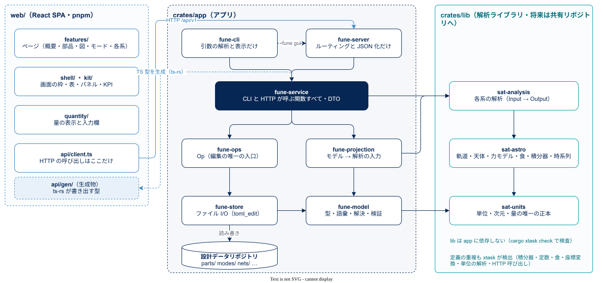

# iwafune のアーキテクチャ

この文書は、コードが現在どう組み上がっているかを説明します。
設計データの形とファイル形式は [model.md](model.md) に、各機能の置き場所は [architecture/registry.md](architecture/registry.md)（レジストリ）に、
開発の規則は [CONTRIBUTING.md](../../CONTRIBUTING.md) に、今後の機能は [roadmap.md](roadmap.md) と GitHub の Issue にあります。

条件（軌道、地上局、打ち上げ条件）は `conditions/` に置きます。`mission/` と `tables/` は、今後の #9（ミッションと成功基準）のために予約したディレクトリで、現時点では読みません。フェーズは `phases/`（[model.md §7.10](model.md#710-phases-ミッションのフェーズごとに-1-ファイル)）に、部品の姿勢に名前を付けて重ねたものは `configurations/`（[model.md §7.11](model.md#711-configurations-部品の姿勢の名前つきの重ね合わせ)）に置きます。
解析は `sat_analysis::spec::AnalysisArea`（サブシステムの `System` か、条件の話題の `Condition` のどちらか）に属します。
話題ごとの設定は条件のファイルの中に置き、具体的な型は #3 で足します（[model.md §1.1](model.md#11-前提条件と解析の区分)）。
CLI、API、Web は同じ分類を使い、KPI はサブシステムごと、または話題ごとに表示します。Web は、条件の KPI が空のときは隠します。

## 1. 目的と範囲

iwafune は小型衛星の概念設計のための道具です。1 組の設計データをもとに、部品の選定、質量・電力・データのバジェット、モードごとの消費電力、
AOCS、C&DH、通信、電力、推進、構造、熱の解析を扱います。

- 設計データを持つ場所は git で管理する TOML のディレクトリだけです。常駐するサーバーもデータベースもありません。
- 編集の手段は CLI（`fune`）と Web の GUI の 2 つで、できることは同じです。GUI は、`fune gui` がローカルで起動するサーバーから配信します。
- 解析の精度は概念設計の水準で、呼び出しのたびに再計算します。結果を設計データに書き込むことはありません。
- フライトソフトウェア、テレメトリとコマンドの設計、運用は対象外です。

## 2. 設計データ

### 2.1 ディレクトリ

衛星 1 機の設計は 1 つのディレクトリで、ルートに `fune.toml` を置きます。`fune` は、現在の場所から上へ向かって `fune.toml` を探します（場所は `-C` で指定できます）。
1 つのエンティティは 1 つのファイルで、ファイル名が ID です。

| 場所 | 内容 |
|---|---|
| `fune.toml` | プロジェクト名、スキーマのバージョン、使うカタログ |
| `parts/` | 部品。サブディレクトリで製品ツリーを表す |
| `catalog/` | カタログの項目（購入品の値と出典など） |
| `defs/attribute/`, `defs/kind/` | プロジェクト固有の属性と種類の定義（組み込みの定義は fune-model が持つ） |
| `modes/`, `nets/`, `harness/` | 運用モード（部品 → 状態の表）、電気のネット、ハーネスの区間 |
| `maneuvers/` | マヌーバ（種別、計算の段階、スラスタ、前のマヌーバ、目標軌道、制約。実行の順序は `after`） |
| `requirements/` | 要求（記述、制約、定量化、出典、検証する解析の検査かバジェット） |
| `budget/` | 配分と余裕の方針 |
| `conditions/`, `analysis/`, `cases/` | 軌道と地上局、サブシステムごとの解析設定、解析ケース |
| `phases/`, `configurations/` | ミッションのフェーズと、部品の姿勢に名前を付けて重ねたもの |
| `sources/` | 出典の台帳 |
| `view/` | 系統図の配置など、見た目だけの情報 |
| `catalog.lock` | 使っている共有カタログごとの commit。導出されるもの（`fune catalog fetch` と `update` が書く）で、git で管理する |
| `.fune/` | 書き込みロック、編集の履歴（`history.json`、2.4 節）、共有カタログのキャッシュなどの作業ファイル。`fune init` が `.gitignore` に加える |

ファイルの書き方、値と単位の表し方、エンティティ間の関係は [model.md](model.md) にあります。
デモの設計データは [fixtures/demo-6u](../../fixtures/demo-6u) です。

### 2.2 ファイルにする理由

- PR の差分がそのまま設計の変更として読めます。1 つの値を変えると、その行だけが変わります（2.4 節）。
- 検討をブランチで分けられます。1 つのエンティティが 1 つのファイルなので、別のブランチで別の部品を触っても衝突しません。
- エディタでファイルを直接書き換えてもかまいません。`fune fmt` が正規形にそろえ、`fune check` が検査します。

### 2.3 読み込みと解決

| 層 | 内容 | 作る関数 |
|---|---|---|
| Design | 書かれたままの値（数値と単位の文字列）、出典、ファイル内の位置 | `fune_store::load` |
| Resolved | カタログ、種類、部品ごとの上書きを重ねたあとの値（SI）と、それぞれの出どころ | `fune_model::resolve` |
| 解析の入力 | 解析ごとの型付きの SI の量 | `fune_projection`（6.3 節） |

検査は `fune_model::check` の 1 か所にあり、`fune check`、GUI、編集の前後の比較はすべて同じ関数を通ります。
診断には重大度（error、warning、info）があります。error は単位や次元の誤り、存在しない ID への参照、取り付けの循環などです。
必須の値の欠落は warning なので、作業途中の設計も保存できます。

### 2.4 書き込み

ファイルを読み書きするのは fune-store だけです。

- toml_edit を使い、値を変えた行だけを書き換えます。コメント、キーの順序、書かれた単位（`620 g` は `g` のまま）が残ります。
- 新しいファイルと `fune fmt` は、正規形（TOML 1.0 の範囲で、キーの順序を固定し、`=` を揃える）で書きます。
- 複数のファイルにまたがる変更は、一時ファイルに書いてから rename で入れ替えます。途中で失敗したときは、すでに入れ替えたファイルを元に戻してからエラーを返します。
- revision は追跡ファイル（パスと本文）の BLAKE3 です。読んだときの revision が現在の revision と違えば、何も書きません（楽観ロック）。
- 別のプロセスからの同時の書き込みは `.fune/lock` で防ぎます。
- 編集の履歴（取り消しとやり直し）。適用した Op の列（ドライランを除く）は、変えたファイルの前後の中身を `.fune/history.json`（git の管理外。CLI と GUI が共有する。
  ファイル、位置、上限は `fune_store::journal` が持つ）に記録します。直近 100 件の編集と、ファイルの中身の合計で最大 32 MiB までを保持し、古いものから捨てます。`fune undo` と `fune redo`（`POST /undo`、`POST /redo`）は、記録した中身を
  編集と同じロックと revision の確認のもとで、1 回の commit として書き戻します（`fune_ops::history`）。取り消しには、現在の revision がその編集の直後の revision と一致していること、やり直しには直前の revision と一致していることが必要です。そのあとに別の方法で
  （エディタ、`git checkout`、`fune fmt`、`fune catalog fetch|update`）ファイルが変えられていれば、何も書かず、競合としてコマンドが失敗します。編集が作ったファイルは削除され、削除したファイルは復元され、名前の変更は元に戻ります。
  新しい編集をすると、やり直しの側は消えます。取り消しとやり直しは新しい記録にならず、位置を動かすだけです。`fune fmt` とカタログの lock の取り込みは Op ではないので、記録されず、取り消せません。
  `fune history`（`GET /history`）が記録を一覧します。

### 2.5 ブランチと PR によるレビュー

fune は git を操作しません。GUI に表示するブランチ名を `.git/HEAD` から読むだけで、commit、push、PR は利用者が行います。

1. 検討ごとにブランチを作ります（`git switch -c study/rw-4wheel`）。
2. CLI か GUI で編集します。GUI のサイドバーの下部には、ブランチ、revision、診断の数、このセッションで行った編集の一覧があります。
   一覧の各行は CLI のコマンドとしてコピーできます。
3. commit して PR を出します。差分には、変えた値の行だけが出ます。
4. 設計データのリポジトリの CI で `fune check` と `fune fmt --check` を実行します。リリースごとに公開するコンテナイメージ（8 節）を
   ジョブのコンテナとして使えば、ビルドせずに `fune` を使えます。手順は [README](../../README.md) にあります。

実際の設計データは衛星ごとの非公開のリポジトリに置きます。このリポジトリに入れるのはデモの設計データだけです。
NDA や輸出管理の対象になる値を、公開リポジトリに入れてはいけません。

## 3. crate と依存の向き



図の元のファイルは [diagrams/crate-architecture.drawio](../diagrams/crate-architecture.drawio) です（draw.io で開けます）。

`sat-*` は `crates/lib/` に、`fune-*` は `crates/app/` にあります（`sat-units` は `crates/lib/units`）。
「依存してよい crate」の列は `crates/xtask` の `ALLOWED` と同じで、これと違う依存を作ると `cargo xtask check` が失敗します。

| crate | 依存してよい crate | 責務 | してはいけないこと |
|---|---|---|---|
| `sat-units` | なし | 単位、次元、量の唯一の定義。型付きの量（`Qty`）、表示の種別（`Fraction`、`Decibel*`）、量と単位の表示文字列（`format`） | — |
| `sat-astro` | units | 数学、積分器、時刻、軌道、天体、食、地球、重力、地磁気、捕捉放射線帯のマップ、大気、地上局、姿勢則、時系列、ロケット方程式。慣習的な既定値（`with_defaults` など） | 解析固有の判断、ファイル I/O（大きなデータはバイト列として受け取る） |
| `sat-checkkey` | なし | 解析の検査のキーの書式（要求の `verify.check` が指す文字列）。葉の crate で、キーを組み立てる `sat-analysis` と、キーから名前を読み出す `fune-model` が 1 つの定義を共有できるようにしている | — |
| `sat-analysis` | units, astro, checkkey | サブシステムごとの解析と判定。入出力は型付きの SI の量。モデル化の既定値は解析が持つ（入力は `Option`） | `fune-*` への依存、I/O |
| `fune-model` | units, checkkey | 設計データの型、組み込みの属性、種類、語彙の表示名、解決（Resolved）、検査（check） | ファイル I/O |
| `fune-store` | model | ディレクトリ ⇄ Design の読み書き（toml_edit、正規形）、revision、ロック、編集の履歴 | 検査、物理の計算 |
| `fune-ops` | model, store | Op（編集の唯一の入口）、plan / apply、取り消しとやり直し（`history`）、Op → CLI コマンド（`to_cli`） | HTTP、表示 |
| `fune-projection` | model, units, astro, analysis, checkkey | Resolved を解析の入力の型に写すことと、足りない入力の一覧 | 物理の計算、モデル化の既定値 |
| `fune-report` | units | 設計書の書き出し。表、図、値のデータモデル、SVG のグラフの書き出し、Typst のモジュール、ファイルの配置（[report.md](report.md) を参照） | 設計や解析についての知識、ファイル I/O |
| `fune-service` | 上記すべて | CLI と HTTP が呼ぶすべての関数と、その入出力の型（TS は ts-rs で生成）。表示文字列は `sat_units::format` で作る | HTTP についての知識、整形の規則を自分で持つこと |
| `fune-server` | service | axum のルーティングと JSON への変換、SPA の配信、Host の許可リスト | ロジック |
| `fune-cli` | service, server | `fune` の引数の解析と表示（表、色、診断）。`fune gui` のために server を使う | ロジック |
| `web/` | HTTP API だけ | GUI の表示と操作 | 物理の計算、次元の計算、単位の換算、文字列の分割による ID やパスの解釈 |

- `crates/lib/*` は物理と解析のライブラリで、設計モデルを知りません。`crates/app/*` には依存しません。
- server と cli が見るのは service だけです（cli は `fune gui` のために server も使います）。service が再公開する model と ops の型を使います。
- projection はファイルを読みません（store にも ops にも依存しません）。
- crate の中のモジュールも循環してはいけません。

## 4. 編集: Op と plan / apply

### 4.1 Op

設計データを変えるすべての操作は `fune_ops::Op` で表します。CLI のコマンドも GUI の操作も適用する前に Op に変換します。
Op は JSON にできます（`{ "op": "set_value", "part": "RW_X", ... }`）。TS の型も生成します。

| 対象 | Op の例 |
|---|---|
| 部品 | `CreatePart`, `RemovePart`, `RenamePart`, `RenameGroup`, `MovePart`, `SetValue`, `UnsetValue`, `SetField`, `Place`, `SetPort`, `SetMountPoint` |
| カタログの項目 | `CreateCatalogItem`, `SetCatalogValue`, `UnsetCatalogValue`, `SetCatalogField`, `RenameCatalogItem`, `RemoveCatalogItem` |
| 定義 | `CreateAttribute`, `UpdateAttribute`, `DeleteAttribute`, `RenameAttribute`, `CreateKind`, `UpdateKind`, `DeleteKind`, `RenameKind`（組み込みの定義は、書き換えも名前の変更も削除もできない。使われている定義の削除は拒否する。名前の変更は、すべての参照を書き換える。種類の属性の一覧と `extends`、部品とローカルのカタログ項目の `kind` と属性の値である。読み取り専用の共有カタログの項目がその定義を使っている間は拒否する） |
| モードとネット | `CreateMode`, `RenameMode`, `SetModeStates`, `CreateNet`, `UpdateNet`, `SetNetField`, `RemoveNet` など |
| ケース、出典、ハーネス | `SetCase`, `SetSource`, `SetHarness` と、それぞれの削除 |
| 地上局 | `CreateGroundStation`, `RenameGroundStation`（`analysis.comm.stations` を書き換える）, `RemoveGroundStation`（`analysis.comm.stations` がその局を挙げている間は拒否する）。値は `SetSetting` で書く |
| マヌーバ | `CreateManeuver`, `SetManeuver`, `RemoveManeuver`（削除すると、後ろのマヌーバを前のマヌーバにつなぎ直す） |
| 要求 | `CreateRequirement`, `SetRequirement`, `RemoveRequirement` |
| 図 | `SetViewLayout`, `SetViewEdge`, `UnsetViewEdge`, `ResetView` |
| フェーズとコンフィギュレーション | `CreatePhase`, `SetPhase`, `RemovePhase`, `CreateConfiguration`, `SetConfiguration`, `RemoveConfiguration`, およびそれらの名前の変更 |
| 通信リンク | `CreateCommLink`, `RenameCommLink`, `RemoveCommLink` |
| 設定 | `SetSetting`（`conditions/`、`analysis/`、`budget/` の値）, `SetRecordField`（ケース、マヌーバ、要求などの 1 つの項目） |

すべての Op とその意味は `crates/app/ops/src/op.rs` にあります。

### 4.2 plan と apply

- `plan` は書き込みません。Op を 1 つずつストアの編集にし、そのたびに Design を読み直します。
  最後に、適用の前後の `check` を比べ、新しい error が出ていれば拒否します。すでにある error は編集を止めません。
- `apply` は、ロックを取り（別のプロセスが持っていれば最大 5 秒待つ）、読み込み、revision を確認し、plan を作って、すべてをまとめて書きます。
  すべて通るか、何も書かれないかのどちらかです。
- `dry_run` を付けると、plan だけが返ります。CLI の `--dry-run` と GUI の確認画面は、どちらも変わるファイルのユニファイド diff を見せます。

### 4.3 CLI と HTTP の対等性

CLI と HTTP は`fune-service` の同じ関数を呼びます。

| 操作 | CLI | HTTP（`/api/v1`） | service の関数 |
|---|---|---|---|
| Op の適用 | 各編集コマンド、`fune apply ops.json` | `POST /ops` | `edit::apply` |
| 打たれた値の文字列 → Op | `fune set`, `fune setting set`, `fune catalog set` | `POST /ops/from_text` | `edit::set_op` |
| 削除するパス → Op | `fune unset`, `fune setting unset`, `fune catalog unset` | `POST /ops/unset_from_text` | `edit::unset_op` |
| 名詞コマンドに打たれた引数 → Op | `fune net set\|unset`, `fune part place`, `fune mode set\|unset`, `fune attr add\|replace`, `fune kind add\|replace`, `fune maneuver add\|set`, `fune requirement add\|set`, `fune ground add`, `fune catalog source add` | `POST /ops/from_command` | `edit::command_ops` |
| 整形 | `fune fmt [--check]` | `POST /fmt` | `format::format_design` |
| 直前の編集の取り消しとやり直し | `fune undo`, `fune redo` | `POST /undo`, `POST /redo` | `history::{undo, redo}` |
| 編集の履歴 | `fune history` | `GET /history` | `history::view` |
| 設計書の表と図（導出されるファイル。設計は変えない） | `fune report export` | `POST /report/export` | `report::export` |

- `fune set RW_X.mass "620 g"` の `"620 g"` を、量、整数、ベクトル、状態ごとの値のどれとして読むかは、service が属性の定義を見て決めます。
  GUI も打たれた文字列を `/ops/from_text` で Op にしてから `/ops` で送るので、解釈が 2 つに分かれることはありません（部品とカタログ項目の値の欄、
  設定の表、部品の基本の項目、パラメータ追加のダイアログのどれも同じです）。同じ編集の中で定義を作る属性の値は、リクエストの `ops`（下書き）を当てた設計に照らして文字列を読みます。
  GUI が送るパスは API が返したもの（`PartRow.paths` と `field_paths`。同じ編集の中で定義を作る属性では、`POST /parts/{id}` の `ops` を当てた部品の `paths`）で、
  Web が ID やパスの文字列をつなぎ合わせることはありません。
- パスと値の組ではない編集（ネットの電源電圧、部品の配置の位置と姿勢、モードの表の時間割合、属性と種類の定義の作成）は、
  CLI の名詞コマンドと同じ引数の形で、打たれた文字列のまま `/ops/from_command` に送ります（`CommandText`。`{ command: "part_place", part, on, point, position: "0 0 12 mm", … }`）。
  量、ベクトル、クォータニオン、分数、カンマ区切りの一覧、`name=kind` の読み取りと、既定の表示名（空なら ID）の決定は、CLI と同じ service の関数（`edit::{command, defs}`）が行います。
  Web は打たれた値を数にしません（`cargo xtask check` が `Number(` と `parseFloat(` を検査します）。
- 適用の結果には、同じ編集をする CLI のコマンド（`fune_ops::to_cli`）が入っています。GUI の「Copy as CLI」がこれを使います。
- `fune apply` は、GUI が送るのと同じ Op の JSON を受け付けます。スクリプトからの一括の編集にも使えます。
- 編集を書かずに試すこともできます（`fune_service::preview`）。`POST /analyses/{id}`、`POST /budgets/{kind}`、`POST /parts/{id}` の `ops` と、
  `fune analyze --ops`、`fune budget --ops`、`fune part show --ops` は、保存していない下書き（モードの表の編集など）から、解析、バジェット、部品の表示を作ります。
- 例外は次のものだけです。`fune data fetch` の `--from <DIR>` オプション（6.5 節。HTTP は、サーバーのマシンの上のパスをあえて受け取りません）、`fune init`（サーバーはプロジェクトの中でしか動かないので、HTTP にはありません）、`fune gui`（サーバーを起動するコマンド）、`fune self-update`（CLI のバイナリ自身を置き換える。`fune_service::self_update` に実装があり、プロジェクトの外でも使える）、`fune skill`（設計データではなく、呼び出した人のディレクトリにエージェント用のスキルのファイルを書く。`fune_service::skill` に実装があり、プロジェクトの外でも使える）です。

HTTP の経路と、CLI および service との対応です（`crates/app/cli/tests/route_table.rs` が `routes.rs` と突き合わせます。経路を足すときは、ここと、その表の定数を直します）。

| HTTP | CLI | service の関数 |
|---|---|---|
| `GET /project` | `fune status` | `query::project_info` |
| `GET /design` | `fune {net,mode,case,source,harness,setting,catalog} ls`, `fune view ls` | `query::design_view`（1 つの図は `query::view_layout`） |
| `GET /maneuvers` | `fune maneuver ls` | `query::maneuvers` |
| `GET /phases` | `fune phase ls` | `query::phases` |
| `GET /configurations` | `fune configuration ls` | `query::configurations` |
| `GET /requirements` | `fune requirement ls` | `query::requirements` |
| `GET /requirements/compliance` | `fune requirement compliance` | `requirements::compliance` |
| `GET /parts`, `GET` と `POST /parts/{id}` | `fune part ls`, `fune part show [--ops]` | `query::list_parts`, `query::part_view` |
| `POST /parts/{id}/place_body` | `fune part place --body-pos` | `edit::place_body` |
| `GET /values/{path}` | `fune get` | `query::get_value` |
| `GET /defs` | `fune attr ls`, `fune kind ls` | `query::defs_view` |
| `GET /diagnostics` | `fune check` | `query::check` |
| `POST /fmt` | `fune fmt` | `format::format_design` |
| `POST /undo`, `POST /redo`, `GET /history` | `fune undo`, `fune redo`, `fune history` | `history::{undo, redo, view}` |
| `POST /ops` | `fune apply`（各編集コマンド） | `edit::apply` |
| `POST /ops/from_text`, `/ops/unset_from_text`, `/ops/from_command` | `fune set`, `fune unset`, 名詞コマンド | `edit::{set_op, unset_op, command_ops}` |
| `POST /ops/case_from_eclipse` | `fune case from-eclipse` | `edit::case_from_eclipse_op` |
| `POST /ops/maneuver_window` | `fune maneuver set-window` | `edit::maneuver_window_op` |
| `POST /ops/case_from_sun_distance` | `fune case from-sun-distance` | `edit::case_from_sun_distance_op` |
| `POST /ops/cases_from_geometry` | `fune case from-geometry` | `edit::cases_from_geometry_ops` |
| `GET /units`, `POST /units/parse`, `/units/format` | `fune units ls`, `parse`, `format` | `units::{units_catalog, parse_quantity, format_quantities}` |
| `GET /analyses`, `POST /analyses/{id}` | `fune analyze ls`, `fune analyze <ID>` | `analysis::{analysis_catalog, run_analysis}`（終了コードの判定は `analysis::fails`）。リクエストの `detail: true`（CLI では `--detail`）は、解析の重い任意の出力（`detail`。一覧の `detail_type` で型が決まる。たとえば `structure.modal_fem` のモード形状）も返す。既定では含まれない |
| `GET` と `POST /budgets/{kind}` | `fune budget <kind>` | `budget::budget`（終了コードの判定は `budget::failure::fails`） |
| `POST /report/export` | `fune report export` | `report::export`（service はファイルの中身を返し、CLI がそれを `--out` に書く） |
| `GET /data/status`, `/data/space_weather`, `POST /data/{id}/fetch` | `fune data status`, `space-weather`, `fetch` | `data::{data_status, space_weather::lookup, fetch}` |
| `GET /catalog/{id}` | `fune catalog show` | `query::catalog_item` |
| `POST /catalog/fetch`, `/catalog/update` | `fune catalog fetch`, `update` | `shared_catalog::{fetch, update}` |
| `POST /system_modes/{system}` | `fune mode view <system> [--ops] [--case] [--analyzed] [--totals-only]` | `system_modes::system_modes`（終了コードの判定は `system_modes::fails`） |
| `POST /thermal/tables` | `fune thermal tables [--ops] [--case]` | `thermal_tables::thermal_tables` |

テストは次のことを確かめます。

- 同じ編集を `fune` の実行ファイルと HTTP で行うと、ファイルがバイト単位で同一になること（`crates/app/cli/tests/parity.rs`、`parity_text.rs`、`parity_command.rs`）。
- `fune mode view` の `--json` が、同じ経路の HTTP の JSON と等しいこと（`crates/app/cli/tests/parity_pages.rs`）。
- どの種類の Op でも、`to_cli` の文字列を clap で読み戻すと元の Op に戻ること（`crates/app/cli/src/cmd/roundtrip/`）。
  Op の種類を足すときは、サンプルを足すまでコンパイルが通りません。

### 4.4 エラーと終了コード

| 分類 | 例 | HTTP | CLI の終了コード |
|---|---|---|---|
| 検査 | 編集が新しい error を生む | 422 | 1 |
| 不正な入力 | 引数、単位、Op の形 | 400 | 2 |
| 見つからない | その部品や解析がない | 404 | 2 |
| 競合 | revision が違う、ロックを取れない、同じ ID がすでにある | 409 | 3 |
| その他 | I/O など | 500 | 1 |

HTTP の失敗は `{ "error": { "code", "message" }, "diagnostics": [...] }` として返り、CLI は `--json` で同じ形を出力します。
保存していない下書き（解析、バジェット、部品の表示の `ops`）が通らないときは、保存したときと同じ分類で返ります（検査の失敗なら、422 と診断）。
入力の不足はエラーではないので、解析もバジェットも`missing`（足りない入力の対象、理由、それぞれを埋めるものを示す `fixes`）を付けて 200 を返します。
`fune check` は、error があれば 1 で終了します（`--deny-warnings` を付けたときは warning でも同じです）。

`fune` の実行ファイルの終了コードは1 つの約束に従います。0 は成功です。1 は「設計か結果が失敗している」（検査の error、結果を判定する読み出しでは、入力の不足、実行の失敗、violation の判定）か内部エラーです。2 は不正な入力か、見つからないことです（`--ops` に渡した読めないファイルのように、service のエラーでないものも 2 で終了します）。3 は競合です。
warning で失敗することはありません。「結果が失敗している」という判定は service の関数が行うので、`--json` と表が一致し、HTTP も同じ判定を示せます。`analysis::fails`（`fune analyze`: 実行が `ok` でない、または検査が violation）、`budget::failure::fails`（`fune budget`）、`system_modes::fails`（`fune mode view`）、`requirements::fails`（`fune requirement compliance`）です。

## 5. サーバーと Web アプリ

### 5.1 fune-server

`fune gui` は、同じバイナリの中でサーバーを起動し、ブラウザを開きます。

- 既定では `127.0.0.1:3000` で待ち受けて `http://localhost:3000/` を開きます。そのポートが使用中で `--port` がなければ、次に空いているポートを使います。`--port`、`--host`、`--no-open` で変えられます。認証はありません。
- API は `/api/v1` の下にあります。ハンドラは引数を読み、service を呼び、結果を JSON にするだけです。ファイル I/O と解析は `spawn_blocking` で別のスレッドに移します。
- Host の許可リスト: API は設計ファイルを書けるので、Host ヘッダーが許可リストにないリクエストは 403（`host_not_allowed`）で拒否します（DNS リバインディングへの防御）。
  許可するのは、`localhost`、`127.0.0.1`、`[::1]`（任意のポート）、`--host` で与えた IP（`0.0.0.0` を除く）、`--allow-host` で足した名前です。
  Host ヘッダーのないリクエスト（ブラウザ以外のクライアント）は通します。
- CORS: オリジンが localhost のリクエストだけを許します（GET、POST、`Content-Type`）。開発用の Vite（別のポート）から呼べるようにするためです。
- SPA の同梱: `web/dist` を rust-embed でバイナリに埋め込みます。クライアント側のパス（`/design/components/RW_X` など）には `index.html` を返し、
  `assets/` の下のファイルは長くキャッシュさせます。`web/dist` なしでビルドした場合は、GUI のビルド手順を説明するページを返します。
- サーバーは設計を記憶せず、リクエストのたびにディレクトリから読み直します（数十ファイルで数 ms）。CLI で書き換えても、次のリクエストから GUI に反映されます。
  ファイルは監視しないので、GUI はウィンドウがフォーカスを取り戻したときと、自分の編集のあとに読み直します。

| パス | 内容 |
|---|---|
| `GET /project`, `/design`, `/parts`, `/parts/{id}`, `/values/{path}`, `/defs`, `/diagnostics`, `/maneuvers`, `/phases`, `/configurations`, `/requirements`, `/requirements/compliance`, `/catalog/{id}` | 読み出し（概要と revision、設計全体、部品、1 つの値、定義、診断、カタログの項目 1 つ、マヌーバの一覧（実行の順で、`fune maneuver ls` と同じ）、フェーズ、コンフィギュレーション、要求の一覧と要求の適合表（`fune requirement ls\|compliance` と同じ）） |
| `POST /ops`, `/ops/from_text`, `/ops/unset_from_text`, `/ops/from_command`, `/ops/case_from_eclipse`, `/ops/maneuver_window`, `/ops/case_from_sun_distance`, `/ops/cases_from_geometry`, `/fmt` | 編集（4.3 節） |
| `POST /undo`, `POST /redo`, `GET /history` | 直前の編集の取り消しとやり直し、編集の履歴（2.4 節） |
| `POST /parts/{id}` | 保存していない編集（`ops`）を、書かずに当てた部品（`GET` と同じ形。`fune part show --ops`） |
| `POST /parts/{id}/place_body` | 機体座標での配置を、取り付け先からの相対の `Place` に変換して適用する |
| `GET /units`, `POST /units/parse`, `/units/format` | 単位の一覧、入力の解析（次元と SI への換算）、SI の値の表示文字列 |
| `GET /analyses`, `POST /analyses/{id}`, `GET`/`POST /budgets/{kind}` | 解析とバジェットの一覧と実行（6 節。POST の `case` と `ops` で、解析ケースと下書きを指定する） |
| `POST /system_modes/{system}` | サブシステムごとのモード表示（電力、C&DH、熱、AOCS の値、合計、判定。リクエストの `ops`、`case`、`analyzed`、`summary` で、下書きと表示を選ぶ） |
| `POST /thermal/tables` | 熱結合（使用中の値と出典）、外表面の塗装、塗装、節の最低・最高温度。リクエストの下書き `ops` を当てる（GUI の「Couplings and surfaces」タブ） |
| `GET /data/status`, `GET /data/space_weather`, `POST /data/{id}/fetch` | 外部データの状態と取得、宇宙天気の表（6.5 節） |
| `POST /report/export` | 設計書を書き出す |
| `POST /catalog/fetch`, `POST /catalog/update` | 共有カタログの取得と更新 |

### 5.2 Web アプリ

`web/` は React 19 の SPA です（SPA モードの React Router 8 を、Vite でビルドします）。サーバーの状態は TanStack Query で持ちます。
UI の部品には Tailwind CSS 4 と Radix を、系統図には @xyflow/react を使い（配置と配線には、`features/diagram/` にある独自の自動レイアウトを使います）、
3D の配置には three、@react-three/fiber、@react-three/drei を、グラフには Recharts を使います。lint と整形には Biome を、テストには Vitest を使います。

ページは `web/src/routes.ts` に登録し、サイドバーの並びは `web/src/lib/nav.ts` にあります。各ページの表示内容と使い方は [GUI ガイド](guide/gui.md)にあります。この節に書くのは構造を決めるものだけです。

- サブシステムのページの経路は 1 つです。`systems/:system/:tab?` がすべてのサブシステムを受け持ちます。サブシステムの一覧は Web に書かず、`DefsView.systems` から得ます。モードのタブを持つサブシステムは `DefsView.mode_systems` から得ます。
  タブは `SYSTEM_TAB_ORDER` から選び、1 つのサブシステムに固有のもの（追加のタブ、専用のモードや時系列の表示、ページの操作、先読みするチャンク）は、`features/systems/dedicated.tsx` の `SYSTEM_REGISTRY` の 1 項目にします（`cargo xtask check` は、ほかの場所でサブシステムの名前と比べることを拒否します）。
  サブシステムのページはそのサブシステムに関わる部品を、そのサブシステムの属性の列だけで一覧し、セルで編集でき、同じページに解析の結果を表示します。
- サブシステムごとのモード表示は Rust で計算します。`POST /system_modes/{system}`（`fune_service::system_modes`、`fune mode view <system>`）は、モードのタブの値、合計、判定を返します。これは、既存の projection と解析から作ります。リクエストでは下書き（`ops`）、解析ケース（`case`）、
  解析を実行するか（`analyzed`。Power では、Power の解析を型付きで実行して作る `SystemModeView.power` が加わります）、足もとに何行返すか（`summary`）を選びます。
  AOCS のカードの値（運動量の蓄積、アンローディングの頻度、MTQ のアンローディング時間、センサの視野の判定）は、`fune_projection::aocs::{rw_unloading_for_mode, sensor_fov_for_mode}` が評価します。
  これらはモードを明示的に受け取り、既定のケースの軌道条件を保ったまま姿勢則だけを選ぶので、通常の解析のケースの選択、入力、数値は変わりません。Web は、Rust が返したものを描くだけです。
- モードのセルは下書きとして編集します。モードの表のセルの編集は下書き（`features/modes/draft/draft.ts`）として持ち、`fune mode set|unset` の引数 → Op として送ります。同じ下書きを、上の表示に `ops` として渡すので、合計と判定は保存していない編集に追随します。保存はほかの編集と同じく Op を適用します。
- 系統図ではサブシステムを隠せます。選択肢は API の `DefsView.systems` で、何も選ばないときに隠すものは `DefsView.diagram_hidden_systems` が示します（構造）。選択は URL に `hidden-system` として残ります（`lib/nav.ts` の `SEARCH`。繰り返して指定でき、空なら全部を表示します）。隠すのは表示だけで、設計データは変わりません。
- 配置は全画面の 3D 表示で、左に製品ツリー（`PartsTree`。部品のページと同じツリー）、右に配置の欄があります。部品の選択、取り付け、位置の指定はそこで検査し、編集します。表示の切り替えとカメラの移動はページの中の状態で、設計データにも URL にも書きません。
  `/design/maneuvers` は、Propulsion のページの Maneuvers のタブへ転送します。

Web がしないことは次のとおりです。

- 物理の計算、次元の計算、単位の換算。量の入力は `POST /units/parse` で解析し、表示には、サーバーが `sat_units::format` で作った文字列（`Formatted`）を使います。
- 文字列の分割による ID やパスの解釈。API が構造として返します。
- API の型を手で書くこと。ts-rs が Rust から書き出した `src/api/gen/` だけを使います（`cargo test -p fune-service export_ts` で再生成し、CI が差分を確かめます）。

次の機能は、それぞれ置き場所が 1 か所に決まっています（xtask が検査します）。

| 機能 | 場所 |
|---|---|
| HTTP の呼び出し（`fetch(`） | `src/api/client.ts` |
| クエリの無効化（`invalidateQueries`） | `src/api/`（キーと、編集のあとに読み直す範囲は `keys.ts` にある） |
| 数の整形（`Intl.NumberFormat`、`toFixed` など） | `src/quantity/` |
| 色の値 | `src/lib/tone.ts`（`index.css` の色は `pnpm -C web tokens` で生成する。コントラストはテストが確かめる） |

文は日本語と英語の辞書（`src/i18n/`）に置きます。2 つの辞書の項目が同じであることは、テストが確かめます。
開発中は、`pnpm -C web dev`（ポート 5173）が `/api` を `127.0.0.1:3000` へ中継し、そこでは `fune gui --no-open` が動いています（`FUNE_API` で変えられます）。

## 6. 解析

### 6.1 一覧

| サブシステム | 定常 | 時系列 |
|---|---|---|
| AOCS | `aocs.unload_time`（MTQ と RCS でアンローディングするのに要する時間）, `aocs.slew_time`（RW で姿勢を変えるのに要する時間） | `aocs.rw_unloading`（外乱トルク（スラスタの誤差を含む。部品の箱の投影面積と重心から求める空力トルクと太陽輻射圧トルク）と RW のアンローディングの頻度、RCS が 1 日に放出する推進剤とその ΔV 換算）, `aocs.sensor_fov`（センサの視野と除外角） |
| C&DH | `cdh.data_budget`（データ量と記憶容量） | — |
| 通信 | `comm.link_budget`（回線設計） | `comm.visibility`（地上局の可視性）, `comm.data_throughput`（送信したデータ量と蓄積したデータ量） |
| 軌道条件 | `orbit.total_dose`（環境表から求める部品ごとのトータルドーズ。環境表はユーザーのもの、なければ計算した捕捉粒子の表で、許容値までの余裕を出す。放射線の輸送計算は持たない）, `orbit.trapped_flux`（AP-8/AE-8 による、軌道平均とピークの捕捉陽子・電子のフラックスと、ミッション全体のフルエンス。`fune data fetch radiation` のデータが必要。[trapped-radiation.md](trapped-radiation.md) を参照）, `orbit.trapped_dose`（それらのスペクトルから SHIELDOSE-2 で求める、アルミ遮蔽の深さに対する線量。この表は、ユーザーの表のない leg に対する `orbit.total_dose` の環境にも使われる） | `orbit.eclipse_season`（ベータ角と食の季節）, `orbit.decay`（大気抵抗による減衰と軌道維持）, `orbit.geometry`（フェーズごとの太陽と地球の距離と角度） |
| Power | `power.mode_load`（モードごとの消費電力）, `power.solar_sunlit`（日照中の発電）, `power.sizing`（最長の食に対して必要な太陽電池の面積とバッテリの容量） | `power.orbit_generation`（軌道上の発電）, `power.energy_balance`（電力収支と DoD）, `power.thrust_balance`（数値伝播するマヌーバの噴射中の電力収支） |
| 推進 | `propulsion.maneuvers`（マヌーバごとの ΔV、噴射時間、推進剤、前後の軌道）, `propulsion.dv_budget`（ΔV の分類ごとの内訳、合計、余裕と、RCS のアンローディングの ΔV）, `propulsion.propellant`（推進剤の湿重量と乾燥重量、タンクの容積の余裕）, `propulsion.thruster_usage`（総力積、累積の噴射時間、噴射回数と定格）, `propulsion.mass_properties`（推進剤を積んだときと使用後の質量と重心）, `propulsion.launch_window`（惑星間のマヌーバの、出発日 × 到着日の格子。スイングバイのある遷移では、セルごとにフライバイの日付を最適化する。格子点ごとの C3、超過速度、赤緯、ΔV と、最小点、書かれた日付とのずれ）, `propulsion.transfer_check`（日付つきの惑星間の遷移を、太陽と惑星の重力のもとで再伝播する。到着日の外れ距離、最接近、到着時の超過速度の差、軌道。DE440 を使うときだけ判定する） | `propulsion.orbit_history`（マヌーバの順の軌道の履歴。数値伝播するマヌーバでは、推力つきの伝播の高度、傾斜角、質量） |
| 構造 | `structure.mass_properties`（質量特性）, `structure.static_load`（準静的荷重）, `structure.modal_estimate`（簡易の固有振動数。FEM ではない）, `structure.modal_fem`（軸に平行なパネル、集中質量、支持の種類からなる機体全体の粗い有限要素モード。打ち上げ形態の設計データから作る。支持は、ランチャーかディスペンサーの属性 `launch_constraint` から得る）, `structure.launch_fit`（ランチャーとディスペンサーに対する、質量、収納時の外形、固有振動数。機体全体の振動数は、まず `structure.modal_fem` から、なければ `structure.modal_estimate` から得る。有限要素モデルは任意の入力）, `structure.interference`（部品の箱の重なり。警告のみ）, `structure.cone_clearance`（スラスタのプルームの円錐かセンサの視野の円錐に入る部品。警告のみ）, `structure.external_geometry`（部品の箱の投影面積と露出面積。報告のみ） | — |
| 熱 | `thermal.steady`（多節点の定常温度） | `thermal.transient`（多節点の過渡温度） |

定常か時系列かの分類は`sat_analysis` の各解析の `KIND` です。入力、式、検査を載せた解析ごとのページは、[解析リファレンス](analyses/index.md)にあります。

`fune analyze ls` と `GET /analyses` は同じ一覧を返します。

`structure.modal_fem`（#370、段階 2）は、軸に平行な長方形のパネルを、機体の軸ごとに共通の格子でメッシュ化します。辺を共有するパネルや T 字に接するパネルは、共有する節で剛に結合します（結合した組と、集中質量をどのパネルに付けたかは出力に入ります）。
要素は1 節点あたり 6 自由度の平面の 4 節点シェルです（曲げは MITC4、膜は Q4、節点の回転と面内の回転との差に対する drilling のペナルティは、`DRILLING_FACTOR` に G·t を掛けたもの）。質量は対角の集中質量で、低次のモードは `sat_astro::math::lowest_modes` から得ます。
支持は `base_fixed`、`rails`、`tabs`、`fixed`（面、辺、点）、`free` です。拘束のないモデルや拘束の足りないモデルでも解け、零に近いモードは剛体モードとして報告します。
各モードは軸ごとの有効質量比と分類（軸方向、打ち上げ軸に対して横方向、局所、剛体）を持ちます。傾向と桁を見るための道具で、詳細なモデルの代わりにはなりません。
段階 3 からは、projection が設計データから入力を組み立てます（`fune_projection::structure::modal_fem`、`model.md` の 5.10 節）。パネル、フレームの質量、パネルに結び付けた集中質量、打ち上げの値から得る支持、`[modal]` の設定です。

### 6.2 解析の形

すべての解析は `sat_analysis::spec::Analysis` を実装します。

- 解析はID（`<subsystem>.<name>`）、タイトルと説明（日本語と英語）、サブシステム、定常か時系列か、`Input` と `Output` の型、`run(&Input) -> Result<Output>` を持ちます。
- `run` は純粋関数で、I/O も乱数も使いません。設計モデル（`fune-*`）を知りません。
- 入出力は sat-units の型付きの量（`Qty`）で、値は SI です。分数には `Fraction` を使います。
- 解析の登録先は 1 か所、`sat_analysis::catalog` だけです。ID と JSON の入力で実行する `run_json` もここにあります。
- モデル化の既定値は解析が持ち、入力では `Option` です。軌道要素と地上局の慣習的な値は、sat-astro の `with_defaults` が持ちます。
- 時系列の解析は軌道と姿勢則から `sat_astro::timeline` で時系列（時刻、位置、速度、太陽の方向、影、機体の姿勢）を作り、その上で計算します。
  制御ループを実行するシミュレーションは行いません。

### 6.3 入力と結果の組み立て

解析は次のように実行します（`fune_service::analysis::run_analysis`。`fune analyze <ID>` と `POST /analyses/{id}` が呼びます）。

1. 設計を読み、Resolved を作ります（`ops` があれば、書かずに当てます）。複数の解析やバジェットを実行するリクエスト（要求の適合表、設計書の書き出し、Power のモード表示）は、`fune_service::session::Session` の中で設計を 1 度だけ読んで検査し、解析とバジェットの結果をケースごとに保持して使い回します。単独の解析は自分用のセッションを開きます。
2. fune-projection が解析ケース（`cases/<ID>.toml`。省略すれば既定）を含むコンテキストから、その解析の `Input` を組み立てます。
   解析 ID と projection の対応は 1 か所、`fune_projection::dispatch` にあります。
3. 入力が 1 つでも足りなければ、解析を呼ばずに `missing_inputs` を返します。`missing_inputs` は、足りないものをパラメータのパス（`RW_X.max_momentum`、`conditions.orbit.altitude`）と理由で表し、
   見つかったものをすべて挙げます。
   足りない入力には、それぞれ `fixes`、つまりそれを埋める候補が構造化されて付きます（値を入力する、部品を追加または割り当てる、項目が参照する部品を選ぶ、一覧の項目を足す。`fune_service::fixes` が、これを決める唯一の場所です）。`fune analyze`（と `fune budget`、`fune mode view`）は、各候補を `<…>` の入力欄を持つコマンドとして表示し（たとえば `fune set RW_X.max_momentum "<value>"`）、`--json` は同じ候補を返します。GUI の行の操作もこれを使います。
4. `sat_analysis::catalog::run_json` で解析を実行します。
5. service は出力の各量の次元（JSON Pointer → 次元名）と、語彙の値（列挙型）の表示名を集め、時系列に表示名と表示単位を付け、
   出力の中の判定を並べ、最も悪い判定を付けます。解析は表示名を持たず、キー（`ChannelKind`、列挙型の値、`span_fallback`）だけを返します
   （日本語と英語の表示名は `fune_service::analysis::labels` にあります）。

入力の与え方はリクエストの `source` で選びます。`design`（既定）は設計から組み立て、`patched`（JSON Merge Patch）は組み立てた入力の一部を一時的に上書きし、
`given`（CLI の `--input`）は入力の全体を与えます。

判定を作るのは解析です。`Check` は、キー、ラベル、判定（`ok`、`warning`、`violation`）、文を持ちます。
余裕の 3 段階の判定は `spec::margin_verdict` が決め（警告の幅は解析ごとの名前付きの定数です）、判定の文の中の数値は `spec::quantity_text::<dimension type>` で書きます（内部は sat-units の整形です）。
比の余裕の定義は `spec::ratio_margin`（`capability / requirement − 1`）だけにあります。
バジェット（質量、電力、データ量）の集計と判定は、`sat_analysis::budget::budget_rollup` が行います。
service は部品と解析の結果を項目として並べ、`budget/allocation.toml` の配分の行に割り当てるだけです。成長の余裕は部品の成熟度と `budget/policy.toml` から決めます。
バジェットでも解析ケースを指定できます（`POST /budgets/{kind}` の `case`、`fune budget --case`）。電力はケースのモードで数え、データ量はケースのモードだけで数えます。
どのサブシステムにも属さず、部品への明示的な配分もない部品は、「Other」の行にまとめます（行の `node` は null で、文言は CLI と Web が作ります）。

### 6.4 sat-astro

解析が使う物理と数学の部品は sat-astro にあり、それぞれの置き場所は 1 か所です。

| モジュール | 内容 |
|---|---|
| `ode` | 固定刻みの RK4 と、適応刻みの DOP853（Hairer の `dop853.f` の移植。稠密出力つき）。積分器はこれだけ |
| `orbit` | 軌道要素、伝播（ケプラー、J2 の永年項、力のモデルの数値積分）、太陽同期の傾斜角、β 角。中心天体は地球、月、太陽、惑星 |
| `ephem` | 太陽、月、惑星の位置。解析式（太陽は打ち切った VSOP87A、月は Meeus、惑星は Standish の表）と、登録されていれば JPL DE440 |
| `force` | 重力場（EGM96、次数 70 まで。係数は埋め込み）、第三体、太陽輻射圧、大気抵抗、固体潮汐、相対論の補正 |
| `shadow` | 影（円柱と円錐）。食の判定はここだけ |
| `earth`, `time` | ECI ⇄ ECEF、測地座標、歳差、元期と恒星時 |
| `geomag`, `atmosphere` | 地磁気（傾斜双極子、球面調和関数の Gauss モデル、McIlwain の L と B/B₀）、大気密度（指数大気、NRLMSISE-00）、宇宙天気（F10.7、Ap）の日ごとの表 |
| `radiation` | AP-8 と AE-8 の捕捉粒子のマップ、各マップが組になる場、位置を (L, B/B₀) で表すこと、SHIELDOSE-2 の遮蔽の表。データはバイト列として受け取り、プロセスごとに 1 度登録する |
| `ground` | 地上局の仰角、パスの検出、地上軌跡 |
| `attitude`, `illumination`, `timeline` | 姿勢則（太陽指向、ナディア指向、慣性固定）、面への太陽入射、軌道上の時系列 |
| `view_factor` | 長方形どうしの形態係数（閉じた式と、遮蔽つきの数値積分）。形態係数の置き場所はここだけ |
| `math`, `constants`, `body`, `kepler`, `state` | ベクトル、行列、クォータニオン、固有値と連立一次方程式のソルバー、物理定数と天体の定数、共有の状態と天体の型 |
| `rocket`, `transfer` | ロケット方程式（推進剤 ⇄ ΔV と噴射時間）、軌道遷移の ΔV（近地点と遠地点での 2 回の噴射とホーマン、平面変更、バイエリプティック、Edelbaum の低推力、Robbins による有限噴射の損失の近似） |

入力の仕様（`OrbitSpec`、`GroundStation` など）は型付きの量を受け取り、内部の関数は f64 の SI の値を受け渡します。
設計データが解析に渡す軌道伝播は、軌道条件の `propagator` の設定で選びます。`kepler`（二体のみ）、`j2`（二体に J2 の永年項を加えたもの。既定）、`numerical` のどれかです（[model.md](model.md)）。

### 6.5 外部データ（リリースで配布するデータ）

git やバイナリに入れるには大きすぎる、または制約の強いデータは、このリポジトリのリリースに置き、必要になったときに取得します。**データ 1 つは、型付きの表 1 つの行 1 つです**（`fune_service::data` の `RELEASE_DATASETS`。行の型は `release::Dataset`）。行には ID、キャッシュのファイル名（= リリースの成果物の名前）、リポジトリとタグ、期待する SHA-256 と大きさ、何が使うか、利用者に見せる出典とライセンスの文、インストーラ（バイト列を受け取って、使う側、たとえば sat-astro に登録する関数）が入ります。状態、取得、CLI とサーバーの起動時の登録（`install_cached_datasets`）は、すべてこの表から動かすので、データを足すときは、行 1 つとインストーラ 1 つを足します。宇宙天気の表（6.6 節）は取得の方法が違うので（毎日更新され、固定のハッシュがない）、`fune data status` では表の行のあとに並びます。

| ID | 内容 | リリースのタグ | 使うもの |
|---|---|---|---|
| `de440` | JPL DE440 惑星暦を、sat-astro が読む形式に変換したもの（`de440.bin`） | `data-de440-v1` | 太陽、月、惑星の位置 |
| `ap8min`, `ap8max`, `ae8min`, `ae8max` | 太陽活動極小期と極大期の AP-8 陽子と AE-8 電子の放射線帯のマップ | `data-radiation-v1` | `orbit.trapped_flux` |
| `jensen_cain_1960`, `gsfc_1966` | 放射線帯のマップが組になる古い地磁気モデル | `data-radiation-v1` | `orbit.trapped_flux` |
| `igrf14` | IGRF-14 の地磁気係数 | `data-radiation-v1` | 現在の磁場（これを使う解析はまだない） |
| `shieldose2` | SHIELDOSE-2 の遮蔽線量の表 | `data-shielding-v1` | `orbit.trapped_dose`, `orbit.total_dose` |

行は `data.rs`（`RELEASE_DATASETS`）、`data/de440.rs`、`data/radiation.rs` にあります。放射線の行は [trapped-radiation.md](trapped-radiation.md) で説明しています。

- 1 つを取得するには、`fune data fetch <id>` を使います（GUI では設定ページ、HTTP では `POST /data/<id>/fetch`）。内部では `gh release download` を呼ぶので、GitHub CLI が必要です。
  一時ディレクトリに落とし、行の大きさと SHA-256 を確かめてからファイルを置き換えるので、失敗しても既存のファイルはそのままです。
- 置き場所はユーザーごとのキャッシュです。`$IWAFUNE_DATA_DIR`、なければ `$XDG_CACHE_HOME/iwafune/data`、それもなければ `~/.cache/iwafune/data` です。
- 表のどの行もファイル（リリースと同じ名前）を置いたディレクトリから `fune data fetch <id> --from <DIR>` でインストールできます（CLI 専用のオプションです。HTTP はサーバーの上のパスを受け取りません。CONTRIBUTING.md の対等性の例外を参照してください）。
  大きさと SHA-256 はダウンロードのときと同じに確かめます。放射線の行（`ap8min` から `shieldose2` まで）は、群の ID `radiation` でまとめて取得することもできます（`data/radiation.rs` の `GROUP_IDS`）。
- CLI とサーバーは起動時にキャッシュを 1 度読み（`install_cached_datasets`）、sat-astro に登録します。ファイルを読むのは `fune_service::data` で、sat-astro はバイト列を受け取るだけです。
- 登録したあとは、1849 年から 2150 年までは DE440 を使い、それ以外には解析式を使います。今どちらを使っているかは、`fune data status` と `GET /data/status` で分かります。
- 放射線のファイルがなければ、`orbit.trapped_flux` と `orbit.trapped_dose` は、理由に `fune data fetch radiation` を挙げた入力不足を報告し、`orbit.total_dose` は、データができる前と同じに動きます。

### 6.6 外部データ（宇宙天気）

NRLMSISE-00 の F10.7 と Ap を日付で引くための表です（CelesTrak の SW-All、`SW-All.csv`、約 3 MB。1957 年以降の観測値、45 日先までの日ごとの予測、
それより先の月ごとの予測を含みます）。毎日更新されるので、git にもリリースにも入れず、取得して扱います。

- 取得は `fune data fetch space_weather` です（GUI では設定ページ、HTTP では `POST /data/space_weather/fetch`）。内部では `curl` を呼びます。
  一時ディレクトリに落とし、表として読めることを確かめてからファイルを置き換えます。出典（URL）、取得時刻、SHA-256 は `SW-All.json` に記録します。
- 置き場所はDE440 と同じユーザーごとのキャッシュです。`fune_service::data::space_weather`（`loaded`）が読み、表の解釈と日付による検索は
  `sat_astro::atmosphere::space_weather`（バイト列を受け取る）にあります。
- 日付による検索は`fune data space-weather <date> [--activity low|moderate|high]` と `GET /data/space_weather?date=…&activity=…` です。
  F10.7 は前日の観測値、81 日平均はその日を中心とした平均、Ap はその日の日平均です（3 時間値がそろっていれば、NRLMSISE-00 の 3 時間 Ap の履歴も含みます）。
  表の範囲の外の値と空白は、太陽活動のプリセット（ECSS-E-ST-10-04C の表 6-3 の長期の値）に戻り、各値の出どころと、使った表のバージョン
  （取得時刻、SHA-256、観測と予測の最後の日）を返します。解析はこのバージョンを結果に残します。F10.7 と Ap を手で与えた場合（`AtmosphereModel::Nrlmsise00`）は、それが優先されます。

### 6.7 地磁気の係数（配布ファイルの形式）

`sat_astro::geomag::GaussModel` は、内部起源の磁場を、ある元期の Gauss 係数（Schmidt の準正規化、nT）と永年変化で持ちます。`GaussModel::from_text_bytes`
がバイト列から読み（`to_text` が書き戻します）、sat-astro はファイル I/O をしません。古い磁場と IGRF の係数のセットは、取得するデータとして届きます（6.5 節）。`GaussModel` のテキスト形式は独自で、1 モデルが 1 ファイルです。

```text
# comment (everything after # on a line is ignored; blank lines are ignored)
name: free text
epoch: 2025-01-01T00:00:00Z      # ISO 8601, required: the epoch of g and h
radius_km: 6371.2                # required: reference radius a
# n m g h [g_dot h_dot]          # nT, and nT/year; the two secular columns may be omitted (0)
1 0 -29350.0 0.0 12.0 0.0
1 1 -1410.0 4545.0 8.0 -20.0
```

ヘッダー行は `key: value` の形（`name`、`epoch`、`radius_km`）で、それ以外の行は 1 行が 1 つの係数です。最大次数の行はありません。次数は現れる最大の `n` です（50 まで）。欠けている項は 0 です。
同じ `(n, m)` が 2 回あること、`m > n`、`m = 0` で `h` が 0 以外であること、有限でない数は、エラーです。ポテンシャルは `V = a Σ (a/r)^(n+1) (g cos mφ + h sin mφ) P_n^m(cos θ)`、`B = −∇V` で、
時刻 `t` の係数は、経過時間をユリウス年で測った `g + ġ (t − epoch)` です（外挿も同じ線形の規則です）。

`FieldSnapshot::l_shell` は、McIlwain の L と B/B₀ を返します（`geomag::lshell`）。L は基準半径を単位とし、その点を通る磁力線に沿った第 2 不変量 I と
`L³B/M = F(I³B/M)` から求めます。F は公表された多項式ではなく、その定義（中心双極子）から解きます。M は既定ではモデル自身の 1 次のモーメントです（`MomentConvention::ModelDipole`。
中心双極子なら L = r_eq/a になります）。固定のモーメントで作ったマップに L を合わせる必要があるときは、固定の赤道での強さを与えられます（`MomentConvention::Fixed`）。基準半径の
`max_radius_ref`（既定は 12）倍までに閉じない磁力線は、数ではなく、型付きの `NoL` を返します。

AP-8/AE-8 のマップの古い係数ファイル（Jensen & Cain 1960、GSFC 12/66）と IGRF のファイルは、`geomag::legacy`（`GaussModel::from_jensen_cain_bytes`、`from_gsfc1266_bytes`、`IgrfTable`）が読みます。
変換は [trapped-radiation.md](trapped-radiation.md) にあります。捕捉粒子のマップそのものは `sat_astro::radiation` です。

## 7. 機械的な検査

`cargo xtask check`（`crates/xtask`）は、構成の規則を検査し、違反があれば失敗します。

| 検査 | 内容 |
|---|---|
| 依存の向き | ワークスペースの crate が、3 節の表で許された crate にだけ依存しているか（`deps.rs` の `ALLOWED`。dev-dependencies は見ない） |
| モジュールの循環 | crate の中のモジュールが循環していないか（`module_cycles.rs`） |
| レジストリ | すべての crate が [registry.md](architecture/registry.md) の crate の表に載っているか（`registry.rs`） |
| 単一の置き場所 | レジストリで置き場所を決めた定義（積分器、μ や地球の半径のような定数、影、座標変換、単位の解析、解析の登録、推進剤の質量流量は `sat_astro::rocket` だけ、表示名から ID へのフォールバックは `fune_model::display_name` だけ、など）が、ほかのファイルに現れていないか。また、同じ種類の Web の規則（`fetch(` は API クライアントだけ、数の整形、`queryKey: [`、`animate-pulse`、`tracking-tight`、フィードバックの部品、リテラルで書いたバジェットの種類）も見る。許したパスのどこにも当たらない規則は、それ自体が違反（`single_home.rs`、規則は `single_home/rules.rs`） |
| 書き込みの入口 | 設計ファイルを書く `write::commit` を呼ぶのが store と ops だけか（取り消しとやり直しは、記録した Op の結果を再生する `fune-ops` にある。Op を通さない例外は `fmt` と `catalog.lock` の取り込みで、理由を許可リストに書いている。`store_writes.rs`） |
| projection の既定値 | `fune-projection` にモデル化の既定値がないか（`const DEFAULT_…`、`unwrap_or(` と `map_or(` の中の数のリテラル。`projection_defaults.rs`） |
| レポートの JSON | `fune-service` の設計書の書き出しが、JSON をフィールド名で読まずに、型付きの解析の出力を読んでいるか（`serde_json`、`.get("…")`、`.pointer("…")`、`x["…"]`。設計書のファイルが 1 つも見つからない規則は、それ自体が違反。`report_json.rs`） |
| Web: 文字列 | Web が ID やパスを `/` や `.` で分割していないか、打たれた文字列を `Number(` や `parseFloat(` で数にしていないか（`web_strings.rs`） |
| Web: 色 | 色の直書き（hex の値、色の名前）と `color-mix(` が `lib/tone.ts` の外にないか（`web_colors.rs`） |
| Web: 役割とサブシステム | Web が、部品の役割やサブシステムの識別子を文字列と比べていないか（`web_roles.rs`、`web_systems.rs`） |
| Web: ページ | ページの URL を `lib/nav.ts` の `paths` の外で組み立てていないか、`features/` を import するのが `features/` と `routes/` だけで、feature 間の import が許可リスト `FEATURE_EDGES` に限られているか（`web_pages.rs`） |
| ユーザーに見せる文の言語 | 日本語と英語の名前の対を持つ許可済みのファイルを除き、Rust の文字列リテラルに日本語がないか（`english_text.rs`） |
| 言語とファイル名 | Python のファイルがないか（言語は Rust と TypeScript だけ）、同じディレクトリに大文字・小文字だけが違うファイル名がないか（`main.rs`、`file_names.rs`） |
| 大きさ | 400 行を超えるファイルと 60 行を超える Rust の関数への警告（係数の表などのデータは除く。`sizes.rs`） |

規則を足すときは、xtask にも足します。

CI（`.github/workflows/ci.yml`）は、main と develop への push と、PR で動きます。PR では、変更した部分に対応するジョブだけが動き、push ではすべてが動きます。

| ジョブ | 内容 |
|---|---|
| changes | 変更に、次のどのジョブが必要かを決める |
| architecture | `cargo xtask check` |
| rust | `cargo fmt --all --check`、`cargo clippy --workspace --all-targets -- -D warnings`、`cargo test --workspace`（対等性のテストを含む）、生成した TS の型が Rust と一致するか |
| web | Biome、型検査、Vitest、ビルド |
| bundle | push のときだけ。SPA を同梱したリリースビルドを作り、デモの設計データで CLI と HTTP を試す |

## 8. ブランチとリリース

- 日々の作業は `develop` に入れます。`main` に入れるのは `develop` からの PR だけで、`main` に入ったものはすべてリリースになります。
- PR を出す前に、`develop` でバージョンを上げます。`Cargo.toml` の `[workspace.package] version` と、`web/package.json` の `version` を同じ値にします。
- `release.yml`
  - main への PR: 2 つのバージョンが一致していることと、タグがまだないことを確かめます。
  - main への push: `image.yml` を呼んでコンテナイメージを公開し、macOS のバイナリをビルドしてから、タグ `v<version>` と GitHub Release を作ります（変更点は自動で生成します）。
    Release にはLinux と macOS のバイナリの tar.gz と、その SHA-256 を添えます。リリース済みのコミットで再実行しても、何も起きません。
  - macOS のバイナリ: Apple Silicon のランナー（macos-15）で arm64 をビルドし、x86_64 をクロスコンパイルして、`lipo` で 1 つにまとめます
    （`fune-<version>-universal-apple-darwin.tar.gz`）。GUI は `image.yml` がビルドしたものを使います。公証はしていません。
- `image.yml`: SPA をビルドし、ubuntu-24.04 で `fune` をビルドして（イメージのベースと glibc を合わせるため）、`fune --version` がバージョンと一致することを確かめます。
  バイナリが同梱した GUI を配信することを確かめてから、`fune-<version>-x86_64-linux-gnu.tar.gz`（バイナリ、README、ライセンス）にまとめます。
  `docker/fune.Dockerfile` でイメージを作り、デモの設計データで `fune check` と `fune fmt --check` を通してから、
  `ghcr.io/<owner>/fune:<version>` と `:latest` を push します。
- タグを手で作ってはいけません。

## 9. 今後

予定している機能は [roadmap.md](roadmap.md) と GitHub の Issue にあります。この文書が書くのは、今あるものだけで、機能を足すときに広げます。

部品の最上位の分け方はサブシステムです（`parts/<subsystem ID>/`）。`Design::system_of` が、場所 → 役割 → 未割り当ての順で決め、Resolved と API の `PartRow.system` に渡します。サブシステムとバジェットの表示名は組み込みの語彙（日本語と英語）にあり、色は Web の `lib/systems.ts` の対応だけが持ちます。配分のキーはサブシステムか部品の ID で、限度は要求（`verify.budget`）が持ちます（ない場合、check が警告します）。init は限度を設定しません。

3D のシーンの枠（キャンバス、照明、範囲へのフィット、自由な周回、ビューキューブ、カメラの移動）は `kit/scene3d/SceneShell` で、配置、熱画像、メッシュ場の表示（`kit/scene3d/SurfaceField`。解析の行のモード形状に使う）がこれを共有します。3D では、`features/layout3d/scene.ts` が、回転を含めた外形の最も長い辺から、表示の寸法を作ります（Bounds）。仮の箱、向きの矢印、重心の球、座標軸、グリッド、カメラは、`SCENE_RATIOS` の比を共有します。表示の基準を使うのは、形も位置の広がりもないときだけです。編集のスナップは、利用者が選ぶ実寸で、操作のハンドルと隅のギズモの大きさは、画面に対する相対です。

CAD のブラウザのように、配置ページは左に、部品のページと同じ製品ツリー（`PartsTree`。`parts/` のフォルダと、組立品の親子関係）を表示します。ツリーで部品を押すと 3D でも選択され、視点はその部品の外形へ向かって動きます（向きは保ちます）。3D で選んだ部品はツリーでも選択され、閉じたフォルダは開きます。部品とフォルダの目のアイコンで、3D の箱を表示・非表示にでき（フォルダでは子孫をまとめて）、操作バーで、原点の軸、地面のグリッド、隅の軸を表示・非表示にできます。これらはすべてページの中の状態で、設計データにも URL にも書きません（表示の寸法は、隠した部品も含めた外形のままです）。幅が狭いときは、3D、ツリー、配置の欄を、この順に縦に積み、中くらいの幅ではツリーと 3D を横に並べ、配置の欄をその下に置きます。
