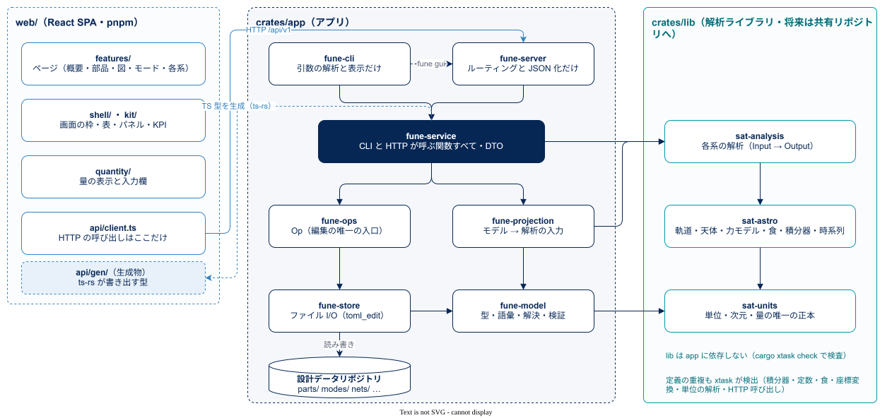

# レジストリ

**各機能がどこにあるかを示す唯一の拠り所です。** 新しい型・関数・モジュールを作る前にここを見てください。同じ機能がすでにあれば使い、なければ先に行を足してから作ります。
行を足すときは変更履歴にも 1 行書き、レビューで確認してもらいます。

## 1. crate と依存関係

依存の向きは `cargo xtask check` が検査します（`crates/xtask/src/deps.rs` の `ALLOWED`）。定義の重複は xtask の `single_home` が検査します。

| crate | 場所 | 責務 | 依存してよい内部 crate |
|---|---|---|---|
| `sat-units` | crates/lib/units | 単位・次元・量の唯一の拠り所 | none |
| `sat-astro` | crates/lib/astro | 数学、積分器、時刻、天体、力のモデル、軌道、食、地球、地磁気、捕捉放射線帯のマップ、大気、地上局、姿勢則、入射、時系列、ロケット方程式、軌道遷移 | sat-units |
| `sat-checkkey` | crates/lib/checkkey | 解析チェックのキーの書式（要求の `verify.check` が指す文字列）。解析が使う組み立て部と、キーの中のエンティティ名を読み書きする部分。葉の crate とすることで、sat-analysis と fune-model が 1 つの定義を共有する | none |
| `sat-analysis` | crates/lib/analysis | サブシステムごとの解析（Input から Output への純粋関数） | sat-units, sat-astro, sat-checkkey |
| `fune-model` | crates/app/model | 設計データの型、組み込みの語彙、解決、検査 | sat-units, sat-checkkey |
| `fune-store` | crates/app/store | ディレクトリ ⇄ Design（toml_edit）、revision、ロック | fune-model |
| `fune-ops` | crates/app/ops | Op、plan / apply、to_cli | fune-model, fune-store |
| `fune-projection` | crates/app/projection | Resolved → 解析の入力型、不足している入力 | fune-model, sat-analysis, sat-astro, sat-checkkey, sat-units |
| `fune-report` | crates/app/report | レポートの書き出し。表・図・値のデータモデル、SVG グラフの書き出し、Typst モジュール、ファイルの配置。設計や解析の知識は持たない | sat-units |
| `fune-service` | crates/app/service | CLI と HTTP が呼ぶ関数と、その入出力の型 | 上記すべて |
| `fune-server` | crates/app/server | axum のルーティング、JSON のシリアライズ、SPA の配信 | fune-service |
| `fune-cli` | crates/app/cli | `fune` の引数の解析と表示 | fune-service, fune-server |
| `web/` | web | 表示と操作（React SPA） | HTTP API only |

## 2. 機能の一覧

| 機能 | 場所 | 備考 |
|---|---|---|
| AOCS のモードカード | `fune_service::system_modes::{aocs,devices,attitude}`・`dto::aocs_modes`, `fune_projection::aocs`, `web/src/features/systems/aocs/` | モードが明示する姿勢則の投影。機器については、AOCS サブシステムに属する部品（`fune_projection::parts::in_system`）を、既存の counted_states を使って日照と食の状態ごとに役割別に集計する（役割のない種類は「その他」= `labels.toml` の `device_group.other` に入り、部品のない役割は表示しない）。モードによらないアンローディング時間は、全モード分を 1 回だけ計算し、手段（MTQ、RCS）ごとに `AocsModeView.unload_times` に入れる。姿勢則は既存の SetText の入口から編集する（未設定の軸の型のヒントは `edit::text`）。クォータニオンの設定は `SettingValue::Quaternion`、既存の value::text / json、store のコーデックを通って往復する。通常の解析のケース選択と数値は保つ |
| サブシステムごとのモード表示 | `fune_service::system_modes`（DTO は `dto::design`）, `fune_projection::{cdh,thermal}`, 既存のモード評価, `web/src/features/modes/matrix/` | 定義するのは設計のモードだけ。サブシステムのタブは同じドラフトと保存を使い、値・合計・判定は Rust が返す。食中の Power の部品ごとの値は `power::mode_load` から来る。C&DH の部品の投影は `cdh::data_parts`、欠けのあるレートは `data_budget::mode_part_rates`。表を作るための不足入力は `SystemModesView.missing`（power）にある。Thermal は `thermal::loads`、`ThermalModeLoads::evaluate_parts`、`ThermalLoad::dissipation`（熱への換算の唯一の場所）を共有する。**どのサブシステムがモード表示を持つかは `fune_service::mode_systems::mode_systems` だけが決め（`query` と `system_modes` の両方が使えるようにした葉のモジュール。同じ関数が `system_modes_of` で対応の可否を決め、`DefsView.mode_systems` を埋める。Web は一覧を持たない）、表がどのフッター行を出すか（`SystemModesView.summary`: ラベルと項目と判定を付けるかどうか）は `system_modes::summary_rows` だけが決める（リクエストの `summary` スコープ `Totals` は合計行だけを返し、設計のモードのページがフッターに使う）。** Power 固有の部分（`SystemModeView.power`、`system_modes::power`）は、リクエストが `analyzed: true` で、任意の `case` を持つときにだけ付く。CLI は `fune mode view <system> [--ops] [--case] [--analyzed] [--totals-only]`（`fune-cli` の `cmd/pages.rs`）。 |
| 熱結合と表面のタブ（結合の編集、外表面のコーティング、前後の温度プレビュー付きのコーティング） | `fune_service::thermal_tables`（`thermal_tables`; `POST /thermal/tables`）, `dto::thermal_tables`（`ThermalTablesView`, `ThermalCouplingRow`, `ThermalSurfaceRow`, `ThermalCoatingRow`, `ThermalNodeTemperature`; 編集の入力 `ThermalSetText`/`ThermalCellText`）, `fune_service::edit::thermal`（`thermal_set_ops`、`CommandText::ThermalSet` について `edit::command_ops` から呼ばれる）, `ThermalSettings::field_shape`（未記入の結合・コーティング・表面の項目の型。`edit::text::thermal_field_type` が読む）, `analysis::labels::{coupling_source, coupling_kind}`, `web/src/features/systems/thermal/tables/` | **ペア → 設定パスの対応（`THERMAL_CONDUCTIVE`/`THERMAL_RADIATIVE.at`、`analysis.thermal.coating.*`、`analysis.thermal.surface.*`）は `edit::thermal` だけにあり、行（使われる値、出どころとその表示名、明示されたペアの書かれた向き、接触面積）、ノードの一覧、表面の行（面積、ノード、一様な α/ε、割合の合計）、ノード温度の最小・最大は `thermal_tables` だけにある。** 編集は既存の `SetSetting` Op（`fune set|unset` と同じファイルなので、別の CLI コマンドはなく、`parity_thermal_tables` が比較する）で、それを拒む検査は既存の `thermal.coupling_*`、`ref.thermal_node`、`ref.coating`。プレビューは設計のモードのページのドラフトの仕組みを再利用する。`useCommandOps` がドラフトを Op にし、`POST /thermal/tables` がそれらの Op をメモリ上で適用した状態で `thermal.steady` を評価する（`preview::snapshot_with`）。保存バー（`ThermalSaveBar`）はドライランの CLI と、変わったノードの前 → 後を示し、`useApplyOps` で保存する。Web が持つのはドラフトのセル（`draft.ts`）だけで、API が返すものを表示する。`AnalysisRunResult` は拡張しない（`fune analyze` の解析 JSON は変わらない）。 |
| AOCS のモードカード | `fune_service::system_modes::{aocs,devices,attitude}`・`dto::aocs_modes`, `fune_projection::aocs`, `web/src/features/systems/aocs/` | モードが明示する姿勢則の投影。機器は既存の counted_states を使って日照と食の状態ごとに役割別に集計する。姿勢則は既存の SetText の入口から編集する（未設定の軸の型のヒントは `edit::text`）。クォータニオンの設定は `SettingValue::Quaternion`、既存の value::text / json、store のコーデックを通って往復する。通常の解析のケース選択と数値は保つ |
| サブシステムごとのモード表示 | `fune_service::system_modes`（DTO は `dto::design`）, `fune_projection::{cdh,thermal}`, 既存のモード評価, `web/src/features/modes/matrix/` | 定義するのは設計のモードだけ。サブシステムのタブは同じドラフトと保存を使い、値・合計・判定は Rust が返す。食中の Power の部品ごとの値は `power::mode_load` から来る。C&DH の部品の投影は `cdh::data_parts`、欠けのあるレートは `data_budget::mode_part_rates`。表を作るための不足入力は `SystemModesView.missing`（power）にある。Thermal は `thermal::loads`、`ThermalModeLoads::evaluate_parts`、`ThermalLoad::dissipation`（熱への換算の唯一の場所）を共有する。**どのサブシステムがモード表示を持つかは `fune_service::mode_systems::mode_systems` だけが決め（`query` と `system_modes` の両方が使えるようにした葉のモジュール。同じ関数が `system_modes_of` で対応の可否を決め、`DefsView.mode_systems` を埋める。Web は一覧を持たない）、表がどのフッター行を出すか（`SystemModesView.summary`: ラベルと項目と判定を付けるかどうか）は `system_modes::summary_rows` だけが決める（リクエストの `summary` スコープ `Totals` は合計行だけを返し、設計のモードのページがフッターに使う）。** Power 固有の部分（`SystemModeView.power`、`system_modes::power`）は、リクエストが `analyzed: true` で、任意の `case` を持つときにだけ付く。CLI は `fune mode view <system> [--ops] [--case] [--analyzed] [--totals-only]`（`fune-cli` の `cmd/pages.rs`）。 |
| モードの表示順と並べ替え | `Design::ordered_modes`（model::design::project）, `Project.modes`, `fune_ops::op::{Op::MoveMode, ModePosition}`, `plan::others`, `store::write::project`, `service::edit::command` | fune.toml の `[modes] order`。検査は model::check::modes にあり、正規化は store の format_files と共有する。CLI のモード移動と Web の ModeHeaderMenu は CommandText::ModeMove を共有する |
| 解析の領域と前提条件のトピック | `sat_analysis::spec::{AnalysisArea, ConditionTopic}`（葉の `spec::area` から再エクスポート）, `fune_model::design::ConditionTopic` | 領域はサブシステムか前提条件のトピックのどちらか。model ⇄ 解析のトピックの対応と領域のキーは `fune_projection::system` にある。トピックの設定は `design::conditions` にあり、対応する条件ファイルの中に置く |
| ほかの解析の結果を内部で使う解析 | `sat_analysis::spec::Analysis::USES`, `sat_analysis::catalog::uses` | 内部で `X::run` を実行する解析（同じ計算を別の乗数で実行するものを含む）は、その ID を `USES` に書く（電力収支 → 負荷、サイジング → 季節、負荷、発電、電力収支、噴射中の電力収支 → 電力収支、ΔV → アンロード、推進剤の質量特性と高度減衰 → 推進剤）。カタログのテストが、それらが登録されていて循環しないことを検査する。カタログのテスト以外は今は読まない。解析 → 解析の接続にこれを使っていたフロー図は削除した（#159）。解析のメタデータとして残している |
| β の季節変化と軌道ごとの本影・半影の集計 | `sat_analysis::orbit::eclipse_season`, `fune_projection::orbit` | 季節の入力は、軌道、ミッション期間、任意のステップ（β の指定なし）。1 つの軌道の中では既存の時間格子と、太陽を固定した states_at を使う。円錐の影、伝播、β は sat-astro にある。季節のステップの既定値は解析が持つ。設定は `conditions/orbit.toml` にある。数値伝播する軌道変更があるときは、サンプルの日の軌道は `propulsion::OrbitHistory::locate` から得る |
| 大気抵抗による高度減衰、軌道寿命、軌道維持の ΔV | `sat_analysis::orbit::decay`（`rates`, `simulate`, `weather`, `checks`, `output`）, `fune_projection::orbit::decay`, `fune_service::analysis::weather` | 太陽活動の条件ごと（ECSS のプリセットの low、medium、high と、宇宙天気の表から日付で引く列 `DecayWeatherSchedule`）に、軌道平均の `da/dt = 2a²/μ ⟨v · a_D⟩` を RK4（`sat_astro::ode::rk4_step`）で積分する。軌道内の位置は `OrbitSpec::states_at`、相対風と抵抗の式は `force::{earth_relative_wind_eci, drag_force}`、密度は `atmosphere::earth_density_kg_m3`、軌道平均は `spec::orbit_mean`、RAAN の歳差は `orbit::j2_secular_rates`。軌道維持の推進剤は推進の解析の値から決める（`decay::propellant` が `propulsion::Propellant::run_for_category` を実行し、カテゴリが軌道維持でスラスタを名指しする軌道変更のスラスタと推進剤を使う（名指しされたものの中で比推力が最も低いもの）。なければ、推進剤がちょうど 1 つのときだけ全量を使い、複数あるときは決めず、判定 `station_keeping_thruster` で知らせる。推進剤をまたいだ換算はしない。入力は推進と同じ `fune_projection::propulsion::maneuvers` で、推進系があるかどうかは `propulsion::present`。独自の推進剤の設定は持たない）、推進剤の ΔV は `sat_astro::rocket`。モデル化の既定値（Cd 2.2、期間 25 年、再突入 120 km、1 軌道あたり 12 点、ステップ、表を引く 27 日の間隔）は解析が持つ。抗力係数は `analysis.aocs.drag_coefficient`、抗力の面積は書かれた `drag_area`、なければ部品の箱の平均投影面積（`fune_projection::structure::boxes` から来る `OrbitDecayInput.body_boxes`。`ExternalGeometry::from_boxes(..).mean_projected_area()`、`structure.external_geometry` のレポートと同じ関数。どちらかは `DecayUsed.area_source` が示す）で、設定は `conditions/orbit.toml` の `[decay]`。表から列を引いて入力に足すことと、使った表のバージョンを `AnalysisRunResult.space_weather` に記録することは、サービスの `analysis::weather` が行う。軌道維持の `StationKeeping.delta_v_per_year` は、ΔV バジェット（#1）が使える出力 |
| レポートの書き出し（質量の表、モード別の電力の表、リンクバジェットの表、熱の結果の表、温度履歴の図、発電とバッテリーの履歴の図） | `fune_service::report::{export, parse_item, parse_lang, DEFAULT_DIR}`（ビルダー `mass`, `power`, `link`, `thermal`, `history`, `values`。補助 `common`（`Run`: 1 回の解析の実行の DTO の結果と型付きの入出力、`Counted`）, `column`）, `dto::report`, `fune_report::{model, files}`, `fune report export`, `POST /report/export` | 解析とバジェットを読む。物理も判定も再計算しない。表と図は型付きの出力を読む（`Session` の `typed_run`、#479）。リンクの表の「必要な余裕」は、判定が使うリンクごとの値。モジュールは JSON をキーで読まず、型付きの出力がないときはエラーにして、空の表にはしない（xtask の `report_json`）。文言は `fune_report::labels` だけにある。ただし、すでにほかに表示名がある語（リンクの向きは `analysis::labels::link_direction`、「その他」は `fune_model::builtin::role_other_label`、グループと状態の名前は `fune_model::builtin`）は、書き出しがそれを使い、繰り返し書かない。サービスはファイルの内容（`data.json`, `iwafune.typ`, `example.typ`, `figs/*.svg`）を返し、CLI が `--out`（既定は `exports/report`）に書くので、設計ファイルの書き込みの例外は増えない。セルは `sat_units::format` で整形する（1 列に 1 つの単位、有効数字 3 桁）。不足した入力は「利用不可」と記した項目と `unavailable` の項目になり、書き出しの失敗にはならない |
| レポートの見出し、キャプション、注記（日本語と英語） | `fune_report::labels` | 書き出しの文言を書く唯一の場所（`pair(ja, en)`）。設計の名前と解析のラベルはサービスから来る |
| レポートの SVG グラフとパレット | `fune_report::{chart, legend, ticks, palette}` | 固定精度の座標で手書きした SVG テキスト（バイト単位で安定）。図の色のパレットは `palette` だけ（Web の `tone.ts` ではない） |
| Typst モジュールとサンプル文書 | `fune_report::typst`, `crates/app/report/src/template/iwafune.typ` | モジュールは言語に依存する文字列を持たず（キャプションは `data.json` から来る）、`data.json` と `figs/` を Typst の `json()` と `image()` で読む。`#value("…")` は書き出した値を 1 つ引用する |
| 質量バジェットの部品の行（部品ごとの単位質量、個数、成長、配分の行） | `fune_service::budget::mass_part_lines`。行そのものは `fune_projection::parts::{budget_item, mass_budget_items}` | 質量の表の入力。`budget_rollup` が数えるのと同じ項目。**質量の行の集合と、行の成長の余裕は `parts::{budget_item, mass_budget_items}` だけにある**（サービスのバジェットと `structure.launch_fit` の両方がこれを呼ぶ） |
| 季節の解析からのケースの作成 | `fune_service::edit::eclipse` | `SetCase` Op を作り、CLI と HTTP が共有する。日付は説明に保存する。新しいケース ID とモードの検査は `eclipse::validate_new_case` で、太陽距離のケースと共有する |
| 太陽まわりの軌道の近日点と遠日点（ミッション期間内の太陽距離の最小と最大） | `sat_analysis::orbit::sun_distance`（`SunDistanceInput`, `SunDistanceExtremes`, `sun_distance_extremes`）, `fune_projection::orbit::sun_distance` | カタログの解析ではない。ケースを作るためだけに使う。`spec::orbit_step_s` でサンプルし、その後に黄金分割で詰める。距離と詰める処理は `timeline::geometry::{body_distances_m, extremes_by}`（下の行）なので、数値は以前の実装とビット単位で同じ。手計算のテスト: a(1∓e) と半周期の時刻 |
| 時間に沿ったミッションの幾何: 太陽距離、地球距離（または任意の天体）、太陽・地球・探査機の角（SEP）、太陽・探査機・地球の角（SPE）、片道の光の時間 | `sat_astro::timeline::geometry`（`geometry_at`・`GeometrySample`・`body_views_at`・`BodyView`・`ViewAngles`・`body_distances_m`・`light_time_s`・`Metric`・`refined_extremes`・`breakpoints_from`・`times_with_breaks`・`ProbeTrack`。`geometry/extremes.rs`: `extremes_by`・`extremes_by_split`・`extreme_indices`・`Extremes`・`Extremum`。`geometry/below.rs`: `time_below_s`、サンプルされた量がしきい値を下回る時間（交差は線形）), 解析 `orbit.geometry`（`sat_analysis::orbit::geometry`: `GeometryInput`・`GeometryLeg`・`GeometryOutput`・`GeometrySpanBasis`）, `fune_projection::orbit::geometry` | **探査機から太陽、地球、ほかの天体までの距離と角度は、ここだけにある**（`ground::earth_range`、`sun_distance_extremes`、リンクバジェットの光の時間はこれの上に作られている。入口は `Trajectory` なので、どの軌道の出どころでも動く）。位置は地心 ECI。探査機 = 中心天体の地心位置 + 軌道の相対位置で、天体は `CentralBody::position_eci_m` から得る（地球が原点で 0）。中心天体までの距離は軌道半径 `|r|` そのもの（暦の引き算はしない）。SEP = 地球の中心での太陽と探査機のなす角（合は 0° 付近、衝は 180° 付近）。SPE = 探査機での太陽と地球のなす角。地球軌道では SEP は地心での太陽と衛星のなす角（軌道ごとに周期的に変わる）。別の天体 B については、B での角と探査機での角（`BodyView`。太陽にはない）。極値はサンプルの極値（同じ値なら最初のサンプル）で、極値のサンプルの隣どうしの間を `math::golden_section_min` で詰める。そこに極値は 1 つと仮定する（SEP で見た低軌道の地球衛星の軌道のように、サンプルのステップ内で速く変わるものは分解できない）。詰める範囲は、弧の連なりの切れ目で分け（`Trajectory::breakpoints_s` から `breakpoints_from` を通る。`extremes_by_split`）、各切れ目自体も候補とするので、範囲が 2 つの弧にまたがることはない（#375 のスイングバイの巡航）。`orbit.geometry` は `Design::ordered_phases()` の順にフェーズごとに 1 つの leg を持つ（フェーズのない設計は、設計の軌道に対する 1 つの leg。`Context::in_phase` が有効な軌道を返す）。スパンは軌道の一回限りのスパン、なければフェーズの `duration`、なければ 1 周期（`span_basis`）で、leg ごとに等間隔 720 サンプル、判定も注記もない。段階 D2 は `legs[P].earth_distance.max`（フェーズ P での最も遠い地球距離と、その日付）、`legs[P].sun_distance.max.epoch`（太陽距離が最大の日付）、`legs[P].light_time_max`、`legs[P].sep_min` を直接読み、`legs[].phase` で見つける。各 leg の太陽・地球距離と SEP/SPE の系列は `ChannelKind::{SunDistance, EarthDistance, SunEarthProbeAngle, SunProbeEarthAngle}` |
| 太陽まわりの軌道の近日点と遠日点（ミッション期間内の太陽距離の最小と最大） | `sat_analysis::orbit::sun_distance`（`SunDistanceInput`, `SunDistanceExtremes`, `sun_distance_extremes`, `sun_distance_extremes_over`）, `fune_projection::orbit::sun_distance` | ケースの作成と、電力のサイジング（`sun_distance_extremes_over`: 慣例的な太陽距離を持たない中心天体について、スパンにわたるどの軌道でも最も遠い太陽距離）が使う。カタログの解析ではない。`spec::orbit_step_s` でサンプルし、その後に黄金分割で詰める。距離と詰める処理は `timeline::geometry::{body_distances_m, extremes_by}`（下の行）なので、数値は以前の実装とビット単位で同じ。手計算のテスト: a(1∓e) と半周期の時刻 |
| 時間に沿ったミッションの幾何: 太陽距離、地球距離（または任意の天体）、太陽・地球・探査機の角（SEP）、太陽・探査機・地球の角（SPE）、片道の光の時間 | `sat_astro::timeline::geometry`（`geometry_at`・`GeometrySample`・`body_views_at`・`BodyView`・`ViewAngles`・`body_distances_m`・`light_time_s`・`Metric`・`refined_extremes`・`breakpoints_from`・`times_with_breaks`・`ProbeTrack`。`geometry/extremes.rs`: `extremes_by`・`extremes_by_split`・`extreme_indices`・`Extremes`・`Extremum`）, 解析 `orbit.geometry`（`sat_analysis::orbit::geometry`: `GeometryInput`・`GeometryLeg`・`GeometryOutput`・`GeometrySpanBasis`）, `fune_projection::orbit::geometry` | **探査機から太陽、地球、ほかの天体までの距離と角度は、ここだけにある**（`ground::earth_range`、`sun_distance_extremes`、リンクバジェットの光の時間はこれの上に作られている。入口は `Trajectory` なので、どの軌道の出どころでも動く）。位置は地心 ECI。探査機 = 中心天体の地心位置 + 軌道の相対位置で、天体は `CentralBody::position_eci_m` から得る（地球が原点で 0）。中心天体までの距離は軌道半径 `|r|` そのもの（暦の引き算はしない）。SEP = 地球の中心での太陽と探査機のなす角（合は 0° 付近、衝は 180° 付近）。SPE = 探査機での太陽と地球のなす角。地球軌道では SEP は地心での太陽と衛星のなす角（軌道ごとに周期的に変わる）。別の天体 B については、B での角と探査機での角（`BodyView`。太陽にはない）。極値はサンプルの極値（同じ値なら最初のサンプル）で、極値のサンプルの隣どうしの間を `math::golden_section_min` で詰める。そこに極値は 1 つと仮定する（SEP で見た低軌道の地球衛星の軌道のように、サンプルのステップ内で速く変わるものは分解できない）。詰める範囲は、弧の連なりの切れ目で分け（`Trajectory::breakpoints_s` から `breakpoints_from` を通る。`extremes_by_split`）、各切れ目自体も候補とするので、範囲が 2 つの弧にまたがることはない（#375 のスイングバイの巡航）。`orbit.geometry` は `Design::ordered_phases()` の順にフェーズごとに 1 つの leg を持つ（フェーズのない設計は、設計の軌道に対する 1 つの leg。`Context::in_phase` が有効な軌道を返す）。スパンは軌道の一回限りのスパン、なければフェーズの `duration`、なければ 1 周期（`span_basis`）で、leg ごとに等間隔 720 サンプル、判定も注記もない。段階 D2 は `legs[P].earth_distance.max`（フェーズ P での最も遠い地球距離と、その日付）、`legs[P].sun_distance.max.epoch`（太陽距離が最大の日付）、`legs[P].light_time_max`、`legs[P].sep_min` を直接読み、`legs[].phase` で見つける。各 leg の太陽・地球距離と SEP/SPE の系列は `ChannelKind::{SunDistance, EarthDistance, SunEarthProbeAngle, SunProbeEarthAngle}` |
| 環境表から求める、ミッション全体での部品のトータルドーズ（ユーザーの表、なければ `orbit.trapped_dose` が計算した捕捉粒子の表）（#375 段階 K1、#470 段階 3） | 解析 `orbit.total_dose`（`sat_analysis::orbit::total_dose`: `TotalDoseInput`・`DoseLegInput`・`DosePartInput`・`DoseDepthPoint`・`TotalDoseOutput`・`DoseLeg`・`DosePart`・`DoseWorst`, `DEFAULT_DESIGN_MARGIN`）, `fune_projection::orbit::total_dose`, 軌道の表のキー `dose_rate_by_shielding`（`OrbitSettings`, `setting_dims::ORBIT_DOSE_RATE_BY_SHIELDING`）, `analysis.common.radiation.{default_shielding, design_margin}`（`RadiationSettings`）, 組み込みの属性 `shielding` と `tid_tolerance`（セクション `radiation`）, チェックの系列 `dose`（`sat_checkkey::total_dose`）, KPI `TotalDoseMargin` | **部品の線量は、環境表からここだけで計算する（ユーザーが与えた表が常に優先される。なければ `fune_projection::orbit::computed_environment` が leg の軌道について `orbit.trapped_dose` を実行し、各深さで太陽極小期と極大期のうち悪いほうを表として渡す。`EnvironmentSource::ComputedTrapped`。この解析自体は放射線帯のモデルも遮蔽の輸送モデルも持たない）。** 各 leg の表の出どころは `legs[].environment_source` で、計算した表には警告のチェック `environment_source` が付く（捕捉粒子だけなので、合計は下限）。表は曲線型の設定値（`SettingValue::Curve`。属性 `payload_mass_by_c3` と同じ `Curve`、テキスト形式は `"0.5:400 1:120 (mm -> Gy/yr)"`）で、設計の軌道と、フェーズの `[orbit]` で有効（フェーズの `[orbit]` は設計の表を丸ごと置き換える）。引数と値の次元は `setting_dims::CURVES` に 1 回だけ宣言する（`check` が検査する: `curve.shape`, `unit.dimension`）。leg は `propulsion.dv_budget` のアンロードの leg に従う（`duration` を持つフェーズ、なければミッション期間を持つ設計の軌道）。表は `sat_astro::math::interpolate` で読む（対数線形、**外挿なし**: 表の外では部品を評価せず、`interpolation` として返す）。余裕 = 許容量 / (合計 × RDM) − 1 を `spec::ratio_margin` で求める。RDM の既定値は 2（`DEFAULT_DESIGN_MARGIN`、出どころとともに返す）。許容量のない部品は、線量はあるが判定はない。期間か表のない leg は一覧に載せるが対象から外す（警告 `phases_left_out`）。吸収線量は `AbsorbedDoseKind` で表示する（型 `AbsorbedDose` は `SpecificEnergy` の指数を持ち、名前の引き当てはそれを返す）。線量率は新しい次元 `AbsorbedDoseRate`。要求の基準はない（許容量は部品の値、RDM は設計の値）。要求は解析全体を検証できる |
| 1 変数の表の補間（値は線形または対数、外挿なし） | `sat_astro::math::{interpolate, ValueScale}`（`math/table.rs`） | 表の点の間を読む規則はここだけにある（`orbit.total_dose` が使う）。`structure.launch_fit::capability::mass_at_c3` は独自の読み方を保つ（最初の点より下では値を固定し、最後の点より上では拒む。意図した動作） |
| 表の 3 次スプラインと、端を延長する線形補間 | `sat_astro::math::spline::{NaturalSpline, ExtendedLinear}` | **表の外へ端の区間を延ばす補間は、ここだけにある**（自然 3 次スプライン = Reinsch のもので、`eval` と `derivative` を持つ）。`math::interpolate` は、外挿してはならない表の規則のまま残る |
| 別の時刻から軌道を始める（ケースの `epoch`） | `sat_astro::orbit::{Trajectory::starting_at, OrbitSpec::rebased_at}`（`orbit/trajectory/rebase.rs`）, `fune_projection::Context::case_trajectory`（`context/orbit_source.rs`）, `AnalysisCase.epoch` | **「この時刻から見た軌道」は `rebase.rs` だけで作る**（要素は Kepler / J2 なら永年変化率で進め、数値伝播なら接触要素で進める。状態の軌道は、その時刻の状態から既存の数値伝播で再初期化する。一回限りのスパンは残りに短くする。`[epoch, epoch + span)` の外の epoch はエラー）。`Context::case_trajectory` はケースの `epoch` を適用する唯一の場所で、時系列の投影（`timeline.rs`）はすべてこれを呼ぶ。最悪ケースの解析（リンク距離、電力サイジングの太陽距離）は `trajectory` を呼び、`epoch` を読まない。テスト: 付け替えた軌道は元の軌道の続きになる（Kepler、J2、数値）、スパンは残り、遠日点の epoch のケースは遠日点の流束 `(0.7/1.5)²` になる |
| 軌道の最悪の日にケースを作る（太陽距離の最大・最小、地球距離の最大） | `fune_service::edit::geometry_cases`（`cases_from_geometry_ops`）, `POST /ops/cases_from_geometry`, `fune case from-geometry` | フェーズの `orbit.geometry` の leg を読み（どの出どころでも。距離を 2 度計算しない）、`epoch` と `phase` を持つ `SetCase` Op を返す: `<prefix>_sun_far`、`<prefix>_sun_near`、`<prefix>_earth_far`。名前は固定なので、2 回目の実行でも同じファイルに書く。既存のケースはほかの項目を保つ。パリティテスト `parity_geometry_cases`。`from-sun-distance`（下）を補う。そちらは定常解析のために円軌道の `sun_distance` の上書きを書く |
| 太陽距離が最小または最大の日にケースを作る | `fune_service::edit::sun_distance`（`case_from_sun_distance_op`）, `POST /ops/case_from_sun_distance`, `fune case from-sun-distance` | `AnalysisCase.sun_distance`（AU。日付は説明に保存する）を持つ `SetCase` Op を作り、CLI と HTTP が共有する（パリティテスト `parity_sun_distance`）。ケースの `sun_distance` があると、`Context::orbit`（`fune_projection::context::orbit`）はその距離の円軌道を使う。太陽まわりの軌道に限る |
| Power のモード別表示（バジェットのバー、判定、グラフ）と、Power の解析の概要の行 | `fune_service::system_modes::power`（`attach`。`Runs`: モード表示が使う 4 つの Power の解析の一覧。`modes`, `budget`, `charts`）, `fune_service::analysis::{run_typed_in, typed_run, TypedRun}`, `fune_projection::{Projects, project_typed}`, `dto::power_modes`, `dto::display`（表示用の葉の型）, `fune_service::analysis::overview::power`（+ `meter`）, `web/src/features/systems/power/` | **Power のページは独自の fetch を持たない。** 結果タブは、解析ごとの `POST /analyses/{id}` を元にした汎用の解析の表（`useAnalyses`。サブシステムの解析の一覧と順序は解析カタログの `info.area` で、ほかのサブシステムと同じ）。モードとシリーズのタブは、`analyzed: true` と選んだ `case` を付けて `POST /system_modes/power` を読み（`SystemModesRequest`。ドラフトの `ops` は、`/budgets/{kind}` と同じく書き込まずに適用する）、設計のモード順に `SystemModeView.power`（`PowerModeView`: モードごとの判定、日照と食のバジェットのバー、グラフの定義）が付く。`system_modes::power::attach` は 4 つの Power の解析（負荷、軌道発電、電力収支、サイジング）を**型付きで**実行し（`analysis::typed_run`。リクエストの `Session` を再利用し、`analysis::run_analysis` と同じケースの解決をする。不足入力や失敗はその解析を除く）、型付きの入出力を `modes`、`budget`、`charts` に渡す。**`system_modes::power` の中には、JSON を型に読み戻すものはない**（`serde_json::from_value` はテストの中だけ）。`analyzed` は既定でオフで、モードの表（ドラフトが変わるたびに `system_modes` を問い合わせる）が解析を実行しないようにしている。グラフの系列の表示名と単位は、型付きの系列から `analysis::channels::display_series` で得る。`SystemModeView.power` 以外の、汎用の解析結果や設計の DTO には、Power 固有の項目を入れない。概要の行の棒グラフと隠れた表は、各解析の結果を作る場所で足す（`analysis::overview::add_system_parts` → `overview::power`、`analysis::run_analysis` が呼ぶ。隠れた表の比較相手になるほかの解析はリクエストの `Session` から来るので、呼び出し側が同じケースですでに実行したものは再実行されず、`POST /analyses/power.*` と `fune analyze power.*` がそれらを返す）。限界と必要値のメーターの位置は `overview::power::meter` だけが決める。グラフの系列は、各解析の `output` と `PowerChartView.series`（グラフごとのチャンネルの部分集合）の両方で、今も届けている。Web は表示、選択、目次だけを扱う。 |
| Web の時系列グラフ | `web/src/analysis/SeriesChart.tsx` | サブシステムの解析と条件の解析が共有する。表示単位はサービスが足す |
| Web の解析 KPI の帯 | `web/src/analysis/AnalysisKpis.tsx` | サブシステムのページと前提条件のページが共有する表示 |
| サブシステムの概要の解析の表（1 行 = 1 解析。主な結果、判定、不足入力の数。展開すると、すべての KPI、小さな棒グラフ、判定の文、生の表） | `fune_service::analysis::overview`（`MAIN_KPIS`・`main_kpis`・`check_groups`・`share_of_largest`）, `dto::overview`（`AnalysisOverview`・`OverviewCheckGroup`・`OverviewChart`・`OverviewBar`・`OverviewReference`）, 行は実行結果の `AnalysisRunResult.overview`（`analysis::run_analysis` が、棒グラフも隠れた表もなしで作る）, 4 つの Power の解析については `analysis::overview::power` が棒グラフと隠れた表を足す（`overview::add_system_parts`、`run_analysis` が呼ぶ）, `web/src/analysis/{AnalysisTable,AnalysisRowDetail,OverviewBars}.tsx`, サブシステムのページの `features/systems/SystemOverview.tsx`（Thermal 以外すべて） | **行に出す主な結果をどう選ぶか（定義順に最大 3 つの KPI）は、ここだけにある**。判定の文は、持ち主（`CheckView.scope`。電力収支ではケースとモードの順）でまとめる。棒グラフは、サブシステムの組み立てが解析ごとに選ぶ（Power: 負荷はモードごとの消費電力、発電は軌道平均の BOL と EOL と日照の割合、電力収支はケースとシーケンスごとの最大 DoD とその限界、サイジングは現在の面積と容量と必要な面積と容量。限界と必要値のメーターの位置は `overview::power::meter::verdict_view`）。塗りと線の位置は 0 から 1 で、表示文字列は `units::quantity_auto` から来る。「データを見る」の奥に隠れた表（`overview::power::hidden_tables`: サービスが同じ設計とケースでもう 1 つの解析を実行し、型付きの出力を比べる。同じ内容がほかの解析の行に出るもの: 電力収支の `mode_loads.modes` と `eclipses`）も、サービスから来る。Web のコンポーネントはサブシステムに依存せず（解析の定義、結果、概要を受け取る）、開閉は行の先頭のボタン（`aria-expanded`）。Power を含め、Thermal を除くすべてのサブシステムの概要が使う（Thermal は、ノード温度の表、3D、`AnalysisCard` のまま）。Power 以外の棒グラフはまだない（null）。まだ結果のない解析は、読み込み中のスケルトンの行か、クエリのエラーの行を出す |

| 機能 | 場所 | 備考 |
| 編集履歴、元に戻すとやり直し | `fune_store::journal`（ファイル `.fune/history.json`、位置、上限 `MAX_ENTRIES` 100 / `MAX_BYTES` 32 MiB）, `fune_ops::{apply (records), history::{undo, redo}}`, `fune_service::history::{undo, redo, view}`, `dto::history`, `fune undo`/`redo`/`history`, `POST /undo`・`POST /redo`・`GET /history`, `web/src/api/history.ts`, `web/src/lib/history-keys.ts`, `web/src/shell/use-history-keys.ts` | **ジャーナルとその上限は `store::journal` だけにあり、記録された内容を書き戻すのは `ops::history` だけ（`apply` と同じロックと revision の検査をするので、Op と同じく `commit` を呼んでよい）。** 適用された Op の一覧だけを記録する（ドライラン、`fune fmt`、`catalog.lock` の取り込みは記録しない）。Web は独自の元に戻すスタックを持たない。図のページのかつての `inverseOf` のスタックは削除し、そのボタンは同じ `/undo` を呼ぶ。Web の変更履歴の元に戻すとやり直しの項目は `ChangeEntry.kind` |
| 部品のサブシステムの決定 | `fune_model::part_system`（`Design::system_of`。種類の役割のサブシステムのための `Design::kind_system` は `CatalogItemView.system` と共有） | 最上位のディレクトリのサブシステム → 役割のサブシステム → None。フォルダーも同じ関数でサブシステムを引く。xtask が関数の場所を検査する。API は projection の対応を通して System にする。サブシステムの ID でない最上位のフォルダー（機構やハーネスのアセンブリ）は許され、`info` 診断 `part.system_dir` が出るだけ: 解析を持つサブシステムの集合（`AnalysisSystem`）と、製品ツリーの最上位のフォルダーの集合は別（docs/model.md §6.2） |
| ID 付きの表示名（空、空白だけ、ID と等しいラベルは、ないものとして扱う） | `fune_model::display_name::{name_or_id, name_with_id}`（CLI には `fune_service::query::name_with_id` として再エクスポート）, `web/src/lib/design.ts`（`nodeName`, `withNote`, `idWithName`） | 表示名から ID へ戻し、「名前 (ID)」を組み立てる唯一の場所（レポートの書き出しの見出し、`fune-service` のビューの組み立て、CLI の見出し）。Web も同じ規則に従い、両方がテストで表 `crates/app/model/testdata/display_name_cases.json` を読んで、一致するようにしている。xtask の単一の置き場所の規則は、2 つ目の定義と `label.clone().unwrap_or_else(|| …)` を禁じる |
| Web のサブシステムごとの表示ツリーと配置の選択肢 | `web/src/lib/design.ts::{systemTree, parentOptions}` | 直下の部品も、API の部品のサブシステムを使ってサブシステムにまとめる。配置は API のサブシステムの一覧と構造のノードを使う |
| 3D の外形と表示寸法 | `web/src/features/layout3d/scene.ts` | 回転した Bounds の最も長い辺に対する比率。箱、矢印、重心、軸、格子、カメラの寸法を共有する |
|---|---|---|
| 単位文字列の解析と次元 | `sat_units::parse_unit` / `Unit` / `Dimension` / `named_dimensions` | 単位文字列はほかのどこでも解析しない。SI 接頭辞の表と、どの単位が接頭辞を取れるかの規則は `sat_units::parse::prefix` にある（`T`・`G`・`M`・`k`・`h`・`c`・`m`・`µ`・`u`・`n`・`p`・`f`。完全一致する記号が優先され、`kkg`・`mmAh`・`kh` は拒まれ、`h`（ヘクト）は `hPa`・`hL` にだけ使う） |
| dB ⇄ 比 | `sat_units::{ratio_to_db, db_to_ratio, apply_db_gain}` | **dB の換算はここだけにある**（リンクの計算もこれを使う） |
| JSON に書き出す量の次元 | `sat_units::take_last_dimension` | `Qty` の `Serialize` が記録する（スレッドごと）。トルクの出力項目は `#[serde(serialize_with = "sat_units::typed::TorqueKind::serialize")]` で種類を記録する。次元の検査（N·m = J）と JSON の数値は変わらず、Energy の表示も保つ |
| 次元の表示名 | `sat_units::format::dimension_label` | 名前がなければ、SI 組立単位の式 |
| 次元の表示名の組（日本語と英語、画面用） | `sat_units::format::{dimension_display_name, DimensionDisplayName}`（`label` / `label_en`）, `DimensionInfo.label` / `label_en` として公開（`GET /units`） | **識別子（`AngularMomentum`）は人には見せない。** Web は単位カタログからその組を引き（`web/src/quantity/use-dimension-label.ts`, `localized(label, label_en)`）、識別子を API に送り返すときと、識別子として編集するときにだけ識別子を残す。テストが、`named_dimensions()` のすべての項目に空でない組があることを求める。CLI は英語のみのまま |
| 二分法と黄金分割探索 | `sat_astro::math::{bisect, golden_section_max}` | **根と極値の探索はここだけにある** |
| 凸多角形の平面上の和集合（面積と重心） | `sat_astro::math::planar`（`ConvexPolygon`, `union_measure`, `UnionMeasure`, `StaticUnion`） | **凸多角形の平面上の和集合は、ここだけにある。** 厳密なスラブの掃引（すべての頂点と辺の交点の縦座標で切り、各スラブで区間の和集合を取る。面積は台形則、一次モーメントは Simpson 則で、どちらも幅が線形なら厳密）。共有する辺や一致する辺、同一の多角形、面積ゼロの多角形、ほぼ平行な辺に頑健で、分解能のパラメータはなく、決定的。`StaticUnion` は、呼び出しの間で変わらない多角形（面の接地面とカバー）を 1 回だけ準備した同じ掃引で、呼び出しでは動くもの（影）の分だけ計算する。リスト `[leading, fixed head, between, fixed tail]` に対する `union_measure` と同じビットを返す。部品の箱の投影面積と露出面積（#388）と、面の照らされた割合が使う |
| Gauss–Legendre 求積の節点と重み | `sat_astro::math::quadrature::gauss_legendre` | **求積の節点はここだけにある**（`P_n` に対する Newton 法で、次数 2n − 1 まで厳密）。平均投影面積の方向の集合はこれから作る |
| 二分法と黄金分割探索 | `sat_astro::math::{bisect, golden_section_max, golden_section_min}` | **根と極値の探索はここだけにある**（`golden_section_min` はミッションの幾何の極値が使う最小化で、値が等しいときは下側を捨てる。`golden_section_max` はその逆） |
| 型付きの量 | `sat_units::typed::Qty<D>` | JSON では SI の数値、TS では number |
| dB の型付きの表示 | `sat_units::typed::{Decibel, DecibelWatt, DecibelPerKelvin, DecibelHertz}` | JSON は dB の数値のまま。種類は記録され、format_quantity で表示する |
| 解析結果の判定の集約 | `fune_service::analysis` / `sat_analysis::spec::Verdict::worst` | サービスがチェックを平らにして CLI と Web に返す |
| KPI（サブシステムとトピックごとの代表値、判定、充足率、判定の数え方） | `fune_service::analysis::kpi`（Power の解析の値は `kpi::power_kpi`、構造は `kpi::structure_kpi`、推進は `kpi::propulsion`、軌道は `kpi::orbit`。KPI ごとの扱い（結びつけるチェック、充足、数え方）は `kpi::rule`。型は `dto::{KpiKey, KpiDef, KpiView, KpiTally, FillRatio, FillBasis}`） | **どの値が代表か（系列の最大または最小 = 悪い側）、KPI の判定（判定を持つ KPI は、その KPI が示す量を判定するチェックのキーに結びつけられ（完全一致か接頭辞）、その中で最も悪いものを取る。`kpi::rule::CheckMatch`。`kpi::rule_tests` が、結びつけたキーが sat-analysis にあることを検査する。熱の最高温度の KPI は上側のチェック `range_high:` に、最低温度の KPI は下側のチェック `range_low:` に結びつく）、充足率、判定の数え方（`kpi::rule::Tally`: 範囲内のノードの KPI は、ノードと範囲の種類ごとに 1 項目を数え、両側を `sat_analysis::thermal::range_item` でまとめて、悪いほうの判定を取る）は、ここだけにある。** 値は、解析の出力を型に戻して引く（`kpi_table!`。次元は型の `NamedKind`）。表示は `units::quantity_auto` を使う。定義（名前）は `AnalysisEntry.kpis`（`GET /analyses`）で、値は `AnalysisRunResult.kpis`。キーはサブシステムをまたいで一意（`KpiKey`）で、表示名は `analysis::labels::kpi_label`。KPI は件数にもなれる（`Reading::Count`。出力から取る `KpiTally`: `structure.interference` の重なるペア、`structure.cone_clearance` の遮られた円錐）。解析は実行されたが示すものがない KPI（日付つきの遷移がない、窓がない）は、値のない KPI を持つので、行は「結果なし」（解析が KPI を返さなかった、たとえば失敗した、という意味）ではなく「—」と読める。設計データから作れない解析（`projectable = false`）は、サブシステムとトピックのページに一覧しない（`web/src/api/queries.ts`）。設計が持たない手段の KPI（`Rule.when_measured`）は、値も判定もなければ除く（`kpi::only_measured`。値がなくても判定があれば、判定つきの「—」として残る）。Power のモードの消費はバジェットと同じモードを使う（`budget::budget_mode`）。充足率は 0 から 1 に丸められ、根拠（`FillBasis`）を持つ（バジェットの `BudgetView.fill` と `BudgetRow.fill` も同じ型を使う。`FillRatio::used_over_limit`）。CLI は `fune analyze` の表で、Web は `web/src/analysis/kpi.ts` で `area` ごとに並べるだけ（サブシステムのページの数値の帯と概要のカード） |
| 概要の KPI カード（どの KPI がカードの先頭になり、どの KPI がフッターに入るか） | `fune_service::analysis::kpi::rule::overview`（`GET /analyses` の `KpiDef.overview: Option<OverviewKpi>` と、その `order` と `footer`）, `web/src/features/overview/`（`cards.ts` が API の印を付けたスロットを `order` で並べる） | **概要の KPI の集合と順序は `rule::overview` だけが決め、Web は KPI のキーの一覧を持たない。** 解析の実行後に、値も判定も数えた判定もないカードは出さず、推進の KPI（`DvWithMargin`）は設計に推進があるときに出る。バジェットのパネルは `DefsView.budget_kinds` を繰り返す（`xtask` の web_strings は JSX に書いたバジェットの種類を拒む） |
| サブシステムごとのモード表示の CLI | `fune-cli` `cmd/pages.rs`（`fune mode view <system> [--ops] [--case] [--analyzed] [--totals-only]`） | 表だけ。値、合計、判定は `system_modes::system_modes` の DTO。`--json` は `POST /system_modes/{system}`（`SystemModesRequest`）と同じ DTO を出力し、違反または不足入力があれば終了コードは 1（`crates/app/cli/tests/parity_pages.rs`） |
| 比（0 から 1。% で表示） | `sat_units::typed::Fraction` | JSON では数値、TS では number。書き出すとき、`take_last_dimension` は種類の名前 `Fraction` を返し、`format_quantity(_, "Fraction")` が % で表示する。**解析の入出力の割合（DoD、SOC、日照の割合、デューティ、余裕、占有率、使える割合）はこれを使う**（Web が項目名で決めないようにする） |
| 型から表示名を得る | `sat_units::typed::{NamedKind, TorqueKind, TemperatureDifferenceKind}` | **次元の名前や表示の種類を文字列で書かない**（`quantity_text::<Power>`・`Channel::of::<Power>`・`limit_check::<Information>`。綴りの間違いはコンパイル時に捕まる）。次元の型は `format::dimension_name` を使い、`Fraction` と `Decibel*` は `KIND` を使う。`Torque` は `Energy` と同じ型なので、N·m にしたいときは `TorqueKind` を使う。**温度差は 273.15 のオフセットなしで K で表示する**（`Temperature` は °C で表示する）: `TemperatureDifference` は `Temperature` の別名（Torque と Energy と同じく同じ次元）で、差を持つ項目（`ThermalMarginPolicy`/`ThermalMarginUsed` の不確かさと警告の幅、`ThermalRangeMargin` の余裕、設定 `analysis.thermal.margin.*`）の型は `Qty<TemperatureDifference>` で、`TemperatureDifferenceKind::serialize[_option]` で種類を記録し、`quantity_text::<TemperatureDifferenceKind>` がそれを整形する。表示単位は `format/preferences.rs`（`K`）にあり、入力の単位の候補は K だけ（`units_catalog`） |
| 量の表示文字列（SI 接頭辞の選択） | `sat_units::format::{format_quantity, format_dimension, format_in_unit, format_number, FormattedQuantity}` | CLI と Web は、サービスが返す表示文字列を使う。TS で単位を換算しない。表示単位の候補は `display_units`、SI 組立単位の式は `si_unit_expression`。`FormattedQuantity` は整形関数の戻り値で、API には公開しない（API の量の表示は `fune_service::dto::QuantityView` だけ） |
| 次元 → 次元の名前 | `sat_units::format::{dimension_name, canonical_dimension_name, dimension_label_preferring}` | Energy と Torque は同じ次元なので、整形は次元の名前で指定する。呼び出し側が知っている次元の名前が、その次元の名前として正しいなら、それを使う規則（別名の選び方）は `dimension_label_preferring` だけにある（サービスの `units` が使う。xtask の `single_home` は format.rs の外の `fn dimension_name(` を拒む） |
| ベクトル、行列、クォータニオン | `sat_astro::math::{Vec3, Mat3, Quat}` | 演算子（Vec3 の + − × ÷、Mat3 の +）、`Mat3::{mul, inverse, outer, scale}`、`Quat::{rotate, rotate_inverse, from_matrix}`。対称行列の固有値分解（主慣性モーメントと主軸）は `Mat3::symmetric_eigen` だけ。軸まわりの回転行列は `Mat3::{rotation_x, rotation_y, rotation_z}`、球座標からの単位ベクトルは `Vec3::from_spherical`、そして `Quat::{from_wxyz, to_wxyz}` |
| 固定軸の X → Y → Z の回転角 ⇄ クォータニオン | `sat_astro::math::Quat::{from_fixed_xyz, to_fixed_xyz}`（`math/euler.rs`） | **角度 ⇄ 姿勢の変換はここだけにある。** 親の座標軸まわりに X → Y → Z の順に回す（`q = qz ⊗ qy ⊗ qx`）。逆向きでは、X と Z は (−π, π]、Y は [−π/2, π/2] に入り、ジンバルロック（Y = ±π/2）では X = 0 とし、残りを Z に入れる。作る向きにより、スカラー部は非負になる（`Quat::with_nonnegative_w`。`from_matrix` も同じ）。配置の向きの表示（`fune_service::query::pose`）と `--rotation` の解析（`edit::rotation_from_text`）が使う |
| 密な連立一次方程式 | `sat_astro::math::solve_dense` | 部分ピボット選択つきのガウスの消去法。熱ネットワークの定常解などに使う。**連立一次方程式の解法はここだけにある** |
| 疎な対称連立一次方程式（スカイライン格納、LDLᵀ、負のピボットの数） | `sat_astro::math::{Skyline, SkylineLdl}`（`math/skyline.rs`） | 列の高さによる対称行列の可変バンド格納（`new`, `from_couplings`, `add`, `add_scaled`, `mul_vec`）、ピボットなしのその場の LDLᵀ（正定値には `into_ldl`、Sturm の数え上げには `into_ldl_indefinite` と `count_negative_eigenvalues`）、1 つまたは複数の右辺の解法。ゼロまたは負のピボットは `SkylineError` になり、panic はしない。**疎な対称の解法はここだけにある** |
| 密な対称固有値問題 | `sat_astro::math::{symmetric_eigen, generalized_symmetric_eigen}`（`math/sym_eigen.rs`） | 小さな n×n 行列に対する巡回 Jacobi 法（値は昇順、ベクトルは正規直交）と、B が正定値のときの、その Cholesky 因子を通した `A x = λ B x`。射影した問題（n は 40 程度まで）のためのもので、3×3 の慣性の場合は `Mat3::symmetric_eigen` のまま。**密な一般化固有値の解法はここだけにある** |
| `K x = λ M x` の最も低い固有モード | `sat_astro::math::{lowest_modes, Mass, SubspaceOptions, Modes}`（`math/subspace.rs`） | `(K + σM)` に対するシフト付きの部分空間反復。K は対称半正定値（シフトにより特異でもよい）、M は対角またはスカイライン（`Mass`）。固定シードの決定的な開始（ビット単位で再現できる）、`2·count + 8` 本の反復ベクトル、収束しないときの型付きのエラー、返した最大の固有値より下の固有値を取りこぼしていないことの Sturm 列による確認（`SubspaceError::MissedModes`。切断点の重根は、代わりに `Modes::cluster_split` を設定する）。**モード固有値の解法はここだけにある。** 今は呼ぶものはない（#370 のライブラリ段階） |
| 積分器（固定ステップの RK4、可変ステップの DOP853） | `sat_astro::ode` | **積分器はここだけにある。** 固定ステップの格子は `ode::{step_count, step_offsets}` だけ（時系列の時間の列もこれを使う）。イベント付きの区間の積分（スカラー関数が 0 に達すると積分を止める。時刻は稠密出力に対する `math::bisect` で求める）は `Dop853::integrate_segment`（`ode/segment.rs`）だけで、そのコストは `OdeStats` |
| 物理定数と天体の定数 | `sat_astro::constants` | 定数を 2 回定義しない |
| 時刻（epoch）と恒星時 | `sat_astro::time::Epoch` | JSON では ISO 8601 |
| 天体（太陽、月、惑星）の位置と μ | `sat_astro::ephem` | 太陽は VSOP87A、月は Meeus、惑星は Standish。Kepler 方程式は `kepler::solve_kepler` を使う（orbit からも再エクスポートされる）。JPL DE440 は `ephem::De440::from_bytes` で読み、`ephem::install_de440` で登録し（1849 年から 2150 年に使う。プロセス全体の唯一の状態）、出どころは `ephem::source_at` |
| 軌道の中心天体（μ、半径、J2、位置） | `sat_astro::ephem::CentralBody` | `OrbitSpec::central`（既定は地球。設計が指定しなければ `CentralBody::default()`）。中心天体から見た太陽の向きは `ephem::sun_direction_from`（太陽が中心のときは `None`）。親の天体 `CentralBody::parent`、親のまわりの軌道の長半径 `orbit_radius_m`（月は `A_MOON`、惑星は Standish の J2000）、設計の太陽距離の慣例値 `nominal_sun_distance_m`（地球と月は 1 AU、ほかはなし）、太陽まわりの平均運動 `sun_mean_motion_rad_s`（地球は `SUN_MEAN_MOTION`、惑星は `√(GM☉/a³)`、月と太陽はなし。太陽同期軌道が使う）。親に対する状態 `CentralBody::state_about_parent`（太陽に対する惑星、地球に対する月。`position_eci_m` の位置の差と、±60 s の 1 回の差分による速度 `velocity_eci_m_s`）と、Laplace の影響圏半径 `CentralBody::soi_radius_m`（`orbit_radius_m` と天体の GM から `a (m/M)^(2/5)`）。設計での綴り `fune_model::design::CentralBodyKind`（`conditions.orbit.central` と軌道変更の `target.body`）→ `fune_projection::context::central_body`（一致はテストする） |
| 天体の自転軸、経度ゼロの方向、天体固定座標系 | `sat_astro::ephem::orientation`（`pole_eci`・`equatorial_frame`・`moon_fixed_frame`・`lunar_orientation`） | IAU WGCCRE 2015。月には周期的な秤動の項を含む。地球の ECEF は `earth` にある |
| 力のモデル（重力場、第三体、SRP、抗力） | `sat_astro::force` | EGM96 の次数 70 まで。項ごとの関数 `point_mass` `j2_perturbation` `third_body_eci` `earth_srp_eci` `earth_drag_eci` と、設定の検査 `validate`。**J2 の式は `force::zonal_j2` だけ**（`j2_perturbation` は、地球で z 軸を使った `zonal_j2`）。**抗力の式 `F = −½ ρ (Cd·A) \|v\| v` は `force::drag_force` だけ**（`earth_drag_eci` は `Cd·A/m` で加速度を返し、空力トルクは `Cd·A` で力を返す）。共回転する大気に対する速度は `force::earth_relative_wind_eci`（地球が中心のときだけ。名前に `earth_` を持つ `earth_srp_eci`、`earth_drag_eci`、`earth_density_kg_m3` も同じ）で、太陽放射圧は `force::srp_pressure`（抗力、空力トルク、SRP トルクが共有する）。**推力の項（操舵則 `ThrustSteering`、Edelbaum のヨー角 `edelbaum_initial_yaw_rad` と `edelbaum_yaw_rad`、推力 / 質量 `thrust_acceleration_eci`）は `force::thrust` だけにある**（総 ΔV の式は `transfer::edelbaum`） |
| 軌道要素、伝播、周期、SSO の傾斜角、β 角 | `sat_astro::orbit` | 伝播はここだけにある。`Propagator::default()` は J2 の永年項。書かれていない要素の慣例値（離心率 `DEFAULT_ECCENTRICITY`、角度は 0）は `OrbitElements::with_defaults` だけにある。要素 ⇄ 状態は `elements_to_state` / `osculating_elements`、`solve_kepler`、`j2_secular_rates`。β 角から RAAN を逆に解くのは `orbit::raan_for_beta` だけ（β の符号は `beta_angle_rad` と同じ）。SSO の傾斜角は `orbit::sso_inclination_about_rad(central body, a, e)`（天体の赤道に対して。太陽と月は Err を返す。地球版の `sso_inclination_rad` は同じ式を呼ぶ）。昇交点地方時 ⇄ RAAN は `orbit::{raan_from_ltan, raan_from_ltdn, ltan_from_raan}`（真太陽時。`_about` が付くものは中心天体を取り、地球以外は Err を返す）。高度 ⇄ 長半径は `orbit::{semi_major_axis_from_altitude, altitude_from_semi_major_axis}` と `OrbitSpec::altitude_m`（中心天体の半径）だけ。平均運動は `orbit::mean_motion_rad_s`。任意の時刻の状態を何度も求める処理（Kepler と J2 は直接。数値伝播は 1 回だけ表にして 3 次の Hermite 多項式で補間する）は `OrbitSpec::track` → `OrbitTrack::state_at`（`orbit/track.rs`）だけ |
| 解析が軌道について読むもの。時刻の関数としての状態、中心天体、epoch、1 回の繰り返しの長さ | `sat_astro::orbit::{Trajectory, Cycle}` (`Trajectory::{epoch, central, state_at, states_at, track, table_step_s, cycle, altitude_m, elements, elements_mut, with_span, span_s, chain, breakpoints_s}`、`Trajectory::{Spanned, State, Synodic, Arcs}` (`orbit/trajectory/chain.rs`: `ArcChain`、`BREAK_TIME_TOL_S`、`BREAK_POSITION_TOL_M`。`arc_index` は `orbit/track.rs`。JSON は `orbit/trajectory/repr.rs`: `TrajectoryRepr`、`ArcsRepr`)、`Cycle::{length_s, period_s}`、`OrbitSpec::cycle`)、`OrbitSampling::orbit` / `TimelineSpec::orbit()` (`Trajectory` を返す)、`ground::{find_passes, earth_range, ground_track}`、`sat_analysis::spec::{sampling, daily_sampling, orbit_step_s, orbit_ranges}` (`Cycle` を受け取る) | **時間に沿った状態だけが要る解析は、`OrbitSpec` ではなく `Trajectory` を受け取る。周期は `cycle().length_s()`** (#375 段階 A)。元になるのは、`Trajectory::Elements(OrbitSpec)` (すべての呼び出しを `OrbitSpec` の関数に渡し、数値は変わらず、Kepler 周期の `Cycle::Periodic` を返す) と、`Trajectory::State(StateSpec)` (次の次の行。常に一度きり) である。JSON では、`source` がなければ elements とみなし、elements は `OrbitSpec` そのままの形で (タグなしで) 書くので、既存の解析入力は読み書きしてもバイト単位で変わらない。`source = "state"` なら `StateSpec` のフィールド (`epoch`、`central`、`state`、`forces`、`span_s`) を並べて書き、未知の `source` はエラーである。Kepler 要素が本当に要るもの (RAAN による β の指定、高度、`orbit.eclipse_season`、`orbit.decay`、推進計画、Power のサイジング季節) は `OrbitSpec` のまま、または `elements()` を通す。elements でない trajectory は、そこでは「適用外」になる。**span を付けると、どの trajectory も一度きりになる** (`Trajectory::with_span`、`Spanned { orbit, span_s }` というバリアント。JSON は `OrbitSpec` のフィールドに `span_s` を足したもので、周期軌道では `span_s` がない)。`cycle()` は `Cycle::OneOff` になり、`elements()` は `None` になり (この弧は繰り返す Kepler 軌道ではない。`altitude_m()` は内側の軌道から答える)、運動は内側の軌道のものである。`source = "transfer"` の軌道は `Trajectory::Elements(cruise_orbit).with_span(time of flight)` である。`state` ソースは span を自分のフィールドとして持ち (`with_span` はそれを置き換える。`Spanned` で包まない。state の軌道は span なしでは意味がない)、`libration` ソース (`Trajectory::Synodic`) は周期的で、elements と同じく `Spanned` を通して `with_span` を受ける。一度きりの軌道のサンプリングは、span そのもの、軌道数なし、刻みは `max(30 s, span / 200)` (`spec::sampling::orbit_step_s`)、要求された刻み (熱の `time_step`) はそれより細かくしない (`spec::requested_step_s`)、日次サンプリングは span より長くしない、軌道の分割は span を 1 軌道として扱う、そして出力でそのことを伝える (`SpanFallback::OneOffSpan` から `spec::span_note` へ。周期の出力は変わらない) **フライバイをまたぐ巡航は弧の連なりであり、新しい種類の trajectory ではない** (#375 swing-by cruise)。`Trajectory::Arcs(ArcChain)` は、span を持つ 2 本以上の弧 (それぞれ `Spanned` の Kepler 軌道か `State`) を時間順に並べ、端がつながるものである (中心天体が同じで、次の始点が前の終点から 1 ms 以内、各つなぎ目で位置が 1 m 以内。速度は飛んでよい)。作るのは `Trajectory::chain` だけで、弧が 1 本ならその弧そのものを返す (弧 1 本の場合は既存の `Spanned` で、数値も JSON も TS も同じ)。**ある時刻がどの弧に属するかは `arc_index` だけが決める** (その時刻以前に始まる最後の弧。つなぎ目ちょうどでは後に出ていく弧。最初の弧より前、最後の弧より後は、最初・最後の弧を延長する)。これを `states_at` (各時刻をその弧で評価し、同じ弧が続く部分はまとめて処理する)、`OrbitTrack` (弧ごとに 1 つの表を持ち、つなぎ目をまたいで補間しない)、`starting_at` (含まれる弧の残りと後続の弧) が使う。`cycle()` は飛行全体にわたる `OneOff` で、`central()` は共通の親天体、`elements()` と `altitude_m()` は `None` であり、`table_step_s` は弧のうち最小のものである。JSON では、弧 1 本は変わらず、Kepler 弧が 2 本以上なら `{source = "arcs", arcs = [...]}` になる。フライバイ天体の影響圏の内側にいる時間はモデル化しない (フライバイは瞬間的に起こるものとする) |
| 地球の影 (食) | `sat_astro::shadow::earth_shadow_factor` | 食の判定はここだけ。月や惑星の影は `shadow::body_shadow_factor`。中心天体の影は `shadow::central_shadow_factor` (時系列と SRP が共有する)。何かが天体の影の中にあるか (月が地球の影の中にあるか) は `shadow::occulted_by` |
| ECI ⇄ ECEF、測地座標、高度、歳差 | `sat_astro::earth` | 座標変換はここだけ (`of_date_to_j2000`・`mean_obliquity_rad`・`ecliptic_to_equatorial` を含む) |
| 地磁気 (傾いた双極子) | `sat_astro::geomag` | 地球専用のモデル。`geomag::field_about_eci_t` は地球以外の中心天体では 0 を返す。その 0 が「磁場がない」(月、金星、火星) のか「モデルがない」(木星など) のかは `CentralBody::magnetic_field_model` (`body::EnvironmentModel`) で分かる。解析は後者を黙って 0 として出力せず、ユーザーに知らせる (外乱トルクは `DisturbanceSpacecraft::environment_check` 経由。`aocs.unload_time` は MTQ を評価せず (`mtq` は `None`。RCS は続ける)、理由 (`MtqFieldReason`) と、RCS がすべての方向を捨てられるか (`covered_by_rcs`) を、出力の `mtq_field_gap` (`unload_time::field_gap::MtqFieldGap`) に返す (判定は `MtqFieldGap::verdict`。RCS で足りれば OK、足りないなら磁場がないときは違反、モデルがないときは警告)。service の `analysis::checks` が判定 `mtq_field_model` を日本語と英語で組み立てる) |
| 球面調和関数による内部地磁気 (Gauss 係数 g、h。Schmidt 準正規化。永年変化。基準半径)、そのテキストファイル形式、McIlwain の L と B/B₀ | `sat_astro::geomag::{GaussModel, GaussTerm, FieldSnapshot}` (`gauss.rs`。ファイル形式は `gauss_text.rs`)、`geomag::lshell::{LOptions, MomentConvention, LShell, NoL}` (`FieldSnapshot::l_shell`)、`geomag::dipole_f` (非公開) | Legendre の漸化式は書き直さない。磁場は、重力場と同じ V/W 漸化式 (`force::gravity::GravityTable::from_schmidt`。Schmidt から非正規化への係数があるのはここだけ) からの `−∇V` である。`GaussModel::tilted_dipole` は既存の双極子を次数 1 (軸と `B0_EARTH` からの g10、g11、h11) で表し、丸め誤差の範囲で `dipole_field_eci_t` に等しい。磁力線は `ode::Dop853` で追跡し、`I = ∫√(1 − B/Bm) ds` は Gauss–Chebyshev 求積を使う。McIlwain の F は中心双極子の定義から解く (`geomag::dipole_f`。文献の多項式は使わない)。既定の M はモデル自身の次数 1 のモーメントで、`MomentConvention::Fixed` は固定の赤道面の強さを与える。捕捉放射線のモデル (`sat_astro::radiation`、#470) が使う |
| 古い地磁気ファイル (Jensen & Cain 1960、年に外挿した GSFC 12/66) と IGRF 係数ファイルの、`GaussModel` への変換 | `sat_astro::geomag::legacy` (`GaussModel::{from_jensen_cain_bytes, from_gsfc1266_bytes}`、`IgrfTable::{from_bytes, model_at, year_range}`)、`geomag::REFERENCE_RADIUS_M` | Jensen & Cain 係数の変換 (Chapman–Bartels の「Gauss」正規化、符号が逆: `g' = −g·(n−m)!/((2n−1)!!·Sₙₘ)`) と、GSFC 12/66 の `½·g̈·Δt²` 外挿はここだけ (docs/trapped-radiation.md)。入力はバイト列で、ファイル I/O はしない |
| 捕捉された陽子と電子の分布図 (AP-8、AE-8)。NSSDC の ASCII 分布図の読み込み、(L, B/B₀, E) での積分フラックス `> E`、分布図と磁場の組み合わせ、ある位置での L と B/B₀、読み込んだテーブルのプロセス全体での登録 | `sat_astro::radiation::{map::TrappedMap, TrappedModel, BeltField, belt_position, belt_position_with, BeltConvention, registry::{install_map, install_field, install_igrf, RadiationTables}}` (フラックスの参照は `TrappedMap::integral_flux`) | **これらの分布図を読むことのすべてがここだけにある。** `TrappedMap::integral_flux` は NSSDC RADBELT の TRARA1/TRARA2 (TRMFUN.FOR、1987) を単精度で 1 ステップずつ踏襲し、AE8MIN について NASA のサンプル出力に印字された 4 桁を再現する。L と B/B₀ は `belt_position` が `BeltConvention::Literature` (既定。固定の `M = 0.311653 G·Rₑ³` による L と、B₀ = M/L³) か、比較用の `ModelDipoleLineMinimum` で求める。読み込んだテーブルは、DE440 に次ぐ 2 つ目のプロセス全体の状態である (`RadiationTables::installed`。解析は `RadiationTables` を受け取るので、テストでは合成したものを渡せる)。静的モデル。太陽極小期と極大期のエポックがあり、太陽粒子はない |
| 軌道平均と最大の捕捉陽子・電子フラックス、およびミッションのフルエンス | 解析 `orbit.trapped_flux` (`sat_analysis::orbit::trapped_flux`: `TrappedFlux`、`TrappedFluxInput`・`TrappedFluxOutput`・`TrappedFluxCase`・`TrappedFluxPoint`、`proton_energies_mev`、`electron_energies_mev`)、`fune_projection::orbit::trapped_flux`、`fune_service::analysis::radiation::missing` | 軌道の 1 日分 (`spec::daily_sampling`。`OrbitSampling::states` で伝播)、サンプルごとにフラックスを読み、`sat_astro::timeline::time_mean` で平均する。**フルエンス = 平均フラックス × ミッション期間** (期間は `orbit.total_dose` が使うもの)。標準のエネルギー格子はここだけ。フラックスは SI (`ParticleFlux`、`ParticleFluence`) で保持し、cm⁻² s⁻¹ / cm⁻² で表示する。データがなければ、解析は入力不足になり、その理由に `fune data fetch radiation` が挙がる。線量への換算は `orbit.trapped_dose` (#470 の段階 3)。軌道サンプルの (L, B/B₀) (`positions_in`、`earth_samples`) は `orbit.trapped_dose` と共有する。文書: docs/trapped-radiation.md |
| 捕捉粒子の微分スペクトルから、アルミニウム遮蔽の背後の線量を求める計算 (SHIELDOSE-2、Seltzer、NISTIR 5477 1994)。線量データベースの読み込み、対数エネルギー格子と Simpson 積分、陽子および電子/制動放射のカーネル、3 つの幾何 (半無限媒質、有限平板、中実球の中心)、読み込んだデータのプロセス全体での登録 | `sat_astro::radiation::shielding::{ShieldingData, ShieldingModel, GeometryDoses, ElectronDoses, EnergyGrid, GridSpectrum, differential_from_integral, Detector, NuclearOption, aluminium_depth_g_cm2}`、`registry::{install_shielding, shielding}` | **スペクトルから深さごとの線量への変換はここだけ。** SHIELDOSE-2 の手順は、ln E での Simpson 積分、ln E での ln(スペクトル) のスプライン (格子幅の半分を超える外挿はしない)、カーネルの深さ/飛程のスケーリング (陽子はスプライン、電子と制動放射は ln T で線形)、単位定数 1.6021892e-10 Gy g/MeV、アルミニウム密度 2.70 g/cm³ である。陽子データの核減衰オプション 1〜3 はすべて実装している (`NuclearOption`。1 が既定)。**`GeometryDoses::sphere_half` は SHIELDOSE-2 が印字する値 (「アルミニウム球の中心での線量の 1/2」、平板の正規化) であり、実際の球の線量は `sphere_centre()` = 2 倍である。** ファイル `shieldose2.dat` は配布されるデータセットである (リポジトリには入れない。形式は `shielding::data`)。文書: docs/trapped-radiation.md |
| アルミニウム遮蔽の深さに対する捕捉粒子の線量 (軌道平均した AP-8/AE-8 のスペクトル → SHIELDOSE-2) | 解析 `orbit.trapped_dose` (`sat_analysis::orbit::trapped_dose`: `TrappedDose`、`TrappedDoseInput`・`TrappedDoseOutput`・`TrappedDoseCase`・`TrappedDosePoint`・`TrappedDoseUsed`、`DoseGeometry`、`NuclearAttenuation`、`DEFAULT_THICKNESSES_MM`、`TrappedDoseOutput::worst_case_table`)、`fune_projection::orbit::{trapped_dose, computed_environment, dose_data_missing}` | `orbit.trapped_flux` と同じ軌道上の位置を使う。積分フラックスは細かい格子 (1 桁あたり 25 点。陽子 0.1〜400 MeV、電子 0.04〜7 MeV) で読み、時間平均し、差分を取り (`differential_from_integral`)、`sat_astro::radiation::shielding` に渡す。既定値 (`used` に書く) は、シリコン検出器、中実アルミニウム球の中心、核減衰なし、0.1〜20 mm の 13 通りの厚さである。**捕捉粒子のみ** (太陽陽子も宇宙線も含まない)。`computed_environment` は計算したテーブルをプロセス全体のメモとして保持する (同じ軌道入力なら同じテーブル)。`fune data fetch radiation` が必要 (`shieldose2` の行はそのグループに含まれる)。文書: docs/trapped-radiation.md |
| 量としての粒子フラックスとフルエンス | `sat_units::typed::{ParticleFlux, ParticleFluence}` (次元名 `ParticleFlux`・`ParticleFluence`、表示 `cm⁻²/s`・`cm⁻²`) | 次元は L⁻² T⁻¹ と L⁻² |
| 大気密度 (指数大気、NRLMSISE-00) | `sat_astro::atmosphere::{earth_density_kg_m3, density_nrlmsise00_kg_m3, AtmosphereModel, density_exponential_kg_m3}`、`atmosphere::nrlmsise00` | 大気モデルはここだけ。地球大気の入口は `earth_density_kg_m3` (地球が中心のときだけ。中心天体を選ぶ入口は `density_about_kg_m3` で、地球以外では 0 を返す。0 が「なし」か「モデルなし」かは `CentralBody::atmosphere_model` で分かる)。抗力 (`force::DragParams::atmosphere`) と空力トルクは `AtmosphereModel` を受け取り、`earth_density_kg_m3` を呼ぶ。時間変化する宇宙天気は `nrlmsise00::SpaceWeather` として `density_nrlmsise00_kg_m3` に渡す |
| 宇宙天気 (F10.7、Ap) の日次テーブル、日付による参照、太陽活動のプリセット | `sat_astro::atmosphere::space_weather` (`SpaceWeatherTable::from_csv_bytes`・`space_weather_at`・`DatedSpaceWeather`・`SolarActivity`・`WeatherSource`) | **NRLMSISE-00 の宇宙天気を日付で決めることはここだけ。** CelesTrak の SW-All CSV をバイト列で受け取る (列はヘッダー名で探す)。前日の F10.7、81 日の中心平均、日平均 Ap、3 時間 Ap の履歴を扱う。テーブルの範囲外の日付と空欄には `SolarActivity` のプリセットを使う (ECSS-E-ST-10-04C の Table 6-3 の長期値。プリセットの値はここだけ)。行のない日は前の行を保ち、月ごとの予測はその月に適用する。手で与える値は `DatedSpaceWeather::manual`。日番号は `time::Epoch::{day_number_and_seconds, day_number_of, calendar_of_day_number}` |
| 地上局、視線の角度、パス、スラントレンジ | `sat_astro::ground` | 書かれていない仰角と最小仰角 (0) は `GroundStation::with_defaults` だけが決める。仰角と高度からのスラントレンジは `ground::slant_range_m(central body radius, altitude, elevation angle)` だけ (リンク計算が使う。半径は `CentralBody::radius_m`)。ほかの天体 (月、惑星、太陽) まわりの機体では、ある期間の地球から機体までの距離の範囲は `ground::earth_range` だけが求める (`EarthRange`: サンプル分解能での地心距離の最小と最大とそれぞれの epoch、および `earth_range_with_sep` による、SEP の最小とその epoch と SEP がしきい値を下回る時間。`earth_range` はしきい値 0 の同じもの。距離と角度は `timeline::geometry::geometry_at`。局は地球の中心で近似する)。パスは実際の地心位置から求め、中心天体による掩蔽 (局から機体への線分が天体の球にぶつかる。`Track::occultation_margin`) があればその接触を除く。どちらもここだけ |
| 姿勢則 → 機体姿勢 | `sat_astro::attitude` | 2 軸の整列は `align_two_axes`。既定の主軸 `DEFAULT_PRIMARY_AXIS` = +Z と副軸 `DEFAULT_SECONDARY_AXIS` = +X |
| 面への日射入射、中心天体の形態係数、太陽フラックス | `sat_astro::illumination` | Power と Thermal が共有する (`solar_incidence`、`body_view_factor` (天体の半径を受け取る。地球は `R_EARTH`)、`solar_flux_w_m2` (`SOLAR_CONSTANT·(1 AU/d)²`。**太陽距離の関数としてのフラックスはここだけ。** Power の逆算、発電、Thermal の入熱が使う)、`solar_flux_or_nominal_w_m2` (**「距離が分からないときは 1 AU」という規則はここだけ**。Power の `SolarArray::flux`)、`CentralBody::nominal_solar_flux_w_m2` (その天体の慣例的な太陽距離でのフラックス。姿勢固定の熱の定常ケース)) |
| 軌道に沿った時系列 (位置、太陽、食、姿勢) | `sat_astro::timeline` | 時系列の解析は、自前のループを書かずにこれを使う。共通の既定の刻みは `DEFAULT_STEP_S` = 30 s。時刻の列は `sample_times`、日照割合の平均は `mean_sunlit`。時系列の時間平均と累積は `timeline::{time_mean, cumulative_trapezoid}` だけ。任意の時刻での時系列の点 (サンプル時刻では `build` のものに等しい) は `timeline::TimelineEvaluator::at` だけ、日照割合が 1 を離れる、または 0 に達する区間の時刻 (食の境界。`math::bisect` で求める) は `TimelineEvaluator::shadow_edges` (`timeline/evaluator.rs`) だけが求める |
| 軌道サンプルの取り方 (軌道、期間、刻み、β) | `sat_astro::timeline::{OrbitSampling, OrbitPoint}` | **軌道、期間、刻み、β をまとめて受け取るのはこれだけ。** `TimelineSpec` は `sampling` (JSON では同じ階層に展開する) に姿勢則と影を加えたもの。地上局のパス (`comm.visibility` と `comm.data_throughput`) とアンロード時間の地磁気平均もこれを受け取るので、ケースの β がそこにも届く。β の適用は `OrbitSampling::resolved_orbit` だけで、姿勢が要らない位置の系列は `OrbitSampling::states` である (`timeline::build` もこれから作る) |
| 時系列の軌道面表示フレーム (固定の軌道面フレームへ射影した位置、機体フレームでの太陽とナディア、β に似た仰角) | `sat_astro::timeline::{OrbitPlaneTrack, orbit_plane_track}` (`timeline/orbit_plane.rs`) | **フレーム (最初のサンプルから、z = r × v、x = 軌道面へ射影した太陽、y = z × x) と射影はここだけ。** `thermal.transient` が `orbit_plane` として保存し、Web は一様な縮尺で回転なしに描く。太陽が中心天体のときは、フレームに太陽側がない (x = 最初の位置の方向、`body_radius` / `sun_elevation` / `shadow_half_width` = 0、食なし。`orbit_plane_track` は中心天体を受け取る)。影の帯は円柱による模式図で、食はサンプルごとの `eclipse` フラグである (しきい値は呼び出し側が渡す。熱解析は `spec::SUNLIT_THRESHOLD` を渡す) |
| 判定の文中の量の文字列 | `sat_analysis::spec::quantity_text::<K: NamedKind>` | 名前は型から決まる (`sat_units::typed::NamedKind`)。変換と整形は `sat_units::format` に任せる。整形できない名前は `format_number` を使う |
| 時系列のチャンネル | `sat_analysis::spec::{Channel::of, ChannelKind}` | チャンネルは、キー、種類 (`ChannelKind`)、対象の ID (`subject`)、次元 (型から決まる)、値を持つ。**表示名は持たない** (service の `analysis::labels` が日本語と英語で引く)。service は、JSON 出力には `analysis::channels::fix_channels` で、型付きの系列には `analysis::channels::display_series` で、表示名と単位を加える (どちらも同じ `unit_and_scale` と `channel_label`) |
| 解析のトレイト、情報、エラー、時系列、判定 | `sat_analysis::spec` | |
| 時系列の中の区間 (食、侵入、可視) | `sat_astro::timeline::{Window, windows}` (`sat_analysis::spec` が再エクスポートする) | 区間の抽出はここだけ。食は `timeline::shadow_windows` |
| 軌道ごとの分割と閉区間 | `sat_analysis::spec::{orbit_ranges, orbit_segment, orbit_segments}` | 軌道平均と軌道ごとの積分に使う。軌道を閉区間 `s..=e` にするのは `orbit_segment`、軌道がないときに期間全体を 1 つの区間にするのは `orbit_segments` (永年成分の外挿)。実装は `spec/orbit.rs` |
| 時系列の軌道数と期間の既定値 (設計に書かれていないとき) | `sat_analysis::spec::{DEFAULT_ORBITS, ORBIT_AVERAGE_ORBITS, SamplingSpan, orbit_count, orbits_sampling, sampling, daily_sampling, orbit_step_s, step_for_period, MAX_STEPS_PER_ORBIT}` (実装は `spec/sampling.rs`) | **軌道数が書かれていないときの既定の 3 軌道 (太陽まわりの軌道では 1 軌道: `DEFAULT_HELIOCENTRIC_ORBITS`)、1 軌道で平均または数える量 (センサー侵入割合、アンロードの地磁気平均、熱の軌道平均: `SamplingSpan::OrbitAverage`) の 1 軌道分の期間、刻み、そして軌道数または 1 日から `OrbitSampling` を作ることは、ここだけ。** 1 日サンプリングの刻みには、長周期 (太陽中心) の軌道で刻みが 1 日より長くならないよう、さらに `MAX_DAILY_STEP_S` (600 s) の上限をかける。刻みは軌道周期の何分の一かで、`max(DEFAULT_STEP_S = 30 s, period / MAX_STEPS_PER_ORBIT = 200)` である (`orbit_step_s`。100 分以下の軌道は 30 s のままで、長周期の軌道は 1 軌道あたり最大 200 点。`orbit.eclipse_season` の影のサンプリングも `step_for_period` と `shadow_step_s` を通して同じ規則を使う。下限 5 s、1 軌道あたり最大 1200 点)。`fune_projection::timeline` は、書かれた軌道数 (なければ `None`) か、解析の種類が選ぶ `SamplingSpan` (`timeline_over`、`sampling_of`) を渡すだけで、既定値は持たない。`cargo xtask check` (`xtask::projection_defaults`) は、`fune-projection` にモデリングの既定値 (`const DEFAULT_…`、リテラル値の `unwrap_or(`、`const …_ORBITS` / `…_STEP` の定数、timeline のビルダーに渡すリテラルの `Some(<number>)`) が書かれていないことを検査する (残る 1 件、`power.rs` の `power.solar_sunlit` の 1 軌道は、#138 が移すまで検査の許可リストに入っている)。解析ごとの既定値は入力を `Option` で受け取り、解析が適用する。`SolarLife`、`LoadGrowth`、`DEFAULT_GROWTH_MARGIN` (`mode_load`)、`ThrustLoad::sunlit_only`、`ThrustConstraints::sunlit_only`、`DEFAULT_CP_OFFSET`、`DEFAULT_RESIDUAL_DIPOLE` (`aocs::disturbance`)、`DEFAULT_PHASE_DURATION_S` (`thermal::transient`) がそうである |
| 軌道平均、条件付きの時間平均、時間割合 | `sat_analysis::spec::{orbit_mean, masked_time_mean, time_fraction}` | 台形則による時間平均 (`sat_astro::timeline::time_mean`)。サンプル数で割る平均は書かない。**軌道平均は `orbit_mean` だけ** (Thermal の入熱平均も)。本当の時間割合 (日照割合、侵入割合) は `time_fraction` (軌道が渡されなければ期間全体) |
| 日照の判定、最長の区間、期間が足りないときの扱い | `sat_analysis::spec::{SUNLIT_THRESHOLD, is_sunlit, longest_window, span_fallback, span_note, SpanFallback}` | **日照のしきい値と判定はここだけ** (Power とセンサー FoV。食の区間は `SUNLIT_THRESHOLD` を `shadow_windows` に渡す)。最長の食または侵入は `longest_window`。1 軌道より短い期間の代わりの集計は `span_fallback` で、一度きりの軌道 (繰り返さない軌道) は `span_note` が `SpanFallback::OneOffSpan` として報告する (`ok` の通知で、警告ではない) (出力の `span_fallback`。文言は持たず、service の `analysis::checks` が通知 (キー `span`) を日本語と英語で組み立てる) |
| 判定と入力検査の部品 | `sat_analysis::spec::{Verdict::from_ok, margin_verdict, ensure_fraction, ensure_positive, ensure_non_negative}` | 3 段階の余裕の判定 (警告の幅は解析ごとの名前付き定数) と、割合、正の値、非負の値の検査 |
| チェックが持つ余裕と、最も厳しいものを選ぶ順序 | `sat_analysis::spec::{Check::margin, Check::with_margin, Check::with_ratio_margin, margin_order}`、`dto::check::CheckView::margin` | **値を基準と比べるチェックは、判定の元にした数値を持つ** (`margin`: 小さいほど厳しく、負なら違反。単位は種類ごとで、比の余裕、dB、K、またはバジェットの SI の量)。事実と「未検証」の警告は持たない。**「より厳しい」の順序は `margin_order` だけが決める** (余裕のないものは最後に並ぶ)。余裕を比べるのは、1 つの要求キーが対象とするチェックの間だけで、それらは同じ種類である。`fune_service::requirements` はこれで決め手のチェックとケースを選び、KPI は余裕でチェックを選ばない (KPI は出力から値を取り、そのチェックのうち最悪の判定を取る) |
| 比の余裕の定義と判定 | `sat_analysis::spec::{ratio_margin, ratio_margin_verdict}` | **余裕 = 能力 / 要求 − 1 (`Fraction`。0 以上で充足) はこれだけ。** 構造の MS、固有振動数、RW のトルク (`min_torque_margin`)、蓄積 (`capacity_margin`)、ダウンリンク量 (`downlink_margin`)。要求が 0 (無限) なら `None` (JSON に有限でない数を書かないため)。差で測る余裕 (温度、エネルギー、バジェットの `margin`) と dB のリンクマージンは、それぞれの量のままにする |
| バジェット (質量、電力、データ量) の集計と判定 | `sat_analysis::budget::{budget_rollup, BudgetRollupRow}` | 個数 × 値、成長マージンは 1 回だけ、判定 = 成長込み ≤ 上限 × (1 − システムマージン)。**バジェットの判定はここだけ。** 解析が数えるだけ、または上限と比べるだけのときは `budget::{counted_total, limit_check}` を使う (行は `BudgetItem::counted`) |
| モードごとの電力集計 (1 つのモードの合計、供給可能量、余裕と判定。日照または食) | `fune_service::budget::mode_rollup` (`budget/power.rs`。`mode_items` が項目を組み立てる) | **モードごとの電力の集計はここだけ。** `BudgetView.modes` のモードごとの行と Power のモード表 (`system_modes`) の両方がこれを呼ぶ。成長マージンは `power.mode_load` が各部品に適用した値 (`ModeLoadPart::growth_margin`。`projection::parts::growth` による部品の成熟度、なければ解析の既定値) で、集計と判定は `budget_rollup` である。`tests/power_modes.rs` が 2 つのビューと解析が一致することを検査する |
| バジェットに数えられない部品 (値のない部品) | `fune_service::budget::uncounted` (型は `dto::BudgetUncounted`。`BudgetView.uncounted`) | **「数えられない部品」の選び方はここだけ** (質量では `mass` のない部品、電力ではモードごとの割り当てがない、または平均が計算できない部品。合計と判定は変わらず、0 として扱わない)。`missing` (解析の入力が足りず合計がない) とは別物である。CLI は `fune budget` の通知の行を表示し (`--json` は DTO のまま)、Web は `features/overview/BudgetUncounted.tsx` を使う |
| 質量バジェットの推進剤と、推進剤を含む合計 | `fune_service::budget::propellant` (型は `dto::{BudgetPropellant, BudgetTotal}`。`BudgetView.propellant`) | **推進剤の値は、推進の解析 `propulsion.propellant` の搭載推進剤だけ** (バジェットは推進剤を計算しない)。成長マージン 0 の 1 行として乾燥部品に加え、乾燥のときと同じ `budget_rollup` が推進剤込みの合計、余裕、判定、充填率を出す (乾燥は `BudgetView.total` のまま)。推進系がない、入力が足りない、または解析が失敗したときは、理由を構造で返し、文言は CLI (`fune budget mass`) と Web (`features/overview/BudgetPropellant.tsx`) にある。概要の質量余裕のカードは、推進剤込みの値があればそれを使う (`features/overview/cards.ts` の `massCard`) |
| バジェットが失敗したかどうか (`fune budget` の終了コード) | `fune_service::budget::failure::fails` | **失敗の判定はここだけ。** 入力が足りない、合計が違反、または推進剤込みの合計が違反のとき (警告は失敗ではない)。`--json` でも表でも同じ。HTTP は判定を `BudgetView` として返すだけ |
| 解析の結果が失敗したかどうか (`fune analyze` の終了コード) | `fune_service::analysis::fails` (`analysis/failure.rs`) | **失敗の判定はここだけ。** ステータスが ok でない (入力不足、実行の失敗)、またはいずれかのチェックが違反のとき (警告は失敗ではない)。`--json` でも表でも同じ。HTTP は `AnalysisRunResult` を返すだけ |
| サブシステムごとのモードビューが失敗したかどうか (`fune mode view` の終了コード) | `fune_service::system_modes::fails` (`system_modes/failure.rs`) | **失敗の判定はここだけ** (CLI はもう判定を数えない)。入力が足りない、または日照か食の合計、電力収支、AOCS の解析のいずれかの判定が違反のとき |
| CLI の判定マークと色 | `fune-cli` `cmd/common.rs` (`verdict_mark`、`verdict_cell`、`verdict_word_cell`、`value_with_mark`、`verdict_line`) | **`Verdict` から ✔ / ⚠ / ✖ とその色への対応はここだけ。** 文字は `output.rs` の `MARK_*` 定数である (`Out::{ok, warn, fail}` も使う) |
| 静荷重の既定値 (取り付けのない部品の取り付け先、打ち上げケースの ID とラベル) | `sat_analysis::structure::static_load::{LAUNCH_VEHICLE_MOUNT, LAUNCH_CASE_ID, StaticLoadItem::new, StaticLoadCase::launch}` | projection は設計が書いたもの (`Option`) を渡す。既定値は解析の中でだけ適用する |
| 打ち上げ機とディスペンサー (#5): 選択、種類、属性 | `fune_model::design::launch` (`LaunchInterface`、`attr::*`、`Design::{launch_selection, launch_item, is_launch_kind, is_launch_kind_of}`)、組み込みの種類 `launcher` と `dispenser`、属性 `max_payload_mass`、`payload_mass_by_c3`、`launch_envelope`、`launch_load_axial`、`launch_load_lateral`、`min_frequency_axial`、`min_frequency_lateral`、`max_tip_off_rate`、列挙 `launch_constraint` と `launch_constraint_face` (#370。語彙は属性定義の `symbols`) (`builtin/{kinds,attributes}.toml`)、`LaunchSettings::{launcher, dispenser, launch_constraint, launch_constraint_face}` | **これらは部品ではなくカタログの項目である** (`extends = "component"` はなく、`check::launch` がそのような種類の部品を `part.launch_kind` で拒否する)。`conditions/launch.toml` が、部品の `catalog` の参照形式で選ぶ。参照の検査は `ref.launcher` / `ref.dispenser` と `launch.kind` で、参照の索引には `RefSite::LaunchSelection` がある (項目の名前変更は `launch.toml` を書き換え、選択中の項目やそのカタログの削除は拒否される)。既存の `SetSetting` の Op (`fune set conditions.launch.launcher <catalog>/<id>`) で編集するので、CLI と HTTP が共有する。`launch.toml` に書く支持の種類と面は、属性と同じキーを使う。`check::launch` は語彙の外の値を拒否し (`launch.constraint`)、欠けているときは語彙を修正の選択肢として示す (`fixes::value::launch_enum`。キーが列挙の属性である任意の `conditions.launch.<key>`) |
| 打ち上げの値の出どころ (優先順位) と上限の候補 | `fune_projection::launch` (`LaunchValues`、`mass_limits`、`capability`、`LauncherDeparture`、`frequency_limits`、`need_selection`、`LaunchValues::text_set`) | **優先順位はここだけ** (`launch_constraint` とその面のような対になった列挙は `LaunchValues::text_set` で読み、書かれた値を優先し、最初の属性を与えた 1 つの出どころからすべてを取る)。`conditions/launch.toml` に書かれた値 (荷重。使う projection が読む) → ディスペンサー → 打ち上げ機 (近いインターフェースが先。`LaunchInterface::NEAREST_FIRST`)。要求は厳しくする方向にしか働かない (`structure.launch_fit` が最も厳しいものを選ぶ)。**質量の候補はすべて適用する** (スカラーの `max_payload_mass`、打ち上げ機が遷移を出発させるときの能力曲線 `payload_mass_by_c3`、質量の要求)。曲線を読むのはここだけ (`LaunchValues::curve`、`capability`) で、C3 は `propulsion.maneuvers` から来る (`fune_projection::launch_fit`) |
| 打ち上げ適合 (質量、収納時の包絡、固有振動数を、打ち上げ機とディスペンサーに対して) と、有効な上限の選択 | `sat_analysis::structure::launch_fit` (`LaunchFit`、`tightest_max_mass`、`tightest_min_frequency`、子 `launch_fit::frequency` の振動数の判定: `LaunchFitMode`、`LaunchFitSource`、`LaunchFitSearch`、`LaunchFitSourceNote`、`LaunchFitFrequency`、`FEM_MODE_COUNT`、`launch_fit::capability`: `LaunchFitCapability`、`CapabilityPoint`、`mass_at_c3`。子 `launch_fit::envelope` の包絡: `LaunchFitEnvelope`、`LaunchFitEnvelopeSource`、`LaunchFitPartBoxes`、`LaunchFitAxis`)、projection `fune_projection::launch_fit` | **複数ある振動数の推定のどれを使うかはここだけ (`launch_fit::frequency`: モードの 1 つのリストで、各モードに出どころがある。有限要素の全体モードが先、次に梁の推定、次に有限要素の探索による「f までに全体モードなし」(f が上限に届くときだけ ok)、それ以外は「未検証」。局所モードは報告するが判定しない。有限要素モデルは任意の入力で、使わないときは理由を残す)。複数ある上限のどれを使うか (より厳しいもの。出どころを判定の文に入れる) もここだけで、遷移の C3 での能力曲線の評価もここだけである (区分線形。最後の点を超えると不可。最初の点より下では最初の質量)。** 打ち上げ質量は、質量バジェットの成長込みの質量である (行は `parts::mass_budget_items` で、`budget_rollup` が合計し、推進剤は成長 0 の行。素の質量も報告し、判定の文は両方を示す)。質量と最小固有振動数は、それらをすでに持つ要求 (`verify.budget = "mass"`、`structure.modal_estimate` / `lateral`、`axial`) も取り入れるので、これらの基準の置き場所は 2 つにならない。`structure.modal_estimate` は同じ候補から最小値を取る (`projection::structure::modal_estimate`)。**収納時の包絡もここだけ (`launch_fit::envelope`): 構成が有効なとき (打ち上げ条件が指定するか、実行が指定する) は、projection がすべての部品のボックスを渡し (`fune_projection::structure::boxes`。部品のボックスの唯一のヘルパー)、解析は軸ごとにその軸に平行な範囲 (`obb::axis_aligned_extents`) を取り、判定の文に両端の部品を挙げ、本体の原点からの中心のずれを報告し (情報であり、判定しない)、`size` のない部品を列挙する (`envelope_source = "parts"`)。そうでなければ従来どおり根の部品の `size` である (`envelope_source` は省く)。両方が与えられたときは、ボックスが根のサイズに優先する** |
| 打ち上げ機とディスペンサー (#5): 選択、種類、属性 | `fune_model::design::launch` (`LaunchInterface`、`attr::*`、`Design::{launch_selection, launch_item, is_launch_kind, is_launch_kind_of}`)、組み込みの種類 `launcher` と `dispenser`、属性 `max_payload_mass`、`launch_envelope`、`launch_load_axial`、`launch_load_lateral`、`min_frequency_axial`、`min_frequency_lateral`、`max_tip_off_rate` (`builtin/{kinds,attributes}.toml`)、`LaunchSettings::{launcher, dispenser}` | **これらは部品ではなくカタログの項目である** (`extends = "component"` はなく、`check::launch` がそのような種類の部品を `part.launch_kind` で拒否する)。`conditions/launch.toml` が、部品の `catalog` の参照形式で選ぶ。参照の検査は `ref.launcher` / `ref.dispenser` と `launch.kind` で、参照の索引には `RefSite::LaunchSelection` がある (項目の名前変更は `launch.toml` を書き換え、選択中の項目やそのカタログの削除は拒否される)。既存の `SetSetting` の Op (`fune set conditions.launch.launcher <catalog>/<id>`) で編集するので、CLI と HTTP が共有する |
| 打ち上げの値の出どころ (優先順位) と上限の候補 | `fune_projection::launch` (`LaunchValues`、`mass_limits`、`frequency_limits`、`need_selection`) | **優先順位はここだけ。** `conditions/launch.toml` に書かれた値 (荷重。使う projection が読む) → ディスペンサー → 打ち上げ機 (近いインターフェースが先。`LaunchInterface::NEAREST_FIRST`)。要求は厳しくする方向にしか働かない (`structure.launch_fit` が最も厳しいものを選ぶ) |
| 打ち上げ適合 (質量、収納時の包絡、固有振動数を、打ち上げ機とディスペンサーに対して) と、有効な上限の選択 | `sat_analysis::structure::launch_fit` (`LaunchFit`、`tightest_max_mass`、`tightest_min_frequency`、子 `launch_fit::frequency` の振動数の判定: `LaunchFitMode`、`LaunchFitSource`、`LaunchFitSearch`、`LaunchFitSourceNote`、`LaunchFitFrequency`、`FEM_MODE_COUNT`)、projection `fune_projection::launch_fit` | **複数ある振動数の推定のどれを使うかはここだけ (`launch_fit::frequency`: モードの 1 つのリストで、各モードに出どころがある。有限要素の全体モードが先、次に梁の推定、次に有限要素の探索による「f までに全体モードなし」(f が上限に届くときだけ ok)、それ以外は「未検証」。局所モードは報告するが判定しない。有限要素モデルは任意の入力で、使わないときは理由を残す)。複数ある上限のどれを使うか (より厳しいもの。出どころを判定の文に入れる) もここだけ。** 打ち上げ質量は、質量バジェットの成長込みの質量である (行は `parts::mass_budget_items` で、`budget_rollup` が合計し、推進剤は成長 0 の行。素の質量も報告し、判定の文は両方を示す)。質量と最小固有振動数は、それらをすでに持つ要求 (`verify.budget = "mass"`、`structure.modal_estimate` / `lateral`、`axial`) も取り入れるので、これらの基準の置き場所は 2 つにならない。`structure.modal_estimate` は同じ候補から最小値を取る (`projection::structure::modal_estimate`) |
| 機体フレームでの部品のボックス (位置、向き、`size`。`size` のない部品) | `fune_projection::structure::{placed, boxes, BodyBoxes, BodyBox}` (`structure/body_boxes.rs`)、`fune_model::resolve::Resolved::mount_ancestors` | **機体フレームでの配置と、部品の `size` の読み取りはここだけ。** `structure::items` (質量特性) と `structure.interference` が共有し、部品からの打ち上げ包絡 (#374) と粗い FEM の projection (#370。集中質量の占有面積とパネルの中心) も、ここからボックスを取る。姿勢は `pose::body_pose` を通して `ctx.resolved` だけから得るので、選択できる構成はここでは何も変えない。`mount_ancestors` (近いものが先、自分は含まない) は、`pose_chain` の隣にある取り付けの連鎖をたどる関数である |
| 2 つの有向ボックスの重なりと隙間、および部品の干渉チェック (#384) | `sat_analysis::structure::interference::obb` (`OrientedBox`、`separation`、`Separation`)、`sat_analysis::structure::interference` (`Interference`、`structure.interference`、`DEFAULT_TOLERANCE`)、その子 `edge_contact` (`classify`、`EdgeContact`、`MAX_VOLUME_FRACTION`、`MIN_ASPECT`) と `scan` (`scan_pairs`)、`fune_projection::structure::interference`、設定 `analysis.structure.interference_tolerance` (`setting_dims::STRUCTURE_INTERFERENCE_TOLERANCE`) | **分離軸の判定 (15 軸。符号付きの分離、深さ、方向) は `obb` だけにある。** 重なりは**警告であり、エラーにはならない**。`fune check` の診断はなく、実行は `ok` で、ペアごとに `warning` のチェックが 1 つ出る (`overlap:<first>:<second>`)。許容値の既定 (0.1 mm。それより深い重なりだけを数える)、取り付けの連鎖にあるペア (祖先と子孫。兄弟は含まない) の除外、`count` > 1 の部品を 1 つのボックスにすること、サイズのない部品の列挙は `structure::interference` だけにある (モデリングの既定値は解析に属する)。重ならないペアの隙間は、真の距離の下界である。**重なりが干渉ではなくエッジ接触 (辺に沿った薄い切れ端。たとえば隅で隣り合うパネルのボックス) かどうかは `edge_contact` だけが決める** (幾何だけで、役割は見ない。エッジ接触は `edge_contacts` に列挙し、警告にも KPI の指摘にもしない) |
| 2 つのボックスの接触面積 (2 つの部品が接する面、#389) | `sat_analysis::structure::interference::obb::OrientedBox::contact_area` (`obb/shape.rs`。`BoxFace::corners`)、`interference::is_usable` (ボックスの有効性の規則。`usable_boxes` が共有する)、`sat_analysis::thermal::network::{ThermalContact, ThermalMountBoxes}` (各取り付けのボックス)、`fune_projection::thermal::network::mount_boxes` (`structure::boxes` からのボックス。物理は含まない) | **何が接触とみなされるかと接触面積は `contact_area` だけにある。** 外向きの法線が逆向きで、もう一方の面の 4 隅がすべてこの面の平面から許容値 (干渉の既定 0.1 mm) 以内にあり、面積は 2 つの面の長方形の平面上での共通部分の面積 (`planar::ConvexPolygon::intersection`)、複数のペアが接するときは最大のもの。ほかの解析も同じ関数を使う (熱の知識は持たない)。`G = h·A` の規則と固定値へのフォールバックは `thermal::network::mounts` だけにある |
| 接触面積からの取り付けの熱伝導 (`analysis/thermal.toml`: `contact_conductance_per_area` = `h`、W/(m²·K)、#389) | `fune_model::design::ThermalSettings::contact_conductance_per_area`、`setting_dims::THERMAL_CONTACT_CONDUCTANCE_PER_AREA` (次元は `sat_units::typed::HeatTransferCoefficient`。新設)、`fune_projection::thermal::network::links` | 任意。書かなければ何も変わらない。書くと、2 つのノードの間の各取り付けは、ボックスが接するときは `h × A_contact`、そうでないときは固定の `contact_conductance` になる (取り付けごとに `couplings.mount_contact.fallbacks` で報告する)。汎用の `SetSetting` の Op (`fune set analysis.thermal.contact_conductance_per_area "300 W/(m^2*K)"`) で編集するので、CLI と HTTP が 1 つの経路を共有する |
| 確認済みの幾何の指摘 (`analysis/structure.toml` の `[[acknowledged]]`。重なりとコーン検査で 1 つのリスト、#414) | `fune_model::design::acknowledged` (`AcknowledgedFinding`、`FindingKind`)、`sat_analysis::structure::acknowledged` (`Acknowledgement`、照合の規則と文)、`fune_projection::structure::acknowledgements`、`fune_store::write::acknowledged`、`fune_ops::Op::{Acknowledge, Unacknowledge}` (`plan/acknowledged.rs`。CLI は `fune acknowledged add\|rm`)、`RefSite::{AcknowledgedPart, AcknowledgedConfiguration}`、`check::settings_structure`、`fune_service::stale_acknowledgements` (`acknowledged.stale`)、`analysis::part_findings` (`PartFinding`、`FindingState`)、`KpiTally.acknowledged`。Web は `analysis/geometry-findings.ts`、`analysis/GeometryFindings.tsx`、`lib/tone.ts` の `findingHex`、`layout3d/Layout3D.tsx` の指摘の切り替え |
| 部品のボックスに対するコーン (スラスターのプルームとセンサーの視野を 1 つのチェックで、#397) | `sat_analysis::structure::cone_clearance` (`ConeClearance`、`structure.cone_clearance`、`ConeCarrier`、`ConeKind`)、`sat_analysis::structure::cone_clearance::cone` (`Cone`、`contact`)、`fune_projection::structure::cone_clearance` (担い手の表 `CARRIERS`、`CarrierRow`)、設定 `analysis.structure.cone_clearance_range` (`setting_dims::STRUCTURE_CONE_CLEARANCE_RANGE`)、属性 `plume_half_angle` と `beamwidth`、チェックキー `obstruction:<carrier>:<part>` (`sat_checkkey::cone_obstruction`) | **コーンと有向ボックスの正確な交差 (最小の角度、最小の距離) は `cone` だけにあり、どの役割がどの属性 (軸、符号、半角) でコーンを持つかは `CARRIERS` だけにある** (スラスター、センサー、アンテナが行である。アンテナの行は `half_angle_scale` で `beamwidth` を半分にする)。当たりは、干渉と同じく**警告であり、エラーにはならない**。頂点の規則 (軸が担い手自身のボックスから出る位置)、担い手自身のボックスと取り付けの連鎖の除外、範囲の既定 (すべてのボックスと担い手の外接ボックスの対角線)、半角のない担い手の列挙 (何も仮定しない) は `structure::cone_clearance` だけにある。ボックスの選択 (`usable_boxes`)、取り付けの連鎖の規則 (`on_mount_chain`)、ボックスの型は `structure.interference` と共有する |
| 部品のボックスの投影面積と露出面積 (外部形状、#388) | `sat_analysis::structure::external_geometry` (`ExternalGeometryReport`、`structure.external_geometry`、`ExternalGeometry`、`PartBox`、`Projection`)、その子 `geometry` (投影、内部の部品の規則)、`exposed` (面の被覆、`Exposure`)、`directions` (`DirectionSet`)、ボックスの形状ヘルパー `sat_analysis::structure::interference::obb::{corners, faces, silhouette, plane_section, contains_box, axis_aligned_extents, plane_basis}` (`obb/shape.rs`)、`fune_projection::structure::external_geometry`、`From<BodyBox> for InterferenceBox` (`structure/body_boxes.rs`) | **投影面積 (ボックスのシルエットの正確な和集合)、露出した表面積、平均投影面積の方向の集合、内部の部品の規則はここだけ。** 有向ボックスのシルエット、面、断面、包含は `obb/shape.rs` だけにある。判定のない報告 (`ok` のチェックが 1 つ)。まだこれを使うものはない (抗力の面積、空力トルクと太陽輻射圧トルク、打ち上げ包絡は #388 の段階 3〜5)。`count` > 1 は 1 つのボックス。8 つの隅が別の 1 つのボックスの内側にある (0.1 mm) 部品は内部であり、列挙するが露出面積には数えない (投影には分類が要らない)。ボックスから解析入力への変換は `From<BodyBox> for InterferenceBox` だけ (干渉とコーン検査と共有する) |
| 機体全体の粗い有限要素モード解析 (#370) | `sat_analysis::structure::modal_fem` (`ModalFem`、`structure.modal_fem`)。部品は、`mesh` (機体の軸ごとに 1 つの共通格子、節点、接合したパネルのペア。`mesh::skewed`: `orientation` を持つパネルの独自の格子と節点の併合。`mesh::members`: フレームのボックスの辺とその節点)、`shell` (4 節点の平面シェル: MITC4 の曲げ、Q4 の膜、ドリリングのペナルティ、集中質量)、`beam` (2 節点の Euler–Bernoulli の部材と、正方形断面の `A`、`I`、`J` を `ModalFemMemberSection::properties` で)、`masses`、`lumped`、`frame_tie` (パネル、分布、フレーム、集中の質量を節点へ。フレーム上の部品を、選んだ 2 つのボックスの辺へつなぐこと)、`supports` (`base_fixed`、`rails`、`tabs`、`fixed`、`free` を拘束する自由度へ)、`assemble` (スカイライン K、対角 M。`to_global` がすべての要素行列を局所軸から機体軸へ回す)、`solve` (`sat_astro::math::lowest_modes` を呼ぶ)、`classify` (有効質量比、軸 / 横 / 局所 / 剛体)、`shapes` (`ModalFemShapes`: モード形状。解析の `detail` としてだけ返す)、`ModalFemSupport::{LAUNCH_KINDS, from_launch_kind}` (打ち上げの支持の各表記の意味)、`ModalFemFace::{ALL, parse}`、projection `fune_projection::structure::modal_fem` (パネルは中立面の長方形で、傾いたものはボックスの姿勢を使う。集中質量は部品の原点に置く。`modal_fem::frame`: `member_width` のあるフレームは `ModalFemFrame` として、ないものは分布質量として扱う。支持は打ち上げの値から)、設定 `analysis.structure.modal` (`design::ModalSettings`: `mesh_size`、`joint_tolerance`、`tie`。`setting_dims::{STRUCTURE_MODAL_MESH_SIZE, STRUCTURE_MODAL_JOINT_TOLERANCE}`)、KPI `first_frequency` | **シェル要素、メッシュ、支持の種類はここだけ。** 固有値のソルバーは `sat_astro::math` のもの (2 つ目のソルバーは作らない)。入力はシリアライズできる `ModalFemInput` で、projection が設計から作る (打ち上げの解析なので、部品は打ち上げ構成に置かれ、展開物は収納時の姿勢の集中質量になる)。**部品がどこにつながるかは、projection と解析で決める** (projection は `tie` の設定、次に取り付けの連鎖の中で最初のパネルか部材を持つフレーム。解析は、そうでなければ最も近いパネルで、最も近いものから結合の許容値以内にあるパネルは質量を等分し、部材を持つフレーム上の部品は `frame_tie` が選ぶ 2 つのボックスの辺に付く。どれも `share` を持つ `attachments` の行が 1 つずつ)。任意の属性 `member_width` / `member_wall` を持つフレーム (role = structure) はボックスの辺の梁部材としてモデル化し、持たないものは質量だけを与える。質量は素の質量である (成長の余裕なし)。機体の軸に揃っていないパネルは、独自の格子でモデル化する (一致する節点でだけ結合する。`skewed_panels` が結合した辺を報告する)。`skipped_panels` は、パネルを除外する生成側のために入力に残してあり、デモには含まれない。`structure.modal_estimate` は教科書的な推定として残す。**モード形状** は、計算した各モードの節点の並進で、最大の節点並進の大きさが 1 になるよう正規化し (`ModalFemShapeNorm::MaxTranslation`。出力に明記する。符号は最初の大きな成分が正)、それを描くメッシュ (`mesh_view::SurfaceMesh`) を伴う。回転は返さない。次の `detail` の仕組みを通して要求されたときだけ作り、既定の出力は変わらない |
| パネル (role = panel: 材料、`size`、`thickness`) と材料の特性の読み取り | `fune_projection::structure::panel` (`read`、`PanelRead`、`properties`) | **パネルの材料、外形、厚さと、材料のヤング率、ポアソン比、密度を読むのはここだけ。** `structure.modal_estimate` (教科書的な推定) と `structure.modal_fem` (有限要素。パネルとフレームの部材) が共有する |
| 解析の重い任意の出力 (`detail`。モード形状などのメッシュのフィールド、#370) | `sat_analysis::spec::{Analysis::{DETAIL_TYPE, run_detailed}, Detailed}`、`sat_analysis::catalog::{detail_type, run_json_detailed, run_typed_detailed}`、`RunAnalysisRequest.detail`、`AnalysisRunResult.detail`、`AnalysisEntry.detail_type`、`fune analyze <ID> --json --detail`、`{ "detail": true }` を付けた `POST /analyses/{id}`、`web/src/api/queries.ts` の `q.analysisDetail` | **解析が任意で返す追加の出力は、この仕組みを通してだけ返す** (解析ごとのフラグやルートは作らない)。持つ解析は `DETAIL_TYPE` (TS の型名) を設定して `run_detailed` を上書きする。既定の結果には `detail` キーがなく、ほかのすべてのフィールドは、あってもなくても同一である。CLI と HTTP はどちらも `analysis::run_analysis` を呼ぶので、同じデータを返す (`crates/app/cli/tests/analysis_detail.rs`)。`fune analyze ls --json` は、持つ解析について `detail_type` を表示する。Web は、解析の行を開いたときだけ取得する |
| 面の上のフィールドのメッシュ形状 (今はモード形状。パネルの温度分布は後で、#340) | `sat_analysis::mesh_view` (`SurfaceMesh`: 機体フレームでの節点位置 (m)、`SurfaceGroup`: パネルごとの四角形)、`web/src/kit/scene3d/{SurfaceField.tsx,surface-mesh.ts}` | **描画できるメッシュの形と、その描き方はここだけ。** 解析は `SurfaceMesh` と節点ごとの値を `detail` に入れ、`SurfaceField` は、変形前のメッシュをうすい線で、変形後のメッシュ (節点 + 倍率 × 変位。表示用の和) を `lib/tone.ts` の `heatHex` による節点ごとの 0 から 1 の値で色付けして描く。変位、値、正規化は API から来る |
| 機体全体の粗い有限要素モード解析 (#370) | `sat_analysis::structure::modal_fem` (`ModalFem`、`structure.modal_fem`)。部品は、`mesh` (機体の軸ごとに 1 つの共通格子、節点、接合したパネルのペア)、`shell` (4 節点の平面シェル: MITC4 の曲げ、Q4 の膜、ドリリングのペナルティ、集中質量)、`masses` と `lumped` (パネル、分布、集中の質量を節点へ)、`supports` (`base_fixed`、`rails`、`tabs`、`fixed`、`free` を拘束する自由度へ)、`assemble` (スカイライン K、対角 M)、`solve` (`sat_astro::math::lowest_modes` を呼ぶ)、`classify` (有効質量比、軸 / 横 / 局所 / 剛体)、`shapes` (`ModalFemShapes`: モード形状。解析の `detail` としてだけ返す)、`ModalFemSupport::{LAUNCH_KINDS, from_launch_kind}` (打ち上げの支持の各表記の意味)、`ModalFemFace::{ALL, parse}`、projection `fune_projection::structure::modal_fem` (パネルは中立面の長方形、集中質量は部品の原点、フレームは分布質量、支持は打ち上げの値から)、設定 `analysis.structure.modal` (`design::ModalSettings`: `mesh_size`、`joint_tolerance`、`tie`。`setting_dims::{STRUCTURE_MODAL_MESH_SIZE, STRUCTURE_MODAL_JOINT_TOLERANCE}`)、KPI `first_frequency` | **シェル要素、メッシュ、支持の種類はここだけ。** 固有値のソルバーは `sat_astro::math` のもの (2 つ目のソルバーは作らない)。入力はシリアライズできる `ModalFemInput` で、projection が設計から作る (打ち上げの解析なので、部品は打ち上げ構成に置かれ、展開物は収納時の姿勢の集中質量になる)。**部品がどのパネルにつながるかは projection だけが決める** (`tie` の設定、次に取り付けの連鎖の中で取り付け先の最も近いパネル。そうでなければ解析が最も近いパネルを選び、最も近いものから結合の許容値以内にあるパネルは質量を等分する。どれも `share` を持つ `attachments` の行が 1 つずつ)。フレーム (role = structure) は質量だけを与える。質量は素の質量である (成長の余裕なし)。機体の軸に揃っていないパネルは、理由 (`skipped_panels`) を付けて除外し、その質量は集中質量にする。`structure.modal_estimate` は教科書的な推定として残す。**モード形状** は、計算した各モードの節点の並進で、最大の節点並進の大きさが 1 になるよう正規化し (`ModalFemShapeNorm::MaxTranslation`。出力に明記する。符号は最初の大きな成分が正)、それを描くメッシュ (`mesh_view::SurfaceMesh`) を伴う。回転は返さない。次の `detail` の仕組みを通して要求されたときだけ作り、既定の出力は変わらない |
| パネル (role = panel: 材料、`size`、`thickness`) の読み取り | `fune_projection::structure::panel` (`read`、`PanelRead`) | **パネルの材料、外形、厚さを読むのはここだけ。** `structure.modal_estimate` (教科書的な推定) と `structure.modal_fem` (有限要素) が共有する |
| 解析の重い任意の出力 (`detail`。モード形状 #370 と板の温度 #340 などのメッシュのフィールド) | `sat_analysis::spec::{Analysis::{DETAIL_TYPE, run_detailed}, Detailed}`、`sat_analysis::catalog::{detail_type, run_json_detailed, run_typed_detailed}`、`RunAnalysisRequest.detail`、`AnalysisRunResult.detail`、`AnalysisEntry.detail_type`、`fune analyze <ID> --json --detail`、`{ "detail": true }` を付けた `POST /analyses/{id}`、`web/src/api/queries.ts` の `q.analysisDetail` | **解析が任意で返す追加の出力は、この仕組みを通してだけ返す** (解析ごとのフラグやルートは作らない)。持つ解析は `DETAIL_TYPE` (TS の型名) を設定して `run_detailed` を上書きする。既定の結果には `detail` キーがなく、ほかのすべてのフィールドは、あってもなくても同一である。CLI と HTTP はどちらも `analysis::run_analysis` を呼ぶので、同じデータを返す (`crates/app/cli/tests/analysis_detail.rs`)。`fune analyze ls --json` は、持つ解析について `detail_type` を表示する。Web は、解析の行を開いたときだけ取得する |
| 面の上のフィールドのメッシュ形状 (モード形状と、分割した板のセルごとの温度) | `sat_analysis::mesh_view` (`SurfaceMesh`: 機体フレームでの節点位置 (m)、`SurfaceGroup`: パネルごとの四角形)、`web/src/kit/scene3d/{SurfaceField.tsx,surface-mesh.ts,field-color.ts,FieldLegend.tsx}` | **描画できるメッシュの形と、その描き方はここだけ。** 解析は `SurfaceMesh` と値を `detail` に入れ、`SurfaceField` はそれを `lib/tone.ts` の `heatHex` (`field-color.ts` の `fieldRgb` を通して) による 0 から 1 の値で色付けして描く。`at="node"` は節点ごとに滑らかに、`at="cell"` は四角形ごとに 1 色の平坦な色で (頂点は四角形ごとに分ける) 描く。任意で変位 (変形前のメッシュをうすい線で、変形後のメッシュ、節点 + 倍率 × 変位 は表示用の和)、任意の `highlight` の四角形、`onHover` の四角形の添字を付けられる。`FieldLegend` は唯一の凡例の帯である (熱画像、モード形状、板の温度)。変位、値、正規化は API から来る |
| Web の 3D シーンの枠組み（キャンバス、ライト、範囲に合わせた表示、カメラの移動、自由回転、ホイールによる拡大縮小、ビューキューブ、視点ボタン） | `web/src/kit/scene3d/{SceneShell.tsx,CameraMover.tsx,FreeOrbit.tsx,free-orbit.ts,free-rotation.ts,orbit-input.ts,ViewInput3D.tsx,view-cube.ts,ViewCube.tsx,ViewControls3D.tsx,types.ts}` | **配置、熱画像、メッシュの場は同じ枠組みを使う**（`behind` / `outside` のスロットと `useViewRequests` を持つ `SceneShell`）。`features/layout3d/Scene3D.tsx` が足すのは箱とそれに付くものだけ。3D の共通コードは `features/` の外に置く |
| 解析の行の詳細ビュー（API の詳細の型名からビューへの登録表） | `web/src/analysis/detail/{AnalysisDetail.tsx,ModeShapes.tsx,mode-shapes.ts,PlateTemperatures.tsx,plate-temperatures.ts}` | `DETAIL_VIEWS` が `AnalysisEntry.detail_type` を遅延読み込みのビューに対応づける。ビューを持つ行は、開いたときに `detail` を取得する（解析の表の行、カードを表示するページの解析カード、Thermal ページの「解析結果」タブ。`AnalysisCard` が検査の上に `AnalysisDetail` を描く）。モード形状のビュー（`ModeShapes`）は、API が返す周波数、分類、方向のラベルつきでモードを並べ、表示振幅（本体の大きさに対する %）と、一時停止できる正弦波のアニメーションを持つ（`prefers-reduced-motion` のときは停止した状態で始まる）。エントリは `available(result)`（結果の出力から決める）を持てる。見せるものがない行は何も取得せず、空の枠も出さない。`hasDetailView(detailType, result)` がこれを適用する。板温度のビュー（`PlateTemperatures`、型 `ThermalPlateTemperatures`。`thermal.steady` と `thermal.transient` で `couplings.plates` が空でないときに表示）は、分割した板のすべてを本来の位置に、セルごとに単色で描く。ケースか最小 / 最大 / 終了時を選ぶセレクタ、ホバーでの読み取り、セルの一覧もある。色の範囲（`lib/heat-scale.ts`）は全場を通した最低から最高までで、熱画像と同じ意味である。メッシュの場を持つほかの解析は、`DETAIL_VIEWS` に 1 行足す |
| 部品の箱の投影面積と露出面積（外形の幾何、#388） | `sat_analysis::structure::external_geometry`（`ExternalGeometryReport`、`structure.external_geometry`、`ExternalGeometry`、`PartBox`、`Projection`）、その子 `geometry`（投影、内部部品の規則）、`exposed`（面の被覆、`Exposure`）、`directions`（`DirectionSet`）、箱の形状ヘルパ `sat_analysis::structure::interference::obb::{corners, faces, silhouette, plane_section, contains_box, axis_aligned_extents, plane_basis}`（`obb/shape.rs`）、`fune_projection::structure::external_geometry`、`From<BodyBox> for InterferenceBox`（`structure/body_boxes.rs`） | **投影面積（箱のシルエットの厳密な和集合）、露出表面積、平均投影面積の方向集合、内部部品の規則はここだけ。** 向きつきの箱のシルエット、面、断面、包含は `obb/shape.rs` だけにある。判定のない報告（`ok` の検査が 1 つ）。`orbit.decay` の抗力面積（`ExternalGeometry::from_boxes`、`mean_projected_area`）と、`aocs.rw_unloading` の空力トルクと太陽輻射圧トルク（`disturbance::surface`、`projected`）も同じ幾何を使う（#388 の段階 3〜4）。`count` > 1 は 1 つの箱として扱う。8 つの角がほかの 1 つの箱の内側にある部品（0.1 mm）は内部部品とし、一覧には載せるが露出面積には数えない（投影には分類が要らない）。箱から解析入力への変換は `From<BodyBox> for InterferenceBox` だけ（干渉とコーンのクリアランスと共有） |
| 面の日照割合。部品の箱どうしの影（#424） | `sat_analysis::structure::external_geometry::lit`（`ExternalGeometry::{face_toward, lit_fraction}`、`FaceOccluders`、`LitSurfaces`、`Footprint`、`ShadowingInput`、`ShadowingReport`、`PartLit`、`DEFAULT_SHADOWING`）、`geometry::direction_key`、`fune_projection::structure::shadowing` | **ある箱がほかの面に落とす影（遮蔽の規則）、影を数えるかどうかの既定値、日照割合の報告はここだけ。** 規則は次のとおり。`n·d ≤ 0` の面は暗い。ほかの箱はすべて面の平面で切り、光源側の部分を `d` に沿って平面へ投影し、面で切り取って `sat_astro::math::planar` で和集合にする。平面からの高さが `SURFACE_TOLERANCE` 未満の箱は面一であり、影を作らない。`Footprint::Blocks`（太陽電池）は、面の上で部品の下にある面積（部品に接している場合と、`mount_ancestors` を通じて面の部品に取り付けられている場合）を暗いままにする。`Footprint::Credited`（熱の表面）はそれを日照として数える。`FaceOccluders` は 1 つの面について方向に依存しない前処理を持ち、`LitSurfaces`（子 `surfaces`）は方向ごとにキャッシュして報告を作る。面とは、書かれた法線に合う（`cos ≥ 0.999`）部品の箱の面で、合わなければ影なしとする。結果は方向ごとにキャッシュする（`direction_key`。`aocs::disturbance::surface` も使う）。**覆われた面（#446）。ある面をほかの部品が覆うかどうか（面の平面に接する、または交わり、その上に突き出している箱。面の部品に取り付けられた部品は、自分の外表面を持つ場合だけ覆い、持たなければ面に一体として扱われて覆わない（#472））は `lit::covers` だけにある（`covers_of`。`FaceOccluders::{with_covers, covered_fraction, coverers}`、面から離れて立つ平行な箱には `rect_view_factor` による `facing_of`。`FaceOccluders::{with_covers, covered_fraction, facing_fraction_among, exposed_fraction_among, coverers, facers}`、`LitSurfaces::{covered, exposed, exposed_surfaced_only, lit_surfaced_only}`、`PartLit::{covered_area, covered, covered_by, facing, facing_by, exposed}`、`ShadowingReport::coverers`）。覆われた面積は `lit_fraction` でも暗く、覆いを探すのは `Footprint::Credited`（熱）だけである。自分の表面を持たない取り付け部品の下で日照として数える面積は、その部品自身の影だけを考慮して日照を決める。自分の表面を持つ取り付け部品は、日照としても数えず、免除もしない（`surfaces::lumped_into`。`surfaced` と同じ表面の一覧で決める）。** 利用側は `power::solar`（`SolarArray::{shading, panel_powers_shaded}`、`SolarProfile::shadowing`）と `thermal::orbit_heat`（`Compiled::shading`、直達の太陽光。アルベドと惑星赤外と宇宙への放射は、露出割合 `(1 − covered)(1 − ΣF facing)`、`Surface::exposed` の分だけ減らす）。設定 `analysis.power.shadowing` と `analysis.thermal.shadowing`（読むのは `fune_projection::structure::shadowing` だけ。未設定のときは、部品に大きさがあれば有効）。**分割した板のセルごと（#456）。`FaceOccluders::{lit_fractions_over, covered_fraction_in, facing_fraction_in, exposed_fraction_in}`（同じ多角形と形態係数のコードをセルの矩形に適用する。面全体は `None` の領域で、まったく同じ計算を行う）、`LitSurfaces::{new_subdivided, cell_count, lit_cell, lit_surfaced_only_cell, exposed_cell, exposed_surfaced_only_cell}`、`Surface::cell`。面のセルの矩形は `external_geometry::cells`（`face_cells`、`FaceCell`）だけにある。** |
| 本体全体の粗い有限要素モード解析（#370） | `sat_analysis::structure::modal_fem`（`ModalFem`、`structure.modal_fem`）と、その部品 `mesh`（本体の軸ごとの共通格子、節点、接合したパネルの対）、`shell`（4 節点の平面シェル。MITC4 の曲げ、Q4 の膜、ドリリングのペナルティ、集中質量）、`masses` と `lumped`（パネル、分布、集中の質量を節点へ）、`supports`（`base_fixed`、`rails`、`tabs`、`fixed`、`free` を拘束自由度へ）、`assemble`（スカイラインの K、対角の M）、`solve`（`sat_astro::math::lowest_modes` を呼ぶ）、`classify`（有効質量比、軸方向 / 横方向 / 局所 / 剛体） | **シェル要素、メッシュ、支持の型はここだけ。** 固有値ソルバは `sat_astro::math` のものを使う（2 つめのソルバは作らない）。入力はシリアライズできる `ModalFemInput` で、projection はまだない（#370 の段階 3 が設計から作る）。`structure.modal_estimate` は教科書の推定として残す |
| ID による解析の登録と実行 | `sat_analysis::catalog` | 登録と実行はここだけ（run_json と型つきの run_typed） |
| モードの検査 | `fune_model::check::modes` | 参照、時間の次元、稼働台数、スペアの状態を検査する |
| C&DH のモードごとのレート | `sat_analysis::cdh::data_budget::mode_rates` | 1 台あたりのレートと部品の情報を共通のモード評価器に渡す |
| モードの拡張（#6） | `fune_model::design::{Redundancy, Mode, StateAssign}`、`sat_analysis::modes::{Population, counted_states}` | 稼働とスペアの評価は modes に、対応づけは projection に、読み書きは store にある。編集は、既存のセルの Op とモードの継続時間の Op、およびサービスの文字列の解釈を、CLI と HTTP で共有する |
| モードの状態と時間の割合 | `sat_analysis::modes` | Power、C&DH、Thermal が共有する。`DUTY_TOLERANCE`（設計の検査 `fune_model::check::SHARE_TOLERANCE` と同じ値。fune-projection のテストが確かめる）、`find_mode`、`evaluate`（未割り当てや不足の値を警告して合計から除く方針はここだけ。一覧にない部品への割り当てを警告するかどうかは引数 `UnlistedParts` で決める）。**部品の状態ごとの値の表は `modes::StateValues<D>` だけ**（`default`、`by_state`、`get`）（Power、C&DH、Thermal。これらは 1 台あたりの値で、台数、冗長、状態の語彙は `Population` を通じて共通の評価器に渡す）。**モードでの部品の電源のオンとオフは `modes::power_states` だけ**（`PowerStates`、`modes/power.rs`）（`counted_states` の上に作る。割合と台数が正で、停止状態 `OFF_STATE` ではない状態はオンとする。Thermal の温度範囲の選び方にも使う） |
| 各解析 | `sat_analysis::<subsystem>::<name>` | 1 ファイルに 1 解析。一覧は docs/architecture.md §6.1 にある |
| 外乱トルク | `sat_analysis::aocs::disturbance` | 重力傾斜、空力、SRP、残留磁気、推力誤差（`ThrustDisturbance`。モードで噴射するスラスタの時間平均。出力の種類の一覧は、推力があるときだけ `thrust` を含む。`DisturbanceSpacecraft::kinds`）。`DisturbanceSurface` は係数で、面積と圧力中心は書いても書かなくてもよい。書かれていないものは、時間サンプルごとに `disturbance::surface` が部品の箱から取る（`SurfaceModel::evaluate`。機体座標での流れか太陽の方向に沿った `ExternalGeometry::projected` の投影面積と重心の腕から、質量中心を引き、方向に沿った成分を落とす。方向を 1e-12 で鍵にしたキャッシュが、繰り返し現れる方向を再利用する。`SurfaceValueSource` は書かれた値か幾何かを表す。幾何の入力は `DisturbanceGeometry { boxes, center_of_mass }`）。`DisturbanceSpacecraft::model()` は検証して `DisturbanceModel` を作り、その `torques(central, &TimelineSample)` がサンプルごとのトルクである（μ、磁場、大気は中心天体のもの。風、抗力、輻射圧は `sat_astro::force`）。`RwUnloadingOutput.surfaces` は面積と腕の出どころと範囲を報告する（`rw_unloading/surfaces.rs`）。設定 `analysis.aocs.{aero_area, srp_area, cp_offset_aero, cp_offset_srp}` は幾何の値を置き換える。地球以外の天体で空力トルクと磁気トルクが 0 になる理由は `DisturbanceSpacecraft::environment_check`（`disturbance/environment.rs`。地球では `None`）にある。種類は `DisturbanceKind`（表示名は持たない）。アンローディング頻度と時系列が共有する |
| スラスタ 1 基の値と質量中心まわりのトルク | `sat_analysis::aocs::thrusters`（`Thruster`・`Thruster::torque_about`・`thruster_torques`） | **`τ = (r − r_cm) × F d̂` はここだけ。** RCS によるアンローディング（`unload_time::rcs`）、推力誤差の外乱、RCS が 1 日に捨てる推進剤が共有する。projection は `fune_projection::aocs::thrust` である（噴射の割合は、モードの時間のうち `fune_model::role::STATE_THRUSTER_FIRING` にある時間の割合） |
| RCS が 1 日に捨てる推進剤とその ΔV への換算 | `sat_analysis::aocs::rw_unloading::rcs`（入力 `RwUnloadingInput.rcs`、出力 `RwUnloadingOutput.rcs_unloading`） | 1 日の角運動量は、1 周回の永年成分に 1 日の周回数を掛けたもの。推進剤は `unload_time::rcs_unload`（機体の ±x、±y、±z のうち最悪のもの）で、ΔV への換算は `sat_astro::rocket::delta_v` である。ΔV の収支（`propulsion::unloading`）は、これに各フェーズの日数（どのフェーズにもなければミッション期間）を掛けて使う。スラスタがなければ、このフィールドは出力しない |
| 姿勢変更にかかる時間 | `sat_analysis::aocs::slew_time`（`aocs.slew_time`）、`fune_projection::aocs::slew_time` | 固定軸まわりの静止から静止への回転で、角速度の形は三角形か台形とする。トルクと角運動量は `WheelSet::capacity_along`、使える割合は `wheels`、慣性は質量特性から取る。角度は設定 `analysis.aocs.slew_angle`（必須）で、必要な時間は要求が持つ基準 `slew_time`（任意。要求がなければ検査もしない） |
| ロケット方程式（推進剤 ⇄ ΔV） | `sat_astro::rocket`（`exhaust_velocity`・`delta_v`・`propellant_for`・`burn_time`・`mass_flow_kg_s`） | **換算と推進剤の流量はここだけ**（アンローディングの ΔV への換算、推進の解析、推力つき伝播での質量の減少） |
| 軌道遷移の ΔV | `sat_astro::transfer`（`apse_transfer`・`hohmann`・`bi_elliptic`・`plane_change_m_s`・`combined_burn_m_s`・`edelbaum`・`finite_burn`・`finite_burn_factor`・`patched_conic`・`lambert`） | **遷移の式はここだけ。** 軌道の apse で 2 回噴射する（円から円へはホーマン）。面の変更は遠いほうの噴射と合成する。低推力はエーデルバウムで、有限噴射にはロビンズの係数 `(Φ/2)/sin(Φ/2)` を使う。中心天体が変わる遷移はパッチト・コニックとする（`transfer::patched`。天体の円軌道どうしのホーマンと、出発と到着の双曲線の近点での噴射。親子と兄弟の天体だけ。**双曲線の近点噴射の速度増分は `transfer::hyperbolic_periapsis_dv_m_s` だけ**）。日付が固定された遷移の端点の速度はランベルトによる（`transfer::lambert`。普遍変数と二分法で、周回数は 0。`lambert_about_normal` は順行を決める法線を取り、`lambert` は z である）。兄弟の惑星どうしで日付が固定された遷移は `transfer::dated_transfer` である（`transfer::dated`。`DatedTransfer` は噴射、C3、漸近線ベクトル、出発天体の極 `ephem::orientation::pole_eci` に対する出発時の赤緯、巡航の状態を持つ。ランベルトは黄道の法線 `ephem::ecliptic_normal_eci` まわり。`ephem::covers` の外の日付と兄弟でない天体は `AstroError::{OutsideEphemeris, NotSiblingBodies, ArrivalNotAfterDeparture}`） |
| 推進の解析 | `sat_analysis::propulsion`（`input`・`plan`・`dated`・`sequence`・`flight`・`history`・`maneuvers`・`dv_budget`・`unloading`・`propellant`・`thruster_usage`・`orbit_history`・`mass_properties`） | 4 つの解析は同じ入力 `PropulsionInput` を共有する。マヌーバは質量が減りながら順に適用する（`sequence`。初期質量は乾燥質量に一致するまで反復する）。ΔV の余裕 10%、残る推進剤 3%、余裕の警告幅は `input` の定数である。RCS アンローディングの ΔV と推進剤（`propulsion::unloading`。`UnloadingInput.legs`、`DvUnloading`、`DvUnloadingLeg`）は、継続時間を持つフェーズごとに（そのフェーズの軌道、姿勢則、構成で）1 回評価した `aocs::RwUnloading` の 1 日あたりの結果に、そのフェーズの日数を掛けたもので、`unloading` の行に合計する。フェーズに継続時間がなければ、ミッション期間の 1 区間とする。搭載推進剤（`loaded_propellant`）は質量の収支の推進剤で、使える推進剤（`usable_propellant`）は高度減衰での軌道維持が使うもの（推進剤の量はここだけ）。`DatedTransferInput`（`ManeuverInput.transfer`）を持つマヌーバは `plan::interbody` の日付つきの分岐（`transfer::dated_transfer`）を取る。出発を `DepartureProvider::Launcher`（`departure_by`）にすると、その分岐は噴射の一覧から出発の噴射を落とし（`Planned.launcher_departure`、注記 `DepartureByLauncher`。ここだけ）、`dated::checks` はどちらの警告も出さない。`propulsion::dated` が持つのはその出力 `DatedTransferResult`（C3、超過速度、赤緯、飛行時間、`EphemerisSource`。`ManeuverResult.dated_transfer` と `DvBudgetOutput.dated_transfers` に入る）と 2 つの警告（`dated_transfer_plane`、`dated_transfer_timing`。出発時刻は `history` から取る前のマヌーバの終了で、順序づけはここだけ）だけである |
| 軌道遷移の ΔV | `sat_astro::transfer`（`apse_transfer`・`hohmann`・`bi_elliptic`・`plane_change_m_s`・`combined_burn_m_s`・`edelbaum`・`finite_burn`・`finite_burn_factor`・`patched_conic`・`lambert`） | **遷移の式はここだけ。** 軌道の apse で 2 回噴射する（円から円へはホーマン）。面の変更は遠いほうの噴射と合成する。低推力はエーデルバウムで、有限噴射にはロビンズの係数 `(Φ/2)/sin(Φ/2)` を使う。中心天体が変わる遷移はパッチト・コニックとする（`transfer::patched`。天体の円軌道どうしのホーマンと、出発と到着の双曲線の近点での噴射。親子と兄弟の天体だけ。**双曲線の近点噴射の速度増分は `transfer::hyperbolic_periapsis_dv_m_s` だけ**）。日付が固定された遷移の端点の速度はランベルトによる（`transfer::lambert`。普遍変数と二分法で、周回数は 0。`lambert_about_normal` は順行を決める法線を取り、`lambert` は z である）。兄弟の惑星どうしで日付が固定された遷移は `transfer::dated_transfer` である（`transfer::dated`。`DatedTransfer` は噴射、C3、漸近線ベクトル、出発天体の極 `ephem::orientation::pole_eci` に対する出発時の赤緯、巡航の状態を持つ。ランベルトは黄道の法線 `ephem::ecliptic_normal_eci` まわり。`ephem::covers` の外の日付と兄弟でない天体は `AstroError::{OutsideEphemeris, NotSiblingBodies, ArrivalNotAfterDeparture}`）。この遷移の多天体での検査は `transfer::check_cruise` である（`transfer::cruise`。`CruiseCheck`、`CruiseSample`。力のモデルと開始状態を選び、到着時の量を読み取るだけで、伝播そのものは下の `orbit::propagate_states` である） |
| 推進の解析 | `sat_analysis::propulsion`（`input`・`plan`・`dated`・`sequence`・`flight`・`history`・`maneuvers`・`dv_budget`・`unloading`・`propellant`・`thruster_usage`・`orbit_history`・`transfer_check`・`mass_properties`） | 4 つの解析は同じ入力 `PropulsionInput` を共有する。マヌーバは質量が減りながら順に適用する（`sequence`。初期質量は乾燥質量に一致するまで反復する）。ΔV の余裕 10%、残る推進剤 3%、余裕の警告幅は `input` の定数である。RCS アンローディングの ΔV と推進剤（`propulsion::unloading`。`UnloadingInput.legs`、`DvUnloading`、`DvUnloadingLeg`）は、継続時間を持つフェーズごとに（そのフェーズの軌道、姿勢則、構成で）1 回評価した `aocs::RwUnloading` の 1 日あたりの結果に、そのフェーズの日数を掛けたもので、`unloading` の行に合計する。フェーズに継続時間がなければ、ミッション期間の 1 区間とする。搭載推進剤（`loaded_propellant`）は質量の収支の推進剤で、使える推進剤（`usable_propellant`）は高度減衰での軌道維持が使うもの（推進剤の量はここだけ）。`DatedTransferInput`（`ManeuverInput.transfer`）を持つマヌーバは `plan::interbody` の日付つきの分岐（`transfer::dated_transfer`）を取る。`propulsion::dated` が持つのはその出力 `DatedTransferResult`（C3、超過速度、赤緯、飛行時間、`EphemerisSource`。`ManeuverResult.dated_transfer` と `DvBudgetOutput.dated_transfers` に入る）と 2 つの警告（`dated_transfer_plane`、`dated_transfer_timing`。出発時刻は `history` から取る前のマヌーバの終了で、順序づけはここだけ）だけである。解析 `propulsion.transfer_check`（`propulsion::transfer_check`。入力は同じ `PropulsionInput`、`TransferCheckOutput` / `TransferCheckResult` / `TransferCheckNote`）は、各区間の `DatedTransfer` を `sequence` から取って `transfer::check_cruise` に渡す。行うのは、結果を量、軌道の時系列、判定にすることだけである（`judge`。DE440 のときだけで、到着天体の影響圏に対する外れと最接近）。日付つきの遷移がなければ出力は空の一覧で、projection はほかの 4 つと同じ `propulsion::maneuvers` である。解析 `propulsion.launch_window`（`propulsion::launch_window`。入力 `LaunchWindowInput` は同じ `PropulsionInput` に `LaunchWindowSettings` を加えたもの。`axes` は格子の軸と既定値、`cell` は格子の 1 点、`grid` は格子の値と局所最小、`chain` はスイングバイつきの遷移のフライバイ日付の探索で、セルごとのフライバイ日付、全日付の精緻化、`Counts`）は、天体間の各マヌーバについて出発日 × 到着日の格子を、マヌーバのコピーに 2 つの日付を書き込んで `plan::plan` を呼ぶことで解く。したがってすべてのセルが `transfer::dated_transfer` とプランの噴射を通る（ランベルトの設定や ΔV の式を 2 つめに作らない）。出力は格子、ΔV 最小と C3 最小の点、書かれた日付の点、平らな `points` の表である |
| 日付つきの遷移のスイングバイ（重力アシスト） | `sat_astro::transfer::flyby`（`flyby_geometry`、`FlybyStop`、`FlybyPass`、`default_min_altitude_m`、`BALLISTIC_DV_M_S`）、`transfer::dated::{dated_transfer_via, lambert_chain}`（遷移はランベルト区間の連鎖で、`dated_transfer` はフライバイが 0 回の場合であり、同じ数値を返す）、`transfer::{hyperbolic_periapsis_speed_m_s, check_cruise_leg}`、`transfer::leg::{cruise_legs, cruise_trajectory}`（フライバイをまたぐ巡航軌道。円弧ごとに切り取ったランベルト区間を 1 つ作り、`Trajectory::chain` で組み立てる。フライバイのない遷移は単一の区間 `cruise_leg` で、変わらない）、`sat_analysis::propulsion::{flyby (FlybyResult, checks), input::FlybyInput}`、`fune_model::design::{ManeuverFlyby, ManeuverTransfer::flybys}`（`[[transfer.flybys]]`。`ManeuverFlyby::{to_text, from_text}` が `--flyby` の文字列を書き、読む唯一の場所）、検査 `maneuver.{flyby_date, flyby_altitude}`（model）と `maneuver.{flyby_epoch, flyby_ephemeris, flyby_order, flyby_bodies}`（`fune_projection::maneuver_dates`） | **フライバイの式と、天体の種類ごとの最小近点高度の既定値は `transfer::flyby` だけ。** パッチト・コニックである。2 つのランベルト区間と天体の速度から出入りの v∞ を求め、その間の転向角 δ を出し、近点半径を `e = 1 + r_p v∞²/μ` として `asin(1/e_in) + asin(1/e_out) = δ` から求め（二分法）、近点での噴射を `hyperbolic_periapsis_speed_m_s` の差とする。最小高度での最大転向角を超える転向は実現不能と報告し、近点の噴射は最小半径で取り、足りない転向は出ていく v∞ の弦として計上する。フライバイは瞬間的とする（影響圏の内側にいる時間はモデルにしない）。噴射は、出発から捕捉までの間でマヌーバの噴射の一覧に加わる（`plan::flyby_burns`、`Planned::mid_burns`）ので、収支、推進剤、スラスタの使用量はほかの噴射と同じように数える。`source = "transfer"` は、フライバイを持つマヌーバを円弧の連鎖として扱い（`Trajectory::Arcs`。フライバイの日付で切れ、位置は連続し、速度は跳ぶ。影響圏で切り取るのは最初の円弧の始点と最後の円弧の終点だけ）、`propulsion.launch_window` は出発日と到着日と一緒にフライバイの日付を探索し（`launch_window::chain`、#375）、`propulsion.transfer_check` は区間ごとに実行する（#375 の段階 I3） |
| 推力つきの数値伝播 | `sat_astro::orbit::propagate_powered`（`ThrustArc`・`PoweredTarget`・`PoweredArc`・`PoweredSample`。`orbit/powered.rs`） | **推力つきの伝播はここだけ。** 状態は位置、速度、質量、累積 ΔV で、積分器は `NUMERICAL_INTEGRATOR`（DOP853）、力は `force::acceleration_eci_about` と `force::thrust` である。噴射するか（日照、デューティ）と面外の符号は、制御ステップの始めに決めて保持する。目標は平均軌道長半径（`orbit::mean_semi_major_axis_m`）と軌道傾斜角で、行き過ぎたステップは按分して積分し直す |
| 状態ベクトルからの数値伝播（任意の中心天体） | `sat_astro::orbit::propagate_states`（`orbit/numerical.rs`。`OrbitSpec::states_at` が `NUMERICAL_INTEGRATOR` でこれを呼ぶ） | **状態のコーウェル伝播はここだけ。** 始点は `central`（地球、月、太陽、惑星。向きは ECI のまま）に対する状態で、力は `force::acceleration_eci_about`、積分器は呼び出し側が選ぶ（太陽中心の巡航は 600 s のステップ上限を上げる。`transfer::cruise::CRUISE_INTEGRATOR`）。太陽中心の状態には、`ForceConfig::heliocentric_point_masses(excluded)` が惑星を第三体として並べ、`ForceConfig::omit_earth` が自動の地球の項を取り除く（地球は、省かない限り、地球以外のすべての中心天体の第三体になる）。1 つの天体まわりのケプラー軌道でない軌道（libration、ハロー）も、同じ呼び出しで状態から始める。**太陽中心の積分器の設定（ステップ上限 1 日）は `orbit::HELIOCENTRIC_INTEGRATOR` だけ**（`transfer::cruise::CRUISE_INTEGRATOR` はこの定数である） |
| 状態ベクトルで与えられ、数値伝播される軌道（`source = "state"`） | `sat_astro::orbit::{StateSpec, Trajectory::State}`（`orbit/state_spec.rs`。`with_defaults`、`validate`、`integrator`、`states_at`、`table_step_s`）、`ForceConfig::deep_space_defaults`、`timeline::geometry::ProbeTrack`、`fune_projection::Context::trajectory`（`context/orbit_source.rs` の `state_trajectory`）、`quantity::vec_qty` | **新しい伝播も力のモデルも作らない。`StateSpec::states_at` は `propagate_states` である**（要求されたすべての時刻に対して、密な出力つきの 1 回の積分）。状態は、ECI（J2000 の平均赤道）座標系での原点天体の中心に対するもの。期間は 1 回限りの期間である。**書かれていないものの既定値は、それぞれ 1 か所で決める。** 力は `ForceConfig::deep_space_defaults` で原点天体ごとに決める（太陽は惑星を質点とし、地球は GM だけの第三体。地球は J2 に太陽と月。月か惑星は、その J2 に太陽、地球は自動）。積分器は `StateSpec::integrator`（太陽は `HELIOCENTRIC_INTEGRATOR`、それ以外は `NUMERICAL_INTEGRATOR`）、`Trajectory::track` の表のステップは `StateSpec::table_step_s`（接触近点での円周期の 100 分の 1。`orbit/track.rs` の `TABLE_STEPS_PER_ORBIT` で、タイムラインの評価器も読む）。時刻 1 点の評価の繰り返し（極値の精緻化）は、時刻ごとに元期から積分し直さず、`ProbeTrack`（表 1 つとエルミート補間）を通す |
| 2 天体のラグランジュ点、またはそのまわりのハロー軌道である軌道（`source = "libration"`） | `sat_astro::orbit::{SynodicSpec, HaloSpec, Trajectory::Synodic, LIBRATION_SOURCE}`（`orbit/synodic.rs`。`new`、`validate`、`cr3bp`、`mean_motion_rad_s`、`period_s`、`states_at`、`rebased_at`、`central`、`extra_shadow_caster`）、`Trajectory::extra_shadow_caster`、`timeline::sample`（中心天体と追加の遮蔽体のうち、日照係数の小さいほう。`shadow::body_shadow_factor` を通す）、`fune_model::design::{OrbitSource::Libration, LibrationPointKind, HaloBranchKind, CentralBodyKind::parent, OrbitSettings::{primary, secondary, point, amplitude_z, branch}}`、`setting_dims::ORBIT_AMPLITUDE_Z`、`check_libration`（`orbit.libration_pair`、`orbit.libration_halo_point`、`orbit.libration_branch`）、`builtin/labels.toml` の語彙 `libration_point` と `halo_branch`、`fune_projection::Context::trajectory`（`context/orbit_source.rs` の `libration_trajectory`）、`orbit_central::{libration_point, halo_branch}`、`service::query::orbit_choices`（`primary`、`secondary`、`point`、`branch` の選択肢）、`service::analysis::checks::orbit_model_checks`（キー `orbit_model`） | **新しい数学も天体暦も作らない。CR3BP は `sat_astro::orbit::cr3bp`、位置は `CentralBody::state_about_parent`、表は `OrbitTrack`（3 次エルミート）、影は `shadow::body_shadow_factor` である。** 天体暦の上で脈動座標系を使って運ぶ CR3BP の軌道（docs/model.md §7.10）。原点と、星下点 / 影 / 掩蔽の天体は第二天体である。周期はハローの周期か、その対の恒星周期である。軌道維持はマヌーバの ΔV の許容量であり、推定はしない。編集は既存の設定の Op を使う（新しい Op はない）。`Trajectory::extra_shadow_caster` は、中心天体のほかに影を落とす天体を名指しする唯一の場所である（ほかのすべての source では `None` なので、既存の結果は変わらない）。対 `primary` / `secondary` は、ある天体とその親でなければならない（`CentralBodyKind::parent` は `CentralBody::parent` を繰り返したもので、projection のテストが両者を等しく保つ）。こうした軌道でのすべての解析結果は、注記 `orbit_model` を持つ |
| 動く 2 点の最接近 | `sat_astro::orbit::closest_approach`（`ClosestApproach`。`orbit/approach.rs`） | **距離の時系列の最小値はここだけ。** 粗い格子で区間を選び、呼び出し側の距離関数を 1 回呼んで細かい格子で測り直し、距離の 2 乗を通る放物線から時刻と距離を出す（直線の相対運動では厳密）。`transfer::check_cruise` が使う。伝播した任意の対にも再利用できる |
| 平均軌道長半径と軌道平均の要素 | `sat_astro::orbit::{mean_semi_major_axis_m, osculating_state_from_mean, orbit_averaged_elements}`（`orbit/mean.rs`） | 短周期の J2 項のための軌道長半径の変換（ブラウワーの 1 次）はここだけ。軌道平均の離心率は、伝播した 1 周回にわたる離心率ベクトルの平均である |
| 円制限三体問題（2 つの GM からの質量比、ラグランジュ点 L1〜L5、ヤコビ定数を持つ回転座標系の力学と 42 状態の変分方程式、xz 対称な軌道のための周期軌道の補正器、3 次のハロー近似、1 周期の表、回転 ⇄ 慣性の変換） | `sat_astro::orbit::cr3bp`（`Cr3bp`・`LibrationPoint`・`LinearModes`・`PeriodicOrbit`・`CorrectorConfig`・`HaloGuess`・`HaloOrbit`・`SampledOrbit`。`points`・`dynamics`・`corrector`・`halo_guess`・`sampling`・`frame`） | **CR3BP の数学はここだけ**（#375 のライブラリの段階 F1。段階 F2 はこれを天体暦の上に載せる。`SynodicSpec`）。正規化した単位（長さは 2 天体の距離、時間は 1/n）、原点は重心、x は第一天体から第二天体へ、μ = m₂/(m₁+m₂)（`Cr3bp::from_bodies`。`Secondary::EarthMoonSystem` は地球と月の GM の和を使う）。共線点は有効ポテンシャルの軸方向の勾配に対する `math::bisect` で、L4/L5 は閉形式である。積分は `ode::Dop853`（`integrate_segment` が次の xz 平面の通過を見つける）、補正の求解は `math::solve_dense` である。リチャードソン（1980）の係数は、Koon、Lo、Marsden、Ross の *Dynamical Systems, the Three-Body Problem and Space Mission Design*（2011）§6.6 にある再掲から書いたもの（原論文は読んでいない）で、それがなくても検証できる（`tests_richardson`。公表されている太陽–地球 L1 の `s1`、`s2`、`l1`、`l2`、特性方程式、厳密な運動方程式に入れた級数の残差が振幅の 4 乗で小さくなること。これは `a31`〜`d32` も決める）。補正器は安全網として残る。慣性系への変換は、瞬間の距離と角速度の脈動座標系を使い、第一天体まわりの状態（`OrbitState`）を返す |
| 数値伝播するマヌーバと軌道の履歴 | `sat_analysis::propulsion::{flight, history}`（`OrbitHistory`・`OrbitSegment`・`OrbitHistory::locate`・`orbit_history`）、解析 `propulsion.orbit_history` | **各時刻の軌道の引き当ては `OrbitHistory::locate` だけ。** マヌーバは元期から連続して始まる（待機はフェーズ #9）。数値伝播するマヌーバは、エーデルバウムの推定の列の質量で伝播し、プランを ΔV、継続時間、最終軌道で置き換え、列を作り直す（`sequence::run`）。制御ステップと上限継続時間の倍率は `input` の定数である。`orbit.eclipse_season` は、数値伝播するマヌーバがあるときだけ、サンプルの日の軌道を履歴から引く（projection が `maneuvers` を渡す） |
| 推進剤による質量特性の変化 | `sat_analysis::propulsion::mass_properties`（`propulsion.mass_properties`）、`fune_projection::propulsion::mass_properties` | 質量特性の計算は `structure::mass_properties` である。推進剤は `propulsion.propellant` にある推進剤ごとの搭載量で、タンクの体積比で分け、タンクの部品の質量中心に質点として置く。寿命末期は、残る推進剤だけとする |
| タンクごとの推進剤（#469） | `sat_analysis::propulsion::tank_load`（`PropellantTankRow`、`PropellantOutput.tanks` / `unloading_propellant`）、`PropulsionInput.thruster_tanks`、`propulsion::unloading::propellant_by_tank`、`fune_projection::propulsion::tank_refs`（`thruster_tanks`、`check`）、`RefSite::PartTank`、`refs::{TANK_ATTR, tank_of}`、`BudgetPropellant::Counted.tanks`（`BudgetPropellantTank`） | スラスタは、組み込みの文字列属性 `tank` でタンクを名指しする（`Design::references` に索引される部品参照なので、名前の変更は追従し、削除は `ref.part` で拒否される）。どのスラスタがどのタンクから使うかは `tank_load::rows` だけで決める（名指しされたタンクは、そのスラスタの推進剤をすべて。名指しされていなければ、その推進剤の名指しのないタンクから体積比で。どこにも `tank` がなければ、以前の体積比の配分をビット単位で同じに）。質量特性と質量の収支は `PropellantOutput.tanks` を読む。RCS のアンローディングの推進剤は、噴射するスラスタの間で `sat_astro::rocket::mass_flow_kg_s` により分ける。`<thruster>.tank` の修正候補は `fixes::tank_of_thruster`（`PickRef`）である |
| 噴射中の電力の収支 | `sat_analysis::power::thrust_balance`（`power.thrust_balance`）、`fune_projection::power::thrust_balance` | バッテリーの積分は `power.energy_balance` をそのまま実行する（噴射ごとに作り直すのはケースか列だけ）。日照のみは日照 / 食のモードを使い、デューティは 1 周回の中での噴射と休止の列とする（保守側） |
| マヌーバ | `fune_model::design::maneuver`（`Maneuver`・`ManeuverCategory`・`ManeuverMethod`（`propagated` を含む）・`ManeuverSteering`・`ManeuverTarget`・`ManeuverConstraints`・`ManeuverTransfer`・`Design::ordered_maneuvers`）、`check::maneuvers`、`store::layout::maneuver_file`、`store::write::records::{write_record_with_sections, MANEUVER_SECTIONS}`、`fune_ops::Op::{CreateManeuver, SetManeuver, RemoveManeuver}`、`plan::records`、`cli::records` | `maneuvers/<ID>.toml`。実行の順序は `after` で決まり、並べ替えるのは `ordered_maneuvers` だけである。参照（スラスタ、制約のモード）は `design::refs` の `ManeuverThruster` と `ManeuverMode` で、マヌーバ自身も、ほかのマヌーバの `after`（`ManeuverAfter`）と、軌道の `maneuver`（`conditions/orbit.toml` には `OrbitManeuver`、フェーズの `[orbit]` には `PhaseOrbitManeuver`。`store::layout::orbit_file`。名前の変更はこれらを書き換え、削除は `ref.maneuver` で拒否される）から参照される。削除すると、後ろのマヌーバを前のマヌーバにつなぎ直す。任意の `[transfer]` テーブル（`Maneuver.transfer`。`departure` と `arrival` は ISO 8601 の文字列）は、兄弟の惑星どうしの遷移の日付を与える。モデルが検査するのは、2 つの日付と `target.body` があることだけで（`maneuver.transfer_dates`、`maneuver.transfer_body`、`maneuver.transfer_method`）、**天体暦が要る検査は `fune_projection::maneuver_dates::check` だけにある**（解析、範囲、順序、兄弟の天体。`maneuver.transfer_epoch`、`maneuver.transfer_ephemeris`、`maneuver.transfer_order`、`maneuver.transfer_bodies`）。これは `fune_service::workspace::Snapshot::of` が `fune check` に付け足す（fune-model は sat-astro に依存してはならない）。書かれた ΔV の許容量は、任意の最上位の `Maneuver.delta_v`（速度。軌道の補正、軌道維持、余裕。**新しい種類のマヌーバではない**。`method` は `impulsive` か `low_thrust` のまま、`category` は収支の行、`label` は目的である）。解析で読む場所は `sat_analysis::propulsion::plan::written` の 1 か所だけで、軌道を変えないプランを返し、書かれた値を理想の ΔV とするので、順序、スラスタ、ロケット方程式、余裕、収支はほかのすべてのマヌーバと同じになる。検査は `maneuver.delta_v_negative`、`maneuver.delta_v_conflict`（`[target]`、`via_altitude`、`[transfer]` との組み合わせ）、`maneuver.delta_v_method`（`finite_burn` / `propagated` ではないこと）、`unit.dimension`。フラグ `--delta-v`、`ManeuverText.delta_v`、`ManeuverView.delta_v` |
| マヌーバの編集と一覧 | `fune_service::edit::maneuver`（`maneuver_op`）、`query::maneuvers`（`maneuvers`・`maneuver_text`）、`dto::maneuver`（`ManeuverText`・`ManeuverView`）、`CommandText::{ManeuverAdd, ManeuverSet}`、`GET /maneuvers`、`fune maneuver add\|set\|rm\|ls`、`web/src/features/maneuvers/` | 型つきの量、真偽値、日付 `--depart` / `--arrive` を読むのはサービスだけである（`ManeuverText.depart` / `arrive`。両方指定するか、どちらも指定しない。`sat_astro::time::Epoch::parse` で解析する。GUI も `POST /ops/from_command` を使う）。編集フィールドの初期値は API の `ManeuverView.text` である |
| フェーズ | `fune_model::design::phase`（`Phase`・`Design::ordered_phases`）、`design::mode`（`Mode`・`StateAssign`。`phase` と `system::Case` がモジュールの循環を作らないよう、`system` から移した）、`Case::phase`、`check::phases`、`check::settings::{phase_orbit_scope, check_orbit}`、`design::settings_view::entries_under`、`store::layout::{phase_file, PHASES_DIR, FileRole::Phase}`、`store::write::records::PHASE_SECTIONS`、`store::write::refs::rename_phase`、`fune_ops::Op::{CreatePhase, SetPhase, RemovePhase, RenamePhase, SetPhaseField, CopyPhaseOrbit, UnsetPhaseOrbit, UnsetPhaseLaw, SetCasePhase}`、`plan::phases`、`cli::phases`、`Target::Phase`、`EntityKey::Phase` | `phases/<ID>.toml`（model.md §7.10）。一覧の順序は `(order, ID)` で、並べ替えるのは `ordered_phases` だけである。`[orbit]` は `conditions/orbit.toml` と同じ形で、設計の軌道を丸ごと置き換える。`[law.<mode>]` は `analysis/aocs.toml` と同じ形で、そのモードの則を置き換える。参照は `design::refs` の `PhaseMode`、`PhaseLaw`（フェーズ → モード）と `CasePhase`（ケース → フェーズ）である。ケースが名指ししているフェーズを削除すると、モードと同様に検査（`ref.phase`）が拒否する。`SetPhase` は、Op が何も持たないときは現在の `[orbit]` と `[law.*]` を保つ。それらの値は `SetPhaseField` で書く（`store::write::entities::set_setting`。`SetSetting` と同じ書き手）。`order` は `store::profile::INTEGER_KEYS` にある |
| ケースで有効な軌道の設定と姿勢則 | `fune_projection::Context::{phase, orbit_settings, orbit_source, trajectory, orbit_target, orbit_setting, orbit_setting_opt, beta_applies, laws, law_target}`（`context/orbit.rs`、`context/orbit_source.rs`、`context.rs`）、`fune_projection::orbit_central::{central_body, design_orbit, design_orbit_central}`（葉） | **軌道を作る処理は既存の `Context::orbit`（ケプラー要素。有効な設定を取る）で、`Context::trajectory` は、有効な軌道を `source` ごとに解析が読むものに変える唯一の場所である**（`elements` は `orbit`。`transfer` は、マヌーバの日付つきの遷移を、2 つの影響圏の間の区間に切り取った太陽中心の二体軌道とするもので、`maneuver_dates::{parse, central_before}` と `transfer::cruise_leg` を使う。`transfer::cruise_leg` は 2 つの影響圏の間の区間に切り取ったランベルトの円弧で、元期は出発側の影響圏を出る時点、期間は到着側の影響圏に入るまで）。時系列、地上局、通信の projection は `trajectory` を呼ぶ。要素を本当に必要とする解析は `orbit` を呼び、ほかの source には「適用外」（`<orbit>.source` の入力不足。修正候補なし）と答える。ケースの `beta` / `sun_distance` と、熱条件の `beta` は、要素でない軌道では、それぞれのキーで拒否される（`beta_applies`）。設計の軌道の設定と、マヌーバの連鎖のための中心天体は、`orbit_central` を通してだけ読む（ケースのフェーズが `[orbit]` を持てばそれ、なければ `conditions/orbit.toml`）。`orbit::{eclipse_season, decay}`、`timeline`、`power` は、軌道の設定と則をこれらを通してだけ読む。フェーズの軌道や則に対する入力不足と読み取りログの対象は、フェーズのファイルを名指しする（`phases.<ID>.orbit.<key>`、`phases.<ID>.law.<mode>`）。フェーズのない設計と、フェーズのないケースは、以前とまったく同じものを読む |
| 軌道の source（軌道の出どころ） | `fune_model::design::{OrbitSource, OrbitSettings::{source, maneuver, source_kind, unused_keys}}`（`design/conditions.rs`）、`builtin/labels.toml` の語彙 `orbit_source`、`check::settings::check_orbit`（`check_orbit_source`）、`service::query::orbit_choices`、`SettingView::choices` / `PhaseFieldView::choices` / `PhaseView::orbit_from`、`service::fixes::refs::orbit_maneuver`（`RefKind::Maneuver`）、`sat_astro::transfer::{lambert_arc, cruise_orbit, cruise_leg, cruise_legs, cruise_trajectory}`、`OrbitSettings::{position, velocity, span, field_shape}`、`setting_dims::{ORBIT_POSITION, ORBIT_VELOCITY, ORBIT_SPAN}`、`check_state`（`orbit.state_frame`）、`service::edit::text::orbit_field_type`、`service::fixes::value::vector_example` | 軌道のテーブル（`conditions/orbit.toml` とフェーズの `[orbit]`）の任意のキー `source`（省略は `elements` で、書き出さない）、`transfer` では `maneuver`、`state` では `epoch`、`central`、`position`、`velocity`（`{ x, y, z, unit }`。固定の ECI 座標系で、`frame` キーはない）、`span` である。**フェーズに軌道のフィールドは作らず、新しい Op も作らない**（`SetSetting`、`SetPhaseField`）。値は閉じた語彙である（`OrbitSource`。`elements`、`transfer`、`state`、`libration`。各 source の使われないキーは `OrbitSource::unused_keys` で、検査は `setting.not_applied` を警告する）。**日付つきの遷移のランベルトの円弧を解くのは `transfer::lambert_arc` だけ**（`dated_transfer` の噴射と巡航軌道が共有する）。API は選択セルの選択肢（`source` は語彙、`maneuver` は日付つきの遷移を持つマヌーバ）を返すので、Web は中身を調べない |
| マヌーバ | `fune_model::design::maneuver`（`Maneuver`・`ManeuverCategory`・`ManeuverMethod`（`propagated` を含む）・`ManeuverSteering`・`ManeuverTarget`・`ManeuverConstraints`・`ManeuverTransfer`・`Design::ordered_maneuvers`）、`check::maneuvers`、`store::layout::maneuver_file`、`store::write::records::{write_record_with_sections, MANEUVER_SECTIONS}`、`fune_ops::Op::{CreateManeuver, SetManeuver, RemoveManeuver}`、`plan::records`、`cli::records` | `maneuvers/<ID>.toml`。実行の順序は `after` で決まり、並べ替えるのは `ordered_maneuvers` だけである。参照（スラスタ、制約のモード）は `design::refs` の `ManeuverThruster` と `ManeuverMode` である。削除すると、後ろのマヌーバを前のマヌーバにつなぎ直す。任意の `[transfer]` テーブル（`Maneuver.transfer`。`departure` と `arrival` は ISO 8601 の文字列で、`departure_by` = `DepartureBy` は `spacecraft` か `launcher` であり、出発の噴射を誰が担うかを表し、警告 `maneuver.departure_by_launcher_after` がある）は、兄弟の惑星どうしの遷移の日付を与える。モデルが検査するのは、2 つの日付と `target.body` があることだけで（`maneuver.transfer_dates`、`maneuver.transfer_body`、`maneuver.transfer_method`）、**天体暦が要る検査は `fune_projection::maneuver_dates::check` だけにある**（解析、範囲、順序、兄弟の天体。`maneuver.transfer_epoch`、`maneuver.transfer_ephemeris`、`maneuver.transfer_order`、`maneuver.transfer_bodies`）。これは `fune_service::workspace::Snapshot::of` が `fune check` に付け足す（fune-model は sat-astro に依存してはならない） |
| 軌道の source（軌道の出どころ） | `fune_model::design::{OrbitSource, OrbitSettings::{source, maneuver, source_kind, unused_keys}}`（`design/conditions.rs`）、`builtin/labels.toml` の語彙 `orbit_source`、`check::settings::check_orbit`（`check_orbit_source`）、`service::query::orbit_choices`、`SettingView::choices` / `PhaseFieldView::choices` / `PhaseView::orbit_from`、`service::fixes::refs::orbit_maneuver`（`RefKind::Maneuver`）、`sat_astro::transfer::{lambert_arc, cruise_orbit, cruise_leg, cruise_legs, cruise_trajectory}` | 軌道のテーブル（`conditions/orbit.toml` とフェーズの `[orbit]`）の任意のキー `source`（省略は `elements` で、書き出さない）と、`transfer` では `maneuver` である。**フェーズに軌道のフィールドは作らず、新しい Op も作らない**（`SetSetting`、`SetPhaseField`）。値は閉じた語彙である（`OrbitSource`。`state` と `libration` を値として加えた。各 source の使われないキーは `OrbitSource::unused_keys` で、検査は `setting.not_applied` を警告する）。**日付つきの遷移のランベルトの円弧を解くのは `transfer::lambert_arc` だけ**（`dated_transfer` の噴射と巡航軌道が共有する）。API は選択セルの選択肢（`source` は語彙、`maneuver` は日付つきの遷移を持つマヌーバ）を返すので、Web は中身を調べない |
| マヌーバ | `fune_model::design::maneuver`（`Maneuver`・`ManeuverCategory`・`ManeuverMethod`（`propagated` を含む）・`ManeuverSteering`・`ManeuverTarget`・`ManeuverConstraints`・`ManeuverTransfer`・`Design::ordered_maneuvers`）、`check::maneuvers`、`store::layout::maneuver_file`、`store::write::records::{write_record_with_sections, MANEUVER_SECTIONS}`、`fune_ops::Op::{CreateManeuver, SetManeuver, RemoveManeuver}`、`plan::records`、`cli::records` | `maneuvers/<ID>.toml`。実行の順序は `after` で決まり、並べ替えるのは `ordered_maneuvers` だけである。参照（スラスタ、制約のモード）は `design::refs` の `ManeuverThruster` と `ManeuverMode` である。削除すると、後ろのマヌーバを前のマヌーバにつなぎ直す。任意の `[transfer]` テーブル（`Maneuver.transfer`。`departure` と `arrival` は ISO 8601 の文字列で、`departure_by` = `DepartureBy` は `spacecraft` か `launcher` であり、出発の噴射を誰が担うかを表し、警告 `maneuver.departure_by_launcher_after` がある）は、兄弟の惑星どうしの遷移の日付を与える。モデルが検査するのは、2 つの日付と `target.body` があることだけで（`maneuver.transfer_dates`、`maneuver.transfer_body`、`maneuver.transfer_method`）、**天体暦が要る検査は `fune_projection::maneuver_dates::check` だけにある**（解析、範囲、順序、兄弟の天体。`maneuver.transfer_epoch`、`maneuver.transfer_ephemeris`、`maneuver.transfer_order`、`maneuver.transfer_bodies`）。これは `fune_service::workspace::Snapshot::of` が `fune check` に付け足す（fune-model は sat-astro に依存してはならない）。書かれた ΔV の許容量は、任意の最上位の `Maneuver.delta_v`（速度。軌道の補正、軌道維持、余裕。**新しい種類のマヌーバではない**。`method` は `impulsive` か `low_thrust` のまま、`category` は収支の行、`label` は目的である）。解析で読む場所は `sat_analysis::propulsion::plan::written` の 1 か所だけで、軌道を変えないプランを返し、書かれた値を理想の ΔV とするので、順序、スラスタ、ロケット方程式、余裕、収支はほかのすべてのマヌーバと同じになる。検査は `maneuver.delta_v_negative`、`maneuver.delta_v_conflict`（`[target]`、`via_altitude`、`[transfer]` との組み合わせ）、`maneuver.delta_v_method`（`finite_burn` / `propagated` ではないこと）、`unit.dimension`。フラグ `--delta-v`、`ManeuverText.delta_v`、`ManeuverView.delta_v` |
| マヌーバの編集と一覧 | `fune_service::edit::maneuver`（`maneuver_op`）、`query::maneuvers`（`maneuvers`・`maneuver_text`）、`dto::maneuver`（`ManeuverText`・`ManeuverView`）、`CommandText::{ManeuverAdd, ManeuverSet}`、`GET /maneuvers`、`fune maneuver add\|set\|rm\|ls`、`web/src/features/maneuvers/` | 型つきの量、真偽値、日付 `--depart` / `--arrive` を読むのはサービスだけである（`ManeuverText.depart` / `arrive`。両方指定するか、どちらも指定しない。`sat_astro::time::Epoch::parse` で解析する。GUI も `POST /ops/from_command` を使う）。編集フィールドの初期値は API の `ManeuverView.text` である |
| 解析の構成の選択（#374） | `fune_projection::configuration_policy::{effective_configuration, ConfigurationSource}`、projection の `Context` と `dispatch`、`RunAnalysisRequest.configuration`、`AnalysisRunResult.{configuration, configuration_source}` | 明示的な要求、次に打ち上げ解析では打ち上げの設定、それ以外の解析では有効なケースのフェーズ、最後にベースの順に決める。打ち上げ解析の一覧はポリシーにある。入れ子のケースの Context は、ベースの解決から始める |
| 構成の選択の参照（#374） | `LaunchSettings.configuration`、`Phase.configuration`、`PhaseText`、`check::configurations`、`RefSite::{LaunchConfiguration, PhaseConfiguration}`、`fixes::refs` | 打ち上げは `SetSetting` で、フェーズは `SetPhase` で編集する。参照の索引が名前の変更を進め、編集後の検査は、選択されている間の削除を拒否する。無効な選択には `Fix::PickRef` で構成の候補を渡す |
| フェーズ | `fune_model::design::phase`（`Phase`・`Design::ordered_phases`）、`design::mode`（`Mode`・`StateAssign`。`phase` と `system::Case` がモジュールの循環を作らないよう、`system` から移した）、`Case::phase`、`check::phases`、`check::settings::{phase_orbit_scope, check_orbit}`、`design::settings_view::entries_under`、`store::layout::{phase_file, PHASES_DIR, FileRole::Phase}`、`store::write::records::PHASE_SECTIONS`、`store::write::refs::rename_phase`、`fune_ops::Op::{CreatePhase, SetPhase, RemovePhase, RenamePhase, SetPhaseField, CopyPhaseOrbit, UnsetPhaseOrbit, UnsetPhaseLaw, SetCasePhase}`、`plan::phases`、`cli::phases`、`Target::Phase`、`EntityKey::Phase` | `phases/<ID>.toml`（model.md §7.10）。一覧の順序は `(order, ID)` で、並べ替えるのは `ordered_phases` だけである。`[orbit]` は `conditions/orbit.toml` と同じ形で、設計の軌道を丸ごと置き換える。`[law.<mode>]` は `analysis/aocs.toml` と同じ形で、そのモードの則を置き換える。参照は `design::refs` の `PhaseMode`、`PhaseLaw`（フェーズ → モード）と `CasePhase`（ケース → フェーズ）である。ケースが名指ししているフェーズを削除すると、モードと同様に検査（`ref.phase`）が拒否する。`SetPhase` は、Op が何も持たないときは現在の `[orbit]` と `[law.*]` を保つ。それらの値は `SetPhaseField` で書く（`store::write::entities::set_setting`。`SetSetting` と同じ書き手）。`order` は `store::profile::INTEGER_KEYS` にある |
| 構成（部品の姿勢に名前をつけた上書き） | `fune_model::design::configuration`（`Configuration`・`Design::pose_in`）、`fune_model::resolve::Resolved::{configurations, in_configuration}`、`check::configurations`（`check::parts::check_pose` を再利用する）、`fune_store::layout::{CONFIGURATIONS_DIR, configuration_file}`・`write::records::CONFIGURATION_SECTIONS`、`design::refs::RefSite::ConfigurationPose` | **構成の中で部品に有効な、書かれた姿勢を決めるのは `Design::pose_in` だけで、それを呼ぶのは取り付けの解決（`resolve/compute.rs`）だけである**（`single_home` は、ほかの場所の `.pose_in(` を拒否する）。構成の解決済みの設計は、上書きされた取り付けを作り直すことでベースから作る（姿勢の合成を 2 つめに作らない）。1 つを選ぶ唯一の方法は `Resolved::in_configuration(id)` である（`None` か未知の ID はベース。呼んでよいのは `resolve.rs` と、後の段階で配線する projection の Context）。構成ごとの設計は `#[serde(skip)]` で、API には含めない。`[pose.<PART>]` は部品の `[pose]` を丸ごと置き換える（キーごとの併合はしない）。部品の名前の変更はキーを書き換え、部品の削除は行を削除する。これはモードの部品の行と同じである。#374 の段階 1 では、選択も解析もまだこれを使わない（Op、CLI、HTTP は段階 2 で、次の行）。`configurations/` のない設計は変わらない |
| 構成の編集、配置、一覧 | `fune_ops::Op::{CreateConfiguration, SetConfiguration, RemoveConfiguration, RenameConfiguration, UnsetConfigurationPose}` と `Op::Place.configuration`、`plan::configurations`（Op と `place_in`）、`plan::remount`（警告 `configuration.mount_changed`）、`cli::configurations`、`Referent::Configuration`、`store::write::refs::rename_configuration`、`fune_service::edit::configuration`（`configuration_op`・`unset_pose_op`）、`edit::place`（`place_op`・`place_body_op` は構成を取る）、`query::configurations`、`query::pose::{require_configuration, resolved_in, authored_pose, is_overridden}`、`dto::configuration`（`ConfigurationText`・`ConfigurationView`。どちらも `label_en` を持つ）、`PartsQuery.configuration`、`PartQuery`、`PartViewRequest.configuration`、`PlaceBodyRequest.configuration`、`PlaceText.configuration`、`MountView.overridden`、`CommandText::{ConfigurationAdd, ConfigurationSet}`、`DesignView.configurations`、`GET /configurations`、`fune configuration ls\|show\|add\|set\|rm\|rename\|unset-pose`、`fune part place --configuration`、`fune part ls\|show --configuration` | **構成の中で部品を配置するのは `Place` の Op（任意の引数が 1 つ増える）であり、配置の Op を別にもう 1 組作らない。機体座標での配置は、構成を渡す既存の `place_body_op` である。** 取り付けの局所姿勢を計算するのは、`resolved_in(.., configuration)` に対する `fune_projection::pose::body_to_mount_local` だけである。構成か書かれた姿勢を選ぶサービスの場所は `query::pose::{resolved_in, authored_pose}` だけである（xtask の `single_home` は、そこでの `.in_configuration(` と `.pose_in(` を許す）。`Resolved::in_configuration` は未知の ID をベースとして読むので、未知の構成はサービスのすべての入口で `require_configuration` が拒否する。構成の配置の `on` / `point` は、部品の取り付けと等しくなければならない。構成ファイルの保存形式は汎用のレコード書き込み（`write_record_with_sections`）が書き、これはファイル全体の `=` をそろえ直すようになった（新しいテーブルと、最長のキーを取り除いたものを、すべてのレコードで直す。#382）。検査は取り付けが変わったことを知り得ないので、`configuration.mount_changed` はプランが加える |
| ケースで有効な軌道の設定と姿勢則 | `fune_projection::Context::{phase, orbit_settings, orbit_target, orbit_setting, orbit_setting_opt, laws, law_target}`（`context/orbit.rs`、`context.rs`） | **軌道を作る処理は既存の `Context::orbit` で、有効な設定を取る**（ケースのフェーズが `[orbit]` を持てばそれ、なければ `conditions/orbit.toml`）。`orbit::{eclipse_season, decay}`、`timeline`、`power` は、軌道の設定と則をこれらを通してだけ読む。フェーズの軌道や則に対する入力不足と読み取りログの対象は、フェーズのファイルを名指しする（`phases.<ID>.orbit.<key>`、`phases.<ID>.law.<mode>`）。フェーズのない設計と、フェーズのないケースは、以前とまったく同じものを読む |
| フェーズの編集と一覧 | `fune_service::edit::phase`（`phase_op`・`phase_field_op`・`copy_orbit_op`・`unset_orbit_op`・`unset_law_op`・`case_phase_op`）、`query::phases`（`phases`・`phase_text`）、`dto::phase`（`PhaseText`・`PhaseView`・`PhaseFieldView`・`PhaseLawView`）、`attitude_view::{view, phase_view}`（AOCS のモードとフェーズの上書きに表示する姿勢則のフィールドと有効な軸）、`CommandText::{PhaseAdd, PhaseSet, PhaseField, PhaseCopyOrbit, PhaseUnsetOrbit, PhaseUnsetLaw, CasePhase, CaseEpoch}`（ケースの元期。`edit::phase::case_epoch_op` → `Op::SetCaseEpoch`、`fune case set-epoch\|unset-epoch`、`web/src/features/conditions/CaseEpochDialog.tsx`）、`DesignView.phases`、`CaseView.phase`、`GET /phases`、`fune phase ls\|show\|add\|set\|rm\|rename\|set-field\|unset-field\|copy-orbit\|unset-orbit\|unset-law`、`fune case set-phase\|unset-phase`、`fune case set --phase`、`web/src/features/phases/`（ページと `PhaseOverridesDialog`）、`web/src/api/field-edit.ts`（`FieldEdit`、`useSettingEdit`、`usePhaseFieldEdit`。フィールドの編集器が書く先）、`web/src/features/conditions/CasePhaseDialog.tsx`（ケースのフェーズ） | 型つきの量、整数、`orbit.*` / `law.*` のフィールドの値を読むのはサービスだけである（`OrbitSettings::field_shape` と `AttitudeLawSetting::field_shape` が、文字列フィールドの形を与える）。編集フィールドの初期値は API の `PhaseView.text` である。Web は、設計自身の編集器（軌道には `SettingsTable`、則には `Attitude`）で上書きを編集し、これらは書き込み先（`FieldEdit`）だけを受け取る。編集器を 2 つめに作らない |
| 要求 | `fune_model::design::requirement` (`Requirement`・`Constraint`・`ConstraintKind`・`Quantification`・`Verification`・`ANALYSIS_IDS`), `check::requirements`, `store::layout::{requirement_file, REQUIREMENTS_DIR}`, `store::write::records::REQUIREMENT_SECTIONS`, `fune_ops::Op::{CreateRequirement, SetRequirement, RemoveRequirement}`, `plan::requirements`, `cli::requirements`, `Target::Requirement` | `requirements/<ID>.toml`。平らな一覧で、木構造や割り当てはない。制約の向きで `value`/`tolerance`/`min`/`max` のどれを書くかが決まる (`Constraint::{allowed_keys, required_keys}`、決めるのはここだけ)。何で検証するかは `Verification` (解析 ID と任意のチェックキー、またはバジェットの種類)。チェックキーは解析が実行時に組み立てる文字列なので、`check` ではなく、適合表が解析を走らせるときに検証する。`ANALYSIS_IDS` は `sat_analysis::catalog` を写したもの (fune-model は sat-analysis に依存できないため。fune-projection のテスト `requirement_analysis_ids_match_the_analysis_catalog` が一致を確かめる)。出典への参照は `check::sources` が読む (`ref.source`)。改名はない (要求を ID で参照するものがないため) |
| 要求の編集と一覧 | `fune_service::edit::requirement` (`requirement_op`), `query::requirements` (`requirements`・`requirement_text`・`constraint_view`), `dto::requirement` (`RequirementText`・`RequirementView`・`ConstraintView`), `CommandText::{RequirementAdd, RequirementSet}`, `GET /requirements`, `fune requirement add\|set\|rm\|ls`, `web/src/features/requirements/` | 型付きの量・真偽値・ケースの一覧を読むのはサービスだけ (GUI は `POST /ops/from_command` も使う。真偽値を読む `edit::text::bool_from_text` はマニューバと共有する)。制約の文 (`≤ 12.0 kg`) を作るのは `query::requirements::constraint_view` だけ (適合表も使う)。編集欄の初期値は API の `RequirementView.text` |
| 判定基準の置き場所 (バジェットの上限、解析のチェック基準、ミッション期間) | `fune_model::design::criteria` (`CRITERIA`・`CriterionDecl`・`Criterion`・`key_covers`・`declared`・`Design::{budget_limit, criterion, mission_duration, requirement_input, criterion_siblings}`), `design::moved_settings` (`MOVED_SETTINGS`・`MovedSetting`), `Requirement::input` (`RequirementInput`), `check::requirements::{check_criterion, check_input}`, `check::moved`, `fune_projection::Context::{criterion, budget_limit, mission_duration}`, `fune_projection::comm::{margin_criterion, pfd_criterion}`, `thermal::network::required_ranges`, `fune_service::budget::allocated`, `sat_analysis::thermal::range::required` (`ThermalRequiredRange::tighten`), `Target::Criterion` | **基準の値は要求の `constraint` にだけ持つ** (#10 第 2 段階)。`CRITERIA` は、どの解析チェックが基準を要求から取るかを、向きと次元とともに並べた唯一の表。バジェットの上限は、`verify.budget` を持つ要求の `at_most` のうち最小のもの。チェックキーは `:` か `@` の位置までの前方一致で合わせる (`key_covers`。適合表も同じ関数を使う)。最も厳しい要求が適用される。適合表は、基準を共有するほかの要求を外して解析を再実行し、各要求をそれ自身の制約で判定する。温度の要求は部品の範囲を狭めるだけ (`tighten`)。ミッション期間は入力 (`input = "mission_duration"`) で、基準ではない。古い設定キー (`budget.<kind>.limit`, `analysis.power.dod_max`, `analysis.comm.min_margin`, `…link.<n>.pfd_limit`, `analysis.aocs.max_slew_time`, `conditions.orbit.decay.max_lifetime`, `conditions.launch.min_frequency_*`, `conditions.orbit.duration`) は読まない。`check` がこれらを報告し (`setting.moved_to_requirement`)、`SetSetting` は受け付けない。設計値 (`ebn0_required`, `system_margin`, 割り当て、効率、安全率、部品の温度範囲) は元の場所に残る。解析の既定値 (例: 3 dB の余裕) は sat-analysis に残る |
| 要求の適合表 | `fune_service::requirements` (`compliance`・`fails`), `dto::requirement` (`ComplianceReport`・`ComplianceRow`・`ComplianceCase`・`DecisiveCheck`・`ComplianceSummary`・`NotVerifiedReason`), `GET /requirements/compliance`, `fune requirement compliance`, `web/src/features/requirements/ComplianceTab.tsx` | **判定と件数を決めるのはここだけ。** 要求の判定は、それが指す解析 (`analysis::run_analysis`) またはバジェット (`budget::budget`) の判定を、定量化したケースごとに取ったもの。行は最悪のケースで、違反 > 未検証 > 警告 > ok の順に重く、同順位 (同じキーのチェック、次にケース) の中では `Check::margin` が最小のものを取る。行には決め手のチェック (`DecisiveCheck`) とケース (`decisive_case`) が書かれる。制約の値と結果は比べない。解析とバジェットが基準を要求から読むため (`design::criteria`)、基準を共有するほかの要求を外して再実行することで、行はそれ自身の制約で判定される。終了コード (`fails`) は違反で 1 になり、`--deny-unverified` のときは未検証でも 1 になる。Web は行を並べるだけで、数えはしない |
| 推進の projection | `fune_projection::propulsion` (`maneuvers`・`dv_budget`・`category`・`method`・`model_category`・`model_method`) | スラスタはロール `propulsion_thruster` の部品か、マニューバが指す部品で、タンクは `propellant_tank`。燃焼中の消費電力は `STATE_THRUSTER_FIRING` の値。カテゴリと計算段階の、モデルと解析の対応をテスト付きで持つ。推進系があるか (マニューバか推進の部品がある) を決めるのは `present` だけ (質量バジェットの推進剤と高度減衰が使う)。`[transfer]` の日付を読むのは `maneuver_dates::parse` だけ (check と同じ関数) |
| 同じ親天体を回る 2 天体の会合周期 | `sat_astro::ephem::CentralBody::synodic_period_s` (`ephem/central.rs`) | `2π / abs(n₁ − n₂)`。`n = √(GM_parent / a³)` で、`a` は `orbit_radius_m` (ホーマン遷移の概算と同じ半径)。日付探索の既定の出発窓になる |
| 打ち上げ窓の日付探索の設定と projection | `fune_model::design::PropulsionLaunchWindow` (`PropulsionSettings.launch_window`, `analysis/propulsion.toml` の `[launch_window]`), `setting_dims::PROPULSION_LAUNCH_WINDOW_*`, `fune_projection::propulsion::launch_window` | すべて任意 (`departure_start`, `departure_span`, `time_of_flight_min`, `time_of_flight_max`, `departure_steps`, `arrival_steps`)。**既定値は解析が持つ** (`sat_analysis::propulsion::launch_window::axes`。窓は、最初の軌道のエポックから始まる 1 会合周期か、書かれた出発日を中心にした 1 会合周期。飛行時間はホーマン遷移時間の 0.5 倍から 1.5 倍。格子は 100 × 100 点で、飛行時間が範囲に入る点だけを解く。フライバイがあるときは、フライバイ 1 回・2 回・3 回でそれぞれ 60 / 36 / 20 ステップ、飛行時間の範囲は書かれた飛行時間の 0.5 倍から 1.5 倍)。チェック `setting.range` はステップ数が 2 未満のものを拒否する |
| 最良の格子点の日付をマニューバに書き込む | `fune_service::edit::maneuver_window_op` (`ManeuverWindowRequest`, `WindowObjective`), CLI `fune maneuver set-window <ID> --min dv\|c3`, HTTP `POST /ops/maneuver_window` | `propulsion.launch_window` を走らせて最小の点を取り、マニューバの `[transfer]` を設定した既存の `SetManeuver` Op を返す (ほかのフィールドはそのまま)。そのため、できるファイルは `fune maneuver set … --depart … --arrive …` が書くものと同じになる (フライバイのあるマニューバには、その点のフライバイ日付も書く)。CLI と HTTP は同じ関数を呼ぶ (パリティテスト `parity_window`) |
| 推進の KPI と語彙 | `fune_service::analysis::kpi::propulsion`, `analysis::labels::propulsion` | カテゴリと計算段階の表示名は、labels.toml の `maneuver_category` と `maneuver_method` だけが持つ (解析側の列挙は対応表を通して引く) |
| `fune analyze` の出力表 | `fune_cli::cmd::output_tables` | どの配列・フィールド・見出しを並べるかだけを決める。セルは結果の `labels` と `dims` (書式はサービスの `units::quantity_auto`) |
| RW の組への配分 (擬似逆行列) と容量 | `sat_analysis::aocs::wheels` | `RwWheel`, `WheelSet::{distribute, capacity_along}`, 使える割合 `usable_momentum_fraction` (既定は `DEFAULT_USABLE_MOMENTUM_FRACTION` = 0.8。既定値はここだけ)。数と配置は任意 |
| 太陽電池の発電モデル | `sat_analysis::power::solar` | `SolarPanel`, `SolarArray::{panel_powers, sample_powers}`, 時系列 `SolarProfile` (日照かどうかは `lit`。判定は `spec::is_sunlit`), `eclipses` (`timeline::shadow_windows` と `spec::SUNLIT_THRESHOLD`)。日照時・軌道上・収支・逆算で共有する。部品の箱がある場合 (`SolarArray::shadowing`) は、パネルの発電に面の日照割合も掛ける (上の節: `structure::external_geometry::lit`。影の規則を持つのはそこ) |
| 1 回の電力解析の中での発電時系列の再利用 (#484) | `sat_analysis::power::energy_balance::context::Profiles` (`get`, `main`。`EnergyBalance::run` と `ScaledBalance::new` が使う), `power::sizing::calculate::loads` (モードの負荷は 1 回の実行で 1 度だけ計算), `power::sizing::modes::evaluate` (日照平均の発電は、姿勢則ごとに 1 度だけ。`AttitudeLaw: PartialEq`) | **1 つの姿勢則の `SolarProfile` (タイムラインの構築とパネルごとの発電。電力解析で最も重い部分) は、その姿勢則を使うケース・モード・シーケンスの区間がいくつあっても、1 回の実行で 1 度だけ作る。** 結果はビット単位で同じ。これは実行が持つ実行ごとのキャッシュで、解析のあいだでは共有しない (同じアレイとタイムラインを使う別の解析、たとえば `power.orbit_generation` と `power.energy_balance` は、それぞれ自分で作る) |
| 電力の逆算サイジング | `sat_analysis::power::sizing` (`series`・`judge`), `fune_projection::power::sizing` | SMAD の必要発電量・SAP 面積・バッテリ容量・直並列 (参照値 `smad`) と、時系列による逆算 (`series`。KPI と判定はこちらから出し、できなければ SMAD から出す。`basis`)。季節の解析は `orbit::EclipseSeason`、負荷は `mode_load`、SMAD の入射は `orbit_generation` の日照平均 (姿勢則とモードごとの上書きは `power.energy_balance` と同じ。時系列は `fune_projection::power::attitude_timeline`)、発電は `solar` を再利用する。時系列による逆算は `energy_balance::ScaledBalance` (運用・バッテリ積分・軌道ごとの収支は電力収支のもの) を、最長の食の日付と β で、倍率を変えながら走らせ、容量は `battery::required_capacity` が出す。最長継続時間・シーケンス・基準モードは電力収支と同じ projection を使う。既定値は解析が持ち (日照経路と食経路の効率は `DEFAULT_SUNLIT_EFFICIENCY` と `DEFAULT_ECLIPSE_EFFICIENCY` で、`SizingOptions::{sunlit_eff, eclipse_eff}` が適用する。経年劣化の寿命は入力の `design_life`、なければ季節掃引の期間。どちらを使ったかは `used.lifetime_source` にある)、対応づけは projection が持つ。部品には書き戻さない |
| バッテリの充放電の積分 | `sat_analysis::power::battery` | `simulate` (`ode::rk4_linear_step` で積分し、容量で頭打ちにし、シャントする)。電力収支が使う。その逆 (閉形式で、DoD が上限に収まる最小の容量を増分から求める) が `required_capacity` (`power.sizing` の時系列による逆算)。`power::battery::EnergyBalanceBattery::combine` は容量と充電電力の上限を合計し、電圧・効率・初期 SOC・DoD の上限は最初のものを取り、最初のものと違っていたフィールドを `CombinedBattery::mismatched` で返す。不一致の通知 (警告 `battery_mismatch`) を作るのは `CombinedBattery::mismatch_check` だけで、電力収支とサイジングは、出力の最上位の `checks` にそれぞれ 1 つだけ入れる |
| 電力収支の運用 (連続、最長継続時間、モードのシーケンス) | `sat_analysis::power::energy_balance::{case, context, duration, scaled, sequence, timing, verdict}`, `fune_projection::power::energy_balance` | ケースは連続で積分する (`case::balance` がバッテリ積分と軌道ごとの集計を 1 か所に持つ)。最長継続時間のモードは、基準モード (`analysis.power.base_mode`、なければシーケンスの最初) の上に 1 回続けて乗り、判定 (窓の開始後の DoD とバッテリ枯渇) を、そのモードのタイミングが許す開始時刻のうちの最悪ケースに置き換える。開始時刻は、固定の開始、許された `when` の窓の中でずらした開始、または (タイミングがなければ) 1 軌道のすべてのサンプル (`duration` が開始を評価し、`timing` が選ぶ)。シーケンスは先頭 (解析の開始か食のイベント) から繰り返し、負荷と姿勢則を切り替える (`sequence`)。判定の文と上限の許容は `verdict` だけにある。姿勢則ごとの時系列と発電の倍率は `context` にある。発電に倍率を掛けて同じ運用を繰り返し評価する入口は `scaled::ScaledBalance` (時系列は 1 度だけ作る。`power.sizing` の時系列による逆算が使う)。デューティは平均のまま (`modes::ModeDef::uses_duty` で印を付ける)。KPI は `fune_service::analysis::kpi` が、判定に使った運用の値から選ぶ |
| モードのタイミングと名前付きのモードシーケンス (#138) | `sat_analysis::power::energy_balance::timing` (`TimeWindow`, `EclipseEvent`, `EventStart`, `ModeTiming`, `SequenceTiming`, `DurationTiming`, `select_starts`, `sequence_origin`, `event_samples`), `fune_model::design::{timing, power_sequences}` (`ModeWhen`, `StartFrom`, `StartRef`, `PowerSettings::{sequence_names, sequence, active_sequence_name, active_sequence_view}`, `DEFAULT_SEQUENCE`), `fune_projection::power::sequence`, `fune_store::write::sequences`, `fune_ops::op::{SetModeTiming, SetSequence, RemoveSequence}`, `service::edit::command::{mode_timing_op, sequence_set_op}`, `query::views::mode_table` (`ModeTable.sequences`), `web/src/features/modes/{SequencePanel, matrix/ModeTiming}` | **最長継続時間の窓がどこから始まるか (どのサンプルの開始を試すか) と、シーケンスがどこから始まるかを決めるのは `timing` だけ** (イベントの時刻は、日照フラグの出入りをサンプルに丸めたもの)。**解析がどのシーケンスを使うかと、名前の一覧を決めるのは `PowerSettings::active_sequence_view` / `sequence_names` だけ** (古い名前なしの `[[sequence]]` はシーケンス `default` で、`default` と書くと移行される)。`when` と `start.from` の綴りは、モデルの `timing` と解析の `timing` にある (依存の向きのため 2 つあり、fune-projection のテストが一致を確かめる)。対応づけは `projection::power::sequence`。`power.sizing` は、同じ projection と `ScaledBalance` を通して、同じタイミングとシーケンスを受け取る。CLI と HTTP は `mode_timing_op` / `sequence_set_op` を共有する (`fune mode timing`, `fune sequence set|rm`, `CommandText::{ModeTiming, SequenceSet, SequenceRemove}`)。シーケンスの選択は `analysis.power.active_sequence` の `SetSetting` |
| モードの消費電力の集計 | `sat_analysis::power::mode_load::evaluate_mode` | `power.mode_load`、`power.energy_balance`、`power.sizing` が共有する (平均と警告は `modes::evaluate`)。数と予備の状態は `modes::counted_states`。日照と食は別々に評価する |
| リンク計算の構成要素 (FSPL、EIRP、Eb/N0) | `sat_analysis::comm::link` | `RfLinkParams::{evaluate, eb_n0_margin_db, min_elevation_for_margin}` (スラントレンジには、中心天体の半径を `sat_astro::ground::slant_range_m` に渡す), `fspl_db`, `eirp_dbw`, `g_over_t_dbk`, `c_over_n0_dbhz`, `eb_over_n0_db`, `max_data_rate_bps`, 必要余裕 `required_margin` (既定は `DEFAULT_REQUIRED_MARGIN`。既定値はここだけ)。入力の dB の値 (利得、損失、必要 Eb/N0、必要余裕) は `Decibel`。必要余裕は、どちらの解析でも入力の直下に置く (`required_margin_db`)。受信系の G/T は、値が与えられていればそれ (`rx_g_over_t_dbk`。地上局の `g_over_t`) を使い、なければ利得・損失・雑音温度から計算する (どちらを使ったかは結果の `g_over_t_given` にある。**この選択はここだけで行う**)。リンクバジェットの入力は、リンク × 地上局の組ごとに 1 行 (`LinkBudgetLink.station`。リンクは、そのリンクの帯域設定を持つ局とだけ組み、どの局も持たなければ入力不足になる)。データ量は、局ごとのリンク条件 `station_links` (共通の `link` はない)、数えない帯域なしの局 `stations_without_band` (`station_closures` には `no_band_settings` として残す)、局ごとのクロージャ `data_throughput::closure`、判定 `data_throughput::checks` を使う (**どのダウンリンクを数えるかを決めるのは `fune_projection::comm::throughput::data_downlink` だけ**。`analysis.comm.data_downlink` が指すリンク、なければ名前順で最初のダウンリンク。数えないダウンリンクは `other_downlinks` で名前を受け取り、判定 `downlinks_not_counted` (事実を伝える OK の通知) で報告する)。機上アンテナの利得は、リンクの `antenna` が指す部品から読み、なければトランシーバから読む (`comm::sat_gain_db`)。`antenna` は参照インデックスの部品参照で (`RefSite::CommLinkAntenna`)、部品の改名に追従する。dB の変換は `sat_units::{ratio_to_db, db_to_ratio}`、クロージャする仰角の探索は `sat_astro::math::bisect`。受信 G/T だけを与えてもよい (そのとき `RfLinkParams.{rx_gain_db, system_noise_temperature}` は任意になる。G/T を選ぶのは `RfLinkParams::rx_g_over_t` だけで、どちらもない受信機は `validate` が拒否する)。地上での電力束密度は `link::pfd_dbw_m2` だけ (EIRP − 10 log10(4π d²) − 10 log10(max(B_occupied / B_reference, 1)))。既定の基準帯域幅は `DEFAULT_PFD_REFERENCE_BANDWIDTH` (4 kHz。**既定値はここだけ**。上限値には既定値がない)。リンクバジェットとデータ量が共有する |
| リンクバジェットの距離モデル、PFD のチェック | `sat_analysis::comm::link_budget` (`range.rs`) | リンクの距離を選ぶのは `range::{deep_space_range, link_range}` だけ。地球周回なら `LinkDistanceModel::EarthOrbit` (最大は最小仰角でのスラントレンジ、最小は天頂)。ほかの中心天体なら `EarthToBody` (ミッション期間にわたる `sat_astro::ground::earth_range` の最小と最大。要求がミッション期間を与えないときは `DEFAULT_RANGE_SPAN` = 1 年)。余裕は最大距離 (`slant_range`) で判定し、結果は `range_min`、極値のエポック、片道の `light_time` (`timeline::geometry::light_time_s`) も持つ。ダウンリンクの PFD は最小距離で評価する。チェック `pfd:<link>@<station>` (`pfd_check`、警告帯 `PFD_WARNING_BAND` = 1 dB、判定は `spec::margin_verdict`) は、要求が上限を与えたときだけ存在する (`LinkBudgetLink.pfd_limit_db` は基準 `comm.link_budget` / `pfd` から取り、`dB` で書く。`pfd_reference_bandwidth` と `occupied_bandwidth` はリンクの設定のまま)。`fune_projection::comm::{margin_criterion, pfd_criterion}` と `Context::mission_duration` は要求を読むだけ (PFD の上限は基準 `pfd`、ミッション期間は要求の入力)。キー `margin:<link>@<station>` / `pfd:<link>@<station>` は `sat_checkkey::{link_margin, link_pfd}` で作る。ほかの中心天体では、結果は距離の反対側の端も持つ (`at_range.rs`: `at_range` が 1 つの距離でリンク方程式を評価し、最大と最小の両方に使うので、方程式は 2 つ目を持たない)。`margin_db_at_range_min`、`max_data_rate_at_range_min` (最も近い距離で支えられるレート。`max_data_rate` は最も遠い距離のもので、レートは 1/d² に比例する)、`light_time_min`。出力は `solar_conjunction` (`conjunction.rs`: `SolarConjunction` = 期間中の最小 SEP とそのエポック、`DEFAULT_CONJUNCTION_ANGLE` = 3° を下回る時間。しきい値を決めるのはここだけ。最小 SEP がしきい値を下回ると警告になるチェック `solar_conjunction` は、キーに実体名を持たないので `sat_checkkey` に項目はない) も持つ。SEP は `earth_range_with_sep` から得る。合の近くでの雑音の増加はモデル化しない。これらのキーは地球周回にはないので、その JSON は変わらない。ほかの中心天体では、`comm.data_throughput` は 1 日の窓の中の地球との最大距離でクロージャを判定する (`closure::closure_of`) |
| 複数局にわたるパスの集計 | `sat_analysis::comm::passes` | 検出は `sat_astro::ground::find_passes` だけが行う。ここでは、サンプルの取り方を確かめて探索窓にし (`search_window` → `SearchWindow`。β を適用した軌道)、局を集めて AOS 順に並べ、開始からの秒の区間と日の窓に変換する (`find_all_passes`, `pass_interval`, `union_sorted`, `day_windows`)。可視性とデータ量が共有する |
| 熱ネットワークのソルバ | `sat_analysis::thermal::network` | 型 (`ThermalNetwork` ほか)。`ThermalMounts::links` は、取り付けから並列の伝導とノード対ごとの放射結合を作る。`ThermalMounts.contact` (`ThermalContact`, `ThermalMountBoxes`。`contact_conductance_per_area` から、#389) があるときは、各取り付けの伝導は `h × A_contact` になり、接触を決められない取り付けは固定値に戻って一覧に載る (`ThermalContactUsed`, `ThermalContactFallback`。出力のフィールドは `mount_contact` と `from_contact`)。`ThermalModeLoads::evaluate` は、`modes::evaluate` で単体の平均電力と警告を求める。ノードの熱容量と、種類ごとの温度範囲のグループ化 (`ThermalNode::{heat_capacity, ranges}`)。**電力から発熱への変換は `network::load` だけ** (`ThermalLoad::dissipation`。`heat_fraction` があれば電力 × 割合、なければ電力 − RF 出力 `rf_output`)。モードの平均は `ThermalModeLoads` (RF 出力の平均も同じ評価器を使う)。**表面材の混ぜ方は `network::surface` だけ** (`ThermalSurface::optics`。一様な α/ε か、`ThermalCoating` の面積割合による重み付き和のどちらか。割合の和の許容は `modes::DUTY_TOLERANCE`)。熱収支、微分、安定なステップの目安。定常解のニュートン法は `network::newton` (線形ソルバは `sat_astro::math::solve_dense`) で、初期値は `INITIAL_GUESS_K` (290 K。初期値はこれだけ)。定常と過渡が共有する |
| 長方形どうしの形態係数 (同一の対向する平行な 2 長方形、辺を共有する直交する 2 長方形、箱の 6 面。および、任意の位置と向きで遮蔽を伴う長方形、#389) | `sat_astro::view_factor` (`parallel_opposed`, `perpendicular_shared_edge`, `box_faces`, 面の順序 `BOX_FACES`), `sat_astro::view_factor::rect` (`Rect`, `Quadrature`, `point_to_rect`, `rect_view_factor`) | 閉形式の便覧の式 (Howell C-11 と C-14)。一般の場合は、点から長方形への厳密な係数 (Nusselt の周回積分) を、放射元の面にわたってガウス・ルジャンドルで平均し、呼び出し側が渡す可視性関数から得た、カーネルで重み付けした見える割合を使う。数値の関数は、閉形式と和の規則に対してテストされている。**長方形どうしの形態係数はここだけ** (平板の中心天体への形態係数は `illumination::body_view_factor` に残る) |
| 灰色拡散の閉じた空間の中の放射交換 (Gebhart 係数と交換面積 ε_i·A_i·B_ij) | `sat_analysis::thermal::enclosure` (`ThermalEnclosure`, `gebhart`, `box_exchange`) | 形態係数は `sat_astro::view_factor` から取り、`sat_astro::math::solve_dense` で解く。純粋な物理で、ノードは知らない。部品による遮蔽はモデル化しない |
| 空洞の中の箱の面どうしの形態係数 (遮蔽を伴う、#389) | `sat_analysis::structure::cavity_views` (`cavity_views`, `CavityViews`, `CavitySurface`, `FacePair`) | **部品の箱の面対の形態係数はここだけ。** 空洞は、コンテナ部品の箱と、その中に完全に収まる部品 (`ExternalGeometry::container_of`) からなる。コンテナは中空の殻で、内側の 6 面が壁になる。外にある部品は加わらず、何も遮らない。内部の部品の箱は遮る (0.1 mm 縮める)。接している面対 (`BoxFace::contact_area`) は伝導に任せる。面ごとの `Σ F` と接触の数を報告する。分割した板のセル (#456): `cavity_views_split`, `CavitySurface::cells`, `CavityViews::cell_pairs` (`CellExchange`。セルの長方形ごとの `A_c F_cc'`、遮蔽は同じ)。`thermal::network::view_factors::CellMatrix` がこれを面全体のノード対の値に対する割合にし、`subdivide::Plan::spread_radiation` がその割合を適用する |
| 形態係数による内部ノード間の放射 (`analysis/thermal.toml`: `[view_factors] emissivity`、#389) | `fune_model::design::ThermalViewFactorSettings` (`ThermalSettings::view_factors`, チェック `thermal.view_factors_emissivity`, `field_shape`), `fune_projection::thermal::network::view_factors` (箱と放射率だけ), `sat_analysis::thermal::network::view_factors` (`ThermalViewFactors`, `ThermalViewFactorsUsed`, `gray_pair_exchange`), 出所 `ThermalCouplingSource::ViewFactor` (ラベルは `service::analysis::labels::coupling_source`) | 任意。書かなければ何も変わらない (出力フィールドもない)。書くと、ノード対の交換面積は、面対にわたる `1 / (ρ/(εA_i) + 1/(A_i F_ij) + ρ/(εA_j))` の和になる (2 つの灰色拡散面。全面で ε は 1 つ)。優先順位は 明示 > 閉空間 > 形態係数 > `radiative_coupling`。板では、部品単位の値を面積で配分する。**面の対の有効放射率と、面からノードへの集約はここだけ。** 汎用の `SetSetting` Op で編集する (`fune set analysis.thermal.view_factors.emissivity 0.8`) |
| 有向の箱に対する線分 (視線) | `sat_analysis::structure::interference::obb` (`OrientedBox::blocks_segment`, `SegmentBox`) | スラブ法。線分が内部を正の長さで横切れば通れない。`shrink` でかすめる視線は通す。接触と共有する面レベルの幾何は `BoxFace::{contact_area, flipped, rect}` (`obb/shape.rs`)|
| 熱ネットワークがどの結合を使うか (優先順位は 明示 > 閉空間 > 取り付けの既定) と、それを並べる出力 | `sat_analysis::thermal::network::couplings` (`ThermalCouplings`, `ThermalCouplingSource` (`mount`, `contact`, `explicit`, `enclosure`); `ThermalSteadyOutput.couplings`, `ThermalTransientOutput.couplings`) | 箱の 6 面とノードの対応づけ (外面の法線・面積・**位置**から。面は箱の面の上になければならない、#446) は `thermal::network::enclosure_faces` (`face_nodes`。`couplings` が呼ぶ) だけにある。出所 `contact` は、取り付けの伝導が接触面積から決まった対を指す (規則 `G = h·A` と取り付けごとのフォールバックは `network::mounts` にある。面積は下の共有の幾何)。`Compiled::new` は、解決済みの結合をここから受け取る |
| 熱ノード。既定は部品ごとに 1 ノードで、`[nodes]` が部品をまとめる (部品 → ノードの対応) | `fune_model::design::thermal_nodes` (`ThermalSettings::{node_map, names_node}`, `ThermalNodes`, `ThermalNodeDef`), `fune_projection::thermal::thermal_nodes` (対応をネットワーク・表面・取り付け・負荷・ヒータに渡す唯一の呼び出し), `ThermalNode.per_part` (表示だけ), チェック `thermal.node_name_clash` (`fune_model::check::settings_thermal`) | **部品がどのノードに属するか、どのノードが存在するかを決めるのは `node_map` だけ** (`[nodes]` に載せた部品はそのノードに入り、ほかの部品はそれぞれ ID を名前とするノードになる。載っていない部品の ID と同じ `[nodes]` のキーは名前の衝突)。ノードを作れるか (質量・比熱・正の容量) はそこでは決めない。projection は、載せた部品と同様に質量か比熱の欠落を報告し、解析は容量 0 を拒否する。参照インデックスは、部品ごとのノードの名前の使用を部品の参照に加える (`RefSite::ThermalNodeName`、ノードを名指す要求のチェックキー) |
| 分割した板の面のセル長方形 (#456) | `sat_analysis::structure::external_geometry::cells` (`face_cells`, `FaceCell`) | **板の箱の面を、`plate_grid::PlateGrid` のセル長方形に切る (面座標で、セル順 `PlateGrid::index` で) のはここだけ。** `lit` (セルごとの日照・被覆・向きの割合) と `cavity_views` (セルごとの形態係数) が使う。格子そのもの (軸、セルの大きさ) は `plate_grid` に残る。分割するのは、薄い軸に垂直な 2 面だけ |
| 板の格子。薄い箱を面内のセルに分ける (法線軸は最も薄い辺、面内の軸 (u, v) は法線から巡回、セルの大きさと位置) | `sat_analysis::plate_grid` (`PlateGrid`, `thinnest_axis`, `in_plane_axes`, `PLATE_MAX_THICKNESS_RATIO`) | **板の法線軸と面内の軸、一様なセル格子はここだけ** (粗い有限要素のメッシュ `structure::modal_fem::mesh` は `in_plane_axes` を再エクスポートし、`fune_projection::structure::modal_fem` は `thinnest_axis` で法線を求める。熱の分割は格子を使う)。最も薄い辺が次に薄い辺の 1/4 以下の箱は板 |
| 板の中の温度分布。セル、面内の伝導、結合・熱・表面をセルにどう配るか | `sat_analysis::thermal::network::subdivide` (`ThermalPlate`, `ThermalPlateAttachment`, `ThermalCell`, `ThermalPlateUsed`, `MAX_CELLS`; `ThermalNetwork.plates`, `ThermalNode.cell`, `ThermalCouplings.plates`), セルの結果 (`ThermalSteadyNodeResult`、`ThermalSteadyEnvelope`、`ThermalTransientNodeResult` の `cell`), `thermal::cell` (`ThermalCell`。`network` と `range` の両方が使うリーフ), `thermal::range::checks::node_checks` (最も熱い・冷たいセルから部品ごとに 1 つの判定), `thermal::transient::plate_step_checks` (キー `plate_step:<part>`, `PLATE_STEP_WARNING_FRACTION`) | **セルのモデル (`G = k·t·edge/distance`、面積割合の容量、面積による配分、接触面積か投影した重なりによる取り付けの重み) は `subdivide` だけにあり、ソルバ (`Compiled` 以降) は板を知らない** (`Compiled::new` が `subdivide::Plan` を通してノードを展開する)。セルのノード ID `<PART>[i,j]` は結果にだけ現れ、人が書く名前は部品のままである。板へのサーモスタットヒータは拒否する。`fune_service::analysis::part_heat` は、最も熱いセルを部品の代表にする |
| 解析の詳細としての、分割した板のセルごとの温度 (#340) | `sat_analysis::thermal::plate_view` (`ThermalPlateTemperatures`, `ThermalPlateField`, `ThermalPlateQuantity`, `ThermalPlateCell`, `plate_temperatures`, `PlateFieldSource`, `DETAIL_TYPE`), `PlateGrid::vertex_offset`, `ThermalSteady` / `ThermalTransient` の `run_detailed` (過渡のフィールドは `thermal::transient::plate_detail`), Web の `lib/heat-scale.ts` (`HeatScale`, `heatRatio`, `heatColor`, `heatScaleOfValues`) と `quantity/Temp.tsx` | **セルの角と、メッシュの中のセルの順序はここだけ (`plate_view`。格子は `plate_grid`、姿勢は `ThermalPlate::frame` から取り、解析の中で再計算しない)。** リーフのモジュール。解析がノード温度を渡す (定常はケースごとに 1 つのフィールド、過渡はセルごとの最小・最大・実行終了時の値で、時間履歴は `series` に残る)。分割した板がなければ `detail` もない。色の範囲と凡例の意味は `lib/heat-scale.ts` を通して熱画像と共有する。機体全体の熱画像は、引き続き部品全体に色を付ける (`part_heat`、最も熱いセル) |
| 板の分割の設定 (`analysis/thermal.toml`: `[subdivide.<part>] u = 3, v = 5`) と材料の熱伝導率 | `fune_model::design::{ThermalSettings.subdivide, ThermalSubdivideSettings}`, チェック `thermal.subdivide_lumped` / `thermal.subdivide_cells` / `thermal.subdivide_incomplete` (`fune_model::check::settings_thermal`), `RefSite::ThermalSubdivide` (部品の改名でキーを書き換える), `setting_dims::MATERIAL_THERMAL_CONDUCTIVITY` (新しい次元 `sat_units::typed::ThermalConductivity`, W/(m·K)), `fune_projection::thermal::network::plates`, `fune_projection::structure::material` (部品の材料を引く唯一の場所。パネルの読み取りと共有する) | 汎用の `SetSetting` Op で編集する (`fune set analysis.thermal.subdivide.PANEL_PX.u 3`) ので、CLI と HTTP は 1 つの経路を共有する (パリティテスト `thermal_subdivide_matches_http`)。`u` と `v` は整数 (`store::profile::INTEGER_KEYS`)。上限の 8 は `ThermalSubdivideSettings::MAX_CELLS` と `subdivide::MAX_CELLS` (projection のテストが一致を確かめる) |
| ノード間の明示的な結合と閉空間の設定 (`analysis/thermal.toml`: `[conductive.<node>] <node> = {…W/K}`, `[radiative.<node>] <node> = {…m^2}`, `[enclosure] emissivity`) | `fune_model::design::{ThermalSettings, ThermalEnclosureSettings}`, `fune_model::check::settings_thermal`, `setting_dims::{THERMAL_CONDUCTIVE, THERMAL_RADIATIVE}`, `fune_projection::thermal::network` | 汎用の `SetSetting` Op で編集する (`fune set analysis.thermal.conductive.A.B "0.8 W/K"`) ので、CLI と HTTP は 1 つの経路を共有する。ノードは部品 ID (既定。部品ごとに 1 ノード) か `[nodes]` のキー。`[nodes]` のキーは改名できないが、部品ごとのノードである部品を改名すると、それを名指す結合と `[heat_node]` の値を書き換える (`RefSite::ThermalNodeName`, `fune_store::write::refs::thermal`) |
| 熱環境と外面への入熱 | `sat_analysis::thermal::{environment, orbit_heat}` | `environment::ThermalEnvironment` (書かれていない値は `None`。中心天体については `resolve(central)` が「書かれた値 → プリセット (太陽光は地球と月、アルベドと赤外は地球だけ) → その天体の既定値」の順で決め、決められなければ入力エラーになる。太陽が中心天体のときは、アルベドと惑星の赤外は 0 で、プリセットや書かれたアルベドと赤外は使わず、フラックスは各時刻の太陽距離から求める。使われた値は `used(central)` → `ThermalEnvironmentUsed`)。`orbit_heat::ThermalExposure` (`Fixed` は `central` を持つ)。太陽・アルベド・中心天体の赤外の吸収。直達の太陽項は、ネットワークが部品の箱を持つとき、面の日照割合を掛ける (`Compiled::shading`, `shadowing_report`。規則は `structure::external_geometry::lit`)。アルベドと赤外は影にしないが、`Surface::exposed` = 1 − 覆われた割合を掛ける (#446。`compile_surfaces`)。宇宙への放射 (`Compiled::space`) も同じ。`Blockers` は、どの部品の影と覆いを数えるかを選ぶ (`shadowing_report` は、面を持たない部品に失われる熱を 2 つの差として取る)。入射の幾何は `sat_astro::illumination` (形態係数は天体の半径を取る)、向きは `sat_astro::timeline`、軌道平均は `spec::orbit_mean` (軌道の切り分けは `spec::orbit_ranges`)。深宇宙の背景温度の既定は `DEFAULT_SPACE_TEMPERATURE_K` |
| 過渡の熱積分 (設定、区間、サンプル間の外部熱、ヒータのイベント、コストの報告) | `sat_analysis::thermal::transient::{integration, simulate, heater_control, phases, initial}` (`ThermalIntegration`, `DEFAULT_REL_TOL`, `DEFAULT_ABS_TOL_K`) | **許容誤差の既定値はここが持つ** (入力の `rel_tol`、`abs_tol`、`max_step` は `Option`)。積分は `Dop853` で、サンプル時刻、熱の位相の変化 (`Phases::boundaries`)、食の境界 (`TimelineEvaluator::shadow_edges`) で滑らかな区間に分ける。外部熱は右辺の中で連続的に評価し (`TimelineEvaluator::at` → `orbit_heat::absorbed`)、区間の端は区間の内側すぐで評価する。ステップの見積もりも、独自の安定限界もない。出力の `integration` は、使った設定と、ステップ数・棄却数・右辺の評価数・ヒータのイベント数を持つ |
| 中心天体ごとの既定の熱環境 | `sat_analysis::thermal::planet` (`planet_environment`・`PlanetIr`) | **天体ごとの既定のアルベドと赤外放射はここだけ** (地球は `sat_astro::constants::{EARTH_ALBEDO, EARTH_IR}`。月は 0.12 と、直下点の太陽天頂角で変わる赤外 `(1 − A)·S·cos θ`、夜側は `0.95 σ (100 K)⁴`。出典は doc コメントにある)。太陽 (太陽中心の巡航) はアルベド 0、赤外 0。既定値のない天体では、projection (`fune_projection::thermal`) が `albedo` と `planet_ir` を入力不足にする |
| 最悪ケース用の熱環境のプリセット | `sat_analysis::thermal::preset` | `ThermalPreset` (`hot`, `cold`, `safe_mode`) の太陽光・アルベド・地球の赤外。**プリセットの値はここだけ。** 設定の綴りは `fune_model::design::ThermalPresetKind` (一致は `fune_projection::thermal` でテストする) |
| サーモスタットヒータ。制御則 (下回ればオン、上回ればオフ、ヒステリシス)、モードでサーモスタットが有効になる条件、定常の定義 (下側の設定点を保つ電力) | `sat_analysis::thermal::network::{heater, heater_steady}` (`ThermalHeater`, `ThermalHeaterState`, `HeaterSpec::{next_state, initial_state}`, `ThermalHeater::enabled_in`, `Compiled::solve_steady_heated`) | **制御則、モードの規則 (状態が `off` だけでなければ有効。`modes::power_states` を通して読む)、定常の定義はここだけ。** `setpoint` を持つヒータは、モードの負荷ではなくヒータとして渡す (二重に数えない): `fune_projection::thermal::heaters` (電力 = `on` 状態、ノード = 熱のノード) と `analysis_loads` (サーモスタットの部品を除いたモードの負荷。`loads` はモードの表示のため、これらを引き続き並べる)。状態と統計の過渡積分は `transient::heater_control`、位相ごとの稼働は `transient::phases` 切り替えの時刻は積分のステップでは決めない。`HeaterSpec::margin` (次の設定点までの距離) が過渡積分のイベント関数で、`HeaterSpec::next_state(on, T, tol)` がそこで反転する (`MIN_BAND_K` が帯を許容誤差より広く保つ) |
| ヒータの結果と判定 | `sat_analysis::thermal::heater` (`ThermalHeaterSteady`, `ThermalHeaterRun`, `steady_checks`, `run_checks`), `ChannelKind::HeaterPower`, `kpi::{MaxHeaterDuty, TransientMaxHeaterDuty}` (`kpi::rule`: `heater:` に結びつく) | **`heater:<part>` のチェック (飽和すれば違反、デューティのしきい値を超えれば警告) はここだけ。** デューティ警告の既定 `DEFAULT_HEATER_DUTY_WARNING` は、ほかの余裕の既定とともに `thermal::range::policy` にある。範囲内ノード数の KPI は温度範囲のチェック (`range_high:`/`range_low:`) だけを数えるので、ヒータのチェックは入らない。電力解析は変わらない (モード状態により常時オン)。比較に使う値は、熱の `mean_power` |
| 3 つの温度範囲、解析の余裕、ノード温度との比較 | `sat_analysis::thermal::range` | 型 `ThermalTempRange`, `ThermalRanges` (保管 `storage`、動作 `operating`、性能 `performance`), `ThermalRangeKind`, `ThermalRangeMargin`。解析の余裕の方針 `ThermalMarginPolicy` (`range/policy.rs`。不確かさ `uncertainty` の既定は `DEFAULT_UNCERTAINTY_K`、警告幅 `warning_band` の既定は `RANGE_WARNING_BAND_K` で、使った値 `ThermalMarginUsed` は出力の `margin` に返す)。`range_margins`, `envelope_margins` (定常の全ケース。種類ごとに、下側と上側で余裕が最小のケース), `worst_verdict`, `range_checks` (判定の文は `range/checks.rs` にある。種類ごとに 2 つのチェックで、キーは `range_high:<node>:<kind>` と `range_low:<node>:<kind>` (`ThermalRangeSide`。側ごとの判定は `ThermalRangeMargin::side_verdict`、比較の `verdict` は悪いほうの側)、判定は `spec::margin_verdict`、電力状態によって除外される部品 `ThermalRangeExclusion` は文に書く)。**温度範囲の判定と、電力状態から範囲を選ぶ規則 `ThermalRangeKind::applies` (オフは保管、オンは動作と性能) はここだけ。** モードによるノードの範囲の選択は `ThermalNode::ranges_in` (`network/ranges.rs`。`ThermalNodeRange`)。定常と過渡が共有する (解析どうしは互いを参照しない) |
| 質量特性 | `sat_analysis::structure::mass_properties` | 関数 `mass_properties(&[MassPropertiesItem]) -> MassPropertiesSummary` (箱による近似と平行軸の定理。主慣性は `Mat3::symmetric_eigen`)。姿勢の解析が使う慣性も、projection がこれを呼んで得る |
| 型付きの ID と ID の規則 | `fune_model::id` | **一意性は大文字小文字を区別しない (`same_id`, `clash`, `duplicates`。比べ方はここだけ)。** 同じ規則が、部品とグループ (同じ名前空間)、モード、ネット、ハーネス、解析ケース、出典、カタログ項目 (出所ごと) に適用される。チェックは `check::ids` (`id.invalid`, `id.duplicate`)、新しい ID に対する Op の事前チェック (409) は `clash`。部品とグループは `validate_node_id` を使う (予約されたパスの語も禁止)。部品やカタログ項目のフィールド名 (`field_names::{PartFieldName, CatalogFieldName}`) と衝突する属性 ID を拒否するのは、`check::attribute_def_problems` の `def.reserved` だけ (チェックと `create_attribute` の事前チェックが共有する) |
| 連鎖のたどり方 (循環の検出と停止) | `fune_model::chain::{chain, Chain}` | 取り付けの連鎖 (`Resolved::pose_chain`, `mount_root`, チェックの `mount.cycle`)、製品木の祖先 (`Design::ancestors`)、種類の継承 (`Design::kind_chain`) が使う。連鎖を独自のループでたどらない |
| 判定の基準 (大きさ 1 の許容、位置の既定の単位) | `fune_model::check::UNIT_NORM_TOLERANCE`, `fune_model::design::{DEFAULT_POSITION_UNIT, position_unit}` | 方向ベクトルと姿勢クォータニオンの大きさは、同じ許容を使う。位置の単位が書かれていなければ m (解決、チェック、機体座標系での配置。`unwrap_or("m")` は xtask の `single_home` が拒否する) |
| 設計データの型 | `fune_model::design` | 列挙値の綴りは `enum_text!` を使う (次の行)。service::query::enum_label は Display の綴りで引く |
| 列挙値の綴り (serde 名、`as_str`、`Display`、`FromStr`、値の一覧 `ALL`、`NAMES`) | `fune_model::enum_text` (`enum_text!`・`EnumText`・`EnumTextError`) | **綴りは、列挙の定義の中で、値ごとにちょうど 1 度だけ書く** (マクロが同じ文字列から `#[serde(rename)]` や `as_str` などを作る。`rename_all` は書かない)。手書きの match や、serde_json を通す綴り (`enum_str`) は書かない (xtask の `single_home`)。全値の往復は `model/tests/enum_text.rs` にある。`FromStr` のエラーは選べる綴りを持つ (CLI のフラグのエラーにそのまま出る) |
| 部品・カタログ項目・ネットのフィールド名 (名前の一覧と正準の順序) | `fune_model::field_names` (`PartFieldName`・`CatalogFieldName`・`NetFieldName`。`design` から再エクスポート) | **フィールド名の一覧はここだけ** (宣言の順序が、ファイルの見出しにあるキーの正準の順序)。型付きフィールドの名前は `PartField::key()` と `name()`、現在の値は `PartField::of(part, key)` (Catalog と Net も同様)。パス表記 (`path::parse`)、チェックの `def.reserved`、`views::field_paths`、`net_field_paths` はこの一覧を引く。store の新しいファイルの見出しと 1 フィールドの書き込みは、同じ `field_item` で一覧を巡る (`write::{part, catalog, entities}`)。読み込みの Doc のキー (`read::tree` の `PartDoc` と `CatalogDoc`、ネットは `Net`) は、一覧と同じ順序にする (store のテスト)。Op の `fune net add|replace` のフラグの順序と、サービスの型付き文字列 → フィールドの変換 (`text::field_value`, `catalog::catalog_field`, `command::net_field`) も、この列挙を巡るか、これで match する |
| 解析のサブシステムの一覧 | `fune_model::design::AnalysisSystem` (`enum_text!`) | **サブシステムの一覧はここだけ。** 綴りは、ファイル名 `analysis/<subsystem>.toml`、設定パス `analysis.<subsystem>` (`setting_path`)、解析 ID の接頭辞と同じ。store の規約 (`layout::{classify, analysis_file, setting_location}`, `FileRole::Analysis`)、読み込み (`read::decode` の網羅的な match)、参照の書き換え、チェック、projection は、これを巡る。`AnalysisSettings` のフィールドとの一致は `model/tests/enum_text.rs` に、labels.toml の `[section.*]`、`section_order`、`role_system` との一致は `model/tests/enum_labels.rs` にある。xtask の `single_home` は、サブシステム名の手書きの一覧を拒否する (Rust は `RUST_RULES`、Web は `WEB_RULES`。許すのはテスト補助のデータだけ)。Web は API の `DefsView.systems` (この列挙の順序。バジェットの種類は `DefsView.budget_kinds`) から取る (解析ケースのページのサブシステムへのリンク、サブシステムのページのサブシステムのチェック、バジェット変更のトースト)。サイドバーと検索のサブシステムの項目も、`lib/nav.ts` が API の一覧から作る。アイコンの対応だけを `Record<System, LucideIcon>` として持つ。Payload には解析がなく、`PayloadSettings` は空の設定 |
| 解析のサブシステムの対応づけ (model ⇄ sat-analysis) | `fune_projection::system::{to_analysis, from_analysis, topic_to_analysis, topic_from_analysis, area_key}` | sat-analysis の `spec::System` は依存の向きのため共有できないので、両方が見えるここで網羅的な match を作る。テストが、綴りの一致と、解析 ID が `<area key>.` で始まることを確かめる。サービスの `query::settings::setting_system` が使う |
| 解析のチェックキーの書式 (要求の `verify.check` が指す文字列と、その中の実体名) | `sat_checkkey` (`FAMILIES` の表, `family::*`, 作る側 `link_margin`/`link_pfd`/`link_closes`/`sensor_intrusion`/`mount_interface`/`heater`/`modal_frequency`/`thermal_range`, 読む側 `names`/`renamed`/`is_family`, `EntityKind`) | **チェックキーの書式はここだけ。** 解析は作る側の関数でキーを作る。`fune_model::design::Verification::{check_names, check_with_renamed}` は名前を読み、書き換える (参照インデックス: `RefSite::RequirementCheck`)。`design::criteria::CRITERIA` と KPI の規則 (`fune_service::analysis::kpi::rule`) は、`family::*` でファミリーを名指す。表にないキーは読まない。実体名を埋め込む新しい解析のキーは、`FAMILIES` に加えなければならない (`fune-projection` の `tests/check_keys.rs` は、ファミリーが表にない、名前らしい部分を持つデモのキーで失敗する) | 実体名を埋め込まないキー (`dod`, `energy_balance`, `frequency:<direction>`) は項目がいらない |
| 参照インデックス (どの実体のどのキーが、与えられた ID を持つか) | `fune_model::design::refs` と `refs/records.rs` (`Design::references`・`Referent`・`RefSite`・`NetEnd`・`HarnessEnd`) | **参照がどこにあるかの知識はここだけ。** 改名と削除で消す行 (`fune_store::write::refs` は、インデックスの参照元を書き換えるだけ)、カタログ項目の削除の拒否 (`Design::catalog_users`)、属性や種類の定義の削除の拒否 (`Referent::{Attribute, Kind}`。fune-ops の `plan::defs` が使用中のものを並べて拒否する。定義の改名 (`RenameAttribute`, `RenameKind`) は、`write::refs::{rename_attribute, rename_kind}` (`refs/defs.rs`) を通して、同じインデックスの参照元を書き換える)、`analysis.comm.stations` が挙げる地上局の削除の拒否と、改名でのその一覧の書き換え (`Referent::Station`, `RefSite::CommStation`)、共有カタログの出所の削除の拒否 (`Referent::CatalogSource`。`<name>/…` の項目を参照する部品とハーネス。項目が取得されていなくても、参照の文字列で探す。`plan::catalog_source`)、使用中の部品の一覧 (`Design::catalog_part_users`。`CatalogItemView.users`) は、すべて同じインデックスを引く。割り当てのキーは `BudgetKind` として持つ (種類の一覧を手書きしない)。図の配置のキーは、部品とグループの両方の参照元になる。ネット・ハーネスの区間・解析ケース・出典・マニューバ・通信リンクの改名 (#330) は、同じインデックスの参照元を書き換える (`fune_store::write::refs::records`): `Referent::{Net, Harness, Case, Source, Maneuver, Link}` (ネットは図のノードのキーも探す。ハーネスには参照元がない。ケースは `analysis.common.default_case` と `[quantify].cases` が持つ。出典は、状態ごとのセルを含む部品とカタログ項目の値の `from.source` (`Authored::with_source_renamed`)、カタログ項目の `source` と `datasheet`、要求の `source` が持つ。マニューバはほかのマニューバの `after` が持つ。リンクは `data_downlink` と、`Verification::{check_names, check_with_renamed}` を通した要求のチェック `margin:<link>…`/`pfd:<link>…` が持つ) **要求のチェックキーの中の名前 (#367)**: キーの書式は `sat_checkkey` だけが定義する (その `FAMILIES` の表。解析は作る側の関数でキーを作り、`fune_model::design::refs::checks` がキーから名前を読み出す)。キーが名指せる実体は、部品 (`intrusion:<part>`, `heater:<part>`, `interface:<mount>`, `panel\|lateral\|axial:<part>`)、通信リンクと地上局 (`margin\|pfd:<link>@<station>`, `link_closes:<station>`)、熱ノード (`range_low\|range_high:<node>:<kind>`。ノードは部品 ID ではなく `analysis/thermal.toml` の `[nodes]` のキーで、それを改名する Op はない)。これらは `Referent::{Part, Station, Link, ThermalNode}` の下に `RefSite::RequirementCheck { requirement, entity }` として載る。部品・地上局・リンクを改名するとキーを書き換え (`write::refs::records`)、削除は `plan::check_keys` が拒否する (熱ノードを取り除く `SetSetting` も同じ拒否)。`fune-projection` の `tests/check_keys.rs` は、デモの解析が出すすべてのキーが表にあり (または名前なし)、実在する実体を名指すことを確かめる。`fune-service` の `tests/requirement_key_renames.rs` は、各ファミリーを改名して、適合表の行が検証済みのままであることを確かめる。センサの `<sensor>:<target>` は時系列のチャネルキーでチェックキーではないので、要求は名指せない |
| 地上局 (追加、改名、削除。`conditions/ground/<ID>.toml`) | `fune_ops::Op::{CreateGroundStation, RemoveGroundStation, RenameGroundStation}`, `plan::ground` (ID の規則と、`plan::others::new_flat_id` を通した大文字小文字を区別しない一意性。削除は、`analysis.comm.stations` がその局を挙げているか、要求の `verify.check` が名指しているあいだは拒否する (`plan::check_keys::refuse_if_checked_by_requirements`, `RefSite::RequirementCheck`)。改名は `stations` とそれらのキーを書き換える (`sat_checkkey` がキーの書式を持つ)。局が存在しないあいだ、`conditions.ground.<ID>.…` への `SetSetting` は NotFound で拒否されるので、ファイルを作るのは `CreateGroundStation` だけ。ID は `check::ids` が確かめる)、新しいファイルの正準の形は `fune_store::write::ground::new_ground_text` (`GROUND_SECTIONS` を伴う共有の `records::record_doc`。キーの順序は `GroundStationSettings` の serde の順序)、パスは `layout::ground_file`、改名は `write::refs::rename_station`、型付きの引数は `fune_service::edit::ground_add_op` (`CommandText::GroundAdd` と `dto::GroundAddText`。量は `text::quantity_from_text` で読む)、一覧は `query::ground::stations` (`DesignView.stations: GroundStationView`。`group` は局の `SettingView.group`、ほかに `in_use`)、CLI は `args::ground` と `cmd::records::ground` | CLI は `fune ground add|rm|rename`、HTTP は `POST /ops/from_command` (`ground_add`) と `POST /ops`。**値の変更は `SetSetting` のまま** (`fune set conditions.ground.<ID>.<field> …`。帯域ごとの `[link.<band>]` も含む)。パリティは `cli/tests/parity_ground.rs`。GUI は `web/src/features/conditions/StationDialogs.tsx` (軌道と地上局のページ。追加のボタンはページのヘッダ、改名と削除は各局のカード) |
| 属性と種類の定義の改名 | `fune_ops::Op::{RenameAttribute, RenameKind}`, `plan::defs` (組み込みの定義と名前の衝突は拒否する。共有カタログは読み取り専用なので、共有カタログの項目が使う定義も拒否する)、書き換えは `Design::references` の参照元 (`Referent::{Attribute, Kind}`: 種類の `required`/`optional`/`extends`、部品とローカルのカタログ項目の `kind` と `[attr.<ID>]` のキー) に対する `fune_store::write::refs::{rename_attribute, rename_kind}` (`refs/defs.rs`) だけ | CLI は `fune attr rename` と `fune kind rename`、HTTP は `POST /ops` (`rename_attribute`, `rename_kind`)。パリティは `cli/tests/parity_ground.rs`。GUI は `web/src/features/defs/RenameDefinition.tsx` (属性と種類の表の、プロジェクトで定義した各行の鉛筆) |
| 設定の量の次元の表 (設定パスのパターン → 次元) | `fune_model::design::setting_dims` (`SettingQuantity<D>`・`TYPED`・`UNTYPED`・`setting_dimension`) | **設定 (`conditions/`, `analysis/`) の量の次元はここだけ。** `check::settings` のチェックの `Scope::dimensions` は表を葉ごとに引き、projection は、フィールドの定数 (`ORBIT_ALTITUDE` など) を `fune_projection::quantity::{setting, setting_opt}` に渡して `Qty<D>` として読む (型は表から決まる)。次元名と型の一致は、表のテストにある。割り当ての次元は `BudgetKind::dimension` (projection の型との一致は `fune_projection::quantity` のテストにある)。ケース・ネット・ハーネスの量の次元はチェックにある |
| 置き換える Op が既存のレコードから落とすキー (`--beta` なしの `fune case set` は黙って `beta` を消す、#434) | `fune_ops::plan::removed` (`RemovedKeys`, `replaces_record`: レコード全体を置き換える Op の一覧, `between`, `settled`), `fune_store::write::removed` (`removed_keys`, `has_key`: 2 つのファイルの文面のキーの比較), `Plan::removed` / `PlanSummary::removed`, `ApplyResult::removed` (サービス), CLI の通知 `print_removed` (`fune_cli::cmd::edit`), Web の `OpPreview` | **どの Op がレコードを置き換えるかは `replaces_record` だけに挙げ、どのキーが消えたかを決めるのは、Op の前後のファイルの文面に対する `fune_store::write::removed` だけ** (入れ子のキーはドットでつなぐ: `target.altitude`)。名詞ごとではなく、plan の層で汎用に行う。同じバッチの後ろの Op が書き戻したキーは報告しない (`settled`)。キーを挙げるのは、レコードを置き換える Op だけ (`SetRecordField` のような 1 フィールドの Op や、値を加えたり変えたりする Op は何も挙げない)。CLI は `Removed from cases/hot.toml: beta, orbits (not given to set)` を警告として出す (ドライランでは diff の前に `Would remove from …`)。HTTP は同じ一覧を `POST /ops` の `removed` に返す (`dry_run` でも)。GUI のプレビューは、Web 側で差分を取らずに、結果からそれを示す |
| 解析ケース（項目を埋めて追加する。`cases/<ID>.toml`） | `fune_service::edit::case_set_op`（`CommandText::CaseSet`、`dto::CaseSetText`。`fune case set` も同じ関数を呼ぶ）、`fune_ops::Op::SetCase`、`web/src/ops/add-case/`（`AddCaseDialog`、`case-form`）、`features/conditions/AddCaseButton` | **`fune case set` のフラグの読み方（量、周回数の整数、エポック、`side`）は `edit::case` だけにある。** 選択肢（モード、フェーズ、`side`、熱環境）は設計ビューと `DesignView.add_choices.thermal_cases` から取る。`SetCase` はレコード全体を置き換えるので、既存の ID で追加すると置き換わり、プランの結果に落ちるキーが並ぶ（`RemovedKeys`。GUI のプレビューに出る）。CLI は `fune case set`、HTTP は `POST /ops/from_command`（`case_set`）。パリティは `cli/tests/parity_case_fields.rs`。名前の変更と削除（`Op::RenameCase`、`Op::RemoveCase`。CLI は `fune case rename\|rm`、HTTP は `POST /ops`）は GUI の `features/conditions/CaseActions`（ケースのページの各行）が受け持ち、`ops/RenameDialog` と `ops/OpDialog` を使う。名前の変更は `analysis.common.default_case` と要件の `quantify.cases` を書き換える。参照が残る削除は `ref.case` が拒否する（プレビューが理由を示す）。Web は `retiredBy` / `retiredBetween`（`api/keys.ts`）で古い ID を問い合わせなくなる。パリティは `cli/tests/parity_renames.rs` と `cli/tests/parity_link_case_edit.rs` |
| 名前付きレコードの 1 項目（`fune set <collection>.<ID>.<field>`。ケース、マニューバ、要件、ハーネス、ソース、フェーズの見出し。#434） | `fune_model::design::record_field`（`RecordKind`、`FieldType`、`FieldSpec`、`RecordKind::{fields, field}`、`RecordValue::{from_text, to_text}`、`patched`、`parse_record_field`）、Op `SetRecordField`（`fune_ops::plan::record_field`。`to_cli` は `fune_ops::cli::records`）、`fune_service::edit::record_field::record_field_op`（`edit::set_op` / `unset_op` から呼ばれるので、`POST /ops/from_text` と `/ops/unset_from_text` が共有する） | **すべてのレコードのコレクション名、項目名、その値の型は `record_field`（`RecordKind::fields`）だけに、テキスト ⇄ 値の読み書きは `RecordValue` だけに、書き換えは `patched` だけにある（レコード → JSON → 1 キー → レコード。enum の綴りと必須項目は serde が最終的に決める）。** 型ごとではなく全レコードで 1 つの Op にする。新しいレコードの型や項目は項目表の 1 行で足せる。ケースの `phase` と `epoch` は専用の Op（`SetCasePhase`、`SetCaseEpoch`）のままで、その Op も同じ経路で作るので、エポックの検証は 1 か所（`case_epoch_op`）に収まる。`[[transfer.flybys]]` とフェーズの `[orbit]`/`[law.*]` テーブルはこの経路の項目ではない。レコード全体を置き換える `set` コマンドは従来どおりレコードを置き換え、落ちたキーを報告する。0.9.0 の Op `SetCaseField`（`CaseField`、`CaseFieldName`、`parse_case_field`）の後継 |
| リスト設定（値が文字列のリストである設定。#434） | `fune_model::design::setting_lists`（`LIST_SETTINGS`、`SettingPath::is_list`、`list_field_shape`）、`fune_model::value::setting_from_text`（リストの読み取り。カンマ区切りか文字列の TOML 配列）、`fune_service::edit::text::setting_value` | **どの設定キーがリストかは `LIST_SETTINGS`（パスの形 → リスト）だけで決め、テキストからは推測しない。** 対象は `analysis.thermal.nodes.<NODE>` と `analysis.comm.stations`。主な書き方はカンマ区切り（`"A, B"`。`to_cli` が出力する形）で、TOML 配列（`'["A", "B"]'`）も受け付ける。要素は既存の `ref.*` 検査で確かめ、名前の変更で書き換える。テスト（`fune-service` の `list_settings`）が、デモのリスト値がすべて表と合っていることを確かめる |
| 熱ノードの熱容量。`fune check` で報告する（`thermal.zero_capacity`、#434） | `sat_analysis::thermal::network::ThermalNode::lacks_heat_capacity`、`fune_projection::thermal::check`（`thermal/capacity.rs`）、`fune_service::workspace::Snapshot::of` | **ノードに熱容量がないかどうかは `ThermalNode::lacks_heat_capacity` だけで決める**（容量 = Σ 質量 × 個数 × 比熱 が正でなく、温度固定のノードでもない）。解析の入力検査とこの警告の両方がこれを呼び、警告は同じ projection（`network::nodes`、`ThermalSettings::node_map`）でノードを作る。警告であり（エラーにはしない）、`analysis/thermal.toml` があるときだけ、部品（`<PART>.mass`）に出る。部品がすべて熱容量を欠く集中ノードでは `analysis.thermal.nodes.<NODE>` に出る。原因が比熱の欠落であるノードは飛ばす（その入力は解析が報告する） |
| ある時刻に到達できるベータ角（到達できないベータのメッセージ。#434） | `sat_astro::orbit::beta`（`beta_range_rad`、`unreachable_message`） | **範囲 `sin β ∈ [sin(δ − i), sin(δ + i)]`（δ はその時刻の太陽の赤緯、i は軌道傾斜角）は `beta_range_rad` だけで定義する。`raan_for_beta` は、太陽の赤緯と変えるべきもの（ベータ、時刻、軌道傾斜角）を `sat_units::format` でエラーに書く。** 動作は変わらない（到達できないベータは従来どおりエラー） |
| 書かれたままの量と値の型、およびソース | `fune_model::value` | 値のソース `Provenance` は `source`、`at`（文書内の位置）、`note` を持つ。型付きのソースから作るのは `Provenance::from_parts` だけ（サービスの `SetText::provenance` がこれを通る） |
| ソースレジストリの型（種別、配布区分、版、取得日、SHA-256） | `fune_model::design::source`（`Source`・`SourceKind`・`Distribution`。`design` から再エクスポートする） | 参照を Web URL として扱うかどうかは `Source::web_link` だけで決め（サービスの `SourceView.link` と `CatalogItemView.datasheet_link`）、公開できないかどうかは `Source::is_restricted` で決める。カタログ項目の `datasheet` はソース ID（docs/model.md §7.8） |
| ソースの検査（日付と SHA-256 の形、値とカタログ項目からの参照、共有カタログの項目に含まれる公開できないソース） | `fune_model::check::sources` | `source.date`、`source.sha256`、`ref.source`（`datasheet` を含む）、`source.restricted`。カタログが書き込み不可かどうかは `CatalogSource::local_dir` |
| 暦の日付の形（`YYYY-MM-DD`） | `fune_model::value::is_calendar_date` | fune-model は sat-astro に依存しないので、形の検査だけを持つ。暦の基準である `sat_astro::time::Epoch::parse` と判定が一致することは、fune-projection の `tests/shared_values.rs` が確かめる |
| 単位の入口（アプリ側） | `fune_model::value::units` | 単位文字列の解析、次元の検査、SI 変換、次元の表示名（`dimension_label`）。実体は sat-units にある。projection の SI 変換は `Quantity::si_as` |
| 人が書く入力形式の読み取りと書き出しの向き（`"620 g"`、`"-20 .. 60 degC"`、`"0 0 1 mm"`、`"off,on"`） | `fune_model::value::text`（書き出しの向きは `text::write`） | 読み取り: `parse_number_unit`、`value_from_text`、`quantity_from_text`、`setting_from_text`（現在の値と同じ型。なければ推測する）、`list_from_text`。書き出し: `value_to_text`、`setting_to_text`、`number_to_text`、`number_unit_to_text`、`quantity_to_text`、`vector_to_text`、`quaternion_to_text`、`range_to_text`、`list_to_text`。**往復（書き出し → 読み取り）のテストは `value/text.rs` にある。** どの型として読むか（属性定義、設定の現在の値）はサービスが決め、エラーをサービスのエラーにする。`to_cli`（fune-ops）は書き出しの向きだけを使う |
| JSON での量とベクトルの見分け | `fune_model::value::json` | `quantity_from_json`、`is_quantity_json`、`vector_from_json` |
| パス表記による設定の読み取り | `fune_model::design::settings_view` | `Design::setting`、`setting_entries`、`settings_json`（キーはパス表記と同じ） |
| 組み込みの属性と種別 | `fune_model::builtin` | §3 の語彙 |
| 語彙の表示名（日本語と英語）とサブシステムの順序 | `fune_model::builtin::labels`（ロール名は `role_label`） | 設計データの語彙（解析出力の語彙は `fune_service::analysis::labels`）。サブシステムの ID は `fune_service::query::system_id`（projection の対応づけを使う）。CLI は `fune_service::query::enum_label` で引き、Web は `web/src/api/labels.ts` の `useEnumLabel`（`GET /defs` の `labels`）で引く。i18n にはコピーしない（診断の重大度の名前も `labels.enum.severity`。`kit/status/SeverityPill` と診断ページのフィルタ）。状態、サブシステム（section）、列挙（budget_kind など）の `label` / `label_en`、`sections()` の順序、選択肢として並べる列挙値の順序は `enum_order`（Web は `useEnumValues`（値と表示名）と `useEnumOptions`（「値（表示名）」）を使う。成熟度の選択肢や重大度のフィルタのような値の一覧を手で書かない）。属性 → サブシステムは `Design::attribute_section`、ロール → サブシステムは labels の role_system。部品の実効的なサブシステムは `Design::system_of`。列挙の型名（`enum_label(ty, …)` の `ty`）、列挙の対応づけ、すべての値に表示名があることは `model/tests/enum_labels.rs` にある（値の一覧は各列挙の `NAMES`） |
| CLI が二言語の表示名のどちら側を出力するか | `fune_service::query::{english, enum_label}` | **規則はここだけにある。** 英語側を使い、英語がない（または空の）ときだけもう一方に戻る。CLI は DTO の `label` / `label_en` の組から必ずこれで選ぶ。DTO は GUI のために両側を持ち、GUI は Web の `localized(label, label_en)` で選ぶ。作成者が英語なしで書いた表示名（部品、カタログ項目、モード、解析ケース）は書かれたまま出力する |
| 型付きの解析出力の読み取り（TS） | `web/src/api/analysis-output.ts` | dispatch から生成された型 AnalysisOutputs を、ID と成功状態で絞り込む唯一の入口 |
| パラメータのパス表記 | `fune_model::path` | CLI と API が共有する。service::query::views::parameter_paths が属性と状態のパス（`paths`）を DTO に付け、`views::field_paths` が部品の項目のパス（`PartRow.field_paths`）を付ける。Web は `lib/design.ts` の `paramPath`、`findParamPath`、`fieldPath` で引くだけで、連結しない（同じ編集で定義が作られる属性は、定義を書かずに適用した部品 `POST /parts/{id}` の `paths` から引く。`api/queries.ts` の `useDraftPart`） |
| ポート参照の読み書き（`PCDU.OUT3`） | `fune_model::path::{PortRef, port_text}` | ネットの `source` と `master`、ハーネスの `from` と `to` は、読み取り時に `PortRef` になる（TOML と Op の JSON は文字列のまま。`#[serde(with = "port_text")]`）。読み取りは `PortRef::parse` と `FromStr`（CLI の引数も）だけ、書き出しは `Display` だけ。形が誤っていれば、そのファイルの `toml.schema` になる。DTO（`NetView`、`HarnessView`）は `{ part, port }` の構造を持つ |
| リターン（GND）ネットの分類 | `fune_model::design::Net::is_return` | 電源ネットのうち、レール電圧が 0 のもの、または ID に語 `GND` か `RTN` を含むもの（`RETURN_NET_TOKENS`）。サービスが `NetView.is_return` に入れ、Web のシステム図（`features/diagram/power.ts`）はこのフィールドだけを見る |
| 電源ネットのクラスとネットのスターハブ（システム図） | `fune_service::query::net_class`（`power_class`・`hub`）、`fune_model::design::NetKind::hub_role`、`dto::{PowerClass, NetHub}`、`NetView.{power_class, hub}` | **電源ネットの分類（リターン → ソースがバッテリー → 太陽電池パネルが接続されている → 安定化（レールがある） → 非安定化）と、ハブのポートの選び方（書かれた `source` / `master` がネットのポートにあればそれ。なければハブのロールを持つ部品の最初のポート。電源は PCDU、データと RF は OBC。ハブのロールの唯一の置き場所は `NetKind::hub_role`。電源ネットでロールにより選んだハブは `collects` を持つ）はここだけにある。** ロールは `ResolvedPart.role` から取る。Web（`features/diagram/{power,model}.ts`）はクラスを色と凡例に対応づけ（安定化レールは電圧で分ける）、ハブの端を探すだけで、ロール名は持たない |
| 部品ごとの代表温度（熱の 3D） | `fune_service::analysis::part_heat`（`part_heat`・`of_parts`）、`dto::PartHeat`、`AnalysisRunResult.part_heat`（`thermal.steady` のみ）、`web/src/features/systems/thermal/heat.ts`（`partHeatColors`、`nodeTemperatures`、`heatScaleOf`） | **ノード ↔ 部品の対応（入力ネットワークの `nodes[].parts`）と代表値（包絡線から得る全ケースにわたるノードの最大値、そのケース、ノードの最悪の判定）はここだけにある。** すべての部品がいずれかのノードに属する（既定では部品ごとに 1 ノード）ので、すべての部品が一覧に載る。`PartHeat.per_part` は、そのノードが部品ごとの既定か集中の `[nodes]` ノードかを示す（Thermal ページのノード一覧に出る）。Web は選んだ温度源（最悪ケース、定常の 1 ケース、過渡のサンプル）から部品のノードを引き、色（`heatRatio`、`heatHex`）に対応づけるだけで、色のスケールは全ケースとサンプルで固定する。熱画像のタブ（`ThermalImage`。`dedicated.tsx` の `SYSTEM_REGISTRY` の `tabs` にあるサブシステムだけに表示する）と概要の範囲チャート（`rangeChart.ts`、`ThermalRangeChart`。API の判定と余裕を再計算せずに置く）は `features/systems/thermal/` にある |
| 熱画像の軌道インセットと太陽の矢印（過渡の再生） | `web/src/features/systems/thermal/{OrbitInset.tsx,insetGeometry.ts}`、`Layout3D` の heat `corner` と `sun`、`Scene3D` の `SunArrowMark`、`visibility.ts` のヘルパー `sun`（`HEAT_SCENE_HELPERS`、`visibleHelpers`） | API の `orbit_plane`（`thermal.transient`）を 1 つの一様なスケールで描き（Web では回転も投影もしない）、温度の再生と同じ時刻インデックスで進める。API の `eclipse` フラグが立っているとき、衛星の点と太陽の矢印は暗くする（Web はしきい値を持たない）。矢印は機体座標系の太陽方向をそのまま使う（3D シーンが機体座標系だから）。過渡の温度源のときだけ表示し、配置のバリアントには矢印もそのボタンもない |
| 解決（Resolved） | `fune_model::resolve` | カタログ項目そのものに書かれた値の解決は `resolve_catalog_item`（部品がその項目の値を使うときと同じ関数を通る） |
| 検査と診断 | `fune_model::check` / `fune_model::diagnostic` | **検査の規則は check だけにある。** fune-ops は、プランの最後で新たに増えたエラーで拒否する（`catalog` も `kind` も持たない部品の `part.no_definition` と、図の線の経路の `view.route` を含む。コピーは ops に置かない）。共有カタログの状態のうち取得で解消するもの（`check::FETCH_STATE_CODES`: `catalog.not_locked`、`lock_mismatch`、`not_fetched`）は数えない（共有カタログを足した直後は、ロックに記録がない） |
| 診断の対象と欠けている入力 | `fune_model::target::Target` | 部品 ID などは構造として持ち、文字列のパスを組み立てるのは `Display` だけ（受け取る側は再解析しない）。部品の属性、項目、設定は `path::ParamPath` を、ポートは `PortRef` を、カタログ項目の属性は `AttrPath` を持つ。どの部品に関わるかは `Target::part`（部品のファイル内の対象だけ）。読み取り診断（ファイル → エンティティ）の対象は `fune_store::layout::file_target` |
| ディレクトリの約束 | `fune_store::layout` | カタログの出どころ（`[[catalog]] path = …`）を書き換えられるかどうかは `fune_model::design::CatalogSource::local_dir` だけで決める（`catalog_location`、fune-ops、サービスの出どころ一覧、検査 `check::sources` が使う）。`analysis/` の直下のファイルは `AnalysisSystem` の綴り（`analysis_file(AnalysisSystem)`）だけ |
| 設定のパス → ファイル | `fune_store::layout::setting_location` | 唯一の対応づけ（行は `locate_setting` でも引ける） |
| プロジェクトの探索、初期化、git のブランチ名 | `fune_store::project` | `find_root`、`init`、`git_branch`。`fune init` のテンプレートは、型付きの値（`template_design`）を store の書き出し関数（`write::project::{new_project_text, new_allocation_text, new_policy_text}`、`write::entities::new_mode_text`）でテキストにする（TOML を手で書かない。`project` のテストが、テキストが変わらないことを確かめる） |
| 読み取り、書き込み、整形 | `fune_store::{read, write, format}` | ファイル I/O はここだけ。計画された変更の列をファイル群に適用する（書き込まない）のは `fune_store::apply_changes` だけ（サービスの `preview::snapshot_with` と、`edit::apply` の診断の抜粋） |
| 属性値のファイル上の形 ⇄ `Value` | `fune_store::codec` | 読み取りも書き込みもこれを使う。`from` テーブルの書き出しは `codec::{encode_from, push_from}` だけ（量の行 `write::entities::quantity` も） |
| ソース付きの値の 1 要素 1 行の形（見出しテーブルかドット区切りのキー。値の行がないテーブルの見出しは書かない） | `fune_store::profile::{lay_out, spread_rows, hide_empty_header}`（`profile/sourced.rs`） | **形の規則はここだけにある**（docs/model.md §10.2 項目 3）。属性の書き出し（`codec::{encode_value, encode_cell}`）は `lay_out` を通り、ケース、ソース、ハーネスの書き出し（`write::records`）と `fune fmt`（`format`）は `spread_rows` を通る。ドット区切りのキーの行を含む `=` の揃えは `profile::{align_rows, row_key_len}`（書き込みの `write::doc::{insert_aligned, set, remove_aligned}` も同じ幅で数える） |
| ファイル内の見出しテーブルの順序。値の行を持つテーブル（`[attr]`）をそのサブテーブル（`[attr.mass]`）の前に置く。既存の部品やカタログのファイルに足した属性の位置 | `fune_store::profile::{parents_first, order_parents_first}`（`Edits::edit` と `profile::finish` から呼ぶので、Op と `fune fmt` が一致する）、`write::part::place_sorted`（足した属性は、ID 順で直前の属性の直後に入る。`new_part_text` が書く順序。既存の属性は並べ替えない） | カタログ項目の属性も同じ `set_attr` を通る。ガード: `crates/app/store/tests/attr_shape.rs`、`crates/app/cli/tests/parity_attr_shape.rs` |
| キーを足す、消す、名前を変える編集のあとの `=` の揃え（Op が書くファイルは常に正規形） | `fune_store::profile::{align_rows, align_table, realign_changed}`。`fune_store::write::Edits::edit` から呼ぶ | **編集を仕上げるのは `Edits::edit` だけ。** クロージャの前後ですべてのテーブルの値の行のキーを比べ、変わったテーブルを `fune fmt` と同じ `align_rows` で揃え直す。キーが変わっていないテーブルは、テキストもコメントもそのまま残る。書き込み側は、削除のために自分で揃え直してはならない（`write::doc::insert_aligned` は新しいキーの幅のためだけに残す）。ガード: `crates/app/cli/tests/canonical_after_removal.rs` |
| 名前が変わった設定キー（古い名前の読み取り、警告、書き換え） | `fune_store::profile::renamed`（`RENAMED_KEYS`・`old_keys`・`rename_keys`・`current_keys`） | **古いキーと新しいキーの対応づけはここだけにある**（docs/model.md §10.2 項目 9）。読み取りはモデルの serde の `alias` を使い（一致は `store/tests/renamed_keys.rs` が確かめる）、警告 `toml.renamed_key` は `read::profile::findings`、書き換えは `fune fmt`（`format::format_text`）と設定の書き込み（`write::entities::set_setting`。入力された古い名前も `current_keys` で新しい名前にする）が行う。現在あるのは Thermal の `[case.*] earth_ir` → `planet_ir` |
| revision とロック | `fune_store::{revision, lock}` | |
| Op | `fune_ops::op` | 編集の唯一の入口。設計ファイルを書く `fune_store::write::commit` を呼ぶのは store と ops（`apply`）だけで、Op ではない書き込みは `fune fmt`（`service::format`。全ファイルを正規形に書き直すだけ）と共有カタログの取り込み（`service::shared_catalog`。派生の `catalog.lock` だけ）である（`xtask::store_writes` が検査する。キャッシュ、取得したデータ、生成した TS は設計ファイルではない）。定義（属性、種別）の追加、置き換え、削除は `plan::defs` が行う。カタログの出どころ（fune.toml の共有カタログ）の追加と削除は `plan::catalog_source` が行う |
| 変更のプランと適用 | `fune_ops::{plan, apply}` | |
| Op → CLI コマンド文字列 | `fune_ops::cli` | 引用符とフラグの組み立て（`cli::text`）だけを持つ。値の文字列は `fune_model::value::{value_to_text, setting_to_text, …}`、列挙は `as_str`、項目名は `field_names` |
| 解析の共通設定と有効なケース | `fune_model::design::CommonSettings`、`fune_projection::case_policy::{effective_case, CaseSource}`、`dto::AnalysisCaseSource` | `analysis/common.toml` の `default_case`。既定の対象は case_policy の表だけにある（生成、RW、視野、過渡の熱）。電力収支は、既定のモードを上位の姿勢則にだけ使い、全モードのケース、β、周回数は変えない。サービスは選択の出どころを DTO に対応づける（既定は指定されたものには適用しない） |
| 過渡の熱の環境条件の選択 | `fune_projection::thermal::transient_case` | 明示した ID を優先し、省略したときは条件がちょうど 1 つの場合に限って選ぶ |
| モデル → 解析の入力 | `fune_projection::<subsystem>` | |
| 欠けている入力 | `fune_projection::missing` | 対象は `fune_model::Target` として直接作る（文字列を作って読み直さない）。`part` は `Target::part`、`path` は表示用。「どれかの部品」は `Target::AnyPart`（部品 ID を持たない）。解析（`AnalysisRunResult.missing`）と予算（`BudgetView.missing`）は同じ形で返す（どちらも 200 で、エラーではない） |
| 欠けている入力の修正候補 | `fune_projection::fix`（型: `Fix`、`ListKind`、`CatalogFix`、`Choice`、`RefKind`）、`fune_service::fixes`（候補を決める唯一の場所）、`MissingInput.fixes`、``fune_cli::cmd::fix_hints`（「To fix」の出力: 候補と例）、`web/src/analysis/{MissingFixActions,MissingValueDialog,MissingPickDialog,MissingPartDialog,missing-fix}` | 欠けている入力を埋めるために何をするかを、構造として持つ（読み直す文字列にはしない）。`SetValue`（部品の属性、部品の項目、設定。`dimension` は期待する次元、`example` は `sat_units::format::input_example` で作る入力例、`choices` は閉じた語彙（属性定義から得る enum か真偽値の属性）で受け付ける値、`catalog` は部品がカタログ項目を選んでいたときの代わりの場所）、`SetValueOnPart`（あるロールの部品のどれかに値がない）、`AddPart` と `AssignPart`（そのロールの部品がない。そのロールの種別とカタログ項目、およびそのロールを引き受けられる既存の部品）、`PickRef`（ほかのエンティティを参照する項目。`what: RefKind`: 部品（マニューバの `thruster`、リンクの `part` と `antenna`。`roles`）、カタログ項目（`conditions.launch.launcher` / `dispenser`、または `conditions.launch` 全体。`kinds`）、通信リンク（`analysis.comm.data_downlink`）。`choices` は表示名付きの候補で、`add_command` は候補がないときの追加の方法を示す。`fixes/refs.rs` で作る）、`AddListItem`（リストが空。`ListKind`）。projection は `fixes` を空で返す。**属性を何で入力するか（`AttrInput`）は `fixes::attr_input`（`fixes/input.rs`。`dto::attr_input`）だけで決める。** 部品属性の修正（`SetValue` の choices、または定義が `references = "part"` の属性の `PickRef`。`reference_roles` で絞る）と、GUI の部品属性の入力欄（`AttributeDefView.input`）の両方がこれを使う。**`fixes::complete(design, resolved, missing)` は、サービスが欠けている入力を返すすべての場所**（解析、予算、推進剤、システムのモード、AOCS のモード）**で `fixes` を埋め**、`fixes::fixes_for` が唯一の決定関数である。各候補の `command`（`<…>` のプレースホルダーを含む `fune …` の行。マニューバは `fune_ops::to_cli` と `fune_ops::cli::quote` で作る）は、`fune analyze`（人向けと `--json`）と `fune budget` / `fune mode view` が出力する。GUI の行の操作も同じ候補を使う（`MissingList`: その場で値を入力する、その場で部品、カタログ項目、リンクを選ぶ、値を設定する、またはロールを割り当てる部品を選ぶ（`MissingPartDialog`）、ロールの種別とカタログ項目に絞った部品作成ダイアログ（`ops/add-part/AddPartDialog`、`narrow`）でそのロールの部品を足す。いずれも `useTextOp` / `useCommandOps` と `OpDialog` を使う（既存の Op だけ）。`AddListItem` は従来どおり、そのリストを持つページへのリンク）。Web は、何を提案するかを決めるのに `path` や `target` の文字列を読まない |
| 欠けている入力の修正候補 | `fune_projection::fix`（型: `Fix`、`ListKind`、`CatalogFix`、`Choice`、`RefKind`）、`fune_service::fixes`（候補を決める唯一の場所）、`MissingInput.fixes`、``fune_cli::cmd::fix_hints`（「To fix」の出力: 候補と例）、`fune_service::fixes::assign`（同じ Op をプランして `AssignPart` を絞る）、`web/src/analysis/{MissingFixActions,MissingValueDialog,MissingPickDialog,MissingPartDialog,missing-fix}`、`web/src/ops/{add-mode,add-station,link,add-case,maneuver}/`（リストの追加ダイアログ。ページと行で共有する） | 欠けている入力を埋めるために何をするかを、構造として持つ（読み直す文字列にはしない）。`SetValue`（部品の属性、部品の項目、設定。`dimension` は期待する次元、`example` は `sat_units::format::input_example` で作る入力例、`choices` は閉じた語彙（属性定義から得る enum か真偽値の属性）で受け付ける値、`catalog` は部品がカタログ項目を選んでいたときの代わりの場所）、`SetValueOnPart`（あるロールの部品のどれかに値がない）、`AddPart` と `AssignPart`（そのロールの部品がない。そのロールの種別とカタログ項目、およびそのロールを引き受けられる既存の部品。対象は、`fune set <part>.kind <kind>` を新しい検査エラーなしにプランできる部品と種別だけで、`fixes/assign.rs` の `fune_ops::plan` が決め、並列のスレッドで実行し、ファイルの revision ごとに記憶する。1 つもなければ `AssignPart` は出さない）、`PickRef`（ほかのエンティティを参照する項目。`what: RefKind`: 部品（マニューバの `thruster`、リンクの `part` と `antenna`。`roles`）、カタログ項目（`conditions.launch.launcher` / `dispenser`、または `conditions.launch` 全体。`kinds`）、通信リンク（`analysis.comm.data_downlink`）。`choices` は表示名付きの候補で、`add_command` は候補がないときの追加の方法を示す。`fixes/refs.rs` で作る）、`AddListItem`（リストが空。`ListKind`。`id` は、設定の地上局のように、欠けている入力が名指しした ID で、なければ None）。projection は `fixes` を空で返す。**`fixes::complete(snapshot, missing)` は、サービスが欠けている入力を返すすべての場所**（解析、予算、推進剤、システムのモード、AOCS のモード）**で `fixes` を埋め**、`fixes::fixes_for` が唯一の決定関数である。各候補の `command`（`<…>` のプレースホルダーを含む `fune …` の行。マニューバは `fune_ops::to_cli` と `fune_ops::cli::quote` で作る）は、`fune analyze`（人向けと `--json`）と `fune budget` / `fune mode view` が出力する。GUI の行の操作も同じ候補を使う（`MissingList`: その場で値を入力する、その場で部品、カタログ項目、リンクを選ぶ、値を設定する、またはロールを割り当てる部品を選ぶ（`MissingPartDialog`）、ロールの種別とカタログ項目に絞った部品作成ダイアログ（`ops/add-part/AddPartDialog`、`narrow`）でそのロールの部品を足す。いずれも `useTextOp` / `useCommandOps` と `OpDialog` を使う（既存の Op だけ）。`AddListItem` は、モード（`ops/add-mode`）、マニューバ（`ops/maneuver/ManeuverDialog`）、地上局（`ops/add-station`）、通信リンク（`ops/link`）、解析ケース（`ops/add-case`）では、そのリスト自身の追加ダイアログを開き、ID は `id` から入力済みにする）。Web は、何を提案するかを決めるのに `path` や `target` の文字列を読まない |
| マウントの連鎖 ⇄ 機体座標系での位置と姿勢（合成と逆変換） | `fune_projection::pose`。連鎖そのものは `fune_model::resolve::Resolved::pose_chain` で、ルートの `[pose]`（`ResolvedPart.root_pose`。`resolve/compute.rs::resolve_root_pose` だけが設定する）から始まる | sat-astro の `Quat` で合成する（`body_pose`、`mount_frame`、`body_to_mount_local`）。サービスもこれを呼ぶ。ルートの `[pose]` は機体座標系でのその姿勢であり、ルートのマウント座標系は機体座標系（恒等）なので、ルートの機体座標系での配置も同じ `body_to_mount_local` を通り、そのまま書かれる。2 つ目の合成はない |
| 機体の外形（マウントを持たない部品のうち `size` を持つ 1 つ）: その選び方、機体軸での広がり、姿勢を読み違えたときの警告 | `fune_projection::outline`（`candidates`、`axis_aligned_extents`、`body_extents`、`check` → 警告 `outline.root_pose`） | `aocs::reference_box`（空力と SRP の箱、減衰の面積、打ち上げへの収まりのフォールバック）と熱の外郭が使い、サービスの `Snapshot::of` も診断のために使う。ルートが 90° の倍数だけ回っていると、広がりは入れ替わる。オフセットやほかの回転では `size` を保ち、警告を出す。#388 でこの規則を置き換える |
| 機体の外形（マウントを持たない部品のうち `size` を持つ 1 つ）: その選び方、機体軸での広がり、姿勢を読み違えたときの警告 | `fune_projection::outline`（`candidates`、`body_extents`、`check` → 警告 `outline.root_pose`） | `aocs::reference_box`（#388 の段階 3〜4 以降は打ち上げへの収まりのフォールバックだけ）と熱の外郭が使い、サービスの `Snapshot::of` も診断のために使う。ルートが 90° の倍数だけ回っていると、広がりは入れ替わる。オフセットやほかの回転では `size` を保ち、警告を出す。#388 でこの規則を置き換える |
| 部品の配置の表示（マウントポイントの一覧、マウントポイントの位置、マウントポイントからの位置、機体座標系での位置と姿勢の角度） | `fune_service::query::pose`（型は `dto::{PoseQuantities, MountPointView}`、`MountView.point_pose`・`relative`・`authored_orientation`、`BodyPoseView.quantities`、`PartRow.mount_points`） | 位置は 1 つの部品の中では同じ単位を使い（`query::pose::position_unit`: マウントポイントからの位置の書かれた単位 → マウントポイントの位置の書かれた単位 → `DEFAULT_POSITION_UNIT`）、姿勢は度の角度にする（`Quat::to_fixed_xyz`。1e-6° に丸める）。表示文字列は `units::quantity_from_si`（sat-units）。Web は表示を並べるだけ（`quantity/format.ts` の `vectorText` と `rotationText`） |
| 解析 ID → projection の対応表、型付き出力の受け渡し、解析の入力と出力の TS 書き出し | `fune_projection::dispatch`（同じ表の型付きの引き方: `Projects`、`project_typed`。サービスの `analysis::run_typed_in` が Power のモードビューと概要の隠れた表に使う） | 実行は `sat_analysis::catalog`（サービスが呼ぶ）。AnalysisOutputs の TS の対応表も同じ表から生成する。表がずれないことをテストが確かめる |
| 解析ケースのコンテキスト（軌道、地上局、姿勢則、モード） | `fune_projection::context` | 軌道を作るときは `OrbitSpec::new`、`semi_major_axis_from_altitude`、`raan_from_ltdn` を呼ぶだけ |
| projection が読んだものの記録（**いまは `tests/reads.rs` 以外でログを使っていない**。ログから接続を作っていたフロー図は削除した（#159）。`Context::note` が projection のあちこちに織り込まれているので残している） | `fune_projection::reads`（`ReadLog`）、`Context::{note, with_reads, reads, setting, ordered_modes}`、および部品属性の `Context::{attr, scalar, vec3, side, read}`（`parts`） | **記録は `Context::note` だけ。** 部品属性はコンテキストの `attr`、`scalar`、`vec3` だけで読む（`scalar` と状態ごとの値は、ケースが選んだ側を読む。「不確かさの側」の行を参照）（`parts` の `part_qty`、`ratio`、`state_values`、`extensive_qty`、`direction_body` もコンテキストを取る。その種別がその属性を持てるなら、値がなくても記録する。有無だけを見るフィルタは記録しない）。設定は `setting`（パスを記録して値を返す）か `note` を使い、モードは `ordered_modes` と `modes` を使い、ケースの項目（`mode`、`beta`、`orbits`）は読む場所で `note` する。記録は入力を変えない（`tests/reads.rs`）。現在は、Power の設定、共通のコンテキスト（軌道、地上局、姿勢則、モード、ケース）、全サブシステムの部品属性を記録する |
| 解析が値の不確かさのどちら側を読むか（ケースの `side`） | `fune_model::resolve::SiScalar::read`、`fune_projection::Context::{side, read}`（`parts`）。結果の側は `AnalysisRunResult.side` | **選択は `SiScalar::read` だけ。** `max` → 値の `max`、`min` → その `min`、境界がない、または `nominal`、またはケースがない → 公称値。projection は、スカラーと状態ごとの値を `Context::{scalar, state_values, read}` だけで受け取る（推進の点火電力も）。質量バジェットも質量を `Context::scalar` で読むので、解析と予算は同じ規則に従う。範囲（`SiValue::Range`。例: `setpoint`）は不確かさではなく、これでは読まない。一覧（`part show`、`GET /parts`）は公称値のままにする。検査の情報 `case.side_without_bounds`（`fune_model::check::system`）は、求められた境界を持つ値がないときに知らせる（`docs/model.md`） |
| 時系列の仕様（軌道、姿勢則、期間、刻み、β） | `fune_projection::timeline` | `timeline`（`TimelineSpec`）、`orbits_sampling`、`day_sampling`（`OrbitSampling`）。いずれもケースの β（`case_beta`）を適用する。既定の周回数 `DEFAULT_ORBITS` はここだけ。刻みは `sat_astro::timeline::DEFAULT_STEP_S` |
| 解決された部品の値、個数（extensive）、成長余裕の取り出し | `fune_projection::parts` | **サブシステムに属する部品を選ぶのは `in_system`（サブシステムは `ResolvedPart.system`）、ロールで選ぶのは `by_role`。** **設計の個数（0 → 1）は `fune_model::resolve::ResolvedPart::count_or_one` だけで正規化する。入力が `count` を持つときは、1 台分の値と個数を渡し、解析が掛ける。ないときだけ、`extensive*` で合計の値を渡す。成熟度 → 成長余裕は `growth` だけ**（サービスの予算も使う）（part_qty は部品の属性、quantity::qty は書かれた量）。状態ごとの値（電力、データレート）→ `modes::StateValues` は `state_values` だけ（スカラーは `default`。Power、C&DH、Thermal） |
| 書かれた量 → 型付きの SI の量と dB | `fune_projection::quantity` | 変換は `fune_model::value::units` と `sat_units::ratio_to_db` |
| CLI と HTTP が呼ぶ関数 | `fune_service::{query, edit, units, analysis, budget}` | |
| 未保存の編集（Op の列）を、書き込まずに適用した設計 | `fune_service::preview::snapshot_with` | スナップショットを作るのは `workspace::Snapshot::of` だけ。草稿（リクエストの `ops`）の上で、解析、予算（`POST /budgets/{kind}`、`fune budget --ops`、`fune analyze --ops`）、部品（`POST /parts/{id}`、`fune part show --ops`。`query::part_view` の `PartViewRequest`）を見るときに使う。草稿が通らなければ、どの入口も保存したときと同じエラーを返す（検査は 422 と診断。解析も文字列にならす処理はしない） |
| 1 回の設計の読み込みで複数の解析と予算を実行する（読み込みごとの実行メモリ。#466） | `fune_service::session::Session`（`open`、`draft`、`cached`、`cached_result`。葉のモジュール）、`fune_service::analysis::{run_cached, typed_run}`（`analysis/cached.rs`）、`fune_service::budget::budget_cached` | **1 つのリクエストで複数の解析や予算を実行する呼び出し側は、`Session` を 1 度開いて下へ渡す**（要件の達成表 `requirements::compliance`、レポートの書き出し `report::export`、Power のモードビュー `system_modes::power::attach`、Power の概要の行の隠れた表）。設計はセッションを開くときに読んで検査する。同じケースの同じ解析は 1 度だけ計算して保持する。JSON の結果（`run_cached`。結果がケースの出どころを記録するので、解析 ID と指定されたままのケースがキー）、型付きの結果（`typed_run`。解析 ID と有効なケースがキー）、予算（`budget_cached`。種別とケースがキー）である。草稿（`Session::draft(ops)`。達成表の要件なしの設計など）は、読み込み済みの設計から、ディスクを読み直さずに作り、同じ `ops` なら同じ草稿になる。セッションは 1 つのリクエストか 1 つのコマンドの間だけ生きる（リクエストをまたぐキャッシュはなく、ディスク上の外部データのキャッシュには触れない）。シングルスレッドである（`Rc`、`RefCell`。解析を並列に実行するものはない）。単一の解析の入口（`analysis::run_analysis`、`budget::budget`、`system_modes::system_modes`、`thermal_tables`）はシグネチャを保ち、使い切りのセッションかスナップショットを開く。`session` は `preview` と `workspace` を除いてほかのサービスのモジュールに依存しない（`analysis`、`budget`、`requirements` が循環なしに使えるように） |
| プロジェクトを開くことと、スナップショット（再読み込み、診断の対応する行） | `fune_service::workspace` | 読み取りは `fune_store::load` |
| サービスのエラーとその分類（HTTP ステータスと終了コードの出どころ） | `fune_service::error` | fune-store と fune-ops のエラーの変換は `workspace::{store_error, op_error}`（保存、草稿のプレビュー、型付き文字列の読み取り、整形が共有する。ロックと「すでに存在する」の分類は `store_error` だけにある）。同じ ID がすでにある場合（`AlreadyExists`）は競合（409、終了コード 3） |
| 人が入力する文字列 → Op（属性の型、設定の現在の型、リスト） | `fune_service::edit::{text, catalog, place}` | **CLI と GUI はどちらもここを通る**（入口は `edit::set_op(&SetText)` と `edit::unset_op(&UnsetText)`。`item` があればカタログ項目（`catalog`）、なければ部品か設定（`text`）。GUI は `POST /ops/from_text` と `POST /ops/unset_from_text` で Op にし、そのあと `POST /ops` を送る。`fune set`、`fune unset`、`fune setting set|unset`、`fune catalog set`、`fune catalog unset` は同じ関数を使う）。`SetText.ops` があれば、型はそれを書き込まずに適用した設計の上で決める（`preview::snapshot_with`）（GUI のパラメータ追加が属性の定義と値を同時に作るとき）。成熟度の読み方は `edit::maturity` だけ。文字列の読み方は `fune_model::value::{value_from_text, setting_from_text, quantity_from_text, parse_number_unit}` と `path::{AttrPath, PortRef}`（部品とカタログ項目の項目名は `field_names` の列挙で読む）。リストの規則は `fune_model::value::list_from_text`（カンマだけ、トリム、空の要素は除く。サービスは `edit::list_from_text` として再エクスポートする）、`name=value` は `edit::pair_from_text`、図の X,Y は `edit::{xy_from_text, points_from_text}`、ネットの種別は `edit::net_kind`（すべて CLI の引数と GUI の欄が共有する。Web は読み直さない） |
| 名詞コマンドに入力された引数 → Op（ネットの項目、配置、モードの時間割合、属性と種別の定義の作成と置き換え） | `fune_service::edit::{command, defs, place}`（型は `dto::CommandText`、`NetSetText`、`NetUnsetText`、`PlaceText`、`ModeSetText`、`ModeCellText`、`AttrAddText`、`KindAddText`） | **CLI と GUI はどちらもここを通る**（入口は `edit::command_ops(&CommandText)` で、HTTP は `POST /ops/from_command` で Op の列にし、そのあと `POST /ops` を送る。CLI の `fune net set|unset`、`fune part place`（`--body-pos` 以外）、`fune mode set|unset`、`fune attr add|replace`、`fune kind add|replace` は同じ型を作り、`net_set_ops`、`net_unset_op`、`place_op`、`mode_set_op`、`attr_add_op`、`attr_replace_op`、`kind_add_op`、`kind_replace_op` を呼ぶ）。フラグを省略することと、項目を空にすることは、フラグを書かないことと同じ（`text::given`）。ネットの項目名 → 型付きの項目は `command::net_field` だけ（名前の一覧とフラグの順序は `NetFieldName`）。`--duty tx=0.1` は `edit::duty_from_text`、割合は `mode_set_op` が読む。定義を作るときの既定（表示名は ID、値の型はスカラー）は `defs` だけにある。ポートのテンプレート `name=kind` は `edit::port_template_from_text`。配置の `place_op` は `edit::place`（姿勢はクォータニオンの `--orientation` か角度の `--rotation "0 90 0 deg"` のどちらか 1 つだけ。角度の読み方は `edit::rotation_from_text` だけ。角度には単位を書く必要があり、6 桁に丸めたクォータニオンとして書かれる。GUI の X、Y、Z の欄は並べて `rotation` にし、角度を変えなければ、書かれているクォータニオンを `orientation` として送る） |
| 解析出力の量の次元（JSON Pointer → 次元名）、列挙値、時系列の表示名と表示単位 | `fune_service::analysis::{dims, channels}` | `sat_units::take_last_dimension` と `sat_units::format` を使う。列挙値は、serde が渡す型名と綴りを使って集め（`dims::meta_of`）、`AnalysisRunResult.labels`（JSON Pointer → 表示名）になる。JSON Pointer のセグメントの書き方（RFC 6901 のエスケープ）は `dims::pointer_token` だけ（判定の位置を作る `analysis::checks` も使う） |
| 解析出力の語彙の表示名（日本語と英語） | `fune_service::analysis::labels` | **解析出力の表示名はここだけにある**（時系列の `ChannelKind`、出力の列挙の値、期間不足の通知の文、KPI 名 `kpi_label`）。型ごとに網羅的な `match` を書く。設計データの語彙（`fune_model::builtin::labels`）とは分ける。Web は `localized(label, label_en)` で選ぶ |
| 出力の判定の収集 | `fune_service::analysis::checks` | 出力の `checks` を現れる順に平坦にし（`CheckView`。型は葉の `dto::check`）、`span_fallback` から期間不足の通知を、`mtq_field_gap` から MTQ を評価できなかったという判定（キー `mtq_field_model`）を作る（どちらも `label_en` と `message_en` を持つ。文は `analysis::labels` から） |
| 解析の入力の与え方 | `fune_service::dto::AnalysisInputSource` | `RunAnalysisRequest.source`: `design`（既定）、`patched`（JSON Merge Patch）、`given`（全体を与える。CLI の `--input`） |
| 外部データの取得、状態、読み込み（DE440 や宇宙天気などのリリースのデータセット） | `fune_service::data`（`release`・`de440`・`radiation`・`space_weather`・`verify`） | **リリースのデータセットは `data::RELEASE_DATASETS` の 1 行（`release::Dataset`: id、ファイル、リポジトリ、タグ、SHA-256、サイズ、使用先のテキスト、ライセンスのテキスト（帰属と参考文献。`fune data status` が表示する）、インストーラー）。捕捉放射線のファイルは `data::radiation` の行で、グループ id `radiation` は 7 つすべてを取得する。状態、取得（ファイルを置き換える前にサイズと SHA-256 を確かめる）、起動時の登録（`install_cached_datasets`）はこの表で動く。データセットは、行とそのインストーラーを足して追加する。`DataItem.used_by` / `license` は行から取る。** ユーザーのキャッシュ。install_cached_ephemeris は CLI と HTTP の起動時に明示的に呼ぶ。GUI の設定の DataPanel も同じ API を使う（状態は `web/src/api/queries.ts` の `q.dataStatus`、取得は `web/src/api/data.ts` の `useFetchData`。取得のあとで解析結果を読み直す）。状態の SHA-256 は、同じプロセスの中でファイルのサイズと更新時刻が変わらないあいだ、前回の結果を使う（`verify::StampCache`）。宇宙天気は `data::space_weather`: `curl` で取得し、表として読めることを確かめてから置き、取得元、取得時刻、SHA-256 を `SW-All.json` に記録する。読み込んだ表と版は `loaded`（スタンプが変わるまで記憶する。解析はここから表と版 `SpaceWeatherVersion` を受け取り、結果に残す）、日付による引き当ては `lookup`（CLI は `fune data space-weather`、HTTP は `GET /data/space_weather`。太陽活動の綴りの解釈もここにある） |
| `fune` のバイナリ自身を GitHub Release から更新する（`fune self-update [--check] [--version]`） | `fune_service::self_update`（`version::Version`、`asset::{Platform, archive_name, dir_name, download_url, latest_api_url, parse_sha256_file}`、`install`、`step::Step`（`OnStep` コールバックで報告される型付きの進捗。CLI は stderr に出力する）、`system`。`check`/`update` と差し替えられる `Host`）、CLI の `cmd::self_update` | CLI だけ（CLI のバイナリ自身を置き換える。`route_table` の HTTP の表にはない）。**リリースのアセット名の規則は `self_update::asset` だけにある**（`crates/app/cli/Cargo.toml` の cargo-binstall の宣言は、そこにあるテストが照合する）。リポジトリの URL は `CARGO_PKG_REPOSITORY`。取得は `fune_service::fetch`、SHA-256 は `data::sha256_file`。版の比較は数値の `major.minor.patch` だけ。SHA-256 が一致し、新しいバイナリがちょうど `fune <version>` と報告しない限り、何も置き換えない。一時ディレクトリは実行中のバイナリの隣に作るので、最後の `rename` はアトミックになる |
| fune のエージェント用スキル（`fune skill show`、`fune skill install [--skills-dir] [--force]`） | `fune_service::skill`（`include_str!` で埋め込んだ `SKILL.md`。`render`、`install`/`install_into`、`InstallOutcome`、`default_skills_dir`）、CLI の `cmd::skill` | CLI だけ（呼び出し元のディレクトリにエージェントへの指示ファイルを書くが、サーバーにはできない。設計ファイルの書き込みではないので、Op も `fune_store::write::commit` も通らない。`route_table` の HTTP の表にはない）。**スキルのテキストは `crates/app/service/skill/SKILL.md` だけ。** fune の版は書き出すときに埋める（`metadata.fune-version`）。これが、古いインストールと編集されたインストールを見分ける目印である。テキスト内のコマンドは、CLI の `skill_drift` テストが clap のツリーと照合する |
| ネットワークからの取得（`curl`: HTTPS のみ、リダイレクトを追う、HTTP エラーは失敗） | `fune_service::fetch::{download, text}`（`download` は `progress` を取る: 継承した stderr への curl の進捗バーで、ターミナル上の CLI だけが求める） | 宇宙天気の取得と `self_update` が使う。DE440 は代わりに `gh` で取得する（`data::de440`）。取得したものの検証は呼び出し側に任せる |
| 変更の前後のテキスト → unified diff | `fune_service::diff` | `--dry-run` と GUI の変更の確認が共有する |
| 表示用の型（DTO） | `fune_service::dto` | DiagnosticView の `target`（構造）とそこから作る `part` と `path`、NetView の PortRef と `field_paths`（`Target::net` の表示。診断の `path` と同じで、GUI の項目の名前）、MountView（マウントを持つ部品だけ。マウント先に対する位置と姿勢、およびマウントポイントには常に値がある）、`PartRow.body`（`BodyPoseView`。機体座標系での位置と姿勢は、マウントを持つ部品、マウントのルート、`[pose]` が書かれたルートに存在する。ルートでは書かれた姿勢も `authored_position` / `authored_orientation` として返す（書かれていなければない）。マウントのルートかどうかは `Resolved::is_mount_root` だけで決めて `root` として返す。ルートもほかの部品と同様に動かせる）、PartRow.paths / PartRow.field_paths / CatalogItemView.paths と SettingView.group / field、AttributeDefView.section と型付きの enum（`PartRow.maturity` も `Maturity`）。TS の型生成の元。`DisplayChannel` と `DisplaySeries` は、サービスが表示情報を付けた時系列。値の表示 `ValueView` と `ValueData` は `dto::value` にある（部品、カタログ項目、設定が共有する）。**形に関する約束**: 量の表示は `QuantityView` だけ（`/units/format` も。フィールド名は `*_display` ではなく量の名前。量ではない数や文は `*_text`）。目盛りバーの充填率は `FillRatio`（0 から 1 に収めた値とその根拠 `FillBasis`。Web は割り算をしない）。ないものは null（空文字列ではない。`PartRow.kind` と `ModeRow.kind`）。未設定の値は `display: null` の `ValueData::Unset`、モード表のセルは状態と割合（`ModeRow.cells` と `shares`）、予算の「その他」の行は `node: null` の構造として返し、文言は CLI と Web（i18n）が作る。表示名（`label`）は、なければ ID で埋める（TreeNode、ModeHeader、CaseView、NetView、HarnessView）。ただし、編集用の項目の値でもあるもの（`CatalogItemView.label` と `label_en`）は書かれたままにする。`DiagnosticView` と `MissingInput` の `part` と `path` は、1 か所（`workspace::with_excerpt` と `MissingInput::new`）で `target` から作るので、保持する。`path` は入力欄のエラーとの突き合わせ用（Web の `lib/field-errors.ts` が、保存に失敗した診断を項目のパラメータのパスと比べる）、`part` は部品ごとの絞り込み用（`PartView.diagnostics` と部品詳細の診断） |
| 部品の場所（`parts/` からのディレクトリのセグメント） | `fune_service::query::parts`（`PartRow.dir`。実体は `fune_store::layout::dirs_for_parent`） | セグメントは製品ツリーのノードの ID。Web のツリー（`kit/tree/tree-nodes.ts` の `partsTree`）は `dir` と `DesignView.tree` の表示名を使い、ファイルのパスは分割しない |
| 部品の行に対する判定（診断の件数、未設定の値の数、マニューバのスラスターとして選べるか） | `fune_service::query::parts`（`part_diagnostics`・`unset_count`。`PartRow.diagnostics`（`DiagnosticCounts`）と `PartRow.unset_count`）と `fune_model::Design::is_maneuver_thruster`（`PartRow.maneuver_thruster`） | 診断は `DiagnosticView.part` が部品 ID であるものを数え、未設定は値の出どころが `unset` であるものを数える。スラスターとして選べるかどうかは、検査 `maneuver.thruster_role`（`check::maneuvers`）と共有する 1 つの判定（継承をたどって引いた種別のロールが `propulsion_thruster` か `thruster`）。Web は並べるだけで、数えたりロール名と比べたりしない（`features/maneuvers/maneuver-form.ts` と `features/components/list/parts-sort.ts`） |
| 設定の領域とサブシステムの対応 | `fune_service::query::settings::setting_system`（`SettingView.scope`・`system`・`group`・`field`）と `budget_system`（`BudgetView.system`） | **設定とサブシステムの対応はここだけにある**（`analysis/<subsystem>.toml` はそのサブシステムに属し（`AnalysisSystem` → `fune_projection::system::to_analysis`）、配分は質量 → 構造、電力 → Power、データ量 → C&DH。予算の種別 → サブシステムの対応は `budget_system` だけで、配分の設定と予算の表示が共有する）。Web の設定ページ、軌道ページ、サブシステムのページの設定タブは、項目だけで選ぶ（キーの接頭辞は比べない）。概要の質量カードが開く先も `BudgetView.system` |
| カタログ項目の表示（値、パス、使っている部品、編集できるか、カタログ名と名前） | `fune_service::query::catalog`（`dto::CatalogItemView`、`DesignView.catalog`） | 値は部品と同じ `query::values::value_view`（解決は `fune_model::resolve::resolve_catalog_item`）、パスは `views::parameter_paths`、書き換えられるか（`editable`）は fune-ops と同じ `fune_store::layout::catalog_location`、使っている部品は `Design::catalog_part_users`、`scope` と `name` は `split_catalog_ref` から得る。Web は ID を分割しない（`editable`、`scope`、`users` を使う）。CLI の `fune catalog ls` と `fune catalog show` も同じ型を使う |
| カタログの出どころの一覧（名前、書き込めるか） | `fune_service::query::catalog::sources`（`dto::CatalogSourceView`、`ProjectInfo.catalogs`） | fune.toml の `[[catalog]]` の順序。書き込めるかは `fune_model::design::CatalogSource::local_dir`。Web は出どころの名前を書かず、カタログ項目を作る先、読み取り専用の文言、ID の説明をここから作る（`features/catalog/catalog.ts` の `writableCatalogs`） |
| カタログ項目 1 件、または図のレイアウト 1 件の選び方 | `fune_service::query::{catalog_item, view_layout}`（`GET /catalog/{id}`、`fune catalog show`、`fune view ls`） | **`design_view` から 1 件を選ぶのはサービスだけ**（CLI は一覧全体を作ってから選ぶことはしない）。カタログ項目がなければ `ServiceError::NotFound`（終了コード 2、404）。図がないことはエラーではない（`None`） |
| 共有カタログの固定（`catalog.lock` の型）と状態の判定 | `fune_model::design::shared_catalog`（`CatalogLock`、`LockedCatalog`、`SharedCatalogState`、`SharedCatalogStatus`、`Design::shared_catalog_statuses`、`unused_lock_entries`、`shared_catalog_of`、`CatalogSource::shared_git`） | **fune.toml、ロック、キャッシュの突き合わせはここだけにある**（検査 `check::catalogs` の `catalog.not_locked`、`catalog.lock_mismatch`、`catalog.not_fetched`、`catalog.lock_unused`、および `CatalogSourceView.shared`）。共有カタログかどうかは `local_dir` の上に組む。状態の表示名は labels.toml の `enum.shared_catalog_state` |
| 出どころ付きの参照の組み立て（カタログ項目と共有カタログのソース） | `fune_model::path::catalog_ref`（分割は `split_catalog_ref`） | 共有カタログのソースは `<name>/<ID>`（docs/model.md §12.4）。ソース ID に見えない URL やパスの判定は `fune_model::design::source::is_location`（読み取りと検査 `source.datasheet_location`） |
| 共有カタログの読み取り（ロックのコミットのキャッシュ → 出どころ付きの項目とソース） | `fune_store::read::shared`（`parse_lock`）、`FileSet::shared`（読み取り専用の層）、`fune_store::layout`（`LOCK_FILE`、`SHARED_CATALOG_ROOT`、`shared_catalog_dir`、`shared_catalog_mirror`、`is_cache_key`）。ロックのテキストは `fune_store::write::project::catalog_lock_text` | `catalog.lock` は追跡されるファイル（revision に入る）。キャッシュも revision に入る。項目の中のソース参照に出どころを付けるのは、読み取り時だけ |
| 共有カタログの取得と更新（git の CLI、キャッシュ、ロックの書き込み、項目の差分） | `fune_service::shared_catalog`（`fetch`、`update`、`git`、`cache`、`changes`）、`dto::{CatalogFetchRequest, CatalogUpdateRequest, CatalogSyncResult}` | 外部データのキャッシュに対する例外（プロジェクトの `.fune/catalogs/`）。CLI は `fune catalog fetch [--locked]` と `fune catalog update <name>`、HTTP は `POST /catalog/fetch` と `POST /catalog/update`（パリティは `cli/tests/parity_catalog.rs`）。GUI は `web/src/api/catalog.ts` の `useFetchCatalogs` と `features/catalog/SharedCatalogsDialog.tsx`。共有のソースが読み取り専用か（`SourceView.editable` と ops の拒否）は `Design::shared_catalog_of` |
| 共有カタログの取得元の追加と削除（fune.toml の `[[catalog]] name/git/rev`） | `fune_ops::Op::{AddCatalogSource, RemoveCatalogSource}`、`plan::catalog_source`（名前の規則、重複、空の URL、参照されている項目。名前の検査は `new_catalog_name` だけ。`RemoveCatalogSource` は `path` カタログも削除するが、項目が入っていない間だけ）、書き込みは `fune_store::write::project::{add_catalog_source, remove_catalog_source}`（正規形。ほかの行とコメントは残る）、型付きの引数は `fune_service::edit::catalog_source_add_op`（`CommandText::CatalogSourceAdd` と `dto::CatalogSourceAddText`。前後の空白は取り除き、空の rev は省く）、CLI の案内は `fune-cli` の `cmd::catalog::after_edit` | CLI は `fune catalog source add <name> --git <URL> [--rev <rev>]` と `fune catalog source rm <name>`、HTTP は `POST /ops/from_command`（`catalog_source_add`）と `POST /ops`（`remove_catalog_source`）。パリティは `cli/tests/parity_catalog_source.rs`。**取得はしない**（`fune catalog fetch`）。削除しても catalog.lock は書き換えず、次の取得で記録が消える（`catalog.lock` を書くのは今も `service::shared_catalog` だけ）。GUI は `features/catalog/SharedCatalogsDialog.tsx`（ページ見出しのボタン `SharedCatalogsButton.tsx` から開く）（追加ダイアログ `AddSharedCatalogDialog.tsx` と削除の確認） |
| このプロジェクトのカタログの追加（fune.toml の `[[catalog]] name/path`） | `fune_ops::Op::AddLocalCatalog`、`plan::catalog_source`（`new_catalog_name` を共有カタログの追加と共有）、ディレクトリの規則は `fune_store::layout::parse_local_catalog_path` だけ（ID の規則に合う名前、プロジェクトのルートでないこと、プロジェクトの構成のディレクトリ（`layout::PROJECT_DIRS`、`RESERVED_DIRS`、`IGNORED_DIRS`）でないこと、ほかのカタログと重ならないこと）、書き込みは `fune_store::write::project::add_catalog_source`（共有カタログと同じ書き手）、型付きの引数は `fune_service::edit::catalog_local_add_op`（`CommandText::CatalogLocalAdd`、`dto::CatalogLocalAddText`） | CLI は `fune catalog source add-local <name> --path <dir>`、HTTP は `POST /ops/from_command`（`catalog_local_add`）。削除は `RemoveCatalogSource`（model.md の §12.3）。パリティは `cli/tests/parity_project.rs`。GUI は未対応（`POST /ops/from_command` から使える） |
| fune.toml の `[project]`（`name`、`label`）の設定 | `fune_model::design::ProjectField`、`fune_ops::Op::SetProjectField`、`plan::project`（空でない 1 行のテキスト）、書き込みは `fune_store::write::project::set_project_field`（コメントとキーの順序は保つ。消した `label` を戻すと `name` の後ろに入る）、型付きの引数は `fune_service::edit::project_field_op`（`CommandText::ProjectSet`、`dto::ProjectSetText`。フィールド名はここと `ProjectField::NAMES` にだけある） | CLI は `fune project set name\|label <value>` と `fune project unset label`。`schema` と `toml` は設定できない。パリティは `cli/tests/parity_project.rs`。GUI は未対応 |
| 通信リンク（追加、名前の変更、削除。`analysis/comm.toml` の `[link.<name>]`） | `fune_ops::Op::{CreateCommLink, RemoveCommLink, RenameCommLink}`、`plan::link`（ID の規則と、`plan::others::new_flat_id` による大文字小文字を区別しない一意性。要件の `verify.check` がそのリンクを指している間は削除を拒否し（地上局と同じヘルパー `plan::ground::refuse_if_checked_by_requirements`）、`data_downlink` がそのリンクを指していれば消す。名前の変更は `data_downlink` と要件のキーを書き換える）、書き込みは `fune_store::write::link::{create_link, remove_link}` と `write::refs::rename_link`、型付きの引数は `fune_service::edit::link_add_op`（`CommandText::LinkAdd`、`dto::LinkAddText`） | リンクは読み込みに `direction`、`part`、`band` が必要なので、3 つをまとめて作る。ほかの値は `SetSetting` のまま。CLI は `fune link add\|rm\|rename`、HTTP は `POST /ops/from_command`（`link_add`）と `POST /ops`。パリティは `cli/tests/parity_renames.rs`。GUI は `web/src/ops/link/`（`LinkDialog` が追加と編集の共通フォームで、`link-form` を使う）。追加は comm のシステムページの `AddLinkButton`（`features/systems/dedicated.tsx` の `actions` に登録）と `AddListItem` の行から開く。選択肢（トランシーバの部品、バンド）は `DesignView.add_choices`（`fune_service::query::add_choices`）。**リンクの一覧は `DesignView.links`（`dto::LinkView`、`fune_service::query::comm_links`）で、表示は `features/systems/comm/LinksPanel`（`dedicated.tsx` に comm の `extras` として登録）。行を開くと編集は `LinkDialog`、削除は `OpDialog` が開く。** リンクの編集は、変更したフィールドごとに `POST /ops/from_text`（`fune set analysis.comm.link.<name>.<field>`。パスは `LinkView.group` にフィールドを足したもの。`SetSetting` で、新しい Op はない）で書き、ID が変わったときは続けて `RenameCommLink` を実行する。削除は `RemoveCommLink`（`fune link rm` と同じメッセージで拒否する）。フィールド編集のパリティは `cli/tests/parity_link_case_edit.rs` |
| ネット、ハーネスのセグメント、解析ケース、ソース、マヌーバの名前の変更 | `fune_ops::Op::{RenameNet, RenameHarness, RenameCase, RenameSource, RenameManeuver}`、`plan::renames`（ID の規則と、`plan::others::new_flat_id` による一意性。共有カタログのソースと、共有カタログの項目が使っているソースは `plan::defs::refuse_shared_users` で拒否する）、書き換えは `fune_store::write::refs::{rename_net, rename_harness, rename_case, rename_source, rename_maneuver}`（`refs/records.rs`）だけ（参照元は参照インデックスから得る） | CLI は `fune net\|harness\|case\|source\|maneuver rename <ID> <NEW>`、HTTP は `POST /ops`。ソースは元のディレクトリに残る。図の手描きの線のキー（`[edge]`）は（部品と同様に）書き換えない。テストは `ops/tests/rename_records.rs`（古い ID への参照が残らないこと）と `cli/tests/parity_renames.rs`。GUI は未対応 |
| カタログ項目とソースのディレクトリ（場所だけ。読み込み、`add`/`set --subdir`、`mv`） | **両方に共通の 1 つの汎用の仕組み**: `fune_store::layout::subdir::{parse_subdir, file_in_dir, dirs_text, split_below, is_cacheable, shared_sub_dir, dir_below}`（`layout/subdir.rs`）、`read::tree::check_location`（不正なディレクトリ名と `id.duplicate`）、再帰的な読み込み `read::shared::read_toml`、ops 側の `plan::subdir::{parse_dir, new_file, placed_file, move_file}`。カタログ固有の部分は `layout::catalog::{catalog_location, catalog_item_dir, catalog_role}`（`FileRole::Catalog.dirs`、`read::tree::read_catalog`）、ソース固有の部分は `layout::source::{source_path, source_file, source_dir}`（`FileRole::Source.dirs`、`read::tree::read_source`）。Op は `fune_ops::Op::{MoveCatalogItem, MoveSource}` と `CreateCatalogItem.dir` / `SetSource.dir`（`plan::catalog`、`plan::records`）、ビューは `CatalogItemView.dir` と `SourceView.dir` | **ディレクトリは場所にすぎず、ID はファイル名のままで**、参照にはディレクトリを含めない。入力されたディレクトリ（`a/b`、`.` は基準のディレクトリ）の読み方は `parse_subdir` だけ。`<base>/<dirs…>/<id>.toml` のパスは `file_in_dir` だけで組み立て、相対パスは `split_below` だけで分ける（ファイルの分類と共有キャッシュの読み込み）。編集は、そのエンティティがあるファイル（ソースマップから得る）に書く。`catalog rename` はディレクトリに残り、空のディレクトリは `write::commit` が削除する。`source set --subdir` が選ぶのは*新しい*ソースのディレクトリだけ（既存のソースに別のディレクトリを指定すると拒否し、`fune source mv` を案内する）。共有カタログのキャッシュは `catalog/` と `sources/` のディレクトリを保つ（`service::shared_catalog::cache` は `layout::is_cacheable` を使う）。CLI は `fune catalog add <item> --subdir <DIR>`、`fune catalog mv <item> <DIR>`、`fune source set <ID> --subdir <DIR>`、`fune source mv <ID> <DIR>`（`--dir` ではない。これはグローバルの `-C`）、HTTP は `POST /ops`。パリティは `cli/tests/parity_catalog_dirs.rs` と `cli/tests/parity_source_dirs.rs`。Web は `dir` を表示するだけ（分割しない） |
| TS の型名の重複の検査 | `fune_service::export::names` | エクスポート時に止まる（レジストリ §4） |
| HTTP のルーティング | `fune_server::routes` | |
| HTTP のエラー本文、Host の許可リスト、SPA の配信 | `fune_server::{error, host, spa}` |  |
| CLI の引数、表示、診断 | `fune_cli::{args, cmd, output, diag}` | |
| CLI と HTTP の往復テスト用の Op のサンプル | `fune_cli::cmd::roundtrip::samples` | 共通の関数は `samples`、部品ツリー・値・unset・フィールド・配置は `samples::parts`、定義・サブシステム・表示・レコードは `samples::records` にある。公開する名前は `samples` から再エクスポートする |
| API クライアント（TS） | `web/src/api/client.ts` | 型は `web/src/api/gen/`（生成物）だけ |
| 画面の枠とナビゲーション | `web/src/shell/`（ナビゲーションは `sidebar/`、ブランドの描画は `brand/`） | shell はページの中身（`features/`）を import しない（`xtask::web_pages`）。ページが必要とするもの（プリロードの計画）は `routes/` から `Frame` に渡す |
| ページの URL（構築、ID のエンコード、検索部分の名前） | `web/src/lib/nav.ts` の `paths`、`itemPath`、`SEARCH` | **ページの URL を組み立てるのはここだけ**（`xtask::web_pages` が、ハードコードされた `/design/…`、`/systems/…`、`/conditions/…`、`/project/…` を検査する）。部品、カタログ項目、解析ケースの ID はエンコードする。検索部分の名前（`view`、`new`、`case`）は `SEARCH`（`useDetailRoute` とサブシステムのページが読む）。ルートの形は `routes.ts` にあり、`nav.test.ts` が、組み立てた URL がすべてルートに合うことを確かめる。サイドバーの順序（`nav`）も `paths` から作る（サブシステムの項目は `system` を持ち、プリロードの計画は、項目がサブシステムの項目かどうかを `isSystemItem` で見る）。概要の KPI カードの行き先は `paths.area`（解析の `area`）と `paths.system`（バジェットの `system`） |
| ページの登録、遅延読み込み、プリロード（ルートごとの分割、待つ間のスケルトン、ナビゲーションのホバーとアイドル時間のプリロード） | `web/src/routes/pages.ts`（`pages`、`preloadPlan`）、`web/src/shell/{preload.ts,lazy-page.ts,LazyRoute.tsx}` | `routes/` のモジュールはページ本体を `LazyRoute` で描画し、`clientLoader`（`loadOnNavigate`）では本体の読み込みを始めるだけにする（読み込みが済んでいれば待たずに描画する。Suspense の 300 ms のスロットルを避けるため）。何を先に読み込むか（`PreloadPlan`: ナビゲーション項目ごとの `item` とアイドル時間の `idle`）は `routes/pages.ts` が決め、`routes/layout.tsx` が `Frame` の `preload` に渡す（ナビゲーションは `usePreloadPlan` を使う）。shell の `preload.ts` が持つのは、ホバーの待ち（`preloadHandlers`、React Router の `prefetch="intent"`）と、最初のデータを取得した後のアイドル時間に読み込む仕組み（`preloadIdlePages`）だけ。待つ間のスケルトンは `kit/feedback/Loading.tsx` の `SkeletonPage`。サブシステムの解析と追加表示のチャンクのプリロードは `features/systems/preload.ts` の `preloadSystem`（解析は `api/queries.ts` の `prefetchSystemAnalyses`。チャンクは登録テーブルの `chunks` で、`dedicated.tsx` の動的 import で読み込む）。大きなライブラリは使う場所で遅延読み込みする（three.js は `features/layout3d/LazyLayout3D.tsx`、recharts は `SystemTabs` の時系列タブ）。**ルートは先にスケルトンを描き、ページ本体はその後に描画する**（`LazyRoute` が `web/src/lib/after-paint.ts` の `afterPaint` で待ってから、トランジションで本体を描画する）ので、本体の最初の描画が重くても、クリックするとすぐ画面が切り替わる。effect から始める重い処理も、素のタイマーではなく `afterPaint` で始める（ダイアグラムのレイアウトは別で、Web Worker で動く。システムダイアグラムの自動レイアウトの行を参照）。システムのルートは、システムごとに `LazyRoute` のキーを分ける。 |
| ロゴ（マーク、名前とタグラインの字形、レイアウト）と、README とファビコン用の SVG | `web/src/shell/brand/{brand-art,brand-glyphs,brand-svg}.ts`、`BrandMark.tsx`、`BrandWordmark.tsx` | 字形はヒラギノ角ゴシックのアウトライン（名前は W6、タグラインは W4）（フォント自体は含まない）。色は `lib/tone.ts` の `brandHex` と `brandInkHex`。SVG は `pnpm -C web brand` で書き出し、一致することをテストで確かめる |
| ファイル階層のツリー表示、構築、絞り込み | `web/src/kit/tree/Tree.tsx`、`web/src/kit/tree/tree-nodes.ts`（カタログの分け方は `catalogTree`。ページ側の選択は `features/catalog/use-catalog-grouping.ts`）、各ページの `*Tree.tsx` | 部品の親子とカタログの階層、ARIA に沿ったキーボード操作、すべて展開・すべて折りたたむのボタン（`TreeToolbar`。開閉の状態は `Tree` が持ち、枝の一覧は `branchKeys`）。表表示とツリー表示の切り替えはページのタブ（`PageTabs` と `useDetailRoute` の `view`） |
| 一覧と詳細の表示面、ツリー列の幅、詳細フィールドの幅 | `web/src/kit/list-detail/{DetailLayout,DetailDialog,TreePane}.tsx`、`tree-width.ts`、`use-detail-route.ts` | 全幅の表のモーダル、可変幅のツリー、カード一覧の横の可変幅の詳細（`wideList` と `DETAIL_WIDTH`）、URL での選択と幅の保存 |
| クエリの読み込み中、失敗、成功の表示 | `web/src/kit/feedback/QueryState.tsx`（`QueryState`、`queryPhase`、型 `QueryLike`） | **ページの読み込み中と失敗の分岐はこれで書く。** `useQuery` の戻り値（値から作った別のものを待つときは、`data` を差し替えたもの）を受け取り、値があれば `children` に渡す（バックグラウンドの再読み込みが失敗しても値は表示する）。値がなくて失敗していれば、理由（`failure`。既定は `common.cannotLoadDesign`）と再試行を表示し、そうでなければ `skeleton` を `kit/feedback/Loading` で包む。部品、カタログ、モード、システムダイアグラム、定義、単位、軌道、ケース、サブシステム、診断、設定のページが使う。`kit/feedback/Loading` の内側のラッパーはボックスを作らない（`contents`）ので、`className` の flex と gap はスケルトンに効く。前の内容を画面に残したまま再計算や再取得をしている間は、スケルトンに戻さず、`Refreshing`（`kit/feedback/Loading.tsx`: 上端の細い動くバー）を表示して古い内容を薄くする（システムダイアグラムは `planLayout` を再実行している間、最後のレイアウトを保つ。`useDiagramModel` が `pending` を返す）。そのような内容は、画面ごとに `opacity-*` を書かず、`Refreshable`（`kit/feedback/Refreshable.tsx`: 薄くし、`Refreshing` を表示し、必要なら入力を塞ぐ）で包む。1 秒以上待つときは、動くロゴマーク（`MarkLoader`。3 つの面が順に明るくなり、`prefers-reduced-motion` のときも動かない）、呼び出し側が翻訳済みのラベル、経過秒数を加える。`Refreshing` / `WorkingChip` ではチップとして、まだ表示する内容がないときの `Working` では中央に置く（システムダイアグラムのレイアウト、3D のチャンク、遅い解析。`SkeletonCanvas` は `label` を取る）。タイマーは `kit/feedback/use-working.ts` の `useAfter` / `useElapsedSeconds`。 |
| 一覧と詳細のページの骨組み（見出し、タブ、読み込みと失敗、一覧と詳細のレイアウト）と URL の状態 | `web/src/kit/list-detail/ListDetailPage.tsx`、`use-detail-route.ts`（`useDetailRoute`、型 `DetailRoute`） | 部品とカタログのページはこれだけで作る（見出しの検索欄と追加ボタンは、ページが `PageHeader` に差し込む。読み込みと失敗は `QueryState` を使い、読み込み中のレイアウトは `DetailLayout.tsx` の `DetailSkeleton`）。選択中の ID はルートの `:id?`（React Router がデコードした値をそのまま使い、再びデコードしない）、表示モードは `?view=`（`setView` で切り替える）、追加ダイアログの開閉は `?new=1`。`DetailRoute` はそのまま一覧と詳細のコンポーネントに渡す |
| 1 つの対象の詳細の枠（見出し、操作ボタン、セクション）と、編集ダイアログの開閉 | `web/src/kit/detail/{DetailPane,DetailSection}.tsx`、`use-dialogs.ts` | `DetailPane`（見出しと縦に流れる内容）、`DetailHeader`（名前、補足のテキスト、操作、閉じるボタン。`tone` でサブシステムの色の背景にする）、`DetailAction`（アイコンだけのボタン。title と aria-label を持つ）、`DetailSection`（セクション）。どの種類のダイアログが開いているかは `useDialogs`（部品とカタログ項目の詳細、モードの見出しメニュー） |
| コンポーネントの Props の規約（名前の揃え方） | `web/src/kit/`、`web/src/features/`、`web/src/quantity/`、`web/src/ops/` のコンポーネントの Props の型（説明は TSDoc の `/** */`） | 似たコンポーネントは同じ名前を受け取る。**値**は `value`（オン・オフも含む。`Segmented`、`SearchInput`、`CommitInput`、`Switch`、`Toggle`、`ModeCellForm`）で、変わるたびに `onChange`、入力が終わったときに確定するものは `onCommit`（入力された文字列をそのまま。`CommitInput`、`QuantityInput`、`EditableQuantity`、`AttrValueEditor`、`CatalogAddValue`）。**選択**は `selected`（ID。なければ null）と `onSelect(id)`（`Tree`、`Chip`、`SelectableRow`、一覧のコンポーネント、`AttributePicker`、`Scene3D`）。一覧のコンポーネントは、表示するものを `items`、ツリーの形に必要なものをすべて `all`（`PartsTree` と `CatalogTree`。表とカードの一覧も `items` を使う）で受け取り、詳細は、選択された 1 つを `item`（`PartDetail` と `CatalogDetail`）で受け取る。**ダイアログ**は `open` と `onOpenChange`（`useDialogs` の `props`）を使い、確認で終わるときは `onDone`（作成または変更した ID があれば、それを渡す。追加、名前の変更、削除、`OpDialog`。`onCreated`、`onDeleted` などは使わない）。詳細ペインの閉じるボタンは `onClose`。ページの状態を複数受け取るコンポーネントは `x` と `onX` を使う（`search` と `onSearch`、`filters` と `onFilters`、`draft` と `onDraft`）。用途によって内容が変わるコンポーネントは、真偽値の組み合わせではなく `variant` の判別可能なユニオンにする（`Layout3D` の `placement` と `heat`）。編集のときだけ必要なものは、省略可能な 1 つの Props にまとめる（`Scene3D` の `edit`）。API の型は、使う深さまでだけ渡す（`design: DesignView` は一覧と詳細のコンポーネントまで。それより下では、使う値である `defs`、モードの表 `table`、`all`、`folderLabel` などを渡す。行列のセルは 1 つの `MatrixCell`）。URL の状態は `useDetailRoute` から受け取り、コンポーネントが URL を自分で読むことはしない。使わない Props や引数を残さない（`_` で始まる名前で黙らせない） |
| 共通コンポーネント（表、パネル、KPI、入力欄、折りたためる領域） | `web/src/kit/`（`table/`、`panel/`、`metrics/`、`forms/`、`selection/`、`status/`、`feedback/`） | KPI カードの `KpiCard` と数値の帯の `StatStrip` は、値を待つ間（`loading`）、`kit/feedback/Loading` のスケルトンを表示する。下書きのときだけ現れる帯のような開閉は `kit/Reveal.tsx`。見出し付きの全幅の表パネルは `TablePanel`、列のソートは `useTableSort`、`tableComparator`、`Th.sort`（部品の比較は `features/components/list/parts-sort.ts`、SI の取り出しは `quantity/sort.ts`）。選択できる表の行は `SelectableRow`（クリック、Enter と Space、`aria-selected`）、1 件の診断は `DiagnosticItem`（行）と `DiagnosticCard`（診断ページ）で、キーは `diagnosticKey` |
| 入力欄（見た目、検索、確定） | `web/src/kit/forms/{TextInput,SearchInput,CommitInput}.tsx`、`search.ts` | **入力欄の見た目（高さ、角の丸み、枠線、フォーカスリング）は `TextInput` だけ**（`size` は `md` か `sm`。量の入力欄 `quantity/QuantityInput` も使う）。検索欄は `SearchInput` で、絞り込みの規則は `matchesSearch`。欄を離れたとき（Enter でも）に確定する欄は `CommitInput`（`value` と `onCommit`。変わっていなければ呼ばない。Escape で元に戻す。`allowEmpty={false}` は空の値を元に戻す）。features に素の `<input>` を書かない |
| 量の表示と入力欄 | `web/src/quantity/` | 単位の解析は `/units/parse` に問い合わせる。入力欄の初期値の文字列（`quantityInputText`、`vectorInputText`、`numbersInputText`。API の数値をそのまま並べる）は `format.ts` にある |
| 属性値の表示と編集（部品とカタログ項目で共有） | `web/src/quantity/{AttrValueEditor.tsx,AttrInputFields.tsx,attr-mode.ts}`、送信の経路は `web/src/api/ops.ts` の `useAttrEdit` | **属性値の欄はここだけ**（部品の詳細、サブシステムのページの表、カタログ項目の詳細）。欄が何を提供するかは API だけが決め（`AttributeDefView.input`。`AttrInput`: 量、選択肢、参照、テキスト、理由つきの型付きの読み取り専用。`attrInput`）、値の型、値の形、属性名では決めない。`AttrInputFields` は、入力の種類から欄のコンポーネントへの型付きのテーブル（選択肢と参照は select、フォーカスを外すと確定するテキスト欄、読み取り専用の種類は表示のみ）。入力された文字列とパラメータのパスは `useSetText` と `useUnsetText` にそのまま渡し、Web は `set_value` のような Op を組み立てない |
| 部品の 3D の透過表示 | `web/src/features/layout3d/scene.ts`、`Scene3D.tsx`、`Layout3D.tsx` | 配置ページでは、API のシステムが structure のボックスを半透明にし、選択中のボックスは不透明にする。既定の不透明度とマテリアルの仕様は scene.ts、操作は Layout3D にある。 |
| 3D ビューの入力（自由回転、ホイールとパン、ビューキューブ、カメラの移動） | `web/src/kit/scene3d/{free-rotation.ts,free-orbit.ts,FreeOrbit.tsx,orbit-input.ts,ViewInput3D.tsx,view-cube.ts,ViewCube.tsx,CameraMover.tsx}` | ビューは、極のロックも固定の上方向ベクトルもなく、トラックボールのように回す（`free-rotation.rotateBall` がターゲットのまわりでカメラの姿勢を回す。`FreeOrbitControls` は左ドラッグ、中ボタン・右ドラッグ、Shift + 左ドラッグ、タッチを受け付け、R3F の `controls` として OrbitControls に代わるので、`Bounds`、`TransformControls`、`ViewInput3D` は引き続き `target`、`update`、`enabled` を使う）。ホイールは `ViewInput3D`（`orbit-input.ts`）にとどまる。キューブの 26 方向と上方向ベクトルは 1 つのテーブル（`view-cube.CUBE_VIEWS`。面は PX、MX、PY、MY、PZ、MZ、辺と角は面の法線の和を正規化したもの。上は +Z をビュー平面に射影したもので、PZ と MZ は +Y）で、`ViewCube.tsx` は描画と選択だけを行う（`GizmoHelper` の中で、色はパレットから）。`CameraMover` がカメラのアニメーションの唯一の場所（ホーム、部品への注目、キューブのクリック。約 1 秒で、ターゲットと距離は lerp、向きはターゲットのまわりの slerp） |
| 不透明度のような連続値の入力 | `web/src/kit/forms/RangeInput.tsx` | ネイティブの range の数値と onChange。既存の入力欄と同じフォーカスとアクセント。 |
| 設計の配置ページ | `web/src/features/layout3d/{LayoutPage,ConfigurationControls}.tsx`、`web/src/routes/layout3d.tsx`、`web/src/lib/nav.ts` | 切り替えは、設計からコンフィギュレーションを読み、`configuration` 検索パラメータを通じて、コンフィギュレーションに対応した部品のクエリを選ぶ。Base にはパラメータがない。重心は、選択したコンフィギュレーションで要求した `structure.mass_properties`（`q.analysis(id, case, ops, configuration)`）から得る。コンフィギュレーションのレコードは、共通の Op ダイアログと名前変更ダイアログを使う。 |
| 3D での配置の編集と部品の詳細 | `web/src/features/layout3d/{Layout3D,Scene3D}.tsx`、`web/src/features/components/detail/PlacementSection.tsx` | コンフィギュレーションが有効なときは、同じ 3D エディタと配置のフィールドが、選択したコンフィギュレーションの姿勢を書く。コンフィギュレーションの編集は取り付け先を固定したままで、上書きされた姿勢を Base に戻せる。部品の詳細は、上書きされた取り付け先基準の姿勢を、コンフィギュレーションに対応した部品のクエリで読む。 |
| 配置ページの部品ツリーと表示・非表示 | `web/src/features/layout3d/{LayoutBrowser.tsx,HelperToggles.tsx,visibility.ts}`、ツリーは `features/components/list/PartsTree.tsx`（`compact` と `renderActions`）と `kit/tree/` | 部品ページと同じ製品ツリーに、姿勢を上書きしたことを示すバッジと目のアイコンが付く（`Tree` の `renderActions`。フォルダでは `treeItems` の子孫をまとめて扱う）。隠した部品の集合、座標の表示（原点の軸、グリッド、画面の隅の軸）、視点を動かす要求（`FocusRequest`）はページの状態で、設計データには書かない。外で選択された項目の祖先を開き、スクロールして表示するのは `Tree`（`ancestorKeys`）が行う。視点の移動は `Scene3D` の drei の `Bounds` が行う |
| 各ページ | `web/src/features/<page>/` | |
| ソースレジストリのページ（一覧、書き込み） | `web/src/features/sources/`（`SourcesPage`、`SourceDialog`、`sources.ts`）、`lib/nav.ts` の `paths.sources` | 書き込みは `set_source` の Op（`fune source set` と同じ）。入力された文字列はそのまま渡し、日付と SHA-256 の形はサーバーの dry_run が検査する。リンクは API の `SourceView.link` だけ |
| 外部の Web ページを開くリンク | `web/src/kit/ExternalLink.tsx` | 新しいタブ、`rel="noopener noreferrer"`。API が Web の URL と判定した URL（`SourceView.link` と `CatalogItemView.datasheet_link`）だけを渡す |
| モード行列（状態の切り替え、セル、時間の比率、矢印キー、サブシステムごとの値） | `web/src/features/modes/matrix/`、`web/src/features/modes/draft/` | 定義ページは、状態を持つすべての部品を表示し、参考として単体の電力の列だけを残す。追加、名前、継続時間の編集は定義ページだけで行う。サブシステムのタブは同じ `ModesMatrix`、`ModesTable`、`ModeCell`、`matrixGroups` を使い、セルの値、末尾の合計、判定は `SystemModesView`（`query::system_modes`、`POST /systems/{system}/modes`）。Power は成長マージンを含む合計と、設計の上限に対する日照と食の収支、C&DH は圧縮とパケット化の前の生成レート、Thermal はノード内の部品の発熱、AOCS は姿勢の法則を持つ。下書きは `draft.ts`、`useModeDraftLoad`、`useCommandOps`（`fune mode set|unset` の引数）→ Op を全画面で使い、サブシステムごとの値は、保存の前に同じ Op で問い合わせる。`MatrixCell` は状態、語彙、位置、サブシステムごとの `QuantityView` で、`ModeBudgetRows` は API の値を並べるだけ（定義ページも、フッターの 1 行である、モードごとの電力の合計に `ModeBudgetRows` を使う。`system` なしの `useModeDraftLoad` が `summary: "totals"` と下書きの Op で `system_modes/power` を問い合わせ、行列の本体はそのビューを使わない）。日照・食の上書きと継承も、同じ下書きと保存の経路を使う。 |
| Op の送信、dry_run、無効化、トースト（CLI としてコピー） | `web/src/api/ops.ts`。編集、取り消し、カタログの取得の後の無効化は `web/src/api/refresh.ts` の `refreshDerived` で、削除または名前を変えた部品、コンフィギュレーション、ケースをキーが参照しているクエリは飛ばす（`web/src/api/keys.ts` の `retiredBy`、`refersToRetired`） | Op の送信は、ここの `useApplyOps` だけ。入力された文字列による編集は `useSetText`（`/ops/from_text`）と `useUnsetText`（`/ops/unset_from_text`）で、`item` を渡すとカタログ項目になる。属性値の欄は `useAttrEdit`（要約の文言を含む）で、部品の基本のフィールド（`features/components/detail/BasicSection.tsx`）は、`PartRow.field_paths` のパスで `useSetText` と `useUnsetText` を使う。確定の前に dry_run を見せるダイアログは、`useTextOp` で入力された文字列を Op にしてから `OpDialog` に渡す。名詞コマンドの引数（ネットのレール、配置、モードの表、属性と種類の作成）は `useCommandText`（`/ops/from_command` の後に `/ops`）と `useCommandOps`（Op にするだけ。ダイアログと下書き）。属性を作るときの引数は `features/components/parameters/param-ops.ts` の `attrAddCommand`（定義ページとパラメータの追加で共有）。キーは `web/src/api/keys.ts` だけで組み立てる。トーストに出すバジェットの変化は、API の `DefsView.budget_kinds` のうち、編集の前に読み込まれていた種類 |
| Op を確定する前のプレビューと、編集ダイアログの共通の形 | `web/src/ops/` | `OpPreview`（dry_run の CLI と差分）、`OpDialog`、ID の変更（部品、カタログ項目、モード）のための `RenameDialog`（`opsFor(new ID)` と `onDone(new ID)`） |
| shadcn/ui のプリミティブ | `web/src/ui/` | shadcn/ui から取り込む。小さな見た目の部品は `kit/` にある |
| オン・オフのスイッチ、トグルボタン、選択できる ID のチップ | `web/src/kit/selection/{Switch,Toggle,Chip}.tsx`、`pressed.ts` | チェックボックスは使わない。単独のオン・オフは `Switch`、複数のうち選択を重ねられるトグル（システムダイアグラムのレイヤーなど）は `Toggle`（どちらも `value` と `onChange`）、ID を選ぶ小さなボタンは `Chip`（`selected` と `onSelect`。`selected` を渡すと `aria-pressed` が付く）、行き先のある ID は `ChipLink`。押された状態の見た目は `pressed.ts` の `PRESSED` だけ |
| 診断と不足している入力の対象 → 直すためのページ | `web/src/lib/target-link.ts` の `targetLink` | API の `DesignTarget`（構造体）だけを見る。URL は `lib/nav.ts` の `paths`。診断ページ、概要の診断、解析の不足している入力が使う（診断では、呼び出し側が `targetLink` で組み立てた URL を `DiagnosticItem` の `to` に渡す） |
| 色、パレット、サブシステムの色、開閉の動き、小さな汎用関数 | `web/src/lib/` | `tone.ts`（色の値の唯一の出どころ。`index.css` の色と影の変数は `pnpm -C web tokens` で書き出し、一致、コントラスト、見分けやすさをテストで確かめる。色の混ぜ方もここだけ: サブシステムの色の淡い背景 `toneTint`、サーモカメラのパレット `heatHex`（熱画像の凡例と 3D で共有。OKLab で混ぜる計算は `color.ts` の `mixOklab`）、ベール `inkVeil`）、`systems.ts`（`systemTone`。API の System → 色。別名のテーブルは持たない。xtask が関数の場所を検査する）、`design.ts`（設計データの引き当て）、`motion.ts`（開閉の長さとカーブ。サイドバーと保存の帯で共有）、`browser.ts`（ブラウザの描画の違いの判定。`keepsPromotedLayerResolution` は、ダイアグラムのズーム中に Safari がラスタライズしないようにするためのもの） |
| 解析の実行の取得（TS） | `web/src/api/queries.ts` の `useAnalyses`（型 `AnalysisState`）、`useSystemAnalyses`、`prefetchSystemAnalyses` | 解析を実行するクエリはここだけ（サブシステム、概要、軌道、モードのページが使う。キーは `keys.analysis` で、サブシステムのページと概要は同じキャッシュを使う）。`ops` を渡すと、下書きを適用して計算する |
| 解析結果の表示（カード、判定、不足している入力、表、フィールドの値）と KPI の引き当て（TS） | `web/src/analysis/`（`AnalysisCard`、`ChecksList`、`MissingList`、`ResultTable`、`FieldValue`、`fields.ts`、`output.ts`、`kpi.ts`） | **複数のページが使う解析の表示はここにある**（サブシステム、概要、軌道のページ。features から移した）。`analysis/` は features を import しない（`xtask::web_pages`）。KPI は、API の定義（`AnalysisEntry.kpis`）と結果（`AnalysisRunResult.kpis`）をキーで突き合わせるだけで（`kpiSlots`、`analysesFor`、`kpiText`）、代表値、判定、充足率、判定の数え方はサービスの `analysis::kpi` が決める。サブシステムと前提条件のページの数値の帯は `analysis/AnalysisKpis`、概要のカードは `features/overview/cards.ts` の `overviewCards`（純粋関数）で並べる |
| 解析の出力の汎用的な読み取り、フィールドの表示名、次元 | `web/src/analysis/{output,fields}.ts` | 出力の形によらず、表と時系列を見つける。判定はサービスの checks / verdict で、dB の表示も dims を使う。数値の表示は `/units/format`（`web/src/quantity/use-formatted.ts`。まとめて 1 回で行う）。換算はしない |
| 解析の出力の中の位置と JSON Pointer（TS） | `web/src/analysis/output.ts` の `JsonPath`、`jsonPointer`、`FieldPath`（`EACH`） | たどる間はセグメントの列として持ち、**ポインタを組み立てるのは `jsonPointer` だけ**（RFC 6901 のエスケープ。サービスの `analysis::dims` と同じ書き方）。`dimOf` は出力をたどり、行き当たった位置のポインタで dims を引く（熱の温度の表） |
| UI の文言（日本語と英語） | `web/src/i18n/` | `useT()` / `getT()`。領域ごとに `<area>/{ja,en}.ts`。組み込みの語彙の名前は `localized(label, label_en)` を使う |
| 外観（ライトかダークか: 閲覧者の選択、解決されたスキーム、スキームに対応した色） | `web/src/lib/theme.ts`、`web/src/shell/ThemeSwitch.tsx`、`lib/tone.ts`（`paletteFor`、`toneHexFor`、`toneInkHexFor`、`uiHexFor`、`toneVar`、`uiVar`） | 選択（OS に合わせる、ライト、ダーク）は閲覧者ごとに localStorage に保存する（設計データにも API にも置かない）。`themeStore` が `<html>` に `data-theme` を設定し、`useScheme()` / `useHex()` がそれを読み、`themeBootScript()`（`root.tsx` がインラインにする）が最初の描画の前に設定する。ダークの色は `lib/tone.ts` のライトの色の隣にあり、`index.css` の `:root[data-theme="dark"]` の下に書き出す。CSS が使える描画は `toneVar` / `uiVar`（`var(--color-…)`）を使い、本物の 16 進数が必要な描画（three.js）だけがスキームを受け取る |
| 部品の一覧（サブシステムごとに部品カードを枠の中に並べるタブ） | `web/src/features/components/list/PartsOverview.tsx` | 絞り込んだ部品（`PartRow`）を、製品ツリー（`design.tree`）と同じ形で並べる。種類の名前は種類の定義から得て（`lib/design.ts` の `kindLabel`）、アイコンは `kit/RoleIcon.tsx`。タブは `?view=overview\|tree\|table`（`useDetailRoute` の `views`） |
| 部品のロール、停止状態、主な状態、噴射状態の表記 | `fune_model::role::{Role, STATE_OFF, STATE_MAIN, STATE_THRUSTER_FIRING}`（`builtin` からも公開） | 慣例の表記（状態の語彙は種類ごとに自由）。語彙がこれに従わないスラスタの種類には、検査 `def.thruster_firing_state`（警告）が知らせる。Role は `enum_text!`。種類、解決済みの部品、DTO、診断の対象で共有する。ロールの表示名は組み込みの種類の日本語名と英語名で、サブシステムは `labels.role_system`。Web が比較に使う値は、システムダイアグラムの Role 型の定数 |
| 状態の語彙から選ぶ停止状態と主な「オン」の状態 | `fune_service::query::views::stop_and_main_states`（`ModeRow.off_state` と `main_state`） | 停止は語彙の `off`（なければ null）、主なオンは `on`、なければ停止以外の最初のもの（なければ null）。**選ぶのはここだけ。** Web のモード表の切り替え、記号、電力レベルは状態の名前を知らず、これらの値を使う（`matrix.ts` の `toggleCell`、`cellSymbol`、`powerLevels`） |
| ウォームスペアの既定の状態 | `sat_analysis::modes::WARM_SPARE_DEFAULT_STATES`、`fune_model::check::WARM_SPARE_DEFAULT_STATES` | 依存の向きのために共有できないので、両方が持つ。`fune-projection/tests/shared_values.rs` が、両者が一致することを確かめる |
| 部品のロールのアイコン | `web/src/kit/RoleIcon.tsx` | `Record<Role, LucideIcon>`。ロールがなければ箱 |
| 見出し付きの枠とカード（カードの並べ方） | `web/src/kit/cards/{GroupBox,ItemCard,CardGrid}.tsx` | `GroupBox`（色の点、接頭辞、タイトル、入れ子、選択のリング。`onSelectHeading` を渡すと見出しをクリックできる）、`ItemCard`（ロールの丸いアイコン、補足のテキスト、名前、2 個以上の数を示す重なった影つきの丸、選択のリング）、そして `CardGrid`、`NestedBoxes`、`columnsFor`、`CARD_WIDTH`（カードの列の数と幅）。`PartRow` と `TreeNode` は知らず、クリックされた場所で選択解除を止める。部品の一覧（`PartsOverview`）が使う |
| 大きさの違う箱を隙間を少なくして詰める | `web/src/lib/skyline.ts`（スカイライン法の計算）、`web/src/kit/Packed.tsx`（子の大きさと幅を測って配置する） | 部品の一覧のサブシステムの枠。システムダイアグラムのレイアウト（`features/diagram/layout/`）は、線の経路のための別のレイアウト |
| 製品ツリーのノード、モード、解析ケースの表示名（言語ごと） | `web/src/lib/design.ts` の `nodeName` / `nodeLabel` / `idWithName` | 英語は ID を使い、日本語は表示名を使う（なければ ID）。選択肢「ID（表示名）」は `idWithName`（サブシステムのページの解析ケースの選択肢にも使う）。システムダイアグラムの枠、一覧、表、モード行列の見出し、部品の詳細のモード、検索が使う。解析のサブシステムの表示名は `systemTitle`（`labels.section`。サブシステムのページと解析ケースのページ） |
| 「主（注）」の表示（ID と表示名、名前と種類など） | `web/src/lib/design.ts` の `withNote` | **ID と名前を並べるのはここだけ。** 括弧の書き方は i18n の `common.withNote`（日本語は全角、英語は半角）。注がないか主と同じなら、主だけにする。`idWithName`、`defWithId`、`useEnumOptions`、ポートの接続先、カタログ項目の候補、次元の SI 単位、変更されるファイルの一覧が使う |
| 属性と種類の定義の引き当てと表示名（言語ごと） | `web/src/lib/design.ts` の `attrDef` / `attrLabel` / `kindDef` / `kindLabel` / `defName` / `defWithId` | **`defs.attributes` と `defs.kinds` を ID で探して名前にするのはここだけ。** `label_en` があれば英語ではそれを使う（`localized`）。定義がなければ ID。選択肢「ID（表示名）」は `defWithId` |
| システムダイアグラムのサブシステムごとの表示フィルタ | `web/src/features/diagram/visibility.ts`、`DiagramSystems.tsx`、`web/src/lib/nav.ts` の `diagramHiddenSystems` と `withDiagramHiddenSystems` | 一覧は DefsView.systems。structure は既定で隠し、URL の hidden-system に保存する（繰り返し可。空は全部を表示）。カードと接続線は隠し、残った線は結び直さない。空の枠は取り除き、隠した組立品の子は、見えている祖先の下に置く |
| システムダイアグラムの表示モデルと線の飛び越し | `web/src/features/diagram/{model,power}.ts`、`web/src/features/diagram/canvas/{jumps,line-store}.ts` | 位置は表示専用。手で動かした位置は `set_view_layout` |
| 型レベルの次元の定義 | `sat_units::dimensions` | typed、parse、unit で共有する。typed の公開名は再エクスポートで保つ |
| 診断の位置 | `fune_model::diagnostic::Loc` | design::Loc と source_map::Loc は再エクスポートする |
| カタログ参照の分割 | `fune_model::path::split_catalog_ref` | design::part の公開パスも保つ。Web は分割せず、`CatalogItemView.{scope, name}` を使う（カタログツリーも同じ） |
| プロジェクトの作成（HTTP の例外） | `fune_service::edit::init` | サーバーは既存のプロジェクトの中で動くので、CLI だけ。起動前の操作。`init(base, dir, name)` が、プロジェクトのディレクトリ（`base/dir`、または `base` そのもの）と名前（`--name`、なければディレクトリ名。使えない名前は `--name` を求めるエラー）を決め、書き込みに失敗したときは、作った空のディレクトリを削除する |
| グラフの目盛りの数値の表示 | `web/src/quantity/chart.ts` | Intl.NumberFormat は quantity/ の中だけ |
| 表示の種類の名前 | `sat_units::display_kind` | format、typed、parse で共有する定数 |
| 共有する軌道の状態と Kepler の幾何 | `sat_astro::{state, kepler}` | orbit の公開パスは再エクスポートで保つ。force と ephem は葉を参照する |
| 中心天体の型と定数 | `sat_astro::body` | 位置を得るメソッドは ephem に実装する |
| 設計の組み込みのフォールバック | `fune_model::lookup` | Design の固有メソッド。design は builtin を参照しない |
| ネットの型 | `fune_model::design::net` | part と system で共有する型 |
| ファイル集合と TOML の共通処理 | `fune_store::{fileset, profile}` | read、write、format で共有する葉 |
| TS の生成 | `fune_service::export` | dto は型だけを持つ。以前の dto::export_ts は再エクスポートする |
| 設計ファイルの整形 | `fune_service::format` | CLI の fmt と HTTP の /fmt（check に対応） |
| CLI の共通ヘルパー | `fune_cli::cmd::common` | read、parts、records、nouns で共有する |
| モジュールの循環の検査 | `xtask::module_cycles` | 本番の crate / super の参照を検査する |
| xtask の検査でのテストコードの分類 | `xtask::scan` | **どのファイルがテストファイルで、どの項目が `#[cfg(test)]` かを決めるのはここだけ**（`is_test_file`、`production_text`。項目は、ファイルの途中の `fn`、`use`、`mod x;`、impl 内のメソッドを含め、末尾まで取り除く）。関数の長さも測る（`function_lengths`） |
| xtask でのサイズの警告、依存の向き、レジストリの検査 | `xtask::{sizes, deps, registry, meta}` | `sizes`: 400 行を超えるファイルと 60 行を超える Rust の関数への警告（エラーではない。データのテーブルと NRLMSISE の移植は理由つきで除外）。`deps`: `ALLOWED`。`registry`: crate は §1 の表のいずれかの行の最初のセルに現れなければならない。`meta`: `cargo metadata` とファイルの一覧（1 回だけたどる） |
| Web でのハードコードされた色の検査 | `xtask::web_colors` | テスト以外の Web の TS では、引用符つきの 16 進数、色の名前（`white`、`black`。Tailwind のクラスも）、`color-mix(` を `lib/tone.ts` の外に書くと違反（`color-mix(` は shadcn/ui の `ui/` でも許可）。CSS では、書き出された範囲の外の 16 進数、`rgb()`、色の名前が違反 |
| Web のページの URL と features への依存の検査 | `xtask::web_pages` | テスト以外の `web/src/` では、引用符の直後に `/design/`、`/systems/`、`/conditions/`、`/project/` が来る形は、`lib/nav.ts` の外では違反（一時的な許可はない）。`@/features/` の import は、`features/` と `routes/` の外では違反（`analysis/` も）。ページの中身どうしの import（`features/<A>` → `features/<B>/…`）は、`FEATURE_EDGES` に理由つきで書いた組だけ。スケルトン `@/ui/skeleton` は `kit/feedback/Loading.tsx` だけ、待つためのアニメーションするロゴマーク（`MarkLoader`、`mark-glow`）は `kit/feedback/` の中だけ、サブシステムとバジェットの種類のハードコードされた一覧はテストのヘルパーのデータだけ（`single_home` の WEB_RULES） |
| レポートの出力がキーで JSON を読まないことの検査（#479） | `xtask::report_json` | テスト以外の `crates/app/service/src/report.rs` と `report/` では、`serde_json`、`.get("…")`、`.pointer("…")`、`x["…"]` はエラーなので、解析のフィールドの名前を変えると、表が空のままになるのではなくコンパイルに失敗する。JSON のままにしなければならない汎用の表は、理由をつけて `ALLOWED` に入れる（今はない）。レポートのファイルが見つからない規則や、キーで JSON を読まない `ALLOWED` のファイルは、それ自体がエラー。テキストの値のための KPI のキーの綴りは `dto::KpiKey::wire_name` |
| Web での文字列の分割と数値の読み取りの検査 | `xtask::web_strings` | テスト以外の `web/src/` では、`/` や `.` で分割する形（`split("/")`、`indexOf(".")` など）、`.` や `/` で終わる接頭辞との比較（`startsWith("conditions.")`）、文字列を数値として読む形（`Number(…)`、`parseFloat(…)`、`.map(Number)`）は違反。入力欄ではない値を読むファイルだけを、理由つきで `NUMBER_READERS_ALLOWED` に置く |
| Web でのロール名との比較の検査 | `xtask::web_roles` | テスト以外の `web/src/` では、ロールを文字列と比較する形（`p.role === "battery"`、`role !== "obc"`）と、ロール名の文字列定数（`const X_ROLE: Role = "pcdu"`）は違反。`ALLOWED`（理由つきで許可するファイル）は今は空: ダイアグラムの電力の分類とハブは `NetView.power_class` と `NetView.hub` に移した。規則は残す |
| Web でのサブシステム名との比較の検査 | `xtask::web_systems` | テスト以外の `web/src/` では、`system` で終わる識別子を文字列と比較する形（`system === "power"`、`p.system !== "structure"`）は違反。`ALLOWED` は空: サブシステムに依存するものは API から得て（`PartRow.structural`、`DefsView.mode_levels`、`OverviewKpi.budget`）、サブシステムごとの登録は、型付きの登録テーブル `web/src/features/systems/dedicated.tsx`（`SYSTEM_REGISTRY`。キーであって比較ではない）。この規則は、登録テーブルと、色とアイコンのテーブル `lib/systems.ts` 以外の、サブシステムをキーにしたテーブル（`Record<System, …>`）も拒否する（`TABLES`。テーブルのない、挙げられたファイルはエラー）。規則は残す |
| 方向と視野の属性（3D の軸と視野の円錐）、構造の部品、モード表のレベルの列 | `fune_model::design::AttributeDef::{unit_vector, fov_axis}`（組み込みは `builtin/attributes.toml`。`fune attr add --unit-vector --fov-axis`）→ `AttributeDefView.{unit_vector, fov_axis}`、`query::parts::part_row` → `PartRow.structural`、`fune_service::mode_systems::{mode_levels, totals_system, diagram_hidden_systems}` → `DefsView.{mode_levels, mode_totals_system, diagram_hidden_systems}`（`dto::mode_levels`）、`analysis::kpi::rule::overview` → `OverviewKpi.budget`。Web は `layout3d/scene.ts`（`directionAttrs`、`axesOf`、`fovsOf`）、`modes/matrix/matrix.ts::modeLevels` | **どの属性を軸として描くか（`unit_vector`。組み込みが先で、次にプロジェクトのもの。矢印の色はその順の位置で決まる）、どのスカラーが視野の半角で、どの軸のまわりか（`fov_axis`）、どの部品が構造か、レベルの列が何を示すか（設計のページと Power では状態ごとの電力、ほかでは状態名）、どの概要カードにバジェットを付けるかは、ここだけで決める。** Web は、これらのための属性 ID もサブシステム名も持たない。 |
| Web でのサブシステム固有の登録（専用の Power のモードと系列、AOCS のモード、Comm のアクション、熱のタブ / extras / 3D チャンク、Propulsion のマヌーバのタブ。タブの順序と表示） | `web/src/features/systems/dedicated.tsx`（`SYSTEM_REGISTRY`、`systemRegistration`、`SYSTEM_TAB_ORDER`、`systemTabs`、`resolveTab`、`systemExtras`、`systemChunks`）、`lib/systems.ts`（すべてのシステムの色とアイコン、`systemTone`、`systemIcon`） | **Web でサブシステムを名指ししてよいのは、この 2 つの型付きテーブル（キーとして）だけ。** サブシステムごとに 1 つの登録を持つ: `tabs`（追加のタブ）、`modes` / `series`（専用のタブの表示）、`actions`（ページの右上の操作）、`extras`（追加のタブが表示するもの）、`chunks`（ページと一緒にプリロードする大きなチャンク）。システムに Modes タブがあるか、ダイアグラムが既定でどのシステムを隠すか（`DefsView.diagram_hidden_systems`）、設計の Modes ページのフッターにどのシステムが答えるか（`DefsView.mode_totals_system`）は API から得る。汎用のコード（`SystemPage`、`SystemTabs`、`tabFillsBody`、ナビゲーションのプリロード）はテーブルに問い合わせ、サブシステム名を比較することはない。専用の表示を足すのは、テーブルへの 1 行 |
| Rust の文字列リテラルの中の日本語の検査 | `xtask::english_text` | `crates/lib/*/src`、`crates/app/*/src`、`crates/xtask/src` のテスト以外の Rust では、日本語（ひらがな、カタカナ、漢字、全角形）を含む文字列リテラルは違反。コメントと `#[cfg(test)]` のコードは読まない。また、`crates/app/cli/src/args*`（`--help` のテキスト）の日本語の `///` は違反。日英の名前の対を持つファイルだけを、理由つきで `ALLOWED`（`english_text/allowed.rs`）に置き、そのファイルに日本語のリテラルがなくなった項目は、それ自体が違反 |
| ダイアグラムの線の経路、端子の辺、リセット | `fune_model::design::view`（`ViewEdge`、`ViewPortSide`。辺の書き方は `ViewPortSide::as_str` だけ）、`fune_ops::Op`、`fune_store::write::entities` | SetViewEdge / UnsetViewEdge / ResetView。CLI と HTTP で共有する。`points` は整数のまま（`fune_store::profile::VIEW_INTEGER_KEYS`）。経路の規則（2 点以上の直交する線、0 以上の端子の位置）は `ViewEdge::{is_orthogonal, offsets_are_valid}` だけにあり、検査（`check::views` の `view.route` と `view.port_offset`）は手書きのファイルにも適用し、ops は計画の最後の検査で拒否する |
| システムダイアグラムの自動レイアウト（枠とカードの置き方、端子の辺、線の経路の探索、候補のコスト、線のない枠、ラベルの探索） | `web/src/features/diagram/layout/`（`layout.ts`、`geometry.ts`、`pack.ts`、`place.ts`、`estimate.ts`、`compact.ts`、`ports.ts`、`refine.ts`、`wires.ts`、`route.ts`、`route-board.ts`、`score.ts`、`grid.ts`、`labels.ts`） | 条件は docs/model.md §10.4 にある。部品の ID や名前は見ない。テストは `web/src/test/diagram-model.ts`（再生成は `diagram-model.gen.test.ts`）。**レイアウトをどこで実行し、結果をどう保つか:** `planLayout` は Web Worker（`plan.worker.ts` → `plan-worker-core.ts`）で動き、メインスレッドでは決して動かないので、待機の表示は動き続ける。`plan-service.ts`（`createPlanService`）が唯一の入口（新しい要求は古い要求を終了させて置き換え、同じ入力は 1 つの計算を共有する）で、`plans.ts` がページ全体のインスタンスを持つ。結果は、レイアウトの入力の SHA-256 + `LAYOUT_VERSION`（`plan-key.ts`）をキーにして、メモリと IndexedDB（`plan-cache.ts`。上限あり、バージョンつき、壊れた項目は無視）に保つ。**レイアウトの結果が変わるときは必ず `LAYOUT_VERSION` を上げる。** `layout-identity.test.ts` が、結果を `web/src/test/layout-golden.json` と `web/src/test/layout-versions.ts` と比べる |
| システムダイアグラムの線の手動編集（直交する経路、線のキー、保存、取り消し） | `web/src/features/diagram/editing/`、`web/src/features/diagram/layout/routes.ts` | 線のキーは `net:start-terminal>end-terminal`（`routes.ts` の `waypointKey`）。保存は useApplyOps の Op だけを通す。配置の編集はすべて `view-history.ts` の `useViewEdits` を通り、取り消しの Op（`inverseOf`）を積む |

| 実装とテストの置き場 | `web/src/features/diagram/{layout,canvas,editing}/`、`web/src/shell/{brand,sidebar}/`、`web/src/kit/{tree,list-detail,forms,selection,table,panel,detail,status,metrics,feedback}/`、`web/src/features/components/{parameters,list,detail,groups}/`、`web/src/features/modes/{matrix,draft}/`、`web/src/features/systems/thermal/`、`web/src/i18n/<purpose>/` | 実装、専用の補助処理、テストを、依存と変更の単位ごとに隣り合わせに置く。Rust で外に出したテストは、親モジュールと同じ名前のディレクトリに置く（`data_throughput/{backlog,tests}.rs` など）。単一の入口を取り繕うだけの再エクスポートのファイルは足さない |
| 部品の行き先の解決: ID の連なりで指定したグループ（`aocs` → `RW`）と、なければ作ること | `fune_ops::plan::groups`（`target_dirs`、`new_node_id`）、`Op::{MovePart.under, CreatePart.group_under}` | **行き先をディレクトリの連なりにする方法はここだけ**（`MovePart`、`CreatePart`、`RenameGroup`/`RenamePart` の ID の検査は `new_node_id` を共有する）。`under` は `to` の祖先を、いちばん外側から順に並べる。最初の要素は存在しなければならず（新しい最上位のフォルダは連なりでは作らない）、既存の要素は直前の要素を親に持たなければならず、存在しない要素は作られ、グループの下に置かなければならず（部品の下には置かない）、ID は重複してはならない。グループと部品の ID は 1 つの名前空間を共有する（`id::clash`、`fune check` の `id.duplicate`）。最後の部品を移して出すと、空になったフォルダは削除される（`fune_store::write::commit`）。グループの ID はフォルダ名だけで、表示名はない（ダイアグラム、概要、ツリーは ID を表示する）。入力された文字列 `aocs/RW` を読むのは `fune_service::edit::group_target` だけ（`fune part mv <id> aocs/RW`、`fune part add --group aocs/RW`。`to_cli` は同じ綴りを書き戻す）。GUI は構造（`to`、`under: [parent]`）を送り、文字列を分割することはしない。パリティ: `cli/tests/parity_groups.rs` |
| GUI での部品のグループ化（Group…、グループの名前の変更、グループ解除） | `web/src/features/components/groups/{GroupPartsDialog,GroupActions}.tsx`、`group-ops.ts`（純粋: Op、兄弟、グループを解除できるか） | Group… は部品の詳細の見出しにある（親を持つ部品）。チェックした兄弟を、1 つずつの `move_part` で移す。`PartsOverview` の入れ子のグループの枠には名前の変更（`rename_group`）とグループ解除（すべての部品を親へ移す `move_part`。グループがほかのグループを持つときは隠す）がある。モードの行列は入れ子のグループの部品を隣り合わせに保つ（`matrix-rows.ts`） |

## 3. 標準の語彙（組み込みの属性と種類）

解析、projection、デモデータ、GUI で共有する規約です。実体は `fune_model::builtin` にあります。ここに載っていない属性は、プロジェクトごとに `defs/` へ追加できます。

| 属性 ID | 次元 | 主な単位 | 状態ごとに引くか | 使う主な種類 |
|---|---|---|---|---|
| `mass` | Mass | kg, g | | すべて |
| `size` | Length（ベクトル） | mm, m | | すべて（外形の箱） |
| `power` | Power | W, mW | ✓ | 電力を使うもの |
| `heat_fraction` | Dimensionless | — | | 消費電力のうち熱になる割合（書いてあれば RF 出力より優先する。既定値はない） |
| `rf_output` | Power | W, mW | ✓ | transceiver（アンテナから出ていき、熱にならない電力。発熱 = 消費電力 − RF 出力） |
| `temp_op` | Temperature（範囲） | degC, K | | すべて（動作範囲） |
| `temp_perf` | Temperature（範囲） | degC, K | | すべて（性能を保証する範囲） |
| `temp_survival` | Temperature（範囲） | degC, K | | すべて（保管 = 非動作の範囲） |
| `specific_heat` | SpecificHeatCapacity | J/(kg*K) | | thermal |
| `absorptivity` / `emissivity` | Dimensionless | — | | thermal（外面） |
| `hk_rate` | DataRate | bit/s | ✓ | HK を出力するもの |
| `mission_rate` | DataRate | bit/s, Mbit/s | ✓ | ミッション機器 |
| `capacity` | Energy | Wh | | battery |
| `voltage` | Voltage | V | | battery, pcdu |
| `charge_efficiency` / `discharge_efficiency` | Dimensionless | — | | battery |
| `area` | Area | m^2, cm^2 | | solar_panel, panel |
| `cell_efficiency` / `packing_factor` / `eol_factor` | Dimensionless | — | | solar_panel |
| `cell_voltage` | Voltage | V | | solar_panel（直並列のための任意の入力） |
| `cell_current` | ElectricCurrent | A, mA | | solar_panel（直並列のための任意の入力） |
| `normal` | Dimensionless（ベクトル、部品座標系） | — | | solar_panel, panel |
| `max_momentum` | AngularMomentum | N*m*s, mN*m*s | | reaction_wheel |
| `max_torque` | Torque | N*m, mN*m | | reaction_wheel |
| `spin_axis` / `axis` | Dimensionless（ベクトル、部品座標系） | — | | reaction_wheel, magnetorquer |
| `max_dipole` | MagneticDipoleMoment | A*m^2 | | magnetorquer |
| `thrust` | Force | N, mN | | thruster, propulsion_thruster |
| `isp` | Time | s | | thruster, propulsion_thruster |
| `direction` | Dimensionless (vector, part frame) | — | | thruster |
| `boresight` | Dimensionless (vector, part frame) | — | | star_tracker, sun_sensor, camera, antenna |
| `fov_half_angle` | Angle | deg | | sensors |
| `plume_half_angle` | Angle | deg | 0 to 90° | thruster, propulsion_thruster（任意） |
| `beamwidth` | Angle | deg | 0 to 180° | antenna（任意。半値幅で、その半分がビーム円錐の半頂角） |
| `exclusion_sun` / `exclusion_earth` / `exclusion_moon` | Angle | deg | | sensors |
| `tx_power` | Power | W | | transceiver |
| `frequency_down` / `frequency_up` | Frequency | MHz, GHz | | transceiver |
| `data_rate_down` / `data_rate_up` | DataRate | kbit/s | | transceiver |
| `antenna_gain` | Dimensionless | dB | | transceiver, antenna |
| `noise_temperature` | Temperature | K | | transceiver（受信系） |
| `storage_capacity` | Information | GB, Gbit | | obc |
| `setpoint` | Temperature (range) | degC | | heater |
| `thickness` | Length | mm | | panel |
| `member_width` / `member_wall` | Length | mm | | structure（任意。フレームの箱形の辺部材の正方形断面の外側の一辺と肉厚、`structure.modal_fem`。肉厚がなければ中実の棒。`member_width` がなければフレームは質量のみ） |
| `material` | Enumeration | — | | panel |
| `propellant` | Enumeration (name) | — | | propulsion_thruster, thruster（任意）, propellant_tank（同じ名前のスラスタとタンクが対応づく） |
| `tank` | Text (a part ID) | — | | propulsion_thruster, thruster（任意。スラスタが推進剤を引く `propellant_tank` の部品、#469。名前は `fune_model::design::refs::TANK_ATTR`） |
| `propellant_density` | MassDensity | kg/m^3, g/cm^3 | | propellant_tank |
| `tank_volume` | Volume | L, mL, m^3 | | propellant_tank |
| `min_impulse_bit` | Impulse | mN*s, uN*s, N*s | | propulsion_thruster |
| `rated_total_impulse` | Impulse | N*s, kN*s | | propulsion_thruster |
| `rated_firing_time` | Time | h, s | | propulsion_thruster |
| `rated_firings` | Dimensionless | — | | propulsion_thruster（回数） |
| `max_payload_mass` | Mass | kg, g | | launcher, dispenser（衛星の質量の上限） |
| `payload_mass_by_c3` | Mass over SpecificEnergy (curve) | kg, g | | launcher, dispenser（出発 C3 の関数としての質量の上限。曲線の値） |
| `shielding` | Length | mm, m, cm | | all（アルミ換算のしゃへい厚さ。`orbit.total_dose` が読む） |
| `tid_tolerance` | AbsorbedDose | Gy, kGy, mGy | | all（部品が耐えるトータルドーズ。`orbit.total_dose` が読む） |
| `launch_envelope` | Length (vector) | mm, m | | launcher, dispenser（機体の x, y, z に沿って許される収納時の箱。z が打ち上げ軸） |
| `launch_load_axial` / `launch_load_lateral` | Acceleration | g0, m/s^2 | | launcher, dispenser（準静的荷重の倍数） |
| `min_frequency_axial` / `min_frequency_lateral` | Frequency | Hz | | launcher, dispenser（最低固有振動数） |
| `max_tip_off_rate` | AngularVelocity | deg/s, rad/s | | launcher, dispenser（まだどの解析も読まない） |

役割を持たない kind: `launcher` と `dispenser` は部品ではなく（§2 の打ち上げ機とディスペンサを参照）、上の属性を持ち、`conditions/launch.toml` で選ばれます。

kind の役割（kind）: `obc` `pcdu` `battery` `solar_panel` `reaction_wheel` `magnetorquer` `thruster` `star_tracker` `sun_sensor` `gyro` `gps` `transceiver` `antenna` `camera` `heater` `panel` `structure` `propulsion_thruster` `propellant_tank`。
推進スラスタ（`propulsion_thruster`）は AOCS の RCS（`thruster`）とは別の役割で、AOCS の解析（推力誤差と RCS のアンロード）には含まれません。噴射中の消費電力は `power` の `on`（`STATE_THRUSTER_FIRING`）です。
機器の状態の語彙は kind ごとに持ちます（例: 多くは `off` / `on`、transceiver は `off` / `rx` / `tx`、reaction_wheel は `off` / `idle` / `on` / `peak`）。

## 4. 命名の規則

- TS に出す型名はワークスペース全体で一意にします（例: `OrbitState` と `GroundPass`。`State` や `Pass` のような短い名前は使わない）。
- 解析の型は `<name>Input` / `<name>Output` にします（例: `EnergyBalanceInput`）。
- 解析の ID は `<subsystem>.<name>`（snake_case）にします。
- ファイルとモジュールは snake_case、型は UpperCamelCase にし、TS のコンポーネントのファイル名は PascalCase にします。

解析の冗長構成の TS 名は設計側の `Redundancy` と区別するため `ModeRedundancy` です。

## 5. 変更履歴

| 日付 | 変更 | 理由 |
|---|---|---|
| 2026-11-25 | `sat_astro::geomag` に、球面調和関数の内部磁場（`GaussModel`、`FieldSnapshot`。次数 1 の場合は傾いた双極子と一致）、係数ファイルのテキスト形式（docs/architecture.md §6.7）、McIlwain の L と B/B₀（`geomag::lshell`、`FieldSnapshot::l_shell`、双極子で定義した関数 F は `geomag::dipole_f`）を追加した。`force::gravity` を `pub(crate)` にし、`GravityTable::from_schmidt` を付けた。まだどの解析も使わず、デモの数値は変わらない | 位置での B と L を必要とする捕捉放射線モデルの下準備（#470） |
| 2026-11-25 | #434 の使い勝手の修正。plan の結果に、置き換える Op（`fune case set` とそのほかのレコード全体の `set` の Op）が既存のレコードから取り除いたキーを並べる（`RemovedKeys`。CLI の警告、`ApplyResult.removed`、GUI のプレビュー）。`fune set|unset cases.<ID>.<field>` と Op `SetCaseField` でケースの 1 フィールドを編集する。リスト形式の設定（`analysis.thermal.nodes.<NODE>`、`analysis.comm.stations`）を `fune set` / `POST /ops/from_text` で書ける（`setting_lists`）。`fune check` が `thermal.zero_capacity` を警告する（`ThermalNode::lacks_heat_capacity`）。到達できない beta の誤りに、到達できる範囲を示す（`beta_range_rad`） | 初めて実際の設計をモデル化していて見つかった、フィールドが黙って消える、誤りが遅れて出る、リストを書く手段がない、という問題 |
| 2026-11-25 | #434 の 1 フィールドの編集を一般化した。`fune set|unset <collection>.<ID>.<field>` と `POST /ops/from_text` が、ケース、maneuver、要求、ハーネスのレコード、出典、フェーズの見出しの 1 フィールドを、単一の Op `SetRecordField` で書く（`fune_model::design::record_field`、`fune_ops::plan::record_field`、`fune_service::edit::record_field`）。`SetCaseField`、`CaseField`、`CaseFieldName`、`parse_case_field` を削除した（通信上の形 `set_case_field` もなくなる。0.9.0 にしかなく、GUI のどの画面も送っていなかった） | レコード全体のコマンドはフィールドを落とす。ケースだけの経路はほかのレコードを扱えなかった |
| 2026-11-25 | 構成（configuration）に任意の英語名 `label_en` を追加した（`Configuration.label_en`、`CreateConfiguration` / `SetConfiguration` の `label_en` フィールド、`ConfigurationText` / `ConfigurationView`、`fune configuration add\|set --label-en`、Web の構成ダイアログの英語名フィールド。`Fix::PickRef` の構成の候補は `Choice.label_en` に英語名を持つ）。名前は既存の `nodeName` / `idWithName` の規則で表示し、それを決める場所は増やさない | 構成には 1 つの言語の名前しか付けられず、英語の画面では ID だけが表示されていた |
| 2026-11-24 | Web の配置ビューに、構成の選択、編集、管理と、読み取り専用の部品ごとの上書きを追加した | #374 の構成の GUI |
| 2026-11-23 | #382 を直した。テーブルの最長のキーを取り除いた Op（`fune maneuver set`、`setting unset`、`catalog unset`、`phase unset-field`、...）が、古い `=` の位置合わせを残していた。`Edits::edit` が、キーの変わったテーブルを `profile::realign_changed`（`fune fmt` と共有する 1 つの定義）で揃え直す | Op が書いたファイルは `fune fmt --check` を通らなければならない |
| 2026-11-22 | `fune skill show` / `fune skill install` を追加した（`fune_service::skill`、CLI の `cmd::skill`、`ServiceError::{Skill, SkillModified}`）。バイナリに埋め込んだエージェントスキル（`SKILL.md`）を出し、`<project>/.claude/skills/fune/`（または `--skills-dir`）に入れる。CLI には、テキストの中の `fune ...` のコマンドと `--flag` がすべて clap の木に存在するというテストがある | AI エージェントが、そのつど規則を説明しなくても設計を編集、解析できるようにするため。テキストが CLI からずれないようにするため（#347） |
| 2026-11-22 | 熱画像の軌道の挿入図と太陽の矢印。`thermal.transient` が `orbit_plane` を返す（`sat_astro::timeline::orbit_plane_track`、`OrbitPlaneTrack`）。Web は、新しい `Layout3D` の heat の `corner` 枠に挿入図（`thermal/OrbitInset.tsx`、`thermal/insetGeometry.ts`: `insetLayout`、`satelliteAt`、`orbitView`）を、同じ時刻の添字から太陽の矢印（`Layout3D` の heat の `sun`、`SCENE_HELPERS` の補助 `sun`、`visibleHelpers`、`SceneHelpers`、`Scene3D` の `SunArrowMark`）を描く。あわせて 3D の 2 種類に、補助 `wireframe`（面をほぼ透明にして辺を残す。`scene::boxMaterial`、`WIREFRAME_OPACITY`）を追加した | 過渡解析の再生中に、衛星が軌道のどこにいるか、太陽がどこか、日陰かどうかが見えなかった（#338） |
| 2026-11-20 | Thermal ページを作り直した。概要は、ケース × ノードの熱の表（`ThermalHeatmap` は削除）の代わりに、ノードの温度範囲のグラフ（`thermal/rangeChart.ts`、`ThermalRangeChart`、`RangeTip`）を表示し、新しい「熱画像」タブ（`ThermalImage`、`SystemTab` の `heat`、`preload.ts` の `EXTRA_TABS` と `hasExtraTab`）が、選んだ温度の出どころで 3D を色づけする。`heatHex` はサーモカメラのパレットになった | 表では温度を範囲と見比べられず、3D は最悪ケースしか示せなかった（#303） |
| 2026-11-14 | フロー図の仕上げ。解析カードの行を、その解析の KPI（定義順に最大 3 つ）から作る（`flow::analysis`。`power_page::outputs` は削除）。KPI `SunlitFraction`（日照の割合、`power.orbit_generation`）を追加し、Power の KPI の値を `kpi::power_kpi` に分けた。解析カードに、定常か時系列かの印と説明を加えた（`FlowNode.analysis_kind`、`description`）。設定の列挙値と真偽値の文字を表示名で示す表 `fune_model::builtin::setting_enums`（labels.toml に `enum.bool` を追加し、パスのパターンの照合を `setting_dims::pattern_matches` に移した）、範囲の記号（日本語は「〜」、英語は「–」、`flow::text`）。`fune flow <subsystem>` と `GET /flow/{system}`（`flow::system_flow`、解析の一覧 `flow::flow_analyses`、`dto::FlowQuery`）。Web のフロー図のカードには、大きさ `measured` を渡す | 解析ごとに手で書いていた分岐と、生の綴りのまま API を通っていた値と範囲の記号をそろえるため。CLI でも同じ図を出せるようにするため。配置のあとに線が消えたままになる不具合（大きさのないノードを再び渡すと、React Flow が端点の位置を捨てる）を直すため（#147） |
| 2026-11-14 | フロー図を読みやすくした。同じ役割で読み方も同じ部品を 1 枚のカードにまとめる（`fune_service::flow::{group, parts}`、`FlowNode.members`、`FlowRow.varies`）。設定ファイル、キー、ケースのフィールドの表示名（`labels.toml` の `[setting]` と `[case_field]`、`builtin::{setting_label, role_label}`）。Power の解析カードの名前付きの主な出力（`power_page::outputs`）。書かれた値を最大 6 行と「N 件が未設定」の 1 行で示す Web のカード。ページの高さいっぱいに広がる図 | 実際の画面では背の高いカードが多く、全体が 37% に縮み、ファイルのパスとキーの綴りが並んで読めなかった（#145） |
| 2026-11-14 | Power ページに「フロー」タブを追加した（`PowerPageView.flow`、`fune_service::flow`、`dto::flow`、`web/src/features/systems/power/flow/`）。projection が読んだものの記録 `fune_projection::reads::ReadLog` と、コンテキストの読み取りの入口（`Context::{note, with_reads, setting, ordered_modes, attr, scalar, vec3}`）を導入し、部品の属性の読み取りをコンテキスト経由にした（`parts` の関数はコンテキストを取る。`Context` のフィールド `reads` は非公開で、ケースのないコンテキストは `Context::bare`）。解析が内部で使う解析 `Analysis::USES` と `catalog::uses`、設定のパスを分ける方法 `query::settings::{split_setting, setting_view}`、`uiHex.{ink4, accent}` を追加した | 解析が読む値と解析どうしのつながりを、手書きの線ではなく projection の読み取りから示すため（#145） |
| 2026-11-14 | 質量バジェットに、推進剤の行と推進剤を含む合計を加えた（`BudgetView.propellant`、`BudgetPropellant`、`BudgetTotal`、`fune_service::budget::propellant`、`fune_projection::propulsion::present`、`fune budget mass` の推進剤の行と推進剤込みの行、概要のバジェットとカードの乾燥質量と推進剤込みの値）。高度減衰の軌道維持の推進剤を、推進解析の使える推進剤にした（`OrbitDecayInput.propulsion` は `PropulsionInput`、`decay::propellant`、`DecayUsed.{propellant, thruster}`。`DecayPropulsion` は削除）。設定 `conditions.orbit.decay.propellant` を削除した（古い設計は読めるまま残り、`check` が警告 `setting.moved` を出す） | 推進解析の推進剤が質量バジェットに入っておらず、高度減衰が別の仮の推進剤の値を使っていた（#131） |
| 2026-11-14 | maneuver の計算段階 `propagated` を追加した（推力つきの数値伝播 `sat_astro::orbit::propagate_powered`、推力の項 `sat_astro::force::thrust`、平均軌道長半径 `orbit::mean`、推進剤の流量 `rocket::mass_flow_kg_s`）。制約 `duty` と `steering` も追加した（`ManeuverSteering`。`fune maneuver add\|set --duty --steering`）。maneuver の順に並べた軌道の履歴 `propulsion::{flight, history}`、解析 `propulsion.orbit_history`、`propulsion.mass_properties`、`power.thrust_balance`、KPI `ManeuversEnd`、`ComShift`、`ThrustMaxDod`、時系列の種類 `Inclination` と `Mass` を追加した。`orbit.eclipse_season` は、数値伝播した maneuver があるときだけ、サンプルの日の軌道を履歴から引く（そうでなければ結果は変わらない） | 日照中にだけ噴射する電気推進の上昇時間、噴射中のバッテリー、推進剤を使ったあとの重心を、推力つきの伝播で求め、その期間の軌道をほかの解析に渡すため（#79） |
| 2026-11-14 | 地球以外の中心天体。設計の `conditions.orbit.central`（`CentralBodyKind`、語彙 `central_body`）。熱の入熱を中心天体に一般化した（`illumination::body_view_factor`、`thermal::environment` と `thermal::planet`。月の赤外は副衛星点の地方時で変わる）。β と食の季節の解析を中心天体の影に載せ、`power.sizing` の `sun_distance` を 1 AU 以外にできるようにした（既定は `CentralBody::nominal_sun_distance_m`）。中心天体を替える遷移 `transfer::patched_conic`、ランベルト問題 `transfer::lambert`、maneuver の `target.body`（`--body`。出力の噴射と軌道の `central` と `v_inf`、注記 `patched_conic` と `plane_change_ignored`）を追加した | 月と火星を中心天体にした熱、食、電力の解析と、月と火星への遷移の ΔV を、バジェットに載せるため（#2） |
| 2026-11-14 | `orbit.decay` を追加した（大気抵抗による高度減衰、軌道寿命、軌道維持の ΔV、推進剤の寿命。KPI `OrbitLifetime`、`DecayPerDay`、`StationKeepingDeltaV` と時系列の種類 `Altitude` つき）。設定 `conditions.orbit.decay.{span, reentry_altitude, drag_area, band, max_lifetime, propellant}`、結果の `space_weather`（使った宇宙天気の表の版。使わない解析では出力しないフィールド）、太陽活動、値の出どころ、面積の出どころの表示名を追加した。`aocs::reference_box` を高度減衰と共有した | 太陽活動の条件ごとの寿命と軌道維持の ΔV を、その日の宇宙天気と使った版とあわせて出力するため（#4） |
| 2026-11-14 | サブシステム `propulsion`（部品の場所 `parts/propulsion/`、色 `magenta`、ナビゲーションのアイコン `Rocket`）と、maneuver のエンティティ `maneuvers/<ID>.toml` を追加した（型、読み書き、チェック、`CreateManeuver`、`SetManeuver`、`RemoveManeuver`、`fune maneuver add\|set\|rm\|ls`、`GET /maneuvers`、`CommandText::{ManeuverAdd, ManeuverSet}`、設計の maneuver ページ）。推進の役割 `propulsion_thruster` と `propellant_tank`、属性（推進剤、密度、タンク容積、最小インパルスビット、定格の総インパルス、累積の噴射時間、噴射回数）、次元 `Impulse`（N·s）、遷移の式 `sat_astro::transfer`、解析 `propulsion.maneuvers`、`propulsion.dv_budget`、`propulsion.propellant`、`propulsion.thruster_usage` とその KPI、`fune analyze` の出力の表（`cmd::output_tables`）を追加した | インパルシブな maneuver と低推力の maneuver のどちらについても、ΔV の内訳の表と余裕、推進剤とタンクの余裕を出力するため（#1） |
| 2026-11-14 | `power.sizing` に時系列の逆算を加えた（`series` と `time_series`。最長の食の日付と β で、電力収支と同じ運用の 1 周回の収支が 0 以上になる最小の面積を二分法で求め、容量は `battery::required_capacity` の閉形式）。KPI と判定をそこから出すようにした（`basis`。SMAD の値は `smad` とモードのフィールドに残す）。電力収支から、倍率つきの入口 `energy_balance::ScaledBalance` を分けた（コンテキストは `context`）。入力に、最長の継続時間、シーケンス、基準のモードを加えた | 日照中でも発電が負荷を下回る姿勢では、SMAD の式が面積と容量を過小に見積もっていた（#83） |
| 2026-11-14 | `power.energy_balance` に、モードの並びの収支（`sequence`）、最長の継続時間での評価（ケースの `by_max_duration` と `evaluation`）、デューティの扱い（`duty`）を加えた。設定 `analysis.power.base_mode` を追加した（参照、名前の変更、チェック）。最大 DoD と収支の KPI は、判定に使った運用の値と並びから選ぶ | 短いモードを解析の全期間にわたって続けた計算から判定していた（#106） |
| 2026-11-14 | `aocs.slew_time` を追加した（姿勢を変える時間、設定 `slew_angle` と `max_slew_time`、KPI `SlewTime`）。外乱の種類に、推力誤差を `thrust` として加えた（モードで噴射するスラスタ。噴射の状態は `role::STATE_THRUSTER_FIRING`）。RW のアンロード頻度に、RCS が捨てる 1 日あたりの推進剤と ΔV への換算を加えた。スラスタの値とトルクを `aocs::thrusters` に分け（TS の `UnloadTimeThruster` を `Thruster` に改名）、ロケット方程式を `sat_astro::rocket` に置いた | 姿勢の章の標準の表（スルー時間、推力誤差、アンロードの ΔV）を解析から出力するため（#12） |
| 2026-11-13 | Power 専用の表示を、独立したサービス、API、クエリにまとめ、汎用の解析結果と設計の DTO から Power 専用のフィールドを取り除いた | #89 の第 1 段階のレビューへの対応 |
| 2026-11-13 | Power の概要、部品、時系列を専用の表示にし、フロー、判定のバー、グラフの表示用 DTO と、その日本語と英語の名前を追加した | #89 の第 1 段階 |
| 2026-11-13 | 配置の凡例をビューの中へ移し、編集フィールドを縦に並べた。structure の透過度の操作と、選択時の不透明表示を加え、structure のサブシステム名と概要を整えた | #96 |
| 2026-11-13 | AOCS のモードを、姿勢則、役割ごとの機器、モードの姿勢での解析、最長の継続時間のカードに変えた。組み込みの役割に magnetometer を追加した。未設定の姿勢の軸とクォータニオンを、SetText で編集できるようにした | #91 |
| 2026-11-13 | 設計に配置ページを追加し、構造の概要の 3D をリンクに変えた。配置は画面の高さを使い、質量特性の重心を表示する。熱の温度の 3D はそのまま残す | #90 |
| 2026-11-13 | サブシステムごとのモードの DTO、共通のマトリクスのモードのタブ、日陰の Power の部品ごとの値を追加した。収支を定義ページから移した | #78 |
| 2026-11-13 | モードの表示順を fune.toml に保存し、モデルの共通の並べ替え関数、MoveMode、CLI と HTTP の共通コマンド、マトリクスでの左右の移動を追加した | #84 |
| 2026-11-13 | `power.sizing`、Power の設定、projection、KPI と、セルの電圧と電流の属性を追加した。最長の食、負荷、発電のモデルは、既存の信頼できる場所を共有する | 必要な Power の面積と容量を、解析の出力として比べるため（#7） |
| 2026-11-13 | ミッションの期間と季節の刻み、軌道の β と本影と半影の季節の解析、KPI、共通のグラフ、代表のサンプルから SetCase を作る CLI / HTTP / GUI を、パリティと往復のサンプルとあわせて追加した | #3 |
| 2026-11-13 | 前提条件を conditions/ に分け、#9 のために mission/ を確保した。解析の所属を AnalysisArea（サブシステムか条件の話題）にし、CLI、API、Web、KPI の領域と URL を更新した | #74 |
| 2026-11-12 | #6: 継続時間、食、稼働している台数、冗長性を追加した。台数の評価は sat-analysis::modes に、チェックは model::check::modes にあり、C&DH のレートは mode_rates に分けた | Power、データ量、熱の放散が同じ台数を使う |
| 2026-11-11 | 電力収支の `EnergyBalanceCaseResult.energy_margin_per_orbit` を Option にし、1 周回に満たない場合は、継続時間の収支を `energy_margin_over_span` で返し、周回あたりの収支の判定を Warning にした。日本語と英語の表示フィールドを追加した | 解析の全期間の収支が、周回あたりの余裕として出力されていた（#47） |
| 2026-11-11 | 既定のケースの対象の宣言と解決を projection::case_policy にまとめた。電力収支は、上位の姿勢則にだけ既定を使う | 運用全体の集計と、モードごとの収支を保つため（#24） |
| 2026-11-11 | どのサブシステムにも属さない `analysis.common.default_case` と、その参照のチェックを追加した。サービスが有効なケースを 1 か所で選び、既定に由来するかどうかを結果と画面に示す | 明示した既定のケースで、最初の画面の解析を動かすため（#24） |
| 2026-11-11 | 宇宙機の外形、姿勢則、熱の条件の選択があいまいな場合を、足りない入力として扱い、熱の条件が β を省いた場合は、ケースの β を保つようにした。地球以外の中心天体は、共通の熱の入熱の処理で入力の誤りにした | 暗黙の仮定で解析結果が変わるのを防ぐため（#24） |
| 2026-11-08 | 公開向けに整えた版を最初の版とした | これより前の履歴は省いた |
| 2026-11-09 | 診断と足りない入力の対象を、型 `fune_model::target::Target` として持つ（`layout::file_target` と `web/src/lib/target-link.ts` も追加） | 文字列のパスを読み直して部品の ID を推測していたため、存在しない ID（`<part>` と `cases`）が紛れ込んでいた（#21） |
| 2026-11-09 | 属性の値のフィールドを、単一の `quantity/AttrValueEditor`（判定は `attr-mode.ts`）と `useAttrEdit` にした。部品の値も、型つきの文字列としてサービスに渡す（`op-values.ts` の `set_value` の組み立てを削除）。`SetText.ops`（下書きを適用して型を決める）と `useTextOp`。成熟度の選択肢は `labels.enum_order` と `useEnumOptions`。属性と kind の表示名は `lib/design.ts` にある。カタログの出どころの一覧 `ProjectInfo.catalogs`（`local_catalog_dir`）。`fune setting unset` も `edit::unset_op` を使う。`op_error` を `workspace` に移した | 文字列、フィールド、語彙の選択肢、出どころの名前の解釈を、部品、カタログの項目、設定で 1 か所にするため（CLI と GUI のパリティ） |
| 2026-11-09 | 部品の基本のフィールド（切り替えの候補、トレードの候補の一覧、個数、成熟度）を、`PartRow.field_paths`（`views::field_paths`）と `useSetText` と `useUnsetText` で送る。`POST /parts/{id}`（`PartViewRequest.ops`、`fune part show --ops`）と `useDraftPart` を追加し、`lib/design.ts` から `newAttrPath`（`findParamPath`、`fieldPath`）を削除した。属性 ID とフィールド名の衝突（`def.reserved`）を `check::attribute_def_problems` に移した | Web が `set_field` の Op を組み立て、新しい属性のパスを文字列で連結していたため。フィールド名の規則を、チェックと `create_attribute` で 1 か所にするため（#20） |
| 2026-11-09 | ネットとハーネスの端を、読み込み時に `PortRef` にする（`path::port_text`。`HarnessView` も構造にした）。帰線ネットの分類 `Net::is_return`（`NetView.is_return`）、部品の場所 `PartRow.dir`、設定の `scope` と `system`（`query::settings::system_of`）。Web の JSON Pointer を `output.ts` の `jsonPointer` の 1 か所にし、チェック `xtask::web_strings` を追加した | Web が、ID の正規表現と日本語のラベルから GND を、ファイルのパスから木の見出しと役割の逆引きを、キーの接頭辞から設定を推測し、ポインタを文字列で組み立てて分けていたため（#21） |
| 2026-11-10 | DTO の形をそろえた（§2 の「表示用の型」の規約）。量の表示は `QuantityView` だけにする（`FormatResponse.items`、`ParsedQuantity.si`、`DataItem.size`、`BudgetView.system_margin`。`FormattedQuantity` は API に出さない）。`scale_text`、`PartRow.kind` と `ModeRow.kind` は null、`PartRow.maturity` は `Maturity`、未設定の値、モードの表のセル（`ModeRow.shares`）、バジェットの「その他」の行（`node: null`）は構造にし、`NetView` と `HarnessView` の `label` は ID で埋める。`EntityKey::Setting` は `SettingPath`。誤りの分類: 下書きの誤りは、解析でも保存と同じにし（`ProjectionError::Analysis` は削除）、バジェットの入力不足は `missing`、バジェットの `case`、`AlreadyExists` は 409（`store_error` がロックとあわせて分類する） | 同じ意味の値が入口ごとに違う形と状態で返され、英語の画面にも日本語の言い回しが出ていたため（#29） |
| 2026-11-10 | 名詞のコマンドの型つきの引数 → Op を `fune_service::edit::{command, defs}` に置いた（`CommandText`、`POST /ops/from_command`）。CLI の `fune net set|unset`、`fune part place`、`fune mode set|unset`、`fune attr add`、`fune kind add` と、Web のネットのレール、配置、モードの表の時間の割合、kind と属性の作成が、同じ関数を通る。CLI の中の読み取り（`--duty`、`X,Y`、`--port name=kind`、`--min` のような数値）もサービスに移した（`pair_from_text`、`xy_from_text`、`points_from_text`、`net_kind`、`duty_from_text`）。`NetView.field_paths` と `NetField::NAMES`、`MountView` の常にあるフィールドから `Option` を外した。`xtask::web_strings` に数値の読み取りのチェックを加えた | Web が、`Number()`、`split(",")`、`quantityOf` で型つきの値を読んで Op を組み立て、属性を作る組み立てが 2 か所にあり、CLI も引数を独自に読んでいたため（#30） |
| 2026-11-10 | 解析の重複を 1 か所にまとめた。軌道の閉区間、時間の割合、最長の区間、継続時間の不足の通知、日照の判定を `spec`（`spec/orbit.rs`）に、Thermal の入熱の平均を `spec::orbit_mean` に、スラントレンジを `sat_astro::ground::slant_range_m`（中心天体の半径。`LinkBudgetLink.central`）に、温度範囲の判定を `thermal::range` に、ニュートン法の初期値を `network::INITIAL_GUESS_K` に、抵抗を `force::drag_force` に、J2 を `zonal_j2` に移した。状態ごとの値の表を `modes::StateValues` にし（Power の部品の `count` も）、一覧にない部品の扱いを `modes::evaluate` の `UnlistedParts` に、バジェットの定型処理を `budget::{counted_total, limit_check}` にした。xtask の規則の表を `single_home/rules.rs` に分け、`.log10()` が sat-units にしかないことのチェックを加えた | 同じ計算が解析ごとに書かれ、解析が互いに横から依存していたため（Thermal の定常 ↔ 過渡、電力収支 → 軌道上の発電、センサの FoV → Power）（#23） |
| 2026-11-10 | Web の共通のコンポーネントを kit/ に集めた。一覧と詳細のページの骨格 `ListDetailPage`（`useDetailRoute` が、選んだ ID と、追加ダイアログ `?new=1` の開閉も持つ。ルートの引数は `:id?`、型は `DetailRoute`）、詳細の枠 `DetailPane`、`DetailHeader`、`DetailAction`、`DetailSection`（features/components から移した）と `useDialogs`、入力フィールド `SearchInput` と `CommitInput`（見た目は `TextInput` の `size` にそろえた）と `matchesSearch`、`Chip` と `ChipLink`（押した状態の見た目は `pressed.ts`）、`SelectableRow`、`TablePanel`、`DiagnosticItem`、`DiagnosticCard`、`diagnosticKey`、ID の変更用の `ops/RenameDialog`（カタログの項目の名前の変更もダイアログに分けた）。色の混合を `lib/tone.ts`（`toneTint`、`heatHex`、`inkVeil`）と `color.ts` の `mixOklab` に集め、色のチェックを、色の名前と `color-mix(` も見る `xtask::web_colors` に分けた | 部品とカタログのページ、詳細、ダイアログ、入力フィールド、チップ、診断の表示が、同じ形で別々に書かれ、選択した ID の解読が 2 回行われ、熱のパレットが温度の表（oklab）と 3D（sRGB）で違っていたため（#25） |
| 2026-11-10 | 列挙の綴りを、1 か所 `fune_model::enum_text`（`enum_text!`）から作るようにした（serde の名前、`as_str`、`Display`、`FromStr`、`ALL`、`NAMES`。手書きの match と、ops の 2 つの `enum_str` を削除した。`Maturity`、`ViewPortSide`、`Severity`、`SettingScope` などの列挙をすべて `enum_text` のテストに入れ、表示名があることは `enum_labels` のテストで見る）。部品、カタログの項目、ネットのフィールド名の一覧を `fune_model::field_names`（`PartFieldName`、`CatalogFieldName`、`NetFieldName`）にし、`path::{PART_FIELDS, CATALOG_FIELDS}` と `NetField::NAMES` を削除した（store の書き込み、ops のフラグ、サービスの読み取りも、列挙を回す。store の読み取りのキーとの一致はテストで見る）。値の文字列の書き出す向き（`value_to_text`、`setting_to_text` など）を `fune_model::value::text` に移し、読み込む向き（`setting_from_text`、`quantity_from_text`、`list_from_text`）と往復のテストをその隣に置いた。xtask の `single_home` に、`fn enum_str`、`fn value_to_text`、`fn setting_to_text`、`fn list_from_text` を加えた | 同じ一覧、綴り、形式のコピーが model、store、ops、service に別々にあり、一致を確かめるテストがなかったため（#22 の前半） |
| 2026-11-10 | 解析の入力と出力の型をそろえた。比の余裕を単一の `spec::ratio_margin`（能力 / 要求 − 1、`Fraction`）にし、RW のトルク（`torque_margin` → `min_torque_margin`）、ストレージ（`storage_margin` → `capacity_margin`、要求は残りの割合 `storage_reserve` から）、データ量（`capacity_ratio` → `downlink_margin`）をそこへ移した。有限でない余裕は `None` にする。dB の入力を `Decibel` にし、両方のリンク解析で、必要な余裕を入力の直下に置いた。既定は `Option` とメソッドで持ち、使った値を出力で返す（`usable_momentum_fraction`、`usable_pass_fraction`、`ThermalEnvironmentUsed` など）。次元の名前は型から得る（`sat_units::typed::NamedKind`、`quantity_text::<K>`、`Channel::of::<K>`）。bool と冗長な Option を列挙にした（`LoadGrowth`、`DataThroughputLinkClosure`、`AnalysisInputSource`、可視性の数え方）。軌道、継続時間、刻み、β は `sat_astro::timeline::OrbitSampling` で受ける（`TimelineSpec`、通信とアンロードの時間も）。解析は表示名を持たず、`ChannelKind`、列挙値、`span_fallback` を返し、表示名は `fune_service::analysis::labels`（日本語と英語）が引く。マジックナンバーに名前を付けた | 余裕の定義が解析ごとに違い、無限大が JSON で null になって TS の型と食い違い、次元の名前の綴りの誤りが実行時まで見つからず、ケースの β が通信解析に届かず、英語の画面に日本語の系列名が出ていたため（#23） |
| 2026-11-10 | 一覧と判定基準を 1 か所にした（#22 の後半）。解析のサブシステムの一覧を `fune_model::design::AnalysisSystem`（`enum_text!`）にし、store の `ANALYSIS_FILES`、読み取りの文字列の match、参照の書き換えの `analysis_file("…")` を削除した（sat-analysis の `System` との一致は、`fune_projection::system` の対応づけとテストで、labels.toml との一致はテストで確かめる）。参照の場所を `fune_model::design::refs`（`Design::references`）に置き、store の `write::refs` は参照元を書き換えるだけにし、カタログの項目の一覧と削除の拒否も同じ索引を使う（部品の名前を変えると、図の配置のキーも書き換える）。設定の量の次元の表を `design::setting_dims` に置き、チェックは表を引き、projection はフィールドの型で読む。連鎖をたどる方法を `fune_model::chain`、大きさ 1 の許容差を `check::UNIT_NORM_TOLERANCE`、位置の既定の単位を `design::DEFAULT_POSITION_UNIT` にした。ops にしかなかった検証（線の経路、`catalog` か `kind`）を check に移し、ID の一意性の規則（大文字小文字を無視）を `id::{same_id, clash, duplicates}` にして、ハーネス、ケース、出典、カタログの項目にも適用した（`check::ids`）。サービスの JSON Pointer の区切り（`dims::pointer_token`）、変更を集合に適用する処理（`fune_store::apply_changes`）、次元名の別名の選び方（`sat_units::format::dimension_label_preferring`。サービスの同名の `dimension_name` は削除）を 1 か所ずつにし、`attr_value` の bool を `AttrSlot` にした。`fune init` のテンプレートを `write::project` の書き込み関数で作る（文章は同じ）。xtask の `single_home` に規則を加えた（Rust だけの `RUST_RULES` も） | サブシステム、参照の場所、設定の次元、判定基準、ID の規則のコピーが、model、store、ops、projection、service に別々にあり、ops にしかない検証を、手書きのファイルがすり抜けられたため（#22 の後半） |
| 2026-11-10 | Web のコンポーネントの Props をそろえた（§2 の「コンポーネントの Props の規約」）。モードのマトリクスのセルは単一の `MatrixCell` と `onCell`（部品、状態の語彙、位置 `at` もセルが持ち、矢印キーでの移動は `features/modes/matrix-focus.tsx` の `MatrixFocus` と `useCellFocus`）。`Layout3D` を `variant`（`placement`、`heat`）の union にし、`Scene3D` の `editable`、`mode`、`snap`、`onPlace` を 1 つの `edit` にまとめ、タイトルと凡例は用途から決める。一覧は `items` と `all`（`PartsTree` は `design` の代わりに `all` と `folderLabel`）、詳細は `item`（`PartDetail` の `row`）、ダイアログの終わりは `onDone`（`DeletePartDialog` の `onDeleted`、`AddPartDialog` と `CreateCatalogDialog` の `onCreated`）、`NewNetDialog` も `open` と `onOpenChange` を使い、`Switch` と `Toggle` の `on` は `value` になり、`AttributePicker` は `selected` と `onSelect`、確定は `onCommit`（`AttrValueEditor` の `onSet` と `CatalogAddValue` の `onAdd`）にした。`ViewSwitch` は URL を読まず、`useDetailRoute` の `view` と `setView` を受け取る（追加）。末端のコンポーネントには、使う値だけを渡す（`AttrTable`、`CatalogValues`、`CatalogAddValue` は `defs`、`PartModes` と `DeletePartDialog` はモードの表 `table`）。使わない引数を削除した（`fieldFormat` のフィールド名、`subsystemKey`、`subsystemTone`、`SubsystemDot` の役割、`EditableQuantity` と `QuantityInput` の `onCommit` の量、`PartsOverview` のコンテキストの `design`） | Props が多く（`ModeCell` は 11 個）、用途を Boolean の組み合わせで表し（`Layout3D`）、似たコンポーネントの間で名前がそろわず、使わない引数が `_` で残り、`ViewSwitch` が URL を自分で読んでいたため（#25） |
| 2026-11-10 | サービスが KPI を返すようにした（`fune_service::analysis::kpi`。定義は `AnalysisEntry.kpis`、値、判定、充足率、判定の数え方は `AnalysisRunResult.kpis`、名前は `analysis::labels::kpi_label`、`fune analyze` も表として出力する）。Power のモードの選び方を単一の `budget::budget_mode` にし、バジェットの充足率（`BudgetView.fill` と `BudgetRow.fill`）、サブシステム（`BudgetView.system`。`query::settings::budget_system`）、サブシステムとバジェットの種類の一覧（`DefsView.systems` と `budget_kinds`）を追加した。Web の `features/systems` の共有部分を `web/src/analysis/`（解析カード、判定、足りない入力、表、フィールドの値、出力の読み取り、KPI の引き当て）と `api/queries.ts` の `useAnalyses` に移し、`features/systems/{systems,kpi,use-analyses}.ts` と `features/overview/kpis.ts` を削除した。概要のカードは `features/overview/cards.ts` の純粋な関数、URL は `paths.system`、解析の表示の読み込み中は `kit/Loading`（`StatStrip` の `loading`）にした。xtask: 概要の URL とスケルトンの一時的な許可を削除し、features どうしの import を `FEATURE_EDGES` だけにし、サブシステムとバジェットの種類の手書きの一覧を Web で拒否するようにした | 代表値の選び方（最大か最小か）、解析の特例扱い、判定の数え方、充足率を Web が決めていて、CLI では出力できず、サブシステムとバジェットの種類の一覧のコピーが Web に残り、`features/systems` がほかのページの共有ライブラリになっていたため（#25 の最後の段階。#22 から持ち越した項目） |
| 2026-11-11 | 関連する実装、補助の処理、テストを、責務ごとのディレクトリに集めた（#45）。Web のシステム図、ブランド、サイドバー、木、一覧と詳細、属性の追加、翻訳の辞書と、Rust の解析とサービスの専用のサブモジュールを整え、import、レジストリ、xtask を追従させた | 責務の違う実装が同じ階層に並び、関連するファイルとテストの場所をたどりにくかったため |
| 2026-11-11 | トルクの出力フィールド（RW のアンロード、アンロード時間、準静的荷重のモーメント）に `TorqueKind::serialize` を指定し、次元の記録と表の表示を Torque / N·m にした。単位の一覧の Torque の候補は、sat-units の表示候補を使う。`dims::meta_of` は、開始時に前の記録を消す | Energy と同じ次元であるため、表に Wh が出て、入力の候補にエネルギーの単位が混ざり、前回の書き出しの記録が残って、最初の ID のフィールドに次元が付いていたため（#39） |
| 2026-11-11 | 往復のテストの `samples.rs` を `samples/{mod,parts,records}.rs` に分けた。共通の関数と公開名は `samples` に残す | サンプルの内容と順序を保ち、各ファイルを 400 行以下に保つため（#50） |
| 2026-11-11 | グループをサブシステム ID に統一し、部品のサブシステム、割り当て、色を 1 行にした。[groups] と、役割のグループの別名を削除した。init の上限と、表示名の前提を削除し、3D の表示寸法を外形に比例させた | #55 の第 2 段階と残りの項目 |
| 2026-11-11 | サブシステム Attitude を AOCS（`aocs`）に改名し、解析のない Payload（`payload`）を追加した。設定、解析 ID、語彙、API、ナビゲーションを追従させ、空のサブシステムの結果、KPI、操作を扱えるようにした | サブシステムの名前と一覧をそろえるため（#55 の第 1 段階） |
| 2026-11-11 | 共通の列の並べ替えと、部品の表の全列の比較、SI の取り出し、見出しの操作とチェックを追加した | 部品の表を、昇順、降順、元の順に並べ替えるため（#60） |
| 2026-11-12 | Role と STATE_OFF を builtin にまとめた。kind、解決した部品、診断の対象、DTO、Web が Role 型を使うようにし、xtask が、手書きの役割と停止状態を拒否するようにした | 役割と停止状態の綴りを 1 か所にするため（#54） |
| 2026-11-13 | 日照 / 日陰の切り替えと共通の下書きの編集を、モードのマトリクスに統合し、別の日陰の編集フィールドを廃止した | 日陰の上書きを同じマトリクスで編集するため（#76） |
| 2026-11-14 | 配置ページに、左側の部品の木（`LayoutBrowser`）と、部品、フォルダ、座標の表示を切り替えるスイッチを追加した。`Tree` に、行の操作（`renderActions`）と、外で選んだ項目の表示を、`PartsTree` に、狭い列向けの `compact` を追加した | 部品が多いと目的のものを見つけにくく、見たいものだけを表示する手段がなかったため（#103） |
| 2026-11-13 | システム図に、API のサブシステムの一覧を使った表示の切り替えと、URL の状態と、表示モデルのフィルタを追加した | structure のような部品を隠して、つながりを見やすくするため（#97） |
| 2026-11-14 | Thermal の入力を作り直した。温度範囲を、保管（`temp_survival`）、動作（`temp_op`）、性能（新しい `temp_perf`）の 3 種類にし、定常と過渡の判定を種類ごとに出力する（キーは `range:<node>:<kind>`、型と判定は `thermal::range`）。既定の熱の放散を、消費電力 − RF 出力にした（状態ごとの新しい属性 `rf_output`。`network::load` で変換）。`heat_fraction` の既定値 1 を削除し、上書きにした。Thermal の設定を `design::thermal_settings` に分け、熱の放散の場所 `[heat_node]`、表面の材料 `[coating.<name>]` と面ごとの面積の割合 `[surface.<part>]`（混合は `network::surface`）、解析の余裕 `[margin]`、環境条件のプリセット `preset`（値は `thermal::preset`）を追加した。チェックは `check::settings_thermal`、名前の変更は `RefSite::{ThermalSurface, ThermalHeatNode}`。設定の中間のテーブルを暗黙にした（`store::write::entities::set_setting`） | チェックリストが、3 種類の温度範囲、「熱の放散 ≠ 消費電力」、面ごとの表面の材料、解析の余裕、最悪ケースを求めていたため（#11） |
| 2026-11-14 | 出典（`from`）つきの値を書く 1 要素 1 行の形を、1 か所 `fune_store::profile::sourced`（`lay_out` と `spread_rows`）にした。属性は `[attr.<name>]`、最上位の値は見出しのテーブル `[<name>]`、状態ごとの値のセルは `<state>.value` のようなドットつきのキー、出典は `from.source` と `from.note` にする。`=` の位置合わせ（`align_rows`）と書き込みの位置合わせ（`write::doc`）も、ドットつきのキーの行を数える。値の行のないテーブルの見出しは書かない。読み込みは古い形でも同じ値になり、`fune fmt` がデモを書き直した。codec のテストを `codec/tests.rs` に分けた | 長い出典の `note` を持つ値の行が読みにくく、どの要素を変えても行全体が差分になっていたため（#77） |
| 2026-11-14 | 出典（`Source`）に、版 `revision`、取得日 `retrieved`、SHA-256 `sha256`、配布区分 `distribution`（`public` / `on_request` / `restricted`）を加え、値の出典に文書内の位置 `from.at` を加えた。型を `design/source.rs` に分け、チェックを `check::sources` にまとめた（日付と SHA-256 の形、`datasheet` への参照、共有カタログの項目の公開できない出典）。カタログの項目の `datasheet` を出典の ID にし（URL は出典の `ref` だけ）、書き込めるかどうかの判定を `CatalogSource::local_dir` に移した。`fune source set`、`fune set --at`、GUI の出典ページ（`/project/sources`）とデータシートのリンク、`SourceView` と `datasheet_link` を追加し、デモの RW のデータシートを出典 `ds_rw10` にした | 版、取得日、SHA-256、配布してよいかどうかが `note` に自由な文章で書かれ、チェックも表示もできず、データシートの場所が、カタログの項目と出典の 2 か所に持たれていたため（#32） |
| 2026-11-14 | 宇宙天気の表（CelesTrak SW-All）の解釈、日付による引き当て、太陽活動のプリセットを `sat_astro::atmosphere::space_weather` に置き、取得（取得時刻と SHA-256 の記録）、読み込み、引き当ての入口を `fune_service::data::space_weather` に置いた。`data` を `de440`、`space_weather`、`verify` に分け、`time::Epoch` に通日を加えた | NRLMSISE-00 の F10.7 と Ap を、手入力の値ではなく、その日の観測値と予測値から与え、使った版を残すため（#18） |
| 2026-11-14 | 共有カタログ（`[[catalog]] git = …`）を読めるようにした。`catalog.lock`（name、git、rev、commit）と、プロジェクトの `.fune/catalogs/<name>/<commit>/` のキャッシュ（取得は git CLI 経由）。項目と出典は `<name>/<ID>` として入り、項目の中の出典の参照にも出どころが付く。`fune catalog fetch [--locked]`、`fune catalog update <name>`（変わった項目と値）、`POST /catalog/fetch|update`、ロックとキャッシュの診断 `catalog.*`、GUI のカタログページのロックの状態と取得、`SourceView.editable`。コンテナのイメージに git を入れ、CI の手順を README に書いた | 共有のリポジトリに集めた部品のカタログを、衛星の設計データから参照できなかったため（#31） |
| 2026-11-14 | 機体座標の位置と向きを `MountView` から `PartRow.body`（`BodyPoseView`）に移し、マウントのルート（`Resolved::is_mount_root`）にも、原点と恒等で付けた。配置の 3D は `body` で描き、ルートは動かさない（`place_body` も拒否する） | マウントのルート（`BUS_FRAME`）は `mount: null` のため、3D に現れず、木の目のアイコンも現れなかったため（#121） |
| 2026-11-14 | サブシステムのページの部品タブ（`SystemPartsTable` と Power の `PowerParts`）と `PowerPageView.parts`（`power_page::parts`）を削除した。部品タブにあった解析の生の表は、結果タブの解析カード（`AnalysisCard`）の、たたまれた「データ」に移した | 部品のページにある以上の情報がなかったため（#98） |
| 2026-11-14 | xtask の単一の置き場所の規則の表を、分野ごとのファイルに分けた（`single_home/rules/{compute,app}.rs`。Rust だけ、Web だけ、テスト以外の規則は `rules.rs`）。`propagate_powered`、`mean_semi_major_axis_m`、`mass_flow_kg_s` の規則を追加した | 規則の表が 400 行を超え、#79 の関数の規則を追加できなかったため（#133） |
| 2026-11-14 | Thermal の環境条件 `earth_ir` を `planet_ir` に改名した（設定、`setting_dims::THERMAL_CASE_PLANET_IR`、解析の入力と出力の `ThermalEnvironment` と `ThermalEnvironmentUsed`、表示名、デモ）。改名したキーの対応を `fune_store::profile::renamed` に置き、古い名前は警告 `toml.renamed_key` つきで読めるまま残し、`fune fmt` と `fune set` が書き換える | 中心天体の赤外放射であるのに、名前が地球に限られていたため（#132） |
| 2026-11-14 | Thermal の温度範囲の判定を、ケースのモードでの部品の電源の状態で選ぶようにした（過渡では熱の放散の区間のモード）。オフの部品は保管だけを使い、オンの部品は動作と性能を使い、両方の部品や決まらない部品、モードのないケースは 3 つすべてを使う。電源の状態は `modes::power_states`（`counted_states` の上に載る。コールドスペアの状態 `COLD_SPARE_STATE` を停止状態 `OFF_STATE` に改名した）、選択は `ThermalRangeKind::applies`、ノードの範囲は `ThermalNode::ranges_in`（`ThermalNodePart` に `redundancy` と `states` を追加）、定常の全ケースは `range::envelope_margins`。除外された部品は、比較の `excluded`（`ThermalRangeExclusion` と `ThermalPowerState`）と判定の文に現れる。判定の文を `range/checks.rs` に分けた | 電源がオフのモードの部品も動作範囲で判定され、保管範囲で足りるはずのところに違反が出ていたため（#130） |
| 2026-11-14 | 配置のフィールドのマウント点を、マウント先の `mount_points` からの選択にし（`PartRow.mount_points` と `MountPointView`）、向きを、固定軸の X → Y → Z の角度（度）で見て入力できるようにした。変換は `sat_astro::math::Quat::{from_fixed_xyz, to_fixed_xyz}`、読み取りは `edit::rotation_from_text`（`fune part place --rotation`、`PlaceText.rotation`）、表示は `query::pose`（`PoseQuantities`。マウント点の位置、マウント点からの位置、機体座標の位置を同じ単位で、機体座標の向きも角度で）。`place_op` を `edit::place` に移した | マウント点を入力するフィールドが、マウント先のマウント点を示さず、向きがクォータニオンで方向を読み取れず、位置の単位がそろっていなかったため（#143） |
| 2026-11-14 | システム図とフロー図のズーム（`DiagramZoom`）で、Safari では、動かしている間に `will-change: transform` を付けないようにした（`web/src/lib/browser.ts` で判定） | Safari は、ラスタライズの対象から外したあとも、ラスタライズ時の解像度で図を引き伸ばし続け、ズーム時に文字と線が粗くなったため（#152） |
| 2026-11-14 | フロー図の入口を削除した。Power ページの「フロー」タブ、`fune flow`（`fune_cli::cmd::flow`）、`GET /flow/{system}`（`fune_server::routes::flow`）を削除し、Power ページは `flow` を作らなくなった（`PowerPageView.flow` は null）。`fune_service::flow`、`fune_projection::reads`、Web の `features/systems/power/flow/` は残した | 値が多すぎて、概念設計にはまだ実用的でなかったため。概要に解析結果を並べることを優先するため（#154） |
| 2026-11-14 | Power の概要を「上位の判定 4 つ + 解析の表（1 行 = 1 解析）」にした。サブシステムに依存しない行の概要 `fune_service::analysis::overview` と `dto::overview`（`AnalysisOverview` など）、Power の解析ごとの棒グラフと、解析をまたいで同じ表 `power_page::overview`（`PowerAnalysisView.overview`）、メーターの棒 `presentation::{dod_bar, area_bar, capacity_bar}`、Web の `analysis/{AnalysisTable,AnalysisRowDetail,OverviewBars}`（`ChecksList` の `showScope`）。フロー図の解析カードの行数 `flow::analysis::MAX_OUTPUTS` を `analysis::overview::MAIN_KPIS` に移した | 解析結果が概要に現れず、開かないと何も見えなかったため。電力収支の判定の文にケースを加え、解析をまたいで同じ表を 1 か所にまとめた（#149） |
| 2026-11-15 | Sun-synchronous の傾斜角に中心天体を渡す `orbit::sso_inclination_about_rad`（`sso_inclination_rad` は地球版）、中心天体の太陽まわりの平均運動 `CentralBody::sun_mean_motion_rad_s`、地方時の変換 `raan_from_ltan_about` と `raan_from_ltdn_about`（地球以外は Err）を追加し、`fune_projection::context` は、地球以外の `sun_synchronous` と `ltdn` を、足りない入力として記録する | 地球以外の中心天体に、地球の傾斜角と RAAN が黙って使われていたため（#161） |
| 2026-11-15 | 高度減衰の軌道維持の ΔV を、軌道維持の maneuver のスラスタと推進剤から求めるようにした（推進剤の組ごと）。maneuver がない場合は、推進剤がちょうど 1 つのときだけ従来どおり全量を使い、複数ある場合は求めず、判定 `station_keeping_thruster` を出す（`propulsion::Propellant::run_for_category` を追加。公開の型は変えない） | 電気推進とコールドガスを組み合わせると、推進剤が別の推進剤の比推力で換算され、軌道上昇と廃棄の推進剤も軌道維持に数えられていたため（#164） |
| 2026-11-15 | 軌道の `propagator` は、`kepler` と `j2` を対応づけ、`numerical` は使わず J2 のままにし、このことを `check` の警告 `setting.not_applied` で知らせる。ケースの `side`（nominal 以外）は、同じキーの info にする（`fune_model::check::{settings, system}`、docs/model.md §1.1 と §5.1） | 書けるが解析に効かない設定が、黙って無視されていたため（#162） |
| 2026-11-15 | 通信の解析を、複数の地上局と複数のダウンリンクに対応させた。リンクバジェットは、リンク × 地上局のすべての組を計算し（`LinkBudgetLink.station`、結果と判定のキー `margin:<link>@<station>`）、データ量は、局ごとのリンク条件 `station_links` と局ごとのクロージャ `station_closures`（`data_throughput/closure.rs`）を使い、数えないダウンリンクは `other_downlinks` と判定 `downlinks_not_counted`（Ok）で知らせ、バンドの設定のない局は、リンクの余裕の組を作らず、データ量には `stations_without_band` として残す。地上局の `g_over_t` を、`RfLinkParams.rx_g_over_t_dbk` としてダウンリンクの受信側に渡す（結果の `g_over_t_given`） | 2 つ目の局、2 つ目のダウンリンク、`g_over_t` が、黙って計算に入っていなかったため（#160） |
| 2026-11-15 | 状態名についての仮定を見えるようにした。噴射の状態 `on` を持たないスラスタの kind に、チェック `def.thruster_firing_state`（警告）を設け、ウォームスペアの既定の状態を `WARM_SPARE_DEFAULT_STATES` にし（model と解析の一致は projection のテスト）、モードの表の行に、停止状態と主の状態を加えた（`ModeRow.off_state` と `main_state`。`query::views::stop_and_main_states`）。これで Web は `on` と `off` を書かない | 状態の語彙は kind ごとに自由なのに、固定の名前を仮定した箇所が、黙って結果を変えていたため（#163） |
| 2026-11-15 | モデル化の既定を、projection から解析へ移した。既定の周回数 `DEFAULT_ORBITS` と、周回数または 1 日からのサンプルの取り方（`sat_analysis::spec::sampling`。`fune_projection::timeline::DEFAULT_ORBITS` と `DEFAULT_STEP_S` の再エクスポートは廃止）、入力を `Option` にして解析が適用する形にしたもの: `OrbitGenerationInput::life`、`EnergyBalanceInput::{life, load_growth}`、`ModeLoadInput::default_growth_margin`、`ThrustLoad::sunlit_only`、`ThrustConstraints::sunlit_only`、`DisturbanceSurface::cp_offset`、`DisturbanceSpacecraft::residual_dipole`、`ThermalHeatPhase::duration`、慣性固定の向きの既定 `sat_astro::attitude::DEFAULT_INERTIAL_ORIENTATION`。`xtask::projection_defaults` が、projection の `const DEFAULT_…` とリテラルの値を検査する | projection が「モデル化の既定は解析が持つ（入力は `Option`）」という規則を破っていたため（#157）。デモの解析結果の数値は変わらない（入力の JSON の既定が null になるだけ） |
| 2026-11-15 | 単位の接頭辞に `T`、`h`、`f` を加え、接頭辞を付けてよい単位を絞った（`parse/prefix.rs`。`kkg`、`mmAh`、`k1`、`kh` などは `UnknownUnit`）。表示単位の段に年（2 年以上）、TB、THz、AU（0.1 AU 以上）、秒角（0.01° 未満）、秒角毎秒（0.01 deg/s 未満）を加えた（`format/preferences.rs`） | 小型の低軌道衛星に合わせた表では `TB`、`THz`、`hPa` が書けず、15 年の寿命や秒角の指向精度が読みにくい桁になっていたため（#173） |
| 2026-11-15 | AOCS の表示が、磁気トルカでのアンローディングと固定のロール一覧を前提にしていた点を直した。アンロード時間の KPI に RCS を加えて MTQ と並べ（`KpiKey::RcsUnloadTime`。最悪方向の時間）、モードカードの `AocsModeView.mtq_unload_time` を手段つきの `unload_times` に変え（`AocsUnloadTime` と `AocsUnloadMeans`）、機器カードは AOCS サブシステムに属する部品（`parts::in_system`）をロールごとに出してロールのない種別を「その他」にまとめ（`AocsDeviceGroup.role` は Option）、モードに依存しないアンロード時間の解析は全モードで 1 回だけ走るようにした | スラスタでアンロードする設計では KPI とカードが空になり、ロールのない種別の部品が機器に出ず、カメラがどこに置いてあっても AOCS に出ていたため（#168） |
| 2026-11-15 | 値のない部品を集計から黙って落とすのをやめた。バジェットに数えなかった部品を `BudgetView.uncounted` に並べ（`fune_service::budget::uncounted`、`fune budget` の注記行、概要のバジェットの 1 行）、Power のモード表示の足りない入力を `SystemModesView.missing` で返し、Thermal のノードに部品の質量不足を記録し、荷重と固有振動数の項目の質量不足を `parts::mass_or_missing` で記録する（質量特性と共有） | 値のない部品が合計から消え、設計の早い段階で足りない入力が多いほど結果がよく見えていたため（#165） |
| 2026-11-15 | Power の解析の前提を見えるようにした。バッテリの組み合わせは最初の 1 つと違ったフィールドを返して警告 `battery_mismatch` を出し（充電電力の上限は合計する）、サイジングの既定効率に名前を付け（`DEFAULT_SUNLIT_EFFICIENCY` と `DEFAULT_ECLIPSE_EFFICIENCY`）、設計寿命の入力 `SizingInput::design_life` とその由来 `used.lifetime_source` を加え（projection が `conditions.orbit.duration` を渡す。値は以前の季節の継続時間と同じ）、効かない `checks.extend` を取り除いた | バッテリの値の不一致、既定の効率、寿命の由来が、知らないうちに結果を決めていたため（#174）。デモの解析結果の数値は変わらない（入力に `design_life` と `used.lifetime_source` が加わるだけ） |
| 2026-11-15 | KPI の判定を、解析全体の最悪ではなく、対応する検査に結び付けた（`analysis::kpi::rule`。`Rule.checks` = `CheckMatch`（`Unjudged`、`Any`、`Exact`、`Prefix`、`OneOf`））。4 通りしかなかった `check_key` の `match` を取り除き、`kpi.rs` から `Rule` を切り出した。結び付けたキーが解析に存在することの検査 `kpi::rule_tests` を加えた | 最高温度だけが違反なのに最低温度の KPI が違反と出る、電力収支と DoD、日次データ量と最大バックログでも同じ、といった誤りを直すため。Thermal の温度範囲の判定はノードと種別ごとに 1 つで最低側と最高側の両方を見るので、この 2 つはまだ分けられない（#169） |
| 2026-11-15 | `PartRow` に、診断の数 `diagnostics`（`DiagnosticCounts`）、未設定の値の数 `unset_count`、マヌーバ用スラスタとして選べるか `maneuver_thruster` を載せた（`query::parts`。`Design::is_maneuver_thruster` は検査 `maneuver.thruster_role` と共有）。検査 `xtask::web_roles` を加えた | Web がロール名で診断と未設定の値を数え、マヌーバ用スラスタを選んでいたため（#172） |
| 2026-11-15 | 地球専用の関数に `earth_` を付けた（`srp_eci`→`earth_srp_eci`、`drag_eci`→`earth_drag_eci`、`force::relative_wind_eci`→`earth_relative_wind_eci`、`atmosphere::density_kg_m3`→`earth_density_kg_m3`）。大気と磁場のモデルを中心天体に使えるかを `CentralBody::{atmosphere_model, magnetic_field_model}` で分かるようにし（`body::EnvironmentModel`。ある、ない、モデルなし）、外乱トルクは地球以外で空力トルクと磁気トルクが 0 になる理由を判定 `environment_models` で報告する（月は `Ok`、モデルのない天体は `Warning`。地球では出さない）。`aocs.unload_time` は、磁場モデルのない中心天体で軌道から磁場を求めようとするとエラーにする。`ephem::sun_direction_from` を `Option` にし、`beta_angle_rad` と `raan_for_beta` は中心天体が太陽のとき `Err` を返す（任意の方向には答えない） | 地球専用の関数が、地球以外の中心天体で黙って地球の値か 0 を返していたため（#161） |
| 2026-11-15 | CLI と HTTP の対応の隙間の一部を埋めた。カタログの 1 件（`query::catalog_item`、`GET /catalog/{id}`）と図のレイアウト 1 件（`query::view_layout`）の選び方をサービスに移し、バジェットの失敗判定 `budget::failure::fails` で終了コードが `--json` でも表でも同じになるようにし（質量違反は `--json` でも 1）、`SpaceWeatherQuery` を `dto::data` に移して `ApiQuery` で受けるようにし、ルートと CLI の対応表を加えた（docs/architecture.md §4.3 と `crates/app/cli/tests/route_table.rs`） | CLI に選択と判定があり、サーバにクエリ型があったため（#158）。Power ページとサブシステムごとのモード表示の CLI はまだ |
| 2026-11-15 | 定義（属性、種別）を置き換える Op と削除する Op を加え（`UpdateAttribute`、`UpdateKind`、`DeleteAttribute`、`DeleteKind`、CLI の `fune attr|kind replace|rm`、`CommandText::{AttrReplace, KindReplace}`）、定義の Op の解釈を `plan::defs` に集めた。参照の索引に `Referent::{Kind, Attribute}` を加えた。設計ファイルへの書き込みを Op だけにし、例外（`fune fmt` と `catalog.lock` の取り込み）を規則に書き、`write::commit` を呼ぶ場所を `xtask::store_writes` で検査した | 定義の更新と削除が手での編集でしかできず、整形とロックの書き込みが Op を通らないことが規則に書かれていなかったため（#175）。デモの解析結果の数値は変わらない |
| 2026-11-15 | Power の概要から上位の判定カード（全モードでの最悪）を取り除き、解析の表だけを残した。`PowerPageView.verdicts`、`PowerModeView.bars`、`presentation::worst_verdicts`、`PowerVerdictCard` を取り除いた（DTO の `PowerVerdictView` と `PowerLimitKind` は書き出さなくなった。メータの位置の計算 `verdict_view` は表の棒グラフが使う） | 内容が表の電力収支とサイジングの行と同じで、1 周回のエネルギー余裕のカードは必要値が 0 のため、値によらず長さが同じで読めなかったため（#166） |
| 2026-11-15 | Thermal を除くすべてのサブシステムの概要（結果タブ）を、Power と同じ解析の表にした（`features/systems/SystemOverview.tsx`。結果のない解析は読み込み中のスケルトンかエラー行）。行の概要を実行結果 `AnalysisRunResult.overview` に載せ（`analysis::run_analysis`。棒グラフも隠しの表もなし）、Power ページは `power_page::overview::add_charts` で棒グラフと隠しの表を加える。`PowerAnalysisView.overview` を取り除き、`CheckView` を葉の `dto::check` に移した（`dto::analysis` と `dto::overview` の循環を避けるため）。`fune analyze --json` と `POST /analyses/{id}` の出力に `overview` を加えた | 結果の見せ方がサブシステムごとに違い、Power 以外は開かないと読めないカードが並んでいたため（#177） |
| 2026-11-16 | レビューで見つかった解析とドキュメントの修正。設計にない手段の KPI は、値がなくても判定があれば残す（`kpi::only_measured`。RCS だけの設計の `rcs_direction` 違反が RCS の KPI に出る）。電力収支のバッテリ不一致 `battery_mismatch` は、ケースやシーケンスごとではなく、出力の最上位の `EnergyBalanceOutput.checks` に 1 回だけ載せる。`aocs.unload_time` は、磁場モデルのない中心天体でもエラーにせず、MTQ の結果を `None` にして理由を `mtq_field_gap`（`MtqFieldGap`）で返し、サービスが判定 `mtq_field_model`（日本語と英語）にして MTQ の KPI に結び付ける（RCS の結果は残る）。判定は解析が決める。RCS が全方向を捨てられれば OK（文に RCS で行うと添える）、そうでなければ磁場がないときは違反、モデルがないときは警告。`comm::data_throughput` の説明を、取り除かれた `link` フィールドから `station_links` に直し、#162 の行の `side` を info に直した | 月や火星で MTQ と RCS を両方持つ設計では RCS の結果まで消え、重複した警告が判定の数を増やし、RCS だけの設計の違反が KPI に出ず、説明が実装と食い違っていたため（#198） |
| 2026-11-16 | fune.toml にある共有カタログの出どころを追加、削除する Op を加えた（`AddCatalogSource` と `RemoveCatalogSource`、`plan::catalog_source`、`write::project::{add_catalog_source, remove_catalog_source}`）。CLI の `fune catalog source add|rm`、`CommandText::CatalogSourceAdd`（`edit::catalog_source_add_op`）、GUI のカタログページの「共有カタログを追加」ダイアログと削除の確認も加えた。参照の索引に `Referent::CatalogSource` を加え、計画の検査が数えない取得の状態 `check::FETCH_STATE_CODES` を加えた。削除してもロックの記録は消さず、次の `fune catalog fetch` が取り除く | 共有カタログを使うのに fune.toml を手で書く必要があり、CLI と GUI の対応（規則 5）から外れていたため。ロックを書くのは取得だけという分担を保つため（#208） |
| 2026-11-16 | 部品一覧の部品カードと見出し付きの枠を `kit/cards/` に分けた（`ItemCard`、`GroupBox`、`CardGrid`）（表示は変わらない） | カタログページも同じカードを使うので、部品の型に依存しない形にする必要があったため（#211） |
| 2026-11-16 | カタログの一覧を部品一覧と同じ形にした（`features/catalog/`。ページのタブ、並べ替え `catalog-sort.ts`、カタログ名と種別での絞り込み、ツリーのグループ分け `?group=`）。ツリーは `kit/tree/tree-nodes.ts` の `catalogTree(items, by, kinds, labels)` だけで作る（カタログ名、製造元、種別の親子、成熟度。値のない項目は未設定のフォルダに入る） | 見出しの文言は、API の表示名から呼び出し側が渡す。使い道のなくなった `kit/selection/ViewSwitch` を取り除いた |
| 2026-11-16 | カタログ項目に自由形式のタグ `CatalogItem.tags` を加えた（ファイルでは `tags = [...]`、`CatalogField::Tags`、`CatalogFieldName::Tags`）。編集は既存の `fune catalog set/unset <item> tags` を使い（サービスの `edit::catalog` がリスト読み取りの `list_from_text` で読む）、検査は `check::parts::check_tags`（空と重複）、`CatalogItemView.tags` と `tags_text` も加え、共有カタログの変更点にも並ぶ | 製造元でも種別でもない分類（実績の有無など）で項目を絞り込めるようにするため（#210） |
| 2026-11-16 | 共有カタログの状態、取得、追加、削除を、一覧の上のパネル（`SharedCatalogs.tsx`）から、ヘッダのボタンで開くダイアログ（`SharedCatalogsDialog.tsx`、`SharedCatalogsButton.tsx`）に移した | パネルが一覧から浮いて見え、ツリータブの狭い列に押し込まれていたため（#221） |
| 2026-11-16 | アプリのクレートのユーザーに見えるテキストを英語だけで書くようにし（`fune-model`、`fune-ops`、`fune-store`、`fune-projection` の診断とエラー、`fune-service` と `fune-server` のメッセージ、`fune` の出力と `--help`）、CLI が日英の表示名の英語側を単一の規則 `fune_service::query::english` で出すようにした（`enum_label` はそれを通る） | 公開したツールの出力が日本語で言語の切り替えがなかったため。CLI は 1 言語で保守すれば足り、GUI は辞書を持ち続ける（#218） |
| 2026-11-16 | 日英ペアのファイルの許可リスト以外で、テスト以外の Rust の日本語の文字列リテラルを拒否する xtask の検査 `english_text` を加え、CLI の `--help` のドキュメントコメントと xtask 自身の出力を英語に訳した | ユーザーに見えるテキストが訳したあとで日本語に戻らないようにし、「規則を足したら xtask にも足す」を守るため（#218） |
| 2026-11-16 | `fune gui` は既定でポート 3000 で待ち受け（以前は 8787）、`http://localhost:<port>/` を表示して開く。`--port` なしでは、3000 が使用中なら次の空きポートを取り、使用中のポートを明示した `--port` は `--port` を示すエラーになる（`fune-cli` の `cmd::gui::{bind, browser_url, bind_error}`）。`web/vite.config.ts` の開発用プロキシの既定もこれに合わせた | 8787 はローカルの Web ツールにはなじみのない番号だったため（#231） |
| 2026-11-16 | `fune self-update` を加えた（`fune_service::self_update`、CLI の `cmd::self_update`）。実行中の `fune` を、最新の GitHub Release か指定したバージョンに、SHA-256 と報告されたバージョンを確かめたうえで置き換える。`curl` でのダウンロードを `data::space_weather` から `fune_service::fetch` に移し（HTTPS のみ）、`ServiceError::SelfUpdate` を加えた | ダウンロードしたバイナリを更新するには手動のインストールを繰り返すしかなかったため。`self-update` は `init` と同じく CLI 専用（#234） |
| 2026-11-17 | カタログ項目のサブシステムを加えた。`Design::kind_system`（種別の継承をたどったロールのサブシステム。`system_of` から切り出した）、`CatalogItemView.system`、`fune catalog ls` のサブシステム列、カタログツリーのグループ分け `tag` と `system`（`kit/tree/tree-nodes.ts` の `catalogTree`。複数のタグを持つ項目はそれぞれの下に出る） | Web がサブシステムを導かずに、タグとサブシステムでカタログを見られるようにするため（#236） |
| 2026-11-17 | カタログ項目を `catalog/` のサブディレクトリに置けるようにした（共有カタログのキャッシュでも）。`FileRole::Catalog.dirs`、再帰的な読み込み、同じ ID が 2 つのファイルにあるときの `id.duplicate`、`layout::{catalog_item_path, catalog_item_dir, parse_catalog_dir}`（新しい `layout/catalog.rs`。`catalog_location` もここに入った）、`CatalogLocation::Local.base`、Op の `MoveCatalogItem` と `CreateCatalogItem.dir`、CLI の `fune catalog mv` と `add --subdir`、`CatalogItemView.dir`。ID が重複したときの最初のファイルがソースマップのものになる | 項目の ID や参照を変えずに、大きなカタログを整理しておくため（#237） |
| 2026-11-17 | #237 のサブディレクトリの仕組みを、カタログ項目とソースで 1 つの実装に一般化した。`layout::catalog_item_path` / `parse_catalog_dir` を `layout::file_in_dir` / `parse_subdir` にした（新しい `layout/subdir.rs`。`split_below`、`is_cacheable`、`shared_sub_dir`、`dir_below`、`dirs_text` もここ）。`read::tree::check_location` と Op の `plan::subdir` は共有し、ソースも `sources/` のサブディレクトリに置けるようにした（共有カタログのキャッシュでも）。`FileRole::Source.dirs`、`layout::source::{source_path, source_file, source_dir}`（`layout::source_file(id)` は設計を受け取るようになった）、Op の `MoveSource` と `SetSource.dir`、CLI の `fune source mv` と `source set --subdir`、`SourceView.dir` | 仕組みの 2 つ目のコピーを持たずに、ソースもカタログと同じように整理できるようにするため（#243） |
| 2026-11-17 | `fune self-update` が進捗を報告するようにした。`self_update::Step` を `check`/`update` が `OnStep` コールバックに渡し、CLI が stderr に表示する（`Out::status`、`Out::stderr_is_terminal`。`--json` では出さない）。`fetch::download` と `Host::download` は curl のバーのための `progress` を受け取る（アーカイブのみ、端末のみ）。リリースが見つからないときは `Release <version> was not found` と報告する | ダウンロード中に更新が無言にならないようにするため（#248） |
| 2026-11-17 | サブシステムを ID のアルファベット順という 1 つの順序で並べた（`aocs, cdh, comm, payload, power, propulsion, structure, thermal`）。`AnalysisSystem` / `sat_analysis::spec::System`（したがって `DefsView.systems`、GUI のタブ、生成される `System.ts`）、`labels.toml` の `section_order`（`basic`、`mass` のあと）、解析カタログの順（`fune analyze ls`、`GET /analyses`。`orbit` は `comm` と `power` の間）、Web のアイコン、トーン、スペックの辞書、docs と README とヘルプテキストの文章。サブシステム一覧の単一の置き場所の規則は、新しい順と古い順の両方に合う。解析の数値とファイルの内容は変わらない。 |
| 2026-11-17 | 共有の `Tree` に、すべて展開とすべて折りたたむボタンを加えた（`TreeToolbar`、`branchKeys`）。カタログと部品のツリーが、ページ側のコードなしでこれを得る | 多くのフォルダを 1 つずつ開閉するのが面倒だったため（#271） |
| 2026-11-17 | カタログページから部品を追加できるようにした。カタログ項目の詳細に「設計に追加」の操作を置き（読み取り専用の共有項目でも）、項目を選んだ状態で `features/components/AddPartDialog` を開く（`initialCatalog`。グループは、項目の `CatalogItemView.system` がグループの選択肢にあれば、利用者が選んでいない限りそれが既定になる。ID は引き続き人が入力する）。ダイアログのカタログ選択は、datalist から検索できるリストに変わった（`CatalogPicker`、`catalog-pick.ts`: `pickOptions`、`filterPickOptions`、`groupForSystem`）。`FEATURE_EDGES` に新しい項目 `catalog` → `components/AddPartDialog` を加えた。バックエンドの変更はない（`create_part` を再利用） | カタログ項目、特に共有のものを、ID を打ち直さずに設計に入れられるようにするため（#274） |
| 2026-11-18 | 編集の元に戻すとやり直しを加えた。適用した Op の列ごとに、変更したファイルの前後の内容を `.fune/history.json` に記録し（`fune_store::journal`、100 件 / 32 MiB）、`fune_ops::history::{undo, redo}` が revision の検査のもとで書き戻す。`fune undo`/`redo`/`history`、`POST /undo`・`POST /redo`・`GET /history`、GUI の ⌘Z / Ctrl+Z と ⇧⌘Z / Ctrl+Y（テキスト欄の中を除く）、変更履歴の元に戻すとやり直しの項目を加え、図のページ独自の undo スタックを取り除いた（`view-history.ts` → `view-edits.ts`） | 編集を取り消す方法が、手でもう 1 つ編集することしかなかったため（#137） |
| 2026-11-18 | 2 つの判断を Web から API に移した。熱の 3D の色は、ノード ID が部品 ID と等しいと仮定してケースにわたって `Math.max` を取る代わりに、`AnalysisRunResult.part_heat`（`analysis::part_heat`。ノードと部品の対応と、部品ごとの代表の温度、ケース、判定）を使う。システム図は、`features/diagram/{power,model}.ts` のロールの定数の代わりに、`NetView.power_class` と `NetView.hub`（`query::net_class`、`NetKind::hub_role`）を使う。`xtask::web_roles` の `ALLOWED` リストを空にした。デモの解析の数値と図のモデルは変わらない | Web が代表を選び、ロール名を読んでいたため（#172） |
| 2026-11-18 | Thermal の温度範囲の判定を側ごとに分けた。`thermal::range::range_checks` は、1 つの `range:<node>:<kind>` の代わりに `range_high:<node>:<kind>` と `range_low:<node>:<kind>` を出し（`ThermalRangeSide`、`ThermalRangeMargin::side_verdict`）、Thermal の KPI（`kpi::rule`）は最高温度と過渡の最高温度を上側に、最低温度を下側に対応させる | 2 つの温度 KPI が 1 つにまとめた判定を共有していたため、上限だけを超えても最低温度にも印が付いていた（#169） |
| 2026-11-18 | 温度差の種類を加えた。`sat_units::typed::{TemperatureDifference, TemperatureDifferenceKind}` と表示の次元 `TemperatureDifference`（K、オフセットなし。`format/preferences.rs`）で、Thermal の解析の余裕（不確かさ、警告帯、限界までの余裕）と設定 `analysis.thermal.margin.{uncertainty,warning_band}` が使う。温度差の単位の一覧は K だけを出す（`units_catalog`） | 5 K の差が温度（-268 °C）として整形されていたため（#173） |
| 2026-11-18 | 「1 周回」の選択を `fune-projection` から解析に移した（`spec::SamplingSpan::{Series, OrbitAverage}`、`ORBIT_AVERAGE_ORBITS`、`timeline::{timeline_over, sampling_of}`）。既定の時間刻みを軌道周期の割合にし（`spec::{orbit_step_s, step_for_period}`: `max(30 s, period / 200)`。`orbit.eclipse_season` の影の刻みは `max(5 s, period / 1200)`）、`xtask::projection_defaults` を、`…_ORBITS`/`…_STEP` の定数と周回数のリテラルを拒否するよう広げた。100 分以下の低軌道は従来の 30 秒と 5 秒の刻みのままなので、デモは変わらない | 周回数を projection が選び、絶対値の刻みのせいで周期の長い軌道（GEO、月）では点が多くなりすぎたため（#157） |
| 2026-11-18 | 名前付きのモードシーケンスを加えた（`analysis/power.toml` の `[sequences.<name>]` に任意の `anchor`、`active_sequence` で選ぶ。従来の `[[sequence]]` は `default` として読める）。あわせてモードの最長継続時間の評価のタイミングも加えた（`modes/<ID>.toml` の `when`、`start`）。`energy_balance::timing`（新規）が開始サンプルを選び（固定、窓つき、従来どおり未指定）、判定は窓の開始後の DoD と枯渇を使うようになり（`max_dod_from_start`）、Op の `SetModeTiming`、`SetSequence`、`RemoveSequence`（CLI の `fune mode timing`、`fune sequence set|rm`、HTTP の `from_command`）と、モードページのシーケンスパネルとタイミングのポップオーバーが編集と表示を担う | モードの順序に名前を付けて食と並べて置く必要があり、最長継続時間の窓の開始が、192 個の開始点のうち最悪のものでしかなかったため（#138） |
| 2026-11-18 | モードシーケンスのエネルギー収支の日照時と食時の平均負荷（`sequence` の `EnergyBalanceCaseResult::{load_sunlit, load_eclipse}`）を、サンプルの単純平均ではなく、モードごとのケースと同じ時間重みつきの平均 `spec::masked_time_mean` にした | サンプルの単純平均が条件つき平均を取る 2 つ目の方法になっていたため（「単一の置き場所」の規則）。デモのシーケンスの食時の負荷はわずかに変わる（約 10.4601 W から 10.4650 W。境界サンプルの重み）（#174） |
| 2026-11-18 | `fune-projection` に残っていた最後の周回数のリテラル（`power.solar_sunlit`: `Some(1)`）を `SamplingSpan::OrbitAverage` に移し、`xtask::projection_defaults::ALLOWED_SAMPLING` を空にした | 周回数は解析が選ぶため。以前と同じ 1 周回なので、デモは変わらない（#157） |
| 2026-11-18 | 表示オプションを変えたとき、システム図がスケルトンに消えなくなった。`useDiagramModel` はレイアウトを再計算している間（`pending`）、最後のモデルとレイアウトを保ち、ページはそれを薄く表示して `kit/feedback/Loading.tsx` の新しい `Refreshing` バーを出す | 隠すシステムの切り替えや統合のたびにスケルトンからキャンバス全体を描き直していたため、毎回図が作り直されているように見えた（#287） |
| 2026-11-18 | #154 のあとに残っていた、レジストリにないフローのコードを取り除いた。`fune_service::flow`（`system_flow`・`flow_analyses`・`run_all`・`cards`・`rows`・`analysis`・`text`・`fold`・`group`・`parts`）、`dto::flow`（`FlowView`・`FlowQuery` とカード、行、辺の型）、`analysis::read_targets`、`PowerPageView.flow`、`fune_model::builtin::{setting_label, setting_enums}` と labels.toml の `[setting]` と `[case_field]` と `enum.bool` のラベルの表、Web の `features/systems/power/flow/` とその辞書キー `systems.flow` と `tabs.flow`、`test/flow.ts`、`FEATURE_EDGES` の `DiagramZoom` の辺。残したもの: `fune_projection::reads` と `Context::note`（projection の全体に織り込まれている）、`Analysis::USES` と `catalog::uses`（カタログのテストのある解析のメタデータ） | どこからも届かず、Power ページが解析の一覧をレジストリにない `flow` モジュールに頼っていたため（#159） |
| 2026-11-18 | Power ページの組み立てを型つきにした。`analysis::{run_typed_in, TypedRun}` は解析を型つきで走らせ、型つきの入力と出力を通常の `AnalysisRunResult` と並べて保つ（`run_analysis` の末尾は共有の `finish`）。`fune_projection::{Projects, project_typed}` は同じ projection の表を型で引く。`analysis::channels::display_series` は型つきの系列に表示名と単位を与える。`power_page::{presentation, presentation::charts, overview}` は型つきの出力を読む（`power_page` の下に `serde_json::from_value` はない）。ページは 4 つの解析の一覧を自分で持つ（`power_page::Runs`）。`PowerPageQuery` は `BudgetRequest` と同じく `ops` を受け取る（`power_page::power_page_with`、`POST /power_page`。`power_page(ws, case)` は残る）。モードごとの電力の集計を 1 つの関数 `budget::mode_rollup`（`budget/power.rs`）にし、バジェットのモードの行とモードの表が使う | 型のずれがエラーなしに空のページになり、2 つの集計が食い違いうる、ページが下書きの編集を無視していたため（#170） |
| 2026-11-18 | CLI と HTTP の対応の最後の隙間を埋めた。`fune power-page [--case] [--ops]` と `fune mode view <system> [--ops]` を加え（`cmd/pages.rs`。`--json` は `GET /power_page` と `POST /system_modes/{system}` と同じ DTO を出す）、`mode_systems::mode_systems` をモード表示を持つサブシステムの唯一の一覧にして `DefsView.mode_systems` として返し（Web の `hasModes` の一覧はなくなった）、Web がサブシステム名でモードの表のフッタ行を選ばないよう `SystemModesView.summary`（`ModeSummaryRow`）を加えた。`route_table.rs` には既知の隙間の一覧がなくなった | Power ページとモード表示に CLI がなく、Web がサブシステム名で分岐していたため（#158） |
| 2026-11-18 | サブシステムの集合と概要を固定の一覧から切り離した。`parts/` の最上位のフォルダがサブシステムの ID でないものは `info` になった（`part.system_dir`。以前はエラー）。解析を持つサブシステムと製品ツリーの最上位のフォルダは別の集合だからである（docs/model.md §6.2）。API が概要の KPI に印を付ける（`KpiDef.overview`、`kpi::rule::overview`）ので Web は `OVERVIEW_KPIS` をやめ、値のないカードを隠して推進系の KPI を出す。概要のバジェットパネルは `DefsView.budget_kinds` を回す。xtask の web_strings の規則は、JSX に書かれたバジェットの種別も拒否する | バッテリやホイールのない設計で空のカードが残り、推進系の KPI が決して出ず、機械で検査する規則が JSX に書かれたバジェットの種別を見ていなかったため（#167） |
| 2026-11-19 | 範囲内ノードの KPI は、ノードと範囲の種別ごとに 1 項目を数えるように戻した（`kpi::rule::Tally::Items`、`sat_analysis::thermal::range_item`。上側と下側の検査をまとめ、悪いほうの判定を使う）。したがって分母は 26 ではなく 13 になる | 上側と下側の検査への分割で分母が 2 倍になり、OK の割合が高く見えていたため（#291） |
| 2026-11-19 | `analysis.comm.data_downlink` を加え（`comm.data_throughput` が数えるダウンリンクを選ぶ。検査は `ref.link` / `setting.link_direction`）、リンクの `antenna` の部品参照を加え（`RefSite::CommLinkAntenna`。ゲインは `comm::sat_gain_db` が読む）、`fune_projection::comm::throughput` を `comm` から切り出した | デモは変わらない。この Issue の完了条件（複数の局とダウンリンクがあっても黙って落とすものがない）は `tests/comm_multi.rs` で確かめている（#160)
| 2026-11-19 | 解析ケースの `side` が効くようにした。`SiScalar::read` は値の `max` / `min` を選び（ないときやケースがないときは公称値）、`Context::{scalar, state_values, read}` と質量バジェットはそれを通り、`AnalysisRunResult.side` は読んだ側を示し、`side` についての `check` の info `setting.not_applied` は `case.side_without_bounds` に置き換わった（#162） |
| 2026-11-19 | Thermal の検証テスト `crates/lib/analysis/tests/thermal_validation_{equilibrium,network,orbit}.rs` を加えた（共有のビルダーは `tests/common/mod.rs`、公開 API のみ）。閉じた形の答えを持つ単純な物体を `thermal.steady` と `thermal.transient` の両方で走らせる。このテストで、`thermal::transient` が積分の刻みを初期温度から 1 回だけ見積もっていたため、粗いサンプルの刻みで 400 K をはるかに超えて加熱される物体で発散することが分かった。刻みは今では、サンプルごとに現在の温度から見積もり直す | Thermal の解析が数個の手計算でしか確かめられておらず、解析解との検証がなかったため（#297） |
| 2026-11-19 | Thermal: ノード対の明示的な伝導と放射（`[conductive.*]`、`[radiative.*]`。その対についてマウントから導かれた値を置き換える）と、視野係数からのボックス筐体の任意の内部放射モデル（`[enclosure]`、`sat_astro::view_factor`、`thermal::enclosure`、`network::couplings`）。Thermal の 2 つの出力は、使った結合をその出どころとともに並べる | #295 |
| 2026-11-20 | サーモスタット制御つきの Thermal ヒータ。`setpoint` を持つヒータの部品は（モードの負荷ではなく）`ThermalHeater` として渡され、`network::{heater, heater_steady}` が扱う（定常: 下側の設定点を保つ電力で、オフ / 調整中 / 飽和。過渡: 積分のサブステップごとのヒステリシス、`transient::heater_control`）。検査 `heater:<part>`、ヒータの KPI、電力チャンネル `heater:<part>`、温度範囲の検査に限った範囲内ノードの KPI を伴う。電力の解析は変わらない | ヒータがモードの平均電力としてしか数えられず、設定点が無視されていたため（#296） |
| 2026-11-20 | Web での待ち時間の表示を `kit/feedback/` の 1 つの系統にそろえた。`Refreshable`（古い内容を薄くする + `Refreshing`。`label` があれば、中央にアニメーションするロゴマークと経過秒数も出す。図のような大きな領域向けで、表の行、カード、モード表のような小さな場所は薄くするだけ）と、まだ内容がないときに中央に出す `Working`（図のレイアウトと 3D のチャンクでは最初から、遅い解析では 1 秒後から）。解析のカードと表の行は `AnalysisState.updating` を使い、モード行列と図は独自の `opacity-*` の代わりに `Refreshable` を使う。xtask: `MarkLoader` と `mark-glow` は `kit/feedback/` だけ。ページの切り替えは本体より先にスケルトンを描く（`afterPaint`、`LazyRoute`）。`Settled` は、データとすべての整形された量（`FORMAT_KEY` のクエリ）が届くまでビューをロゴの後ろに置き、届いたら一度に見せる。 | 待ち時間の見せ方が画面ごとに違い、長い待ちに進み具合の手がかりがなかったため（#304） |
| 2026-11-20 | 適応積分器とイベント位置の特定による Thermal の過渡積分。`thermal.transient` は、サンプル時刻、加熱フェーズの変化、食の境界で分けた滑らかな区間で `Dop853`（許容誤差は `rel_tol` 1e-8 / `abs_tol` 1e-6 K で上書き可、`max_step` は上限）を使って積分する。外部の熱はサンプルの間も連続して評価し（`timeline::TimelineEvaluator`、`orbit::OrbitTrack`。サンプル・アンド・ホールドの置き換え）、ヒータは感知するノードが設定点に達した正確な時刻に切り替わる（`Dop853::integrate_segment`、`OdeStats`、`HeaterSpec::{margin, next_state(tol)}`、`MIN_BAND_K`）。固定刻みの安定性の見積もり（`Compiled::stable_step_s`、`step_s`）を取り除き、出力に `ThermalIntegration`（ステップ数、評価回数、イベント）を加え、検証テスト `thermal_validation_integration.rs` を加え、ほかのテストの許容誤差を厳しくした | サンプル・アンド・ホールドの固定刻み RK4 では、食への入りがサンプルの刻みに縛られ、ヒータがサブステップの終わりで切り替わっていたため（#300） |

| 2026-11-20 | Power ページ独自の取得を取り除いた。`fune_service::power_page`（`GET`/`POST /power_page`、`fune power-page`、`PowerPageView`、`PowerPageQuery`、`PowerAnalysisView`、`PowerVerdictView`、`usePowerPage`）。Power の概要は汎用の解析ごとの表になる（`POST /analyses/power.*`。棒グラフと隠しの表は `run_analysis` の中で `analysis::overview::power` が加え、メータは `overview::power::meter`）。モードごとのバジェット、判定、グラフは `POST /system_modes/power` の `SystemModeView.power`（`system_modes::power`、`dto::power_modes`）になり、新しいリクエスト `SystemModesRequest { ops, case, analyzed, summary }` を伴う（CLI: `fune mode view --case --analyzed --totals-only`。`ModeSummaryScope::Totals` は `useModeDraftLoad` を通じて設計のモードページに合計電力のフッタ行を与える）。`analysis::TypedRun` は実行結果を持たなくなった。Web の Power のタブは `useAnalyses` と `q.systemModes` を使う | ページの取得が、操作ではなくページを描くための束であり、すべてのサブシステムのページが同じ操作を使うべきだったため（#309） |
| 2026-11-20 | 部品をサブシステムの下にグループ化する。`MovePart.under` と `CreatePart.group_under`（ID の連なり。`plan::groups`）、`fune part mv <id> aocs/RW` と `fune part add --group aocs/RW`（`edit::group_target`）、部品一覧の「グループ化…」/ 名前の変更 / グループ解除、モード行列で隣り合ったまま保たれる入れ子のグループ、デモのホイール、磁気トルカ、太陽センサを `RW`、`MTQ`、`SS` にグループ化したもの | `fune part mv RW_X RW` がサブシステムの下のグループではなく新しい最上位のフォルダを作り、GUI から部品をグループ化する方法がなかったため（#310） |
| 2026-11-21 | レポートのエクスポート（設計レポートの第 1 段階）。新しいクレート `fune-report`（`model`、`labels`、`chart`、`legend`、`ticks`、`palette`、`typst`、`files`）と `fune_service::report`（`export` が、解析から質量、モードごとの電力、リンクバジェット、Thermal の結果、温度履歴、発電とバッテリの履歴の項目を作る。`dto::report`）、`fune report export`、`POST /report/export`、`budget::mass_part_lines`。ファイルはサービスが返して CLI が書くので、Op を迂回する新しい書き込みはない（#13） |
| 2026-11-20 | 要求のエンティティ `requirements/<ID>.toml` を加えた（フラット。方向 + 値の制約、ケースによる数量化、出どころ、それを検証する解析の検査かバジェット。型、読み書き、`check` の規則、`CreateRequirement`、`SetRequirement`、`RemoveRequirement`、`fune requirement add\|set\|rm\|ls`、`GET /requirements`、`CommandText::{RequirementAdd, RequirementSet}`）。あわせて要求の適合表も加えた（`fune_service::requirements`、`fune requirement compliance`、`GET /requirements/compliance`、適合と一覧のタブを持つ要求ページ、語彙 `constraint_kind`）。`requirements/` は予約ディレクトリではなくなった。既存の限界としきい値はまだ移していない | 基準に、出どころを持ち、要求ごとにどの解析の検査かバジェットがそれを検証して成り立っているかを示す置き場所を与えるため（#10 の第 1 段階。既存の `limit` としきい値を要求に移すのが次の段階） |
| 2026-11-21 | 残っていた名前の知識を Web から出した。`AttributeDef.fov_axis` と `AttributeDefView.{unit_vector, fov_axis}`（3D の軸と視野の円錐は定義から描くので、プロジェクトで定義した方向の属性も描かれる）、`PartRow.structural`、`DefsView.mode_levels`（`mode_systems::mode_levels`）、`OverviewKpi.budget`。専用の Power と AOCS のビューと Thermal の extras は型つきの登録表になった（`features/systems/dedicated.tsx`、`extras.tsx`）。検査 `xtask::web_systems` と `fune attr --fov-axis` フラグを加えた。電力収支の KPI のラベルは「Power balance (orbit average, worst)」と読める（以前はカードだけの文言）。デモの数値と 3D の軸と円錐は変わらない | Web がサブシステム名と属性 ID を比較していたため（#172） |
| 2026-11-21 | 手でしか編集できなかったものの Op を加えた。地上局（`CreateGroundStation`、`RemoveGroundStation`、`RenameGroundStation`、`plan::ground`、`write::ground`、`write::refs::rename_station`、参照の索引の `Referent::Station`、`RefSite::CommStation` と `RefSite::RequirementCheck`、CLI の `fune ground add|rm|rename`、`CommandText::GroundAdd`、`DesignView.stations`、軌道と地上局のページの追加、名前の変更、削除のダイアログ）と、属性と種別の定義の名前の変更（`RenameAttribute`、`RenameKind`、`write::refs::{rename_attribute, rename_kind}`、CLI の `fune attr|kind rename`、単位と定義のページの名前の変更ボタン）。`doc::rename_key` がヘッダのテーブルのキー（`[attr.x ]`）に余白を付けてしまう不具合を直した | 地上局の追加と削除、定義の名前の変更（すべての参照の書き換えを含む）が手での編集を必要とし、CLI と GUI の対応（規則 5）から外れていたため（#321）。デモの解析結果の数値は変わらない |
| 2026-11-21 | `cargo xtask check` の隙間を埋めた。テスト項目を 1 つずつ取り除くようにし（`xtask::scan`。最初の `#[cfg(test)]` でファイルを切る方法をやめた）、何にも合致しない単一の置き場所の定義規則をエラーにし（`range_verdict` は `side_verdict` / `worst_verdict` になり、`gauss_elim` を取り除き、`to_db` は `ratio_to_db` になった）、`parallel_opposed`、`box_faces`、`gebhart`、`integrate_segment`、`time_mean`、`cumulative_trapezoid`、`bisect`、`margin_verdict`、`ratio_margin` と推進剤の質量流量の規則を加え（アンロード時間とリアクションホイールの RCS の解析は `sat_astro::rocket::{exhaust_velocity, mass_flow_kg_s}` を呼ぶようになった）、`/ 3600.0` と `* 100.0` の規則を絞り、`animate-pulse`、引数としてのバジェット種別のリテラル、`queryKey: [` の Web の規則を加え、60 行を超える Rust の関数に警告を出すようにし、`main.rs` を `deps`、`registry`（クレートはクレートの表になければならない）、`sizes`、`meta` に分けた。解析結果は変わらない | 検査に重複を通してしまう隙間があったため（#331） |
| 2026-11-22 | レビューからの小さな修正（#335）。CLI の判定マークの置き場所を 1 つにし（`cmd/common.rs`。`fune mode view` は違反に ⚠ を出していた）、`analysis::fails` と `system_modes::fails`（`fune analyze` は違反の検査があると 1 で終了するようになった。モード表示の数え上げは CLI から出した）、静的荷重の既定を projection から解析に移し、`ResolvedPart::count_or_one` が `parts::count_of` に代わり、ヒータのオン状態は `role::STATE_MAIN` を使い、軌道減衰の判定文の離心率は `quantity_text` を通り、`xtask::projection_defaults` は文字列のフォールバックも検出し、Web の辞書は使われていないキーをテストする（`web/src/i18n/unused-keys.test.ts`。31 個のキーと 3 個のエクスポートを取り除いた） | 終了コードの規約は docs/architecture.md §4.4 にある。解析の値は変わらない |
| 2026-11-22 | リンクの計算を広げた（#8）。リンクの距離は中心天体に従い（`sat_astro::ground::earth_range`、`comm::link_budget::range`。結果に `distance_model`、`range_min`、極値の時刻、`light_time`）、別の天体の周りを回る機体のパスは天体の陰で接触を失い（`Track::occultation_margin`）、`comm.data_throughput` はそのような軌道では地球までの距離でクロージャを判定し、1 日のサンプリング刻みに上限を付け（`MAX_DAILY_STEP_S`）、ダウンリンクの PFD とその検査 `pfd:<link>@<station>` を、任意のリンク設定 `pfd_limit`、`pfd_reference_bandwidth`、`occupied_bandwidth` とともに加え（`link::pfd_dbw_m2`、`DEFAULT_PFD_REFERENCE_BANDWIDTH`。限界の既定はなし）、地上局の帯域を `g_over_t` だけで記述できるようにした（`RfLinkParams::rx_g_over_t`） | リンクバジェットと可視性が地球周回の機体を前提としており、電波の規制上の束密度の限界を検査できず、G/T だけで指定された深宇宙局に作り物のゲインと雑音の値が必要だったため |
| 2026-11-22 | 太陽中心の巡航（#341）。Thermal の解析は太陽を中心天体として走る（`planet_environment(Sun)` = アルベド 0 と赤外 0、`environment::resolve` はそこで書かれたアルベド、赤外、プリセットを無視し、`require_planetary` は取り除いた。`thermal.steady` と `thermal.transient` は各時刻の太陽距離をタイムラインから取る）。`orbit_plane_track` は中心天体を受け取り、太陽の周りでは太陽側がない。太陽の周りの時系列の既定は 1 周回（`DEFAULT_HELIOCENTRIC_ORBITS`）。`AnalysisCase.sun_distance`、`fune case from-sun-distance` / `POST /ops/case_from_sun_distance`（`edit::sun_distance`、`orbit::sun_distance_extremes`。`Context::orbit` はケースの距離の円軌道を使う）。「不明なときは 1 AU」の太陽フラックスの規則は `illumination::solar_flux_or_nominal_w_m2` と `CentralBody::nominal_solar_flux_w_m2` に移した。`power.sizing` は太陽の周りでは引き続き使えない | 惑星間の巡航（#341） |
| 2026-11-22 | 要求を判定基準の単一の置き場所にした（#10 の第 2 段階）。`design::criteria`（`CRITERIA`、`key_covers`、`Design::{budget_limit, criterion, mission_duration, criterion_siblings}`）、`design::moved_settings`、`Requirement::input`（`mission_duration`）、`Target::Criterion`。バジェットと解析は、限界としきい値（質量、電力、データの限界、DoD、リンクと局ごとのリンクマージン、PFD の限界、スルー時間、寿命、固有振動数、ノードの温度限界）を要求から読み、古い設定キーはもう読まれず、`check` がそれを報告する（`setting.moved_to_requirement`、`requirement.criterion_kind`、`requirement.criterion_dimension`、`requirement.input_*`）。リンクバジェットはリンクと局ごとに必要なマージンを受け取る（`LinkBudgetLink.required_margin_db`）。温度の要求は部品の範囲を狭めるだけ（`ThermalNode.required`）。適合表は各要求をその要求自身の制約で判定し、検査キーを接頭辞で照合する。`BudgetView.limit_requirement`、`RequirementText.input`、`NotVerifiedReason::DesignInput` | 同じ基準が設定と要求の両方にあり、判定が要求と食い違いうるため。デモの解析の数値と判定は変わらない（入力のエコーが基準の出どころを示す。デモには、電力の限界、リンクマージン、PFD の限界、スルー時間、固有振動数、ミッション期間の要求が加わった） |
| 2026-11-23 | フェーズのエンティティを加えた（#9）。`phases/<ID>.toml` は `order`、開始と終了の条件、継続時間、モード、ケースが `phase` で選ぶ `[orbit]` / `[law.<mode>]` の上書きを持つ（`design::phase`、`check::phases`、`Op::{CreatePhase, SetPhase, RemovePhase, RenamePhase, SetPhaseField, SetCasePhase}`、`RefSite::{PhaseMode, PhaseLaw, CasePhase}`、`Context::orbit` が有効な設定を取るための `Context::{orbit_settings, laws}`）。`fune phase …`（`copy-orbit`、`unset-orbit`、`unset-law` と Op の `CopyPhaseOrbit`、`UnsetPhaseOrbit`、`UnsetPhaseLaw` を含む）、`GET /phases`、編集できる上書きを持つフェーズのページ（`FieldEdit` を設定と AOCS の制御則のエディタと共有）。`Mode` と `StateAssign` を `design::mode` に移した。`order` は TOML のプロファイルでは整数のまま |
| 2026-11-23 | 手でしか編集できない残りのものの Op を加えた（#330）。ネット、ハーネス区間、解析ケース、ソース、マヌーバの名前の変更（`RenameNet`、`RenameHarness`、`RenameCase`、`RenameSource`、`RenameManeuver`、`plan::renames`、`write::refs::records`。`Referent::{Net, Harness, Case, Source, Maneuver, Link}` とそれらの `RefSite` は `design::refs::records` にあり、ネットは図のノードのキーも探す）、通信リンク（`CreateCommLink`、`RemoveCommLink`、`RenameCommLink`、`plan::link`、`write::link`、`Verification::{check_names_link, check_with_link_renamed}`、CLI の `fune link add\|rm\|rename`、`CommandText::LinkAdd`）、`[project]` のフィールド（`SetProjectField`、`ProjectField`、`write::project::set_project_field`、`fune project set\|unset`、`CommandText::ProjectSet`）、このプロジェクトのカタログ（`AddLocalCatalog`、`layout::parse_local_catalog_path`、`fune catalog source add-local`、`CommandText::CatalogLocalAdd`。`RemoveCatalogSource` は空の `path` カタログも取り除くようになった）、CLI の `net\|harness\|case\|source\|maneuver rename`、`Authored::with_source_renamed`、対応のテスト `parity_renames.rs` と `parity_project.rs`。`write::doc::rename_key` を、そろえた表（図の `[nodes]`）のキーの名前を変えると行をそろえ直すように直した（図のノードを持つ部品の名前を変えたあと `fune fmt --check` が失敗していた）。これらの GUI のページはまだ作っていない（操作は `POST /ops` と `POST /ops/from_command` から届く） |
| 2026-11-23 | GUI のダークの外観（#360）。`lib/tone.ts` にライトと並ぶダークのパレット（`Scheme`、`paletteFor`、`toneHexFor`、`toneInkHexFor`、`uiHexFor`、CSS 変数の形の `toneVar` / `toneInkVar` / `uiVar`。`toneTint` は CSS 変数を混ぜるようになり、スキームに従う）、`index.css` の `:root[data-theme="dark"]` の下に生成される 2 つ目の領域、`lib/theme.ts` と `shell/ThemeSwitch.tsx` にある閲覧者の選択、両方のパレットで走るコントラストと見分けやすさのテスト | ライトの値は変わらなかった。ブランドマークの面は固定のままで、輪郭とワードマークはダークのスキームでは `brandInkHex.dark` を使う |
| 2026-11-23 | ロケットとディスペンサのカタログと打ち上げ適合の検査を加えた（#5）。種別 `launcher` と `dispenser` と 7 つの組み込み属性、`conditions/launch.toml` のキー `launcher` と `dispenser`（`design::launch`、`check::launch`、`RefSite::LaunchSelection`、`layout::launch_file`）、`projection::launch` での優先順位 launch.toml → dispenser → launcher（`structure.static_load` と `structure.modal_estimate` が使う）、解析 `structure.launch_fit`（`sat_analysis::structure::launch_fit`、`projection::launch_fit`。質量、回転なしの収納時の外形、機体全体の固有振動数。カタログの限界と要求のうち厳しいほうが勝ち、出どころを示す）。新しい Op はない。選択は `SetSetting` を使う。ランダム振動（PSD）とインターフェースの詳細はまだモデル化していない。 |
| 2026-11-23 | 足りない入力の修正候補、#313 の第 1 段階。`fune_projection::fix`（`Fix`、`ListKind`、`CatalogFix`）と `MissingInput.fixes` は `fune_service::fixes`（`complete`、`fixes_for`）だけが決め、`fune analyze` がコマンドとして示す。GUI の足りない入力の行は、その場で値を入力でき（`MissingValueDialog`。カタログ項目か部品の上書きの選択つき）、その場で部品を選べ（`MissingPickDialog`）、部品かリスト項目を追加する既存のページへのリンクを持つ |
| 2026-11-23 | 修正候補が受け入れられるものを出すようにした。#313 の第 2 段階。`Fix::PickPart` は一般的な `Fix::PickRef` になり（`RefKind`: 部品、カタログ項目、通信リンク。表示名つきの `Choice`、`add_command`）、新しい `fixes/refs.rs`（`launcher` / `dispenser` の種別のカタログ項目、ダウンリンクの名前）と `fixes/value.rs`（入力例と列挙型 / 真偽値の選択肢）が加わり、`SetValue` / `SetValueOnPart` は `example` と `choices` を得て、`sat_units::format::input_example` が加わり、`fune analyze` は候補と例を出し（`fix_hints`）、Web の選択ダイアログはすべての `PickRef` に応え、値のダイアログは閉じた語彙には選択肢を出す |
| 2026-11-23 | 日付つきの惑星間遷移のライブラリ段階（#342）。`transfer::dated_transfer` と `DatedTransfer`、`transfer::lambert_about_normal`、公開された `transfer::hyperbolic_periapsis_dv_m_s`（以前は `patched` の中で非公開）、`CentralBody::{state_about_parent, soi_radius_m}`、`ephem::{covers, ecliptic_normal_eci}`、`AstroError` のバリアント `NotSiblingBodies`、`ArrivalNotAfterDeparture`、`OutsideEphemeris`。まだどこからも呼ばれないので、解析の値は変わらない | #342 の第 1 段階（サービス、解析、GUI が続く） |
| 2026-11-23 | マヌーバでの日付つきの惑星間遷移。#342 の第 2 段階。任意の `[transfer]` テーブル（`ManeuverTransfer`、`Maneuver.transfer`、`MANEUVER_SECTIONS`）、検査 `maneuver.transfer_{dates,body,method}`（model）と `maneuver.transfer_{epoch,ephemeris,order,bodies}`（`fune_projection::maneuver_dates`。`Snapshot::of` で `fune check` に付け足す）、`--depart` / `--arrive`（`ManeuverText.depart` / `arrive`、`edit::maneuver::transfer_of`、`to_cli`）、`DatedTransferInput` と `plan::interbody` の日付つきの分岐、`propulsion::dated`（`DatedTransferResult`、`ManeuverNote::DatedLambert`）、次元 `SpecificEnergy`（`sat_units::typed`。表示は `km^2/s^2`。C3 用）、Web のフォームのフィールドと結果のラベル。新しいエンティティや `method` はない。デモの解析の数値は変わらない |
| 2026-11-23 | 害のある 4 つの発見（#367）。(1) 要求の検査キーの中の名前（部品、地上局、リンク、Thermal のノード）を参照の索引に入れ、名前の変更で書き換えるようにした。新しい葉のクレート `sat-checkkey`（キーの形式。解析がキーを作るのに使い、`Verification::{check_names, check_with_renamed}` がそれを読むのに使う。`check_names_station`、`check_names_link`、`LINK_CHECK_FAMILIES` に代わる）、`RefSite::RequirementCheck { entity }`（`RequirementLinkCheck` に代わる）、`Referent::ThermalNode`、`refs/checks.rs`、`plan::check_keys`（部品と Thermal のノードを含む削除の拒否）、地上局の名前の変更はもう拒否されず、KPI と基準の表は `sat_checkkey::family` を使う。(2) 書かれているが読めない任意の入力（通信の損失、地上局の線路損失、G/T、アンテナのゲイン、Eb/N0、準静的荷重の係数）は、対象を名指しする足りない入力になる（`quantity::{db_opt, db_need, ratio_db_need}`、`comm/gains.rs`）。(3) `plan::renamed` は、計画の名前変更の Op を通して編集前の診断を対応づけるので、すでにエラーのあるエンティティの名前は変えられ、本当に新しいエラーは引き続き拒否される。(4) 編集ダイアログのドライランのエラーは `OpPreview` にだけ表示する（`useOpCheck` はフィールド用の `failed` とプレビューだけの `previewError` を返す。`web/src/ops/single-error.test.tsx` が守る） | 名前の変更が要求を黙って壊し（温度の限界が解析に届かなくなった）、読めない入力が黙って落とされ、エラーのあるエンティティの名前を変えられず、同じエラーが 2 回表示されていたため（#367） |
| 2026-11-23 | `structure.launch_fit` は成長の余裕を含めて打ち上げ質量を判定する（#5）。入力は質量バジェットの部品の行を受け取り（`LaunchFitInput.parts`。`dry_mass` に代わる）、新しい `fune_projection::parts::{budget_item, mass_budget_items}` が作り（サービスの質量バジェットもこれを呼ぶようになったので、行の集合と成長の引き当てが 1 か所になる）、`budget_rollup` が、成長 0 の行として推進剤を加えて合計する。`LaunchFitMass` は `bare_mass` を得た（`launch_mass` は判定される、成長を含む値）。 |
| 2026-11-23 | 粗い有限要素のモード解析のための数値ライブラリ。#370 の第 1 段階。`sat_astro::math::{Skyline, SkylineLdl, symmetric_eigen, generalized_symmetric_eigen, lowest_modes}`（スカイライン LDLᵀ、密なヤコビ固有値ソルバ、Sturm 検査つきのシフト付き部分空間反復）。まだどこからも呼ばれないので、解析の値は変わらない | ばね質量の連鎖（両端固定、固定自由、自由自由、整合質量の棒）の閉じた形のスペクトルで検証した |
| 2026-11-23 | 打ち上げ能力を C3 の関数としたものと、ロケット側が提供する出発バーン。#375 の段階 H。値の型 **curve**（`fune_model::value::Curve`、`Value::Curve`、`ValueType::Curve`、`SiValue::Curve`、`AttributeDef.at_dimension`、ストアの `codec` `{ at, at_unit, values, unit }`、テキスト形式 `"0:140 10:120 (km^2/s^2 -> kg)"`、`ValueData::Curve`、両方の軸での検査 `curve.shape` と `unit.dimension`）、種別 `launcher` と `dispenser` の組み込み属性 `payload_mass_by_c3`、`launch_fit::capability`（`LaunchFitCapability`、`mass_at_c3`。`LaunchFitMass.c3` / `beyond_curve_end`）、`fune_projection::launch::{capability, LauncherDeparture}`。`[transfer].departure_by`（`DepartureBy`、`--departure-by`、`ManeuverText.departure_by`、`DepartureProvider`、`Planned.launcher_departure`、`ManeuverNote::DepartureByLauncher`、検査 `maneuver.departure_by_launcher_after`、語彙 `departure_by`、GUI のダイアログのフィールド）。新しい Op や解析はない。デモのデータとその解析の数値は変わらない | 能力の限界は、並行する仕組みを足すのではなく、既存のスカラの質量の限界を一般化する（同じ候補の一覧、同じ「最も厳しいものが勝つ」規則）。出発バーンはバーンの一覧を作る場所で落とすので、ΔV、推進剤、使用量は特別な場合分けなしに従う |
| 2026-11-23 | 円制限三体問題の数学。#375 の段階 F1。`sat_astro::orbit::cr3bp`（質量比、ラグランジュ点、変分方程式つきの回転座標系の力学、xz 対称の周期軌道の修正器、リチャードソンの 3 次のハロー近似、1 周期の表、回転座標系 ⇄ 慣性座標系の変換）。まだどこからも呼ばれない |
| 2026-11-23 | `structure.modal_fem`。#370 の第 2 段階。解析 `sat_analysis::structure::modal_fem`（軸にそろえたパネルを共通の格子で分割し、MITC4 の曲げと Q4 の膜とドリリングのペナルティを持つ平らな 4 節点のシェル要素、集中質量、5 種類の支持、有効質量比とモードの分類）。`sat_astro::math::lowest_modes` を使い、JSON の入力から走る。projection の行は第 3 段階まで `None`。検証テストは自由物体のモード、単純支持 / 固定 / 片持ちの板、先端質量のあるストリップ、軸方向の棒、スケーリング、対称性、不変性、メッシュの収束、支持の単調性を扱う。 |
| 2026-11-23 | 構成。#374 の第 1 段階。`configurations/<ID>.toml`（`Configuration`、`Design.configurations`、`Design::pose_in`）、ストアのレイアウトと読み書き（`FileRole::Configuration`、`CONFIGURATION_SECTIONS`）、検査 `ref.part`、`configuration.pose_without_mount` と共有の姿勢の検査（`check::configurations`、`check::parts::check_pose` を `pub(super)` にした）、`RefSite::ConfigurationPose`（名前の変更はキーを書き換え、削除は行を落とす）、`Target::{Configuration, pose}`、`EntityKey::Configuration`、上書きされたマウントだけを組み直して作る `Resolved::{configurations, in_configuration}`、`.pose_in(` と `.in_configuration(` を resolution と projection のコンテキストからだけ呼ぶという xtask の規則。Op、CLI、HTTP、選択、解析、GUI はまだない |
| 2026-11-23 | 構成。#374 の第 2 段階。Op の `CreateConfiguration`、`SetConfiguration`、`RemoveConfiguration`、`RenameConfiguration`（`Referent::Configuration`。第 3 段階が箇所を加えるだけで済むよう、参照の索引は空）、`UnsetConfigurationPose`、`Place.configuration`（同じ `Place` の Op が構成の `[pose.<PART>]` を書く。機体座標系の配置 `place_body_op` は構成の resolved な設計を読む）、警告 `configuration.mount_changed`（`plan::remount`）、ビュー（構成ごとの `PartRow.mount`/`body`、`MountView.overridden`、`ConfigurationView`、`GET /configurations`、`DesignView.configurations`）、CLI の `fune configuration …`、`fune part place --configuration`、`fune part ls\|show --configuration`、`CommandText::{ConfigurationAdd, ConfigurationSet}`。xtask は `service/src/query/pose.rs` で `.pose_in(` と `.in_configuration(` を許す。レコードの書き込みは編集のたびに `=` をそろえ直す（レコードについては #382） | オーナーの原則は、1 つのケースに専用の構造は持たず、構成での配置は既存の配置とすること。基本の設計とすべての解析結果は変わらない |
| 2026-11-23 | 日付つきの遷移の多天体の検査。#342 の第 4 段階。解析 `propulsion.transfer_check`（`propulsion::transfer_check`）、`transfer::{check_cruise, CruiseCheck, CruiseSample}`（`transfer/cruise.rs`）、`orbit::{propagate_states, NUMERICAL_INTEGRATOR, closest_approach, ClosestApproach}`（`orbit/approach.rs`。`propagate_states` は、`OrbitSpec::states_at` が今は呼ぶ状態ベクトルの入口）、`ForceConfig::{omit_earth, heliocentric_point_masses}`、`ephem::eci_to_ecliptic_j2000`、`ChannelKind::{HeliocentricX, HeliocentricY, ArrivalRange}`。既存の解析の値は変わらない（`omit_earth` の既定は false） | 検証済み: ランベルトの状態を太陽だけで伝播すると、ランベルトの到着を再現し（2.3e11 m のうち 4 cm）、エネルギーと角運動量は保存され、惑星による偏差は摂動の見積もりの内に収まる |
| 2026-11-23 | #375 の段階 A。`sat_astro::orbit::{Trajectory, Cycle}` が、解析が軌道について読むもの（時間による状態、中心天体、エポック、繰り返しの長さ）を一般化した。時系列（`OrbitSampling`、`TimelineSpec`、`TimelineEvaluator`）、地上（`find_passes`、`earth_range`、`ground_track`）、`comm` のパスとリンク距離、Power・熱・AOCS の各解析の周期の呼び出し側は、`Trajectory` / `Cycle` を受け取るようになった。`spec::{orbit_step_s, orbit_ranges}` は `Cycle` を受け取る。数値は変わらない（デモの解析 JSON はバイト単位で同一） | 1 つのケースのための構造を作らずに、深宇宙の軌道ソースを準備する（#375） |
| 2026-11-23 | `fune init [DIR] [--name NAME]`。`fune init <DIR>` はディレクトリとその中のプロジェクトを作るようになった（以前はカレントディレクトリに書き込んでいた）。ディレクトリと名前は `fune_service::edit::init` で決める | `cargo new` や `git init <dir>` に合わせる。`fune init sample` は以前、カレントディレクトリにファイルをばらまいていた（#391） |
| 2026-11-23 | システム図のレイアウトをメインスレッドから外し、キャッシュした（#385）。`layout/{plan.worker,plan-worker-core,plan-service,plans,plan-key,plan-cache}.ts`、`LAYOUT_VERSION`。経路探索は結果を変えずに高速化した（型付き配列のヒープ、ステップコストのインライン化、端子の選び直しでの経路済み盤面の再利用、試行済みの端子の選択を繰り返さない） | レイアウトがメインスレッドで同期的に走り（デモで約 1 秒）、経過秒数のカウンターが止まっていた。しかも開くたびに再計算していた |
| 2026-11-23 | `structure.interference`（#384）。`sat_analysis::structure::interference`（`obb` の有向ボックス分離軸テスト、部品の組ごとの警告、許容差の既定値 0.1 mm、取り付け連鎖の組は除外）、`fune_projection::structure::{placed, boxes}`（部品の機体座標系のボックス。`structure::items` と共有するようになった）、`Resolved::mount_ancestors`、設定 `analysis.structure.interference_tolerance`。既存の解析の数値は変わらない | 部品ボックスの重なりを調べる検査。エラーにはならず、ボックスの配置を 1 つに共有して作る |
| 2026-11-24 | `structure.cone_clearance`（#397）。`sat_analysis::structure::cone_clearance`（と `cone`。円錐とボックスの厳密な交差判定）、担体の表 `fune_projection::structure::CARRIERS`（スラスターのプルーム = −`direction` と新しい属性 `plume_half_angle`、センサーの視野 = `boresight` と `fov_half_angle`）、設定 `analysis.structure.cone_clearance_range`、検査キーの系列 `obstruction`。`structure::interference` を一般化し、`usable_boxes`、`on_mount_chain`、`count` を `pub(crate)` にして共有した（挙動とテストは変わらない）。`OrientedBox::{axes, half}` は公開。`SENSOR_ROLES` を `aocs` から `fune_projection::parts` へ移した（`aocs.sensor_fov` と担体の表で共有し、モジュールの循環を避ける）。デモでは `EPT.plume_half_angle = 20 deg`。既存の解析の数値は変わらない | すべての円錐の担体に対して、円錐とボックスの検査を 1 つで行う。エラーにはならず、干渉のボックスと規則の上に作る |
| 2026-11-24 | `structure.external_geometry`（#388 の段階 1〜2）。`sat_astro::math::planar`（スラブ掃引による凸多角形の厳密な和集合）、`sat_astro::math::quadrature::gauss_legendre`、`interference/obb/shape.rs` のボックス形状ヘルパー（ボックスの型は `interference::obb` に残る）、`sat_analysis::structure::external_geometry`（相互遮蔽を考えた投影面積、固定した半球方向の集合での平均、露出面、内部部品の規則）、`fune_projection::structure::external_geometry`、`From<BodyBox> for InterferenceBox`（2 か所のインライン変換を置き換える）。既存の解析の数値は変わらない | 抗力面積、トルク、これから作る打ち上げ時のエンベロープのために、外形の幾何を 1 つにする。今はまだ何も使っていない |
| 2026-11-24 | `structure.interference`（#384）と `structure.cone_clearance`（#397）で見つかったデモのレイアウトの修正。スラスター `EPT` の `direction` を +Z にした（機体にかかる力の向き。−Z 面にあるので、排気は −Z から出る）。組み込み属性 `direction` の説明に、排気はその反対向きに出ると書いた。リアクションホイールのスロット、タンク（新しい取り付け点 `TANK_BAY`）、`EPT` を置き直し、部品ボックスが重ならないようにした（意図的に残したボックスの人工的な重なりを除く）。コードの変更なし | デモには機体の内部を通って機体を押すスラスターや、部品どうしが入り込む配置があった |
| 2026-11-24 | 3D レイアウトビュー。任意の軸まわりの自由な回転（`FreeOrbitControls`、`free-rotation.rotateBall`。OrbitControls を置き換える）と、クリックできる面・辺・角を 26 個持つビューキューブ（`view-cube.CUBE_VIEWS`、`ViewCube`。`GizmoViewport` を置き換える）。`CameraMover` が `HomeView` と `FocusOn` に代わる唯一のカメラアニメーションになった（#398） |
| 2026-11-23 | 熱ノードは既定で部品ごとに 1 ノードとし、`[nodes]` は任意のまとめ方の上書きにした。#389 の段階 1。`design::thermal_nodes`（`ThermalSettings::node_map`、`ThermalNodes`。`fune_projection::thermal::node_of` を置き換える）、検査 `thermal.node_name_clash`、`ThermalNode.per_part` と `PartHeat.per_part`（表示専用。Thermal ページのノード一覧に「部品ごと」と出る）、`RefSite::ThermalNodeName` と `fune_store::write::refs::thermal`（部品ごとのノードである部品の名前を変えると、結合、`[heat_node]` の値、要求の検査キーにあるノード名を書き換える）。すべての部品を並べた明示的な設計では、解析 JSON はバイト単位で同一 |
| 2026-11-23 | 日付つきの惑星間遷移の日付探索。#342 の段階 5（#375 の段階 J）。解析 `propulsion.launch_window`（`propulsion::launch_window::{axes, cell, output}`。出発 × 到着の格子を `plan::plan` の日付つきの分岐で解き、ΔV 最小と C3 最小の点、書かれた日付とのずれ、平らな `points` 表を出す）、`CentralBody::synodic_period_s`、`[launch_window]` 設定（`PropulsionLaunchWindow`、`setting_dims::PROPULSION_LAUNCH_WINDOW_*`、`fune_projection::propulsion::launch_window`）、`fune maneuver set-window` / `POST /ops/maneuver_window`（`edit::maneuver_window_op`）。既存の解析の値は変わらない | 検証済み。試した格子点はすべて、その日付での `propulsion.maneuvers` と一致する（相対差 0）。格子の最小は極小であり、その周りを細かくしても、格子間隔と曲率から見積もる上限より小さい改善しか得られない。地球から火星への最小 C3 はホーマン遷移の範囲にある |
| 2026-11-23 | #375 の段階 B と C（#342 の段階 3）。軌道の表に `source`（`elements` が既定で書き出さない。`transfer`）と `maneuver` が加わった（`OrbitSource`、`OrbitSettings::{source, maneuver}`、`check_orbit_source`。`orbit.maneuver_transfer`、`ref.maneuver`、`setting.not_applied`）。`RefSite::{OrbitManeuver, PhaseOrbitManeuver}` が参照する。`Context::trajectory` は軌道をソースごとに解決し（`context/orbit_source.rs`）、`Context::orbit` は elements 以外のソースには「適用外」と答える。`fune_projection::orbit_central`（葉。`central_body` と設計の軌道リーダー）を `maneuver_dates::central_before` が読む。`transfer::{lambert_arc, cruise_orbit}`（`dated_transfer` のランベルト解を切り出したもの）。`Trajectory::Spanned` / `with_span` / `altitude_m`。一回限りのサンプリング（`spec::{requested_step_s, span_note}`、`SpanFallback::OneOffSpan`、日単位サンプリングの切り詰め、区間にわたる `deep_space_range`）。`SettingView::choices`、`PhaseFieldView::choices`、`PhaseView::orbit_from`、`RefKind::Maneuver`。Web の選択セル | 日付つき遷移の巡航軌道には時系列解析に入る道がなく、一回限りの区間には作り手がいなかった（#375） |
| 2026-11-23 | #375 の段階 D1。時間にわたるミッション幾何 `sat_astro::timeline::geometry`（`geometry_at`、`body_views_at`、`body_distances_m`、`light_time_s`、`refined_extremes`、`extremes_by`、`extreme_indices`）、`math::golden_section_min`、解析 `orbit.geometry`（`sat_analysis::orbit::geometry`、`fune_projection::orbit::geometry`、`Context::in_phase`）、`ChannelKind::{SunDistance, EarthDistance, SunEarthProbeAngle, SunProbeEarthAngle}`。`ground::earth_range`、`sun_distance_extremes`、リンクバジェットの光行時間はこれを使って作り直した（数値は同一。既存のすべての id について、各ケースありとなしのデモの解析がバイト単位で同一で、近日点と遠日点のケースも同一） | 検証済み。地球軌道では距離 = 軌道半径、光行時間 = 半径 / c。衝と上合に置いた同一平面の太陽中心探査機は、SEP ≈ 180° / 0°、SPE ≈ 0° になる。SEP + SPE + 太陽での角 = π と余弦定理は、すべてのサンプルで成り立つ。1.5 au の円は太陽距離と地球距離を [0.5 − e, 2.5 + e] au の範囲に保つ |
| 2026-11-24 | ルートの `[pose]` を機体座標系での配置として読む（#387）。`ResolvedPart.root_pose`、`Resolved::pose_chain` はこれから始まる（合成は 1 回）、ルートの `pose::mount_frame` は機体座標系、`place_body_op` は取り付けルートを拒まなくなった、構成でルートを上書きできる（`configuration.pose_without_mount` は廃止、`place_in` は取り付けのない部品を受け付ける）、`BodyPoseView.authored_*`、3D ビューと配置フィールドがルートを動かす、`fune_projection::outline`（外形の選び方を共有、90 度回転では範囲を入れ替える、警告 `outline.root_pose`）。**リリースノート。ルートの `[pose]` はこれまで無視されていたが、適用されるようになった。そのため書いていた設計は数値が変わる。ルートの pose がない設計は変わらない** | ルートを置けなかったため（原点にダミーの部品を作る、複数のルートが原点に積み重なる、ということが起きていた） |
| 2026-11-24 | 構成。#374 の段階 3。打ち上げとフェーズの構成参照、projection での解析の選択方針の共有、CLI と HTTP のリクエスト・結果のフィールド、無効な選択に対する構成の候補。 | 解析で、実行が指定した配置、打ち上げ条件、有効なケースのフェーズを使えるようにする。 |
| 2026-11-24 | 部品ボックスからの打ち上げエンベロープ。#374 の段階 4。構成が有効なとき、`structure.launch_fit` は収納時のエンベロープをすべての部品のボックスから取る（`LaunchFitInput.part_boxes`、`LaunchFitOutput.{envelope_source, skipped}`、`LaunchFitAxis.{at_min, at_max, centre_offset}`。新しい子 `launch_fit/envelope.rs` がエンベロープの型と、`launch_fit.rs` から移した判定を持つ。`fune_projection::launch_fit::stowed_outline` は `structure::boxes` を渡す）。構成が有効でないときは、入力、出力、JSON は変わらない。デモでは、構成 `STOWED`（パドル `SAP_PY` を +X 面に畳む）を `LEOP` フェーズと打ち上げ条件が選ぶ。−X の太陽センサーは他の 3 つと同じように置く（余分な −2.5 mm のオフセットを除き、取り付け点を y = +80 mm に動かしてカメラのボックスを避ける）。架空のディスペンサーのエンベロープは 125 × 245 × 380 mm で、収納した組み立て品が収まる。 | 部品ボックスのヘルパー 1 つ、`obb::axis_aligned_extents`、既存の打ち上げの選択方針を再利用する。新しい規則は、解析がどのエンベロープを測るかだけ |
| 2026-11-24 | GUI を一通り試した後のリリース前の仕上げ。`structure.launch_fit`、`structure.interference`、`structure.cone_clearance`、`structure.external_geometry`、`orbit.geometry`、`propulsion.transfer_check`、`propulsion.launch_window` の KPI（`kpi::structure_kpi`、`Reading::Count` による件数の KPI）。ページは `projectable = false` の解析を並べない。解析の出力フィールドにはすべて `i18n/fields` にラベルがある（`i18n/fields-coverage.test.ts` が、生成された出力の型と照らして検査する） | 実行済みの解析の行が「結果なし」と出る、`structure.modal_fem` が失敗に見える、汎用の表に生のフィールド名が出る、という問題があった |
| 2026-11-24 | #375 の段階 E。`source = "state"`（`OrbitSource::State`。軌道キー `position`、`velocity`、`span` が `epoch` と `central` の隣に並ぶ。`check_state`、`setting_dims::ORBIT_{POSITION,VELOCITY,SPAN}`。ベクトルの文字列は `OrbitSettings::field_shape` が `service::edit::text` を通して読む）、`sat_astro::orbit::StateSpec` と `Trajectory::State`（常に一回限り。既存の `propagate_states` を通す）、`ForceConfig::deep_space_defaults`、`orbit::HELIOCENTRIC_INTEGRATOR`（`CRUISE_INTEGRATOR` はこの定数になった）、`Trajectory::table_step_s`、`orbit::track::TABLE_STEPS_PER_ORBIT`（タイムライン評価器から移した）、`timeline::geometry::ProbeTrack`（極値の精密化は、時刻ごとにエポックから積分する代わりに、1 つの表を評価する）、`Context::trajectory` が `state` を解決する、`quantity::vec_qty`、ベクトルキーの修正例、フィールドラベル `velocity`、TS の型 `Trajectory` は `StateRepr | ElementsRepr` | 深宇宙の状態（巡航や、外部ソースの軌道）は、軌道の表を使う解析に入れず、数値伝播器は設計データから届かなかった（#375） |
| 2026-11-24 | ΔV を直接書く機動（#375 の段階 I1）。`Maneuver.delta_v`（`fune_model::design::maneuver`）、検査 `maneuver.delta_v_*`（`check::maneuvers`）、`ManeuverInput.delta_v`（`sat_analysis::propulsion::input`）、計画 `plan::written` と注記 `ManeuverNote::WrittenDeltaV`、`fune_projection::propulsion::maneuver`、`ManeuverText.delta_v` / `ManeuverView.delta_v`、`fune maneuver add\|set --delta-v`、Web の機動ダイアログと一覧。新しい種別、語彙、解析はない。見込み分は計算した機動と同じシーケンス、バジェット、推進剤の解析を通る。デモは変わらない |
| 2026-11-24 | 次元の表示名。`sat_units::format::{dimension_display_name, DimensionDisplayName}`、`DimensionInfo.label` / `label_en`、Web のフック `useDimensionLabel`。 | GUI に `AngularMomentum` のような生の次元の識別子が出ていた。 |
| 2026-11-24 | `structure.modal_fem`。#370 の段階 3。解析は設計データから走る（`fune_projection::structure::modal_fem`。パネルの読み取りは `structure::panel` で `modal_estimate` と共有する。`outline::axis_aligned_extents` は `body_extents` から一般化した）。新しいカタログ属性 `launch_constraint` と `launch_constraint_face`（`launcher` と `dispenser` の列挙）、`conditions/launch.toml` の同じキー（優先順位は `LaunchValues::text_set`。面はその種別のソースからだけ読む）、`analysis/structure.toml` の `[modal]` 設定 `mesh_size`、`joint_tolerance`、`tie`、KPI `first_frequency`、`ModalFemInput::skipped_panels`。デモのディスペンサーには `rails`、ランチャーには `-z` 上の `base_fixed` を付けた。 | この解析は JSON からしか走らせられず、GUI では隠れていた。打ち上げの解析にはランチャー側から支持の種類が要り、周波数は段階 4 で `structure.launch_fit` に入る |
| 2026-11-24 | 部品ボックスからの抗力面積と空力・太陽輻射圧トルク。#388 の段階 3〜4。`OrbitDecayInput.body_boxes` が `body_size` を置き換える（`DragAreaSource::TumblingBox` → `BodyBoxes`。`tumbling_area` は廃止。面積は `ExternalGeometry::from_boxes(..).mean_projected_area()`）、`DisturbanceSurface { coefficient, area, cp_offset }` が `{ cp_offset, coefficient_area }` を置き換える（`from_box` は廃止）、`DisturbanceSpacecraft.geometry`、`DisturbanceSpacecraft::model()` / `DisturbanceModel::torques` が `torques` を置き換える、新しい子 `disturbance/surface.rs` と `rw_unloading/surfaces.rs`、出力 `RwUnloadingOutput.surfaces` と `SurfaceValueSource`、設定 `analysis.aocs.{aero_area, srp_area}`、`ExternalGeometry::from_boxes`。**リリースノート。デモの抗力面積、軌道寿命、空力トルク、太陽輻射圧トルクは変わる（デモに書いてあった `cp_offset_aero` / `cp_offset_srp` は削除した）。`drag_area`、`aero_area`、`srp_area`、`cp_offset_*` のどれも書いていない設計は数値が変わる。ボックスが 1 つだけなら、減衰はこれまでと同じ** | すべての解析の外形は部品のボックスから来るべきで、レポート、減衰、トルクが 1 つの投影関数を共有するため |
| 2026-11-24 | #375 の段階 D2 / E の機能の GUI。`Op::SetCaseEpoch` + `CommandText::CaseEpoch` + `edit::phase::case_epoch_op`（`fune case set-epoch\|unset-epoch`。サービスが `Epoch::parse` で時刻を読む）、ケースのページが `epoch` を編集し（`CaseEpochDialog`）、「最悪の日からのケース」を開く（`CasesFromGeometryDialog`、既存の `POST /ops/cases_from_geometry` に対する `useGeometryCaseOps`）、軌道設定の表は、書かれていなくても選んだソースのキーを並べる（`fune_model::design::conditions` の `OrbitSource::offered_keys`。`Design::settings_json` と `PhaseView.orbit` が使う）。未設定のセルは、サービスが読む文字列入力（`SettingsTable` の `UnsetCell`）で、量の入力ではない | 状態軌道とケースのエポックは CLI / HTTP だけだった。Web はソースごとのキーの一覧を持たず、ベクトルや時刻を読まない |
| 2026-11-24 | #375 の段階 D2。`AnalysisCase.epoch`（`--epoch`、`Trajectory::starting_at`、`Context::case_trajectory`。時系列はケースの軌道上のある日から始まり、一回限りの区間はそれを含まなければならない）、`fune case from-geometry` / `POST /ops/cases_from_geometry`（`edit::geometry_cases`。`orbit.geometry` から、太陽距離の最大と最小、地球距離の最大でのケースを作る）、`power.sizing` は、慣例の距離のない中心天体では、ミッション期間にわたる最遠の太陽距離を取る（`sun_distance_extremes_over`。`used.sun_distance_source` / `sun_distance_epoch` は `span_max` のときだけ書く。入力不足ではなくなった）、`comm.link_budget` のリンク高度は任意になった（別の天体まわりの `state` 軌道にはリンクがなかった）、ケースの表が `epoch` を表示する（`CaseView.epoch`。`fune case ls` は、エポックを持つケースがあるときだけ列を足す） | 最悪条件を「この軌道のこの日」として書く。リンクバジェットはすでに区間にわたる最遠の地球距離を使っていた（変更なし） |
| 2026-11-24 | `structure.launch_fit` が `structure.modal_fem` で機体全体の固有振動数を判定する。#370 の段階 4（#5 を完了）。`LaunchFitMode` は `kind` に代えて `source`（`LaunchFitSource`。はり推定、有限要素）と `direction`（`None` は局所モード）を持つ。`LaunchFitInput.{searched, unavailable}`、`LaunchFitOutput.unavailable`、`LaunchFitFrequency.{source, searched_up_to, lowest_local}`。振動数の判定は子 `launch_fit/frequency.rs` に移った（選択規則は、有限要素の全体モード、なければはり推定、なければ有限要素の探索範囲、なければ未検証）。`fune_projection::launch_fit` は有限要素モデルを `FEM_MODE_COUNT`（12）モードの任意の入力として作るので、作れないモデルは理由だけを残す。KPI `launch_fit_margin` は振動数の余裕を含む。デモでは `structure.launch_fit` の振動数の行が判定される（横方向 81.9 Hz、軸方向 200 Hz）。ほかの解析は変わらない。 | 有限要素の経路を並べて持つ代わりに、ソースつきの 1 つの推定の一覧にする。推定を選ぶ規則の置き場所は 1 か所 |
| 2026-11-24 | 最小固有振動数の要求は、`structure.modal_estimate`（`lateral` / `axial`）に加えて `structure.launch_fit`（`frequency:lateral` / `frequency:axial`）に対しても検証できる。`CRITERIA` の宣言が 2 つ増え、検査キーの系列 `frequency` と `sat_checkkey::launch_frequency` が加わり、`projection::launch::frequency_limits` は両方の解析の基準を読む（限界の候補はどの解析で検証するかに依存しないので、循環はない）。デモでは `R_FREQ_LATERAL` と `R_FREQ_AXIAL` が `structure.launch_fit` に対して検証するようになり、適合表は両方 ok になる（以前は未検証）。 | 限界の置き場所は 1 か所（`frequency_limits`）。要求の表が基準をどこで検証してよいかを宣言する |
| 2026-11-24 | 接触面積からの取り付け部の熱伝導。#389 の段階 2 のうち伝導の半分。任意の設定 `analysis.thermal.contact_conductance_per_area`（`setting_dims::THERMAL_CONTACT_CONDUCTANCE_PER_AREA`。新しい次元 `sat_units::typed::HeatTransferCoefficient`、W/(m²·K)）、`obb/shape.rs` の `OrientedBox::contact_area` と `BoxFace::corners`、`interference::is_usable`（ボックスの妥当性の規則を `usable_boxes` から切り出した）、`ThermalMounts.contact`、`ThermalCouplingSource::Contact`、任意の出力フィールド `couplings.mount_contact` と `conductive[].from_contact`。`ThermalMounts::links` は失敗しうるようになり、`MountLinks` を返す。書かない場合は、既存の数値や出力フィールドは変わらない（デモは変わらない） | 取り付け部の既定の伝導を、部品ボックスの接触面積から出せる。視野係数からの放射は別の段階 |
| 2026-11-24 | 確認済みの幾何の指摘。#414 の項目 1〜2。`analysis/structure.toml` の一覧 `[[acknowledged]]`（`AcknowledgedFinding`、`FindingKind`）。`structure.interference` と `structure.cone_clearance` が共有する（指摘は `acknowledged`/`reason` つきで一覧に残り、その検査は `ok` になる。`KpiTally.acknowledged`）、Op `Acknowledge`/`Unacknowledge` と `fune acknowledged add\|rm`、`RefSite::Acknowledged*` による名前の変更、`fune_service::stale_acknowledgements` が報告する古くなった項目、`AnalysisRunResult.part_findings`、解析結果での GUI の操作とレイアウトページの指摘のスイッチ。デモはヒンジの辺と 12 のパネルの角を確認済みにする | ヒンジの辺とパネルの角の重なりは、既知のボックスの人工的な重なりで、デモが 18 件の警告のままになっていた。3D ビューには指摘が何も出ていなかった |
| 2026-11-24 | 深宇宙のリンクバジェット。#375 の段階 G。別の天体まわりの宇宙機では、リンクは最短距離での余裕、対応できるデータレート、光行時間も報告する（`LinkBudgetLinkResult::{margin_db_at_range_min, max_data_rate_at_range_min, light_time_min}`、`comm::link_budget::at_range`）。また太陽合も報告する（`SolarConjunction`、`DEFAULT_CONJUNCTION_ANGLE`、検査 `solar_conjunction`、`conjunction.rs`）。`sat_astro::ground::earth_range_with_sep` は、`geometry_at` の上に、最小 SEP としきい値を下回る時間を `EarthRange` に足す。`timeline::geometry::time_below_s` はしきい値を下回る時間を数える。地球軌道の出力キーは増えない。 | 最悪ケースだけでは、近いときにリンクがどれだけのレートを運べるか、太陽が地球と探査機を結ぶ線の近くに来るのはいつか、が分からない（#375）。 |
| 2026-11-24 | #375 の段階 F2。`source = "libration"`（`Trajectory::Synodic(SynodicSpec)`。2 つの暦表天体の秤動点、または L1/L2 まわりのハロー軌道。脈動する座標系で暦表に乗せた CR3BP 軌道で、原点 = 第 2 天体、周期的なサイクル。`Trajectory::extra_shadow_caster` と `timeline::sample` のより小さい日照率。軌道キー `primary`、`secondary`、`point`、`amplitude_z`、`branch` と `OrbitSource::Libration`、`LibrationPointKind`、`HaloBranchKind`、`CentralBodyKind::parent`、`check_libration`、`setting_dims::ORBIT_AMPLITUDE_Z`、`service::query::orbit_choices` の選択肢。すべての解析結果の `orbit_model` 注記。リチャードソン係数は検証済みになった（`cr3bp::tests_richardson`）） |
| 2026-11-24 | 板の内部の温度分布。#340（#389 の段階 3 は同じ格子の上に作る）。`analysis/thermal.toml` の `[subdivide.<part>]` は、板状の部品を `u × v` のセル（最大 8 × 8）に分け、内部の熱ノード `<PART>[i,j]` にする。`sat_analysis::plate_grid`（有限要素のメッシュと共有）と `thermal::network::subdivide`（材料の熱伝導率による面内伝導、面積比の熱容量、面積による外部熱と消費、合計を保ったまま部品に分配する結合、接触面積または投影の重なりによる取り付け部）。範囲検査 `range_high|range_low:<part>:<kind>` は最も熱いセル、最も冷たいセルを判定する。`thermal.transient` は、セルの時定数がタイムステップの 0.1 倍を下回るとき `plate_step:<part>` で警告する。新しい次元 `ThermalConductivity`、`RefSite::ThermalSubdivide`、検査 `thermal.subdivide_*`。ソルバーは変わらず、`[subdivide]` のない設計の結果は同一。セルごとの 3D ビューは後の課題 |
| 2026-11-24 | Thermal ページのタブ「結合と表面」（#339）。`thermal_tables` / `POST /thermal/tables`（解析が使った結合を出どころつきで、外表面、コーティング、ノードの最低・最高温度を、下書きの Op を適用して評価した行）、`CommandText::ThermalSet`（`edit::thermal_set_ops`。`fune set\|unset analysis.thermal.…` と同じ `SetSetting` Op）、`ThermalSettings::field_shape`（書かれていない表面の割合やコーティングの α/ε は浮動小数。`fune set …surface.X.grey 1` は `1.0` を書く）。解析の出力とデモデータは変わらない | 結合と表面の材料は `fune set` でしか編集できなかったため（#339） |
| 2026-11-24 | アンテナビームと辺接触の規則。#414 の項目 3〜4。`CARRIERS` のアンテナ行（ロール `antenna`、軸 `boresight`、半角 = 新しい任意の組み込み属性 `beamwidth` の半分。新しい `CarrierRow::half_angle_scale` を通す。`ConeKind::Beam`）と、`sat_analysis::structure::interference::edge_contact`（辺に沿った薄い帯に限られる重なりは、警告ではなく `InterferenceOutput::edge_contacts` に載せる）、`interference/scan.rs`（組の走査。`interference.rs` から切り出した）。`fune_service::stale_acknowledgements` は、古くなった確認済みの組が今は辺接触になっているとき、それを知らせる。デモでは12 のパネルの角の確認を取り下げた（規則が説明する）。ヒンジの辺の確認は残る。デモにアンテナの部品はないので、新しい行は何も見つけない | パネルの角の重なりはボックスモデルの人工的なもので、パネルのあるすべての設計が手で確認済みにしなければならなくなる。アンテナには、センサーの視野のようにビームがある |
| 2026-11-24 | フェーズにわたる姿勢制御の推進剤。#375 の段階 I2。`propulsion::unloading`（`DvUnloading`、`DvUnloadingLeg`、`UnloadingLeg`。`UnloadingInput` は区間の一覧になった）は、`duration` を持つフェーズごとに、そのフェーズの軌道、姿勢則、構成で `aocs.rw_unloading` を 1 回評価し（`fune_projection::propulsion::unloading`、`Context::in_phase`）、日ごとの ΔV × 日数を `propulsion.dv_budget` の `unloading` 行に足す。フェーズごとに捨てた角運動量と推進剤も出す。どのスラスターもアンロードできないフェーズは警告 `unloading_direction`。フェーズの期間がなければ、ミッション期間の 1 区間のままにする。推進剤の式、モーメントアームの規則、ΔV の換算は変わらない（`aocs::unload_time::rcs_unload`、`sat_astro::rocket`） | 手計算での確認。1 µN·m を 100 日 = 8.64 N·m·s、アーム 0.1 m、Isp 200 s で 4.405e-2 kg。スラスターのない設計は変わらない（デモのすべての id の解析はバイト単位で同一）。`propulsion.propellant` は引き続き RCS の推進剤を除く（RCS は機動用スラスターとは別のシステム） |
| 2026-11-24 | `structure.modal_fem` のモード形状。#370 の段階 5 のうち表示の半分。`ModalFemShapes`（モードごとの節点の並進を、最大の並進が 1 になるよう正規化し、メッシュとあわせたもの）は、解析の重い任意の出力のための新しい一般的な仕組みを通して、要求されたときだけ返す（`Analysis::{DETAIL_TYPE, run_detailed}`、`RunAnalysisRequest.detail`、`AnalysisRunResult.detail`、`AnalysisEntry.detail_type`、`fune analyze --detail`）。メッシュの型は `sat_analysis::mesh_view`。Web の 3D の殻（キャンバス、カメラの動き、自由回転、ビューキューブ）は `features/layout3d/` から `kit/scene3d/`（`SceneShell`）へ移り、配置、熱画像、解析の行（`analysis/detail`）に出る新しい `kit/scene3d/SurfaceField` で共有する。既定の解析の出力は変わらない（デモの 35 の解析すべてがバイト単位で同一）。傾いたパネル（段階 5 のもう半分）は未実施。 | メッシュ上の場を持つ次の解析（#340）にも、同じ任意の出力、メッシュの型、3D ビューが要るので、この解析のためだけに作らず共有する |
| 2026-11-25 | 日付つき遷移での惑星のスイングバイ。#375 の段階 I3。`transfer::flyby`（`flyby_geometry`、`FlybyStop`、`FlybyPass`、`default_min_altitude_m`）、`transfer::{dated_transfer_via, lambert_chain, check_cruise_leg, hyperbolic_periapsis_speed_m_s}`（`DatedTransfer` は `flybys` と `legs` を持ち、`Copy` ではなくなった。`dated_transfer` はスイングバイなしの `dated_transfer_via` で、数値は変わらない）、`propulsion::{flyby, input::FlybyInput}` と `DatedTransferResult::flybys`、`ManeuverNote::SwingBy`、`TransferCheckNote::LegsNotChained` と `TransferCheckResult::leg`、モデル `ManeuverFlyby` / `ManeuverTransfer::flybys`（`[[transfer.flybys]]`、`ManeuverFlyby::{to_text, from_text}`）、検査 `maneuver.flyby_*`、`ManeuverText::flybys` と繰り返せる `--flyby` フラグ、`fune_store::write`（セクションの表の中のテーブルの配列は、1 行ごとに 1 つのインラインテーブルの値として書き、行ごとに編集する）、GUI の機動ダイアログの flybys フィールド。区間ごとの巡航軌道（スイングバイをまたぐ `source = "transfer"`）は未実装で、理由を示して拒む。既定の解析の出力は変わらない（デモには日付つき遷移がなく、スイングバイが 0 なら数値は同一）。 | スイングバイつきの遷移は既存の区間を一覧に一般化したものなので、バジェット、推進剤、スラスターの使用に特別な場合分けは要らない。スイングバイの式と既定の最小高度の置き場所は 1 か所でなければならない |
| 2026-11-25 | トータルドーズ。#375 の段階 K1。解析 `orbit.total_dose`（`sat_analysis::orbit::total_dose`、`fune_projection::orbit::total_dose`）、設定値の型の曲線（`SettingValue::Curve`、`curve_from_json`、`encode_curve`、`setting_dims::{CURVES, SettingCurve, ORBIT_DOSE_RATE_BY_SHIELDING}`、検査 `Scope::curve`）、軌道の表のキー `dose_rate_by_shielding`、`analysis.common.radiation`、属性 `shielding` と `tid_tolerance`（とセクション `radiation`）、`sat_astro::math::interpolate`、次元 `AbsorbedDoseRate` と `AbsorbedDoseKind`、検査の系列 `dose`、KPI `TotalDoseMargin`。新しい Op はない（`SetSetting` が曲線を運ぶ）。デモデータと既存のすべての解析結果は変わらない | 環境はユーザーのデータなので、最初の線量解析はフェーズにわたる集計にする。曲線の値の型は2 つ目の表形式を足す代わりに、カタログの属性から設定へ一般化した |
| 2026-11-24 | 適合表は最初ではなく最も厳しい検査とケースを示す（#433）。`sat_analysis::spec::Check` に任意の `margin` が加わった（`with_margin`、`with_ratio_margin`、`margin_order`）。基準と比べる解析が設定する（リンクバジェットの余裕と PFD、DoD とエネルギー収支、Power のサイジング、熱の範囲、スルー時間、センサーへの侵入、減衰寿命、launch fit、静荷重、モーダル推定、バジェットの限界、データ保存、タンク容積、スラスターの定格、アンロード、遷移の検査、太陽合、重心）。`CheckView.margin`、`ComplianceRow.{check, decisive_case, margin}`、`ComplianceCase.{check, margin, decisive}`。同じケースの間の同順位は文書どおり最初のケースになる（古い `max_by_key` は最後を返していた） |
| 2026-11-25 | 部品どうしの影（#424）。`structure::external_geometry::lit`（`ExternalGeometry::lit_fraction`、`LitSurfaces`、`Footprint`、`ShadowingInput`/`ShadowingReport`）が遮蔽の規則の唯一の置き場所。`power.{solar_sunlit, orbit_generation, energy_balance}`（とそれらを通した `sizing`、`thrust_balance`）の発電は、各パネルにその面の日照の割合を掛け、`thermal.{steady, transient}` の外表面への直接の太陽入力も同様にする（アルベドと赤外は影にしない）。部品にサイズがあれば既定でオン。`analysis.power.shadowing = false` / `analysis.thermal.shadowing = false` でオフ。適用したときは、出力に `shadowing`（部品ごとの日照の割合の最小と平均）が加わる。`geometry::direction_key` は `aocs::disturbance::surface` と共有する。デモの発電、収支、熱の数値は変わる（収納した構成では、畳んだパドルの下のセルが失われる）。デモのパドルには熱の表面（`SAP_PY` の裏面、`CELL_MOD_*` のセル面）を足し、遮る光が吸収されるようにした。`power.sizing` の出力に `shadowed` が加わった | #388 が残した部品ごとの影。面ごとの抗力と反射の係数は範囲外のまま |
| 2026-11-25 | `structure.modal_fem`、#370 に残っていた構造の項目。フレームを、そのボックスの辺上のはり部材にする（`structure` 部品の任意の属性 `member_width` / `member_wall`。`ModalFemFrame`、`ModalFemMemberSection`、`beam`、`mesh::members`、部材に沿って分散するフレーム質量、出力の `frames`）、部材のあるフレームに取り付けた部品は、ボックスの最も近い 2 辺に結ぶ（`frame_tie`。`ModalFemLumped.frame`、`ModalFemAttachment.edge`）、機体の軸に沿わないパネルは、自身の格子と回転させた要素行列でモデル化する（`ModalFemPanel.orientation`、`mesh::skewed`、`assemble::to_global`、出力の `skewed_panels`。projection はもうそれらを飛ばさない）。`structure::panel::properties` が材料の特性を読む唯一の場所。部材の断面も傾いたパネルもない設計は、結果がバイト単位で同一（デモの属性を足す前のデモのすべての解析）。 | フレームの剛性と、フレームに取り付けた部品の結びが、有限要素の結果で知られている最大の偏りだった。傾いたパネルは集中質量でしかなかった |
| 2026-11-25 | 分割した板のセルごとの温度の 3D ビュー。#340 の最後の部分。`thermal.steady` と `thermal.transient` は `ThermalPlateTemperatures`（`thermal::plate_view`。`PlateGrid::vertex_offset` と板のボックスの pose から作る機体座標系のセルメッシュ。定常はケースごとに 1 つの場、過渡はセルごとの最小・最大・終端）を `detail` として返し、Web は解析の行にそれを描く（`DETAIL_VIEWS`、`PlateTemperatures`）。`SurfaceField` は、節点ごとまたはセルごとの値を、任意の変位つきで受け取るようになった（モード形状は変わらない）。`FieldLegend` は別のファイルに出て熱画像でも使う。`HeatScale` / `heatRatio` は `lib/heat-scale.ts` へ、`Temp` は `quantity/Temp.tsx` へ移り、詳細ビュー（`features/` を import できない `analysis/` にある）が同じ色のスケールを使えるようにした。`DETAIL_VIEWS` の項目は `available(result)` の検査を持てる。宇宙機全体の熱画像はセルごとには色分けしない | 板の内部の温度を、板のある場所で、熱画像と同じ色と凡例で、1 つの詳細の仕組みと 1 つの面の場のコンポーネントを通して見られるようにする（#340） |
| 2026-11-25 | 視野係数による内部部品どうしの放射。#389 の段階 2 のうち放射の半分。任意の設定 `analysis.thermal.view_factors.emissivity`（`ThermalViewFactorSettings`）、`sat_astro::view_factor::rect`（任意の 2 つの長方形の間の視野係数。点から長方形への厳密な係数をガウス・ルジャンドルで平均し、カーネルで重みをつけた可視性）、`sat_analysis::structure::cavity_views`（容器のボックスとその中の部品が作る空洞、内部のボックスによる遮蔽、接触している面の組は除外）、`OrientedBox::blocks_segment`/`SegmentBox`（`obb/segment.rs`）、`BoxFace::{contact_area, flipped, rect}`、`thermal::network::view_factors`（`gray_pair_exchange`、ノードへの集約）と結合の出どころ `view_factor`（`couplings.view_factors`、`from_view_factors`）。優先順位は明示 > 囲い > 視野係数 > 取り付けの既定。GUI。結合の表に出どころのラベルと見える面積 | #389 |
| 2026-11-25 | 覆われた面と位置による囲いの対応づけ（#446）。ほかの部品に覆われた外表面（面の平面に接する、または交差して、その上にそびえるボックス。有効な構成での話で、面の部品に取り付けた部品は除く）は、覆われた面積の分だけ環境との交換をやめる（`structure::external_geometry::lit::covers`、`FaceOccluders::with_covers`、`LitSurfaces::covered`。`Surface::exposed` がアルベド、惑星の赤外、`Compiled::space` を拡縮する。直接の太陽はすでにそこでは暗い。スイッチは同じ `analysis.thermal.shadowing`）。`ShadowingReport` に `coverers` が、`PartLit` に `covered_area`/`covered`/`covered_by` が加わり、`ShadowLoss` は表面を持たない部品が遮った熱だけを数えるようになった（`Blockers`、`LitSurfaces::lit_surfaced_only`）。囲いの 6 つの面は面積と向きで対応づけ、位置では複数の候補ノードから選ぶときだけ使う（`thermal::network::enclosure_faces`、`ThermalEnclosure::{center, boxes}`）。面から離れて立つ平行なボックスは、それらへの視野係数の分だけ、その面から環境への視界を遮る（`lit::covers::facing_of`、`rect_view_factor`。`PartLit::{facing, facing_by, exposed}`、`LitSurfaces::{exposed, exposed_surfaced_only}`）。`Footprint::Credited` は、取り付けた部品の下の面積を、第 3 の部品の影に対して照らさなくなった。デモのパドルに熱の表面を足した（`SAP_PY` の裏面、セルモジュールには `tj_module_5` カタログの α/ε） | #446 |
| 2026-11-25 | スイングバイをまたぐ巡航。#375 の段階 I3 の残り。`Trajectory::Arcs(ArcChain)`（`orbit/trajectory/chain.rs`。`ArcChain::new` は弧がつながることを検査する、`BREAK_TIME_TOL_S`、`BREAK_POSITION_TOL_M`、`orbit::track::arc_index`）、`Trajectory::{chain, breakpoints_s}`（`chain` は弧が 1 つならそのまま返す）、`OrbitTrack` の弧ごとの表（`Kind::Chain`）、`starting_at` / `with_span` / JSON の `source = "arcs"`（`ArcsRepr`。JSON と serde のコードは `orbit/trajectory/repr.rs` へ移った）、`transfer::{cruise_legs, cruise_trajectory}`（`cruise_leg` は区間が 1 つの場合。`dated::arc_orbit` を `cruise_orbit` から切り出した）、`timeline::geometry::{extremes_by_split, breakpoints_from, times_with_breaks}`（`refined_extremes`、`orbit.sun_distance`、`ground::earth_range` が使う）、`Context::transfer_trajectory` は `[[transfer.flybys]]` から連鎖を作る（拒否はなくなった）、一回限りの軌道の区間の注記はスイングバイを名指しする。既定の解析の出力は変わらない（デモには遷移軌道がなく、弧が 1 つならビット単位で同一）。 | スイングバイつきの遷移の巡航軌道には軌道がなかった。スイングバイ用の別の種類を足す代わりに、ケプラー弧の連鎖で弧が 1 つの `Spanned` を一般化する。時刻がどの弧にあるかは 1 つの関数が決める |
| 2026-11-25 | キーの順序と古くなった問い合わせ（#425）。`fune_store::write::part::sync_table`（共有のレコード書き込み）は既存の表に新しく加わるキーを、末尾ではなく正規の（serde の）順序での直前のキーのすぐ後ろに置く。Web では `api/keys.ts`（`retiredBy`、`refersToRetired`）が、削除または名前変更した部品、構成、ケースを参照するクエリキーを名指しし、`api/refresh.ts`（`refreshDerived`）が、編集、取り消し、カタログ取得の後に設計から導く問い合わせを無効にする唯一の場所で、それらのキーを飛ばす。解析の出力は変わらない | レコードが、編集の履歴によって 2 通りのディスク上の形を持っていた。削除または名前変更した対象を、画面がまだ表示している間に取得し直して 404 になっていた |
| 2026-11-25 | スイングバイつきの遷移の打ち上げウィンドウ探索。#375 の最後の段階。`propulsion::launch_window::{chain, grid}`（直接の探索はスイングバイが 0 の場合。同じ出発 × 到着の格子で、各セルは ΔV を最小にするスイングバイ日での値を持つ（格子の種 + スイングバイ日に対するコンパス探索。実行不能なスイングバイは除いて数える）。続いて 3ⁿ−1 近傍のコンパス探索と、格子の最良の局所最小からすべての日付に対する種つきのランダムな仕上げを行う）、`cell::Evaluator::at_via`（スイングバイ日を差し替えた同じ `plan::plan` の経路）、`LaunchWindowFlybySearch`、`LaunchWindowPoint::flyby_dates`、`LaunchWindowResult::flyby_search`、注記 `written_flyby_infeasible`、`unpowered_flyby_not_ballistic`、`refinement_incomplete`、`DEFAULT_FLYBY_STEPS`、`MAX_FLYBY_CELLS`、`fune maneuver set-window` はスイングバイ日を書く。スイングバイの遷移の拒否はなくなった。既定の解析の出力は変わらない（デモには日付つき遷移がなく、直接の結果には新しいフィールドがなく数値も同じ）。 | 探索には 2 つの日付があった。連鎖には k+2 あり、完全な格子は k+2 次元になる。出発 × 到着を出力の格子にしておけば、ビューとデータの形が保たれ、すべての点が引き続き dv バジェットのソルバーを通る |
| 2026-11-25 | 属性の形と位置（#461）。属性が `[attr.<name>]` の表である部品またはカタログのファイルに属性を足しても、ファイルの末尾に遅れた `[attr]` の見出しが残らなくなった。`profile::{parents_first, order_parents_first}` が、値の行を持つ表をその子の表より前に置く（`Edits::edit` と `profile::finish` で。そのため `fune fmt` は書き直し、`--check` は古い混在のファイルを指摘する）。`write::part::place_sorted` は、足した属性（行でも見出しの表でも、新しい状態ごとの表でも）を、直前の属性の後ろに ID 順で置く。解析の出力は変わらない | 表のファイルに `fune set` すると、`fune fmt --check` が通してしまう混在のファイルができていた |
| 2026-11-25 | 入力不足の修正をその場で行う。#313 の段階 3。`SetValueOnPart`、`AssignPart`、`AddPart` は、ページへのリンクではなく、その行でダイアログを開く（`MissingPartDialog`。部品を選び、値または種別を入力して、`SetText` の `<part>.<attr>` / `<part>.kind` として送る。`AddPartDialog` は、ロールの種別とカタログ項目に絞る `narrow` を受け取る）。`AddPartDialog`、`CatalogPicker`、`catalog-pick` は、解析の行でも使うので `features/components` から `ops/add-part` へ移る（`FEATURE_EDGES` の `catalog` → `components/AddPartDialog` の項目は削除する）。バックエンドの変更なし | 足りないロールを、解析から離れずに埋められるようにする（#313） |
| 2026-11-25 | セルのあるパネルで各面積を 1 回だけ数える（#472）。自身の外表面を持つ表面の部品に取り付けた部品は、持ち主にまとめられなくなった（`lit::surfaces::lumped_into` が `mounted_on` を置き換える。表面の一覧が決め、`ShadowLoss` が使う `LitSurfaces::surfaced` と同じ一覧）。その部品は持ち主の面を接触で覆うか、向かい合う視野係数で遮り、通常の規則で影を落とすので、持ち主はセルが占めない面積でだけ環境と交換する。表面のない取り付けた部品（太陽センサー）は引き続きまとめる（`Footprint::Credited`）。デモの数値は動く（パネルの吸収と放射がセルの下で半分になる）ので、デモの熱設計は CLI だけで取り直した（セルは `cell_net` コーティングを通して電気出力を差し引いて数える、20〜25 degC のヒーターつきの断熱バッテリー、より強いカメラのストラップと +Z の白色塗装、太陽センサーとスラスターの外表面、±Y のセルを ±X のものと同じく 0.5 mm 持ち上げる）。新しいルーチンも設定もない | #472 |
| 2026-11-25 | 部品の属性フィールドは、属性に合った入力を出す（#475）。`AttributeDefView.input`（`AttrInput`。量、選択、参照、テキスト、`AttrReadOnlyReason` つきの読み取り専用）は `fixes::attr_input` だけが決める（`choices_of_attr` から一般化し、修正候補と共有する）。`AttributeDef.{references, reference_roles}`（`AttrReference::Part`。`fune attr add --references --reference-roles`。検査 `def.references`）は、テキスト属性を部品への参照として宣言する。部品参照の属性が足りないときは `PickRef` を出す。Web では `quantity/AttrInputFields` が入力の種類からフィールドへの型つきの表で、`attrEditMode` はなくなり、`choiceLabel` は `kit/forms/choice-label` へ移った。`fune set` と同じく `POST /ops/from_text` を通して書く。デモの数値は変わらない | テキスト、選択、部品参照の属性（`propellant`、`material`、スラスターのタンク）は、GUI では表示しかできなかった |
| 2026-11-25 | タンクごとの推進剤（#469）。スラスターの属性 `tank`（`refs::{TANK_ATTR, tank_of}`、`RefSite::PartTank`、検査 `ref.part` / `propulsion.tank_role`、`fune_projection::propulsion::tank_refs::{thruster_tanks, check}` と `propulsion.tank_propellant`）、`PropulsionInput.thruster_tanks`、`tank_load::rows`（`PropellantOutput.tanks`、`unloading_propellant`。警告 `tank_unused`、`unloading_tank`）、`unloading::propellant_by_tank`、`BudgetPropellant::Counted.tanks`、タンクの行から出す `propulsion.mass_properties` のタンク荷重、`<thruster>.tank` の PickRef（`fixes::tank_of_thruster`）。`tank` がなければ結果は変わらない | 手計算での確認。2 つのタンク（主スラスター 220 s、20 m/s のトリムを持つ RCS スラスター 150 s）は `m_dry (e^(20/v_e2) − 1)` と `(m_dry + that)(e^(Δv/v_e1) − 1)` を保持する。共有のタンクはその和を保持する。タンクが +0.1 m と −0.2 m にあるときの重心は、重みつき平均になる |
| 2026-11-25 | 入力不足の修正をその場で行う。#313 の段階 4。モード、機動、地上局の `AddListItem` は、その行から一覧の追加ダイアログを開く。`AddModeDialog`、`ManeuverDialog`（`FlybysField`、`maneuver-form` つき）、新しい `AddStationDialog`（`features/conditions/StationDialogs` から切り出した）は `ops/add-mode`、`ops/maneuver`、`ops/add-station` にあり、ページと行の両方が使う。`Fix::AddListItem` に `id` が加わった。`fixes::complete`/`fixes_for` はサービスの `Snapshot` を受け取り、種別の変更を計画して `AssignPart` を絞る（`fixes/assign.rs`）。`MissingPartDialog` / `MissingValueDialog` は、`QuantityInput` が持たない id にラベルを結びつけなくなった | 足りない一覧の項目を解析から追加でき、選んだ部品が長いプレビューのエラーで失敗しないようにする（#313） |
| 2026-11-25 | DE440 の取得を、型つきのデータセット表に一般化した（`fune_service::data::release::{Dataset, ReleaseSpec}`、`data::RELEASE_DATASETS`。`install_cached_ephemeris` は `install_cached_datasets` になった。`DataItem.used_by` と `license`）。DE440 はこれまでと同じように振る舞う（同じファイル、コマンド、JSON フィールド）。新しいデータセットはまだない | 捕捉放射線のデータと重力係数を同じ仕組みで配布するための下地（#470） |
| 2026-11-25 | 読み込みごとの実行メモリ。#328 の段階 4（#466）。`fune_service::session::Session`（葉のモジュール）は読み込んで検査した 1 つの設計と、その上で走らせた解析とバジェットの結果（`cached`、`cached_result`、`draft`）を持つ。`analysis::{run_cached, typed_run}` と `budget::budget_cached` がこれを使い、要求の適合表、レポートのエクスポート、Power のモードビュー、Power の概要の行の隠れた表は、解析ごとに設計を読み直して検査し直す代わりに、リクエストごとに 1 つのセッションを開く（`Snapshot::of` の検査は、古くなった確認のために幾何の解析も走らせるので、読み直しのたびに解析がさらに 4 回走っていた）。`preview::draft_of` は読み込んだ設計から下書きを作る。`ServiceError` は `Clone` になった（セッションは失敗も保持する）。出力はバイト単位で同一で、DTO と JSON は変わらない | 多くの解析を走らせるリクエストが、解析ごとに設計をディスクから読んで検査していた（適合表で 19 回、エクスポートで 8 回）。そのため間に編集があると 1 つの出力に複数の revision が混ざりえた。同じ解析も使う側ごとに再計算されていた（#466） |
| 2026-11-25 | 型つきのレポートのエクスポート。#328 の段階 5（#479）。`fune_service::report` は、表と図を解析の型つきの出力から作り（`report::common::{Run, Counted}` は `analysis::typed_run` の上にあり、`analysis::typed_run` は #479 以降、解析と有効なケースごとの 1 回の計算を `analysis::cached::outcome` を通して `analysis::run_cached` と共有する。型つきの入力と出力は、メモ化した JSON の結果を型に読み戻したもの。DTO の結果は引き続き、状態、KPI、判定の検査、選んだケースを与える）、フィールド名で JSON を読むことはなくなった（`report/json.rs` は削除。型つきの出力がないのは内部エラー）。時系列のラベルは `analysis::channels::display_series` から来る。`fune_report::labels` で重複していた文言（`Uplink`、`Downlink`、`Other`）を削除し、サービスの語彙を使う。`dto::KpiKey::wire_name`。新しい xtask の規則 `report_json`。エクスポートしたファイルはバイト単位で同一 |
| 2026-11-25 | 分割した板でのセルごとの影、覆い、視野係数（#456）。日照の割合、覆われた割合、向かい合う割合、`[view_factors]` の割合は、面ごとの 1 つの値を面積で配る代わりに、板の 2 つの大きな面の各セルの長方形で計算する（`external_geometry::cells`、`FaceOccluders::{lit_fractions_over, covered_fraction_in, facing_fraction_in}`、`LitSurfaces::new_subdivided`、`Surface::cell`、`cavity_views_split`、`CellMatrix`、`Plan::spread_radiation`）。`[subdivide]` のない設計は面全体を唯一の領域として同じコードを走らせる。数値は変わらない（デモの解析の出力はバイト単位で同一）。分割した板が変わるのは、一部が影になる、覆われる、部品に向かい合う、視野係数の組にある場合だけ。DTO の変更なし | 半分が影になった板のセルに差が出ていなかった（#424、#446、#389 の段階 2 の続き） |
| 2026-11-25 | 通信リンクと解析ケースの追加ダイアログ（#478）。`ops/add-link`（`AddLinkDialog`）と `ops/add-case`（`AddCaseDialog`）は、通信ページ（`dedicated.tsx` の `actions`）、ケースのページ（`AddCaseButton`）、`AddListItem` の行から開く。行はもうページへのリンクではない（`RowAction` から `link` がなくなった）。`CommandText::CaseSet` と `edit::case::case_set_op`（`fune case set` のフラグを 1 か所で読む。CLI もこれを使う）、`DesignView.add_choices`（`AddChoices`。トランシーバー、バンド、熱環境）、`uncertainty_side` と `link_direction` の `enum_order` | 最後の 2 種類の一覧を解析からその場で追加でき、CLI と GUI がバイト単位で同一になるようにする（#478） |
| 2026-11-25 | Power の解析での繰り返しの構築を減らす（#484。#328 の一部）。`EnergyBalance` と `ScaledBalance` は、姿勢則ごとの発電の時系列を 1 回の実行につき 1 回だけ作り（`Profiles`）、`power.sizing` はモードの負荷を 1 回の実行につき 1 回、日照時の平均発電を異なる姿勢則ごとに 1 回だけ計算する（`AttitudeLaw` は `PartialEq` を導出する）。出力はデモでバイト単位で同一 |
| 2026-11-25 | Web のサブシステムごとの登録を 1 つの型つきの表にまとめる。`features/systems/dedicated.tsx` の `SYSTEM_REGISTRY` は、専用のビュー、追加のタブ（`tabs`。`EXTRA_TABS` から）、追加の要素（`extras`。`extras.tsx` から。今は `thermal/thermalExtras.tsx`）、先読みするチャンク（`chunks`。`EXTRA_CHUNKS` から）を、タブの順序と可視性（`SYSTEM_TAB_ORDER`、`systemTabs`、`resolveTab`）とあわせて持つ。`lib/systems.ts` は色とアイコンをまとめて持つ（アイコンの表は `lib/nav.ts` から移った）。`DefsView.{diagram_hidden_systems, mode_totals_system}` を足し、図の既定と設計の Modes ページがサブシステム名を挙げなくなった。`web_systems` の検査はほかの `Record<System, …>` の表を拒む。描画は変わらない | 登録が複数の表に散らばり、汎用のコードにまだ 2 つのサブシステム名が書かれていたため（#485） |
| 2026-11-25 | 表示名が空のとき、設計書のエクスポートの見出しが壊れなくなった（#483）。`fune_model::display_name` が「名前または ID」と「名前 (ID)」の唯一の置き場所で、エクスポート、`fune-service` のビューの組み立て、`fune-projection`、CLI の見出しが使う。Web の `nodeName`/`withNote` も空白の名前を無視し、共有のケース表が 2 つの規則を同じに保つ | ラベルが空のモードは空の列見出しになり、部品は ` (ID)` になっていた |
| 2026-11-26 | GUI で通信リンクを編集・削除し、解析ケースの名前を変更・削除する（#490）。`DesignView.links`（`dto::LinkView`、`query::comm_links`）、`web/src/ops/add-link` は `web/src/ops/link` になった（`LinkDialog` は追加と編集の 1 つのフォーム）、`features/systems/comm/LinksPanel`（通信の `extras`）、`features/conditions/CaseActions`。新しい Op も CLI コマンドもない（`from_text` を通した `SetSetting`、`RenameCommLink`、`RemoveCommLink`、`RenameCase`、`RemoveCase` はすでにあった） | 最後の一覧の種類は GUI で追加はできたが、変更はできなかった（#490） |
| 2026-11-26 | 熱の過渡を速くする（#489）。面の日照の割合（`FaceOccluders::lit_fraction`、新しい子 `lit::shadows`、`lit::dark::FixedDark`）は、方向によらないフットプリントと覆いを面ごとに 1 回だけ準備し（`sat_astro::math::planar::StaticUnion`）、面に届かない影の凸包を飛ばす。`union_measure` は、辺のデータを再計算せず、重複した切断の縦座標も並べ替えない。出力はデモでバイト単位で同一（すべての解析 id とレポートのエクスポート） | `thermal.transient` は、右辺を評価するたびに（太陽の方向は連続的に変わる）解き直す影の幾何に、時間の大半を使っていた |
| 2026-11-26 | 捕捉放射線のフラックス。#470 の段階 2。`sat_astro::radiation`（AP-8/AE-8 マップのリーダー、積分フラックスの検索、マップと場の対応づけ、`belt_position`、プロセス全体の登録 `registry`）、`sat_astro::geomag::legacy`（Jensen & Cain 1960、GSFC 12/66、IGRF-14 のファイルを `GaussModel`/`IgrfTable` に）、解析 `orbit.trapped_flux`（`sat_analysis::orbit::trapped_flux`、`fune_projection::orbit::trapped_flux`）、次元 `ParticleFlux`/`ParticleFluence`、`data::RELEASE_DATASETS` の 7 つの新しい行（`data::radiation`）とグループ id `radiation`、ローカルでのインストール `fune data fetch <id> --from <DIR>`（CLI のみ）、docs/trapped-radiation.md。既存の解析結果は変わらない | 線量の見積もりのうち環境の半分。データは既存のデータセット表を通して配布し、ローカルでのインストールで、リリースがなくても使える |
| 2026-11-26 | ビューキューブ（#497）。クリックすると、選んだ領域に最も近い正立の向きへ移る（`view-cube.uprightQuaternions`、`poseForView`。面または辺では 90° のロールが 4 通り、角では Y 字型のロールが 3 通り。下の角は −Z を上の基準にする）。キューブの横の 2 つの矢印は視線の軸まわりにビューをロールさせる（`RollRequest`、`view-cube.rollPose` と `rollStep`。角からは 120°、それ以外は 90°。`ViewControls3D`）。 |
| 2026-11-26 | 捕捉粒子の線量。#470 の段階 3。`sat_astro::radiation::shielding`（SHIELDOSE-2 のリーダーとカーネル、スペクトル格子と微分）、`sat_astro::math::spline`、解析 `orbit.trapped_dose`（`sat_analysis::orbit::trapped_dose`、`fune_projection::orbit::trapped_dose`）、レグにユーザーの表がないときの `orbit.total_dose` の計算した環境（`EnvironmentSource`、`legs[].environment_source`、検査 `environment_source`、`fune_projection::orbit::computed_environment`）、データの行 `shieldose2`（タグ `data-shielding-v1`、グループ `radiation`）、`fune analyze orbit.trapped_flux` / `orbit.trapped_dose` の端末向けの表（`output_tables`、ワイルドカード `*`）。ほかの解析は変わらない | 捕捉粒子の環境のうち線量の半分。ユーザーの表が引き続き優先され、デモのほかの解析結果は変わらない |
