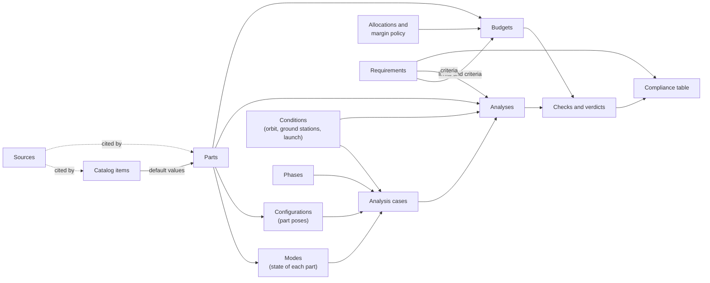
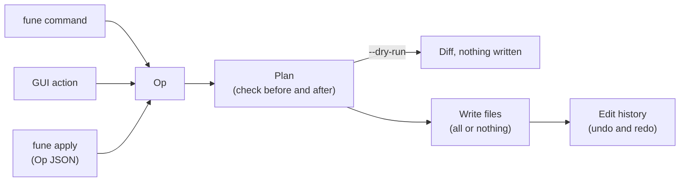

# 概念

このページでは iwafune の考え方を説明します。設計が何を含むか、各要素がどう関係するか、編集がどのように判定になるかです。一度通して読んでから、作業には [CLI ガイド](cli.md)と [GUI ガイド](gui.md)を使ってください。ファイル形式の詳細は[データモデル](../../model.md)にあります。

## 全体像

設計には 4 種類のデータがあります。もの（部品とカタログ）、その使い方（モード、形態）、置かれた状況（条件、フェーズ、ケース）、満たすべきこと（要求、配分）です。解析とバジェットはこれらをすべて読みます。チェックが結果を判定に変えます。



左側の、「Analyses」と「Budgets」までの箱は、自分で編集する TOML ファイルの集まりです。結果、チェック、判定、適合表は、そのつど計算され、保存されません（出力を求めた場合を除きます）。

## プロジェクトのディレクトリ

プロジェクトは `fune.toml` を含むディレクトリです。ほかのものはすべて任意で、必要になったときに現れます。`fune` はカレントディレクトリとその上の各ディレクトリから `fune.toml` を探してプロジェクトを見つけます。別の場所を指すには `-C <dir>` を使います。

| ディレクトリまたはファイル | 置かれるもの |
|---|---|
| `fune.toml` | プロジェクト名、スキーマのバージョン、カタログの一覧、モードの順序 |
| `catalog.lock` | 共有カタログの固定されたコミット（コミットに含めます） |
| `catalog/` | このプロジェクトのカタログ項目（サブディレクトリも使えます） |
| `parts/` | 部品。ディレクトリの木がプロダクトツリーです。`parts/<サブシステム>/<ID>.toml` |
| `modes/` | 運用モードごとに 1 ファイル |
| `configurations/` | 部品の姿勢に名前を付けた重ね合わせ。収納状態や展開状態など |
| `conditions/` | `orbit.toml`、`launch.toml`、地上局の `ground/<ID>.toml` |
| `phases/` | ミッションのフェーズごとに 1 ファイル |
| `cases/` | 解析ケースごとに 1 ファイル |
| `analysis/` | 解析の設定。領域ごとに 1 ファイル（たとえば `analysis/power.toml`）と `common.toml` |
| `requirements/` | 要求ごとに 1 ファイル |
| `budget/` | 配分（`allocation.toml`）と余裕の方針（`policy.toml`） |
| `sources/` | 出典の登録簿。データシート、試験、判断 |
| `nets/`, `harness/` | 電気的な接続とケーブルの区間 |
| `maneuvers/` | マヌーバ。実行順 |
| `defs/` | このプロジェクトが追加する属性と種類の定義 |
| `.fune/` | キャッシュと編集履歴。git では無視されます |
| `exports/` | 報告書の表などの派生出力。git で無視してもかまいません |

ディレクトリ構成の全体は [データモデル §11](../../model.md#11-directory-layout-schema-v2) にあります。

## 部品とカタログ

**カタログ項目**は部品の種類を 1 度だけ記述したものです。リアクションホイールの型式やバッテリパックなどがあり、ベンダーの数値（質量、状態ごとの電力、寸法、限界）を保持します。**部品**はその項目を衛星の中で 1 回使ったもので、たとえば `RW_X` です。部品はカタログ項目を指し（`catalog = "local/rw_10mNms"`）、どの値も上書きできます。

部品には次のものもあります。

- 種類（たとえば `reaction_wheel`）。どの属性が必要か、どの状態を取れるか、どの解析が認識するかを決めます。`fune kind ls` で種類を一覧できます。カタログ項目を持たない部品は種類を直接指定します。
- 取り付け。どの部品のどの取り付け点に載るかと、オフセット、姿勢です。取り付けはつながっていき、各部品の機体座標系での位置は、そこから導かれます。
- ポート。**ネット**（電力、データ、RF の接続）に接続します。
- 数量（同一のユニット数）、成熟度、任意のトレードの候補。

`parts/` の下のディレクトリの木が、プロダクトツリーです。最上位は通常サブシステム（`aocs`、`power`、`cdh`、`comm`、`payload`、`propulsion`、`structure`、`thermal`）で、その下のディレクトリがグループとアセンブリです。

**カタログ**には名前があります。プロジェクトには `catalog/` にある `local` があります。チームは別の git リポジトリに**共有カタログ**を置けます。プロジェクトは `fune.toml` に共有カタログを列挙し、`catalog.lock` にそのコミットを固定し、項目を `<名前>/<ID>` で参照します。共有の項目は読み取り専用です。変更するには、共有リポジトリを変えるか、部品の側で値を上書きします。[共有カタログ](cli.md#共有カタログ)を参照してください。

## 属性、単位、出典、メモ

値は部品かカタログ項目の**属性**です。`mass`、`power`、`max_momentum` などがあります。各属性には**次元**（質量、電力、エネルギーなど）と、使える単位の一覧があります。値は単位付きで書くと、`fune` が次元を検証します。

```text
fune set RW_X.mass "152 g"
```

値は数値以外のものも持てます。

- 出典。`sources/` にある項目の ID です（データシート、測定、解析、判断、仮置き）。値の背後にある最も弱い根拠を追跡し、出典がなければ「出典なし」の印を表示します。
- 文書の中の位置（`--at "p.12 table 3"`）と、自由な**メモ**。
- 公称値の前後の**不確かさ**、`min` と `max`。

属性には、**状態ごと**のものもあります。リアクションホイールの `power` は `off`、`idle`、`on`、`peak` のそれぞれに値を持ちます。パスは `<部品>.power.<状態>` です。

値の出どころはいつでも見えます。`fune get` はカタログの値を `Catalog`、部品にある値を `Override` と表示し、出典も示します。`fune unset` は上書きを取り除いてカタログの値に戻します。

## モードと部品の状態

**モード**は衛星の運用のしかたです。公称、撮像、ダウンリンク、セーフなどがあります。モードのファイルは部品ごとに、どの**状態**にあるかを書いた表です。部品が取れる状態はその種類で決まります（`off`、`standby`、`on` など）。状態には**デューティ**を付けることもできます。他の状態で過ごす時間の割合です。たとえば、`standby` で、時間の 50 % は `on` にあるカメラは、次のように書きます。

```toml
# modes/MISSION.toml (excerpt)
[states]
CAM = { state = "standby", duty = { on = 0.5 } }
OBC = { state = "on" }
```

モードには最大継続時間と、使われる場面（たとえば日照中だけ）も書けます。**モード表**（`fune mode table`、「モード」ページ）は、すべての部品とすべてのモードを並べて示します。バジェットと電源の解析は電力をこの表から読みます。モードの負荷は各部品の、その状態での電力の合計です。

部品を追加すると、指定しない限り、状態 `off` の行がすべてのモードに追加されます。状態のないセルは「未割り当て」で、0 W とは扱われないため、`fune check` が警告します。

## 形態

**形態**は部品の姿勢に名前を付けた重ね合わせです。打上げ時の「収納」や、軌道上の「展開」などです。折りたたまれた太陽電池パドルのように、動く部品の置き換え用の姿勢を保持します。形態を選んでいないときは、基本の配置を使います。フェーズと解析からも形態を指定でき、「配置」ページには選んだ形態の衛星が表示されます。

## 条件、フェーズ、解析ケース

**条件**は衛星ではなく環境を記述します。

- `conditions/orbit.toml`: 軌道（高度、離心率、傾斜角または太陽同期、エポック、伝播モデル）と、減衰や蝕の季節など、軌道に関する設定。
- `conditions/ground/<ID>.toml`: 地上局。位置、最小仰角、各無線バンドの性能。`fune check` は−90 から 90° の外の緯度、−180 から 360° の外の経度、0 から 90° の外の最小仰角を受け付けません。
- `conditions/launch.toml`: 打上げ機やディスペンサーなどの打上げ条件。

**フェーズ**はミッションの段階です。打上げと初期運用、公称運用、廃棄などがあります。順序、期間、使うモード、任意の形態を持ちます。そのフェーズを指定したケースでは軌道と姿勢則を置き換えることもできます。

**解析ケース**は解析のための条件に名前を付けたものです。どのフィールドも任意で、`mode`、`phase`、読み取る不確かさの側 `side`（`nominal`、`min`、`max`）、熱環境、β 角、周回数、太陽距離、開始時刻 `epoch` があります。ケースを使うと、同じ問いを違う条件で尋ねられます。「最悪の蝕」、「撮像中の高温」、「セーフモードでの低温」などです。多くの解析はケースごとに 1 回実行され、結果を比べます。

**既定のケース**は `analysis.common.default_case` です。ケースを指定せずに解析を実行したとき、既定のケースを使う解析もあれば、すべてのモードやすべての条件を見る解析もあります。各[解析のページ](../analyses/index.md)を参照してください。

## 要求、配分、余裕

**要求**は満たすべきことを述べます。記述文、次元を持つ量、制約（`at_most`、`at_least`、`equal`、`range`）、出典、適用するケース、そして**何が検証するか**、つまり解析かバジェットのチェックを持ちます。要求は平らな一覧です。

要求自身が判定を決めるわけではありません。指している解析かバジェットが決めます。**適合表**が判定を集めます。要求ごとに、そのケース全体での最悪の結果を示します。要求は**未検証**になることもあります。何も結び付いていない、入力が不足している、解析が失敗した場合です。表にはその理由が示されます。

**限度**が置かれる場所も、要求です。バジェットの限度は `--budget mass`（または `power`、`data`）を付けた `at_most` の要求です。バッテリの放電深度の限度は `--analysis power.energy_balance --check dod` を付けた要求です。

**配分**はバジェットをサブシステムに分けます。たとえば、姿勢系に質量 1.6 kg です。配分は `budget/allocation.toml` にあり、合計が保つべき**システム余裕**も持ちます。`budget/policy.toml` の**余裕の方針**は、成熟度（既製品、改造、新規）ごとの**成長**余裕と、不確かさの既定の幅を、各値に加えます。

## バジェット

**バジェット**はすべての部品について属性（質量、電力、データ量）を合計します。`fune budget mass|power|data` は、サブシステムごとに、現在の合計、成長余裕を含めた合計、配分、余裕を行にして示し、そのあと合計を限度と比べます。電力とデータはモードに依存するため、ケースを指定できます。`fune budget power --case <ID>` です。入力が不足しているときは、解析と同じようにバジェットがそれを一覧にします。[バジェット](../analyses/budgets.md)を参照してください。

## 解析、チェック、判定

**解析**は `power.energy_balance` のような ID を持つ計算です。設計から入力を組み立て、実行して、次のものを返します。

- KPI: 主要な数値。
- チェック: 結果を基準と比べたもので、それぞれに判定があります。
- 全体の判定。

判定は 3 つのうちのどれかです。

| 判定 | 意味 |
|---|---|
| **ok** | 基準を満たしている |
| **warning** | 満たしているが、注意があるか、限度に近い |
| **violation** | 満たしていない |

**不足している入力。** 解析に必要なものが設計にないときは、解析は実行されず、推測もしません。不足している入力の一覧を返し、それぞれに理由と、可能ならそれを埋めるコマンドを付けます。この場合、`fune analyze` の終了コードは 1 です。GUI は同じ一覧を表示し、適切なダイアログを開くボタンを付けます。まだ育てている途中の設計では不足している入力があるのは普通のことです。

**診断**は結果に対してではなく、設計データそのものに対する `fune check` の指摘です。重大度は「エラー」、「警告」、「情報」の 3 つです。必須の値の不足は警告なので、作業中の設計も保存できます。エラーは間違いです。次元の合わない単位、存在しない ID への参照、取り付けの循環などがあります。

## すべては Op

CLI からでも GUI からでも、編集はすべて **Op** になります。Op は「この部品のこの値を設定する」といった、1 つの変更を型付きで小さく記述したものです。設計ファイルに入る道はほかにありません。この 1 つの規則から、いくつかの機能が得られます。



- ドライラン: `--dry-run` は編集が行うファイルの差分を、書き込まずに示します。GUI もダイアログに同じプレビューを表示し、同じ編集を行うコマンド（「同じ操作のコマンド」）も示します。
- 全部か無か: 複数のファイルに触れる編集はまとめて書き込まれます。編集後のチェックで新しいエラーが出るときは、何も書き込まれません。
- 競合からの保護: 読んだあとに設計が変わっていると、編集は拒否されます（`--base-revision`、終了コード 3）。
- 安全な削除: ケース、フェーズ、モード、形態、出典、マヌーバのうち、まだ何かから参照されているものを削除しようとすると、拒否されます。メッセージに参照元が一覧されるので、先にそれらを変更できます。
- 履歴: 適用された編集はすべて記録されるので、`fune undo` と `fune redo`（GUI では `Ctrl+Z` と `Ctrl+Y`、Mac では `⌘Z` と `⇧⌘Z`）は、CLI と GUI のどちらの編集にも使えます。履歴は直近 100 件の編集を `.fune/history.json` に保持します。
- もしも: `fune analyze` と `fune budget` は `--ops` を受け付けます。Op のファイルをメモリ上にだけ適用するので、ファイルを変えずに結果を見られます。
- 同一性: CLI と GUI で同じ編集をすると、同じバイト列が書かれます。

`fune fmt` は Op を通さずにファイルを書き換える唯一のコマンドです。すべてのファイルを正規の形（キーの順序を固定し、`=` を揃える）にして、差分を小さく保ちます。履歴には記録されません。`fune fmt --check` は変わるファイルを報告し、終了コード 1 で終わります。

## チェック、整形、コミット

コミットの前に、両方を実行します。

```bash
fune check
fune fmt --check
```

`fune check` はエラーがあると 1 で終わり、`--deny-warnings` を付けると警告でも 1 で終わります。CI では両方を実行してください。CI のジョブの例は [インストールのページ](install.md#コンテナイメージ)にあります。

`fune` の終了コードはどのコマンドでも同じです。0 は成功、1 は設計か結果が不合格（チェックのエラー、入力の不足、違反）、2 は入力が不正か見つからないこと、3 は競合です。

## 次に読むもの

- 設計で試す: [クイックスタート](quickstart.md)と[最初の衛星を作る](first-satellite.md)
- コマンドを調べる: [CLI ガイド](cli.md)
- ファイルやキーを調べる: [データモデル](../../model.md)
