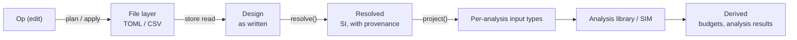

# 設計モデルの構造とファイル形式

この文書は、設計データのモデルがどのような構造を持ち、ファイルにどう置かれるかを説明します。

## 1. 概要

- モデルは 4 つの層に分かれます。ファイル層 → Design（書かれたまま）→ Resolved（解決済み。SI 単位で、由来つき）→ Derived（計算結果）の順です。
  編集は Design に対して行い、解析は Resolved を読みます。Derived は原則としてファイルに保存しません（§9）。
- 解析はモデルを知りません。解析ライブラリは解析ごとに入力の型を定め、fune-projection が Resolved をその型に射影して渡します
  （[architecture.md](architecture.md) §6.3）。足りない入力は「この解析には RW_X.max_momentum が必要です」のように名前で報告されます。
- 製品ツリーはディレクトリで表します。最上位は通常、系の ID（`aocs` など）を名前にしたディレクトリで、その下に組立品を入れ子にできます。`parts/` 直下の部品や、ほかの最上位フォルダ（`mechanism/` など）も使えます（2 つの集合は §6.2）。
  自分の質量や取付先を持つ物理的な組立品は、「部品ファイルと同名のディレクトリ」の組で表します（§6）。
- 配置の原則（§7）
  1 つの部品の中で完結する情報は部品ファイルに書きます。複数の部品にまたがり、自分の名前や属性を持つもの（モード、ネット、ハーネス）は、専用のディレクトリに置きます。
  所属は、子が親を指す形で表します（部品のポートがネットを指します）。
- システム担当が決めるもの（配分とマージンの方針）は `budget/` に集めます（§8）。系のディレクトリには置きません。
- ファイル形式は TOML で、出力は TOML 1.0 の範囲に収めます（§10）。表形式のデータは CSV、機械向けのやり取りには JSON を使います。
- 形式はコーデック層に閉じ込めます。モデルは TOML を知らず、知っているのは store（その `codec`・`read`・`write`・`format` モジュール）だけです。将来形式を変えても、モデルや解析には影響しません。

### 1.1 前提条件と解析の区分

前提条件は `conditions/orbit.toml`、`conditions/launch.toml`、`conditions/ground/<ID>.toml` に置きます。
設定の区分は `SettingScope::Conditions`（綴りは `conditions`。表示名は「前提条件」/ "Conditions"）です。
キーは `conditions.orbit.altitude`、`conditions.launch.<field>`、`conditions.ground.<ID>.<field>` です。
`conditions/launch.toml` では、ロンチャ、ディスペンサ、打ち上げ形態も選びます（`launcher`、`dispenser`、`configuration`。§5.6）。
`mission/` はミッションと成功基準のための予約ディレクトリ（#9）で、今は読み飛ばします。フェーズは `phases/` に置きます（§7.10）。フェーズはそれを名指すケースに対して、軌道を上書きし、形態を選べます。

地上局のファイル（`label`、`latitude`、`longitude`、`altitude`、`min_elevation`、バンドごとの `[link.<band>]`）は次のように編集します（すべて Op を通るので、手でファイルを書く必要はありません）。

- `fune ground add <ID> [--label …] [--latitude "35.7 deg"] [--longitude "139.7 deg"] [--altitude "40 m"] [--min-elevation "10 deg"]`（Op は `create_ground_station`。GUI は入力した文字列を `{ "command": "ground_add", … }` として `POST /ops/from_command` に送ります）
  は、`conditions/ground/<ID>.toml` を正規形で作ります。局名を変えると、その局を名指す要求の `verify.check`（たとえば `margin:<link>@<ID>`、`link_closes:<ID>`）が書き換わります。要求の `verify.check` がその局を名指しているあいだは、削除は拒否されます（先にその要求を直すか削除してください）。ID は ID の規則に従い、既存の局と衝突してはいけません（大文字小文字の違いだけでも衝突します）。単位の検査は `fune check` が行います。
- 既存の局の値は `fune set conditions.ground.<ID>.<field> …`（`SetSetting`）で変えます。局は作成しません（未知の `<ID>` は拒否されるので、先に `fune ground add` で追加します）。バンドも同じで、`fune set conditions.ground.<ID>.link.<band>.antenna_gain "14 dBi"` のように書きます。`fune unset conditions.ground.<ID>.link.<band>` でバンドを削除します。
- `fune ground rename <ID> <NEW>`（Op は `rename_ground_station`）は、ファイルを移し、`analysis/comm.toml` の局の一覧 `stations` を書き換えます。
- `fune ground rm <ID>`（Op は `remove_ground_station`）は、ファイルを削除します。**`analysis.comm.stations` がその局を挙げているあいだは拒否されます**（`stations` が空なら全局を使う意味なので、特定の局を指していません）。
  先にその一覧から局を外してください。参照されているカタログ品や共有カタログの削除と同じ扱いです。
  API は局を `DesignView.stations`（`id`、`label`、`file`、`group`、`in_use`）として返します。
古い配置の軌道などの項目は読みません。軌道が無ければ、既存の入力不足として報告されます。移行も、古いキーとの互換もありません。

解析の区分は `sat_analysis::spec::AnalysisArea` です。`System(System)` と `Condition(ConditionTopic)` を持ち、
最初のトピックは `Orbit`（綴りは `orbit`。表示名は「軌道」/ "Orbit"）です。系の解析は系の区分にとどまり、
すべての解析の ID は `<区分のキー>.<解析名>` です（`fune analyze ls` が区分つきで一覧します）。トピックのキーと系のキーは重なりません。部品、バジェット、色、`parts/<系>/` は引き続き系で扱います。
API の `AnalysisInfo.area` は `{ "kind": "system", "value": "power" }` または
`{ "kind": "condition", "value": "orbit" }` です。KPI は、解析の区分に応じて系ごとまたはトピックごとに並びます。

トピックの解析の設定はその前提条件のファイルの中のテーブルに置きます（たとえば `conditions/orbit.toml` の `[eclipse_season]`。
設定のキーは `conditions.orbit.eclipse_season.<field>`）。`analysis/orbit.toml` は作りません。
トピックの設定の置き場所は `ConditionTopic::setting_path()` で引きます。型つきの設定は未知のテーブルやキーを受け付けません。

`conditions/orbit.toml` の `central` は軌道の中心天体です（`earth`、`moon`、`sun`、`mercury`、`venus`、`mars`、`jupiter`、`saturn`、
`uranus`、`neptune`。省略すると地球。表示名は labels.toml の `central_body`）。高度はこの天体の赤道半径から数えます。μ、半径、J2、暦は
`sat_astro::ephem::CentralBody` が持ちます（projection の `context::central_body` が対応づけます）。太陽同期（`sun_synchronous`）は地球にだけ使えます。
ほかの天体に書くと `check` のエラー（`setting.central`）です。

`source` は軌道の出どころです（`elements`、`transfer`、`state`、`libration`。省略すると `elements` で、その場合は**ファイルに書き出しません**。既存のファイルは変わりません。表示名は labels.toml の `orbit_source`）。
`conditions/orbit.toml` と、フェーズの `[orbit]`（§7.10）で有効です。編集は既存の Op だけで行います（`fune set conditions.orbit.source transfer`、`fune phase set-field <ID> orbit.source transfer`。フェーズ自体に軌道のフィールドはありません）。
解析は `fune_projection::Context::trajectory`（ある時刻の状態、中心天体、エポック、1 周期の長さ）を通して軌道を読みます。ケプラー要素が本当に要る解析だけが `Context::orbit` を読みます。

```toml
# phases/CRUISE.toml (or conditions/orbit.toml)
[orbit]
source   = "transfer"
maneuver = "MARS_TRANSFER"    # a maneuver with a dated [transfer] (§7.7)
```

- `source = "transfer"` は、日付つき遷移の巡航区間を取ります。軌道はランベルト弧（`sat_astro::transfer::lambert_arc`。`propulsion.maneuvers` が噴射に使うのと同じ解）を接触ケプラー要素で書いたもので、
  2 天体の共通の親（惑星 ⇄ 惑星なら太陽）を中心に、二体として伝播します（`sat_astro::transfer::cruise_orbit`。出発日には出発天体の位置を、到着日には到着天体の位置を通ります）。
  **区間は出発天体の影響圏から到着天体の影響圏までです。影響圏の内側の双曲線区間は解析しません**（パッチト・コニックス。太陽中心の弧は影響圏の外でだけ成り立ち、フェーズは双曲線を持てません）。
  `sat_astro::transfer::cruise_leg` は、弧が出発天体の影響圏（`CentralBody::soi_radius_m`）を最初に出る時刻（暦から求めた天体までの距離を、二分法で 1 ms まで詰めます）と、到着の前に到着天体の影響圏の外にいる最後の時刻を求めます。
  軌道の epoch は最初の時刻（同じ楕円を、その状態から進めたもの）で、スパン（`Cycle::OneOff`）は 2 つの時刻の間隔です。そのため地球からの距離は地球の中心ではなく地球の影響圏のあたりから始まります。
  日付は `[transfer]` の唯一の読み手（`fune_projection::maneuver_dates`）が読みます。出発天体はそのマヌーバの前の中心天体です（`maneuver_dates::central_before`）。
  双曲線の弧（飛行時間が短い場合）、影響圏を持たない天体、出発の影響圏を出ない弧や到着の影響圏の外に残らない弧は、理由つきの入力不足になります。
  **フライバイがあると**（`[[transfer.flybys]]`、§7.7）、巡航は**弧の連鎖**（`Trajectory::Arcs`、`sat_astro::transfer::cruise_trajectory`）になります。ランベルトの区間ごとに 1 本のケプラー弧で、フライバイの日付で分かれます。
  各弧はそれぞれの区間で有効で、隣り合う弧はフライバイの日付で接します。そこで**位置は連続**し（どちらの弧もその日のフライバイ天体の位置を通ります）、**速度は跳びます**（フライバイによる太陽中心速度の変化で、2 本の区間のランベルト速度の差であり、入る超過速度と出る超過速度の差に等しい値です）。
  上のとおりに切り取るのは、最初の弧の始まり（出発の影響圏）と最後の弧の終わり（到着の影響圏）だけで、各弧のフライバイ側は区間全体です。
  **フライバイは瞬間的です。フライバイ天体の影響圏の中にいる時間と双曲線の弧はモデル化しません**（太陽中心の弧はフライバイ天体の中心まで延長され、解析しない隙間はありません）。この点は連鎖を読む解析のスパンの注記にも書かれます。
  連鎖が作られるのは、弧が接するときだけです（`ArcChain::new`。中心天体が等しく、各弧の始まりが直前の弧の終わりの 1 ms 以内で、各継ぎ目で位置の差が **1 m** 以内であること。ランベルトの区間は 1 mm よりはるかに良く一致するので、それより大きなずれは弧が実際には接していないことを表し、拒否されます）。
  1 区間だけの遷移は**1 本の弧の場合**で、`Trajectory::chain` は 1 本の弧をそのまま返します（同じ `Spanned` の軌道、同じ数値、同じ JSON です）。
  継ぎ目をまたぐときの入口ごとの動作は次のとおりです（継ぎ目はフライバイの日付、`Trajectory::breakpoints_s`）。
  - `state_at` / `states_at`: 各時刻はそれを含む弧で評価します。継ぎ目ちょうどの時刻は**出ていく側**の弧（フライバイ後の速度）を使います。最初の弧より前や最後の弧より後の時刻は、1 本の弧の場合と同じく、最初または最後の弧を延長します。
  - `track`（補間の元になる表。熱ソルバ、タイムライン評価器、極値の絞り込みが使います）: 弧ごとに 1 つの表を作るので、補間が継ぎ目をまたぐことはなく、速度の跳びも保たれます。
  - `cycle()` は飛行全体の `OneOff` で、`central()` は共通の親です。`elements()` は弧が 2 本以上なら `None` で（ケプラー専用の解析は `state` の場合と同じく「適用外」と答えます）、`altitude_m()` も `None` です。
  - ケースの `epoch` がいずれかの弧の中にあれば、そこから始まります（その弧の残りと、あとの弧です。継ぎ目ちょうどなら出ていく側の弧から始まります）。飛行全体の外の epoch は1 本の弧の場合と同じく入力不足です。
  - 極値の絞り込み（`orbit.geometry`、`comm.link_budget` の地球距離と太陽合、`fune case from-sun-distance` の背後にある太陽距離の極値）は、探索の窓を継ぎ目で分け、継ぎ目そのものも候補に入れます（`extremes_by_split`）。そのため、距離は連続でも傾きが連続でないフライバイでの極値を正確に見つけ、窓が 2 本の弧を混ぜることもありません。
  - 時系列の解析は通常のワンオフ用の格子で飛行全体を標本化します。標本の位置はフライバイをまたいで連続で、表や食の探索は弧ごとに進みます（太陽まわりには食がありません）。
  JSON: 1 本の弧はこれまでと同じに書き出します（`OrbitSpec` のフィールドと `span_s`）。2 本以上の弧は `{ "source": "arcs", "arcs": [ <span_s つきの軌道>, … ] }` と書き出します（`ArcsRepr`。ケプラー弧だけです）。
- `source = "state"` は、状態ベクトルから数値的に伝播した軌道を取ります（`sat_astro::orbit::StateSpec`。既存の N 体伝播 `propagate_states` を使い、新しいものはありません）。

  ```toml
  # phases/CRUISE.toml (or conditions/orbit.toml): a heliocentric circular orbit at 1 au
  [orbit]
  source   = "state"
  epoch    = "2030-01-01T00:00:00Z"
  central  = "sun"
  position = { x = 149597870.7, y = 0.0, z = 0.0, unit = "km" }
  velocity = { x = 0.0, y = 29.78, z = 0.0, unit = "km/s" }
  span     = { value = 365.0, unit = "d" }
  ```

  `epoch`、`central`（原点の天体。省略すると地球）、`position`、`velocity`（`{ x, y, z, unit }`）、`span`（epoch からの期間で、解析が評価する範囲）はすべて必要です。足りないものはそのキー自身の入力不足になり（`conditions.orbit.position`、`phases.<ID>.orbit.span` など）、直し方は `fune set` です（ベクトルの例は `1 0 0 km`）。
  **座標系は固定された 1 つの慣性系です。** モデルのすべての ECI 軌道状態と同じ、J2000 平均赤道系（黄道ではありません）で、原点は `central` の中心です。`frame` キーはありません（`position` や `velocity` の中に `frame` を書くとエラー `orbit.state_frame` です）。座標系の語彙は、2 つ目が必要になったときにだけ追加します。
  軌道は**ワンオフ**（`Cycle::OneOff { span }`）です。解析はスパンを標本化し、「1 周あたり」の量はスパンについて求め、ケプラー要素も高度も持ちません。
  力は書きません。原点の天体から 1 か所で決まる慣例の既定値です（`ForceConfig::deep_space_defaults`）。**太陽**まわりでは、太陽の点質量、水星から海王星までの惑星（点質量の第三体）、地球の GM だけを持つ第三体としての地球（月は無し）です。
  **地球**まわりでは、J2 つきの地球重力と、点質量の太陽と月です。**月やほかの惑星**まわりでは、その天体の J2 つきの重力と太陽、その天体が地球でなければ第三体としての地球（自動のもの）です。大気抵抗、太陽輻射圧、EGM96 の調和項、潮汐、相対論は含みません。
  積分器は数値伝播器の適応型 DOP853（相対許容誤差 1e-11）で、刻みの上限は太陽まわりで 1 日、それ以外の天体まわりで 600 s です。密な出力つきの 1 回の伝播が、要求されたすべての時刻をまかないます。繰り返し評価する表が要る場合
  （熱と電力の積分、極値の絞り込み）は、接触近点での円周期の 100 分の 1 の刻みで 1 度だけ作り、3 次のエルミートで補間します（その刻みの円軌道で相対誤差は約 4e-8）。
  天体の暦は範囲内では DE440、範囲外では解析的なものです（`transfer` と同じ。どちらを使ったかは `orbit.geometry` が報告します）。
- `source = "libration"` は、2 天体の秤動点、またはその周りのハロー軌道を軌道として取ります（`sat_astro::orbit::SynodicSpec`、`Trajectory::Synodic`）。

  ```toml
  # conditions/orbit.toml (or a phase's [orbit]): a halo orbit about the Sun-Earth L2
  [orbit]
  source      = "libration"
  epoch       = "2030-01-01T00:00:00Z"
  primary     = "sun"
  secondary   = "earth"
  point       = "l2"                                   # l1 .. l5; display name `libration_point`
  amplitude_z = { value = 120000.0, unit = "km" }      # omit for the point itself
  branch      = "north"                                # north (default) or south; display name `halo_branch`
  ```

  **これは円制限三体問題（CR3BP）の軌道を暦に載せたもので、力のモデルによる伝播ではありません。** ハロー軌道は CR3BP の周期軌道です（`sat_astro::orbit::cr3bp`。第一推定にリチャードソンの 3 次近似を使い、状態遷移行列による微分補正で仕上げます）。1 周期分を表にします。
  各時刻に、2 天体の実際の主天体まわりの状態（`CentralBody::state_about_parent`。範囲内では DE440、範囲外では解析的な暦）が、瞬間の距離（長さの単位）、瞬間の角速度、回転軸（脈動座標系、`Cr3bp::rotating_to_inertial`）を決め、回転系の状態を慣性系に写します。
  そのため軌道は地球の離心率（距離は瞬間の離隔に比例します）と軌道面に従いますが、第三体の摂動、太陽輻射圧、離心率が力学に与える影響は含みません。**軌道維持は推定しません。** マヌーバの ΔV の余裕として書いてください。
  - `primary` は、暦の上で `secondary` が回る天体でなければなりません（太陽まわりの惑星、地球まわりの月。`CentralBodyKind::parent`、検査 `orbit.libration_pair`）。質量比は主天体と副天体の GM を使い、副天体が地球なら月の GM を加えます（太陽–地球で通常使う値で、暦の地球は地球–月の重心に近いからです）。
  - `amplitude_z` は、CR3BP のハローの最大 |z|（2 回の xz 平面交差のうち大きいほう。通常の `Az`）で、副天体の平均距離 `a` で割って無次元にします。瞬間の距離が違えば、実際の大きさもそれに比例します。ハローには `l1` か `l2` が必要です（`orbit.libration_halo_point`。近似がそこにしかないためです）。振幅は正でなければならず（`setting.range`）、補正が収束しなければなりません（収束しなければ、入力不足が理由を挙げます）。
    `amplitude_z` なしの `branch` は効果がありません（警告 `orbit.libration_branch`）。north は epoch で z > 0 の側（副天体の軌道法線の向き）、south はその鏡像です。
  - epoch は表の始まりで、ハローはそこで xz 平面を横切ります。表の位相は、副天体が主天体のまわりに進んだ角度です（そのため同じ軌道が別の epoch でも続き、ケースの `epoch` は任意の日から始められます。`Trajectory::starting_at`）。
  - 原点、繰り返し、影: 原点の天体（`central()`。直下点、影、掩蔽に使います）は副天体です。この source では `central` を書きません。周期は `Periodic` で、ハローの補正済みの周期（Sun–Earth L2 の 120 000 km のハローで約 180 日、L1 で 177.9 日）、点そのものなら 2 天体の恒星周期（太陽の幾何がそれで繰り返します）です。
    副天体以外の天体も影を落とせます（`Trajectory::extra_shadow_caster`。主天体が太陽でなければ主天体なので、地球は地球–月の L1/L2 に影を落とします。日照の割合は 2 天体の係数の小さいほうで、それを持たない軌道は変わりません）。Sun–Earth L2 では、地球の半影と本影が通常どおり副天体の影です。
  - ケプラー専用の解析は`transfer` や `state` と同じく「適用外」と答えます。時系列の解析と `orbit.geometry` は動きます。Sun–Earth L2 では、太陽–探査機–地球の角度は 0°、太陽–地球–探査機の角度は 180° で（太陽と地球は探査機から見て同じ側）、L1 ではその逆です。
    すべての解析結果に `orbit_model` の注記（検査キー。判定は ok）が付き、軌道が暦に載せた CR3BP 軌道で、軌道維持は推定していないことを述べます。
- 設定のテーブル（軌道ページとフェーズの上書きダイアログ）は、source ごとに、書かれていなくてもその source が使うキーを挙げます（`OrbitSource::offered_keys`）。`state` は `epoch`、`central`、`position`、`velocity`、`span` を挙げ、ケプラー要素は 1 つも挙げません。`libration` は `epoch`、`primary`、`secondary`、`point`、`amplitude_z`、`branch` を挙げます。そこで入力したセルは文字列として送られ、サービスが読みます（`orbit_field_type` / `/ops/from_text`。ベクトルは `1 0 0 km`）。読めない値はセルの下に表示されます。
- source が使わないキーが並んでいると、警告 `setting.not_applied` になります。`transfer` ではケプラー要素、`epoch`、`central`、`propagator`、`[eclipse_season]`、`[decay]`、state のキーです。`state` ではケプラー要素のキー（`elements` のうち `epoch` と `central` を除くすべて）、`propagator`、`[eclipse_season]`、`[decay]`、`maneuver` です。`libration` ではケプラー要素のキー、`central`、state のキー、`maneuver` です（libration のキーはほかのどの source に並んでも同じです）。
  `elements` では `maneuver` と state のキー（`position`、`velocity`、`span`）です。`span` は正で、成分は有限でなければならず（`setting.range`）、単位の次元は Length、Velocity、Time でなければなりません。
  `maneuver` は、書かれているときは必ず既存のマヌーバを名指さなければならず（`ref.maneuver`）、`transfer` ではそのマヌーバが `[transfer]` を持たなければなりません（`orbit.maneuver_transfer`）。`maneuver` が無いのは check のエラーではなく入力不足（`conditions.orbit.maneuver`）で、
  日付つきの遷移を持つマヌーバが選択肢として挙がります（`Fix::PickRef`）。
- `maneuver` はマヌーバへの参照です（設計の軌道は `RefSite::OrbitManeuver`、フェーズの軌道は `RefSite::PhaseOrbitManeuver`）。マヌーバの名前を変えると両方が書き換わり、それらが名指すマヌーバの削除は check が拒否します（`ref.maneuver`）。
- ケプラー要素を必要とする解析（`orbit.eclipse_season`、`orbit.decay`、`power.sizing` の季節、要素を編集するマヌーバ、`propulsion.orbit_history` の初期軌道）は、source が `elements` でない軌道には**適用外**です。
  projection は `<orbit>.source`（フェーズの軌道なら `phases.<ID>.orbit.source`）の入力不足で答え、理由は「Not applicable」で始まり、修正の候補は付きません。ケースの `beta` と `sun_distance`、熱の条件の `beta` は、ケプラー要素を上書きするものなので、
  そうした軌道ではそれぞれのキーの入力不足になります。太陽まわりの軌道（`orbit.eclipse_season`）や地球以外（`orbit.decay`）に対する解析自身の拒否は、解析の側に残ります。
- ワンオフの軌道。スパンを持つ軌道は `Cycle::OneOff` です。時系列の解析はスパンそのものを標本化し（`orbits` の数は無視し、刻みは `max(30 s, span / 200)` なので、290 日の巡航は 200 標本です。熱の `time_step` もその刻みより細かくはなりません）、
  「1 周あたり」の量（軌道平均、1 周あたりのエネルギー、1 周あたりのアンローディング）はスパン全体について求め、`comm.link_budget` の地球距離もスパンについて評価し、出力の `span_fallback` は `one_off_span` になります
  （`ok` の検査「Analysis span」として表示されます。周期軌道には現れません）。周回数は太陽まわりの 1 周という既定を含め、ケプラー要素の軌道では引き続き使います。

`propagator` は軌道の伝播方法です（`kepler`、`j2`、`numerical`。省略すると `j2`）。projection は `kepler` と `j2` を `sat_astro::orbit::Propagator` にそのまま対応づけます。
`numerical` は解析では**使いません**。数値伝播の力のモデル（抗力と太陽輻射圧には機体の値が要ります）は sat-astro に慣例の既定値がなく、
projection は既定値を作らないので、時系列の解析は J2 の永年項（`j2`）で伝播します。`numerical` を書くと、`check` が警告（`setting.not_applied`）で知らせます
（`numerical` は要素を接触要素として読むので、同じ数値でも `j2` とは違う軌道になります）。`orbit.decay` は伝播方法の種類を使わず、自分の積分で高度の減衰を求めます。

**ミッション期間は要求が持ちます**（§7.9）。`conditions/orbit.toml` には置きません。要求 `input = "mission_duration"`（「ミッションは少なくとも 1 年続く」）が、
その `at_least` の値を、期間を必要とする解析に渡します（`Design::mission_duration`）。古いキー `conditions.orbit.duration` はもう読みません（§7.9 の「移した設定」を参照）。
そのような要求が無いと、季節の解析は入力不足を報告します（`requirement[input/mission_duration]`）。
`[eclipse_season]` の任意の `step` は時間の量です（キー `conditions.orbit.eclipse_season.step`）。
読み書きは前提条件のファイルの既存の経路を通り、次元の検査と projection は `setting_dims` の共通の表を使います。
未設定の step も設定の表に表示されます。

```toml
# conditions/orbit.toml (the same file as the other orbital elements)
[eclipse_season]
step = { value = 1, unit = "day" }
```

`orbit.eclipse_season` は `AnalysisArea::Condition(ConditionTopic::Orbit)` です。
入力は `OrbitSpec`、`duration`、任意の `step` です。既定の step の 1 日は sat-analysis が持ち、projection は補いません。
期間の始まりと終わりを含む各標本について、既存の `beta_angle_rad` で β を求めます。J2 による RAAN の歳差と太陽の方向を考慮します。
各標本の 1 周のあいだは太陽の位置を固定し、既存の軌道伝播と円錐影を 5 秒間隔で標本化します。
本影の時間（日照の割合が 0）と、本影を含まない半影の時間（0 より大きく 1 より小さい）は、時間の割合に使う既存の台形則で集計します。
境界の時間の精度は各境界で標本の間隔程度です。短い食や半影は標本の間に隠れることがあります。
影は中心天体の球が落とし（半径は `CentralBody::radius_m`、`shadow::central_shadow_factor`）、太陽の位置は中心天体から見たものです。
月を回っているときに地球に隠れる時間（月食）や、地球を回っているときに月に隠れる時間は含みません。太陽を中心天体とする軌道には β も食もないので、入力エラーです
（太陽中心の巡航は、食の季節ではなく、下の太陽距離のケースで解析します）。

出力の `points` は、日付（UTC）、β [rad]、本影 [s]、半影 [s] の一覧で、`series` は同じ値をグラフ用の系列にしたものです。
`longest` と `max_eclipse_duration` は、本影と半影の和が最大の標本とその長さで、
`beta_min` / `beta_max` は符号つき β の極値とその標本です。極値が等しければ、最初の日付を選びます。
極値は標本の中から選び、日付の間にある真の極値は探索しません。
`eclipse_free_samples` は食の無い標本の数（端の点が端数のものを含む）で、
`eclipse_free_duration` は、食の無いフラグを季節の格子で台形積分した、食の無い期間の推定値です。
季節の間隔 `step`、軌道内の間隔 `shadow_step`、近似 `fixed_sun_per_orbit` も出力します。
判定は情報としてのみで、検査は付きません。KPI は軌道トピックの下に、最長の食と β の範囲の下端と上端を並べます。

`fune case from-eclipse <新しい ID> --at longest|beta_min [--mode <mode>]` は、最新の前提条件で再解析し、
サービスの `case_from_eclipse_op` で既存の `SetCase` Op を組み立てます。
HTTP は `{ "id": "season_longest", "at": "longest", "mode": null }` を `POST /ops/case_from_eclipse` に送り、
返ってきた Op を通常の `POST /ops` で保存します。GUI の軌道ページも同じ入口を使うので、プレビューと CLI の出力は共通です。
ケースは β（rad）と任意のモードを保存します。標本の日付は説明に記録し、ケースの `epoch` には入れません（下記）。
これは代表的な β の条件を再利用するケースで、説明に書いた日付によってあとの解析の開始時刻を変えることはありません。
既存の ID の上書きと未知のモードは拒否されます。`to_cli` は、値と日付を保つ `fune case set` を返します。

**太陽中心の巡航（太陽を中心天体とする場合）。** 電力と熱の解析は `central = "sun"` で動きます。タイムラインは各時刻の太陽距離 `|r|` を与えるので（太陽束は `S₁ (AU/d)²`、
発電も同じ割合で変わります）、食はなく（日照の割合は 1）、熱の解析は反射光と惑星赤外を 0 とします（§5.2）。
ケースの `beta` はそこでは入力エラーです（太陽の方向には β を測る軌道面がないため）。そのため巡航のケースでは設定しません。
`power.sizing` は太陽中心の軌道では使えません。最長の食と β の季節に対して寸法を決める解析で、太陽まわりの軌道にはそれがないからです（上の入力エラー）。
巡航の最悪ケースは近日点と遠日点で、`sun_distance`（長さ。キーは `cases.<ID>.sun_distance`。次元は `beta` と同じく検査されます）を持つ解析ケースとして作ります。

`fune case from-sun-distance <新しい ID> --at min|max [--mode <mode>]` は、epoch から `duration` までのあいだの軌道の太陽距離の最小または最大を求め
（`sat_analysis::orbit::sun_distance_extremes`。通常の刻みで標本化し、極値のまわりを黄金分割で絞り込みます。スパンが半周より短ければ、極値はスパンの端です）、
サービスの `case_from_sun_distance_op` で既存の `SetCase` Op を組み立てます（HTTP は `{ "id": "perihelion", "at": "min", "mode": null }` を `POST /ops/case_from_sun_distance` に送り、`POST /ops` で保存します）。
距離は AU で書き、極値の日付は説明に記録します（極値の日を `epoch` にするのは、下の `fune case from-geometry` です）。軌道は中心天体が太陽でなければなりません（そうでなければエラー）。
`sun_distance` を持つケースでは、すべての解析が軌道の条件の代わりに**その距離の円軌道**を使います（傾斜角、RAAN、epoch、伝播方法は保たれます。`Context::orbit`）。
そのため `thermal.steady` はその距離での定常状態になり（円軌道の軌道平均は一定です）、`thermal.transient`、`power.orbit_generation`、`power.energy_balance` はその距離で動きます
（太陽まわりの円軌道では太陽の方向が 1 周に 1 回ゆっくり回り、姿勢則はそれに従います）。中心天体が太陽でない軌道に `sun_distance` を置くと、`cases.<ID>.sun_distance` の入力不足です。
そのようなケースが無ければ、軌道の条件がそのまま使われます。そのとき `thermal.steady` は 1 周（年のスケールの周期）で平均し、距離の 2 乗の逆数の時間平均を使います（楕円では `⟨(a/r)²⟩ = 1/√(1−e²)`）。
太陽まわりの時系列で周回数が書かれていなければ、3 周ではなく **1 周**を解きます（`spec::DEFAULT_HELIOCENTRIC_ORBITS`。明示した `orbits` はそのまま使います）。
刻みは通常の周期/200 です（1 年周期の軌道は約 1.6 日ごとに標本化します。1 年のあいだ `time_step` を 30 s にすると、標本が多すぎるとして拒否されます）。
熱の過渡解析は同じ適応法でスパン全体を積分するので、費用はスパンとともに増えます（デモの 1 年分で、デバッグビルドでは約 1 分、リリースビルドでは数秒です）。

#### ミッション幾何（`orbit.geometry`）

`orbit.geometry` は `AnalysisArea::Condition(ConditionTopic::Orbit)` で、設定はありません。各フェーズのあいだ、機体が太陽と地球からどれだけ離れ、どの角度にあるかを報告します。
距離と角度は 1 か所の `sat_astro::timeline::geometry` で、時間の関数としての軌道（`Trajectory`）から計算します。太陽と地球の位置は暦から取ります（登録されていれば DE440、なければ解析的な暦。どちらかは出力の `ephemeris` が示します）。

- 区間（leg）。フェーズの順（`order`、次に ID）にフェーズごとに 1 区間です。区間の軌道はそのフェーズで有効な軌道（フェーズの `[orbit]` があればそれ、なければ `conditions/orbit.toml`）で、区間はその軌道の epoch から始まります。
  フェーズの無い設計は設計の軌道の 1 区間です（`phase` は空です）。選択したケースは区間を選びません。すべてのフェーズを報告します。
- スパン。軌道にワンオフのスパンがあればそれ、なければフェーズの `duration`（書かれていれば）、それもなければ 1 周です。`span_basis` がどれかを示します（`one_off`、`phase_duration`、`one_cycle`）。スパンは 720 の等しい標本に分けます（`sample_step`）。
- 定義。距離は機体から天体の中心までです（地球は暦の原点です。地球を回る軌道では地球距離が軌道半径で、太陽を回る軌道では太陽距離が軌道半径です）。
  `sep`（SEP）は地球の中心での太陽と機体のなす角です（太陽合ではほぼ 0°、衝ではほぼ 180°）。`spe`（SPE）は機体での太陽と地球のなす角です（アンテナとアレイの幾何に使う位相角）。
  地球を回る軌道では、SEP は地心での太陽–衛星の角度で 1 周に 1 回まわるので、そこでは合の角度ではありません。地球までの片道の光行時間は地球距離を光速で割ったものです。
- 区間ごとの出力。`sun_distance` と `earth_distance` のそれぞれの `min` と `max`（`value` とその `epoch`）、`sep_min`（合への最接近）、`light_time_max`、`series`（区間の始まりからの時間。チャンネルは `sun_distance`、`earth_distance`、`sep`、`spe`）です。
  極値は極値の標本のまわりで標本の間を絞り込みます（黄金分割。そこに極値は 1 つと仮定します）。標本の刻みより速い変化、たとえば SEP における低軌道の地球衛星の軌道は分解できません。
  この解析は何も判定せず、注記もありません。後段はフェーズ ID で `legs[].earth_distance.max`（最も遠い距離とその日付）と `legs[].sun_distance.max.epoch` を読みます。

#### ケースの時刻（`epoch`）と最悪日のケース

ケースは `epoch`（ISO 8601、`cases.<ID>.epoch`）を持てます。**そのケースで動く時系列の解析が、軌道自身の epoch の代わりに、ケースの軌道（ケースのフェーズで有効な軌道、どの source でも）の上でどの時刻から始まるか**を決めます。
`Context::case_trajectory` がそれを適用する唯一の場所です（`Trajectory::starting_at`。`timeline.rs` のすべての時系列の projection が通ります）。`epoch` の無いケースはこれまでとまったく同じに動きます。

- 周期軌道（ケプラー要素）: 要素を epoch まで進め（`j2` なら RAAN、近地点引数、平均近点角の J2 による永年変化、`kepler` なら二体）、そこから系列が始まるので、太陽の幾何（季節、β、太陽中心軌道の太陽距離）はその日付のものになります。epoch は軌道の epoch の前でも後でも構いません。
- ワンオフの軌道（`transfer`、`state`、スパンのあるもの）: epoch は `[軌道の epoch, 軌道の epoch + span)` の中にあります。スパンは残りの部分（スパンの終わり引く epoch）になり、窓は軌道のスパンの終わりで切られます。スパンの外の epoch や、ちょうど終わりの epoch（解析するものが残っていない）は、メッセージにスパンを書いた `cases.<ID>.epoch` の入力不足になります。解釈できない epoch もそのキーの入力不足です。
  `state` の軌道ではepoch での状態を既存の数値伝播で 1 度伝播し、新しい初期状態にします。
- ほかの上書きとの優先順位。`epoch` は最後に、ほかの上書きが残した軌道に適用します。ケースの `sun_distance` が先に軌道を円に置き換え、そのうえで epoch から系列が始まります。ケースの `beta` は、β が**開始時刻で**成り立つように RAAN を置き換えます（そのため、明示した `beta` は、epoch だけが与える幾何に常に優先します）。
  `beta` と `sun_distance` は `elements` 以外の軌道では引き続き適用外で、`epoch` はどの source にも適用できます。軌道を時系列ではなくケプラー要素として読む解析（`orbit.eclipse_season`、`orbit.decay`、`power.sizing` の季節）は `epoch` を読みません。`thermal.steady` の軌道平均は時系列と同じく epoch から始まります（周期軌道では全周期にわたって同じ結果、ワンオフの軌道では残りのスパンです）。
- 最悪値の計算は `epoch` を読みません。リンクバジェットは、フェーズの軌道のスパン全体で最も遠い地球距離を保ち（`distance_model = earth_to_body`、`range_max_epoch` つき）、電力のサイジングは、ミッション期間のあいだで最も遠い太陽距離を保ちます（下記）。ケースは、時系列が何を示すかを選ぶ手段であり、最悪値のサイジングを弱める手段ではありません。

`fune case from-geometry [--phase <ID>] [--prefix <name>] [--mode <mode>]`（サービスは `cases_from_geometry_ops`。HTTP は `{ "phase": "NOMINAL_OPS", "prefix": null, "mode": null }` を `POST /ops/cases_from_geometry` に送ると Op が返り、`POST /ops` で保存します）は、
日付からのケース作成を一般化したものです。フェーズの区間を `orbit.geometry` から読み（どの source でも 1 つの幾何で、区間のスパンは上のとおり）、`epoch` が次の日になる 3 つのケースを書きます。
**太陽距離が最大**の日（`<prefix>_sun_far`）、**太陽距離が最小**の日（`<prefix>_sun_near`）、**地球距離が最大**の日（`<prefix>_earth_far`）です。`phase` は指定したフェーズにし、量と日付は説明に書きます。
接頭辞の既定はフェーズ ID の小文字です（フェーズの無い設計では無し。フェーズのある設計では `--phase` が必要です）。名前は固定なので、再実行しても同じファイルになります。すでにあるケースは、ほかのすべてのフィールドを保ち（モードは `--mode` を指定したときだけ変わります）、新しい `epoch`、`phase`、説明を受け取ります。
結果は編集できる通常のケースです（`fune case set … --epoch`。`fune case set-epoch <ID> <time>` / `unset-epoch <ID>` は `epoch` だけを変えてほかのフィールドを保ちます。HTTP は `{ "command": "case_epoch", "case": "hot", "epoch": "2031-05-02T00:00:00Z" }` を `POST /ops/from_command` に送ります。サービスは解析と同じように時刻を読み、読めないものを拒否します。ワンオフのスパンの外の時刻は解析だけが見つけ、`cases.<ID>.epoch` の入力不足になります）。
GUI の解析ケースのページにも、同じ 2 つの操作があります。開始時刻の列の鉛筆（`set-epoch`。空欄にすると解除します）と、「最悪日からのケース」（`from-geometry`。フェーズの一覧とモードの一覧は設計から取り、Op と同等のコマンドは保存の前にプレビューされます）です。日付の精度は `orbit.geometry` と同じです（区間あたり 720 標本、黄金分割で絞り込み。滑らかな極値では約 1 秒）。ワンオフのスパンのまさに終わりにある極値は、窓が残らない epoch になりますが（上記）、`fune case from-geometry` はそれでも書きます。
`fune case from-sun-distance` は、定常解析のために残してあります（ケプラー要素を持つ太陽まわりの軌道に対して、`sun_distance` の上書き、つまり円軌道を書きます）。どの軌道でも時系列には `from-geometry` を使います。

#### 全電離線量（`orbit.total_dose`）

`orbit.total_dose` も `AnalysisArea::Condition(ConditionTopic::Orbit)` です（環境は軌道に依存します）。**利用者が与える環境の表**から、各部品がミッションのあいだに受ける放射線量を足し合わせ、部品が耐える線量と比べます。
**限界。** 放射線帯、太陽粒子、遮蔽の輸送のモデルは組み込まれていません。表の数値は利用者のものです。部品の遮蔽は 1 つの等価アルミニウム厚さ（部品を囲む一様な球殻）で、はじき出し損傷と単一事象効果は計算しません。

「環境の表」。軌道テーブルの `curve` 値（`payload_mass_by_c3` と同じ型。「能力曲線」を参照）で、遮蔽の厚さ（等価アルミニウム、長さ）に対する線量**率**（時間あたりの吸収線量。たとえば `Gy/yr`）です。値は正で、厚さは厳密に増加していなければなりません。`conditions/orbit.toml`、またはフェーズの `[orbit]` に書きます（フェーズの軌道テーブルは設計のものを丸ごと置き換えるので、自分の `[orbit]` を持つフェーズは自分の表を持つ必要があります）。

```toml
dose_rate_by_shielding = { at = [0.5, 1.0, 2.0, 4.0, 8.0], at_unit = "mm", values = [400.0, 120.0, 30.0, 5.0, 0.8], unit = "Gy/yr" }
```

`fune set conditions.orbit.dose_rate_by_shielding "0.5:400 1:120 2:30 4:5 8:0.8 (mm -> Gy/yr)"`。フェーズでは `fune phase set-field <ID> orbit.dose_rate_by_shielding "…"` です。線量は `Gy` で書きます（`rad` は曖昧なので拒否されます。1 krad = 10 Gy）。値の次元は `AbsorbedDoseRate`（`L² T⁻³`）です。
`check` は `curve.shape`（引数が増加していない、値が正でない）と、単位についての `unit.dimension` を報告します。

「部品の入力」（すべての component の任意の組み込み属性。セクション `radiation`）: `shielding`（Length。等価アルミニウム厚さ）と `tid_tolerance`（AbsorbedDose。部品が耐える全線量）です。どちらかを書いた部品が評価されます。設計全体の値は `analysis/common.toml` に置きます。

```toml
[radiation]
default_shielding = { value = 3.0, unit = "mm" }   # for parts that write a tolerance but no shielding (if absent they are not evaluated)
design_margin     = 2.0                             # radiation design margin RDM (default 2, stated in the output)
```

「方法」。区間（leg）は、どれかのフェーズに `duration` があればフェーズを順に並べたもの、なければ設計の軌道にミッション期間を当てた 1 区間です（`propulsion.dv_budget` の RCS アンローディングと同じ）。部品と区間ごとに、区間の表から部品の遮蔽での線量率を読み、区間の期間を掛けます。部品の合計は区間にわたる和です。
**表は対数線形で読みます**。厚さについて線形、線量率について対数です（2 点の中間では、2 点の線量率の幾何平均になります）。これは `sat_astro::math::interpolate` で 1 度だけ決め、`interpolation` として出力に示します。**外挿はしません。** 遮蔽が区間の表の範囲の外にある部品は、「評価されません」（合計も判定も出ず、警告の検査 `dose:<part>` が付きます）。端の値を代わりに使うことはありません。
マージン = `tolerance / (total × RDM) − 1`（`spec::ratio_margin`）で、負なら違反です。耐性の無い部品は線量だけが出て、判定はありません。例: 10 Gy/yr で 2 年なら 20 Gy です。耐性 100 Gy、RDM 2 なら、マージンは 100 / 40 − 1 = 1.5 です。
期間か環境の表の無い区間は `legs[].status` に挙げ、合計から外し、警告の検査 `phases_left_out` が付きます（その場合、合計は下限です）。出力には区間ごとの基準遮蔽（評価された最も薄い部品）での線量率と線量 `reference_shielding` と、マージン最小の部品（`worst`）も含まれます。
KPI は最小マージンです。入力不足は`tid_tolerance` か `shielding` を持つ部品、環境の表（または `fune data fetch radiation` のデータ。そこから区間の軌道の捕捉粒子環境を計算します）、（ミッション区間では）ミッション期間で、それぞれ修正の案内が付きます。
**環境の出どころ。** 利用者の表が常に優先します。表の無い区間は、放射線と SHIELDOSE-2 のデータが入っていて区間に期間があれば、その区間の軌道について `orbit.trapped_dose` の表を使います（各厚さで太陽極小と極大の大きいほう。捕捉された陽子と電子だけです）。`legs[].environment_source` がどちらかを示し（`user_table`、`computed_trapped`）、計算した表には警告の検査 `environment_source` が付きます。合計は下限になります（太陽陽子も宇宙線も含まないため）。線量を鍵にする要求はありません。耐性は部品の性質で、マージン係数は設計の値なので、要求が検証できるのは解析全体だけです（`verify.analysis = "orbit.total_dose"`）。

#### 捕捉粒子フラックス（`orbit.trapped_flux`）

`orbit.trapped_flux` は `AnalysisArea::Condition(ConditionTopic::Orbit)` です。捕捉された陽子（AP-8）と電子（AE-8）の、太陽極小と極大での軌道平均と最大の積分フラックス、フラックスのある時間の割合、
ミッションのフルエンス（平均フラックス × ミッション期間）を出します。入力は設計の軌道（1 日分の標本。ケースの β は、ほかの軌道解析と同じく適用されます）とミッション期間から組み立て、設定も部品のデータもありません。
AP-8/AE-8 のデータファイルは設計に含まれません。無ければ、解析は理由に `fune data fetch radiation` を挙げた入力不足になります。線量も遮蔽の深さも計算しません（部品の線量は、`orbit.total_dose` の利用者の表のままです）。
モデル、各マップが組になる磁場、限界、データの出どころは [trapped-radiation.md](trapped-radiation.md) にあります。

#### 遮蔽深さごとの捕捉粒子線量（`orbit.trapped_dose`）

`orbit.trapped_dose` は `AnalysisArea::Condition(ConditionTopic::Orbit)` です。軌道平均の AP-8/AE-8 のスペクトルを、SHIELDOSE-2 でアルミニウム遮蔽の後ろのシリコンの線量率に変換します。太陽極小と極大について、ケースごとに、アルミニウムの厚さ → 陽子、電子、制動放射、合計（SI の線量率。年あたりで表示）の表を作ります。
入力は `orbit.trapped_flux` と同じ（設計の軌道の 1 日分。ケースの β が適用されます）で、任意の `thicknesses`、`geometry`（既定は中実のアルミニウム球の中心）、`nuclear`（既定は無し）が加わります。設計の設定も部品のデータもなく、出力の `used` が使ったものを記録します。扱うのは捕捉粒子だけです。
データファイル（`fune data fetch radiation`）が無ければ入力不足です。`orbit.total_dose` は、自前の環境の表を持たない区間にこの表を使います（上記）。方法、幾何の正規化（球の係数 2）、限界、検証は [trapped-radiation.md](trapped-radiation.md) にあります。

#### 大気抵抗による高度減衰と軌道維持（`orbit.decay`）

`orbit.decay` も `AnalysisArea::Condition(ConditionTopic::Orbit)` です。設定は `conditions/orbit.toml` の `[decay]` です（すべて任意。既定値は解析が持ちます）。

```toml
[decay]
span             = { value = 25, unit = "yr" }   # upper limit of the integration span (default 25 years)
reentry_altitude = { value = 120, unit = "km" }  # perigee altitude regarded as reentry (default 120 km)
drag_area        = { value = 0.06, unit = "m^2" } # drag area (if absent, the mean projected area over all directions of the union of the part boxes; §5.9)
band             = { value = 2, unit = "km" }    # altitude band for orbit maintenance (if absent, drag is cancelled continuously)
```

寿命の上限（廃棄の要求）は設定では**ありません**。`verify.analysis = "orbit.decay"`、`verify.check = "max_lifetime"` の `at_most` の要求です（§7.9）。
そのような要求が無ければ、寿命の検査は行いません。

そのほかの入力値は既存のものを使います。軌道（`conditions/orbit.toml`。ケースの β は使いません）、質量（部品の質量特性の和）、
外形（`size` を持つすべての部品の箱を、有効な形態、つまりケースのフェーズの形態、なければ基準で配置したもの。`structure.external_geometry` と同じ幾何、§5.9）、抗力係数（`analysis.aocs.drag_coefficient`。無ければ 2.2）、
ミッション期間（要求 `input = "mission_duration"`。寿命の判定と軌道維持 ΔV の積算に使う期間で、無ければ 1 年）です。
軌道維持の推進剤は推進解析の使用可能な推進剤（`propulsion.propellant`、§7.7）です（余裕を含めて使う推進剤）。推進剤はここには書きません。
比推力は推進系のスラスタの中で最も低いもの（保守側）で、噴射前の質量は推進剤を積んだ質量です（`wet_mass`）。使った推進剤とスラスタは、結果の
`used.propellant` と `used.thruster` に出ます。推進系（マヌーバや推進部品）が無ければ、推進剤の寿命は計算しません。あれば推進の入力が必要で、
足りなければ高度減衰も入力不足になります。以前の `[decay]` の `propellant` はもう読まず、使いません。`check` は警告（`setting.moved`）でその削除を促します
（`fune setting unset conditions.orbit.decay.propellant`）。

**方法（軌道平均の半解析）**: 軌道長半径 `a` と RAAN を状態とし、1 周にわたる軌道長半径の軌道平均変化率
`da/dt = 2a²/μ ⟨v · a_D⟩`（ガウスの惑星方程式のエネルギー形式）を RK4 で積分します。`a_D` は、NRLMSISE-00 の密度、
共回転する大気に対する速度、`Cd·A/m` から求めた抗力加速度です。1 周を等間隔の 12 点で標本化し、台形則で平均します
（24 点と 48 点とは 4 桁で一致します）。高度だけに依存する大気の円赤道軌道では、キング=ヘールの `da/dt = −ρ (Cd·A/m) √(μa) (1 − ω_E a/v)²` と一致します
（テストで確認済み）。RAAN は J2 の永年変化率で進みます（太陽同期でない軌道では、軌道面の向きが昼側の大気の膨らみに対して変わります）。
刻みは、1 刻みあたりの高度減衰が最大 1 km で、10 分から 10 日のあいだとし、宇宙天気の標本の境界で切ります。再突入は、近地点高度が再突入高度を下回る時刻です（刻みの中では線形に補間します）。
軌道維持の ΔV は沿軌道方向の抗力を打ち消す推力 `−v̂ · a_D` の積分です（バンドがあれば、軌道がバンドの下端で元の高度に瞬時に戻るまでの積分。1 次近似で、高度を上げるのに要る ΔV に等しくなります）。
推進剤の寿命は使用可能な推進剤をすべて使って得られる ΔV（`sat_astro::rocket`）を、1 年あたりの ΔV で割ったものです。

**適用範囲**: ほぼ円の軌道（離心率が 0.01 を超えると注意を出します。離心率と近地点引数の変化は追いません）で、高度はおよそ 180〜1000 km です。
面積と Cd は一定です（姿勢とパネルの向きは、面積の与え方に反映されます）。1 周の平均は世界時の日変化を拾うので、ΔV は刻みによって約 1% 変動します。

**太陽活動の条件**: ECSS-E-ST-10-04C の表 6-3 の長期の値を全期間一定に保つ 3 つの条件（低 F10.7 = 65、Ap = 0。中 140、15。高 250、45）に加え、
宇宙天気の表がある場合（`fune data fetch space_weather`）は、日付で引く条件 `dated` があります。サービスは27 日ごとに `space_weather_at` で引いた系列を入力に加え、
使った表の版（出どころ、取得時刻、SHA-256、範囲）を結果の `space_weather` に残します。表の外や欠けた値には中の既定値を使い、
F10.7 と Ap それぞれの出どころの数と、予報値や既定値を使い始めた時刻は `weather_sources` に返ります（表の月ごとの予報には Ap がありません）。

**判定**: どれかの条件でミッション期間より早く再突入するなら、注意を出します（軌道維持が必要です）。寿命の上限は代表の条件（`dated`、なければ中）で判定します
（低の既定値を数十年保つのは、太陽周期を無視した極端な仮定なので使いません）。積分のスパンの中で再突入しなければ、スパンが上限より短いときに注意を出します。
どれかの条件で推進剤の寿命がミッション期間に届かなければ、注意を出します。KPI は最短の寿命、1 日の高度減衰の最大、1 年あたりの軌道維持 ΔV の最大です。

**桁の確認（テスト）**: 高度 500 km の 3U キューブサット（4 kg、0.039 m²、Cd 2.2）では、寿命は中でおよそ 2.6 年、高でおよそ 0.7 年です（Oltrogge & Leveque、SSC11-VII-2、2011 は、500 km の 3U で 2〜10 年とし、
NASA の CubeSat 101 は「500 km で数年」と述べています）。400 km では中でおよそ 0.5 年です。ISS 級（m/(Cd·A) ≈ 130 kg/m²、410 km、51.6°）では、減衰は
中で月に約 3 km、高で約 11 km です（NASA の説明にある「平均で月に約 2 km」と同じ桁です）。


## 2. 層の構造

| 層 | 内容 | 作るもの | 使うもの | 保存先 |
|---|---|---|---|---|
| ファイル層 | ファイルごとの `toml_edit::DocumentMut` と位置情報 | store（`read`） | store の書き込み | git の作業ツリー |
| Design | 書かれたままの値（`0.62 kg`。`1.0 mN*m` は書かれた単位を保ちます）、出典、ファイルの位置。型つきの ID で正規化したもの | store の読み込みと構造の検査 | ops（編集の対象）、GUI の「元の値」の表示 | ファイル層そのもの |
| Resolved | カタログ、種別、上書きを重ねた各部品の値（SI）、値の由来（catalog / override / derived）、最も弱い根拠、取付をたどって得た機体座標、選ばれた候補 | `resolve(&Design)`（純粋関数） | 解析への projection、GUI の表、check() | なし（毎回作り直します。数千件で数十 ms） |
| Derived | 質量特性（総質量、重心、慣性）、バジェット、解析と SIM の結果 | バジェット、解析ライブラリ、SIM | GUI、CLI、PR のコメント | 原則なし。出力先は §9 |


## 3. エンティティ

| エンティティ | 役割 | ファイル | 主な内容 |
|---|---|---|---|
| Project | プロジェクト全体の設定 | `fune.toml` | スキーマのバージョン、書き出す TOML のバージョン、共有カタログへの参照 |
| Allocation | 配分 | `budget/allocation.toml` | バジェットの種類（質量、電力、データ）ごとのシステムマージンと、系（または部品）ごとの配分。上限は要求（`verify.budget`、§7.9）が持ち、ここのキーではありません |
| BudgetPolicy | マージンの方針 | `budget/policy.toml` | 成熟度ごとの成長マージン、不確かさの既定の幅、ハーネスの余裕 |
| AttributeDef | 量の種類 | `defs/attribute/<id>.toml` | 値の型、次元、使える単位、表示単位、値の範囲、状態ごとに引くか、どのバジェットに入るか、方向か（`unit_vector`。部品座標の単位ベクトルで、3D では軸として描きます）、視野の半角ならそれが回りにある方向の属性（`fov_axis`。たとえば組み込みの `fov_half_angle` は `fov_axis = "boresight"` を持ち、3D はそこから視野の円錐を描きます）。`fune attr add` は `--unit-vector` と `--fov-axis <attribute>` を受け取ります。Web は属性 ID を知りません。テキスト属性は `references = "part"`（と `reference_roles`。`fune attr add --references part --reference-roles a,b`）で部品を名指しでき、GUI はその部品を選択肢として出します |
| KindDef | 部品の種別 | `defs/kind/<id>.toml` | 親の種別、必須と任意の属性、機器の状態の語彙（off / standby / on …）、ポートのテンプレート、役割 |
| CatalogItem | 購入品または設計品の定義（ElementDefinition） | 共有カタログ、または `catalog/[<dir>/…]<id>.toml`（§11.1） | 種別、型番、成熟度、タグ（`tags = ["flight_proven", "domestic"]`。製造元でも種別でもない自由な分類で、空なら書きません。`fune catalog set <item> tags a,b` / `unset`。タグは空でなく、前後に空白がなく、`,` を含まず、同じ品の中で重複しません）、属性値、ポートの値、形状、データシートの出典（出典の ID。§7.8） |
| Group | 系または入れ子のフォルダ | `parts/` の下の、同名のファイルが無いディレクトリ（最上位は通常、系の ID） | なし（系の表示名は組み込みの語彙の項目です。配分は `budget/allocation.toml` にあります） |
| Part | 製品ツリーでの使用（ElementUsage） | `parts/<…>/<ID>.toml` | 定義（カタログ / 種別）、トレードの候補、員数と冗長、取付先と相対姿勢、上書きの値、ポートが属するネット |
| Mode | 衛星の運用モード | `modes/<ID>.toml` | 期間、部品 → {状態、時間の割合、稼働数、予備の状態}、食の上書き |
| Net | 電気的な接続（論理） | `nets/<ID>.toml` | 種類（power / data / rf）、レール電圧、供給元のポート、電流の上限、プロトコル |
| Harness | ケーブルの区間（物理） | `harness/<ID>.toml` | 両端のポート、運ぶネット、電線、芯数、長さ |
| Case | 解析ケース | `cases/<ID>.toml` | モードまたはモードの時系列、フェーズ（§7.10）、不確かさのどちら側を読むか、太陽距離（巡航）、開始時刻 `epoch`（軌道上のある日）、軌道、姿勢則、環境条件、期間 |
| Phase | ミッションのフェーズ（初期チェックアウト、定常運用、廃棄） | `phases/<ID>.toml` | 順序、開始と終了の条件（自由記述）、期間、使うモード、任意の形態の選択と、そのフェーズを名指すケースに対する軌道とモードごとの姿勢則の上書き（§7.10） |
| Configuration | 部品の姿勢の名前つきの重ね合わせ（収納、展開などの配置の違い） | `configurations/<ID>.toml` | ラベル、任意の英語ラベル（`label_en`）、説明、部品ごとの置き換える姿勢（§7.11） |
| Maneuver | マヌーバ | `maneuvers/<ID>.toml` | 区分（ΔV バジェットの行）、計算の段階、スラスタ、先行するマヌーバ、目標軌道、細かい段階だけの制約、惑星間遷移の日付（§7.7） |
| Ground station | 通信解析で使う地上局 | `conditions/ground/<ID>.toml` | ラベル、緯度、経度、高度、最小仰角、バンドごとのアンテナと受信機の値（`[link.<band>]`。§1.1） |
| Source | 出典の一覧 | `sources/[<dir>/…]<ID>.toml`（§11.1） | 種類（datasheet / measured / analysis / judgement / placeholder）、参照、文書の版、取得日、SHA-256、配布区分、日付、作成者（§7.8） |
| Requirement | 要求（軽量。平らな一覧） | `requirements/<ID>.toml` | 記述（日本語と英語）、制約する量の次元、制約（方向と値）、量化（全ケース / 名指しのケース）、出典（出典の ID）、確かめるもの（解析の検査またはバジェット）。判定そのものは解析またはバジェットから来ます（§7.9）。外部の検証ツールへ書き出す形式的な判定は、まだ決めていません |
| Table | 表形式のデータ（予約。ディレクトリは認識しますが、まだ読みません） | `tables/<ID>.csv` + `tables/<ID>.toml` | 曲線と特性表。列ごとの単位は TOML 側で宣言します |
| View | 表示専用の情報（Design の外） | `view/…` | システム図の座標、3D のカメラ |

### 3.1 種別の役割と状態

プロジェクトが定義した属性と種別は名前を変えられます（`fune attr rename <ID> <NEW>`、`fune kind rename <ID> <NEW>`。Op は `rename_attribute`、`rename_kind`。`POST /ops`）。定義ファイルを移し、
参照の索引（`Design::references`）が見つけたすべての参照を書き換えます。属性なら、種別の `required` / `optional` の一覧と、部品とカタログ品の `[attr.<ID>]` キー
（状態ごとのテーブルを含む）です。種別なら、部品とカタログ品の `kind` と、ほかの種別の `extends` です。組み込みの属性と種別は名前を変えられず、新しい ID は ID の規則に従い、使われていてはいけません
（組み込みのものも含みます）。フィールド名と衝突する名前は、`fune check` が引き続き拒否します（`def.reserved`）。共有カタログの品は読み取り専用で書き換えられないので、
そのどれかが定義を使っているあいだは名前の変更は拒否されます（先に共有カタログを変えてください）。定義を参照するものはほかにありません（解析の設定、view のファイル、モードの表が持つのは、部品、グループ、モード、ネットの ID だけです）。

- 種別の `role` は `fune_model::builtin::Role`（`enum_text!`）の値です。綴りは fune-model の `role.rs`（`builtin::Role` として再公開）の 1 か所で定義し、未知の役割は serde が読むときに拒否します。省略すると親の種別の役割を使い、親にも無ければ役割はありません。独自の種別の ID は自由ですが、役割の語彙は拡張しません。
- 役割の表示名は対応する組み込みの種別の日本語名と英語名です。`labels.role_system` は、すべての役割の系を、Role をキーとして持ちます（どの系にも属さない対応は `None` として明示します）。API は役割を TS の `Role` 型で返し、Web のアイコン表はすべての役割を網羅します。
- 状態の語彙は種別ごとに自由に定義します。慣例の停止状態だけが `fune_model::builtin::STATE_OFF` を使い、既定の状態を選ぶ処理もこの定数を参照します（enum にはしません）。スラスタの役割を持つ種別は、噴射状態 `STATE_THRUSTER_FIRING`（`on`）を語彙に持つのが慣例で、持たなければ `fune check` が警告（`def.thruster_firing_state`）を出します。

## 4. Rust の型（Design 層）
```rust
/// Typed ID. Matches the stem of the file name (or directory name) and is unique overall (compared case-insensitively).
pub struct Id<T> { name: SmolStr, _t: PhantomData<fn() -> T> }

/// The design as written. An immutable snapshot; a new one is made on every edit.
pub struct Design {
    pub project: Project,
    pub budget: Budget,                                    // budget/allocation.toml and policy.toml
    pub attributes: BTreeMap<Id<AttributeDef>, Arc<AttributeDef>>,
    pub kinds: BTreeMap<Id<KindDef>, Arc<KindDef>>,
    pub catalog: BTreeMap<CatalogRef, Arc<CatalogItem>>,   // with an origin, such as "lab/rw_18mNms"
    pub groups: BTreeMap<Id<Group>, Group>,                // directories with no same-named file
    pub parts: BTreeMap<Id<Part>, Arc<Part>>,
    pub modes: BTreeMap<Id<Mode>, Arc<Mode>>,
    pub nets: BTreeMap<Id<Net>, Arc<Net>>,
    pub harnesses: BTreeMap<Id<Harness>, Arc<Harness>>,
    pub cases: BTreeMap<Id<Case>, Arc<Case>>,
    pub maneuvers: BTreeMap<Id<Maneuver>, Arc<Maneuver>>,  // maneuvers/ (§7.7)
    pub phases: BTreeMap<Id<Phase>, Arc<Phase>>,           // phases/ (§7.10)
    pub configurations: BTreeMap<Id<Configuration>, Arc<Configuration>>,  // configurations/ (§7.11)
    pub sources: BTreeMap<Id<Source>, Arc<Source>>,
    pub requirements: BTreeMap<Id<Requirement>, Arc<Requirement>>,
    pub conditions: ConditionsSettings,                    // conditions/ (§1.1)
    pub analysis: AnalysisSettings,                        // analysis/ (§5)
    pub views: BTreeMap<String, ViewLayout>,               // view/ (§10.4)
    pub catalog_lock: Option<CatalogLock>,                 // catalog.lock (§12.2)
    pub revision: Revision,                                // BLAKE3 of the tracked files' (path, bytes)
}

/// A node of the product tree. Group and Part IDs are unique within the same namespace.
pub enum NodeRef { Group(Id<Group>), Part(Id<Part>) }

pub struct Group {
    pub parent: Option<NodeRef>,           // determined by the directory
}

pub struct Part {
    pub parent: Option<NodeRef>,           // determined by the directory (not written in the file)
    pub def: PartDef,                      // Catalog(CatalogRef) | Kind(Id<KindDef>)
    pub candidates: Vec<CatalogRef>,       // trade candidates. The catalog in def is the selected one
    pub count: u32,                        // count. If individual attitudes or wiring are needed, make them separate Parts
    pub redundancy: Redundancy,            // none (default) / cold / warm
    pub mount: Option<Mount>,              // the mounting target Part and mount point
    pub pose: Option<Pose>,                // position and attitude relative to the mount point's frame (for a root, which has no mount: in the body frame)
    pub mount_points: BTreeMap<Id<MountPoint>, Pose>,       // points where other parts attach to this one
    pub attr: BTreeMap<Id<AttributeDef>, Authored<Value>>,  // overrides of catalog values
    pub ports: BTreeMap<Id<Port>, PortBinding>,             // port → the net it belongs to
    pub maturity: Option<Maturity>,        // off_the_shelf / modified / new
    pub loc: Loc,
}

/// A written value, with its source and location.
pub struct Authored<T> { pub value: T, pub from: Option<From>, pub loc: Loc }

/// The value type is declared by AttributeDef, and the match is checked at load time.
pub enum Value {
    Scalar(Uncertain<Quantity>),
    ByState(BTreeMap<Id<State>, Uncertain<Quantity>>),   // per equipment state (power, heat dissipation, etc.)
    Vec3 { x: f64, y: f64, z: f64, unit: UnitExpr, frame: FrameRef },
    Quat { w: f64, x: f64, y: f64, z: f64 },
    Tensor3 { m: [[f64; 3]; 3], unit: UnitExpr, frame: FrameRef },
    Enum(Symbol),
    Bool(bool),
    Text(String),
    Range { min: Quantity, max: Quantity },
    Curve { at: Vec<f64>, at_unit: UnitExpr, values: Vec<f64>, unit: UnitExpr },  // §5.6
    Table(Id<Table>),                                    // reserved: tables/ is not read yet
}

/// The number and unit as written. mN*m is kept as mN*m, and conversion to SI is done in Resolved.
pub struct Quantity { pub number: f64, pub unit: UnitExpr }

/// A nominal value and optional uncertainty. Which side to read is decided by the analysis case.
pub struct Uncertain<T> { pub nominal: T, pub min: Option<T>, pub max: Option<T> }

pub struct Mode {
    pub label: String,
    pub description: Option<String>,
    pub states: BTreeMap<Id<Part>, StateAssign>,
    pub max_duration: Option<Quantity>,    // time dimension. Used for the verdict of power.energy_balance (§5.1)
    pub when: Option<ModeWhen>,            // sunlit | eclipse | any: the period the longest-duration evaluation may place the mode in (§5.1)
    pub start: Option<StartRef>,           // { from: eclipse_exit | eclipse_entry, offset }: fixes the start of that evaluation (§5.1)
    pub eclipse: BTreeMap<Id<Part>, StateAssign>, // only the parts written here are replaced during eclipse
}
/// The base state, and the fraction of time spent in other states. The remainder of the fractions is the base state.
pub struct StateAssign {
    pub state: Id<State>,
    pub duty: BTreeMap<Id<State>, f64>,
    pub active: Option<u32>,               // omitted means all units
    pub spare_state: Option<String>,      // explicit spare state for warm redundancy
}
pub enum Redundancy { None, Cold, Warm }

pub struct PortBinding { pub net: Id<Net> }

pub struct Net {
    pub kind: NetKind,                     // Power / Data / Rf
    pub label: Option<String>,
    pub source: Option<PortRef>,           // the power source ("PCDU.OUT3")
    pub rail: Option<Authored<Quantity>>,
    pub limit: Option<Authored<Quantity>>,
    pub protocol: Option<Symbol>,
    pub bitrate: Option<Authored<Quantity>>,
    pub master: Option<PortRef>,
}

pub struct Harness {
    pub label: Option<String>,
    pub from: PortRef,
    pub to: PortRef,
    pub nets: Vec<Id<Net>>,
    pub wire: CatalogRef,                  // wire (mass and resistance per unit length)
    pub cores: u32,
    pub length: Authored<Quantity>,
}

pub struct Budget {
    pub allocation: BTreeMap<BudgetKind, Allocation>,      // Mass / Power / Data …
    pub policy: BudgetPolicy,
}
pub struct Allocation {
    pub limit: Option<Authored<Quantity>>,                 // an old key that is no longer read: the limit is a requirement (§7.9)
    pub system_margin: f64,
    pub alloc: BTreeMap<NodeRef, Authored<Quantity>>,
}
pub struct BudgetPolicy {
    pub growth: BTreeMap<Maturity, f64>,
    pub uncertainty: BTreeMap<Maturity, f64>,
    pub harness_allowance: f64,
}
```

## 5. Rust の型（Resolved 層と解析への射影）
```rust
pub struct Resolved {
    pub parts: BTreeMap<Id<Part>, ResolvedPart>,   // each part holds its product-tree parent (`parent`) and its mount (`mount`)
    pub configurations: BTreeMap<String, Resolved>, // the design resolved per configuration (§7.11); not part of any API output
}
// Diagnostics (severity, code, target `Target`, file location) are not a field of Resolved:
// they come from `fune_model::check` (and the load diagnostics of Design).

pub struct ResolvedPart {
    pub catalog: Option<CatalogRef>,       // the selected one when there are candidates
    pub kind: Id<KindDef>,
    pub count: u32,
    pub attr: BTreeMap<Id<AttributeDef>, ResolvedValue>,
    pub mount: Option<ResolvedMount>,      // the mounting target and the pose relative to it (the body-frame pose is composed by following the chain: `fune_projection::pose`)
    pub root_pose: Option<PoseSi>,         // the `[pose]` of a part with no mount (a root), in the body frame
}

pub struct ResolvedValue {
    pub value: Cell<SiValue>,              // even if missing it is held as Unset and is not an error
    pub origin: Origin,                    // Catalog / Override / KindDefault / Derived / Unset
    pub evidence: Evidence,                // the weakest evidence (placeholder if any placeholder is mixed in)
    pub loc: Option<Loc>,
}
pub enum Cell<T> { Set(T), Unset }

/// Projection to the analysis library's input types. The analysis library does not depend on the design model.
/// (`fune_projection::dispatch`: one table row per analysis; `Context` carries the resolved design, the case and the configuration.)
pub trait Projects: Analysis {
    fn project(ctx: &Context<'_>) -> Result<Self::Input, ProjectionError>;
}
// A missing input is reported by target (fune_model::Target) as `MissingInputs`. It is displayed as a path such as "RW_X.max_momentum" or "<part>.power"
```

- 編集の流れ: Op は Design の中のパス（`RW_X.attr.mass`）を対象にします。store はそれを最小差分のファイル編集にし、
  書き込んだファイルだけを読み直して新しい Design を作り、Resolved を作り直します。
- 計算のキャッシュ: Derived は入力の指紋をキーにしてメモ化します。数千件の規模なら、単純な全再計算で足ります。
  遅くなったら、増分計算の枠組み（salsa など）を検討します。

### 5.0 ケースの編集

`fune case set <ID> --…` は**レコード全体を書きます**（`SetCase`）。与えなかったフィールドは削除されます。レコードをこのように置き換えるすべての Op
（`case set`、`maneuver set`、`requirement set`、`source set`、`harness set`、見出しのフィールドについての `phase set`、`configuration set`、`net replace`、`sequence set`、属性と種別の置き換え）は、
既存のファイルから削除したキーを報告します。CLI は警告として `Removed from cases/hot.toml: beta, orbits (not given to set)` を出し（`--dry-run` では差分の前に `Would remove from …`）、
`POST /ops` はそれを `removed: [{ path, keys }]` として返し（`dry_run` のときも）、GUI のプレビューも表示します。入れ子のキーはドットでつなぎます（`target.altitude`）。同じバッチの後の Op が書き戻すキーは報告しません。
1 つのフィールドだけを変えてほかを残すには、汎用のパス `fune set <collection>.<ID>.<field> <value>` と `fune unset <collection>.<ID>.<field>` を使います
（HTTP は同じ `path` で `POST /ops/from_text` と `/ops/unset_from_text`）。これは 1 つの Op `SetRecordField` を作ります（`{ "op": "set_record_field", "record": "cases", "id": "hot", "field": "beta", "value": { "type": "quantity", "value": … } }`。`value` が無ければフィールドを削除します）。レコードは存在しなければならず、ほかのフィールドはそのままで、新しいキーは正規形の位置に入り、結果はほかの編集と同じように検証されます。
コレクションとそのフィールドは次のとおりです（入れ子のテーブルのフィールドは、`constraint.value` のようにドットで書きます）。

| コレクション | フィールド（値の型） |
|---|---|
| `cases` | `label`、`description`、`mode`、`phase`、`side`（`nominal`/`min`/`max`）、`thermal_case`、`beta`（`"60 deg"`）、`orbits`（整数）、`sun_distance`（`"0.7 AU"`）、`epoch`（ISO 8601） |
| `maneuvers` | `label`、`category`、`method`、`thruster`、`after`、`via_altitude`、`delta_v`、`target.body`、`target.altitude`、`target.perigee_altitude`、`target.apogee_altitude`、`target.inclination`、`constraints.sunlit_only`（`true`/`false`）、`constraints.mode`、`constraints.duty`（数）、`constraints.steering`、`transfer.departure`、`transfer.arrival`、`transfer.departure_by` |
| `requirements` | `label`、`statement`、`statement_en`、`quantity`、`source`、`input`、`constraint.kind`、`constraint.value`、`constraint.tolerance`、`constraint.min`、`constraint.max`、`quantify.all_cases`、`quantify.cases`（カンマ区切り）、`verify.analysis`、`verify.check`、`verify.budget` |
| `harness` | `label`、`from`、`to`、`nets`（カンマ区切り）、`wire`、`cores`（整数）、`length` |
| `sources` | `kind`、`label`、`ref`、`revision`、`retrieved`、`sha256`、`distribution`、`date`、`by`、`note` |
| `phases` | 見出しのフィールド `label`、`order`（整数）、`start`、`end`、`duration`、`modes`（カンマ区切り）、`configuration`（`[orbit]` と `[law.*]` のテーブルは `fune phase set-field` が書きます） |

サービスはフィールドの宣言された型から型つきの値を読みます（量には単位が要り、列挙はその綴りのどれかでなければならず、個数は 0 以上の整数でなければなりません）。存在しないフィールドは、有効なフィールドの一覧を添えて拒否され、必須のフィールド（`requirements.<ID>.statement`）の削除や、レコードが持てない値の書き込みは、何も書かれる前に拒否されます。
`maneuvers.<ID>.transfer.flybys` は対象外です（`fune maneuver set` を使います）。ケースの `phase` と `epoch` は `SetCasePhase` と `SetCaseEpoch` を作ります（`fune case set-phase` / `set-epoch` と同じで、時刻を検証します）。レコード全体を書くコマンド（`fune maneuver set`、`fune requirement set`、…）は、今もレコードを置き換え、削除するものを一覧します。
パスがレコードのフィールドとして読まれるのは、セグメントが 3 つ以上で、最初のセグメントがコレクション名で、**かつその ID の部品（またはグループ）が設計にないとき**だけです。既存の部品が優先されるので、`harness.mass`（2 セグメントで、常に部品のパス）や `harness.power.on`（`harness` という名前の部品）は、これまでの意味のままです。そのような部品が無ければ、`harness.<ID>.<field>` はレコードのフィールドです。`cases` も同じ規則に従います。

### 5.1 解析ケースの条件選択

projection の `case_policy::effective_case` は、明示されたケースを優先します。ケースが与えられないときに `analysis.common.default_case` を解析全体に適用する対象は、
同じモジュールに宣言された `power.orbit_generation`、`aocs.rw_unloading`、
`aocs.sensor_fov`、`thermal.transient` だけです。それ以外は、ケースを選ばずに運用全体またはすべての条件を解析します。
既定の設定が存在しないケースを指していれば、check のエラーです。
実行結果の `case` は使ったケースの ID で、`case_source` は `explicit` / `default` です（ケースが選ばれていなければ、原則どちらも null です）。
未保存の設定の変更も同じ規則で解析に適用されます。既定のケースは、入力全体を与える `given` には適用されません。

ケースを指定しないとき、`power.energy_balance` はすべてのモードを 1 ケースずつ並べ、各ケースの姿勢則はそのモードの
`analysis.aocs.law` を使います。上位の `timeline.attitude` だけが、既定のケースのモードの姿勢則を、同じ解決の関数で引いて使います。
この場合は `case = null`、`case_source = default_attitude` です。既定のケースの β、周回数、side などは適用されません。
既定のケースが無ければ、姿勢則は一意のときだけ上位に使われ、複数あれば入力不足です。
明示的なケースを与えたときは、これまでどおり、そのケースのモードと条件を使います。

ケースの `phase`（`phases/` の ID。§7.10）は、そのケースのミッションフェーズを選びます。projection では、`Context::orbit_settings` が、どの軌道の設定が有効かを決める唯一の場所です
（フェーズの `[orbit]` があればそれ、なければ `conditions/orbit.toml`。規則は §7.10）。`Context::laws` が、有効な姿勢則を決める唯一の場所です（`analysis.aocs.law` の上に、モードごとにフェーズの `[law.<mode>]` を
重ねたもの）。フェーズの無いケース、またはフェーズの無い設計は、これまでとまったく同じに設計の軌道と姿勢則を読みます。存在しないフェーズは check のエラー（`ref.phase`）で、projection は無視します。

ケースの `side`（`nominal`、`min`、`max`）は、値の不確かさのどちら側を解析が読むかを選びます（`Uncertain<T>`。名目値と並ぶ `SiScalar.min` / `max`）。
規則は文字どおりで、どの属性でも同じです。`side = "max"` なら、解析は値に `max` があればそれを、なければ名目値を読みます。`side = "min"` も同様に `min` で読みます。
`nominal` または `side` なしなら、名目値を読みます。ケースが無いとき（上の既定の姿勢の場面や、ケースなしの実行）は、すべての値が名目値です。
選択は 1 か所（`SiScalar::read`）で行われ、projection が解析に渡すスカラ値と状態ごとの値、および質量バジェットのすべてがそれを通ります
（ケースつきで走らせたバジェットもそれに従います。`part show` のような一覧は名目値のままです）。属性ごとの「保守側の向き」はありません。発電と負荷の両方で最悪にしたいケースは、
データがどの境界を持つかによって、値ごとに側を選びます（たとえば、負荷には `max` だけ、発電効率には `min` だけを書き、それに応じて `side = "max"` または `"min"` を使います）。
ヒーターの `setpoint = { min, max }` のような範囲は、不確かさではなく、影響を受けません。結果の `side` は、読んだ側を示します（`side` のないケースでは `nominal`、ケースが無ければ無し）。
ケースが `min` / `max` を求めているのに、どの部品やカタログの値もその境界を持たないとき、`check` は情報 `case.side_without_bounds` で知らせます。

バジェットの方針との組み合わせ: 成長マージン（`budget/policy.toml` の `[growth]`）は、読んだ値の上に適用されるので、`max` の値にも成熟度による成長が付きます。
方針の `[uncertainty]` の幅は入力には適用されません。熱の温度範囲の判定の既定の解析マージン（予測温度に対するマージン）にだけなります。
そのため、値の明示的な `min` / `max`（入力を動かします）と、そのマージン（判定の幅を広げます）は別々で、二重には数えません。

電力収支での各ケースの `energy_margin_per_orbit` は、完了した周回のうちの最小のエネルギーマージンです
（電池効率を含み、容量の上限で切る前で、周期あたりの値に換算済み）。完了した周回が無ければ `null` で、
`energy_margin_over_span` が、周期あたりに換算せず、解析スパン全体の収支を返します。この場合の周回収支の判定は Warning で、
判定文に期間の収支が付け加えられます。完了した周回があれば、`energy_margin_over_span` は `null` です。
スパン不足を示す印 `span_fallback = orbit_mean_over_span` は、引き続き返されます。
KPI の電力収支は平均電力（`orbit_average_balance`。電池効率を含みません）を使い、これは別の量です。

電力収支には 3 つの運用の仕方があります。ケースのフィールド（`max_dod`、`orbit_average_balance`、`orbits`、`series` など）は
すべて、**解析スパン全体にわたって連続運用したとき**の値のままです。判定（`checks` の `dod`、`energy_balance`、`depleted`）が
どの運用で評価されたかは、ケースの `evaluation` に書かれます。

- 連続（`continuous`）: 最大継続時間の無いモード、または一定の負荷です。最大継続時間があっても、基準モードが無ければ
  `no_base_mode`、モード自身が基準モードなら `base_mode` で、どちらも連続として判定します。
- 最大継続時間（`max_duration`）: モードに `max_duration` があれば、基準モード（`analysis.power.base_mode`。
  無ければ `[[sequence]]` の最初のセグメントのモード）を連続で走らせ、その上でこのモードを最大継続時間だけ 1 回走らせます。
  窓の始まりはモードのタイミング（`when`、`start`。下の「タイミング」を参照）に従います。タイミングが無ければ、1 周のあいだで標本ごとに始まりをずらし、窓のあとの
  最小 SOC が最も低くなる始まりを最悪とします。ずらす 1 周は解析スパンの終わりの
  「周期 + 最大継続時間 + 周期」だけ前に始まる周回です（その前に定常に近づき、あとの 1 周で回復を観測します。足りなければスパンの始まり）。
  判定は、**窓が始まってからの** DoD（`max_dod_from_start`）と、窓が始まってから電池が空になること（`depleted`）を使います。
  解析の初期の過渡（基準モードだけで `initial_soc` から始まるもの）はこの判定に入りません。基準モード自身の連続のケースで判定されます。
  結果はケースの `by_max_duration` です。`timing`（始まりの決め方。`fixed`、`windowed`、`unspecified`）、`max_dod_from_start`（判定に使う値）、
  `max_dod`（初期の過渡を含む解析スパン全体の最小 SOC から。参考）、
  `best_max_dod`（最良の始まり。窓のあと）、`base_max_dod`（基準モードだけ）、`worst_start`、`worst_start_in_orbit`、
  `eclipse_overlap`、そして `orbit_average_balance` と `energy_margin_per_orbit`（窓の立ち上がりからの 1 周。1 周に 1 回挿入したとき）です。
  窓は標本の刻みに丸め、窓の中の標本にはそのモードの姿勢則での負荷と発電を使います。
- モードの並び（`sequence`）: 使用中の並び（下の「名前つきのシーケンス」を参照。古い形の `[[sequence]]`）を、解析スパンを覆うように繰り返し、積分は並びの始まり（解析の始まり、または並びのアンカー）からの経過時間を
  1 周期（日照と食、および食の上書きは、`mode_load` と同じく評価します）で割った余りが入るセグメントのモードの負荷と、姿勢則での発電を使います。結果は出力の
  `sequence.balance`（ケースと同じ形で、`load_sunlit` と `load_eclipse` は日照と食の標本での平均）で、運用全体にわたる
  DoD、最小 SOC、周回あたりの収支（`orbits`）、判定を持ち、加えて `name`（使った並び。古い名前なしの形では無し）、`cycle`、`origin`（並びの始まりの時刻）を持ちます。並びが無ければ `sequence = null` です。

デューティ（状態の時間の割合）は平均の消費電力に換算し、どの運用でも一定として適用します（周回内の時間配分は扱いません）。使うモードに
デューティがあれば、ケースと並びの `duty = averaged` で示されます。KPI の最大 DoD と周回平均収支（最悪）は、各ケースの判定に使った運用の値
（あれば `by_max_duration`）と、並びの値から選びます。
```toml
# analysis/power.toml (sequence and base mode)
base_mode = "NOMINAL"   # if omitted, the mode of the first segment of the sequence

[[sequence]]            # the old form: an unnamed sequence, read as the sequence named `default`
mode     = "NOMINAL"
duration = { value = 76.0, unit = "min" }

[[sequence]]
mode     = "DOWNLINK"
duration = { value = 9.6, unit = "min" }
```

**名前つきのシーケンス。** 複数の並びを名前で持てます（たとえば、通常運用、撮像日、ダウンリンクのバースト）。解析が使うのはそのうち 1 つです。
```toml
# analysis/power.toml (named sequences)
active_sequence = "imaging_day"   # the one the analyses use

[sequences.imaging_day]
anchor = { from = "eclipse_exit", offset = { value = 5.0, unit = "min" } }   # optional

[[sequences.imaging_day.segments]]
mode     = "NOMINAL"
duration = { value = 76.0, unit = "min" }

[[sequences.imaging_day.segments]]
mode     = "MISSION"
duration = { value = 10.0, unit = "min" }
```

- 使う並びは `analysis.power.active_sequence` です。無ければ `default`（古い `[[sequence]]`、または `[sequences.default]`）で、それも無ければ名前順の最初です。
  存在しない名前は check のエラーです（別の並びを黙って使うことはありません）。並びは解析ケースごとではなく、解析の設定ごとに選びます。
- 古い形は引き続きそのまま読め（後方互換）、`fune fmt` は書き換えません。`[sequences.default]` と同時には書けません（check のエラー）。
  `fune sequence set default …` で `default` を書くと、`[sequences.default]` に移行し、`[[sequence]]` を削除します。
- `anchor` は、並びの始まりを食のイベントに置きます。`from` は `eclipse_exit`（食のあとに再び日照になる）または `eclipse_entry` で、`offset` は時間です（負なら前。既定は 0）。
  並びは解析スパンで最初のそのイベントから始まり、その周期で繰り返します（イベントは標本の刻みに丸めます）。`anchor` が無ければ解析の始まりから始まります。
  イベントがスパンの中で起きなければ（たとえば食が無い）、並びはスパンの始まりから始まり、並びの `checks` に警告（`sequence_anchor`）が付きます。
- CLI と GUI は Op で編集します。`SetSequence`（名前つきの並び 1 つを丸ごと書きます。`fune sequence set <name> --segments "NOMINAL=76 min,MISSION=10 min" --anchor eclipse_exit --offset "5 min"`）、
  `RemoveSequence`（`fune sequence rm`。削除した並びが `active_sequence` だったときは、それも解除します）、`analysis.power.active_sequence` の `SetSetting` です。GUI のモードのページは並びを一覧し、使うものを選びます。
  GUI でのセグメントの編集はまだありません（CLI を使います）。

**最長継続時間の評価のタイミング。** `max_duration` を持つモードはいつ使われるかを書けます（`modes/<ID>.toml`）。
```toml
max_duration = { value = 10.0, unit = "min" }
when  = "sunlit"                                                  # sunlit | eclipse | any (default)
start = { from = "eclipse_exit", offset = { value = 5.0, unit = "min" } }   # optional
```

- `start` があると、モードはその始まりだけで評価されます（イベントの時刻 + オフセット以降の最初の標本で、ずらした周回の中）。`by_max_duration.timing = fixed` です。
- `when = sunlit | eclipse` だけがあると、始まりは、窓全体がその期間に入る始まりのあいだだけでずらします。`timing = windowed` です。
- どちらも無ければ（`when = any` は書かないのと同じ）、これまでの 1 周の全標本の探索を使い、判定文はそのことを述べます。`timing = unspecified` です
  （判定文は「worst start within the orbit; timing unspecified」と読めます）。
- タイミングに従えないとき（イベントがずらした周回の中で起きない、窓がどの許された窓にも収まらない）は、探索は周回全体に戻り、
  ケースの `checks` に `timing` の警告が付きます。モード自身の `when` の外にある固定の始まりも警告されます。`max_duration` を持たないモードの `when`/`start` は check の警告（`mode.timing_unused`）です。
- `fune mode timing <mode> --when sunlit --start eclipse_exit --offset "5 min"`（フラグを付けなければ削除します。`SetModeTiming`）。次元と綴りはほかの設定と同じく検査されます。

姿勢則は中心天体に対するものです。`nadir_pointing` は `axis` を中心天体に向け（どの天体でも一般の意味）、`inertial` は姿勢を固定します。
太陽が中心天体のとき、`sun_pointing` と `nadir_pointing` は同じ方向（太陽の方）を向き、熱画像の軌道データの `nadir_body` も太陽の方向です。

解析ケースが `mode` を指定したときは、そのモードの `[law.<mode>]` が必要で、別のモードの姿勢則は代わりに使いません。
モードを指定しなければ、姿勢則がちょうど 1 つのときだけそれを使います。無いか複数あれば、解析は入力不足で止まります。

### 5.2 熱解析の条件

`thermal.transient` は、解析ケースの `thermal_case` で環境条件を選びます。省略すると、熱の条件がちょうど 1 つならそれを使い、
複数あれば、解析ケースの `thermal_case` を入力不足として報告します。選んだ ID が存在しなければ、これも入力不足です。
解析ケースがまったく選ばれていなければ、`analysis.thermal.case` を報告します。条件が 0 個のときも止まります。
`thermal.steady` は、今もすべての熱の条件を解析します。
どちらの解析でも、ケースの β を上書きするのは、熱の条件に `beta` があるときだけです。省略されていれば、ケースの β が保たれます。
外面への熱入力は、太陽、中心天体のアルベド、中心天体の赤外放射から成り、形態係数は中心天体の半径から求めます（`illumination::body_view_factor`）。
**影（#424）。** 外面の**直達太陽光**の入力には、その時刻の太陽方向に対する面の日照の割合（§5.9）を掛けます。ほかの部品の箱の影です（面はその部品の箱で、箱や該当する面の無い部品は影を受けず、`shadowing.unshadowed` に挙げます）。中心天体の**アルベドと赤外は影になりません**。空の大きな部分を占める広がった光源で、箱が遮るのはその視野のごく一部なので、形態係数だけを保ちます（ただし下の覆われた面を参照）。
面の部品に取り付けられた部品（パネルの太陽センサ）で、**自分の熱的な面を持たない**ものは、その面の一部であり、下の光を遮りません。その足跡を超えて届く影だけが数えられます（`Footprint::Credited`、§5.9）。**自分の面を持つ**取り付けられた部品（パネル上のセル。同じ解析で自分の面積、法線、α/ε を持つもの）は、持ち主の面の一部ではありません。ほかの部品と同じように、その下の持ち主の面を覆うか遮り（下記）、影を落とすので、各面積は 1 度だけ数えられます（#472）。自分自身が熱的な面でない部品は、吸収せずに、覆う先から光を奪います。自分の加熱が重要なら、面積、法線、α/ε を与えてください。部品に大きさがあれば既定でオンで、`analysis.thermal.shadowing = false` は以前の数値を正確に復元します（影と覆われた面は一緒に消え、`shadowing` の出力もなくなります）。太陽方向は標本の（軌道平均の）もの、またはケースの固定方向です。
**覆われた面（#446）。** ほかの部品に覆われた外面は、覆われた面積では環境と熱をやり取りしません。面の箱の面のうち覆われる部分は、その面の平面に**接するか交差し**（0.1 mm 以内、`SURFACE_TOLERANCE`）、その上にそびえるほかの箱の断面の和集合を、面に切り取ったものです（`sat_analysis::structure::external_geometry::lit::covers`。平面より下にある箱（部品が載っている親など）、平面から浮いた箱、同じ平面で面一の隣は、接触では覆いません）。有効な形態で読みます（`structure::boxes` の箱）。
**接していない向かい合う部品。** 面から離れて立つ部品（日照側のセルの数 mm 上にある折りたたんだパドル）は、接していなくても、その面から環境への視野を遮ります。表面の箱の面に**平行**で（法線が逆向き、`cos ≥ 0.999`）、0.1 mm より前方にあり、投影で重なる面を持つほかのすべての箱について、遮られる割合はその面からその箱の面への形態係数 `F` です（`sat_astro::view_factor::rect_view_factor`。#389 が使う厳密な点から矩形への形式で、新しいルーチンはありません）。`F` は距離とともに下がります。辺と同じ距離にある同じ大きさの板は 0.1998、1 mm の隙間でほぼ 1、100 m で約 3e-5 です。接触している箱はここでは数えません（接触の規則だけです）。表面の部品に取り付けられた部品と、内部の部品（ほかの箱の中）も数えません。向かい合う複数の箱の割合は足し合わされて 1 で頭打ちになります（積み重なった箱は重ねて数えられるので、和は実際に遮られる割合より大きくなりえます。一覧 `facing_by` は、近いものが 1 に達すると止まります）。**傾いた遮蔽物は無視します**（面に垂直に立つパドルは、そこで `F = 0`）。表面とその前の箱とのあいだの放射の交換は**加えません**。両者は、設計が書く伝導と放射の結合（`[conductive]`、`[radiative]`、本体の面の `[enclosure]`）、または `[view_factors]` がオンのときはそのモデルでだけつながります。そのモデルは、構造の空洞とその中の部品の面を組にし、箱の外にある 2 つの外面を組としては扱いません。
面の露出割合は `(1 − c)(1 − ΣF)` です（`c` は接触で覆われた割合。積を使うのは、接触した覆いと向かい合う箱の下の同じ面積を二重に引かないためです）。これは 3 つの項に作用します。**アルベドと惑星の赤外**にそれが掛かり、面の**宇宙への放射** `ε σ A`（節点の宇宙への係数、`Surface::exposed`）にも掛かります。**直達太陽光**は、覆われた面積を暗い面積に加えます（覆う箱は面の上にそびえるので、すでに暗くなっています。箱の影は自分の足跡を含むので、二重には数えません）。接していない向かい合う箱は、通常の影の規則で面に影を落とします。
面の部品に取り付けられた部品（`mount` の連鎖がそれを含む）で、**自分の面を持たない**ものは、覆いにも向かい合う遮蔽物にもなりません。面の面積と光学特性がすでにそれらを含んでいるからです。**自分の面を持つ**取り付けられた部品は、同じ規則で覆い（接触: 面の平面上の断面）または向かい合う遮蔽物（離れて立つ: 形態係数）で、その影は持ち主を暗くします（#472）。そのためデモはパネルの面積を面全体として書き、セルを自分の面として書き続けます。パネルは、セルが占めない面積でだけ環境（アルベド、惑星赤外、宇宙への放射）と交換し、セルが影を落とさない所でだけ直達太陽光を吸収し、セルは自分の面積で交換します。部品が「自分の面を持つ」かどうかは、`lost` が使うのと同じ判断です（解析の面の一覧にあるか）。パネルの面積は、やはり面全体として書かなければなりません。セルを引いた値で書くと、セルが 2 重に引かれます。
**セルごと（#456）。** 分割された板（§「板の中の温度分布」）では、覆われた割合、向かい合う形態係数、開いた割合 `(1 − covered)(1 − ΣF)` は、面全体ではなく、板の 2 つの大きな面の各セルの矩形で評価します。板の半分を覆う部品は、その半分のセルと環境のやり取りを止め、セルの宇宙への放射は、そのセル自身の開いた割合で小さくなります（セルごとの `Surface::exposed`）。向かい合う部品は面ごとに選び、セルから向かい合う部品への形態係数は、セルの矩形に適用した同じ `rect_view_factor` です。和はセルごとに 1 で頭打ちにします（そのため、向かい合う部品が複数積み重なると、面積で重みづけしたセルの和は、頭打ちにした面全体の値より小さくなりえます）。面よりはるかに小さい隙間で面から離れて立つ部品（パネルの 0.45 mm 上のセル）では、セルごとの形態係数のほうが面全体の値より正確です（求積は矩形あたり 10 × 10 点を標本化するので、幅が `gap` の境界層は、セルごとに 10 × 10 点のほうがよく解像されます）。デモの `PANEL_PY`（100 mm × 366 mm。その上に載る太陽電池パネルの 0.45 mm 下）では、面全体の値は 0.9978、8 × 8 セルの平均は 0.9945で、0.45 mm 離れた同じ 100 mm × 366 mm の 2 つの矩形についての閉形式の 0.9943（Howell C-11）に対するものでした。そのため、そのような面の開いた割合は、板を分割すると上がります（0.0021 から 0.0051）。これはモデルの変化ではなく、数値誤差の変化です。
同じスイッチが制御します。`analysis.thermal.shadowing = false` なら、何も覆われず向かい合わず、数値は以前のものです。
`thermal.steady`（ケースごと）と `thermal.transient` は、影が適用されたときだけ `shadowing`（日照の標本での各面の最小と平均の日照の割合）を持ちます。各面はさらに `covered_area`、`covered`（割合）、`covered_by`（接する部品）、`facing` と `facing_by`（遮られる割合とその前にある部品）、`exposed` を出し、`coverers` は、覆うすべての部品と向かい合う部品を挙げます。
既定のアルベドと赤外放射は天体ごとです（`sat_analysis::thermal::planet`）。

| 天体 | アルベド | 赤外放射 |
|---|---|---|
| 地球 | 0.30 | 一様 237 W/m² |
| 月 | 0.12 | 直下点の太陽天頂角 θ で変わります。昼側は `(1 − A)·S·cos θ`（直下点 ≈ 390 K）、夜側は `0.95 σ (100 K)⁴ ≈ 5.4 W/m²` |
| 太陽 | 0 | 0（直達太陽光だけ。書かれた `albedo`、`planet_ir`、`preset` は使いません） |
| その他 | なし（環境条件に `albedo` と `planet_ir` を書きます。無ければ projection が入力不足を報告します） | |

環境条件の `planet_ir` は、中心天体の一様な赤外放射を上書きします（月に書くと、現地時刻のモデルの代わりに使われます）。
古い名前 `earth_ir` も同じ値として読み、警告 `toml.renamed_key` が出ます（`fune fmt` が `planet_ir` に書き換えます。§10.2 の項目 9）。
`body` を名前に使わないのは、機体（spacecraft body）と紛らわしいからです。
太陽束が書かれていなければ、各時刻の太陽距離から `illumination::solar_flux_w_m2`（`SOLAR_CONSTANT·(1 AU/d)²`）で求めます。
プリセットの太陽束（1 AU での近日点と遠日点）は地球と月だけに使い、プリセットのアルベドと赤外（代表的な LEO の値）は地球だけに使うので、
それ以外の天体にプリセットを書くなら `solar_flux` も書かなければなりません（さもなければ入力不足です）。使った値は出力の `environment` にあります
（月では `planet_ir` が null で、夜側の値は `night_ir`）。地球を回るときに月から受けるアルベドと赤外は扱いません（地球のものの数百分の 1 以下）。
太陽が中心天体のとき（惑星間巡航）は、アルベドと惑星赤外は 0 で食もなく、直達太陽光だけが外面を温めます。
書かれた `albedo`、`planet_ir`、`preset` は使わず（プリセットの値は地球軌道を表すため）、太陽束は各時刻の太陽距離から求めます
（最悪ケースの束には、書かれた `solar_flux` をそのまま使います）。姿勢固定の定常ケース（`Fixed`）は `solar_flux` が必要です（慣例の距離はありません）。使った値は出力の `environment` に出ます
（`albedo` は 0、`planet_ir` は 0、`solar_flux` は null で距離から求めたもの）。`thermal.steady` は 1 周（または太陽距離のケースでは、その距離での定常状態。§1.1「太陽中心の巡航」）で平均し、
`thermal.transient` は `orbits` 周を走らせます（書かれていなければ 1 周）。この場合、軌道の表示座標（`orbit_plane`、下記）に太陽側はありません。

#### 温度範囲（3 種類）と判定

部品には 3 種類の温度範囲があり、熱解析は種類ごとに別々に判定します（キーは `range_high:<node>:<kind>` と `range_low:<node>:<kind>` で、側ごとに 1 つです。節点の範囲は、種類ごとに部品の範囲の共通部分です。
モードのあるケースでは、範囲が適用される部品は電源状態で選びます。下の表を参照）。

| 種類 | 属性 | 意味 |
|---|---|---|
| `storage` | `temp_survival` | 電源が切れていても（非動作）損傷しない範囲 |
| `operating` | `temp_op` | 機能が保たれる範囲 |
| `performance` | `temp_perf` | 仕様の性能が満たされる範囲 |

既存の属性をそのまま使います。これまで唯一判定していた `temp_op` は「operating」に、非動作の範囲である `temp_survival` は「storage」に割り当てます
（ID は変えないので、既存の設計は読めます。`temp_survival` も判定に使われるようになりました）。性能の範囲は新しい `temp_perf` です。
どの範囲で判定するかは熱ケースのモード（`[case.*] mode`。過渡解析では、加熱セグメントのモード）での部品の電源状態で選びます。

| モードでの部品の電源 | 適用される範囲 |
|---|---|
| オフ（停止状態 `off` だけ） | storage のみ |
| オン（`off` 以外の状態だけ） | operating と performance |
| 両方（デューティで `off` とそれ以外が交互、または冷予備がある） | 3 つすべて |
| 不定（モードの無いケース、モードに割り当てのない部品（構造など）、員数 0） | 3 つすべて（従来どおり） |

電源状態の読み方はモードの表と同じです。員数、予備、デューティは `sat_analysis::modes::counted_states` で数え、時間の割合と員数が正の状態のうち、
`off` はオフ、それ以外はオンとして扱います（`modes::power_states` だけ）。温予備は予備の状態にあるので、オンです。
範囲の選択は `ThermalRangeKind::applies` で、節点の範囲は種類ごとに、その種類が適用される部品の範囲の共通部分です（`ThermalNode::ranges_in`）。
適用される部品が無い種類は判定しません（たとえば、部品がすべて、そのモードで電源が入っている節点には、storage の判定はありません）。複数の加熱セグメントを持つ過渡解析では、
どれかのセグメントで適用される範囲は適用されます。

各種類には上側（`range_high:<node>:<kind>`。予測の最大に不確かさを加えたものを上限と比べる）と下側（`range_low:<node>:<kind>`）の 2 つの判定があり、KPI は自分の側だけを見られます（最大温度の KPI は上側、最小温度の KPI は下側を使い、上限だけを超えても最小温度は警告になりません）。範囲内の節点の KPI は、節点と種類ごとに 1 項目を数え、2 つの側は統合され、項目の判定は 2 つのうち悪いほうです。比較自身の `verdict` は 2 つの側のうち悪いほうです。電源状態で除外された部品は判定文に書かれ（「… (operating range -25.0 °C to 60.0 °C.
Excluding GPS and STX, powered off in mode SAFE)」）、比較の `excluded`（部品、モード、電源 `power_state`）にも返ります。
全定常ケースにわたる判定（`envelope`）は、種類ごとに、その範囲が適用されたケースだけを見ます。下側は、下限までのマージンが最小のケースの範囲とマージンを使い、
上側は、上限までのマージンが最小のケースのものを使います（範囲がケースによって変わらなければ、範囲を持つすべてのケースにわたる最小と最大を比べるのと同じです）。
判定文の予測温度はその 2 つのケースの温度です。

#### 解析マージンと最悪ケースのプリセット
```toml
# analysis/thermal.toml
[margin]
uncertainty  = { value = 5.0, unit = "K" }  # uncertainty of the predicted temperature (default 0 K)
warning_band = { value = 5.0, unit = "K" }  # warn within this width of a range edge (default 5 K)

[case.hot]
preset = "hot"        # hot / cold / safe_mode
mode   = "MISSION"
```

判定は「予測の最小 − 不確かさ」と「予測の最大 + 不確かさ」を範囲と比べます。外れれば違反で、端から `warning_band` 以内なら警告です。
出力のマージン（`margin_low`、`margin_high`）は不確かさを引く前の値で、使った値は出力の `margin` に返ります。温度差なので K で書きます（degC は check のエラーです）。

プリセットは環境条件に書かれていない太陽束、アルベド、中心天体の赤外（`planet_ir`）を埋めます（書かれた値が優先します。値は `sat_analysis::thermal::preset` にあります）。
`hot` は 1414 W/m²、0.35、258 W/m² で、`cold` と `safe_mode` は 1322 W/m²、0.25、217 W/m² です。`safe_mode` は低温の環境で、
セーフモードの運用モード（`mode`）と組み合わせて、ヒーターだけで機体を暖かく保てるかを見るためのものです。

#### 熱節点

**既定では 1 つの部品が 1 つの節点です。** `[nodes]` に挙げられていない部品はすべて、部品 ID を名前とする節点で、その熱容量はその部品の `mass × count × specific_heat` です（`specific_heat` は属性の既定値、900 J/(kg·K) に戻ります）。
`[nodes]` は任意の上書きで、複数の部品を 1 つの節点にまとめます。まとめるのは、そこに書かれた部品だけです。
```toml
# analysis/thermal.toml
[nodes]                           # node -> parts lumped into it; every other part stays its own node
ELEC = ["OBC", "PCDU", "GPS"]     # one node of Σ mass × count × specific heat, one temperature
```

グループ分けは何も推測しません（「パネルごとに 1 節点」のような規則はありません）。部品から節点への対応は 1 か所（`fune_model::design::ThermalSettings::node_map`）で決まり、ネットワーク、取付、外面、熱源、ヒーター、結合、`[heat_node]` は
すべてそれを通ります。節点名と部品 ID は 1 つの名前空間を共有するので、規則は次のとおりです。
- `[nodes]` に挙げられた部品はその節点に属し、自分の節点は持ちません。部品が 2 つの節点に入ると check のエラーです（`thermal.node_overlap`）。
- `[nodes]` のキーが、`[nodes]` に挙げられていない部品の ID に等しく（かつその部品自身の一覧がそのキーでない）ときは、check のエラーです（`thermal.node_name_clash`）。その部品が同名の節点になるためです。キーの名前を変えるか、その部品を挙げてください。
  （別の節点に挙げられた部品の ID、またはキー自身の一覧にある部品の ID に等しいキーは問題ありません。）
- 節点には正の熱容量が要ります。`mass` を持たない部品（すべての component 種別の必須属性）は、挙げられた部品と同じく入力不足 `<part>.mass` になります。`specific_heat` を持たない部品は属性の既定値を使い、
  `count` は容量に掛かります。質量 0 の部品は容量 0 の節点になりますが、解析はそれを節点を名指した入力エラーとして拒否します。`fune check` は、どの解析が走る前にもそれを報告します。警告 `thermal.zero_capacity` を部品に（まとめた節点のすべての部品が質量 0 のときは `analysis.thermal.nodes.<NODE>` に）出し、設計に `analysis/thermal.toml` があるときだけです。部品に質量を与えるか、質量を持つ部品と一緒に `[nodes]` に挙げてください。（`count = 0` は 1 として読むので、容量 0 の節点にはなりません。）
  組織上の部品や純粋に論理的な部品という別の概念はありません。グループと組立品は部品ではなく、すべての部品は質量を持つ物理的な構成品です。ロンチャやディスペンサは衛星の部品ではなく、節点ではありません。
- `[conductive.*]`、`[radiative.*]`、`[heat_node]`、要求の検査キー `range_high:<node>:<kind>`/`range_low:<node>:<kind>` の節点名は、部品 ID または `[nodes]` のキーです。部品ごとの節点である部品の名前を変えると、これらの名前が書き換わり
  （結合、`[heat_node]` の値、検査キー）、要求の検査キーがその名前を指しているあいだは、削除は拒否されます。解析の入力は部品ごとの節点に `per_part` を付けます（表示専用で、GUI が「部品ごと」と「まとめたもの」を区別できます）。
- 取付の既定は取付関係に沿って節点を結合し、取付を持つ節点の組ごとに 1 つのリンクです（並列の取付は加算します）。1 部品 1 節点なら、リンクの数は取付の数です（既定の放射結合も、そのような組ごとに 1 つで、すべての節点の組ではありません）。
  取付の無い部品（ルート）は自分の取付のリンクを持ちません。

`[nodes]` が省いた部品を追加すると、熱の結果が変わります（その質量が数えられ、取付に沿って結合されるからです）。デモでは、電気推進スラスタと推進剤タンクがこれに当たります。

#### 板の中の温度分布（部品の分割）

板状の部品（パネル）は既定では 1 つの等温の節点なので、その端と中央の差や、熱い部品の足跡と遠い隅の差は現れません。
`analysis/thermal.toml` の `[subdivide.<part>]` は、1 つの部品を熱セルの格子に分割します（選択は部品ではなく、熱解析に属します）。
```toml
# analysis/thermal.toml
[subdivide.PANEL_PX]    # integers: the number of cells along the plate's two in-plane axes
u = 3
v = 5
```

汎用の設定操作で編集します（`fune set analysis.thermal.subdivide.PANEL_PX.u 3`、`… .v 5`、`fune unset …`。CLI と HTTP は同じバイト列を書きます）。部品は次を検査されます。存在すること（`ref.part`）、`[nodes]` にまとめられていないこと（`thermal.subdivide_lumped`）、
軸あたり 1 から 8 セルであること（`thermal.subdivide_cells`。過渡ソルバは陽的なので、セルが多いと刻みがはるかに小さくなります。「硬いネットワーク」を参照）、`u` と `v` の両方が書かれていること（`thermal.subdivide_incomplete`。一方が欠けているあいだは警告）です。
部品の名前を変えると、キーの名前も変わります。箱が板かどうかは、解決した `size` から解析が決めます。最も薄い辺がその次に薄い辺の 1/4 以下でなければならず、そうでなければ、解析は部品を名指した入力エラーで止まります。

- 軸（`sat_analysis::plate_grid`。粗い有限要素のメッシュと共有します）。板の法線は箱の最も薄い辺で、板の厚さはその辺です。面内の軸は法線から巡回します。法線 x → `u` = y、`v` = z。法線 y → `u` = z、`v` = x。法線 z → `u` = x、`v` = y。
  セルは `(i, j)` で 0 から番号を振ります（`i` は `u` に沿う）。
- セルは内部の節点で、結果、時系列、`couplings.plates` の報告では `<PART>[i,j]` と名づけます（たとえば `PANEL_PX[2,4]`）。それぞれが `cell = { part, i, j }` を持ちます。**書くものはすべて部品を名指したまま**です。明示的な `[conductive.*]` または `[radiative.*]` の組、
  `[heat_node]`、`[surface.*]`、要求のキー `range_high|range_low:<part>:<kind>` です。セルの名前を保存するものは無いので、部品の名前を変えても移行は要りません。
- 辺を共有するセル間の**面内伝導**: `G = k · t · (共有する辺の長さ) / (中心間距離)`。`k` は部品の `material` の熱伝導率（`analysis.structure.material.<name>.thermal_conductivity`。無ければ入力不足）、
  `t` は厚さです。`Δu × Δv` のセルでは`u` に沿う隣どうしで `G_u = k t Δv/Δu`、`v` に沿って `G_v = k t Δu/Δv` です。（一様な格子では、共有する辺はもう一方のセルの辺で、中心間距離はセルの 1 辺です。）
- セルの**熱容量**は、部品の容量にその面積の割合 `1/(u·v)` を掛けたものです。部品の**内部発熱**はセルの面積で配分します。**外部の熱**（太陽、アルベド、惑星赤外、宇宙への放射）もセルの面積で配分し、面の塗装は変えません。
  **ただしほかの部品が面に与える変化は別です**（#456）。日照の割合（影。§5.2）、覆われた割合、向かい合う部品に遮られる環境の割合（§5.2「覆われた面」）は、板の 2 つの大きな面（板の薄い軸に垂直な面）の**セルの矩形ごとに**、面全体と同じ関数で計算します（`FaceOccluders::{lit_fractions_over, covered_fraction_in, facing_fraction_in}`。矩形は `structure::external_geometry::cells` から）。
  半分が影の板は、影のセルでは直達太陽光の入力が 0 W、日照のセルでは全量です。板の半分を覆う部品はすべてのセルの半分ではなく、そのセルを覆います。セルの和は、日照の割合と覆われた割合について、面全体の値に等しくなります（正確な多角形の面積で、丸めまで。テスト済み）。板の端の面（法線が板の面内にある）はセルに分割せず、面積による配分のままです。
  各セルの吸収熱は定常の出力にあります（セルの節点 `<PART>[i,j]` の `cases[].nodes[].absorbed`）。
  サーモスタットのヒーターは分割した部品には置けません（サーモスタットは 1 つの節点を感知するため）。解析は入力エラーで止まります。板に取り付けた部品にヒーターを置いてください。
- 部品への結合は、ほかの節点と同じように最初に解決し（明示 > エンクロージャ > 接触面積 > 取付の既定。そのため `couplings` の一覧は今も部品とその源を名指します）、そのあと、合計を保ったままセルに配分します。
  明示の伝導と放射、エンクロージャの放射、放射の既定は、セルの面積による配分です（`[view_factors]` からの放射は例外です。下記）。**取付**の伝導は、取り付けた部品の下のセルに行きます。セルの重みは、ほかの部品の箱との接触面積です
  （セルの箱に適用した `OrientedBox::contact_area`。そのため、面にある箱と端に当たる箱のどちらも扱えます）。箱が許容差（0.1 mm）以内で接しなければ、重みはほかの箱を板に投影したものとセルとの重なりです。
  どちらも決められなければ（箱が無い、重なりが無い）、結合は、セルの面積で広げ、ほかの節点は `couplings.plates[].spread_by_area` に挙げます。両端が分割した板なら、面積の割合の積を使います。
- 要求のキー `range_high:<part>:<kind>` と `range_low:<part>:<kind>` は、板の**最も熱いセル**（上側）と**最も冷たいセル**（下側）を評価します。保守的な読み方で、検査の文はそのセルを名指します
  （`…, hottest cell PANEL_PX[2,4]`）。結果は今もすべてのセルをそれぞれの判定つきで挙げ、KPI（最大と最小の温度）はセルを含みます。
- 硬さ。ソルバは変わらず、今も陽的です。`couplings.plates[]` は、各板の厚さ、2 つの面内コンダクタンス、最小のセルの時定数 `C / ΣG`（和はセルへのすべての伝導にわたり、面内のものと配分したものを含む）を報告します。`thermal.transient` は、その時定数が設定した `time_step` の 0.1 倍を下回ると、警告の検査
  `plate_step:<part>` を加えます（`PLATE_STEP_WARNING_FRACTION`）。メッセージはセルを減らすことを提案します。
  内部の正方形のセル（1 辺 `Δ`）では、面内の部分で厚さが打ち消され、`τ = ρ c Δ² / (4 k)` です（アルミニウム、`Δ` = 7 cm で約 18 s）。取り付けた部品への伝導（数 W/K）は、これをさらに短くします。

- セルごとの表示。解析 `thermal.steady` と `thermal.transient` は、各セルの温度を、それを描く幾何とともに返すこともできます（解析の「詳細」。`structure.modal_fem` のモード形状と同じ仕組み）。明示的に要求してください。既定の出力には含まれません（15 と 16 セルの 2 枚の板、3 ケースで約 8 KB）。
  `fune analyze thermal.steady --json --detail`、または `{ "detail": true }` を指定した `POST /analyses/thermal.steady` です（`thermal.transient` も同じ）。結果には `detail` フィールドがあり、型は `fune analyze ls --json` の `detail_type` に挙がるもの（`ThermalPlateTemperatures`）です。分割した板の無い設計は要求しても `detail` を持ちません。
  `mesh`（`nodes`: 機体座標の格子の頂点で、単位は m。板の箱の姿勢と共有の `PlateGrid` から作り、板の中央面にあります。`groups`: 各板について、その部品の `id` と、セルの四角形の頂点の番号で、板の法線まわりに反時計回り、セルの順は `i · v + j`）、
  `cells`（すべての板にわたる四角形と同じ順序で、セルの節点 ID と `cell = { part, i, j }`）、`fields`（それぞれ `quantity` と `temperature` を持ち、`cells` の各項目に 1 つの値）です。`thermal.steady` ではケースごとに 1 つの field があります（`quantity` は `steady`、ケースの `case` と `label` つき）。そのケースの解です。
  `thermal.transient` には 3 つの field があります。実行にわたる `min` と `max`、およびセルごとの `end`（実行の最後の標本）です。セルの時間履歴は繰り返さず、出力の `series`（キー `<PART>[i,j]`）に残ります。
  GUI は熱のページの解析の行にそれを描きます。分割した各板をその位置に、各セルを熱画像と同じ尺度の 1 色で（範囲は、表示するすべての field にわたる最低から最高の温度なので、field を切り替えても色の意味は変わりません）、板の ID と
  セルの温度を 3D ビューの横の一覧で表示し（セルや一覧の項目を指すと、その ID と温度が出ます）、ケース（定常）または min / max / end（過渡）の選択もあります。

モデル化していないもの: 輪郭が不規則な板や穴のある板（セルは箱の一様な格子です）、厚さ方向の伝導、板の上のサーモスタット、機体全体の 3D の熱画像をセルごとに色づけすること（今も、部品全体を最も熱いセルの色で描きます。`part_heat`。場を見るには、上のセルごとの表示を使います）。

#### 発熱

発熱は、`sat_analysis::thermal::network::load` が、部品のモード平均から求めます。優先順位は次のとおりです。
1. `heat_fraction` があれば、発熱 = 消費電力 × `heat_fraction` です（RF 出力は考えません。これまでの上書き）。
2. なければ、発熱 = 消費電力 − RF 出力です（状態ごとの属性 `rf_output`。書かれていない状態は 0）。

`heat_fraction` の既定値 1 は削除しました（既定値があると常に上書きとして働き、RF 出力が無効になってしまうためです。書かなければ、RF 出力の無い部品は従来どおり全部が熱になります）。
リンクバジェットの送信電力 `tx_power` は状態を持たないので、発熱のためには状態ごとの `rf_output` を別に書きます。
発熱する節点は、既定では部品が属する節点で、`[heat_node]` に `part = "node"` と書くと、その節点に置きます（すべての部品はどれかの節点にあるので、電源状態を持つすべての部品が熱源です。`[heat_node]` はそれを別の節点に移します）。

#### 過渡積分

`thermal.transient` は、適応型のドルマン=プリンス 8(5,3) 法 `sat_astro::ode::Dop853`（ワークスペースで唯一の適応型積分器。密な出力つき）で節点温度を積分します。
出力の標本はタイムラインの標本の時刻のままです。積分器は、その間に、誤差制御が求める刻みで進みます。

- 許容誤差。1 刻みの誤差は節点ごとに `abs_tol + rel_tol·|T|` 以内でなければなりません（節点にわたる RMS）。既定値は解析が持ちます。`rel_tol = 1e-8`、`abs_tol = 1e-6 K` です（`DEFAULT_REL_TOL`、`DEFAULT_ABS_TOL_K`）。
  入力 `rel_tol` と `abs_tol` がそれを上書きします。`max_step` は積分器の刻みの任意の上限です（刻みの設定はほかにありません。固定刻みの RK4 の古い安定性の見積もりはなくなりました）。
  使った値と費用は、出力の `integration` に返ります。`smooth_segments`、`accepted_steps`、`rejected_steps`、`rhs_evaluations`、`events`（積分を止めたヒーターの切り替え）です。
- 積分を分ける場所。誤差制御が働くには、1 回の積分の中で右辺が滑らかでなければならないので、すべての標本の時刻、熱の位相（モード）が変わるたび、食の境界で分けます
  （日照の割合が 1 を離れる、または 0 に達する所。円筒の影のモデルでは境界が跳びで、既定の円錐モデルでは、そこで半影が折れ曲がりを持って始まり、終わります）。
  境界は2 つの標本のあいだで、日照の割合の二分法で求めます（`sat_astro::timeline::TimelineEvaluator::shadow_edges`。許容誤差 1 µs）。1 つの標本の間隔の中で始まって終わる短い食は見つかりません。
- 標本間の外部熱（実装済み: 連続評価）。外面が吸収する熱は、右辺の中で、積分器自身の時刻に、その時刻の軌道、太陽、姿勢則、影から評価します
  （`TimelineEvaluator::at`。ケプラーと J2 は直接評価し、数値伝播器は周期の最大 1/100 の格子で 1 度積分して、3 次のエルミート多項式で補間します。直接の伝播と 1 m 以内で一致します）。
  標本の時刻ではタイムライン自身の値に等しくなります。そのため入射角、中心天体の形態係数、食の入りと出が標本の間でも解像され、標本の刻みは出力の間隔だけを決めます
  （以前の標本保持の評価は、各標本の間隔の始まりの値を保持していました）。セグメントの端はセグメントのすぐ内側（5 µs）で評価するので、日照の割合の跳びを、誤った側から読むことはありません。
  入力のほかの折れ曲がり（たとえば、面が太陽から外れ、その吸収熱が傾きを変えて 0 に達する所）は探しません。誤差制御がそこで小さな刻みを取ります。
- イベントの位置決めによるヒーターの切り替え。ヒーターがオンのあいだは、その節点の余裕 `off_above − T` を、オフのあいだは `T − on_below` を監視し、動作中のヒーターの最小の余裕がイベント関数です。それが刻みの中で 0 に達すると、交差の時刻を、刻みの密な出力に対する二分法
  （`sat_astro::math::bisect`）で求め、セグメントはそこで止まり、ヒーターが切り替わり、積分が続きます。切り替わりでの温度は、設定点に `1e-5 K` 以内で等しいので、節点が 1 つの小刻みの漂いだけバンドを出ることはなく、
  切り替えの時刻、デューティ、最長のオン期間、最後の周回の窓は、正確な時刻を使います。切り替えのあと、反対側の設定点までの余裕はバンドの幅で、少なくとも `0.001 K` です（それより狭いバンドは入力エラー）。
  そのため、同じ時刻に切り替えが繰り返されることはありません。サーモスタットがある位相でオフのヒーターはオフに保たれ、積分を止めません。1 つの刻みの中で出て戻る交差は見えません（バンドは刻みに比べて広いからです）。
- 軌道の表示座標（`orbit_plane`）。出力は過渡の再生中に、GUI の「熱画像」が衛星の位置を示すのに必要なものも運びます。`series.t` とまったく同じ標本の時刻です
  （`sat_astro::timeline::orbit_plane_track`、型 `OrbitPlaneTrack`）。固定の軌道面の座標への位置の投影（`x`、`y`、単位は m）、各標本が食かどうか（`eclipse`。日照の割合が `spec::SUNLIT_THRESHOLD` を下回る。解析が判断し、GUI は判断しません）、
  標本ごとの太陽方向 `sun_dir_body` と中心天体の方向 `nadir_body`（機体座標の単位ベクトル）、および中心天体の `body_radius` と、軌道面からの太陽の高さ `sun_elevation`
  （最初の標本での、β に似た角度）、描くバンドの `shadow_half_width` です。座標は最初の標本から固定されます。z は軌道の法線（r × v）、x は軌道面に投影した太陽方向
  （太陽がほぼ法線に沿っていれば、最初の位置の方向）、y = z × x なので、太陽は常に +x 側、影は −x 側にあります。軌道面が歳差運動しても、座標は更新しません。
  太陽が中心天体のとき、太陽は原点にあるので太陽側はありません。x は最初の位置の方向で、`sun_elevation`、`body_radius`、`shadow_half_width` は 0 で、食の標本はありません
  （`body_radius` が 0 なら、描く中心天体が無く、GUI は挿入図を描きません。太陽の矢印は今も `sun_dir_body` を使います）。
  図は模式図です。影のバンドは円筒の影（半幅 = 天体の半径）で、実際の食は標本ごとの `sunlit` です。温度も検査も変えません。
- 硬いネットワーク。この方法は陽的です。熱容量のごく小さい節点が大きな節点と強く結合していると、精度にかかわらず、刻みは速い時定数まで小さくなります。0.09 J/K と 900 J/K の節点が交互に並ぶ 12 節点の鎖
  （G = 10 W/K）の 5 周では、約 100 万刻み、右辺の評価が 1200 万回になります（デバッグビルドで約 1 分。`stiff_chain_five_orbits_cost` を参照）。陰的な積分器はありません。そのような節点は隣の節点の一部としてモデル化してください。
  1 部品 1 節点では、小さな部品が小さな節点になります。デモで `[nodes]` を外して測ると（38 節点、容量 4.4 から 782 J/K、取付あたりの既定 0.5 W/K）、`thermal.transient` の 5 周は約 1100 刻み、15 000 回の評価（リリースビルドで 0.04 s）で、まとめた節点の場合と同じです。
  費用が増えるのは、部品の結合あたりの容量が 1 秒に近づくときだけです。0.05 g のヒーター（0.045 J/K）と 0.02 g のヒーターが同じ設計にあると、約 100 000 刻み、130 万回の評価になります（リリースビルドで 2 s、デバッグビルドで 27 s）。軽い部品について、制限も警告もありません。非常に軽い部品は取り付け先の部品と一緒に `[nodes]` に挙げてください。分割した板は例外で、そのセルの時定数は報告され、警告されます（「板の中の温度分布」を参照）。
- 精度。円錐影の半影は、日照の割合が `x^(3/2)` のように立ち上がって始まり、終わります。誤差の推定はそれを部分的にしか見ないので、半影を通る軌道では、全体の誤差は許容誤差の数倍になります
  （既定で約 1e-5 K）。半影が無ければ（円筒モデル、または食が無い）、誤差は許容誤差よりはるかに小さくなります。

#### ヒーター

`setpoint = { min, max, unit = "degC" }` を持つヒーター部品（`kind = "heater"`）は、どちらの熱解析でも**サーモスタット制御のヒーター**です（`sat_analysis::thermal::network::{heater, heater_steady}`。判定は `thermal::heater`）。
自分の節点（部品が属する節点、またはその `[heat_node]`。発熱と同じ規則）の温度を感知し、同じ節点を加熱します。`min` は下の設定点（それを下回るとオン）、`max` は上の設定点（それを超えるとオフ）で、
その間では、ヒーターは最後の状態を保ちます（ヒステリシス）。オンのときは、その `power.on`（すべてが熱になる）に `count` を掛けた値を消費します。
`setpoint` が**ある**ヒーターは、モード平均の熱負荷としてではなく、ヒーターとして解析に渡されるので、二重に数えられることはありません。`setpoint` が**ない**ヒーターは、通常の部品のままで、モード平均の電力が熱です。
サーモスタットは 1 節点に最大 1 つです（2 つ目は入力エラー）。

**モードとの相互作用。** サーモスタットは、ケースのモードでのヒーターの状態が、時間の一部で `off` 以外のとき（`on`、または `on` のデューティを持つ `off`。デモの書き方。`modes::power_states`）に有効です。
状態が `off` で、`off` 以外のデューティが無いモードでは、無効（0 W、オンにならない）です。モードが無い、またはモードにヒーターの割り当てが無ければ、有効です。
モードの `duty` は「電力側」の見積もりで、サーモスタットが有効なあいだは熱解析では使いません（サーモスタットがデューティを決めます）。過渡解析では、モードは熱の位相ごとに読みます。

**定常状態**（`thermal.steady`）。サーモスタットには、不感帯の中に単一の定常状態がないので、解析は次のように定義します。「ヒーターは、その節点を下の設定点に保つ電力 P（0 ≤ P ≤ P_max）を出す。」
ヒーターなしで節点がすでに下の設定点以上なら、ヒーターは `off`（P = 0）です。P_max が足りなければ、ヒーターは `saturated`（P = P_max）で、節点は下の設定点より下に落ち着きます。
そうでなければ `regulating` で、P は、下の設定点で節点が失う熱です。宇宙に放射する 1 つの節点では`P = ε σ A (T_set⁴ − T_space⁴) − Q_other` です。
複数のヒーターでは、集合（off / regulating / saturated）は、整合するまで有効集合の反復で求めます。regulating の節点はニュートン法のソルバで設定点に固定され、P は節点の熱収支から読みます。P < 0 ならヒーターを off に、
P > P_max なら saturated に、設定点より上の saturated の節点やそれより下の off の節点は regulating に移します。ケースとヒーターごとの結果は、`state`、`power`、`capacity`、`duty_fraction = P / P_max`、`set_point`、`node_temperature` です。
節点の `internal` の熱にはヒーターの電力が含まれます。検査 `heater:<part>`（ケースにわたる最悪）は、**saturated なら違反**（容量が下の設定点を保てない）、**デューティが 0.8 を超えれば警告**（`DEFAULT_HEATER_DUTY_WARNING`。`ThermalMarginPolicy.heater_duty_warning` で上書きできますが、設定はまだありません）、それ以外は ok です。

**過渡**（`thermal.transient`）。ヒーターごとのヒステリシスつきのオンオフ制御で、感知する節点が設定点に達する正確な時刻に切り替わります（イベントの位置決め。「過渡積分」を参照）。ヒーターの熱は切り替えの間で一定で、
切り替えでの節点温度は設定点に（1e-5 K 以内で）等しいので、バンドの内側に留まります。初期状態は下の設定点より下でオン、上の設定点より上でオフ、**バンドの中ではオフ**です。`orbit_average_steady` があれば、実行は上の定常状態から始まります
（regulating のヒーターは、最初の位相のモードを使って、下の設定点から始まります）。
ヒーターごとの出力は`duty_fraction`（実行のうちオンだった時間の割合。立ち上げを含む）、`duty_fraction_last_orbit`（最後の軌道周期。実行がそれより短ければ実行全体。判定に使います）、`mean_power`、`switchings`、`max_on_duration`、
および系列チャンネル `heater:<part>`（W。各標本の時刻での状態）です。検査 `heater:<part>` は、**saturated なら違反**（最後の周回の全体でオンで、節点が下の設定点に届かなかった）、**最後の周回のデューティがしきい値を超えれば警告**、それ以外は ok です。

**電力側との関係。** 電気の電力解析とバジェットは変わりません。ヒーターのモードの状態を読みます（`on` = `power.on` を常に、`off` と `on` のデューティ = 重みつきの平均）。モードが `on` と言うときは、保守的な常時オンの値です。
熱の結果の `mean_power` / 定常の `power` は、サーモスタットが実際に必要とする値なので、両者を比べられます。熱のデューティを電力バジェットに戻すことは行いません。
限界: 1 節点に 1 つのサーモスタット。ヒーターの冗長はモードでの電源状態だけを決めます（熱は `power × count`）。比例制御や時限制御、サーモスタットの精度、ヒーター自身の熱質量はモデル化しません。

#### 表面材料
```toml
[coating.white_paint]
absorptivity = 0.2
emissivity   = 0.85

[surface.PANEL_PX]  # outer-surface part → surface material → area fraction (total 1)
white_paint = 0.86
black_paint = 0.14
```

面の α/ε は面積の割合で重みづけした和です（1 つの面は 1 つの等温の節点なので、吸収も放射も面積に線形です）。`[surface.<part>]` が書かれた部品は、部品の
`absorptivity` と `emissivity` を使いません。割合の合計が 1 でない、または α/ε が欠けているのは check の警告で（1 つずつ入力している途中でも書けるように）、解析は入力エラーで止まります。

#### 節点間の結合

節点間の伝導と放射は 4 つの場所から来ます。節点の組ごとに、次の順序で正確に 1 つの値を使います（`sat_analysis::thermal::network::couplings`）。
1. 明示（`[conductive.*]`、`[radiative.*]`）: 以下の源からのその組の値を置き換えます（0 はその組を絶縁します）。
2. エンクロージャ（`[enclosure]`。放射のみ。箱の 6 つの面のあいだ）: 面と面の組の値を置き換えます。
3. 形態係数（`[view_factors]`。放射のみ。構造の箱の内面とその中の部品のあいだ）: 値を与えるすべての節点の組について、取付の既定を置き換えます（下の「形態係数による放射」の段落）。
4. 取付の既定（`contact_conductance` と `radiative_coupling`）: 取付を持つ節点の組ごとに 1 つの伝導リンク（`contact_conductance` × その組のあいだの取付の数）と、`radiative_coupling` が書かれていれば、そのような組ごとに 1 つの放射リンク。
   `contact_conductance_per_area` も書かれていれば、各取付の伝導は代わりに幾何から取ります（次の段落）。
**接触面積からの伝導。** `contact_conductance_per_area`（熱伝達係数 `h`、`W/(m²·K)`。`fune set analysis.thermal.contact_conductance_per_area "300 W/(m^2*K)"` で編集）を書くと、
各取付のコンダクタンスは、固定の `contact_conductance` の代わりに `h × A_contact` になります。`A_contact` は 2 つの部品の箱が接する面積です（`sat_analysis::structure::interference::obb` の `OrientedBox::contact_area`。
`structure.interference` と同じ箱）。片方の箱の面ともう片方の面は、外向きの法線が反対を向き（内積が負）、もう片方の面の 4 つの角がすべて、最初の面の平面から距離の許容誤差（0.1 mm。`structure.interference` の既定）以内にあるとき**接します**（これは面どうしの傾きも、およそ `tolerance / width` に抑えます）。接触面積はその平面に投影した 2 つの面の矩形の交わりの面積です
（複数の面の組が接していれば、大きいほう）。接触が決められない取付（使える `size` が無い部品、接しない箱（許容誤差を超える隙間、より深い重なりも数えません）、または面が平行でない）や、面積が 0 のものは、
**固定の `contact_conductance` に戻り**、`contact_conductance_per_area` が書かれていないものとして扱います。戻ったものは、理由とともに出力に挙がります（`couplings.mount_contact.fallbacks`: `no_box` または `not_touching`）。
異なる 2 つの節点間の取付は従来どおり加算します。節点の組のコンダクタンスは、その取付にわたる `h × A_contact` または固定値の和です。1 つの節点の内側の取付は何も寄与しません。この設定は放射を変えません（`radiative_coupling` と `[enclosure]` はそのまま）。
内部の部品間の放射は代わりに `[view_factors]` から来ます。`contact_conductance_per_area` が無ければ何も変わりません。設定はオフで、出力に `mount_contact` や `from_contact` のフィールドはありません。
```toml
# analysis/thermal.toml
contact_conductance_per_area = { value = 300.0, unit = "W/(m^2*K)" }   # optional: conduction of each mount from the contact area
[conductive.BAT]                              # node A -> node B -> conductance (the pair is unordered)
PANEL_MZ = { value = 0.8, unit = "W/K" }
[radiative.PANEL_PX]                          # node A -> node B -> effective radiative exchange area ε_eff·A·F
PANEL_MX = { value = 0.02, unit = "m^2" }
[enclosure]                                   # present with emissivity = the enclosure model is on
emissivity = 0.85                             # inner emissivity of the six faces (above 0, at most 1)
[view_factors]                                # present with emissivity = radiation between internal parts from view factors is on
emissivity = 0.8                              # emissivity of every internal face (above 0, at most 1)
```
組は 1 度だけ、どちらの順でも書きます。`A`→`B` と `B`→`A` の両方を書くと check のエラーです（`thermal.coupling_duplicate`）。同じ節点の組（`thermal.coupling_self`）、
部品 ID でも `[nodes]` のキーでもない節点（`ref.thermal_node`）、負の値（`setting.range`）も同じです。次元は設定の次元の表（`THERMAL_CONDUCTIVE`: W/K、`THERMAL_RADIATIVE`: m²）に照らして検査します。
組はパス（`analysis.thermal.conductive.BAT.PANEL_MZ`）なので、汎用の設定操作で編集します（`fune set analysis.thermal.conductive.BAT.PANEL_MZ "0.8 W/K"`、`fune unset …`）。
CLI と HTTP で同じで、別の操作はありません。`[nodes]` のキーは名前を変えられません。部品ごとの節点である部品の名前を変えると、これらのテーブルの節点名が書き換わります（「熱節点」を参照）。
表面材料も同じ方法で編集します。`fune set analysis.thermal.coating.white_paint.absorptivity 0.2`、`fune set analysis.thermal.surface.PANEL_PX.white_paint 0.7`、`fune unset analysis.thermal.coating.grey`（テーブルを削除すると、その塗装または面全体が削除されます。面がまだ挙げている塗装は `ref.coating` で拒否されます）。
まだ書かれていない吸収率、放射率、面積の割合は浮動小数として読み（`fune set analysis.thermal.surface.PANEL_PY.grey 1` は `1.0` を書きます。`ThermalSettings::field_shape`）、ラベルは文字列、結合は量として読みます。
**GUI の「Couplings and surfaces」タブ**（熱のページ）は、`couplings` のすべての組を、使われている値、その源、`contact` なら接触面積とともに一覧します。値を入力すると、その組の明示の値が書かれ、「Withdraw」はそれを外して、その組を既定の源に戻します。まだ値の無い組は節点の一覧から追加します。その下で、外面（塗装ごとの割合、または部品自身の α/ε）と塗装（ラベル、α、ε）が、同じ方法で編集されます。
編集は下書きにたまります。`command: "thermal_set"`（`ThermalSetText`。`fune_service::edit::thermal_set_ops`）の `POST /ops/from_command` が、変更されたセルを、上の `fune set|unset` コマンドと同じ `SetSetting` Op に変えます（CLI に別のコマンドは要りません。パリティテスト `parity_thermal_tables` がファイルを比べます）。表と節点の温度（`ThermalTablesView.temperatures`。`thermal.steady` のすべてのケースにわたる最小と最大）は、下書きの Op をメモリ上で適用して求めるので（`POST /thermal/tables`、`fune_service::thermal_tables`）、保存バーは、編集が書かれる前に、温度がどう変わるかを示します。編集を拒否する検査（`thermal.coupling_duplicate`、`thermal.coupling_self`、`ref.thermal_node`、`ref.coating`、次元のエラー）は、保存バーに現れ、保存を妨げます。
**エンクロージャのモデル。** 箱はルート部品の `size` です（取付の無い唯一の部品。その座標系は機体座標で、90° の倍数だけ回ったルートは、入れ替わった寸法を与えます。§5.3。下の位置の検査では、箱は、有効な形態でのルートの箱の中心に置かれます）。6 つの内面は外面を通じて節点に対応づけます。
各面（±X、±Y、±Z）について、法線がその向きを指し（約 2.6° 以内）、面積が面の面積の 5 % 以内である外面の節点です。**それらの候補がちょうど 1 つの節点を指すなら、その節点を取ります**（従来どおり。部品の箱がどこにあっても、または箱が無くても）。
**複数の節点が候補のときだけ、位置を使います**（#446）。候補は面の上にあるものに絞ります。面の部品の箱の外向きの面が、面の平面から箱の最短辺の 5 % 以内にあり（箱の中心はルートの箱の中心に置く。`fune_projection::structure::boxes` なので、有効な形態に従います）、
（パネルの厚さとその上のセルは許されます。5 % は `thermal::network::enclosure_faces` の `FACE_PLANE_TOLERANCE` で、この判断の唯一の場所です）、かつ面積の少なくとも半分で面と重なる（`BoxFace::contact_area`）とき、面の上にあるとします。面積と方向だけでは、機体の外に立つ板（展開したパドルの裏、または面の上に浮かぶ折りたたんだパドル）を、同じ大きさの本体の面と区別できないので、そのような板は、パネルと競合するときに落とされます。
箱を持たない部品の候補は位置を決められないので、候補のままです。箱がまったく無い入力は絞られません。そのため、以前に対応した設計はまったく同じに対応します。6 つの面のどれかが
見つからないか曖昧、2 つの面が節点を共有する、または箱の大きさが分からないときは、モデルは**適用されません**。エラーではなく、取付の既定が残り、理由は出力の `couplings.enclosure.note` に返ります（`applied: false`）。
適用されると、15 の面と面の組のすべてがエンクロージャの値を使います（そのため、取付の既定の `radiative_coupling` は、その上には加えません）。部品の節点（面ではない）を含む組は、取付の既定または明示の値を保ちます。
面は共通の内面の放射率 ε を持つ拡散灰色面です。形態係数は、閉形式のカタログの式から得ます（`sat_astro::view_factor`）。同じ大きさの、真向かいの平行な 2 つの矩形（Howell, *A Catalog of Radiation
Heat Transfer Configuration Factors*, C-11）と、辺を共有する垂直な 2 つの矩形（C-14。同じ式は Incropera にもあります）です。立方体は 0.19982（対向）と 0.20004（隣接）を与え、各行の和は 1 です。
箱の面の面積 `A_i` と `ρ = 1 − ε` に対して、ゲブハート係数 `B_ij`（面 i から放射されたエネルギーのうち、反射も含めて最終的に面 j に吸収される割合）は、
`B_ij = F_ij ε_j + Σ_k F_ik ρ_k B_kj`（`sat_analysis::thermal::enclosure`、`sat_astro::math::solve_dense` を使う）を解いて得られ、組の交換面積は `ε_i A_i B_ij` です（`ε_j A_j B_ji` に等しい）。
面 i から面 j への熱の流れは `σ ε_i A_i B_ij (T_i⁴ − T_j⁴)` です。2 つの平行な板では、これは `A / (1/ε₁ + 1/ε₂ − 1)` に近づきます。
仮定: 6 つの面がエンクロージャの唯一の面で、**内部の構成品による面と面の視野の遮蔽は無視します**。内部の構成品はこのバージョンではエンクロージャのモデルの一部ではなく、
その結合は取付の既定または明示の値のままです。壁の厚さは無視します（箱は外寸です）。
**形態係数による放射。** `[view_factors] emissivity` を書くと（`fune set analysis.thermal.view_factors.emissivity 0.8`。値は 0 より大きく 1 以下の素の数）、内部の部品間の固定の `radiative_coupling` が、部品の箱（`structure.interference` と同じ箱で、有効な形態）から計算した値に置き換わります。書かなければ何も変わりません。出力に `view_factors` のフィールドは現れず、ほかの値にも触れません。
これは #389 の段階 2 の放射の半分です。伝導の半分は `contact_conductance_per_area` です。
- 関与するもの（`sat_analysis::structure::cavity_views`）。箱がほかの部品の箱の中にすっかり収まる部品（`structure.external_geometry` の規則。8 つの角すべてが容器の 0.1 mm 以内。複数あれば番号の最も小さい容器）は「内部の部品」で、容器は「中空の殻」であり、その 6 つの面が空洞の壁で、内側から見たものです（法線は反転し、壁の厚さは無視します）。
  各空洞（容器ごとに 1 つ）は6 つの内壁の面と、すべての内部の部品の 6 つの外向きの面を持ちます。**容器の中に無い部品は関与しません**。空洞に面を持たず、どの視野も遮りません（外側のパネル、展開したパドル、外にある部品。`couplings.view_factors.outside` に現れます）。どの部品もほかの箱の中に無い設計には空洞がなく、モデルは**適用されず**（`applied: false`、理由は `note`）、何も推測しません。
- 面の組の形態係数。1 つの空洞の 2 つの面で、互いが見えるもの（各面が相手の平面の前に角を持つ）は、拡散ランベルト面の形態係数 `F_ij = (1/A_i) ∬ cosθ_i cosθ_j / (π r²) V dA_i dA_j` を持ちます（`sat_astro::view_factor::rect`。矩形から矩形への数値積分の唯一の場所で、閉形式は `sat_astro::view_factor` に残ります）。
  面 i の各点 `p` について、「遮蔽なし」の面 j への係数は厳密です（`p` での接平面より上にある面 j の部分のヌッセルト輪郭積分なので、数 mm 離れた面に特別な扱いは要りません）。面 i にわたって 10×10 のガウス=ルジャンドル則で平均します（`Quadrature::DEFAULT.source`）。
  **遮蔽**: ほかの内部の部品の箱（2 つの持ち主を除き、擦るだけの視野が遮られないように各箱を 0.1 mm 縮めたもの。`OrientedBox::blocks_segment`）が、2 つの面の外接箱の中にあれば、`p` での厳密な値に、面 j の見える割合を掛けます。`p` からの線分がどの箱も横切らない面 j 上の 6×6 のガウス=ルジャンドル点の、核で重みづけした割合です。
- 接触している面は除外します。`BoxFace::contact_area` が正の面の組（反対の法線で、4 つの角がすべて相手の平面の 0.1 mm 以内。`contact_conductance_per_area` の規則で、関数は 1 つ）は積分しません。接触した 2 つの箱は伝導し、その核は発散するからです。除外された組の数は `couplings.view_factors.contact_pairs` です。
  `count` が 1 より大きい部品は 1 つの箱です（ほかの幾何の解析と同じ）。
- 面の組の有効交換面積。すべての面は同じ放射率 ε を持ちます（`view_factors.emissivity`。部品の `emissivity` 属性はその「外面」で、使いません）。`G_ij = A_i F_ij` と `ρ = 1 − ε` に対して、組は `E_ij = 1 / (ρ/(ε A_i) + 1/G_ij + ρ/(ε A_j))` を交換します
  （オッペンハイムの 2 面の放射ネットワーク。互いだけを見る 2 つの灰色拡散面）。`F = 1` の等しい 2 つの面では、これは `A / (1/ε₁ + 1/ε₂ − 1)` で、互いを囲む 2 つの面では、エンクロージャのモデルのゲブハートの交換面積（`ε₁A₁B₁₂`。テストが比べます）に等しくなります。第三の面を通る反射は数えません。そのため、`[enclosure]` の完全なゲブハート系はここでは使いません。空洞は閉じておらず（接触の組は除外され、箱は重なりえます）、欠けた反射は高い ε では小さいからです。
- 面から節点の組へ。節点の組の値はその 2 つの節点の部品のあいだの面の組の `E_ij` の和です（1 つの節点の部品どうしは何も交換しません）。向かい合う面の組を少なくとも 1 つ持つすべての節点の組は値を持ち、その源は `view_factor` です。
  値はその組の取付の既定（`radiative_coupling`）を置き換え、視野がすべて遮られた組は 0 になります（放射で絶縁され、`blocked_node_pairs` に数えます）。向かい合う面の組が無い組（接触だけ、または空洞の外の部品）は、優先度の低い値を保ちます。エンクロージャと明示の値は、その組の形態係数の値を置き換えます。
  板の分割（`[subdivide]`、#456）では、節点の組の値は、今も部品全体について解決したものです（面全体の `E_ij` で、分割しない設計と同一なので、部品レベルの数値は動きません）。その後、セルの形態係数に比例してセルに配分します。
  板の 2 つの大きな面をセルの矩形に切り（`structure::external_geometry::cells`）、`structure::cavity_views` が、すべてのセルと向かい合う面について `A_c F_cc'` を計算します（両端が分割した板なら、セルとセル）。同じ遮蔽の規則です（`CavityViews::cell_pairs`）。
  セルの値は面全体の値に合計されます。遮蔽が無ければ求積誤差まで（テストで、2 つの平行な板に対して相対 8e-10）。遮蔽があれば、可視性を標本化するので、和は面全体の値と標本化の誤差（最悪で数 %）だけ違います。そのため、面全体の値が合計のままで、セルの値は割合だけを決めます（割合の和は 1 になるので、合計は正確に保存されます）。
  板の端の面の組はセルの面積で配分します。明示またはエンクロージャの値が組の形態係数の値を置き換えるときは、従来どおりセルの面積で配分します。
- 精度と品質の指標。遮蔽が無ければ、積分は閉形式を再現します。距離 1 の 2 つの平行な単位正方形で `F = 0.1998…`（Howell C-11）、辺を共有する 2 つの垂直な単位正方形で `F = 0.2000…`（C-14）で、丸め誤差まで（1e-14 と 3e-15）。大きさの異なる矩形で約 1e-5。2.5 mm 離れた 90 mm × 96 mm の面（幅の 1/36 の隙間）で相対 7e-4。
  閉じた箱の 6 つの内面は、和が 1（`Σ_j F_ij`）で丸め誤差まで、`A_i F_ij = A_j F_ji` は、各方向を別々に積分したときに（相対で）約 2e-5 で一致します。遮蔽があれば、値は標本化され、精度は数 % です（半分を遮る板は、対称性から正確に半分を与えます。非対称な遮蔽物は、定義と 3 % 以内で一致します）。
  出力は節点ごとに、空洞にあるその面にわたる `residual = 1 − Σ_i A_i Σ_j F_ij / Σ_i A_i` を与えます。閉じた空洞では 0 で、数えられない視野の割合（接触の組、重なった箱の内側から始まる視野、標本化の誤差）だけ大きくなります。面の大半がほかの面と接触している節点は、residual が 1 に近く、その放射に意味はありません。`couplings.view_factors.nodes` を見てください。
- 限界。箱だけ（切り欠き、円柱、穴は無し）、灰色拡散面、すべての面で 1 つの放射率、壁は薄い殻、第三の面を通る相互反射は無し、空洞ごとに入れ子は 1 段まで、分割した板のセルの割合は 2 つの大きな面についてだけ計算、ほかの箱と重なる内部の部品は、その内側から何も見ません。行列は時間刻みごとではなく、解析の実行ごとに 1 度計算します。
  費用: 面の組は面の数の 2 乗で増えます（デモの 15 の内部の部品で約 100 面）。互いに向かい合えない組は積分の前に落とし、遮蔽は組の近くの箱だけを検査します。かかった時間は `couplings.view_factors.elapsed` です。
両方の熱解析は使った結合を `couplings` に返します。すべての組について、コンダクタンス（`conductive`）または交換面積（`radiative`）とその源（`mount`、`contact`、`explicit`、`enclosure`、`view_factor`。`contact` は、その組の取付の少なくとも 1 つが接触面積から取られたことを意味し、組の `from_contact` フィールドは、接触面積の合計、そのような取付の数、`fixed_mounts`（同じ組で固定値を使った取付）を与えます）、
そして、`[enclosure]` が書かれていれば、節点と面積つきの面と、6×6 の形態係数の行列。`[view_factors]` が書かれていれば、空洞、外に残された部品、面、面の組（見つかった、接触、遮蔽）、節点の組の数、節点ごとの residual、かかった時間（`couplings.view_factors`。`view_factor` の組は、合計した `A·F` と面の組の数を持つ `from_view_factors` を持ちます）。`contact_conductance_per_area` が書かれていれば、接触面積から取られた取付の数と、理由つきの戻りの取付。GUI はこれらを解析のデータ表として表示します。

#### 熱解析の検証

閉形式で答えが分かる単純な物体を、`thermal.steady` と `thermal.transient` の両方に通します
（`crates/lib/analysis/tests/thermal_validation_*.rs`。公開 API のみ）。記号: α 吸収率、ε 放射率、S 太陽束、σ ステファン=ボルツマン定数、
A_abs 太陽に面する面積、A_rad 放射する面積、C 熱容量、T_s 背景の温度、τ = C / (4 ε σ A_rad T³)。面は自分の面積で吸収し、放射します（板の裏は別の面です）。

| ケース | 閉形式 | テスト |
|---|---|---|
| 板、片面が太陽に向く | T⁴ = T_s⁴ + α S A_abs / (ε σ A_rad)。定常と過渡（30 τ で収束） | `flat_plate_one_face_equilibrium` |
| 板、両面から放射 | A_rad = 2 A_abs | `flat_plate_both_faces_radiate` |
| 立方体、片面が太陽に向く | A_abs = a²、A_rad = 6a² | `cube_one_face_to_the_sun` |
| 深宇宙での放射冷却 | 1/T³ = 1/T₀³ + 3 ε σ A t / C | `radiative_cooling_in_deep_space` |
| 小さな摂動 | 平衡の近くで e^(−t/τ) で減衰（線形化。非線形の補正の範囲内） | `small_perturbation_decays_with_linear_time_constant` |
| 非線形の緩和 | C dT/dt = ε σ A (T_e⁴ − T⁴): atan x + ½ ln\|(1+x)/(1−x)\| は t に線形に増える（x = T/T_e）。T_e の下からと上から | `nonlinear_radiative_relaxation_matches_the_exact_solution` |
| 白色塗装、黒色塗装、MLI のような実効放射率 | T_eq の比 = ((α₁/ε₁)/(α₂/ε₂))^¼ | `surface_finish_ratios` |
| 混合した面 | 面積で重みづけした α と ε | `mixed_surface_equals_area_weighted_properties` |
| 伝導のみ | T_sink⁴ = Q / (ε σ A)、T_hot − T_sink = Q / G | `conduction_only_steady_and_transient`、`conduction_to_a_fixed_temperature_node` |
| 孤立した 2 つの質量 | τ = C₁C₂ / (G (C₁ + C₂))、最終温度 = 熱容量で重みづけした平均 | `isolated_masses_relax_to_the_energy_weighted_mean` |
| 放射のみ | Q = σ E (T₁⁴ − T₂⁴) | `radiation_only_steady_and_transient`、`radiation_to_a_fixed_temperature_node` |
| エネルギー保存 | ∫(Q_in − Q_rad) dt = Σ C ΔT（放射熱は温度の系列から再計算） | `transient_conserves_energy` |
| 食のある軌道 | 周期的な過渡では、C にかかわらず、(⟨T⁴⟩ + C ΔT/(P ε σ A))^¼ が軌道平均の入力での定常解に等しい（ΔT は最後の周回の温度変化） | `steady_matches_the_fourth_power_mean_of_the_periodic_transient` |
| ヒーターのオンオフ | 切り替えの時刻 τ ln 3、τ ln 1.5、τ ln 2（270 K と 280 K のあいだの 1 次応答）、したがって切り替え、デューティ、最長のオン期間、電力の系列 | `bang_bang_period_duty_and_band_by_hand` |
| 収束 | 許容誤差を半分にしても、結果の変化は許容誤差の尺度より小さい | `halving_the_tolerance_changes_the_result_by_less_than_the_tolerance`、`conical_shadow_converges_within_a_few_tolerances` |
| 食の境界 | ε ≈ 0 の板は、円筒の影の幾何学的な入りで加熱が止まり（出で再開し）、時刻は 1 つの標本の中の温度変化から読む | `temperature_stops_rising_at_the_analytic_eclipse_entry_and_exit` |
| 標本の刻みに依存しないこと | 標本の刻みが 10 s と 120 s の同じケースは、同じ温度と同じヒーターの統計を与える | `results_do_not_depend_on_the_sample_step`、`heater_switching_does_not_depend_on_the_sample_step` |
| 地球向きの板 | 吸収 = ε F q_IR A + α S ρ F A（正午）、F = (R/(R+h))² | `nadir_plate_planet_ir_and_albedo` |
| 太陽中心の板と立方体（太陽が中心天体） | T_eq⁴ = α S₁ (AU/d)² A_abs / (ε σ A_rad)、したがって T ∝ d^(-1/2)（0.5 / 1 / 2 AU。0.5 AU と 2 AU の比は 2）。定常と過渡 | `steady_plate_follows_the_inverse_square_root_of_distance`、`steady_cube_follows_the_inverse_square_root_of_distance`、`transient_plate_converges_to_the_distance_equilibrium`（`thermal_validation_heliocentric.rs`） |
| 太陽中心の楕円（0.7〜1.5 AU） | 軌道平均: ⟨(a/r)²⟩ = 1/√(1−e²)。過渡は T_eq(r(t)) に準静的に従う | `steady_orbit_average_of_an_ellipse_uses_the_time_mean_of_inverse_square`、`transient_follows_the_equilibrium_along_an_ellipse` |

テストは、特に断らない限り T_s = 0 を使い（既定は 3 K で、使う所では式に含まれます）、太陽だけが作用すべきときは、アルベドと惑星 IR を 0 にします。
閉形式との比較の許容誤差（固定刻みの RK4 と標本保持を使った #297、そのあとの #300）: 深宇宙の冷却は 1e-6 → 1e-8 K（観測値 2e-10）、
30 τ のあとの平衡は 1e-6 → 1e-9 K（観測値 1e-13）、ヒーターの切り替えの時刻とデューティ（1e-9）、最長のオン期間（30 s ではなく 1e-5 s）、日照のケースでのエネルギー収支は 1e-5 → ΔU の 1e-9、周期的な軌道の恒等式は 0.1 K → 3e-4 K（標本の刻みは周期の 1/4600 で、平均の窓が正確になるようにします）です。
`transient_stays_stable_when_equilibrium_is_hot` は、粗い標本の刻みで 400 K をはるかに超えて加熱する物体が発散しないことを保ちます（固定刻みの RK4 はかつて発散しました）。適応刻みでは、これは単純な精度の検査です（1 K → 1e-8 K）。
`stiff_chain_with_capacity_ratio_1e4_is_solved` は硬い鎖を走らせます。5 周の費用は、無視されるテスト `stiff_chain_five_orbits_cost` が記録します。

### 5.3 姿勢解析のための外形

**抗力面積**（#388 段階 3）。`[decay]` の `drag_area` は、書かれていれば、そのまま使います（`used.area_source = given`）。そうでなければ、面積は、**部品の箱の和集合の、全方向にわたる平均の投影面積**です（`used.area_source = body_boxes`）。これは、`structure.external_geometry` が報告する `mean_projected_area` とまったく同じです（関数は 1 つ、`ExternalGeometry::mean_projected_area`）。
部品の箱は入力の `body_boxes` です（`fune_projection::structure::boxes`。有効な形態に従います）。箱が 1 つだけで何も無い設計は、従来どおり `(xy + yz + zx) / 2` を得ます。展開したデモは構造の箱だけの場合より大きな面積を得ます。`size` を持つ部品が無く（面積も書かれていなければ）、解析は入力不足を報告します。

**空力と太陽圧のトルク**（`aocs.rw_unloading`、#388 段階 4）。物理モデルは変わりません（力 = 係数 × 流れに沿った面積、または太陽から離れる向き、`τ = r × F`）。変わるのは面積と腕だけです。各時刻の標本で、面積は、機体座標での、流れ（空力）または太陽方向（太陽圧）に沿った部品の箱の和集合の、厳密な投影面積で、
腕は、重心（質量特性）からその投影の図心へのベクトルの垂直成分です（`ExternalGeometry::projected`。報告と抗力面積と同じ関数）。繰り返される方向（太陽指向の姿勢則の太陽方向）は 1 度だけ解きます。
`analysis.aocs.aero_area` / `srp_area`（面積）と `cp_offset_aero` / `cp_offset_srp`（機体座標のベクトル）は、書かれていれば、幾何の値を置き換えます。面積と腕は、それぞれ独立に置き換えます。出力の `surfaces` は、空力と太陽圧の面について、面積と圧力中心がどこから来たかを示し（`written` または `geometry`）、
時系列にわたる面積と腕の範囲も示します。面積と圧力中心の両方が書かれていれば箱は要りません。そうでなければ、`size` を持つ部品が必要です（無ければ入力不足）。Cd と Cr は `drag_coefficient` と `srp_coefficient` のままです。
空力の面積は、もはや「姿勢にかかわらず構造の箱の最大の面」ではありません。現在の姿勢で流れに沿って見える面積なので、古い固定値に頼っていた設計は、トルクが変わります（固定するには `aero_area` を書きます）。

熱のエンクロージャと打ち上げ適合の包絡線のフォールバックは、今もルート部品を使います。`size` を持ち、取付の親が無い部品で、そのような部品がちょうど 1 つあるときです。
複数あれば、解析は入力不足のメッセージに候補の部品 ID を示して止まり、ID の順で選びません。0 の扱いは従来どおりです。

ルートの `[pose]` は機体座標での配置ですが（§7.1）、残りの外形の利用者（打ち上げ適合の包絡線のフォールバックと熱のエンクロージャ）は、今も箱を「ルートの `size`。機体の原点が中心で、機体の軸に揃ったもの」として読みます。
姿勢が黙って誤読されないよう（`fune_projection::outline`）、次のようにします。
- 機体の軸まわりに 90° の倍数だけ回ったルートは、機体の軸に入れ替えた箱の寸法を与えます（z まわりの 1/4 回転は x と y の寸法を入れ替えます）。これは正確です。
- 機体の原点からずれたルート、または 90° の倍数でない回転を持つルートは、`size` を書かれたまま保ち、`fune check` が `outline.root_pose` を警告します（ずれは無視され、箱はこれらの利用者によって回されません。質量特性、干渉、3D ビューは姿勢を使います）。
  警告は基準について、またルートの姿勢を上書きする形態について出ます。外形の候補がちょうど 1 つの部品のときだけ現れます。ルートに `[pose]` が無い設計の数値は変わりません。

### 5.4 解析の共通設定

系の一覧は `AnalysisSystem` が持ち、API の `DefsView.systems` に同じ順序で返されます。`aocs` の表示名は日本語でも英語でも AOCS で、`payload` は日本語で「ミッション機器」、英語で「Payload」です。ペイロードにはまだ解析も設定もありません。古い系の名前 `attitude` は受け付けません。

どの系にも属さない設定は `analysis/common.toml` に置きます。プロジェクトの設定の一覧では、scope は `analysis` で、system は null です。
`default_case` は解析ケースの ID の文字列です。§5.1 の対象の解析と、電力収支の上位の姿勢則にだけ使います。省略すると、ケース未選択の扱いが保たれます。
CLI と画面は同じ `SetSetting` を使います。例: `fune setting set analysis.common.default_case hot_imaging`。
```toml
# analysis/common.toml
default_case = "hot_imaging"
```

### 5.4a 通信の設定（`analysis/comm.toml`）

`stations` は使う地上局を挙げ、各 `[link.<name>]` は 1 つのリンクです
（`direction` = `down` または `up`、`part` = トランシーバの部品、`band` = `conditions/ground/<ID>.toml` の `[link.<band>]` の下のバンド、加えて損失と `ebn0_required`）。
リンクバジェットは、その局がそのバンドを持つ、リンク × 地上局のすべての組について評価します。
必要なリンクマージンは基準なので、要求が持ちます（§7.9）。`verify.analysis = "comm.link_budget"` で、`at_least` の制約と
`verify.check = "margin"`（すべてのリンクと局）、`"margin:<link>"`（そのリンクのすべての局）、または `"margin:<link>@<station>"`（1 つの組）です。組を覆う最も厳しいものがその組に適用され、
何も無ければ、解析の既定（3 dB）が適用されます。`comm.data_throughput` は、ダウンリンクの局のうち最も厳しいマージンを使います。`ebn0_required` はリンクの設定のままです。変調と BER から決まる設計の値だからです。

- `data_downlink`（任意）は1 日のデータ量（`comm.data_throughput`）に数えるレートのダウンリンクを名指します。省略すると、名前順の最初のダウンリンクを使います。
  ほかのダウンリンクは数えず、解析はその名前を通知として報告します。`check` は、名前がリンクでなければエラー（`ref.link`）、リンクがダウンリンクでなければエラー（`setting.link_direction`）を報告します。
- `antenna`（任意。リンクごと）は、機体のアンテナを持つ部品です。その `antenna_gain` 属性を、そのリンクの機体側の利得として使います。
  省略すると、トランシーバ自身の `antenna_gain` を使います。`antenna_gain` を持たない部品はその部品を名指した入力不足として報告されます。`check` は、部品が無ければエラー（`ref.part`）を報告し、
  部品の名前を変えると、`part` とともに `antenna` も書き換えます（どちらも参照の索引 `Design::references` から）。
```toml
# analysis/comm.toml
stations      = ["TOKYO_GS"]
data_downlink = "s_down"

[link.s_down]
direction = "down"
part      = "STX"
antenna   = "S_PATCH"
band      = "s_band"
```

両方のキーはほかの設定と同じ `SetSetting` で設定します。たとえば `fune set analysis.comm.data_downlink s_down` です。

リンクは、`fune set` で 1 つのフィールドずつ作ることはできません。`direction`、`part`、`band` の無いリンクは読み込めないからです。リンクには専用の Op があります（すべて Op を通るので、手でファイルを書く必要はありません）。

- `fune link add <name> --direction down|up --part <part> --band <band>`（Op は `create_comm_link`。GUI は入力した文字列を `{ "command": "link_add", … }` として `POST /ops/from_command` に送ります）は、
  その 3 つのキーだけで `[link.<name>]` を書きます（必要なら `analysis/comm.toml` を作ります）。残りは `fune set analysis.comm.link.<name>.<key> …` で設定します。
  名前は ID の規則に従い、既存のリンクと衝突してはいけません（大文字小文字の違いだけでも衝突します）。存在しない部品は最終検査で拒否され（`ref.part`）、挙げられた局が持たないバンドは警告だけです（`ref.band`）。
- `fune link rename <name> <new>`（Op は `rename_comm_link`）は、テーブルの名前を変え、`data_downlink` と、そのリンクを名指す要求の `verify.check`
  （`margin:<link>`、`margin:<link>@<station>`、`pfd:<link>`、`pfd:<link>@<station>`）を書き換えます。キーの形式は解析のもので、`sat-checkkey` クレートで 1 度だけ定義され、解析（キーの構築）と `Verification::{check_names, check_with_renamed}`（キーの中の名前の読み取りと書き換え）の両方が使います。
  参照の索引はこれらを `Referent::Link`（`RefSite::{CommDataDownlink, RequirementCheck}`）として返します。
- `fune link rm <name>`（Op は `remove_comm_link`）は、テーブルを削除し（最後の 1 つだったときは `link` テーブルも）、`data_downlink` がそのリンクを名指していたなら解除します。
  要求の `verify.check` がそのリンクを名指しているあいだは拒否されます。先にその要求を更新または削除してください。

#### リンクの距離（`comm.link_budget`）

リンクに使う距離は`conditions.orbit` の中心天体（`central`）によって変わります。結果は、使ったモデルを示します（`distance_model`）。

- `earth_orbit`（地球）: 局から機体までのスラントレンジ。リンクマージンは最長の距離（局の `min_elevation`）で判定し、最短の距離（天頂。高度に等しい）は `range_min` として報告します。
- `earth_to_body`（月、惑星、太陽）: 地球から機体までの距離 `|r_body(t) − r_earth(t) + r_spacecraft(t)|` で、天体の位置は暦から（`sat_astro::ephem`）、機体の位置はその天体のまわりの軌道から取ります。
  ミッション期間（`input = "mission_duration"` の要求。無ければ 1 年。惑星の会合周期はそれより長いことがあるので、火星以遠では期間を書いてください）、またはケースのフェーズで有効な軌道のワンオフの軌道（`transfer`、`state`）のスパン全体にわたって評価します。
  解析ケースの `epoch` はこれを変えません。距離はスパン全体にわたる最悪ケースです。極値は通常の刻み（`max(30 s, span / 200)`）での標本の極値なので、太陽中心の巡航では、マージンは真の最大より最大で相対 2·10⁻⁴ 程度近い距離で評価されます（`orbit.geometry` は絞り込んだ極値を報告します）。
  状態ベクトルで与えた軌道には高度が無いので、ほかの天体のまわりのリンクには高度は要りません（`LinkBudgetLink.altitude` は任意です。高度の無い地球軌道のリンクは入力エラー）。以前は、そのような設計は「No links」を報告していました。
  マージンは**最大**距離（`slant_range`）で判定します。`range_min`、`range_min_epoch`、`range_max_epoch` が、最小と極値の epoch を報告します。近似: 距離は局ではなく地球の中心まで測ります（最大で地球の半径までの誤差。月で約 1.7 %、火星以遠で 0.01 % 以下。仰角は、下記のとおり、実際の局の位置を使います）。
- `light_time` は、最大距離での片道の光行時間です。大気と雨の損失は、従来どおり、リンクの `atmospheric_loss` です。

**深宇宙リンク。** `earth_to_body` では、結果が距離の範囲のもう一方の端も示し、最悪と最良のケースの両方が見えるようにします
（キーは `earth_orbit` のリンクには現れず、その出力は変わりません）。すべてが 1 つのリンク方程式を使い、変わるのは距離だけです。

- `margin_db_at_range_min` は、**最小**距離（最良のケース）でのリンクマージンです（判定は、最大距離での `margin_db` に留まります）。`margin_db` より `20·log10(range_max / range_min)` だけ高くなります。
- `max_data_rate`（最大距離）と `max_data_rate_at_range_min` は、2 つの端で必要なマージンを保てる最高のデータレートです。レートは `1 / d²` に比例します（距離が 2 倍で、レートは 1/4。レート固定ならマージンは 6.02 dB 減ります）。これらは情報で、要求が従来どおりマージンを指さない限り判定はありません。
- `light_time`（最大距離）と `light_time_min` は、片道の光行時間 `distance / c` です（1 au は 499.005 s）。距離の時間変化は `orbit.geometry` を見てください。
- `solar_conjunction` は、同じスパンにわたる太陽–地球–探査機の角度（SEP。`orbit.geometry` を参照）の最小とその日付（`sep_min`、`sep_min_epoch`）、および SEP がしきい値を下回る合計時間（`time_below_threshold`。標本を直線で結んだもの）を与えます。
  しきい値は 3° です（`threshold`。解析の既定で、設定はありません）。検査 `solar_conjunction` は、SEP がしきい値を下回ると警告です。リンクがスパン全体で必要だと仮定しているからです。合の近くでの受信機の雑音の増加はモデル化しません。
  距離の極値としきい値を下回る時間は、スパンの標本の分解能（ワンオフの軌道では周期/200）で求め、最小の SEP は標本の間を絞り込みます。

`comm.visibility` と `comm.data_throughput` は、ほかの天体のまわりの機体の、実際の地心位置からパスを求めます（地球の自転による 1 日のパスで、局の `min_elevation` を超えるもの）。
中心天体は機体を掩蔽します。局から機体への線が天体の球（赤道半径）を通るあいだ、機体は見えず、パスは切られます（そのため、月や火星の周回機は 1 日に複数のパスを持ちます）。
地球自身の地平線による掩蔽は仰角です。大気屈折と天体の扁平は、モデル化しません。`comm.data_throughput` は、1 日の窓の中の最大の地球距離でリンクの成立を判定します（リンクは地平線まで成立するか、まったく成立しないか）。仰角ごとではありません。
ミッション全体の最悪距離はリンクバジェットの仕事です。

#### 地上での電力束密度（PFD）

各**ダウンリンク**について、リンクバジェットは基準帯域幅での地球表面での電力束密度も報告します。
`PFD = EIRP − 10·log10(4π·d²) − 10·log10(max(B_occupied / B_reference, 1))` [`B_reference` あたり dBW/m²]。
**最小**距離（最悪のケース）で評価します。地球軌道では天頂のスラントレンジ（高度）、ほかの天体では最小の地球距離です。大気の損失は引きません。`occupied_bandwidth` が書かれていなければ、EIRP は基準帯域幅の中にすべて収まるものとします（拡散による恩恵は見込まない。安全側）。

`analysis/comm.toml` の `[link.<name>]` の任意の設定です（`fune set analysis.comm.link.<name>.<key> …` で設定します。どちらも次元を検査します）。

| キー | 単位 | 意味 |
|---|---|---|
| `pfd_reference_bandwidth` | `Hz`、`kHz` … | 限度が述べられている基準帯域幅（既定は 4 kHz） |
| `occupied_bandwidth` | `Hz`、`kHz`、`MHz` … | 信号の占有帯域幅 |

PFD の限度は、要求が持つ基準です。`verify.analysis = "comm.link_budget"` と `verify.check = "pfd:<link>"`（すべての局）または `"pfd:<link>@<station>"` を持つ `at_most` の要求です。
**限度は組み込みでも既定値でもありません**。バンド、サービス、到来角に依存するので、ミッションに適用される規則から取ってください。
要求が覆うダウンリンクだけが、検査 `pfd:<link>@<station>` を持ちます（`margin:<link>@<station>` と同じ）。マージン = 限度 − PFD で、負なら違反、1 dB 未満なら警告です。
局の名前の変更や削除は、要求が `verify.check`（`…@<station>`）でその局を名指しているあいだは拒否されます。マージンのキーと同じです。
デモの `R_PFD` は、機能を示すために `s_down` について架空の −135 dB の限度を持ちます。規制の値ではありません。

#### G/T で記述した地上局

`g_over_t`（dB/K。`dB` で書く）を書くダウンリンクのバンドは、`antenna_gain` も `noise_temperature` も要りません。与えられた G/T を使います（結果の `g_over_t_given`）。`g_over_t` が無ければ、どちらも必要です。
アップリンクには、局の `antenna_gain` と `tx_power` が要ります。EIRP だけで与えられた局は、`tx_power` = EIRP、`antenna_gain = 0 dBi` と書けます。地上局のカタログは提供しません。

### 5.5 逆算による電力サイジング（`power.sizing`）

電源系に属する定常状態の解析です。必要な SAP と電池の大きさを出力し、部品の属性には書き戻しません。
入力は軌道、ミッション期間（要求 `input = "mission_duration"`）、電力とモードを持つ部品、`solar_panel`（法線つき）と `battery` の部品、姿勢則、電力の設定です。
部品、軌道、期間、モード、姿勢則、または DoD の限度（`power.energy_balance` / `dod` で検証される `at_most` の要求）が欠けていれば、入力不足を返します。
明示的な解析ケースにモードがあれば、そのモードを使います。そうでなければ、すべてのモード（と、時系列の逆算ではモードの並びも）を順に逆算し、
結果は、必要な面積が最大の運用（`area_mode`）と、必要な容量が最大の運用（`capacity_mode`）で決まります。
時系列の逆算は`power.energy_balance` と同じように、モードの `max_duration` とタイミング（`when`、`start`）、使用中の並び（`analysis.power.active_sequence`、`[[sequence]]`、`[sequences.<name>]`）、`analysis.power.base_mode` を使います。
容量は判定する運用のスパン全体（初期の過渡を含む）にわたる閉形式なので、窓のあとの DoD が必要とする値より小さくなることはありません。
成長マージン、員数、冗長、食の上書きは、`power.mode_load` の集計を共有します。
割り当てや電力値が欠けたモードを含むときは、要求を過小評価しないよう、解析は止まります。

**部品間の影（#424）。** すべての太陽電池パネルの発電（`power.solar_sunlit`、`power.orbit_generation`、`power.energy_balance`、およびそれらを通じて `power.sizing` と `power.thrust_balance`）は、`P = Φ · A · η · … · max(0, n̂·ŝ) · ν · λ` です。ここで `λ` は、その標本での機体座標の太陽方向 `ŝ` に対する、パネルの箱の面の日照の割合です（§5.9。有効な形態でのほかの部品の箱の影なので、折りたたんだパドルは、その下にあるセルに影を落とします）。
パネルはその部品の箱で（部品 ID で対応づけ）、その面は、法線が書かれた `normal` に合う箱の面です。箱や該当する面を持たない部品は `λ = 1` を保ち、出力の `shadowing.unshadowed` に挙がります。
**部品に大きさがあれば、既定でオン**です（#388 での所有者の規則: 既定で切り替え、デモの変化を受け入れる）。`analysis.power.shadowing = false` でオフになり、以前の式を正確に復元します（パネルの電力に 1 を掛け、再計算はしません）。設定は `fune_projection::structure::shadowing` を通して読み、既定（`DEFAULT_SHADOWING`）は解析に属します。
`power.solar_sunlit`（ケースごと）、`power.orbit_generation`、`power.energy_balance` の出力は、影が適用されたときだけ `shadowing` を持ちます。各パネルについて、パネルが照らされた標本（日照の標本で `n̂·ŝ > 0`。それらの標本の単純平均）にわたる `λ` の最小と平均、およびその数です。
`power.sizing` は、幾何ではなくパネルの面積をスケールするので（日照の割合は、現在の箱が与えるままです）、必要な面積と容量には**現在のレイアウトの影が含まれます**。出力フィールド `shadowed` がそれを示し、日照の割合は `power.orbit_generation` / `power.energy_balance` の `shadowing` にあります。太陽は点光源で、アルベドは発電しません（反射光に影はありません）。

最長の食は同じ軌道、周期、季節の step で `orbit.eclipse_season` を呼びます（本影と半影の和）。
日照の時間は、軌道周期から最長の食を引いたもので、寿命は、ミッション期間をユリウス年に換算したものです。
太陽距離は 1 AU に限ります。太陽定数は sat-astro の値を使います。1 AU 以外は未対応の入力のエラーです。
地球の太陽距離の季節変動はこの近似では扱いません。

日照の負荷と食の負荷を `Pd` と `Pe`、その期間を `Td` と `Te` とすると、必要な発電は
`(Pe*Te/Xe + Pd*Td/Xd)/Td` です。必要な SAP の面積はこれを単位面積あたりの EOL の発電で割ったものです。
発電は既存の `solar` モデルで、部品ごとの `cell_efficiency`、`packing_factor`、`eol_factor` を使って計算します。
入射は`power.energy_balance` と同じ時系列、SAP、モードごとの姿勢則（`analysis.aocs.law.<mode>`、無ければ上位の姿勢則）で `power.orbit_generation` を走らせて求め、
入射係数（日照の平均発電を、日光がすべてのパネルに正面から当たるときの発電で割ったもの）を掛けます
（太陽束は 1 AU に固定され、変換効率は Xd に数えるので、時系列には入れません）。
さらに `(1-annual_degradation)^lifetime_years` と `inherent_degradation` を掛けます。寿命は入力の設計寿命 `design_life`（projection はミッション期間を渡します）、無ければ季節の走査の期間です。どちらを使ったかは `used.lifetime_source` にあります。
異なるパネルが混在するときは、現在の面積配分を保ったまま拡大縮小する設計を仮定します。
経年劣化と固有の劣化がすでに既存の `eol_factor` に含まれている設計では、追加の劣化が重ならないよう、それらを上書きしてください。

1 組の必要な電池容量は `Pe*Te/(dod_max*N*Xbattery)` で（`dod_max` は DoD の限度の要求）、総容量はその N 倍です。
既存の集中定数の電池モデルと同じく、設計の容量はすべての部品の容量の和で、DoD と放電効率は最初の電池から取ります。電圧、効率、初期 SOC、DoD が電池間で異なると、結果が部品の順序で変わるので、`battery_mismatch` の警告が出ます（出力の最上位の `checks` に 1 つだけ。電力収支とサイジングで共通）。
面積と容量は部品の員数を含みます。マージンは `spec::ratio_margin` で、判定は `ratio_margin_verdict` です（警告の幅は 0）。
負荷または食が 0 で、要求が 0 なら、マージンは null です（判定は OK）。

SMAD の式は、日照の発電を 1 つの平均値として扱うので、日照の発電が負荷を下回る姿勢（天底指向の固定パネルなど）では、
日照のあいだにも電池から引かれる分とその損失を数えず、面積と容量を過小評価します。そのため判定は、次の時系列の逆算を使い、SMAD の値は、
手計算と比べられる参考値として残します。

**時系列の逆算。** `power.energy_balance` と同じ発電、電池、運用のモデルで、1 周の収支が 0 以上になる最小の面積と、
DoD が `dod_max` に収まる最小の容量を求めます。

- 時系列は最長の食の時刻に走らせます。上位の時系列（`power.energy_balance` と同じ姿勢則、周期、刻み）の日付と β を、
  `orbit.eclipse_season` の `longest` の日付と β に置き換えます。
- 発電はSAP の変換効率と EOL を含む `power.energy_balance` のモデルです（Xd、Xe、Xbattery は使いません）。これに
  `(1-annual_degradation)^lifetime_years` と `inherent_degradation` を掛けます。時系列はモードの姿勢則ごとに 1 度だけ作り、
  面積との比を掛けて使います（発電は面積に比例し、現在の面積配分は保たれます）。
- 運用は、`power.energy_balance` が判定に使うもの（`evaluation`）と同じです。最大継続時間のあるモードは、基準モードの上で 1 回走らせる最悪のケースで、
  始まりは周回の中でずらします。持たないモードと基準モードは連続です。すべてのモードを逆算するときは、モードの並び（`sequence`）も 1 つの運用として数えます
  （ケースがモードを選ぶときは、並びは使いません。基準モードは、どちらの場合も設定、または並びの最初です）。
- 面積: 1 周の収支（電池効率を含み、容量の上限で切る前）は面積とともに増えるので、SMAD の面積から始めて、解を括るまで上端を倍にし、
  そのあと二分法で、区間の幅が上端の `1e-4`（`AREA_TOLERANCE`）以下になるまで狭めます。収支が正確に 0 以上になる上端を取ります。
  最大継続時間の運用では、最悪の始まりが面積によって変わりうるので、上端での収支が許容誤差より大きいまま残ることがあります。
- 容量: 各運用は、運用のうち最大の面積で走らせ、容量は、刻みごとのエネルギーの増分（容量に依存しない）から閉形式で求めます
  （`battery::required_capacity`。満充電で切る積分では、満充電からの不足は `max(initial shortfall − cumulative, peak − cumulative)` なので、
  `capacity ≥ max(deepest drop / dod_max, smallest magnitude of cumulative / (dod_max − (1 − initial SOC)))`）。最大継続時間の運用の最悪の始まりは、
  空にならない大きさの電池で、満充電から選びます。初期 SOC だけで許容 DoD に達するなら、容量は決められません。
- 必要な面積と容量は、運用のうち最大のものです（`area_mode`、`capacity_mode`。並びなら `sequence`）。この面積と容量を最長の食の時刻の `power.energy_balance` に渡すと、
  すべての運用で、1 周の収支が 0 以上、DoD が `dod_max` 以下になります。
- 太陽指向（日照の発電が一定）で、SMAD の経路の効率を電力収支のモデルに揃えれば（Xd = 変換効率、Xe = 変換効率 × 充電効率 × 放電効率、
  Xbattery = 放電効率）、時系列の値と SMAD の値の差は食の長さの違いだけで（季節の解析の円錐影と、時系列の影）、テストでは 1% 以内です。
- 判定ができないとき（時系列が 1 周より短いなど）は、SMAD の値を判定に使い、`checks` に `time_series` の注意を入れます（`basis` は `smad`）。

出力 `SizingOutput` は、判定に使った方法 `basis`、必要な面積と電池容量（総量と 1 組あたり）、マージン、決め手の運用、設計の面積と容量、
全体の SMAD の値 `smad`（必要な発電、面積、容量、マージン、決め手のモード、日照と食の負荷）、時系列の逆算 `time_series`（使った日付と β、
運用ごとの面積、その面積での 1 周の収支、容量、評価の回数）、モードごとの逆算 `modes`（入射係数、SMAD の値、時系列の値、
SMAD との比 `area_ratio` と `capacity_ratio`）、日照と食の期間、最長の食の標本（日付つき）、使った仮定 `used`、判定を持ちます。
電力のページの KPI「SAP margin」と「Battery margin」と判定文は、`basis` の値に従います（判定文では、方法が括弧に書かれます）。
任意の `cell_voltage` と `cell_current`、`sizing.bus_voltage` がすべて与えられれば、直列の数は、バス電圧をセル電圧で割ったもの、
並列の数は、必要な電流を EOL のセル電流で割ったもので、どちらも切り上げます（必要な電流は SMAD の必要発電から）。セルの種類が混在する、または属性が欠けていれば、直並列の構成は出ません。
温度変化と電圧の劣化は扱いません。電流にはEOL、経年、固有の劣化と、面積を決めたモードの入射係数を適用します。

上書きは `analysis/power.toml` の `[sizing]` にあります。すべて任意で、既定値は解析が持ちます。

| 設定 | 省略したとき |
|---|---|
| `sunlit_efficiency`（Xd） | `analysis.power.conversion_efficiency` があればそれ、なければ 0.8（教科書の大まかな値。`DEFAULT_SUNLIT_EFFICIENCY`） |
| `eclipse_efficiency`（Xe） | 0.6（SAP から食の負荷までの経路全体。教科書の大まかな値。`DEFAULT_ECLIPSE_EFFICIENCY`） |
| `battery_efficiency`（Xbattery） | 最初の電池の `discharge_efficiency`（それが省略されていれば、既存のモデルでは 1） |
| `annual_degradation` | 0（追加の経年劣化なし） |
| `inherent_degradation` | 1（追加の固有の劣化なし） |
| `battery_strings`（N） | 1 |
| `bus_voltage` | なし（直並列の構成なし） |
| `sun_distance` | 中心天体の慣例の太陽距離（地球と月は 1 AU。`CentralBody::nominal_sun_distance_m`）。ほかの天体（惑星）では、軌道から求めた**ミッション期間のあいだの最大の太陽距離**（最悪の日。束が最小。`sat_analysis::orbit::sun_distance_extremes_over`。`sat_astro::timeline::geometry` のミッション幾何を使います）。`used.sun_distance_source`（`span_max`、`used.sun_distance_epoch` つき）がそれを示します。書かれた値や慣例の値には印が付きません。`power.sizing` は、太陽まわりや `transfer` / `state` の軌道では走りません（ケプラー要素の食の季節がないため。適用外）。解析ケースの `epoch` もこれを変えません |

太陽束は`sun_distance` を使って `illumination::solar_flux_w_m2` から求め（束の式はそこにしかありません）、SMAD と時系列の逆算の両方で使います
（2 AU では 1/4 で、必要な面積は 4 倍です）。部品の `packing_factor` と `eol_factor` が省略されていれば、既存の発電モデルと同じく 1 です。
DoD、セルの効率、面積、電池容量には、サイジング専用の既定値はありません。
```toml
# analysis/power.toml (the DoD limit is the requirement verified by power.energy_balance / dod, not a key here)
[sizing]
sunlit_efficiency = 0.8
eclipse_efficiency = 0.6
annual_degradation = 0.02
bus_voltage = { value = 28.0, unit = "V" }
```

### 5.6 ロンチャ、ディスペンサ、打ち上げ適合（#5）

ロンチャとディスペンサは、組み込みの種別 `launcher` と `dispenser` の**カタログ品**です。衛星の部品ではありません。これらの種別は `component` を拡張しないので、`mass` を持たず、質量バジェット、部品の一覧、図には入らず、
種別がそれら（またはそれらを拡張するもの）である部品はエラーです（`part.launch_kind`）。属性はすべて任意です。書かれた属性は限度になり、書かれていない属性は検査されません。

| 属性 | 次元 | 単位 | 意味 |
|---|---|---|---|
| `max_payload_mass` | Mass | kg, g | 衛星の質量の限度 |
| `payload_mass_by_c3` | Mass（C3 `SpecificEnergy` の曲線） | kg, g | ロンチャが、出発 C3 の関数として投入できる質量（下記） |
| `launch_envelope` | Length（ベクトル） | mm, m | 機体の軸 x、y、z に沿って許される収納の箱（z が打ち上げ軸） |
| `launch_load_axial`, `launch_load_lateral` | Acceleration | g0, m/s^2 | 準静的な荷重倍率 |
| `min_frequency_axial`, `min_frequency_lateral` | Frequency | Hz | 最小の 1 次固有振動数 |
| `max_tip_off_rate` | AngularVelocity | deg/s, rad/s | 分離時の最大の角速度（保存のみ。まだ読む解析はありません） |
| `launch_constraint` | 列挙 | `base_fixed`, `rails`, `tabs`, `fixed`, `free` | `structure.modal_fem`（§5.10）で、インタフェースが衛星をどう支えるか |
| `launch_constraint_face` | 列挙 | `+x`, `-x`, `+y`, `-y`, `+z`, `-z` | `base_fixed`、`tabs`、`fixed` が拘束する機体の箱の面（`-z` が打ち上げ軸のロンチャ側） |

設計は部品の `catalog` と同じ参照の形（`<catalog>/<id>`。`split_catalog_ref` が読む）で、`conditions/launch.toml` でそれらを選びます。
```toml
launcher   = "local/lv_alpha"        # item of kind `launcher`
dispenser  = "local/disp_6u_rs"      # optional; item of kind `dispenser`
load_axial = { value = 6.0, unit = "g0" }   # written values take precedence over the catalog
```

`fune set conditions.launch.launcher <catalog>/<id>` と `fune unset conditions.launch.launcher` で編集します（`dispenser` も同じ。Op は `SetSetting` なので、HTTP の `POST /ops/from_text` は同じバイト列を書きます）。
`fune check` は、定義されていない選択（`ref.launcher`、`ref.dispenser`）と、種別の誤り（`launch.kind`）を報告します。カタログ品の名前を変えると選択が書き換わり、品（またはそのカタログ）は、選択されているあいだは削除が拒否されます。

`conditions/launch.toml` の任意の `configuration = "STOWED"` は、打ち上げ解析の配置を選びます（§7.11）。
`fune set conditions.launch.configuration STOWED` で設定し、`fune unset conditions.launch.configuration` で解除します。形態が存在し、このフィールドが無ければ、
`fune check` は情報として `launch.configuration_unset` を報告し、打ち上げ解析は、要求が形態を選ばない限り、基準の配置を使います。

**能力曲線**（`payload_mass_by_c3`）。属性の値には、スカラ、ベクトル、範囲のほかにもう 1 つの型があります。**曲線**（`type = "curve"`）で、引数が増える順の点として書かれた 1 変数の関数で、
点の間は線形につなぎます。定義は両方の軸の単位の次元を宣言します（値には `dimension`、引数には `at_dimension`。この属性では、`Mass` を `SpecificEnergy`（C3 の次元で、km²/s²）の上に置きます）。
```toml
# catalog/lv_beta.toml (fictional launcher)
[attr]
payload_mass_by_c3 = { at = [0.0, 10.0, 20.0, 30.0], at_unit = "km^2/s^2", values = [140.0, 120.0, 90.0, 40.0], unit = "kg" }
```

`fune catalog set <item> payload_mass_by_c3 "<text>"`（と `POST /ops/from_text`）の文字列形式は、`引数:値` の組と、括弧の中の単位です。
`"0:140 10:120 20:90 30:40 (km^2/s^2 -> kg)"`。`fune check` は、点の無い曲線、引数と値の数が違う曲線、有限でない数、引数が厳密に増加していない曲線（`curve.shape`）、
どちらかの軸の次元が誤った単位（`unit.dimension`）を報告します。
曲線は、ロンチャが出発の噴射を担う日付つきの遷移（`departure_by = "launcher"`。§7.7）が設計にあるときだけ読まれます。その遷移の C3（`propulsion.maneuvers` の `dated_transfer.c3`）で評価します。
評価（`sat_analysis::structure::launch_fit`）: C3 について区分線形。**最後の点より上では、ロンチャは能力がありません**（外挿はしません。質量の限度は 0 kg で、違反です。判定文は「Not capable」と言い、曲線の終端の C3 を示します）。
**最初の点より下では最初の点の質量を使います**（C3 が下がれば投入質量は増えるだけなので、これは保守的な読み方です）。曲線が無い、またはロンチャが出発させる遷移が無ければ、曲線は何の役割も果たさず、数値はスカラの限度とまったく同じです。
打ち上げ場の緯度に対する出発の漸近線の赤緯は、まだ打ち上げ適合の検査ではありません（後の項目）。`propulsion.maneuvers` は、赤緯を打ち上げの要件として報告します。

**優先順位**（`fune_projection::launch`。唯一の場所）: `conditions/launch.toml` に書かれた値（`load_axial`、`load_lateral`）→ ディスペンサ → ロンチャ（近いインタフェースが先。値は、その属性を持つ最初のものから取ります）。
`structure.static_load` は荷重をこのように読みます。どれも荷重を与えなければ、入力不足は `conditions.launch.load_axial`（または `load_lateral`）で、メッセージは、ディスペンサまたはロンチャの `launch_load_axial` / `launch_load_lateral` としても与えられると述べます。
`structure.modal_estimate` は、最小の固有振動数を同じように取ります（品の `min_frequency_*`）。`lateral` / `axial` についての要求は、それを厳しくだけできます（大きいほうが勝ちます）。
`structure.modal_fem` は、`launch_constraint` と `launch_constraint_face` を同じ順序で読みます。`conditions/launch.toml` の同名のキー（`launch_constraint = "rails"`）→ ディスペンサ → ロンチャ
（`LaunchValues::text_set`）。**拘束の種類とその面は組です。面は種類を供給した源（launch.toml、そのディスペンサ、またはそのロンチャ）からだけ読み**、別の源から混ぜることはありません。
その源が面を必要とする種類（`base_fixed`、`tabs`、`fixed`）を与えて面を与えなければ、入力不足は面で、メッセージは源を名指します。同じ源に書かれた面は、`rails` と `free` では無視されます。語彙は属性定義の `symbols` です（それ以外の値は、`fune check` の `launch.constraint`）。何も支持の種類を与えなければ、入力不足は `conditions.launch.launch_constraint` で、その修正は語彙を選択肢として挙げます（面も同じ）。

**`structure.launch_fit`** は、選ばれた品に対して設計を判定し、少なくとも 1 つが必要です（入力不足は `conditions.launch.launcher`）。

- 質量: 打ち上げ質量 = 部品の質量 × 員数 × (1 + 成長の余裕) の和 + 積載した推進剤（`propulsion.propellant`。推進系があるとき）を、質量の限度と比べます。
  ロンチャが日付つきの遷移の出発の噴射を担うとき（§7.7）、積載した推進剤にはその噴射が含まれないので、打ち上げ質量は**投入時の質量**です（ロンチャが出発の漸近線に投入する機体）。
  これは、推進剤を含む質量バジェットの合計と同じ質量です。部品の行は質量バジェットの行（`fune_projection::parts::mass_budget_items`）で、成長の余裕は `budget_rollup` が 1 度だけ適用し、推進剤は成長の余裕のない 1 行です。
  判定はこの成長を含む質量を使います。素の和（成長の余裕なし）も報告し（`bare_mass`）、判定文は両方を示します（`Launch mass with growth allowance … (bare …) (limit … from …)`）。
  バジェットのシステムマージンは適用しません（バジェット自身の限度を下げるものです。打ち上げの限度はそのまま比べます）。
  限度は**すべての**候補の中で最も厳しいものです。スカラのカタログの値 `max_payload_mass`（ディスペンサのもの、なければロンチャのもの）、遷移の C3 での能力曲線（適用されるとき。上記。ディスペンサの曲線、なければロンチャの曲線）、
  質量バジェットの要求（`verify.budget = "mass"`）です。したがって、スカラの限度は上限（たとえばアダプタや構造の限度）として保たれ、曲線はこの C3 での性能を与えます。
  判定文は、勝った限度がどこから来たかを名指します（`dispenser local/…`、`requirement R_MASS`、`launcher local/… at C3 12.1 km²/s²`）。
- 包絡線: 収納した包絡線を、許される包絡線と**回転なしに軸ごとに**比べます。機体の x を許される x と、y を y と、z を z と比べます。打ち上げ軸は機体の z 軸で、品の包絡線も同じ軸で書かれます。
  向きが違うなら、解析の中での回転ではなく、別の `launch_envelope` です。大きさ（軸ごとの広がり、最大引く最小）だけを比べます。許される箱の中での衛星の配置はありません。
  広がりの出どころは、形態が有効かどうかで決まります（§7.11。打ち上げの条件が `configuration` で 1 つを名指すか、実行が `--configuration` で 1 つを名指します）。
  - 形態が有効: 部品から（`envelope_source = "parts"`）。広がりは、その形態に置いた、`size` を持つ**すべての**部品の箱を囲む軸平行の箱です
    （`structure.interference`、§5.7 と同じ箱: `fune_projection::structure::boxes`。囲む箱は `obb::axis_aligned_extents`）。そのため、構造から突き出た部品（太陽センサ、折りたたんだパドル）も測られます。
    各軸の判定文は、その軸の最小と最大に箱が届く部品を名指し（`from -56.5 mm at SS_MX to 60.2 mm at SAP_PY`）、広がりの中心の機体の原点からのずれを与えます（情報: 収納した組立品は中心にないことが多く、判定はされません）。
    出力はそれらを各軸の行に `at_min`、`at_max`、`centre_offset` として持ちます。`size` を持たない部品は測られず、`skipped` に挙がります（§5.7 と同じ）。部品の員数は無視します（コピーは 1 つの姿勢にあります）。
  - 形態が有効でない: ルート部品から（`envelope_source` は省略され、出力は従来と同じ）。広がりは、取付ツリーのルート部品の `size` です（姿勢解析の外形と同じ規則。§5.3）。そこから突き出る部品は測られません。
  両方が適用できるなら、部品が勝ちます。形態が有効なら、ルートの `size` は読みません。どの形態が有効かは、§7.11 の打ち上げの規則に従います（実行の明示のもの、なければ打ち上げの条件のもの。ケースのフェーズは読みません）。
- 固有振動数: 各方向（横、軸）の機体全体の 1 次モードを、カタログの最小と要求のうち大きいほう（`structure.modal_estimate` / `lateral`、`axial`）と比べます。
  見積もりは**源ごとの記載つきの 1 つの一覧**で来ます。有限要素モデル（`structure.modal_fem`、§5.10）と梁の見積もり（`structure.modal_estimate`）です。各方向の規則は次のとおりです（`sat_analysis::structure::launch_fit::frequency`。唯一の場所）。
  1. その方向の全体モードを持つ最初の源（優先順位: 有限要素、次に梁の見積もり）の全体モード。その最も低いものを限度と比べ、判定文はどの源から来たかを述べます（`81.9 Hz by the finite-element model, mode 2 (required at least 50.0 Hz from …)`）。
  2. そうでなく、ある源がある振動数までのすべてのモードを計算し、そのどれもその方向の全体モードでなかった場合、そこでの最初の全体モードはその振動数より**上**にあります。その振動数が限度以上なら、検査は **ok** です（下限: `estimated` は空のまま、`searched_up_to` が設定され、マージンはその振動数 / 限度 − 1）。
     探索した範囲が限度に届かなければ、それより低い 1 次モードを排除できないので、範囲つきの**警告「Not verified」** です。
  3. そうでなければ、**警告「Not verified」** です。欠けた見積もりが、適合と報告されることはありません。

  何が全体かは `structure.modal_fem` のモードの分類です（1 つの軸での有効質量比が 5 % 以上。§5.10）。それより少ないモードは局所なので、規則 2 は「モードなし」ではなく「全体モードなし」と言います。
  有限要素モデルはここでは 12 モードを要求します（`FEM_MODE_COUNT`。自身の既定は 6）。パネルでできた衛星の最初の軸方向モードは、最初の横方向モードより数モード上にあることが多いからです。
  有限要素モデルは**任意の**入力です。作れない（拘束がない、パネルがないなど）または解けないときは、`structure.launch_fit` は従来どおり梁の見積もりから走り、理由は出力（`unavailable`）と振動数の行の末尾に挙がります（`; finite-element model not used: …`）。`structure.launch_fit` の入力不足になることはありません。
  **局所モード**（パネルの面外、または重い部品を載せたパネル）は機体全体の要求とは比べませんが、限度を下回る最も低いものは、情報として行に報告されるので（`lowest_local`、文中）、隠れることはありません。
- 判定は 2 段階です（適合か否か）。マージンは限度 / 値 − 1 で、負のマージンは違反です。検査のキーは `mass`、`envelope:<x|y|z>`、`frequency:<lateral|axial>` です。

まだモデル化していないもの: ランダム振動（PSD）、インタフェースの詳細（機械的なインタフェース、分離ばね）、衝撃。分離時の角速度は保存するだけです。

### 5.7 部品の干渉（`structure.interference`、#384）

`structure.interference` は、部品の箱が重なるかを検査します。`size` を持つすべての部品は箱で、その中心は部品の原点、辺は部品自身の軸に沿った `size` で、機体座標での位置と向きは
取付の連鎖から求めます（`fune_projection::structure::boxes`。`Resolved` / `pose::body_pose` を通してだけ読むので、解析は、解決した設計がどの形態にあっても、それに従います。質量特性も同じ配置を使います）。

**重なりは警告にすぎません。** 箱は実際の形（円柱、切り欠き、肉抜きした壁）より大きいので、ヒットは実際の接触ではないかもしれません。重なりはエラーではなく、`fune check` に診断はなく、解析の実行は `ok` で、
重なる組の判定はすべて `warning` です（検査キー `overlap:<first>:<second>`。文は「box approximation」と言います）。重なりが無ければ、`ok` の検査が 1 つあります（`interference`）。違反が出ることはありません。

- 判定: 15 軸（面の法線 3 + 3、辺の外積 3 × 3）にわたる分離軸テストによる、有向な箱の分離です（`sat_analysis::structure::interference::obb`。唯一の場所）。
  符号つきの分離は軸にわたる最大の隙間です。負は重なりを意味し、深さは箱を分ける最小の並進で、その方向は `separation_axis` です（機体座標。`first` から `second` へ。`second` をそれだけその軸に沿って動かすと分かれます）。
  重ならない箱では、隙間は最良の分離軸の隙間で、真の距離の**下限**です（2 つの面が向かい合うときは正確）。すべての組を比べ、組あたり一定の 15 軸で O(n²)、広域の段階はありません（数百の部品まで問題ありません）。
- 許容誤差: 重なりは、その深さが許容誤差を**超える**ときだけ報告します。既定は 0.1 mm です。箱の粗さよりはるかに小さく、位置の丸めや、ただ接している面を無視できる大きさです。
  `analysis/structure.toml` で `interference_tolerance = { value = 1.0, unit = "mm" }` として設定できます（`fune set analysis.structure.interference_tolerance "1 mm"`）。
  パネルの箱は取り付け先の部品の面に中心を置くので、隣り合うパネルは角でパネルの厚さの半分だけ重なります。これは許容誤差で隠されるのではなく、**辺の接触**として分類されます（次の項目）。
- 辺の接触（`sat_analysis::structure::interference::edge_contact`。唯一の場所）: 侵入が辺に沿った薄い細片に限られる重なりは、**干渉ではありません**。専用のグループ `edge_contacts`（`first`、`second`、`depth`、`thickness`）に挙がり、警告ではなく、検査もなく、今も `pairs_judged` には数えられます。`ok` の検査文がいくつあるかを述べるので、何も隠れません。
  規則は純粋に幾何学的です（役割は見ません）。箱 `P` について、3 つの軸それぞれに沿って、重なりの区間は、もう一方の箱の投影が覆う `P` の範囲の部分で、長さは `e_k` です（軸が揃っていれば正確で、そうでなければ重なりの広がりの上界なので、傾いて沈んだ部品が細片と取り違えられることはありません）。
  厚さ `t` は、2 つの箱の最短の辺のうち小さいほうです。最も長い区間を持つ軸が**辺の方向**で、ほかの 2 つが**断面**です。両方の箱が（干渉の許容誤差を、「以下」と「接する」のゆとりとして）満たさなければなりません。
  (1) 各断面の区間が `t` 以下で、**かつ `P` の範囲の端に接する**（細片は、面の中ほどではなく、箱の辺または面の境界にある）こと、辺の方向の長さは、長いほうの断面の区間の少なくとも 4 倍であること（細片は長い）。
  (2) 体積の上界 `Π e_k`（2 つの箱の上界のうち小さいほう）が、小さいほうの箱の体積の **2 %** 以下であること。
  したがって、角で出会う 2 つのパネル（重なりは `t/2 × t/2 × 全長`）は、大きさにかかわらず辺の接触です。パネルの面に沈んだ部品はそうではありません。パネルの面内の区間は部品と同じ長さで（`t` 以下でない）、パネルの中の薄い小さな部品は自分の体積の大半を占め（規則 2）、パネルの境界に接せず、2 つの太い箱の面のわずかな重なりには長い辺の方向がなく（規則 1）、別の板の面の中ほどに突き刺さった板の端は、その板の境界に接しません。
  2 % と係数 4 は意図的に保守的です。迷ったときは、重なりを警告のままにします。規則は承認を読みません。今は辺の接触になった承認済みの組は、`acknowledged.stale`（下記）で報告されます。
- 取付の祖先と子孫は判定しません。部品は、取り付けた部品を基準に配置され、フレームとパネルは子を自分の箱に収め、子は、設計上、取り付け面に接するか沈みます。1 つの部品がもう一方の取付の連鎖にあるとき、組は飛ばします
  （直接の取付、またはサイズを持たない部品を経由する祖先も）。兄弟と別の枝にある部品は常に判定します。この規則の限界: 子が自分の祖先の箱から突き出るか、交差するかは見えません。
  箱は包含と干渉を区別できないからです。飛ばした組の数は報告します（`pairs_in_mount_chain`）。
- `count` > 1: コピーは 1 つの姿勢を共有するので、部品は 1 つの箱です。自分自身とは比べず、`repeated` に挙がります。コピー間の重なりは判定しません。
- `size` なし: 部品は `skipped` に挙がります（理由 `no_size`。正でない `size` は `invalid_size`）。入力不足ではありません。箱が 2 つ未満なら、結果は空で成功です。
- 出力: `overlaps`（組。深いものから。`first`、`second`、`depth`、`separation_axis`、承認済みの組には `acknowledged`、`reason`、`acknowledged_configuration`）、`edge_contacts`（上の辺の接触。深いものから。所見ではないので、所見の一覧、3D のハイライト、KPI の集計のどれにも数えません）、`parts_judged`、`pairs_judged`、`pairs_in_mount_chain`、`tolerance`（使ったもの）、`min_clearance`（重ならない組のうち最も近いもの）、`skipped`、`repeated`、`checks`。

モデル化していないもの: 実際の形状（STEP、#344）と展開中の経路。センサの視野とスラスタのプルームは、同じ箱に対して `structure.cone_clearance`（§5.8）が判定します。

#### 承認済みの組（#414）

所見のなかには、部品を箱としてモデル化したことによる既知の結果があります（ヒンジの辺、角で出会うパネル）。設計者は1 つの組について「既知、受容」を理由つきで記録でき、警告ではなくなりますが、**見えるままです**。
1 つの一覧が両方の解析（`structure.interference` と `structure.cone_clearance`）に使われます。`analysis/structure.toml` の `[[acknowledged]]` です（`fune_model::design::AcknowledgedFinding`。`finding` の語彙は `FindingKind`）。
```toml
[[acknowledged]]
finding = "interference"
first   = "SAP_PY"
second  = "SP_PY"
reason  = "Hinge edge: the paddle box and the solar panel box meet at the hinge line, where the real parts only touch"

[[acknowledged]]
finding       = "cone_clearance"
first         = "SS_PX"      # the carrier of the cone
second        = "SAP_PY"     # the part inside the cone
configuration = "STOWED"     # optional; absent means every configuration and the base placement
reason        = "The sun sensor is not used while the paddle is folded"
```

- キー: `finding` は `interference` または `cone_clearance` です。`first` と `second` は 2 つの部品です。重なりでは順序は関係ありません（どちらの順でも 1 つの組です）。円錐では、`first` がキャリア、`second` がその円錐の中の部品で、この順です（検査キー `obstruction:<carrier>:<part>` と同じ組。キャリアの円錐の種類は 1 つなので、ほかのキーは要りません）。
  `configuration` は任意です。`reason` は必須で、空白だけではいけません。同じ形態で 2 度書かれた組は警告です（`acknowledged.duplicate`）。
- 意味（`sat_analysis::structure::acknowledged`。唯一の場所）: 承認済みの所見は、今も計算されて挙がります（`acknowledged: true`、`reason`、承認が形態を名指すときは `acknowledged_configuration`。取り下げが同じ項目を指せるようにします）。
  ただし、その検査は `warning` ではなく `ok` で、文は `Acknowledged: <reason>.` で始まります（判定に情報のレベルはありません。文つきの `ok` が所見を見えるままにします）。形態に固有の承認は、その形態が有効なときだけ適用されます（`fune_projection::structure::acknowledgements`）。全体の判定は検査に従うので、所見がすべて承認済みの解析は `ok` です。
- KPI（`structure_kpi`）: 集計は `flagged`（未承認の所見。円錐では、円錐の中に未承認の部品があるキャリア）と `acknowledged`（承認済みの所見。円錐では、円錐の中の部品がすべて承認済みのキャリア）を持つので、Web が数えることはありません。
  文は `N / M need review, K acknowledged` の形です（`M` は判定した組の数）。
- 古くなった承認: どの現在の所見にも一致しない項目は、`fune check`（と GUI の診断）の**警告** `acknowledged.stale` です。モデルの `check` は解析を走らせられないので、`fune_service::stale_acknowledgements` が両方の解析を（既定のケースが選ぶ配置と、各形態について）走らせて比べます。`Snapshot::of` から呼ばれ、射影を必要とするほかの診断の隣にあります。
  `configuration` を持つ項目はその形態の所見とだけ比べます。持たない項目は、どれかの配置に一致するだけでよいのです（所見は形態によって違うので、1 つの配置だけでは古いとは言えません）。比べられる配置のどれでも解析が走らなかった項目（たとえば大きさが欠けている）は、古いとは言いません。
  限界: 「既定のケースが選ぶ」配置は、既定のケースのフェーズが形態を名指さない限り、基準の配置です。
  今は**辺の接触**（§5.7）になった承認済みの干渉の組も、古いものです（辺の接触は重なりではなく、所見でもないため）。警告はそう述べ（「is now an edge contact … no longer needed」）、`fune acknowledged rm` コマンドを名指します。
- 部品と形態は参照です: `fune check` は、存在しない部品や形態を報告します（`ref.part`、`ref.configuration`）。部品や形態の名前を変えると、項目が書き換わり（参照の索引の `RefSite::{AcknowledgedPart, AcknowledgedConfiguration}`）、項目が名指す部品や形態の削除は、項目が取り下げられるまで拒否されます（部品を名指すほかの設定と同じ動作です）。
- 編集（Op `Acknowledge` / `Unacknowledge`。レコードの一覧は `SetSetting` では適切に編集できません）: `fune acknowledged add interference SAP_PY SP_PY --reason "…" [--configuration STOWED]` と `fune acknowledged rm interference SAP_PY SP_PY [--configuration STOWED]`。すでに承認済みの組（同じ形態。重なりではどちらの順でも）を承認すると、その理由を書き換えます。
  承認されていない組の取り下げは拒否されます。GUI は解析の結果から同じ Op を送ります（「Acknowledge」は理由を尋ね、結果が形態について計算されたときは「only in this configuration」を提示します。「Withdraw」）。CLI と HTTP は、バイト単位で同一のファイルを書きます（パリティテスト）。
- デモでは（`fixtures/demo-6u`）: `SAP_PY` と `SP_PY` の 1 mm のヒンジの辺の重なりが承認されています。（パネルの角の重なり、0.75 mm は、§5.7 の規則で辺の接触なので、承認は要りません。ヒンジの辺の組は辺の接触ではありません。重なりは 1.0 mm × 1.6 mm × 366 mm ですが、パドルの箱の Y 軸（113 から 339 mm）に沿って 113.7 から 115.3 mm にわたり、パドルの下端に接しない（0.7 mm 離れており、許容誤差の 0.1 mm より大きい）ので、規則はそれを重なりのままにし、承認されたままです。）ほかの所見は警告のままです。太陽電池パネルの箱に沈んだ太陽センサの箱（`SP_*`/`SS_*`）、`PANEL_MZ` に対する `EPT`、
  円錐の所見（太陽センサの視野の中のパドル、`SP_MY` に対する `STT`）は、受容されたものとして記録されておらず、そのいくつかは実際のものかもしれません。
- 3D（レイアウトのページ）: スイッチ（既定でオフ）が、表示中の形態の所見が関与する部品を塗ります。未承認の所見を持つ部品は警告色、所見がすべて承認済みの部品は良好の色、それ以外は灰色です（`lib/tone.ts` の `findingHex`）。所見も一覧し、部品名を選ぶとそれを選択して注視します。
  各部品の状態はサービスが決め（`AnalysisRunResult.part_findings`、`analysis::part_findings`）、Web は塗るだけです。円錐自体は描きません。

### 5.8 プルームと視野のクリアランス（`structure.cone_clearance`、#397）

`structure.cone_clearance` は、**円錐**を持つ各部品について、機体のどの部品がその中にあるかを問います。スラスタのプルームとセンサの視野は同じ幾何（頂点、軸、半角、任意の範囲）なので、解析も幾何（`sat_analysis::structure::cone_clearance::cone`）も報告も 1 つです。部品は §5.7 と同じ有向な箱です
（`fune_projection::structure::boxes`。有効な形態に従うので、収納と展開の配置は答えが違います）。箱の選択（`size` を持たない部品は、エラーではなく一覧に挙がります）、取付の連鎖の規則、報告の形（`checks`、`skipped`）は、`structure.interference` と共有します（`usable_boxes`、`on_mount_chain`）。

**ヒットは警告にすぎません**。§5.7 と同じ理由で、箱は実際の形より大きいからです。`fune check` の診断はなく、実行は `ok` で、解析の失敗にはならず、編集も妨げません。（キャリア、部品）ごとに 1 つの `warning` の検査で、キーは `obstruction:<carrier>:<part>` です（部品の名前を変えるとキーも書き換わります）。ヒットが無ければ、`ok` の検査 `cone_clearance` が 1 つです。設計者が承認した組（§5.7「承認済みの組」）は今も挙がります（`acknowledged`、`reason`）が、その検査は `ok` です。

- キャリアの表（`fune_projection::structure::CARRIERS`。円錐を与える属性を言う唯一の場所）: 行にある役割の部品は、軸が `axis_sign × <軸の属性>`（`parts::direction_body` を通して読むので機体座標）で、半角が `<半角の属性>` の円錐を持ちます。
  現在: **スラスタ**（役割 `thruster`、`propulsion_thruster`）: 軸 = −`direction`（排気は推力と逆に出ます。`direction` は機体が押される向きです）、半角 = `plume_half_angle`、種類 `plume`。したがって `direction` は、排気ではなく機体にかかる力の向きです。バスの −Z 面にあるスラスタの `direction` は +Z です（組み込みの属性の説明も同じことを述べます）。
  **視野を持つセンサ**（`aocs.sensor_fov` のセンサの役割: `star_tracker`、`sun_sensor`、`camera`）: 軸 = `boresight`、半角 = `fov_half_angle`、種類 `field_of_view`。
  **アンテナ**（役割 `antenna`、#414）: 軸 = `boresight`、半角 = **`beamwidth` の半分**（行の `half_angle_scale` は 0.5、ほかは 1）、種類 `beam`。キャリアの追加はこの表の 1 行です
  （と語彙の属性）。幾何、規則、報告は変わりません。アンテナの所見は同じキーの系列 `obstruction:<antenna>:<part>` を使い、同じ項目で承認されます（`fune acknowledged add cone_clearance <antenna> <part> --reason …`）。
- `plume_half_angle`（新しい組み込みの属性。Angle、0 から 90°、`thruster` と `propulsion_thruster` で任意）: 排気が広がる円錐の半角。無ければ何も仮定しません。スラスタは `skipped_carriers` に、理由 `no_half_angle` で挙がります
  （読める軸がない、軸が 0、半角が (0, 90°) の外のキャリアは、`no_axis`、`invalid_axis`、`invalid_half_angle` で挙がります）。入力不足ではありません。
- `beamwidth`（新しい組み込みの属性。Angle、0 から 180°、`antenna` で任意）: `boresight` を中心とする、半値全幅のビーム幅。これと `boresight` の両方が任意です。どちらかを持たないアンテナ（無指向性や低利得のアンテナは `boresight` を持たない）は、`skipped_carriers` に挙がり（理由 `no_half_angle` / `no_axis`）、入力不足にも仮定した幅にもなりません。
  ビームは半値幅の円錐としてモデル化するので、その中の箱は、半値の円錐が関係する範囲でだけ警告です。サイドローブと近傍界はモデル化しません。3D には描きません（`fov_axis` は半角用で、`beamwidth` は全幅です）。
- 頂点: 軸がキャリア自身の箱を出る所（箱の中心 + 軸 × 軸に沿った箱の支持）。キャリアが `size` を持たなければ、部品の原点です。ノズルや開口は、軸が通る箱の面にあるものとします。
- 判定しないもの: キャリア自身の箱と、その取付の連鎖にある部品（その箱がキャリアとその頂点を含む取付の祖先と、キャリアに取り付けられた部品）。兄弟、別の枝の部品、展開物は常に判定します。
  この規則の限界: 自分の取付に向かうキャリア（たとえば、バスを通して噴射するスラスタ）は、取付の部品自身では検出されず、途中にあるほかの部品を通してだけ検出されます。この理由で飛ばした箱の数は `parts_in_mount_chain` です。
- 範囲: 頂点の範囲内の点だけを数えます。既定はすべての部品の箱とすべてのキャリアの位置を収める軸平行の箱の対角線で、機体の 2 点間の最大の距離なので、既定では何も除外されません。
  `analysis/structure.toml` の `cone_clearance_range = { value = 0.5, unit = "m" }`（`fune set analysis.structure.cone_clearance_range "0.5 m"`）で狭められます。`range_is_default` がどちらを使ったかを示します。
- 幾何は箱について厳密: 円錐は円錐（半角は厳密に 0 と 90° の間）で、箱は凸多面体です。軸からの最小の角度は、軸の半直線が箱に当たれば 0、そうでなければ 12 本の辺について閉形式で求めます。頂点から円錐の中にある箱の部分までの最小の距離は、
  閉形式の候補（頂点、辺と円錐の交差、面への垂線の足、円錐面の母線が面の法線に最も近い面の点）のうち最小のものです。接していればヒットです（±1e-12 rad）。報告する角度は範囲に限らず箱全体のものです。残る誤差は箱の近似そのもので、幾何ではありません。
- 出力: `cones`（判定したキャリアごと: `id`、`kind`、`half_angle`、`axis`、`apex`、`range`、`parts_judged`、`parts_in_mount_chain`、`obstructions` = `part`、`min_angle`、`min_distance`。近いものから）、`skipped_carriers`、`skipped`（大きさのない部品）、`range`、`range_is_default`、`parts_with_box`、`cones_judged`、`cones_obstructed`、`checks`。
- `aocs.sensor_fov` との関係: あちらは時間領域の解析（どの天体が視野に入るか、軌道にわたる除外角）で、こちらは静的な幾何です（機体自身のどの部品がそれを遮るか）。同じ属性（`boresight`、`fov_half_angle`）を読み、どちらも他方に入力を与えません。

モデル化していないもの: プルームが当たるものへの影響（加熱、力とトルク、汚染。プルームの流れのモデルが要ります）、実際の形状（STEP、#344）、円錐でない視野（矩形の視野）、円錐の 3D 描画（レイアウトのビューは `fov_axis` から視野の円錐を描きます。プルームには軸の符号も要るので、まだ描きません）。

### 5.9 外部の幾何（`structure.external_geometry`、#388）

`structure.external_geometry` は、部品の箱が与える機体の外形を報告します。任意の方向に沿った**投影面積**（箱は互いを隠すので、面積は足し合わせません）と、**露出した表面積**（ほかの箱に覆われていない面）です。
これは報告で、判定は出しません（数値つきの `ok` の検査が 1 つ）。`orbit.decay` の抗力面積（§5.3）と `aocs.rw_unloading` の空力と太陽圧のトルク（§5.3）は、面積（とトルクの腕）を同じ幾何から取ります。打ち上げの包絡線（§5.6）は形態のもとで、同じ箱から収納の包絡線を取ります。熱のエンクロージャは今もルートの箱を使います。箱は §5.7 と同じ有向な箱（`fune_projection::structure::boxes`。有効な形態に従います）で、`size` を持たない部品は同じように飛ばします。

- 投影面積: 方向に沿った有向な箱のシルエットは、8 つの投影された角の凸包です（最大で六角形。面の法線に沿えば矩形、真横からは線分）。投影面積は`sat_astro::math::planar` のスラブ掃引による、**シルエットの和集合の厳密な面積**です。
  平面をすべての頂点の縦座標とすべての辺の交差の縦座標で切ると、スラブの中では各シルエットは台形で、その順序は変わらないので、区間の和集合から、面積と 1 次モーメントが閉形式で得られます（台形則とシンプソン則は、線形の幅に対して厳密です）。
  格子も分解能のパラメータもありません。共有する辺、一致する同一の箱、真横の板、ほぼ平行な辺は同じコードで扱い、結果は部品の順序に依存しません。ほかの箱の中に隠れた部品は分類が要りません。和集合がそれを隠します。
- 投影の中心: `Projection.centre` は、和集合の図心で、**機体座標での、機体の原点を通り方向に垂直な平面上の点**として表されます（方向に沿った成分は 0）。重心まわりのてこの腕はこの点と、同じ平面に投影した重心との差です。
  方向に垂直な成分だけが重要です。`−d` に沿ったシルエットは `d` に沿ったものと同じ点集合（同じ直交投影）なので、反対の方向では、面積と中心は等しくなります。
- 全方向にわたる平均: `A(d) = A(−d)` なので、球面にわたる平均は半球にわたる積分です。`DirectionSet::standard` は、積の形のガウス=ルジャンドル則です。`[0, π/2]` の 12 の極角の節点（`sin θ` の重み。被積分関数は θ について滑らか）× 4 つの方位角の象限それぞれの 8 つの節点（箱の `|dx|`、`|dy|` の折れ曲がりは象限の境界にあります）= **384 方向**です。
  1 つの凸の箱の閉形式 `(xy + yz + zx) / 2` と比べて、軸に揃った箱で約 1e-15（相対）、40 のランダムな向きで最悪約 1e-3 です（回った箱の折れ曲がりは象限の境界にないので。誤差は、節点の数のおよそ 2 乗の逆数で減ります。192 方向で 3e-3、ここの 384 で 1e-3）。
  この 1 つの集合が唯一のものです（抗力の平均投影面積、報告の最小、最大、平均）。リリースビルドで 41 個の箱の費用: 1 方向あたり約 0.09 ms（隠れた箱は、許容誤差なしにほかの箱の中にあれば飛ばします。和集合は変わりません）、384 方向すべてで約 40 ms、露出した表面全体で約 0.25 ms です。
  `#[ignore]` つきのテスト（`cost_of_the_projection_on_forty_boxes`）が記録します。
- 露出した表面積: 箱のすべての面（矩形）について、ほかの箱を面の平面で切ります。平面を横切る箱は断面を覆い、平面に 0.1 mm 以内で接する箱は、接触の集合（その面、辺、点）を覆います。断面は面に切り取って、同じ平面の和集合で合わせ、露出した部分は面の面積から和集合を引いたものです（面の 1e-12 未満の残りは完全に覆われたものとして数えます）。
  合計は全体、部品ごと、面の方向ごとに与えます。方向は、面の法線が最大の成分を持つ機体の軸です（±X、±Y、±Z）。軸に揃った箱では正確で、回った箱では面は最も近い軸に行き（和は変わりません）、ちょうど 2 つの軸の中間の法線は、小さいほうの軸に行きます（x が y より先、y が z より先）。
  面と面で貼り合わされた 2 つの箱は、接触の矩形を 2 度失います。面を厳密に覆うパネルはその面を 0 にします。
- 内部の部品（段階 1）: 8 つの角が（0.1 mm の許容誤差で）ほかの 1 つの箱の中にある部品は、内部です。一覧に挙がり（`internal_parts`。それを収める箱つき）、露出面積には数えません（その面も、覆いとしても）。互いを含む 2 つの箱（同じ箱が 2 度）は、先に並ぶほうを残します。投影面積に分類は要りません。
  未実施: 段階 2（方向の集合にわたるシルエットの不変性）。複数の箱が合わせて囲むが、どの 1 つの箱も囲まない部品は、その面がほかの箱に覆われていない所では、今も露出として数えます。
- `count` > 1: コピーは 1 つの姿勢を共有するので、部品は 1 つの箱で、1 度だけ数えます（`repeated` に挙がります）。**`size` なし**: `skipped` に挙がります（§5.7 と同じ規則）。箱がまったく無ければ、解析は入力不足を報告します（`a part with a size`）。
- 出力: `projected`（X、Y、Z: `area`、`centre`。+/− の方向は等しい）、`mean_projected_area`、`min_projected` と `max_projected`（`area` と `direction`。方向の集合と 3 つの機体の軸にわたる極値: 合計で `directions_measured` なので、最大は真の極値の下限、最小は上限です）、
  `exposed_area`、`exposed_by_direction`（−X、+X、−Y、+Y、−Z、+Z）、`exposed_by_part`、`internal_parts`、`skipped`、`repeated`、`parts_with_box`、`checks`。

- 面の日照の割合（影、#424）: 遠い光源（太陽）が見える箱の面の割合で、ほかの箱の影を除いたもの（`sat_analysis::structure::external_geometry::lit`。**ある箱がほかの箱に落とす影は、ここでだけ計算されます**。太陽光発電（§5.5）と熱の外面（§5.2）が同じ関数を使います）。この報告の出力には含まれません。
  面 `F`（外向きの法線 `n`）と、面から光源への方向 `d` について: (1) `n·d ≤ 0` なら、面は光を受けません（日照の割合 0。通常の裏面の規則で、箱が自分の面に影を落とすことはありません）。(2) ほかのすべての箱を `F` の平面で切り、平面の光源側の部分を `d` に沿って平面に投影します（高さ `h` の点は `h·tan θ` だけ横に落ちます。投影された角と平面との辺の交差点の凸包が、影の多角形です）。
  (3) 多角形を面の矩形に切り取り、同じ平面の和集合（`sat_astro::math::planar`）で合わせます。日照の割合は `1 − 影の面積 / 面の面積` です（1e-12 は 0 か 1 に丸めます）。格子も新しいクリッパもありません。太陽は点光源です（0.27° の半径による半影はありません）。
  **面一の規則**: 面の平面より 0.1 mm（`SURFACE_TOLERANCE`）を超えてそびえない箱は、遮蔽物ではありません。同じ平面にある隣と、その上に取り付けられたセルの後ろのパネルは、面に影を落としません。平面の上にそびえる箱（その底が平面より下にあっても。埋め込まれた部品として）は、影を落とします。
  **足跡の規則**（`Footprint`）: 面に載る部品はその下の面を覆います。面の平面に（0.1 mm 以内で）接するか交差する箱、または、取付の連鎖（`mount_ancestors`）が面の部品を含む部品です（許容誤差ではなく、取付が決めます。デモでは、セルはパネルの箱の 0.45 mm 上に取り付けられています）。**太陽電池セル**（`Blocks`）では、その面積は暗くなります。**熱の外面**（`Credited`）では、**面の部品に取り付けられ、自分の面を持たない**部品の下の面積は、照らされたままです（自分の面を持つ取り付けられた部品は、勘定されません。面を覆って影を落とします。#472）。面の光学特性は、その上に取り付けられたものを含む面を表すからです（パネル上のセルは、パネルの面を通して数えるという既存の慣例）。そのため、そのような部品の下の面積（面への直交投影）は勘定され、それを超えて届く影だけが引かれます。勘定は、取り付けられた部品自身の影が持ち主を暗くしない、ということだけを意味します。**第三の**部品の影は、ほかの場所と同じように勘定された面積にかかります（セルの上の折りたたんだパドルは、その下のパネルを暗くします）。取り付けられていないのに面に接するだけの部品は**覆い**です（#446、§5.2「覆われた面」）。その接触面積は暗く、面はそこで環境との交換を止めます。
  面は、法線が部品の書かれた法線に最もよく一致する箱の面です（`cos ≥ 0.999`、約 2.6°）。箱の無い部品、または法線がどの面にも一致しない部品は影を受けず（日照の割合 1）、報告の `unshadowed` に挙がります。結果は方向ごとにキャッシュされるので（`direction_key`、成分は 1e-12 に丸めます）、固定の太陽方向は 1 度だけ解きます。

- 影になるか覆われるが吸収されない（熱）: 熱の `shadowing` の出力は、`casters`（ある日照の標本で、報告する面に影を落とす部品）、`coverers`（報告する面を覆う部品、#446）、`lost` を挙げます。`lost` は、`parts`（ネットワークに**自分の外面を持たない**影を落とすものと覆うもの）、`power`（すべての面にわたって合計した吸収熱。面を持つ部品の影と覆いだけを使ったものから、すべての影と覆いを使った同じものを引いたもの。`OrbitAverage` では軌道平均、`thermal.transient` では標本の平均）、`fraction`（`power` / すべての影と覆いを使った吸収熱）です。
  **板の分割（§「板の中の温度分布」）では**（#456）、日照の割合、覆われた割合、板の 2 つの大きな面の向かい合う割合を**セルごとに**計算します。各セルは面上の矩形で、影、覆い、足跡の多角形はそれで切り取られ、面全体と同じように和集合で合わせます（標本点はありません。セルの日照の割合は、多角形の和集合に覆われていない矩形の厳密な面積です）。向かい合う形態係数はセルの矩形のものです。板を横切る影の辺はセルの温度に現れ、セルの直達太陽光の入力は面全体の値に合計されます（影と覆いでは丸めまで正確で、向かい合う係数では求積誤差まで）。`[subdivide]` の無い設計のセルは面全体で、同一のコードを通るので、数値は変わりません。部品ごとの `shadowing` の報告は、部品ごとに 1 項目（面全体）のままです。板の端の面は分割しません。
  面積と光学特性を持たない部品は、日光を遮るが、モデルでは何も吸収しないので、その熱は消えます（覆う面のアルベドと赤外も同じです。§5.2「覆われた面」）。`lost.power` は、外面を**持たない**部品が取った熱の部分です。面を持つ部品の影と覆いだけを使った吸収熱から、すべてを使った吸収熱を引いたものです（自分の面を持つ部品は、遮るものを吸収するので、何も失いません。`LitSurfaces::lit_surfaced_only`）。`parts` が空でなく、`fraction`（`power` / すべての影と覆いを使った吸収熱）が `SHADOW_LOSS_WARNING_FRACTION`（2 %。`thermal::orbit_heat::external` でだけ定義）を超えると、解析は警告の検査（キー `shadow_loss`。`thermal.steady` はケースごとではなく、割合が最大のケースについて 1 つ）を加えます。対処は影を落とす部品に外面（面積、法線、吸収率、放射率）を与えるか、それが覆う面にまとめることです。

モデル化していないもの: 実際の形状（STEP、#344）、太陽の円盤による半影、面に依存する抗力や反射の係数（#424 の面ごとの係数は、この変更に含まれません）。

### 5.10 有限要素による固有値解析（`structure.modal_fem`、#370）

`structure.modal_fem` は、設計のパネルを平らなシェル要素にメッシュ化し（機体の軸ごとに 1 つの共通格子なので、辺を共有する、または T 字の接合で出会うパネルは、共有する節点で結合されます。機体の軸に揃っていないパネルは、自分の格子を持ちます）、任意で、箱の辺に沿った梁の部材としてフレームを加え、機体全体の最も低い固有振動数を、
各モードの軸ごとと種類（剛体、軸、横、局所）ごとの有効質量比とともに返します。これは**打ち上げ解析**です。部品は打ち上げ形態に置かれる（§7.11）ので、展開物はほかの部品と同じく、収納した姿勢の集中質量です（収納に固有のものは何も作りません）。
これは桁と傾向を見るツールで、詳細なモデルではありません。設計からモデルをどう作るか（`fune_projection::structure::modal_fem`）は次のとおりです。

- パネル。役割 `panel` のすべての部品は矩形の中央面です。箱の中心が中心、最も薄い箱の広がりが法線、ほかの 2 つの広がりが辺で、`thickness` と材料（`analysis/structure.toml`。`structure.modal_estimate` と同じコードが読みます）が剛性を与えます。
  箱が機体の軸に従うパネル（90° の倍数）は、共通格子でメッシュ化されます。**箱がほかの回転で回されたパネルもモデル化されます**（下の「傾いたパネル」を参照）。接合は大きさと位置から許容誤差（既定 1 mm、`joint_tolerance`）で見つけ、`joints` に挙げます。
  パネルが `mass` を持てば、質量行列はそれを使い（肉抜きしたパネル）、剛性は今も密度と厚さから来ます。そうでなければ、質量は密度 × 厚さ × 面積です。
- フレーム。役割 `structure` の部品は、`fune_projection::structure::modal_fem::frame` が読みます。任意の属性 `member_width`（正方形断面の外側の辺、mm）と `member_wall`（壁厚、mm。壁が無ければ中実の棒）が**無ければ**、フレームは**質量だけ**を加え、各節点が担う面積に比例してモデル全体に広げます（「フレームの剛性はモデル化しない」。出力に `frames` の項目は現れず、振動数は**低め**に出る傾向があります）。
  **`member_width` があれば**、フレームには `size`（箱。辺は機体の軸に従わなければなりません）と `material` も要り、**箱の 12 本の辺に沿った梁の部材**になります（CubeSat のような構造のレールとエンドフレームの部材）。
  - 「節点」。新しい節点はありません。部材は各箱の辺の上にある（接合の許容誤差の範囲内の）既存のメッシュの節点を、辺に沿った順につなぎ、隣り合う節点のあいだに 1 つの梁要素を置きます。節点が 2 つ未満の辺（それに沿ってパネルが走らない）は部材では**なく**、`frames[].unmodelled_edges` に挙がります（`+x +y`: その辺を作る 2 つの面として）。
  - 「要素」。2 節点のオイラー=ベルヌーイ梁（節点あたり 6 自由度。部材は細長いのでせん断変形は無視）、3 次の曲げ、線形の軸とねじり、正方形の断面です。中実は `A = a²`、`I = a⁴/12`、`J = 0.1406 a⁴`、壁厚 `t` の管は `A = a² − (a − 2t)²`、`I = (a⁴ − (a − 2t)⁴)/12`、`J = t (a − t)³`（薄肉の閉断面）です。`E` と `ν` は、フレームの材料から来ます（パネルと同じ検索、`structure::panel::properties`）。断面はパネルの中央面の辺にあり（偏心なし）、梁はパネルの上に加えます（レールとパネルの辺の小さな重なりは除きません）。
  - 「質量」。フレームの `mass` 属性（× count）がフレームの質量です。断面は剛性だけを与えます（パネルの `mass` と同じ慣例）。質量は長さに比例して部材に広げ、各端の節点に半分ずつ置くので、合計は保たれます（テストが確かめます）。部材には回転慣性がありません。部材が無いフレーム（すべての辺がモデル化されない）は、質量だけのフレームと同じようにモデル全体に質量を置くので、質量が失われることはありません。
  - 「出力」。`frames[]`（`id`、`members`: 梁要素、`edges`: モデル化した箱の辺、`unmodelled_edges`、`mass`）は、断面を持つフレームがモデルにあるときだけ現れます。
- 取り付けられた部品。`mass` を持つほかのすべての部品は部品の原点（このモデルでは重心）に置いた集中質量（mass × count）で、剛に結合され、箱が機体の軸に従うときは `size` の箱の投影に広げます。**どこに結合されるか**は、この順序で決めます。
  1. `tie` の設定（パネル）。
  2. 部品の取付の連鎖の中で最も近い、パネルまたは**部材を持つフレーム**（パネルに取り付けられた部品はそのパネルに結合され、断面を持つフレームに取り付けられた部品はフレームの部材に結合されます）。
  3. そうでなければ、**最も近いパネル**（解析が見つけます）。最も近いものから接合の許容誤差の範囲内の距離にあるパネルは、すべて最も近く、部品の質量はそれらに**等分**されます
     （2 つのパネルの中間にある部品は、それぞれに半分ずつ与えます）。そのため、ID の順でどのパネルかが優遇されることはありません。`tie` やパネルへの取付は常にちょうど 1 つのパネルを意味します。
  部材を作れなかったフレーム（すべての辺がモデル化されない）は、ステップ 2 では飛ばすので、その上の部品はステップ 3 に落ちます。
  - 「フレームの部材への結合」（`sat_analysis::structure::modal_fem::frame_tie`）。点 `p`（部品の位置。`size` の箱があれば、箱にわたる 5 × 5 × 5 の点で、各点が等しい割合を担います）について、モデル化した各箱の辺の上で最も近い点 `qₑ`（節点の範囲の中）とその距離 `dₑ` を見つけます。`dᵢ + dⱼ + dist(p, segment qᵢqⱼ)` を最小にする辺の組を選び（同点は先に挙げた辺へ。軸 `x`、`y`、`z`、次に面を `−`、`+` の順）、`p` を線分に投影し、`qᵢ` に割合 `1 − s`、`qⱼ` に割合 `s` を与えます。各点はその辺の上で挟む 2 つの節点に線形に広げます。
    総質量は正確に保たれ、**投影した**点まわりの 1 次モーメントも保たれます。`p` が線分の上にあれば（たとえば、2 本のレールの中間の面にある部品）、その重心は変わりません。そうでなければ、線分に垂直なずれだけが落ちます。パネルへの投影と同じ種類の単純化です。ずれの回転慣性はモデル化しません。
  `attachments` は、部品と結合先ごとに 1 行です。パネル（または、部材への結合では、`panel` にフレーム、`edge` に箱の辺）、距離、`share`（部品の質量の割合。分割や複数の辺への広がりがなければ 1）、`automatic`（最も近いパネルの選択と、解析が節点を選ぶすべての部材への結合で true）です。
  パネルから遠い部品はその質量をパネルの最も近い点に置きます。ずれの回転慣性はモデル化しません。
- 傾いたパネル。箱が機体の軸に揃っていないパネルは、**自分自身の一様な面内格子**（セルは最大でメッシュの大きさ。`fune_projection` は箱の姿勢を `orientation` として渡します）でメッシュ化され、その姿勢で機体座標に置かれます。各シェル要素はパネルの平面で定式化され、その剛性行列は機体の軸に回転されます（`assemble::to_global`。軸に揃った要素と梁の部材が通るのと同じステップで、そこでは回転は軸の置換です）。そのため、パネルまたは構造全体の剛体回転は、振動数を変えません（テストで、軸に揃ったモデルと 1e-7 で一致を確認。ドリリングのペナルティはパネルの法線まわりで定式化され、要素とともに回ります）。
  ほかのパネルの節点と（接合の許容誤差の範囲で）一致する節点は**共有**されます。これが傾いたパネルを結合する唯一の方法です。その辺がほかのパネルの面に沿い、格子が合わない所では、パネルはそこで結合**されません**（一般の節点と面の結合は作りません）。出力は傾いたパネルごとに `skewed_panels[]` でそれを述べます。
  `joined_edges`（辺のすべての節点がほかのパネルと共有される）、`partly_joined_edges`（一部が共有される。たとえば角だけ）、`unjoined_edges`（共有されるものがない。自由辺、または格子が合わない接合）。4 つの辺がすべて結合されていないパネルは機構です（その剛体モードが報告されます）。傾いたパネルはほかのパネルとの重なりを検査しません。
  集中質量はほかのパネルと同じように、傾いたパネルに結合されます（局所の軸でのパネルの平面への投影、面内の軸に投影した足跡）。
- 質量。モデルの質量は**素の**質量です（成長の余裕なし、推進剤なし。推進剤は部品ではありません）。`mass` を持つすべての部品の mass × count の和です。デモでは質量バジェットの素の乾燥質量の合計に等しくなります。
- 拘束。`launch_constraint`（§5.6）: `base_fixed` は面の上の節点のすべての自由度を固定します。`rails` は、打ち上げ軸（機体の z）に平行な 4 つの辺を横方向に、8 つの角を軸方向に固定します（CubeSat のディスペンサ）。
  `tabs` は、打ち上げ軸に平行な面の 2 つの辺の並進を固定します。`fixed` は面の上の節点の並進を固定します（回転は自由）。`free` は拘束なしです（テストと診断。剛体モードは `rigid` として報告されます）。
  既定はありません。支持の種類が無ければ、解析は入力不足です。
- 設定（`analysis/structure.toml`。すべて任意。`fune set analysis.structure.modal.mesh_size "20 mm"`）
  ```toml
  [modal]
  mesh_size       = { value = 20.0, unit = "mm" }   # element size; default min(shortest panel edge / 4, 25 mm)
  joint_tolerance = { value = 1.0, unit = "mm" }    # edges and planes closer than this are the same; default 1 mm
  [modal.tie]
  OBC = "PANEL_MZ"                                    # part -> panel; overrides the mount chain and the nearest panel
  ```

  存在しない部品、またはモデル化したパネルでないものを名指す `tie` は、その設定での入力不足です。部品やパネルの名前を変えても `tie` は書き換えません（解析時の検査が捕まえます）。
  結合してはならないパネルの組は、まだ対応していません。
- モード形状。解析は表示のために、計算した各モードの形状も返せます。明示的に要求してください。既定の出力には含まれません（デモ、6 モードで約 290 KB。含まない結果は約 32 KB）。
  `fune analyze structure.modal_fem --json --detail`、または `{ "detail": true }` を指定した `POST /analyses/structure.modal_fem` です（どちらも `analysis::run_analysis` を呼びます）。結果には `detail` フィールドがあり、型は `fune analyze ls --json` の `detail_type` に挙がるもの（`ModalFemShapes`）です。
  `mesh`（`nodes`: 機体座標の位置、単位は m。`groups`: 各パネルについて、その `id` と、パネルの法線まわりに反時計回りの四角形の節点の番号。`lines` は、フレームが部材を持つときだけ現れ、各梁要素の端の節点）、`normalization`、`modes`（各モードについて、`modes[].index` に一致する `index`、
  `displacement`: `mesh.nodes` の各節点の並進（x、y、z）、`magnitude`: そのノルム）。**正規化** `max_translation`: 固有ベクトルは、最大の節点の並進の大きさが 1 になるようにスケールされるので、形状は無次元で、意味があるのはその形だけです（振幅ではありません）。符号は固定されます（最大の 99 % 以上の最初の成分が正）。
  回転は返さず、集中質量は描きません。GUI は解析の行（構造のページ）にそれを描きます。変形前のメッシュは淡い線で、変形後のメッシュは `magnitude` で色づけして描きます（フレームの部材は、同じ淡い様式の線で描き、色づけしません）。振幅のスライダとアニメーションは表示の設定だけです（位置 = 節点 + スケール × 変位）。
- KPI。`first_frequency`: 最も低い非剛体のモード（重い部品を載せたパネルのような局所モードのこともあります。出力は `lowest_lateral` と `lowest_axial` を分けます）。固有の判定はありません。`structure.launch_fit` が、最も低い全体の横と軸のモード（と探索した範囲）を取り、ロンチャの最小と比べます（§5.6）。

既知の偏り: **部材の断面が無ければ**、フレームの剛性は省かれます（振動数は低め）。**あれば**、部材は箱の辺に沿った 1 つの正方形断面のまっすぐな梁で、パネルへの偏心も、せん断変形もなく、実際の角の接合の剛性は剛です（ボルト接合に比べて振動数は高めの傾向）。部品は 1 点または 1 つの投影面積で剛に結合されます（薄いパネルの上の重い部品は低い局所モードを与えます）。部材への結合は、選んだ 2 つの辺の線分からのずれを落とし、最も近いパネルへの結合は距離だけで決めたモデリングの選択で、パネル間の接合は剛で、傾いたパネルの接合は、節点が一致する所にだけあります。

## 6. 製品ツリーと取付

### 6.1 2 つの階層

部品には 2 つの親があります。「どの系に属するか（機能）」と「どこに取り付けられるか（物理）」です。
RW は AOCS に属しますが、物理的には −Z パネルに取り付けられます。1 つのツリーで両方を表そうとすると、どちらかが歪みます。

- 製品ツリー（機能） = `parts/` のディレクトリ構造。配分との比較とバジェットの集計に使います。
- 取付の階層（物理） = 各部品の `mount`（取付先の部品と取付点）。3D の配置、重心と慣性の計算、熱接触に使います。
- 位置は取付点からの相対値としてだけ書きます。パネルを動かせば、それに取り付けられた部品も動きます。機体座標は Resolved で導出します。

### 6.2 ディレクトリの規則

規則は 1 つだけです。**ディレクトリだけならグルーピング（Group）で、同名のファイルがあれば、それ自身も部品（物理的な組立品）です。**
```
parts/
├── aocs/              functional grouping: a directory only (no file needed)
│   ├── RW_X.toml
│   └── STT.toml
└── power/
    ├── BAT.toml
    ├── SAP_PX.toml    physical assembly: an ordinary part file (mass, mount, mount points)
    └── SAP_PX/        a directory of the same name = child parts of SAP_PX
        ├── CELLS.toml
        └── HINGE.toml
```

- Group の ID はディレクトリ名です。部品 ID と同じ名前空間の中で一意でなければなりません。
- Group は質量も取付も持ちません。系のディレクトリ名は `aocs`、`cdh`、`comm`、`payload`、`power`、`propulsion`、`structure`、`thermal` です。それ以外の最上位フォルダ（たとえば機構やハーネスの組立品）も許され、系の ID を挙げた `info` の診断 `part.system_dir` で知らせるだけです。
  **「解析を持つ系」と「製品ツリーの最上位フォルダ」は別の集合です。** 前者（`AnalysisSystem`。`DefsView.systems` として返される）は解析、設定、配分、色のキーで、コードで固定され、後者は自由です。両者をつなぐのは `Design::system_of`（場所、次に種別の役割、次に無し）だけです。系でない最上位フォルダの下の部品は、役割を通してだけ系に属し、そうでなければバジェットの「Other」の行に入ります。入れ子の組立品とフォルダの ID は任意です。
- 部品の系は `Design::system_of` だけが決めます。場所の最上位の系 → 種別の役割の系（`role_system`。継承を含む）→ `None` です。`parts/` 直下の部品も許され、役割があれば系に属します。
- 系の表示名は組み込みの語彙 `labels.section`（日本語と英語）です。プロジェクトは上書きしません。API の `PartRow.system` は `System | null` で、ツリーとバジェットの行も `system` と日本語と英語の表示名を返します。Web の色は、`lib/systems.ts` の 1 つの対応からこの系を引きます（系の無いものは中立の色になります）。配分は `budget/allocation.toml` に書きます。
- 物理的な組立品（`SAP_PX`）は、自分の質量、取付先、取付点を持ち、子の部品は `mount = { on = "SAP_PX", … }` で組立品に取り付きます。
  バジェットでは、「組立品自身 + 子の部品の和」が組立品の質量です。
- 部品を別のグルーピングに移すと、ファイルが移り、git はそれをリネームとして表示します。
- 1 つの系の部品をグルーピングする（たとえば `aocs` の下に 3 つのリアクションホイールを `RW` として）: `fune part mv RW_X aocs/RW` は、部品を `parts/aocs/RW/` に移し、なければ作ります。移動先は ID のパスで、外側が先です
  （`aocs/RW`、または深いグループには `aocs/RW/pair`）。最初の ID は既に存在しなければならず、新しいグループは系またはほかのグループの下に置き、部品の下には置きません。`fune part add RW_W --kind reaction_wheel --group aocs/RW` はその中に部品を作り、素の ID（`--group RW`）は、今も既存のノードを意味します。
  部品を戻すには `fune part mv RW_X aocs`（最後に出た部品が空のフォルダを削除します）、グループの名前を変えるには `fune part rename-group RW WHEELS` です。Op では同じことが `MovePart { id, to: "RW", under: ["aocs"] }` と `CreatePart { group: "RW", group_under: ["aocs"] }` です。
  グルーピングは部品の ID、系、解析やバジェットの数値を変えません。変わるのはファイルのパス（`PartRow.dir`、`parent`）と製品ツリーだけです。グループは自分の表示名を持ちません（フォルダの ID が表示されます）。グループと部品の ID は 1 つの名前空間にあるので、グループに部品と同じ名前は付けられません。
  部品のページにも同じ操作があります。部品のヘッダの「Group…」（同じ親のチェックした部品）と、概観のグループの枠での名前の変更とグループ解除です。
- `CODEOWNERS` で、ディレクトリごとにレビューの担当者を割り当てられます。

## 7. modes / nets / harness

### 7.1 配置の原則

- 1 つの部品の中で完結する情報（質量、ポートがどのネットに属するか、など）は部品ファイルに書きます。
- 複数の部品にまたがり、自分の名前や属性を持つもの（モード、ネット、ハーネス）は、専用のディレクトリに置きます。
- 参照は ID で行います。部品 ID は全体で一意なので、どのディレクトリからも `RW_X` のように部品を指せます。
- `nets/` と `harness/` は平らに置きます。「親」の意味をディレクトリに持たせるのは `parts/` だけです。
- 部品の配置（`[mount]`、`mount_points`、`[pose]`）。取付のある部品は取り付け先の部品の取付点（その点自身の姿勢、点が無ければ原点で回転なし）に対する `[pose]` で配置します。取付の**無い**部品（ルート）は、**機体座標**での `[pose]` で配置します。位置と向きは、ルート自身の機体の中での場所で、書かなければ、従来どおり、原点で回転なしです。
  どの部品の機体座標での姿勢も 1 つの合成（`Resolved::pose_chain`。`fune_projection::pose` が合成します）で、ルートの `[pose]` から始めて取付をたどって下りるので、子は動いた、または回転したルートに従い、複数のルートがそれぞれの場所に置けて、機体の姿勢を読むすべて（質量特性、干渉、円錐のクリアランス、熱の面の法線、太陽電池パネルの法線、推力の向き、3D ビュー）が、2 つ目の合成なしに従います。
  機体の原点は、設計が置く所にあります。中心がたまたま原点になる、ダミーの「origin」部品は要りません。解析の「ルート = 機体の外形」の規則は別の事柄です（§5.3）。
  `fune part place <ROOT> --root --position … --rotation …`（または、取付先のない GUI の配置のフィールド）が、ルートの `[pose]` を書きます。`--root` つきの同じコマンドは取り付けられた部品の取付も解除するので、取付の解除と機体座標の姿勢の付与は 1 つのコマンドです。
  機体座標での配置（`--body-pos`、`POST /parts/{id}/place_body`、3D のドラッグ）は、ルートでは同じ逆変換を通ります（取付の座標系が機体座標そのものなので、要求された姿勢はルートの `[pose]` としてそのまま書かれます）。
  「動作の変更」: ルートの `[pose]` は以前は無視されていました。書かれている設計は、今はそれが適用されます（数値が変わります）。ルートに `[pose]` が無い設計は、ファイルも数値もバイト単位で同一です。
```
my-sat-design/
├── parts/      the parts themselves          ports point to nets
├── modes/      operating modes               → refer to parts (part → state)
├── nets/       electrical connections        ← referred to from parts' ports
├── harness/    cable segments (physical)     → refer to parts' ports and nets
└── cases/      analysis cases                → refer to modes (mode time series)
```

### 7.2 modes/: モードごとに 1 ファイル、「部品 → 状態」の表

表示順は `fune.toml` の `[modes] order` に置きます。リストにあるモードは指定した順に並び、指定のないモードは ID 順で続きます。
省略すると ID 順です。存在しない ID は `check` の警告になります。正規形では、実際の順が ID 順と等しければ `[modes]` は省略されます
（存在しない ID を含むリストは、警告が残るように保たれます）。名前の変更はリストも書き換え、削除はモードをリストから外します。追加は、リストがあれば末尾に付けます。

`fune mode move <ID> --before <ID> | --after <ID> | --first | --last` で動かします。
GUI の列ヘッダの「Move left」と「Move right」も、`POST /ops/from_command` を通して同じサービス関数を使います。
表示順の唯一の源は `Design::ordered_modes` です。モードの表、CLI の一覧、解析のモード列はこの順序を使い、Web は並べ替えません。
```toml
# modes/NOMINAL.toml
label       = "Nominal"
description = "Standby in nadir pointing. Communication only while visible"

[states]
BAT    = { state = "on" }
HEATER = { state = "off" }
OBC    = { state = "on" }
PCDU   = { state = "on" }
RW_X   = { state = "on" }
RW_Y   = { state = "on" }
RW_Z   = { state = "on" }
STT    = { state = "on" }
TRX    = { state = "rx", duty = { tx = 0.1 } }
```

- `state` は、カタログ（種別）が定義する機器の状態から選びます。電力値はカタログ側にあり、ここには書きません。
- `duty = { tx = 0.1 }` は「軌道の 10 % を tx、残りを基準の状態（rx）」を意味します。
- モードの消費電力は「各部品の状態ごとの電力 × 時間の割合」の和として導きます。GUI では「部品 × モード」の表で編集します。
- 表に書かれていない部品は 0 W として扱わず、代わりに「未指定」の警告を出します。

部品の冗長とモードの稼働数は次のように書きます。
```toml
# parts/aocs/RW.toml (fields of other parts omitted)
count = 4
redundancy = "warm"
```
```toml
# modes/NOMINAL.toml
max_duration = { value = 90.0, unit = "min" }

[states]
RW = { state = "on", active = 3, spare_state = "idle" }
HTR = { state = "off", duty = { on = 0.2 } }

[eclipse]
HTR = { state = "on" }
```

- `active` は `count` 以下です。省略すると全数です。明示して書くには、`redundancy = "cold"` または `"warm"` が必要です。
- 稼働する数は `state` と `duty` に従い、残りの数は常に予備の状態にあります。冷予備は組み込みの停止状態 `STATE_OFF` にあります。
  温予備は`spare_state`、次に種別の語彙の項目 `standby`、次に `idle` から選びます（`WARM_SPARE_DEFAULT_STATES`）。予備の状態が決められない、または語彙に無ければ、エラーです。
- `[eclipse]` は、そこに書かれた各部品の割り当てを丸ごと、食のあいだだけ置き換えます（`active` や `duty` などのフィールドは個別には継承されません）。
  書かれていない部品は `[states]` を使います。`[states]` に無い上書きの対象は未指定と同じく警告で、解析には加えません。
- `when` と `start`（最長継続時間の評価のタイミング。§5.1）は任意です。`start.offset` は時間として次元を検査します。
- `max_duration` は次元を検査し、CLI の一覧と GUI のモードのヘッダに表示します。`power.energy_balance` は、基準モードの上で、このモードを最大継続時間だけ走らせて判定します
  （§5.1）。解析のスパンやモードの時間の割合（`mode_share`）には影響しません。
- 数は `sat_analysis::modes::counted_states` だけが評価します。電力は「稼働数 × その状態の平均電力 + 予備の数 × 予備の状態の電力」です。
  `power.mode_load.total` は日照用、`total_eclipse` は食用です（成長マージンつきは、それぞれ `*_with_growth`）。
  `power.energy_balance` はこれらの日照と食の負荷を使います。C&DH は日照の割り当てから同じ数を数えます。
- 熱のモード負荷は同じ数の評価を使います。この段階では日照の割り当てだけを使い、食の上書きと軌道平均による発熱の変化は扱いません。
- CLI は `fune set RW.redundancy warm`、`fune mode set NOMINAL RW on --active 3 --spare-state idle`、
  `fune mode set NOMINAL HTR on --eclipse` です。`fune mode unset NOMINAL HTR --eclipse` は、日照の割り当てを継承する状態に戻します。
  `fune mode duration NOMINAL --max-duration "90 min"` は継続時間を書き、フラグを省くと削除します。
  HTTP は既存の `/ops/from_text` と `/ops/from_command` を通して、これらを Op にします。
- GUI では、稼働数と予備の状態は、モードの表のセルの編集欄で変え、上書きは別の「Eclipse state」欄に保存します。
  冗長の方式は部品の詳細の基本フィールドで選び、最大継続時間はモードのヘッダで編集します。

### 7.3 nets/: ネットごとに 1 ファイル、ネット自身の性質だけ
```toml
# nets/P12V_AOCS.toml
kind   = "power"
label  = "AOCS 12 V rail"
source = "PCDU.OUT3"
rail   = { value = 12.0, unit = "V" }
limit  = { value = 2.0, unit = "A" }
```
```toml
# nets/CAN_BUS.toml
kind     = "data"
label    = "System CAN"
protocol = "CAN"
bitrate  = { value = 1.0, unit = "Mbit/s" }
master   = "OBC.CAN1"
```

どの部品がつながっているかは、ネット側ではなく、部品のポートに書きます。部品を追加しても共有のファイルを書き換えないので、衝突は起きません。
システム図は「ネット + 各部品のポート」から作って描きます。

- `source` と `master`（とハーネスの `from` と `to`）は `"part.port"` の文字列で書かれ、読むと `PortRef`（部品 ID とポート名）になります。
  この形でなければ、ファイルは読まれず、ファイルの形のエラー（`toml.schema`。行番号つき）になります。部品とポートが存在するかは `fune check` が検査します。
- リターン（GND）ネットは、`kind = "power"` で `rail` が 0 のもの、または ID が `GND` か `RTN` の語を含むものです（`_` で区切った語。大文字小文字を区別しません）
  （`fune_model::design::Net::is_return`）。システム図では GND のレイヤーに描きます。表示名（`label`）は見ません。
```toml
# parts/aocs/RW_X.toml (excerpt)
catalog = "lab/rw_18mNms"

[ports.PWR]
net = "P12V_AOCS"

[ports.DATA]
net = "CAN_BUS"
```

### 7.4 harness/: 区間ごとに 1 ファイル、物理的なケーブル
```toml
# harness/H_PCDU_RWX.toml
label = "PCDU → RW_X power"
from  = "PCDU.OUT3"
to    = "RW_X.PWR"
nets  = ["P12V_AOCS"]
wire  = "lab/awg22_ptfe"
cores = 2

[length]
value       = 0.35
unit        = "m"
from.source = "layout_estimate"
from.note   = "Rough estimate from the 3D layout"
```

- ネットが「論理的な接続」であるのに対し、ハーネスは「実際の電線」です。1 つの束に複数のネットを載せられます。
- 質量（長さ × 電線の単位長さあたりの質量 × 芯数）と電圧降下（電流 × 抵抗）は、区間ごとに計算します。電流はモードの消費電力とレール電圧から導きます。
- 概念設計の初期には、ハーネスのファイルを書く必要はありません。そのあいだは`budget/policy.toml` の余裕の割合を代わりに使います。

### 7.5 よくある操作で変わるファイル

| 操作 | 変わるファイル |
|---|---|
| 部品（RW_Z）の追加 | `parts/aocs/RW_Z.toml`（新規）と、各 `modes/*.toml` の 1 行ずつ |
| モードの追加 | `modes/NEW.toml`（新規）だけ |
| 部品をネットに接続 | その部品ファイルの `ports` の 1 行 |
| 新しいネットの作成 | `nets/X.toml`（新規）と、接続する部品の `ports` |
| ハーネスの区間の追加 | `harness/X.toml`（新規）だけ |
| 部品の名前の変更 | 部品ファイルの移動と、それを参照するモード、ハーネス、ネットの `source` の書き換え（Rename Op がこれをまとめて行います） |
| ネットの名前の変更（`fune net rename`） | `nets/X.toml` の移動と、それを参照する部品の `ports.<port>.net`、ハーネスの区間の `nets`、`view/*.toml` の図のノードのキーの書き換え。手描きの線のキー（`[edge]`、`P5V:PCDU.OUT2>CAM.PWR`）は書き換えません（部品の名前の変更と同じ） |
| ハーネスの区間の名前の変更（`fune harness rename`） | `harness/X.toml` の移動だけ（ハーネス ID を持つ別のエンティティはありません） |
| 解析ケースの名前の変更（`fune case rename`） | `cases/X.toml` の移動と、`analysis/common.toml` の `default_case`、要求の `[quantify].cases` の書き換え |
| 出典の名前の変更（`fune source rename`） | `sources/…/X.toml` の移動（そのディレクトリに留まります）と、部品とカタログ品の値（状態ごとのセルを含む）の `from.source`、カタログ品の `source` と `datasheet`、要求の `source` の書き換え。共有カタログの出典、または共有カタログの品が使う出典は、共有カタログが読み取り専用なので拒否されます |
| マヌーバの名前の変更（`fune maneuver rename`） | `maneuvers/X.toml` の移動と、それに続くマヌーバの `after` の書き換え |
| プロジェクト名の変更、表示名の変更（`fune project set name\|label`、`fune project unset label`） | `fune.toml` の `[project]` だけ（コメントとキーの順序は保たれます。`schema` と `toml` はコマンドで設定しません） |
| 配分の変更 | `budget/allocation.toml` だけ |

### 7.6 モードをモード側に置くことのトレードオフ

部品を 1 つ追加すると、モードの数だけのファイルで 1 行ずつ変わります。逆に、各部品のファイルが `[modes] NOMINAL = "on"` を持つなら、
モードを 1 つ追加すると、すべての部品のファイルが変わり、1 つのモードの全体像を 1 つのファイルで見ることもできません。
「電源担当が 1 つのファイルでモード全体を確認できる」ことを優先して、モードはモード側に置きます。
行は ID 順に並べるので、2 つのブランチが隣り合う ID を同時に追加しない限り、git は自動でマージできます。

### 7.7 maneuvers/: マヌーバごとに 1 ファイル

推進解析が共有する入力です（モードの表と同じ位置づけ）。ID はファイル名です。
```toml
# maneuvers/RAISE.toml
label    = "Orbit raise 550 → 600 km"
category = "insertion"   # insertion / station_keeping / unloading / deorbit / other (a row of the ΔV budget)
method   = "propagated"  # impulsive / finite_burn / low_thrust / propagated (numerical propagation with thrust)
thruster = "EPT"         # the thruster part (thrust, specific impulse and power consumption while firing come from the part)
after    = "LEOP"        # the preceding maneuver (optional. An ID that is not a maneuver is currently treated as the first maneuver)

[target]                 # only the elements to change (elements not written stay as in the previous orbit)
altitude    = { value = 600.0, unit = "km" }   # circular orbit. Not written together with perigee_altitude or apogee_altitude
inclination = { value = 97.8, unit = "deg" }

[constraints]            # effective only for numerical propagation (propagated). The result records that analyses of other methods ignored them
sunlit_only = true       # fire only while sunlit (sunlit fraction 0.5 or more)
mode        = "THRUST"   # mode while firing (power.thrust_balance runs the power balance)
duty        = 0.8        # fraction of the allowed firing time actually fired (0 < duty ≤ 1, 1 if omitted)
steering    = "tangential"  # tangential (velocity direction. If inclination also changes, Edelbaum's yaw angle) / inertial (fixed to the initial direction)
```

マヌーバは代わりに**書かれた ΔV**を持てます。軌道変更から計算しない、軌道修正、軌道維持、余裕のための余裕分です。
```toml
# maneuvers/TCM.toml
label    = "Trajectory correction allowance"
category = "station_keeping"   # the row of the ΔV budget (the purpose; `label` says it in words)
method   = "impulsive"         # impulsive or low_thrust
thruster = "CHEM"
after    = "MARS_TRANSFER"
delta_v  = { value = 15.0, unit = "m/s" }
```

- 同じマヌーバのエンティティです。`after` で並びの中の位置を取り、名指すスラスタを噴射し、`propulsion.maneuvers`、`propulsion.dv_budget`、`propulsion.propellant`、`propulsion.thruster_usage`、`propulsion.mass_properties` は、ほかのマヌーバと同じように数えます
  （その時点の質量でのロケット方程式による推進剤、ΔV のマージン、`category` のバジェットの行）。軌道は変わらないので、それ以降のマヌーバは同じ軌道を見ます。
  `impulsive` は 1 回の噴射（有限噴射の損失なし）、`low_thrust` は連続噴射（遷移時間は噴射時間）です。スラスタが無ければ ΔV だけを数えます（注記 `no_thruster`）。結果は注記 `written_delta_v` を持ちます。
- `[target]`、`via_altitude`、`[transfer]` とは組み合わせられません（`maneuver.delta_v_conflict`。エラー）。それらは軌道変更から ΔV を計算するからです。`finite_burn` と `propagated` は軌道が必要です（`maneuver.delta_v_method`。エラー）。
  負の値や有限でない値はエラーで（`maneuver.delta_v_negative`）、単位は速度でなければなりません（`unit.dimension`）。繰り返しの回数はありません。余裕分ごとに 1 つのマヌーバを書きます（または合計を書きます）。
- `fune maneuver add|set ... --delta-v "15 m/s"` で編集します（GUI のマヌーバのダイアログにも同じフィールドがあります。`set` はマヌーバ全体を書き換えるので、フラグを省くと削除されます）。

別の惑星を目標とするマヌーバは、遷移の 2 つの日付を持てます。
```toml
# maneuvers/MARS_TRANSFER.toml
label    = "Earth → Mars transfer and capture"
category = "insertion"
method   = "impulsive"
thruster = "MAIN"
after    = "RAISE"           # the orbit after RAISE is the parking orbit

[target]                     # capture orbit (altitudes from the target body's radius)
body             = "mars"
perigee_altitude = { value = 300.0, unit = "km" }
apogee_altitude  = { value = 33000.0, unit = "km" }

[transfer]                   # dated transfer (optional)
departure = "2028-12-10T00:00:00Z"   # same form as conditions.orbit.epoch (ISO 8601)
arrival   = "2029-09-25T00:00:00Z"
# departure_by = "launcher"          # optional: the launcher provides the departure burn (below)
```

- 書ける目標の要素は`body`、`altitude`、`perigee_altitude`、`apogee_altitude`、`inclination` です（RAAN の変更はまだ扱いません）。
- `body`（中心天体の綴り）が前の軌道の中心天体と異なれば、天体間の遷移はパッチト・コニックスで計算します
  （`sat_astro::transfer::patched_conic`。`method` は `impulsive` または `finite_burn`）。天体の軌道は円で同一平面とみなし、
  ホーマン遷移でつなぎます。出発は前の軌道の近点です（地球 → 月では遷移楕円の近点での噴射、地球 → 火星では双曲線の脱出）。
  捕獲は目標の軌道の近点での噴射です（`altitude`、または `perigee_altitude` と `apogee_altitude`。高度は `body` の半径から。書かれていなければ `check` のエラー）。
  対応するのは親子の組（地球 ⇄ 月）と、同じ親を回る天体（地球 ⇄ 火星）だけです。月 → 火星は中間の天体でのマヌーバに分けます。
  傾斜角の変更と打ち上げのウィンドウ（出会いのタイミング）は数えません（注記 `plane_change_ignored` と `patched_conic`）。後のマヌーバは目標の天体のまわりで計算します。
  出力の噴射と軌道は、地球以外の中心天体 `central` と双曲線の超過速度 `v_inf` を持ちます。
  `[transfer]` テーブル（下記）があれば、遷移は代わりに、2 つの日付の天体の位置から解きます。
  `via_altitude`（最上位）を書くと、インパルスと有限噴射の計算は、その高度を中間の遠点とするバイ・エリプティック遷移を使います。
- `[transfer]`（`departure` と `arrival`。どちらも必須）は、天体間の ΔV を、その日付での 2 つの天体の位置のあいだのランベルト問題から求めます
  （`sat_astro::transfer::dated_transfer`。0 周、黄道の北について順行）。ホーマンの見積もりの代わりです。`[transfer]` が無ければ、上のホーマンによる計算が変わらずに走ります。
  同じマヌーバのエンティティと `method`（`impulsive` または `finite_burn`。`low_thrust` と `propagated` は `check` のエラー）で、`target.body` が必要です。
  範囲: 同じ親を回る 2 つの異なる天体（惑星 ⇄ 惑星）で、出発天体はこのマヌーバの前の軌道の中心天体です。
  日付つきの地球 ⇄ 月は対応しません（`maneuver.transfer_bodies`）。出発の噴射は駐機軌道（このマヌーバの前の軌道）の近点で、捕獲の噴射は目標の軌道の近点です。
  ホーマンの見積もりと同じで、影響圏は点です。軌道面は変えません。出発の漸近線の赤緯が駐機軌道の傾斜角を超えると、結果は警告を持ちます。
  日付の文字列は `conditions.orbit.epoch` と同じ形式です。UTC、TT、TDB は区別しません（うるう秒と UTC/TT の差は無視します。概念設計の精度の範囲内です）。
  - 検査（特に断らなければすべてエラー）: 2 つの日付が揃っていること（`maneuver.transfer_dates`）、目標の天体（`maneuver.transfer_body`）、`propagated` を使わないこと（`maneuver.transfer_method`。モデルによる）。
    日付が解析できること（`maneuver.transfer_epoch`）、暦の範囲内（`maneuver.transfer_ephemeris`。1800 から 2050。DE440 が入っていればより広い）、到着が出発の後（`maneuver.transfer_order`）、
    兄弟の天体であること（`maneuver.transfer_bodies`。暦を持つ `fune_projection::maneuver_dates` が行い、`fune_service::workspace::Snapshot::of` が `fune check` に付け加えます）。
  - それ以外では、マヌーバは日付を持ちません。マヌーバは前のマヌーバが終わった時に始まり、最初の軌道の epoch から数えます（下記）。その時刻が `departure` より後なら、`propulsion.maneuvers` と
    `propulsion.dv_budget` は警告（`dated_transfer_timing`）を持ちます。日付は動かしません。2 つ目の警告 `dated_transfer_plane` は、出発の赤緯が駐機の傾斜角を超える場合です。
  - 天体の位置は、DE440 が入っていればそれ（`fune data`）、そうでなければ解析的な要素（VSOP87A、Standish）から取るので、ΔV は少し違うことがあります。結果の `ephemeris` が、どちらを使ったかを示します
    （両方の日付が DE440 でまかなわれたときだけ `de440`）。結果（`propulsion.maneuvers` の `dated_transfer`、`propulsion.dv_budget` の `dated_transfers`）は、飛行時間、特性エネルギー C3、
    出発と到着の超過速度、出発の漸近線の赤緯を持ちます。噴射はホーマンの見積もりと同じく `v_inf` を持ち、注記は `patched_conic` の代わりに `dated_lambert` です。
  - `fune maneuver add|set ... --body mars --depart 2028-12-10T00:00:00Z --arrive 2029-09-25T00:00:00Z` で編集します（両方か、どちらも無しか。`set` はマヌーバ全体を書き換えるので、省くと `[transfer]` が削除されます）。
  - `departure_by`（任意。書かなければ `spacecraft`、または `launcher`。フラグ `--departure-by`。2 つの日付が必要です。GUI のマヌーバのダイアログに、日付の隣にあります）。
    `launcher` では、ロンチャが機体を出発の漸近線に投入するので、出発の噴射は機体のものではありません。`sat_analysis::propulsion::plan` はそれを噴射の一覧から外します
    （注記 `departure_by_launcher`）。そのため `propulsion.maneuvers`、`propulsion.dv_budget`、`propulsion.propellant`、`propulsion.thruster_usage` は、捕獲の噴射とそれ以降のマヌーバだけを数えます（総 ΔV = 機体が出発する場合の総 ΔV から出発の噴射を引いたもの。推進剤はロケット方程式から従い、有限噴射の遷移時間は、捕獲の噴射の半分だけを加えます）。
    日付つきの遷移の結果は今も C3、超過速度、出発の赤緯を持ちます（打ち上げの要件として。`departure_by` は結果にあります）。`dated_transfer_plane` と `dated_transfer_timing` は出ません
    （駐機軌道と前のマヌーバの終わりは関係しません）。`structure.launch_fit` は、能力曲線のために、そのような最初の遷移の C3 を取り（§5.6）、その打ち上げ質量は投入時の質量です。
    検査: そのようなマヌーバが別のマヌーバの後に続くと（`after`）、`maneuver.departure_by_launcher_after`（警告）です。ロンチャが機体を直接投入するので、その前のマヌーバは合いません（それでも数えられます）。
  - スイングバイ（`[[transfer.flybys]]`。任意。`departure` と `arrival` のあいだで日付順）: 遷移は途中の惑星を通ります（出発と到着の天体と同じ親を回る惑星。天体の次に同じ天体は続けられません）。
    ```toml
    [transfer]
    departure = "2028-10-01T00:00:00Z"
    arrival   = "2030-03-01T00:00:00Z"

    [[transfer.flybys]]
    body         = "venus"
    date         = "2029-01-10T00:00:00Z"
    powered      = true                                  # optional, default true
    min_altitude = { value = 400.0, unit = "km" }        # optional minimum periapsis altitude

    [[transfer.flybys]]
    body = "earth"
    date = "2029-06-01T00:00:00Z"
    ```
    遷移は与えられた日付での連続する天体の位置のあいだの、ランベルト区間の連鎖になります（`sat_astro::transfer::dated_transfer_via`。フライバイの無い遷移は、1 区間の同じコードで、同一の数値を与えます）。
    出発の噴射は最初の区間から、捕獲の噴射は最後の区間から、各フライバイはその前後の 2 つの区間から来ます（パッチト・コニックス、`sat_astro::transfer::flyby_geometry`）。
    - 入る v∞ と出る v∞ は区間の速度から天体の速度を引いたもので、転向角 δ は 2 つのなす角です。半分の転向は `asin(1/e)`（`e = 1 + r_p v∞²/μ`）で、近点半径 `r_p` は、2 つの半分の転向の和が δ になるよう（二分法で）解きます。
      `|v∞in| = |v∞out|` では、これは `sin(δ/2) = 1/(1 + r_p v∞²/μ)`、すなわち `r_p = μ/v∞² (1/sin(δ/2) − 1)` です。2 つの速度が異なれば、**近点での噴射**は、2 つの双曲線の近点速度 `√(v∞² + 2μ/r_p)` の差です（弾道のフライバイでは `1e-3 m/s` 以内で 0）。
    - `min_altitude` は、天体の赤道半径の上の最小の近点高度です。正でなければならず（`maneuver.flyby_altitude`。表面以下の近点は決して受け付けません）、省略すると、天体の種類ごとの慣例が適用されます（`transfer::default_min_altitude_m`。唯一の場所）。
      金星、地球、火星は 300 km（感知できる大気と航法の不確かさの外）、水星は 200 km（大気なし）です。**巨大惑星には慣例がありません**（放射線帯、リング、大気の深さが異なるため）。省略するとエラーなので、高度を書いてください。これらは概念設計の慣例で、ミッションの値ではありません。
    - δ が最小高度での最大の転向を超えるとき、フライバイはこのモデルでは**この日付では不可能**です。結果は `feasible = false` と、必要な近点半径と高度（最小より低い、表面より低いこともある）、警告 `swing_by_turn` を持ちます。
      近点での噴射は最小の半径で取り、不足する転向 `δ − δ_max` は弦 `2 |v∞out| sin(Δ/2)`（出る超過速度の変化）として請求するので、総 ΔV は今も各部分の和です。これは、最適化した解ではなく、費用の簡単な見積もりです。
    - `powered = false` は、フライバイを無動力と宣言します。近点での噴射は数えません（速度が `1e-3 m/s` を超えて違うときは、`swing_by_unpowered` が警告します）。
    - 遷移の総 ΔV = 出発の噴射（`departure_by = "launcher"` でなければ）+ フライバイの噴射 + 捕獲の噴射です。フライバイの噴射は出発と捕獲のあいだのマヌーバの噴射で（中心天体 = フライバイの天体、`v_inf` = 入る超過速度）、バジェット、推進剤、スラスタの使用、質量の解析が、ほかの噴射と同じように数えます。
      有限噴射の遷移時間はそれらを無視します（飛行の途中にあるため）。注記 `swing_by` は、フライバイがパッチト・コニックスであることを述べます。フライバイは**瞬間的**です。フライバイ天体の影響圏の中にいる時間と双曲線の弧はモデル化しません。
    - 結果（`propulsion.maneuvers` の `dated_transfer.flybys`、`propulsion.dv_budget` の `dated_transfers[].flybys`）は、フライバイごとに、天体と日付、v∞ の入りと出、転向角、必要な近点半径と高度、最小高度、最大の転向、近点での噴射、不足する転向の ΔV、数えられるか（`powered`）、`feasible` を持ちます。
    - 検査: `maneuver.flyby_date`、`maneuver.flyby_altitude`（モデル）。`maneuver.flyby_epoch`、`maneuver.flyby_ephemeris`、`maneuver.flyby_order`（フライバイの日付が、出発と到着の日付のあいだで厳密に増加）、`maneuver.flyby_bodies`（`fune_projection::maneuver_dates`）。
    - 繰り返せるフラグ `--flyby "venus@2029-01-10T00:00:00Z,min_altitude=400 km,powered=false"` で編集します（`BODY@DATE`、オプションは任意。`--depart` と `--arrive` が必要。`fune maneuver add|set`、HTTP は `flybys` を持つ `maneuver_add|maneuver_set`、文字列形式は `ManeuverFlyby::{to_text, from_text}`）。
      GUI のマヌーバのダイアログには、それらのリストエディタがあり（マヌーバの表も示します）、ほかのフィールドを編集するときは、書かれたフライバイをそのまま送り返します。
    - `propulsion.launch_window` もそのような遷移を探索します（下の打ち上げのウィンドウの項目を参照）。フライバイの日付は出発と到着の日付とともに探索されます。
    - そのようなマヌーバの `source = "transfer"` は、§1 の**弧の連鎖**です（区間ごとに 1 本のケプラー弧で、位置は連続、速度は各フライバイの日付で跳ぶ）。モデル化するもの: 出発と到着の影響圏のあいだの太陽中心の飛行で、各フライバイの日付に瞬間的な速度の変化があるもの。**モデル化しないもの**: フライバイ天体の影響圏を通る飛行（そこにいる時間、双曲線の弧、目標点の天体の中心からのずれ）と、あらゆる摂動です。
    - `propulsion.transfer_check` は**区間ごとに**走ります（各結果の `leg` 1、2、…、注記 `legs_not_chained`）。各区間は、自身のランベルト速度から伝播するので、区間の到着の外れは、その区間の終端の天体への目標の誤差です。検証されないのは、フライバイ天体の影響圏を通る飛行と、フライバイをまたいで連鎖した伝播です（上の巡航の軌道は、その伝播ではなく、理想的なケプラー弧の連鎖です）。
  - `propulsion.transfer_check` は、日付つきの各遷移を再伝播し、到着の外れ（到着天体の影響圏に対して）、最接近（距離と時刻）、到着の超過速度のランベルトの値との差、
    第三体として使った天体、粗い軌道（機体と両方の天体の太陽中心の黄道面の x と y、到着天体までの距離。`series` に）を報告します。
    巡航は出発日に出発天体の中心から、ランベルトの太陽中心速度で始まり、太陽とほかの惑星（端でなければ地球も）の点質量重力の下で走ります。
    **出発と到着の天体自身の重力はモデル化しません**。その影響圏の内側ではパッチト・コニックスの噴射が代わりをし、目標点の点質量は目標を定めた軌道を特異にするからです。
    そのため、外れは「天体の中心を狙った軌道を、ほかの惑星がどれだけ押すか」であり、フライバイの設計ではありません。最接近の探索は到着日の 10 日後まで走ります（`closest_approach_at_end` は、まだその外にある最小を示します）。
    判定されるのは DE440 があるときだけです。到着天体の影響圏の中の外れは `ok`、外なら、目標の調整や軌道修正が要るという警告です。影響圏の外の最接近も警告です。
    解析的な暦では、数値は示されますが判定されません（外れは暦の誤差の桁で、火星で 10⁵ km）。注記 `analytic_ephemeris_not_judged` がそう述べます。日付つきの遷移が無ければ、結果は空のリストです。
  - `propulsion.launch_window` は日付を探索します。目標の天体が出発の天体と同じ親を回るマヌーバ（`[transfer]` の有無、フライバイの有無を問わず）ごとに、出発日 × 到着日の格子を解き、
    格子点ごとに、C3、2 つの超過速度、出発の赤緯、マヌーバの ΔV（駐機軌道からの出発の噴射 + 目標の軌道への捕獲の噴射。有限噴射の損失なし。
    `propulsion.maneuvers` の `ideal_delta_v`）を報告します。遷移が解けない所（暦の外の日付、2 つの位置がほぼ反対で面が定まらない、双曲線がない）には値がありません。
    **各格子点はその日付を持つマヌーバと同じコードを通ります**（`sat_astro::transfer::dated_transfer` と plan の噴射）。そのため、格子点の日付をマヌーバに書くと、`propulsion.maneuvers` は同じ数値を報告します。
    出力は軸と量ごとの 1 つの配列（`grid.departures`、`grid.arrivals`、`grid.layers`。行優先で、出発 × 到着。これはポークチョッププロットのデータです）、ΔV 最小の点と C3 最小の点（`minimum_delta_v`、`minimum_c3`）、
    マヌーバに書かれた日付での点と、それの格子の最小に対する超過（`written`）、使った暦、注記（`analytic_ephemeris`、最小が軸の端、飛行時間の限度、または解けない点に接するときの `minimum_at_grid_edge`、`declination_above_inclination`）、
    および同じ点を持つ平らな `points` 表を持ちます。惑星間の遷移を持たないマヌーバは空の `windows` を与えます。解ける格子点が 1 つも無ければ、`propulsion.maneuvers` と同じく最初のエラーを返します。
    設定は `analysis/propulsion.toml` の `[launch_window]` で、すべて任意です。`departure_start`（ISO 8601）、`departure_span`、`time_of_flight_min`、`time_of_flight_max`（時間）、`departure_steps`、`arrival_steps`（少なくとも 2）です。
    既定は 2 つの天体から導きます。出発のウィンドウは最初の軌道の epoch から始まる 1 会合周期（マヌーバが日付を持つなら、書かれた出発日を中心とします）、
    飛行時間はホーマンの遷移時間の 0.5 から 1.5 倍、各軸は 100 点で、飛行時間が範囲内の格子点だけを解きます。
    `fune maneuver set-window <ID> --min dv|c3`（HTTP は `POST /ops/maneuver_window`）は、ΔV 最小または C3 最小の点の日付を、既存のマヌーバの Op を通してマヌーバに書きます（`fune maneuver set … --depart … --arrive …` と同じファイル）。
    ウィンドウは書かれた出発日を中心にするので、書いたあとに探索を再実行すると、格子の中心が変わり、わずかに違う最小が見つかることがあります。
    **スイングバイのある遷移は、日付が増えた同じ探索です**（直接の遷移は、フライバイが 0 の連鎖。`sat_analysis::propulsion::launch_window::chain`）。走査する変数は `[departure, flyby 1 … k, arrival]` です（k ≤ 3。それ以上はエラー）。
    すべての日付はdv バジェットと同じソルバを通ります（マヌーバの写しに日付を書いた `plan::plan`。ランベルトの連鎖、フライバイの幾何、噴射。2 つ目のランベルトやフライバイのルーチンはありません）。そのため、報告された点の日付をマヌーバに書くと、`propulsion.maneuvers` と `propulsion.dv_budget` は同じ数値を報告します（出発の噴射 + フライバイの近点の噴射 + 捕獲の噴射。有限噴射の損失なし）。
    **格子は今も出発 × 到着**で、軸と層は同じです（そのため、直接の遷移の出力はバイト単位で変わりません。下の新しいフィールドは、フライバイが無ければ省かれます）。フライバイのある遷移では、各格子のセルは、**その出発と到着について ΔV を最小にするフライバイの日付での**値を持ちます。
    - 「セル」: フライバイの日付は出発と到着の日付のあいだの等間隔の格子（フライバイ 1 つで 24 点、2 つで順に 14 点、3 つで 10 点）と、書かれたフライバイの日付で初期化し、フライバイの日付だけを動かすコンパス探索が、最良の実行可能な初期値を絞り込みます（刻みを 4 回半分にします）。実行可能な日付だけを保ちます。
    - 「実行可能」: すべてのフライバイが最小高度で超過速度を転向できなければなりません（フライバイの結果の `feasible`。モデルは、実行不可能な日付では不足する転向を ΔV として請求しますが、探索はそれらを除外します）。実行可能なフライバイの日付が無いセルは値を持ちません。結果は、除外した解の数（`flyby_search.infeasible_solves`）、実行可能な日付が無いセル（`infeasible_cells`。解が失敗しなければ `evaluated_cells = solved_cells + infeasible_cells`）、すべての連鎖の解（`chain_solves`）を数えます。`powered = false` と宣言したフライバイは、ΔV に近点での噴射を数えず（バジェットと同じ）、報告する ΔV は今もバジェットが数えるとおりです。しかし探索は、その噴射（`FlybyPass::powered_dv_m_s`。バジェットの `swing_by_unpowered` の検査が読む量）を目的関数に加えて日付を**選ぶ**ので、噴射の費用がただ払われない日付ではなく、弾道の日付（入りと出の超過速度が等しい）に向かいます。無動力のフライバイでは、絞り込みはその目的関数で続き、日付の刻みは 1 s まで下がります（`set-window` が書く日付の分解能。日付は全体を通して整数の秒なので、書かれたファイルは、報告された最小と残差を正確に再現します）。絞り込みの開始ごとに 3000 回の評価以内です。`flyby_search.unpowered_residual` は、最小での、数えられていない残りの噴射です。注記 `unpowered_flyby_not_ballistic` は、最良の点でも弾道のしきい値（`BALLISTIC_DV_M_S`。バジェットのもの）を超えるときだけ現れ、そのとき `propulsion.maneuvers` は、書かれた日付について `swing_by_unpowered` を警告します。テストケース: 最小は、3.4 km/s の数えられていない噴射を持つ 6.92 km/s（ΔV だけ）から、5.5e-5 m/s が残る 7.95 km/s になりました（連鎖の解が約 2 500 回増え、合計 57 000）。そのため `set-window` のあと、バジェットは `swing_by_unpowered` を出しません。動力つきのフライバイと直接の遷移は影響を受けません（目的関数は ΔV です）。注記 `written_flyby_infeasible` は、書かれた日付のフライバイが十分に転向できないことを示します。
    - 「最小」: ΔV が最小の格子の（最大 6 個の）局所最小から、**すべての**日付にわたる探索（格子の間隔から 1 時間までの刻みでの 3ⁿ−1 の近傍にわたるコンパス、次に種つきのランダムな仕上げ、最後のコンパス）が、出発のウィンドウと飛行時間の範囲の内側で、それぞれを絞り込みます。`minimum_delta_v` は最良の結果です（格子の最小を決して上回らず、`flyby_dates` つき）。`minimum_c3` は格子のセルのうち C3 が最小のもの（絞り込まれません）。`written` は、書かれたフライバイの日付を含めて、書かれた日付で評価します。探索は決定論的です（固定の種）。絞り込みが評価の限度に達すると、注記 `refinement_incomplete` が現れます。
    - 「既定」: 各セルが内側の探索を走らせるので、軸の刻みは 100 ではなく 60（フライバイ 1 つ）、36（2 つ）、20（3 つ）です（設定 `departure_steps` と `arrival_steps` は今も上書きします。格子点の数の上限は 250 000 ではなく 10 000）。飛行時間の範囲は**書かれた**飛行時間の 0.5 から 1.5 倍です（2 つの端の天体のホーマンの時間は、ほかの惑星を通る飛行について何も言いません）。出発のウィンドウは従来どおりです（2 つの端の天体の 1 会合周期で、書かれた出発日を中心とします）。
    - 「費用」（テストケース、地球、金星、火星、解析的な暦、デバッグビルドで測定）: 既定の 60 × 60 の格子でフライバイ 1 つは、連鎖の解が約 55 000（1.6 s、リリースで 0.8 s）、36 × 36 でフライバイ 2 つ（金星、地球）は約 106 000 の解（4.4 s、リリースで 2.3 s）です。費用は飛行時間の範囲内のセルの数に、セルあたり約 40（フライバイ 1 つ）から 130（2 つ）の解を掛け、さらに絞り込みのための約 12 000 から 20 000 の解を加えたものになります。
    - 「限界」: 結果は粗い関数の**局所**最適（各フライバイの実行可能性の限界が狭い谷を作ります）で、大域最小の証明ではありません。格子がどの盆地が見つかるかを決めます（テストケースは、24、60、100 の刻みで 8.26、7.95、7.97 km/s を与えます）。そのため、刻みを増やせば、より丹念に探せます。絞り込みは、数千のランダムな近傍の最良のものの約 0.1 % 以内です（テストで確認）。フライバイはマヌーバに書かれた天体とオプションで（探索は天体を選ばず、フライバイを加えません）、各フライバイは連鎖のモデルと同じく瞬間的です（§7.7）。
    `fune maneuver set-window` は、最小の点の出発、到着、**フライバイの日付**を書きます（フライバイの天体、最小高度、`powered` は書かれたまま）。
- 実行の順序は `after` でつなぎます。唯一の源は `Design::ordered_maneuvers` です（`after` の無いものが ID 順で始まり、その後ろにつながるもの）。
  循環は `check` のエラーです（`maneuver.cycle`）。
- 巡航の軌道は日付つきの遷移から取れます。`conditions/orbit.toml` またはフェーズの `[orbit]` の `source = "transfer"` と `maneuver = "<ID>"` です（§1 と §7.10）。マヌーバの名前を変えると、それらの参照が書き換わります。
- 最初の軌道は前提条件の軌道です（`conditions/orbit.toml`）。乾燥質量は `analysis/propulsion.toml` の `dry_mass`、無ければ、部品の質量特性の総質量です。
- `analysis/propulsion.toml` の `dv_margin`（既定 10 %）と `residual_fraction`（残りの推進剤、既定 3 %）。既定値は sat-analysis が持ちます（`propulsion::input`）。
- 参照の検査: スラスタは部品です（無ければエラー。役割が `propulsion_thruster` か `thruster` でなければ警告）。制約のモードはモードです。
  名前の変更でまとめて書き換えられます（RenamePart、RenameMode）。マヌーバを削除すると、その後のマヌーバは、削除したマヌーバの前のものにつなぎ直されます。
- `propagated` は、推力を加えて軌道を伝播します（`sat_astro::orbit::propagate_powered`。力は最初の軌道の伝播方法に合わせ、
  質量は推進剤の流量で減ります）。目標の平均軌道長半径と傾斜角に達するまで噴射し、ΔV、継続時間、噴射時間、推進剤、最終の軌道を出力します
  （`propulsion.maneuvers` の `propagation`）。スラスタが必要です（なければ入力不足）。近地点と遠地点の目標は、低推力と同じく、軌道長半径の円で近似します。
- マヌーバは最初の軌道の epoch で始まり、次のマヌーバは前のマヌーバの終わりの直後に始まります（待ち時間は、フェーズ #9 で加えられます）。
  この順序の「いつ、どの軌道で」は `propulsion.orbit_history` が与えます。数値的に伝播するマヌーバがあるとき、`orbit.eclipse_season`
  （とそれを使う `power.sizing`）は、この履歴から各標本の日の軌道を引きます（無ければ最初の軌道を保ちます）。
- `propulsion.mass_properties` は、推進剤を積んだとき（寿命の始め）と使ったあと（寿命の終わり）の質量と重心を与えます（推進剤は、各タンク部品の重心にある点質量で、各タンクは自分の量を持ちます。下記）。
- スラスタがどのタンクから引くか。スラスタ部品（役割 `propulsion_thruster`、または RCS として使う AOCS の `thruster`）は、任意のテキスト属性 `tank` で、推進剤を引くタンク部品を名指せます
  （`fune set MAIN_ENGINE.tank MAIN_TANK`、`POST /ops/from_text`。値は役割 `propellant_tank` の部品で、たとえば `[attr.tank] value = "MAIN_TANK"`）。名前を変えたタンクは `tank` で書き換えられ、まだ名指されているタンクは削除できません
  （`ref.part`）。`tank` を書かなければ、結果はこれまでとまったく同じです。1 つの推進剤のスラスタの推進剤（`propellant` の名前。§7.7）は、その推進剤のタンクのあいだで体積に応じて共有され、
  `propulsion.dv_budget` の RCS の推進剤は、どのタンクにも入りません。書くと、それが名指すものだけが変わります。
  - スラスタがマヌーバで使う推進剤（ΔV のマージンと、残りの割合を加えたもの）は、そのタンクにすべて入ります。`tank` の無いスラスタはどのスラスタも名指さない、その推進剤のタンクから引きます
    （すべてが名指されているときは、その推進剤のすべてのタンクから、体積に応じて）。タンクを名指す RCS のスラスタはフェーズのアンローディングの推進剤（上の `m = m_day · T`。同時に噴射するので、最悪の方向に噴射するスラスタのあいだに、推進剤の流量 `F / (Isp · g₀)`（`sat_astro::rocket`）で分けます。それに残りの割合を加えます）を、そのタンクに持ち込みます。
    タンクが名指されなければ、0.9.0 と同じく、どのタンクの外にも残ります。
  - `propulsion.propellant` は `tanks`（タンクごとに 1 行。タンク部品の順）を得ます。`maneuver_propellant`、`unloading_propellant`、`loaded`（その和）、`volume`、`required_volume`、`capacity`（体積 × 密度）、`volume_margin`、
    そこから引くスラスタ（`thrusters`）、スラスタがそれを名指すか（`named`）、どれかのタンクが名指される推進剤では、タンクごとの `tank_volume` の検査です。`loaded_propellant` と `wet_mass` は合計のままで、
    `unloading_propellant`（RCS のスラスタがタンクを名指さなければ 0）だけ増えます。`usable_propellant` と `residual_propellant` は、マヌーバの量のままです。アンローディングの推進剤は、マヌーバの並びのあとに加えます（ロケット方程式はそれを質量として運びません）。
  - 質量バジェットの推進剤の行（`BudgetView.propellant.tanks`、`fune budget mass`）は、タンクごとに、同じ積載した推進剤と体積のマージンを一覧します。`propulsion.mass_properties` は、各タンクの積載した推進剤を、そのタンク部品の重心に置きます
    （使ったあとは、その残りの割合）。
  - 検査: `ref.part`（タンク部品が定義されていない。エラー）、`propulsion.tank_role`（部品が `propellant_tank` でない。警告）、`propulsion.tank_propellant`（スラスタの `propellant` とタンクのものが異なる。警告。どちらも書かれていなければなりません）、
    および `propulsion.propellant` の警告 `tank_unused`（ほかのタンクが名指されているのに、どのスラスタも引かないタンク）と `unloading_tank`（RCS のスラスタがタンクを名指すが、アンローディングの入力がない）。タンクでない部品を名指すと、
    それは `<thruster>.tank` の入力不足で、修正はタンクを選択肢として挙げます（`PickRef`）。
- 書き方: 最上位の値のあとで、`[target]`、`[constraints]`、`[transfer]` は見出しのテーブルとして書かれ、中の量は `{ value, unit }` です
  （`fune_store::write::records::MANEUVER_SECTIONS`）。編集は `fune maneuver add|set|rm` を使います（GUI は同じ引数を `POST /ops/from_command` に送ります）。

### 7.8 sources/: 出典の一覧と値の出典

値の根拠になる資料、試験、解析、判断は、1 つずつファイルに書き、値の `from.source` と、カタログ品の `source` と `datasheet` から ID で指します。
```toml
# sources/ds_rw10.toml
kind         = "datasheet"
label        = "RW 10 mNms datasheet"
ref          = "https://example.com/datasheets/rw-10.pdf"
revision     = "Rev. C"
retrieved    = "2026-10-15"
sha256       = "9f86d081884c7d659a2feaa0c55ad015a3bf4f1b2b0b822cd15d6c15b0f00a08"
distribution = "on_request"
by           = "system-lead"
```

| キー | 内容 | 検査（`fune check`） |
|---|---|---|
| `kind` | `placeholder` / `judgement` / `analysis` / `datasheet` / `measured`（根拠の強さの順） | 読むときに綴りを検査 |
| `label` | 表示名 | — |
| `ref` | 参照（URL、リポジトリ内のパス、文書番号）。`http://` または `https://` で始まれば、GUI は新しいタブで開くリンクにします（`Source::web_link` だけが決めます） | — |
| `revision` | 文書の版（書かれたまま。`Rev. C` や `v1.4` など） | — |
| `retrieved` | 文書を取得した日付 | `YYYY-MM-DD` の暦に存在する日（`source.date`） |
| `sha256` | 取得したファイル（PDF など）の SHA-256。ベンダが版の番号を変えずに差し替えたときに気づくため | 16 進数の 64 桁（`source.sha256`。大文字も受け付けます） |
| `distribution` | 配布区分: `public`（誰でも入手できる）/ `on_request`（ベンダへの請求で配布される）/ `restricted`（公開できない。NDA など） | 書き込めないカタログ（共有カタログ）の品が `restricted` の出典を使うとエラー（`source.restricted`） |
| `date` | 試験、解析、判断の日付 | `YYYY-MM-DD` の暦に存在する日（`source.date`） |
| `by` | 作成者 | — |
| `note` | メモ | — |

新しいファイルは表の順序で書きます。既存のファイルにフィールドを加えるときは、ほかのレコード（ケース、ハーネス、形態、マヌーバ、フェーズ、要求）と同じく、新しいキーは、その順序で
前に来るキーの直後に入ります（前のキーがファイルに無ければ、キーの行の先頭）。そのため、加えたキーは新しく書いたファイルでの位置に入ります。現在の行、その順序、コメントは動きません
（差分を小さく保つため。`fune fmt` はキーを並べ替えないので、キーを手で並べたファイルはそのままで、加えたキーだけが置かれます）。`fune source set` と GUI の出典のページは同じ Op `set_source` で書きます。資料そのもの（PDF）はリポジトリに置かず、
`ref` の URL で参照し、取得したものの SHA-256 を保ちます。

- 値の出典 `from` は 3 つのキーを持ちます。`source`（出典の ID）、`at`（資料の中の位置。`p.12 Table 3` のようなページ、表、節。書かれたまま）、`note` です。
  出典のある値は1 要素 1 行で、`from.source`、`from.at`、`from.note` の順に書きます（§10.2 の項目 3）。CLI は `fune set … --source … --at … --note …` です。
- カタログ品の `datasheet` は出典の ID を指します（URL やパスは直接書きません）。データシートの場所、版、取得日、SHA-256、配布区分は
  出典の側の 1 か所にだけ書き、カタログ品は ID で参照します。以前は `datasheet` に URL やパスを書いていましたが、出典の `ref` と同じ情報の重複になるので廃止しました。
  存在しない出典の ID を指すと `ref.source` のエラーです。古い形（`datasheet` に直接書いた URL やパス）は今も読めますが、出典への移行を促す
  `source.datasheet_location` の警告になります（既存のカタログを壊さないため）。`source`（出典の書かれていない値に適用される既定の出典）と同じ出典を指しても構いません。
  指した出典の `ref` が Web の URL なら、GUI はデータシートの欄の隣に、それを開くリンクを表示します（API の `datasheet_link`）。
- 共有カタログ（§12）の出典は `<catalog 名>/<ID>`（`lab/ds_rw10`）で参照します。共有カタログの品の内部の参照は、読むときに由来が付きます。
- 公開できない資料（`restricted`）の値は、衛星間で共有するカタログには入れません。共有カタログ（§12。`[[catalog]] git = …`）の品が、
  `source`、`datasheet`、または値の `from.source` を通して `restricted` の出典を指すと、エラーです。カタログが書き込み可能かは 1 か所、
  `CatalogSource::local_dir` で決まります（`path = …` の形の由来だけが書き込み可能）。このプロジェクト内のカタログ（`path = …`）の品は対象外です。

### 7.9 requirements/: 要求ごとに 1 ファイルと適合表

要求は平らな一覧です（ツリー、親子、配分はありません。ツリーは #10 の範囲外です）。ID はファイル名です。要求は
何を、どのように、どのケースについて制約し、どこから来て、何が確かめるかを述べます。**判定はここでは決めません。** 要求が指す
解析の検査またはバジェットの判定であり、適合表がそれらを集めます。
```toml
# requirements/R_BAT_TEMP.toml
label     = "Battery operating temperature"
statement = "The battery shall stay above 0 degC in every analysis case."
quantity  = "Temperature"           # the dimension of the constrained quantity (the unit of the constraint must have it)
source    = "ds_vendor"             # a source ID (sources/). A missing source is a warning

[constraint]
kind  = "at_least"                  # at_most / at_least / equal / range
value = { value = 0.0, unit = "degC" }

[quantify]                          # for which cases it must hold. Omitted: the analysis's default case
all_cases = true                    # every case in cases/. Or `cases = ["hot_imaging", "cold_safe"]` (not both)

[verify]                            # what verifies it: an analysis check, or a budget (not both)
analysis = "thermal.steady"
check    = "range_low:BAT:operating"
```

- `statement_en` は英語の記述を持ちます（GUI は英語でそれを表示します。`label` は任意の短い名前です）。
- 制約: `at_most` と `at_least` は `value` を使い、`equal` は `value` と任意の `tolerance`（`value ± tolerance`、0 以上）を、`range` は `min` と `max` を使います
  （`min` ≤ `max`）。方向が使わないフィールドはエラーです。すべての量は、`quantity` が名指す次元を持たなければなりません（`unit.dimension`）。
- 量化: `all_cases = true` は `cases/` のすべての解析ケースを意味し、`cases = [...]` はそれらを名指します（未知のケースは `ref.case`）。どちらも無ければ、確かめる解析が自分の既定のケースを選びます。
- 何が確かめるか（`[verify]`）: `analysis`（解析の ID。未知の ID は `ref.analysis`）と、任意の `check`（その解析の `checks` のどれかのキー）、
  または `budget`（`mass` / `power` / `data`。次元は `quantity` と一致しなければならず、`requirement.verify_dimension`）。`analysis` の無い `check`、または `analysis` と一緒の `budget` はエラーです。
  `check` が無ければ、解析全体の判定（検査のうち最悪のもの）が数えられます。複数の検査が同じキーを共有する場合（モードごと、構成品ごと）は、最悪のものが数えられます。
  `check` は、区切りで、生成されたキーを前方一致で照合します（`margin` は `margin:s_down@TOKYO_GS` を覆います）。そのため、1 つの要求がすべてのリンクと局を覆えます。
- `input`（最上位。任意）: 要求が与える解析の入力（`mission_duration`）。下の「基準は要求が持つ」を参照してください。`[verify]` の一部ではありません。
- 検査キーを検証する場所: 検査キーは、解析が実行ごとに作る文字列（`dod`、`margin:s_down@TOKYO_GS`、`range_low:BAT:operating`）なので、キーの集合は、
  解析を走らせなければ分かりません。そのため `fune check` が検証するのは静的なものだけです（登録された解析に対する解析の ID、バジェットの種類、次元、参照、ID）。
  適合表は解析を走らせるときにキーを検証します。解析が作らなかったキーは、行を、作られたキーを添えた「未検証」にします。
  （`fune_model::design::ANALYSIS_IDS` は解析のレジストリを写しています。fune-model は sat-analysis に依存できないからです。fune-projection のテストが、両者が一致することを確かめます。）
- マヌーバと違い、名前の変更はありません。要求を ID で参照するものはないからです。要求が指す出典やケースの削除は、編集の検査が拒否します（`ref.source`、`ref.case`）。
- 書き方: 最上位の値のあとで、`[constraint]`、`[quantify]`、`[verify]` は見出しのテーブルで、中の量は `{ value, unit }` です
  （`fune_store::write::records::REQUIREMENT_SECTIONS`）。編集は `fune requirement add|set|rm` を使います（GUI は同じ引数を `POST /ops/from_command` に送ります）。

**適合表**（`fune requirement compliance`、`GET /requirements/compliance`、要求のページ）: 要求ごとに、記述、制約、出典、何が確かめるか、評価したケース、
評価した値（バジェットの合計。解析の検査は、メッセージを持ちますが値は持ちません）、判定です。量化された各ケースは単独で判定されます（解析やバジェットはケースごとに 1 回走り、要求をまたいで再利用されます）。
行の判定は最悪のケースで、**violation > not verified > warning > ok** の順に並べます（どれかのケースが検証できなければ、要求は「ok」ではありません）。未検証には理由があります。
`no_link`（確かめるものがない）、`design_input`（要求が解析の入力を与えるので、確かめるものがない）、`missing_inputs`（解析またはバジェットに入力が足りない。`detail` に挙げる）、`failed`、`key_not_produced`、`unknown_target`（解析、バジェット、またはケースが存在しない）です。
**行がどの検査とどのケースを示すか。** 基準に対して値を比べる検査は、任意の `margin`（JSON の `margin`。無ければ省略）を持ちます。解析が判定の元にした数で、小さいほど厳しく、負は基準が破られたことを意味します（比のマージン `capability / demand − 1`、dB や温度の差、またはバジェットの使える量から合計を引いたもの。`sat_analysis::spec::Check::with_margin`）。単位は検査の種類で違うので、マージンは、1 つの要求のキーが覆う検査のあいだ（たとえば `margin` が覆うすべての `margin:<link>@<station>`）でだけ比べます。それらは同じ種類です。事実と「not verified」の警告は、マージンを持ちません。要求が覆う検査のうち、行は最悪の判定を取り、その中で最小のマージンを取ります。マージンの無い検査は、あるものの後に来て、マージンの無い検査のあいだでは、最初のものが残ります（以前の動作）。ケースにわたって、行は最悪の順位（violation > not verified > warning > ok）、次に最小のマージン、次に最初のケースを取ります。行はそのメッセージと値の元になった検査（`check`: キー、ラベル、モードなどの持ち主）とケース（`decisive_case`、ケースの `decisive`）を名指します。バジェットの行はケースだけを名指します（そのマージンはバジェット自身のもので、使える量から合計を引いたものです）。マージンは、数値ではなく、検査とケースとして示されます（単位が種類で違うため）。`--json` では `margin` にあります。
集計（`summary`）と判定は `fune_service::requirements` で計算し、Web はレイアウトするだけです。`fune requirement compliance` の終了コードは、どれかの要求が違反していれば 1 です（`--deny-unverified` は未検証も加えます。警告は失敗にしません）。

#### 基準は要求が持つ（#10 段階 2）

**判定の基準**（判定が比べる限度やしきい値）は、要求の `constraint` に**だけ**置きます。バジェットと解析は、それらを指す要求から読みます。
設計の値とモデリングの入力は、設定または部品の属性のままです（下の表を参照）。すべてが 1 つの仕組み、`fune_model::design::criteria` に従います。

- バジェットの限度: `verify.budget = "<kind>"` と `at_most` の制約は、そのバジェットの限度です（`Design::budget_limit`）。限度はバジェットのビューにすべてのケースで適用されます（`quantify` は、適合表が判定するケースを選ぶだけです）。
- 解析の基準: `verify.analysis` と `verify.check` が宣言された検査に一致する要求は、その基準を与えます。宣言の表 `CRITERIA`（唯一の表）は、どの検査が基準を要求から取るか、
  それが期待する制約の方向と次元、解析のどの入力に与えるか（`fune_projection` が `Context::criterion` を呼びます）を述べます。検査のキーは区切り（`:` または `@`）で止まる前方一致です。
  `margin` は `margin:<link>@<station>` のすべてを覆い、`margin:s_down` はそのリンクをすべての局で覆い、完全なキーは 1 つの組を覆います（`key_covers`）。

| 検査（解析 / キー） | 方向、次元 | 与える先 |
|---|---|---|
| `power.energy_balance` / `dod` | `at_most`、Dimensionless | 電池の許容 DoD（`power.sizing` も）。**必須**: 無ければ解析は入力不足を報告します |
| `comm.link_budget` / `margin` | `at_least`、Dimensionless（dB） | リンク × 局ごとの必要なマージン（`comm.data_throughput` は、ダウンリンクの局のうち最も厳しいものを使います）。無ければ解析の既定（3 dB）が適用されます |
| `comm.link_budget` / `pfd` | `at_most`、Dimensionless（dB） | ダウンリンクの PFD の限度。無ければ PFD の検査はしません |
| `aocs.slew_time` / `slew_time` | `at_most`、Time | 必要なスルーの時間。無ければ検査はしません |
| `orbit.decay` / `max_lifetime` | `at_most`、Time | 寿命の限度。無ければ検査はしません |
| `structure.modal_estimate` / `lateral`、`axial` と `structure.launch_fit` / `frequency:lateral`、`frequency:axial` | `at_least`、Frequency | 必要な固有振動数。要求は、どちらの解析に対しても検証できます。その値は**両方の**限度の候補です（選ばれたロンチャとディスペンサの最小を厳しくするだけ。§5.6。大きいほうが適用され、`structure.launch_fit` はどちらかを名指します）。デモには梁が無いので、要求は `structure.launch_fit`（有限要素のモードで判定。§5.6）に対して検証します。`structure.modal_estimate` に対しては「not verified」のままです |
| `thermal.steady`、`thermal.transient` / `range_low`、`range_high` | `at_least` / `at_most`、Temperature | 節点の下限または上限の温度（下を参照） |

- 1 つの基準に複数の要求: 最も厳しいものが適用されます（`at_most` は最小、`at_least` は最大）。適合表は今も**各行を自分の制約に対して判定します**。
  その基準を共有するほかの要求なしに、解析やバジェットを再実行するので（`RemoveRequirement` の Op の下書きで。何も保存しません）、緩い要求は、厳しいものが満たされれば満たされ、違反した厳しい要求が、緩いものを失敗にすることはありません。
- 方向や次元が違う: 制約の種類や次元が宣言された検査と一致しない要求（または `at_most` でないバジェットの要求）は、基準ではなく、`fune check` は
  `requirement.criterion_kind` / `requirement.criterion_dimension` をエラーとして報告します。
- 要求が無い: 解析またはバジェットは、設定が無かったときと同じように走ります（その検査に判定はなく、解析の既定、または DoD の限度は入力不足）。
- 部品の温度範囲は部品の属性のままです（`temp_op`、`temp_survival`、`temp_perf`）。温度の要求（`range_low:<node>:<kind>`、`range_high:<node>:<kind>`）は、その検査について、節点の範囲を**厳しくだけ**できます
  （部品の範囲と要求のうち厳しいほうが適用されます）。部品の範囲より緩い要求はそれを広げません。検査のメッセージは、効果がないと述べます（部品の範囲と等しい要求は何も加えません）。
  要求は解析の入力（`network.nodes[].required`）に記録され、メッセージは「tightened by requirement R…」と言います。
- ミッション期間は基準ではなく入力なので、専用のフィールドを持ちます。次元が Time の `at_least` の要求の `input = "mission_duration"` です（設計に 1 つ。2 つ目は `requirement.input_duplicate`）。
  そのような要求の適合の行は、理由 `design_input` の「not verified」です。
- 移した設定（`design::moved_settings`）: キー `budget.<kind>.limit`、`analysis.power.dod_max`、`analysis.comm.min_margin`、`analysis.comm.link.<name>.pfd_limit`、`analysis.aocs.max_slew_time`、
  `conditions.orbit.decay.max_lifetime`、`conditions.launch.min_frequency_axial|lateral`、`conditions.orbit.duration` は、もう読みません。まだ 1 つを持つファイルは、キーと書くべき要求を名指すエラー
  `setting.moved_to_requirement` になります。`fune setting set` はそれらを拒否し、`fune setting unset <path>` は削除します。
- 設定または属性のまま（設計の値とモデリングの入力）: `ebn0_required`、`system_margin`、`alloc`、成長、不確かさ、ハーネスの余裕、`storage_margin`、`usable_momentum_fraction`、`unload_dipole_fraction`、
  `slew_angle`、`dv_margin`、`residual_fraction`、`safety_factor_*`（`system_margin` のような、荷重に適用する係数）、`fastener_allowable`、`interference_tolerance`、`cone_clearance_range`、熱の `[margin]`、地上局の `min_elevation`、モードの `max_duration`、部品の温度範囲です。

### 7.10 phases/: ミッションのフェーズごとに 1 ファイル

フェーズはミッションの段階です（初期チェックアウト、定常運用、廃棄）。ID はファイル名で、フェーズは `(order, ID)` で並びます（`Design::ordered_phases` が順序を決める唯一の場所です）。
```toml
# phases/LEOP.toml
label    = "Launch and early operations"
order    = 1                                         # an integer (kept as an integer by the TOML profile, like `count`). Omitted = 0
start    = "Separation from the launcher"            # free text: the condition that starts the phase (optional)
end      = "All subsystems checked out"              # free text (optional)
duration = { value = 30.0, unit = "d" }              # optional, a time
modes    = ["SAFE", "NOMINAL"]                       # the modes used in this phase (optional; references to modes/)
configuration = "STOWED"                            # optional; placement for analyses using this phase (§7.11)

[orbit]                # optional. Same keys as conditions/orbit.toml. If present it REPLACES the design's orbit as a whole for the cases that name this phase (no per-key merge)
label    = "Disposal orbit (250 km)"
altitude = { value = 250.0, unit = "km" }
# ...

[law.NOMINAL]          # optional. Same keys as analysis/aocs.toml [law.<mode>]. Replaces that mode's attitude law for the cases that name this phase
law = "nadir_pointing"
```

- ケースがフェーズを使う方法。`phase = "<ID>"` を持つケース（§5.1）は、フェーズの `[orbit]` を、`conditions/orbit.toml` の代わりに丸ごと読み（epoch、伝播方法、`[decay]` と `[eclipse_season]` の設定なども、
  フェーズのテーブルから来るので、フェーズの軌道は完全でなければなりません）、フェーズの `[law.<mode>]` を、そのモードの設計の姿勢則の代わりに読みます（フェーズが挙げないモードは設計の姿勢則を保ちます）。任意の `configuration` は、§7.11 に従って配置を選びます。
  既存の軌道と姿勢則のコードがそれらを読みます（軌道ビルダは「有効な軌道の設定」を取ります）。2 つ目の軌道ビルダはありません。フェーズの軌道の入力不足はフェーズのファイルを名指します
  （`phases.<ID>.orbit.<key>`。`conditions.orbit.<key>` ではなく）。フェーズの姿勢則の読み取りも同じです（`phases.<ID>.law.<mode>`）。
- 日付つきの遷移からの軌道。フェーズの `[orbit]` は、ケプラー要素の代わりに `source = "transfer"` と `maneuver = "<ID>"` を設定できます（§1 の軌道の設定を参照。ほかのキーは要りません）。そのため、巡航のフェーズは、マヌーバの日付から軌道を取ります。フェーズのページは「Orbit from <maneuver>」と言います（`PhaseView.orbit_from`）。
- 検査（`fune check`）: ID の規則（`id.invalid`、`id.duplicate`）。`modes` のすべての項目と `[law]` のすべてのキーはモードでなければなりません（`ref.mode`）。`duration` は Time の次元を持ちます（`unit.dimension`）。
  `[orbit]` テーブルは設計の軌道と同じ検査を受けます（量の次元、離心率の範囲、`ltdn` の形式。対象は `phases.<ID>.orbit.<key>`）。
  ケースの `phase` は存在しなければなりません（`ref.phase`）。フェーズの `configuration` は存在しなければなりません（`ref.configuration`）。フェーズを持つケースが、フェーズの空でない `modes` が挙げないモードを名指すと `case.mode_not_in_phase`（警告）。
- 参照。フェーズはモード（`modes`、`[law]` のキー）を参照し、ケースはフェーズ（`phase`）を参照します。どちらも参照の索引にあります（`RefSite::PhaseMode`、`PhaseLaw`、`CasePhase`）。フェーズの軌道の `maneuver` はマヌーバを参照します（`RefSite::PhaseOrbitManeuver`）。
  モードの名前を変えるとフェーズが書き換わり、フェーズの名前を変えるとケースが書き換わります。ケースが名指すフェーズの削除は、ケースが名指すモードの削除と同じように、検査が拒否します（`ref.phase`）。
- Op: `CreatePhase`、`SetPhase`、`RemovePhase`、`RenamePhase`、`SetPhaseField`（`orbit.<key>` または `law.<mode>.<key>` の 1 つの値。値が無ければ削除し、空になったテーブルは消えます）、`CopyPhaseOrbit`（設計の現在の軌道を 1 ステップでフェーズの `[orbit]` に書き、現在のものを置き換えます。軌道の上書きの出発点です）、`UnsetPhaseOrbit` と `UnsetPhaseLaw`（`[orbit]` 全体、または 1 つのモードの `[law.<mode>]` 全体を削除）、`SetCasePhase` です。
  姿勢則の上書きは`SetPhaseField` で種類（`law.<mode>.law`）を書いて始めます。`[law.<mode>]` があれば `AttitudeLawSetting` が `law` を要求するので、どのステップでも、ファイルは読み込めるままです。
  `SetPhase` は見出しのフィールド（`label`、`order`、`start`、`end`、`duration`、`modes`、`configuration`）を置き換え、Op が何も持たなければ、現在の `[orbit]` と `[law.*]` を保ちます。
- CLI（GUI は同じ引数を `POST /ops/from_command` に送ります）: `fune phase ls|show|add|set|rm|rename`、`fune phase set-field <ID> orbit.altitude "550 km"`、`fune phase unset-field <ID> <path>`、`fune phase copy-orbit <ID>`、`fune phase unset-orbit <ID>`、`fune phase unset-law <ID> <mode>`、
  `fune phase set <ID> --configuration STOWED`（解除するには、フラグを省くか空の値を渡します。ほかの任意の見出しのフィールドと同じ）、
  `fune case set-phase <case> <phase>`、`fune case unset-phase <case>`、`fune case set --phase <ID>` です。書き方: 最上位の値のあとで、`[orbit]` と `[law.<mode>]` は見出しのテーブルです
  （`fune_store::write::records::PHASE_SECTIONS`）。
- GUI。フェーズのページは見出しのフィールドをダイアログで、上書きを「Edit overrides」ダイアログで編集します。軌道の上書きは設計の軌道と同じ設定の表（`SettingsTable`）で、姿勢則の上書きは AOCS のモードの姿勢則と同じフィールド（`Attitude`）です。どちらも、値が書かれる場所だけを取ります（`FieldEdit`: `usePhaseFieldEdit` は `phase_field` を送り、設計自身のエディタは `useSettingEdit` を使います）。「Copy the design orbit」、「Remove override」、姿勢則の上書きの追加と削除は、`phase_copy_orbit`、`phase_unset_orbit`、`phase_unset_law`、`phase_field` を `POST /ops/from_command` に送ります。GUI で編集できないもの: まだファイルに無い軌道のフィールドの追加（設計の軌道と同じ。`fune phase set-field` を使います）と、1 つのフィールドの削除（`fune phase unset-field`）です。
- 解析での継続時間。フェーズの `duration` は、`orbit.geometry`（各区間の長さ）と `propulsion.dv_budget` の RCS アンローディングの項（下記）が読みます。順序とほかのフィールドは、どの解析も動かさず、マヌーバはフェーズを読みません（`after` は今もマヌーバを名指します。§7.7）。
- フェーズごとの姿勢制御の推進剤（`propulsion.dv_budget`、行 `unloading`）。設計が AOCS の役割 `thruster` のスラスタ（RCS。マヌーバの `propulsion_thruster` ではない）を持つとき、スラスタが捨てる運動量が ΔV バジェットに加わります。
  `duration` のある各フェーズについて（フェーズの順に）、`aocs.rw_unloading` を、そのフェーズの軌道、姿勢則、形態で、そのフェーズの通常の代表のスパンにわたって**1 度**評価し、その 1 日の結果（周回あたりの永年の運動量 × 1 日あたりの周回数、
  `aocs.unload_time` の同時噴射の規則による、機体の ±x、±y、±z のうち最悪のものの推進剤、機体の質量での ΔV 換算）に、そのフェーズの日数を掛けます。捨てる運動量 `ΔH = H_day · T`、推進剤 `m = m_day · T`（1 つのスラスタでは、捨てる軸まわりのモーメントアーム `L = |r − r_cm|` について `m = ΔH / (L · Isp · g₀)`）、
  ΔV は `Δv_day · T` で、フェーズにわたる和がバジェットの行 `unloading` に加わります（そのため、合計とマージンはそれを含みます。`unloading.legs` は、継続時間、`dumped_momentum`、`propellant`、`delta_v`、`worst_direction` とともに各フェーズを一覧します）。
  **書かれた** `unloading` のマヌーバ（§7.7）は置き換えられません。その ΔV と計算された ΔV の両方が行にあります（行の `includes_rcs_unloading` がそれを示します）。フェーズの姿勢則のモードは、ケースが選ばれていればケースのモード、そうでなければ、フェーズの `modes` に挙がった、姿勢則を持つ唯一のモード、それもなければ設計の唯一の姿勢則です。
  これらのどれも一意でなければ、入力は不足します（注記 `unloading_inputs_missing`）。`duration` の無いフェーズは `counted = false` で挙がり、何も加えません。どのフェーズも継続時間を持たなければ、ミッション期間（`input = "mission_duration"`）が設計の軌道の 1 区間です。
  最悪の軸まわりにトルクを出せるスラスタが無いフェーズは、0 として数えられ**ません**。バジェットは警告 `unloading_direction` を持ちます（数えられるフェーズが無ければ、注記 `not_unloadable`）。
  スラスタが無ければ（磁気トルカによるアンローディング）何も加えず（注記 `no_rcs`）、出力は変わりません。磁気トルカはこの項ではアンローディングに使いません。磁場のモデルが無い中心天体では、`aocs.unload_time` が、すでに RCS だけがアンロードできると報告します（`mtq_field_gap`）。

### 7.11 configurations/: 部品の姿勢の名前つきの重ね合わせ

形態は配置の名前つきの変種です（収納、展開、巡航の配置）。部品のファイルに書かれた配置（`mount`、`pose`）は名前のない**基準**で、形態はその上の疎な重ね合わせです。ID はファイル名です（モードやフェーズと同じ）。
```toml
# configurations/STOWED.toml
label       = "Stowed"
label_en    = "Stowed"                    # optional English name
description = "Paddle folded onto the +X face"

[pose.SAP_PY]          # REPLACES SAP_PY's [pose] as a whole in this configuration (no per-key merge), relative to its unchanged mount point
position    = { x = 2.6, y = -1.5, z = 0.0, unit = "mm" }
orientation = { w = 0.707107, x = 0.0, y = 0.0, z = -0.707107 }
```

- 名前。`label` は書かれたままの表示名（利用者は、たいてい自分の言語で書きます）で、任意の `label_en` は英語の名前です。GUI は英語では `label_en` を、なければ ID を表示します（`label_en` を持つほかのレコードと同じ規則: `nodeName` / `idWithName`）。日本語では、ID を `label` とともに表示します。キーは `label`、`label_en`、`description` の順に書きます。`label_en` の無いファイルは変わりません。
- 何を上書きするか。部品の姿勢（`position` と `orientation`）だけで、部品のファイルに書かれた取付点に対する相対です（取付の無いルートでは、機体座標での姿勢。§7.1）。取付先と取付点は上書きできません。ファイルが挙げない部品は基準の姿勢を保ち、上書きされた部品の子は取付の連鎖を通してそれに従います。
  テーブルは丸ごと置き換えられるので、形態が書かないキーは基準の値ではなく既定値です（`orientation` が無ければ恒等）。`configurations/` ディレクトリの無い設計はファイルも数値もこれまでと同じです。
- 決める場所は 1 か所。`Design::pose_in(part, configuration)` は、有効な書かれた姿勢を返します（形態の行、なければ部品自身の `pose`。未知の形態は基準）。取付の解決がそれを呼び、ほかには呼ぶものがありません
  （`cargo xtask check` が強制します）。2 つ目の姿勢の合成はありません。`resolve` は、形態ごとに解決した設計も作り（取付だけが基準と違う）、`Resolved::in_configuration(Some(id))` がそれを返します
  （`None` と未知の ID は基準を返します）。形態ごとの設計はどの API の出力にも含まれません。解析は、projection のコンテキストを通して、有効な解決済みの配置を読みます。
- 検査（`fune check`）: ID の規則（`id.invalid`、`id.duplicate`）。`[pose]` のキーは部品でなければなりません（`ref.part`）。姿勢は部品の `pose` と同じ検査を受けます（`unit.dimension`、`unit.parse`、`pose.quaternion_norm`。対象は `configurations.<ID>.pose.<PART>`）。
  ルートに特別なことはありません（最初の版の警告 `configuration.pose_without_mount` はなくなりました。ルートの上書きは、その形態での機体座標の姿勢です）。`outline.root_pose`（警告。§5.3）も、外形のルートの姿勢を上書きする形態に出ます。
- 参照。`[pose]` のキーは参照の索引の部品の参照です（`RefSite::ConfigurationPose`）。部品の名前を変えるとキーが書き換わり、部品を削除すると、その行（と空になった `[pose]`）が削除されます。モードの部品の行と同じ方針です。打ち上げとフェーズの選択は `RefSite::LaunchConfiguration` と `RefSite::PhaseConfiguration` として索引されます。形態の名前を変えると、両方の選択が書き換わります。どちらかの場所が名指しているあいだの削除は、`ref.configuration` で拒否されます。
- 書き方。最上位の値のあとで、`[pose.<PART>]` は、`position` と `orientation` をインラインで持つ見出しのテーブルです（`fune_store::write::records::CONFIGURATION_SECTIONS`）。`fune fmt` はこの形を保ちます。
- Op: `CreateConfiguration`（ID が存在すれば拒否）、`SetConfiguration`（`label`、`label_en`、`description` を書きます。空の `label_en` はキーを削除し、ファイルが無ければ作り、`[pose.*]` の行は保ちます）、`RemoveConfiguration`、`RenameConfiguration`（ファイルを移し、参照の索引をたどって打ち上げとフェーズの選択を書き換えます）、
  `UnsetConfigurationPose`（1 つの部品の上書きを削除します。空になった `[pose]` テーブルは消え、見出しは残ります。そこに上書きが無い部品では拒否されるので、繰り返したリセットは、黙った何もしない操作ではなくエラーです）。
  **形態の中で部品を配置することは、部品を配置するのと同じ `Place` Op** で、任意の `configuration` が 1 つ増えます。姿勢（`position`、`orientation`）は、部品自身の `[pose]` の代わりにその形態のファイルの `[pose.<PART>]` に丸ごと書かれ、部品自身の `[pose]` は触れずに残ります。
  規則: `on` と `point` は省略でき、与えるなら部品の取付と等しくなければなりません（形態ごとの付け替えはできず、`--root` は拒否されます。ルートでは、取付先を与えることは付け替えで、これも拒否されます）。取付の無い部品の姿勢は機体座標での姿勢です。`position` と `orientation` の少なくとも 1 つが必要です（基準の姿勢に戻すには、上書きを削除します）。未知の形態や部品は拒否されます。
  `configuration` が無ければ、Op の JSON は変わりません。
- 機体座標での配置（`fune part place --body-pos`、GUI の 3D のドラッグ、`POST /parts/{id}/place_body`）も形態を取ります。機体の位置はその形態の解決した設計（`Resolved::in_configuration`）で読みます。親の姿勢がそこで上書きされていることがあるからです。基準と同じ `fune_projection::pose::body_to_mount_local` で取付の局所の姿勢に変換し、結果は `configuration` つきの `Place` です。
- 読み取り。`PartRow.mount` と `PartRow.body`（部品の一覧と部品の詳細）は、任意の形態を取り（`GET /parts?configuration=`、`GET /parts/{id}?configuration=`、`PartViewRequest.configuration`、`fune part ls|show --configuration <ID>`）、その形態での姿勢を返します。未知の形態はエラーです（基準としては読みません）。
  `MountView.overridden` は、形態が部品の姿勢を上書きするかを示します（書かれた `authored_*` の値と `relative` は、そのとき上書きです）。`GET /configurations` と `GET /design`（`configurations`）は形態を一覧します。ID、ラベル（ラベル、なければ ID）、`label_en`（または null）、説明、上書きされた部品の ID、編集フィールドの初期値です。
- 基準の取付が変わったときの診断。`[pose.<PART>]` は部品の基準の取付点に対する相対なので、形態が部品を上書きしているあいだに、部品自身の取付の `on` か `point` を変える（`configuration` なしの）`Place` は、そのような形態ごとに警告 `configuration.mount_changed` を返します
  （対象は `configurations.<ID>.pose.<PART>`、行の位置つき）。これは、保存された設計ではなく編集の警告です（Op の結果の診断にあります）。保存された設計の検査は、取付が変わったことを知りえないからです。親の取付点の移動（`SetMountPoint`）は検出されません。
- CLI（GUI は同じ引数を `POST /ops/from_command` に送ります）: `fune configuration ls|show|add|set|rm|rename`（`add` と `set` は `--label`、`--label-en`、`--description` を取ります。`ls` は、どれかの形態が持つときだけ「English name」の列を加えます）、`fune configuration unset-pose <ID> <PART>`、
  `fune part place <PART> --configuration <ID> --position "…" --rotation "…"`（`--on`/`--point` は任意。`--body-pos "x y z mm"` はその形態での機体座標を読みます）、`fune part ls|show --configuration <ID>`。
- レイアウトのページは`configuration` の URL パラメータで、基準と名前つきの形態を切り替えます。名前つきの形態では、3D のドラッグと配置のフィールドが姿勢の上書きを書き（ルート部品の姿勢も上書きできます）、取付の操作は無効で、**Reset to base** が、選んだ部品の上書きを削除します。形態のメニューがレコードを管理し、部品の詳細は、部品の上書きと取付に対する相対の姿勢を一覧します。
  重心のマーカーは選んだ形態で要求した構造の質量特性の解析なので、表示中の形態に従います。
- 解析の選択。`fune analyze <id> --configuration <ID>` と `POST /analyses/{id}` の `configuration` フィールドは、入力が設計から作られるとき、形態を明示的に選びます。要求は未知の ID を拒否します。
  そうでなければ、`structure.launch_fit`、`structure.static_load`、`structure.modal_estimate`、`structure.modal_fem` は打ち上げの選択を使います。ほかの解析は有効なケースのフェーズの形態を使います。ケースはフェーズを名指せます。
  適用できる選択が無ければ、解析は基準の配置を使います。未知の ID を名指す保存された選択は、`fune check` ではエラーで、projection では形態の候補つきの入力不足として現れます。
  名前つきの形態が選ばれると、結果は `configuration` と `configuration_source`（`explicit`、`launch`、`phase`）を含みます。基準の結果は両方のフィールドを省きます。入れ子のケースのコンテキストは基準から再び解決し、明示的な要求の選択を引き継ぎます。
- 部品からの打ち上げ適合。打ち上げの選択（または明示的なもの）が有効なとき、`structure.launch_fit` は、その形態のすべての部品の箱から包絡線を測ります（§5.6）。デモが実例です。`configurations/STOWED.toml` は、展開式のパドル `SAP_PY`（2 × 226 × 366 mm、+Y 面の +X の辺にヒンジ、展開時にセルは +X を向く）を、+X 面の上に平らに折りたたみます。
  ```toml
  [pose.SAP_PY]   # relative to the hinge point of PANEL_PY (50, 114.5, 0) mm, which stays as it is
  position    = { x = 9.2, y = -111.5, z = 0.0, unit = "mm" }
  orientation = { w = 0.0, x = 0.0, y = 0.0, z = 1.0 }   # 180 degrees about the hinge line (body z)
  ```

  手計算（mm）。展開したパドルの中心はヒンジ + (0, 111.5, 0) = (50, 226, 0) です。ヒンジの線（z）まわりに 180 度回すと、中心は y についてヒンジ + (0, -111.5, 0) になるので y = 3.0 で、箱は y = -110 から 116 に及び、面（y = ±113）を覆います。z は変わりません（±183）。
  その x は、ヒンジのブラケットのオフセットが決めます。パドルの面はヒンジの面から 9.2 mm 外へ、x = 59.2（58.2 から 60.2）に移るので、+X のパネルを避けます。太陽電池パネル `SP_PX` は 52.8 に達し、パネルから突き出る太陽センサ `SS_PX` は 56.5 に達します。
  回転で、セル（厚さ 0.3 mm、セル側のパドルの面から 2 mm）は本体側に来て、57.05 から 57.35 にあります。`SS_PX` までの隙間は 57.05 - 56.5 = 0.55 mm、`SP_PX` までは 57.05 - 52.8 = 4.25 mm です（パドルの板自身は 1.7 mm と 5.4 mm 離れています）。この形態では、セルは本体を向きます。
  `STOWED` での `structure.interference` には、基準の配置に無い重なりはありません。基準での `SAP_PY` と `SP_PY` の 1 mm のヒンジの辺の重なりは消えます。
  4 つの太陽センサはパネルから同じ量だけ突き出ます（箱の中心は中心から 51.5 mm、パネルの取付面を 1.5 mm 越えた所で、箱は厚さ 10 mm です。外面は 56.5 mm、内面は 46.5 mm）。±X のパネルの 2 つのセンサは y = 80 mm、z = 150 mm に置かれ、内部の箱 `PCDU` と `OBC`（x = ±45）は 1.5 mm の隙間を残します。
  収納した広がり（`size` を持つ 36 個の箱すべて）: x は -56.5（`SS_MX`）から 60.2（`SAP_PY`）で 116.7 mm、ディスペンサの 125 mm に対して（マージン 7.1 %）。y は -119.5（`SS_MY`）から 119.5（`SS_PY`）で 239.0 mm、245 mm に対して（2.5 %）。z は -185（`EPT`）から 184（`PANEL_PZ`）で 369 mm、380 mm に対して（3.0 %）です。
  `LEOP` は `STOWED` を選び（そのフェーズのケースは収納として判定されます）、打ち上げの選択（`conditions/launch.toml`、`configuration = "STOWED"`）も同じなので、`structure.launch_fit` は収納した組立品を測ります。
- フェーズのページのフェーズのダイアログは、フェーズの `configuration` を設定します（既存の形態の選択。空は基準の配置を意味します）。
- 打ち上げの選択のための GUI のコントロールは、#374 の後の段階です。

## 8. 配分とマージンの方針（budget/）

配分は系のディレクトリに散らさず、1 つのファイルに集めます。

- 配分を決めるのはシステム担当で、AOCS 担当は `parts/aocs/` を触ります。担当が違います。`CODEOWNERS` で、レビューの担当者を別々に割り当てられます。
- 配分は連動して動きます。「0.2 kg を AOCS に移し、PAYLOAD を減らす」という変更は、1 ファイルで 2 行の差分です。
- 合計は 1 つのファイルで確認できます。`check()` は「配分の合計 ≤ 上限 × (1 − システムマージン)」を検証し、超えれば警告を出します。
```toml
# budget/allocation.toml (the limits are requirements with `verify.budget`, §7.9, not keys here)
[mass]
system_margin = 0.10

[mass.alloc]
aocs      = { value = 2.0, unit = "kg" }
cdh       = { value = 0.8, unit = "kg" }
comm       = { value = 1.0, unit = "kg" }
power       = { value = 3.2, unit = "kg" }
payload   = { value = 1.5, unit = "kg" }
structure = { value = 2.3, unit = "kg" }

[power]
system_margin = 0.15

[power.alloc]
aocs    = { value = 8.0, unit = "W" }
cdh     = { value = 2.5, unit = "W" }
comm     = { value = 4.0, unit = "W" }
power     = { value = 1.5, unit = "W" }
payload = { value = 5.0, unit = "W" }
```
```toml
# budget/policy.toml
[growth]                 # growth margin per maturity (multiplied onto mass and power)
off_the_shelf = 0.05
modified      = 0.10
new           = 0.20

[uncertainty]            # default width (±) applied to values with no uncertainty written
off_the_shelf = 0.03
modified      = 0.10
new           = 0.20

[harness]
allowance = 0.05         # fraction allowed for subsystem mass while harness/ does not exist
```

配分のキーは系の ID か部品の ID です。系のディレクトリがまだ存在しなくても、配分はできます。組立品（`SAP_PX`）のような部品にも配分できますが、任意のフォルダの ID は受け付けません。
集計は明示的な配分を持つ部品と最も近い祖先の組立品を優先し、そうでなければ、部品の系に集めます（役割で決まる系を含む）。系の無いものは「Other」の行に入ります。同じバジェットの種類の配分だけを使い、ほかの種類の配分の対象には影響しません。
**バジェットの限度は要求が持ちます**: `verify.budget = "<kind>"` の `at_most` の要求です（§7.9。複数なら最小が適用されます）。古い `limit` キーはもう読まず、`fune check` が報告します（`setting.moved_to_requirement`）。
そのような要求が無い種類について、`fune check` は警告「limit not set」（`budget.limit_unset`）を出し、限度に対して判定せず、現在の合計を返します。バジェットのビューは限度を決めた要求を名指します（`limit_requirement`）。`fune init` は質量の限度を設定せず、SAFE モードに表示名を埋め込みません。

**質量バジェットの推進剤**: 質量バジェット（`fune budget mass`、`GET /budgets/mass`、概観の質量バジェット）は、部品の乾燥質量の行のあとに「Propellant」の行を出力します。
その値は、推進解析 `propulsion.propellant` が積載する推進剤（余裕を含めて使う部分 + 残りの部分）だけから取り、成長マージンは適用せず、
配分の行にもしません。合計は乾燥（`total`。部品だけ）と推進剤つき（`propellant.wet.total` = 乾燥 + 推進剤）の両方を与え、両方を
上限 × (1 − システムマージン) と比べます（判定は同じ `budget_rollup` を使います）。推進系（マヌーバ、または役割 `propulsion_thruster` や `propellant_tank` の部品）が無ければ、行は出力されず、理由 `no_propulsion` が返ります。
推進の入力が不足していれば `missing`（足りない入力つき）、解析が失敗すれば `failed`（文言は CLI と Web にあります）です。`fune budget mass` は、推進剤つきの合計が違反なら、終了コード 1 で終わります。概観の質量マージンのカードは、推進剤が数えられるとき、推進剤つきの
マージン、判定、充填率を示し、フッタに乾燥と推進剤つきの両方の合計を加えます。推進解析の乾燥質量（`analysis.propulsion.dry_mass`、無ければ部品の合計）には
成長マージンが含まれないので、推進剤つきの合計は`propulsion.propellant` の `wet_mass` より成長マージンの分だけ大きくなります。

## 9. Derived の出力先

Derived の基本の規則は「保存しない」です。出力先は目的によって違います。実装済みのものと計画中のものがあり、状態の列がどちらかを示します。

| 出力 | 場所 | git で追跡 | 目的 | 状態 |
|---|---|---|---|---|
| バジェットや質量特性のように、すぐに計算できるもの | なし（メモリ上） | — | GUI と CLI の表示。毎回再計算 | 実装済み |
| 取り消しとやり直しのための編集履歴 | `.fune/history.json` | しない | `fune history`、`fune undo`、`fune redo`（各編集が変えたファイルの前後） | 実装済み |
| 設計レポートの表と図 | `exports/report/`（`fune report export`。[report.md](report.md)） | 任意 | 自分の Typst 文書から取り込むファイル。`exports/` は設計データとしては読みません | 実装済み |
| 解析と SIM の実行結果 | `.fune/runs/<analysis>/<case>/<fingerprint>/` | しない | キャッシュと手動の再実行 | 計画中（まだ何も書きません） |
| 残す結果 | `results/<name>/` | する | `fune results pin` で選んだものだけ。レビューと設計審査で示す | 計画中（`fune results` コマンドはまだありません。`results/` は設計を読むときにすでに読み飛ばされます） |
| レビュー用の要約（PDF など） | GitHub Release の添付 | リポジトリには置かない | `git tag pdr-2026-12` と `fune report` の出力 | 計画中 |

固定した結果に計画しているレイアウトは次のとおりです。
```
results/thermal-hot/
├── manifest.toml        analysis ID, case, input fingerprint, source commit, tool version, who pinned and when
├── result.json          scalar values and declarations of series (fune-tool/1)
└── series/temperature.csv
```
```toml
# results/thermal-hot/manifest.toml
analysis    = "thermal.case"
version     = 1
case        = "hot"
fingerprint = "sha256:9f3c2a1e"
source_rev  = "a1b2c3d"
tool        = "git:example-org/thermal-tool@1e9af19"
pinned_by   = "system-lead"
pinned_at   = 2026-11-06T10:30:00+09:00
```

計算結果をすべてコミットしない理由は次のとおりです。

- 入力が問題なくマージできても、結果のファイルは衝突します（2 つのブランチがそれぞれ部品を追加すると、どちらでも総質量が変わります）。
- 入力と食い違う古い結果が残ります。
- 差分が数値の変化で埋まり、レビューが難しくなります。

計画では、PR で CI が両方のリビジョンで再計算して変化をコメントするので、結果をコミットせずに差分が見えます。
`results/` に固定するのは、時間のかかる熱解析と、CI が走らせられない外部ツールの結果だけの予定です。固定した結果は入力の指紋を持つので、
入力が変われば、`fune check` は「この結果は古い」と警告する予定です。大きな系列のファイルは Git LFS に置く予定です。

## 10. ファイル形式

### 10.1 形式の比較

| 形式 | git の diff とマージ | 手での編集 | GUI からの形式を保つ書き込み（Rust） | 入れ子とツリー | スキーマとエディタの対応 | 判定 |
|---|---|---|---|---|---|---|
| **TOML** | ◎ 1 行に 1 つの値 | ○ | ◎ toml_edit 0.25（cargo が使用） | △ 深い入れ子は読みにくい | ○ JSON Schema（Tombi / Taplo、`#:schema`） | **採用。** ツリーをディレクトリで表すことで弱点を避けます |
| KDL v2 | ◎ | ○ | ◎ kdl 6.7（形式を保つ） | ◎ ノードのツリーがそのまま製品ツリーになる | △ JSON Schema が使えず、エディタの対応も薄い。Python 側の読み手が成熟していない | 次点。ツリーを入れ子で書きたくなったら再検討 |
| YAML | ○ | ○（インデントと型推論の罠） | ✗ serde_yaml は非推奨で、形式を保って書く方法がない | ◎ | ○ | 不採用 |
| JSON | △ カンマと括弧で diff がうるさい | ✗ コメントなし | ○ | ◎ | ◎ | 機械間のやり取りと書き出し専用 |
| 独自 DSL（SysML v2 風） | ◎ | ◎ | ✗ パーサ、フォーマッタ、LSP、形式を保つ書き込みをすべて自前で作る | ◎ | ✗ 自前 | 不採用。将来の書き出し先としてだけ |
| CSV | ○ 行単位 | ○ Excel で開ける | ○ | ✗ | △ | 表形式のデータ専用 |
| SQLite / Dolt | ✗ / △ | ✗ | — | — | — | 不採用（理由は [architecture.md](architecture.md) §2.2） |

### 10.2 TOML のプロファイル

`fune fmt` と `fune check` が強制する書き方の規則です。

1. 1 ファイルに 1 エンティティ。ID はファイル名の語幹で、全体で一意です（大文字小文字を区別せず、Windows の予約名は不可、`_` で始めてはいけません）。
   属性 ID は部品とカタログ品のフィールド名（`label`、`count`、`maturity` など。`fune_model::field_names::{PartFieldName, CatalogFieldName}`）を使えません
   （パス表記 `RW_X.label` が、属性とフィールドを区別できなくなるため。`fune check` の `def.reserved`。`fune attr add` も拒否します）。
2. 入れ子は最大 2 段です。ツリーはディレクトリで、エンティティ間の関係は ID の参照で表します。
   唯一の例外は出典のある値の行（3）のドットつきのキーです（`[attr.<name>]` の下の `from.*` と、状態ごとの値のセルの `<state>.*`）。
3. インラインテーブルは`{ value, unit }`、短いベクトル（`{ x, y, z, unit }`）、範囲（`{ min, max, unit }`）、曲線（`{ at, at_unit, values, unit }`。§5.6）、1 行に収まる参照にだけ使います。
   状態や不確かさを持つ値は、`[attr.<name>]` の下に 1 セル 1 行で書きます。
   **出典（`from`）のある値は、1 要素 1 行で書きます。** 出典の無い値は 1 行のインラインテーブルのままです。
   切り替えは、出典があるかどうかだけで決まり、行の長さでは決まりません（短い `note` を足しただけで形が変わり、差分がうるさくなるのを避けるため）。
   - 属性（`[attr]` の行）とファイルの最上位の値（ハーネスの `length` など）は、値の見出しのテーブル（`[attr.<name>]`、`[length]`）の下に、
     `value` と `unit`（範囲は `min` と `max`、ベクトルは `x`、`y`、`z`）を 1 行ずつ書き、出典はドットつきのキー `from.source`、`from.at`、`from.note` に書きます。
   - 状態ごとの値のセルに出典が付くときは、`[attr.<name>]` の下に、セルの名前を付けたドットつきのキーで書きます（`on.value`、`on.unit`、`on.from.source`）
     （`[attr.power.on]` は 3 段になるので使いません）。出典の無いセルは現在の 1 行のままで、同じテーブルに入ります。
   - 見出しのテーブルは親のテーブルの値の行のあとに置きます（TOML の規則）。親のテーブルに値の行が残らなければ、親の見出し（`[attr]`）は書きません。
   - `=` はテーブルごとに揃えます（ドットつきのキーの行を含む）。
   - 値の行を持つ見出しのテーブルは、そのサブテーブルより前に来ます。`[attr]` の値の行（出典の無い属性）が先で、次に `[attr.<name>]` のテーブルです。
     `[attr]` が `[attr.<name>]` の後にあるファイルは、TOML として有効ですが正規形ではありません。`fune fmt` が移し、`fmt --check` が報告します。
   - 属性の順序: 新しく書いたファイルは属性を ID 順に並べます。既存のファイルに加えた属性は、ID 順で前に来るものの直後に入ります
     （無ければ先頭）。すでにファイルにある属性は並べ替えないので、手で並べたファイルはそのままです。出典の無い行と `[attr.<name>]` のテーブルは別々に並べます。
   - 読むと、どちらの形（古い 1 行のインラインテーブル、または見出しのテーブルとドットつきのキー）からも同じ値が得られます。`fune fmt` は現在の形に書き換えます。
   ```toml
   [attr]
   specific_heat = { value = 1100.0, unit = "J/(kg*K)" }

   [attr.mass]
   value       = 115.0
   unit        = "g"
   from.source = "ds_example"
   from.at     = "p.3 Technical Specifications"
   from.note   = "Mass [g]: 115."

   [attr.power]
   off            = { value = 0.0, unit = "W" }
   on.value       = 1.0
   on.unit        = "W"
   on.from.source = "sys_judgement"
   ```
4. 物理量の数値は常に浮動小数で書きます（`0` ではなく `0.0`）。整数はID、個数（`count`、`active`）、回数だけに使います。
5. 出力は TOML 1.0 の範囲に収めます（§10.3）。
6. 曲線、特性表、時系列は CSV に置き、列の単位は対になる TOML で宣言します。
7. 計算結果は書きません（§9）。
8. VS Code（Even Better TOML / Tombi）で補完と検証が働くよう、`#:schema` を先頭に置きます。
9. 名前の変わったキーは、古い名前からも同じ値で読み、`toml.renamed_key` の警告が移行を促します。`fune fmt`（とそのファイルへの `fune set`）が、
   新しい名前に書き換えます（行の位置、値、コメントは保たれ、`=` は揃え直されます）。古い名前を `fune set` に入力しても、新しい名前を書きます。対応は 1 か所、`fune_store::profile::renamed` にあります。現在、唯一の項目は
   `analysis/thermal.toml` の `[case.*] earth_ir` → `planet_ir` です（§5.2）。
10. 一覧の設定。値が文字列の一覧である設定は、`fune set` / `fune setting set` / `POST /ops/from_text` で、カンマ区切りの語
   （`fune set analysis.thermal.nodes.BUS "OBC, PCDU, BAT"`）、または文字列の TOML 配列（`fune set analysis.thermal.nodes.BUS '["OBC", "PCDU", "BAT"]'`。配列は空でも構いません）として書きます。
   どのキーが一覧かは、キーだけで、1 つの表 `fune_model::design::setting_lists::LIST_SETTINGS`（現在は `analysis.thermal.nodes.<NODE>` と `analysis.comm.stations`）から決まり、文字列からの推測はしません。
   未設定のキーも同じ型で読まれ、`fune unset` はキーを削除します。語はファイルに書かれた同じ参照と同じように検査され（`ref.*`）、`fune part rename` / `fune ground rename` がそれらを書き換えます。
   `to_cli` はカンマ区切りの形を出力します。

### 10.3 TOML のバージョン

TOML 1.1.0 は 2025 年 12 月に確定しましたが、**出力は TOML 1.0 の範囲に収めます**。1.1 を決して使わないという決定ではありません。読み手が追いつくのを待ちます。

**理由 1: 読み手がまだ追いついていません。** 設計データはアプリ以外のもの（外部の検証ツール、Python のスクリプトとノートブック、エディタ）も読みます。
1 つでも 1.0 しか対応しない読み手があれば、1.1 の構文で書くと、その読み手はデータを読めなくなります。

| 読み手 | TOML 1.1 | 確認の方法（2026-11-06） |
|---|---|---|
| Rust（`toml` 1.2.0、`toml_edit` 0.25.18） | 対応 | クレートのバージョン表記 `+spec-1.1.0` |
| Python 3.15 `tomllib` | 対応（3.15 で追加） | Python のドキュメント |
| Python 3.14 以前の `tomllib` | **非対応** | 複数行のインラインテーブルがエラーになることを Python 3.14.4 で確認 |
| `tomli` | 2.4.0 から対応 | CHANGELOG |
| `tomlkit` | 0.15.0 から読める。0.15.2 は、1.0 のパーサが読めるよう出力を 1.0 に収める | CHANGELOG |
| Taplo（VS Code の Even Better TOML が使う） | おそらく非対応（最新の 0.10.0 は、1.1 の確定前の 2025-05 に公開） | crates.io のバージョン |

Python で読むツールは、3.14 以前の `tomllib` で動くことが多く、3.14 の `tomllib` は 1.0 しか読めません。

**理由 2: 現在の書き方では、1.1 で得るものが少ない。**

| 1.1 の新機能 | このファイル形式への影響 |
|---|---|
| インラインテーブルを複数行に分けられる（末尾のカンマも可） | 1.0 でも、サブテーブルで 1 項目 1 行に書けるので、差分の読みやすさは変わりません。同じ内容を 2 通りに書けると、フォーマッタの正規形が揺れます |
| `\e` と `\xHH` のエスケープ | 設計データでは使いません |
| 時刻の秒を省略できる | 省略できなくても問題ありません |

**運用:**

- 書くとき: アプリと `fune fmt` は 1.0 の範囲だけを出力します。
- 読むとき: アプリは 1.1 も読めますが、誰かが 1.1 の構文を手で書くと、Python 3.14 の読み手は読めなくなります。`fune check` は警告し、`fune fmt` は 1.0 の形に書き換えます。
- 切り替える時期: Python ベースのツール（CI のイメージを含む）の実行環境がすべて 3.15 以降になり、エディタが 1.1 に対応したとき。
  `fune.toml` の `[project] toml = "1.0"` を `"1.1"` に変えるだけで、出力を切り替えられるようにしてあります。

### 10.4 システム図の表示データ

`view/electrical.toml` は解析に影響しません。`[nodes]` は、部品とグループの ID から、親に対する整数の座標への表です
（`x`、`y`、任意の `w`、`h`）。`[edge]` は手描きの線の経路で、線を指すキーから `ViewEdge` への表です。
`points` は整数の `[x, y]` の絶対画面座標の配列（2 点以上）で、隣り合う点は水平か垂直に揃えます。
`source_side` と `target_side`（任意。`left` / `right` / `top` / `bottom`）は、カードのどの辺から端子が出るかを示し、
`source_offset` と `target_offset`（任意。整数の [px]）は、その辺に沿った位置（左または上の角からの距離。省略すると、端子の順序で決まる位置）を与えます。
すべて表示だけを変え、部品、ネット、解析の入力は変わりません。座標と位置は整数で書きます
（`fune fmt` も小数にしません）。GUI では線を選んで、どちらかの端の円をドラッグすると、その端をカードの縁の任意の位置につなぎ直せます。
手描きの経路の端にあるカードをあとで動かすと、描画は、その端から辺の外へ短い脚を足して、経路の続きにつなぎ直します
（保存された経路は変わりません）。
```toml
[nodes]
power = { x = 20, y = 20 }

[edge]
"P12V:PCDU.OUT3>RW_X.PWR" = { points = [[100, 80], [400, 80], [400, 200]], target_side = "top", target_offset = 40 }
```

線を指すキーは `net:start terminal>end terminal` です。端子は `part.port`、ジャンクション（中心の無いネットの分岐）は
`(net)`、同じ 2 枚のカードを束ねる線は、ネットを `+` でつなぎます（`P5V+P12V:…`）。方向は図での線の方向です
（電力は供給元から、データはマスターから、供給元が書かれていない電力バスは配電の方へ）。
キーはネットと端子だけで決まり、自動配置の順序も座標も含まないので、並べ替えたあとでも同じ線を指します。
同じ種類の項目をまとめたカードの端子には、まとめた部品のうち ID が最小の部品の名前を使います。

保存された位置と経路は、自動配置に優先します。`SetViewEdge` / `UnsetViewEdge` が 1 つの経路を書き、削除し、
`ResetView` は、その図の `[nodes]` と `[edge]` の両方を削除します。CLI コマンドは
`fune view edge-set electrical <key> --points "x,y x,y …" [--source-side …] [--target-side …] [--source-offset …] [--target-offset …]`、
`fune view edge-reset electrical <key>`、`fune view reset electrical` です。

自動配置の条件は次のとおりです（`web/src/features/diagram/layout/`。部品の ID、名前、役割は見ません）。

- 枠の見出しは表示言語での名前だけです（系では、API の組み込みの語彙の日本語と英語の名前。組立品と入れ子のものでは、設計の表示名、無ければ ID）。
- 列も層も固定しません（Power の枠を左端に置くような規則もありません）。最も外側の枠（系）は、
  縦横の格子のセルに置き、カードは枠の中の格子に置きます。枠の内側の隙間は横 56 px、縦 48 px で、線が通れる幅です。枠の中のカードを
  1 列に並べる配置（行数 > 列数 + 1）や、1 行に並べる配置（列数 > 2 × 行数 + 1）は使いません（図全体が縦長の列のように見えるため）。
- 位置は表示中の層にかかわらず、すべての層（電力、信号、GND）の線を使って決めます。層を切り替えても、枠、カード、端子の位置は変わらず、
  表示中の層の線だけを描き直します。
- 配置は探索で決めます。線で最も強くつながる枠から始め、それぞれを見積もりが最小のセルに置き、その後、セルの入れ替え、
  枠の中のカードの入れ替え、枠の列数の変更を、見積もりが下がらなくなるまで繰り返します。見積もりは
  「（線ごとの、両端のカードの中心間の距離（縦 + 横）の和 + 300 px × 予想される交差 + 200 px × ほかのカードを横切る予想される数）×（1 + 全体の縦横比のずれ + 0.8 × 枠の縦横比の平均のずれ）」です。
  式の「全体」は、線の無い枠を下または右に置いたあとの形です。予想される交差はカードの中心を直線でつないだとき、ほかのネットの線と交差する組の数と、
  1 枚のカードから出る異なるネットの相手のあいだの、カードのまわりでの絡みの数（同じネットの連続の数 − ネットの数）の和です。ほかのカードを横切る予想される数は、両端のカードの中心をつなぐ縦横の 2 つの経路
  （水平に出てから垂直に、または垂直に出てから水平に）の両方で、両端以外のカードの上を通る線の数です（横の並びで後ろにあるカードの線が、前のカードを回らなければならない配置を嫌います）。グリッドの形（1 から 4 行）ごとに 1 つの候補を作ります（`estimate.ts`）。
- 詰め: セルに置いた枠は線の相手の方へ、横、次に縦に引き寄せます（相手と揃えた位置の中央値）。同じ帯の枠は
  順序を保ち、少なくとも 64 px の隙間を空けます。セルの大きさと線の長さが残す余分な隙間は縮まり、枠が近づきすぎることはありません。
- 端子の辺（上、下、左、右）は、線の相手（の平均）がカードの外のどこに最も遠くあるかで選びます。同じ辺の端子は相手の位置の順に並べます
  （左右の辺は 24 px。上下の辺は、端子の名前が重ならない間隔）。カードは端子の数に合わせて大きくなります。
  多くの線が出る端子（バス）では、相手がカードの反対側（後ろ）にある線は、相手の側に分岐点を持ち、
  そこから出ます（同じ端子なので、端の名前は同じです。後ろの端子へ戻るためにカードを回る線を避けます）。分岐点は、端子と同じように辺に並べ、
  端を手でつなぎ直した線では、手で選んだ位置が優先されます。
- 線は8 px の格子での直交の経路探索（A*）で描きます。カードと枠の見出しの文字は通らず、カードのそばを通る線は、その縁から少なくとも
  16 px 離れます（端子の出口だけは、その端子の線が通ります）。費用は格子 1 マスあたり 1、折れ 1 回あたり 10、ほかのネットの線との交差 30、ほかのネットの線と平行に重なる所 400（実際には通りません）、
  ほかのネットの線のすぐそばを平行に走る所 1.5、ほかのネットの線の上で折れる所 40、両端のどちらも含まない枠の中 0.4、
  枠の縁に沿って走る所 3（その内側と外側の 1 マスも）です。同じネットの線の上では 0.9 で、分岐が幹を共有します。すべての線を描いたあと、
  それらを外して 1 本ずつ描き直します。経路の端は端子の点（端子の外向きの縁で、React Flow が線をつなぐ所）です。
- 見積もりが最小の 6 つの候補について（すべての層の）線を描き、「20 × 経路が見つからなかった線の数 + 0.5 × 線の交差の数 + 4 ×
  重なりの数 + 8 × 縦横比のずれ（比の対数の差）+ 0.4 × 折れの数 + 線の長さの合計 / 図の対角線」が最小のものを使います
  （同じ端子または同じネットの線は、交差や重なりとして数えません）。結果は毎回同じです。交差は少ないほうがよいのですが、折れや
  長さほどは重く扱いません（交差はホップで描くので、読めるままです）。
- 端子の再選択: 選んだ候補のすべての線を描いたうえで、端子ごとに次の案を作り、その端子の線だけを描き直したときの費用（ほかの
  線は変えません）が下がるものを残します（`refine.ts`）。
  - 辺: ほかの 3 つの辺から、同じカードのほかの端子と重ならない、線の相手に最も近い位置で、端子が出ます（空きが無ければ、
    並べた端子のすぐ外。端子が増えるとカードが大きくなるので、これを見込みます）。
  - 位置: 端子から出て、横にずれて、また外へ向かう線（段差）は、辺に沿って端子を段差の分だけずらして、まっすぐにします。
  案は 1 つずつ、最大 6 つまで、利得の大きい順に試し、総費用が下がるものだけを採用します。採用したものがあれば、案を再び作り、最大 4 回まで繰り返します
  （1 つの端子を動かすと、別の端子が動く空きができることがあるため。例: OBC の SPW1 を下げると、LVDS1 が左に動けます）。
  端子の辺は相手の中心の方向で決まりますが、実際の線は途中のカードと同じネットの幹を回るので、再選択で線が短くなり、
  折れが減ることがあります。
- 配置は、ページが応答し続けるよう Web Worker で走ります。その結果（枠とカードの位置と端子。表示する層の線を描く前のもの）は、配置の入力と `LAYOUT_VERSION` から作ったキーでメモリとブラウザ（IndexedDB）に保たれます。同じ入力は常に同じ図を与えるので、保たれた結果はそのまま使われます。`view/electrical.toml` に保存された位置と経路は、その上に適用され、キーには入りません。
- 線の無い枠（構造など）は3 列の格子にして、図の下または右に置きます。全体が 16:10 により近づくほうを選びます。
- 線のラベル（プロトコル名）は同じ端子から出る同じプロトコルの線に 1 度だけ付け、カード、枠の見出し、
  ほかのラベル、線と重ならない、線のそばに置きます。
- 端子の名前はカードの外の線のそばに置きます（上下の辺では線の右、左右の辺では線の上）。上下の辺の端子は、最も長い名前が
  隣の線に届かない間隔で並べます（辺に沿った位置を再選択するときも、この間隔より近づけません）。
- 交差はホップ（半円）で描き、水平の線がほかのネットの垂直の線の上を通る所に置きます。手描きの線と、カードを動かしたあとにつなぎ直した線にも付けます
  （各線が描く経路は `line-store.ts` を通して共有されます）。
- 手で動かして保存した位置は、自動配置に優先します（保存した枠の大きさが、自動で並べた中身より小さければ、中身に合わせて広げます）。
  「Reset positions to automatic」ボタンは、保存した枠とカードの位置を消して、自動で並べた位置に戻します（手描きの線の経路は
  保たれ、その端はカードに従います）。「Reset positions and lines to automatic」は、位置と線の経路の両方を消します（`ResetView`）。
- ズームは 10% から 1000% です。左下のボックスは現在の倍率（クリックで 100%）、全体表示、選んだカードや線への注視、概観の地図
  （ミニマップ）を示します。キーでは+ / − でズームインとズームアウト、0 で全体、1 で 100%、F で選択への注視です（`DiagramZoom.tsx`）。
  マウスでは、ホイールが垂直にスクロールし、Shift + ホイールが水平にスクロールし、Ctrl / ⌘ + ホイールがカーソルの位置を中心に、1 目盛りあたり 1.2 倍でズームインとズームアウトします
  （トラックパッドのピンチは直接ズームします）。
- 配置の編集（位置、線の経路、端のつなぎ直し、上の 2 つのボタン）は、⌘Z / Ctrl+Z で取り消し、⇧⌘Z / Ctrl+Y でやり直せます
  （ツールバーのボタンでも）。編集前の配置から復元する Op（`SetViewLayout` / `SetViewEdge` / `UnsetViewEdge`）は組み立てて
  記憶され、取り消しは通常の編集としてそれを送ります。そのタブで行った直近の 100 の操作だけが記憶されます。
- デモの表示モデルの写し（`web/src/test/diagram-model.ts`）は、カードが重ならないこと、枠が近づきすぎないこと、
  列に並べられないこと、経路が直交で両端が端子の点にあること、ほかのネットの線と重ならないこと、線が自分のカードの真後ろを回らないこと、
  層を切り替えても位置が同じであること、結果が毎回同じであることを検査するために使います。

## 11. ディレクトリの構成（schema v2）
```
my-sat-design/
├── fune.toml                    # project settings, shared catalogs, TOML version
├── catalog.lock                 # pinned commits of shared catalogs (§12.2. Tracked in git)
├── budget/
│   ├── allocation.toml          # allocations (system lead)
│   └── policy.toml              # growth margin, default width of uncertainty, harness allowance
├── defs/
│   ├── attribute/<id>.toml
│   └── kind/<id>.toml
├── catalog/<id>.toml            # catalog specific to this project (subdirectories allowed: catalog/<dir>/<id>.toml, §11.1)
├── parts/                       # product tree = directories
│   ├── aocs/
│   │   ├── RW_X.toml
│   │   ├── RW_Y.toml
│   │   ├── RW_Z.toml
│   │   └── STT.toml
│   ├── power/
│   │   ├── BAT.toml
│   │   ├── PCDU.toml
│   │   ├── SAP_PX.toml          # physical assembly
│   │   └── SAP_PX/
│   │       ├── CELLS.toml
│   │       └── HINGE.toml
│   └── structure/
│       ├── BUS_FRAME.toml
│       └── PANEL_MZ.toml        # structure part with mount points
├── modes/<ID>.toml
├── nets/<ID>.toml
├── harness/<ID>.toml
├── conditions/                  # conditions
│   ├── orbit.toml               # orbit and analysis settings for the orbit topic
│   ├── launch.toml              # launch conditions
│   └── ground/<ID>.toml         # ground stations
├── analysis/<subsystem>.toml    # analysis settings per subsystem (no files for topics)
├── analysis/common.toml         # common analysis settings
├── mission/                     # reserved directory for #9 (mission and success criteria; not read for now)
├── phases/<ID>.toml             # mission phases (§7.10)
├── configurations/<ID>.toml     # named overlays of part poses (§7.11)
├── cases/<ID>.toml
├── maneuvers/<ID>.toml          # maneuvers (§7.7)
├── sources/<ID>.toml            # subdirectories allowed: sources/<dir>/<ID>.toml (§11.1)
├── requirements/<ID>.toml       # requirements (§7.9)
├── tables/<ID>.csv  tables/<ID>.toml   # reserved (not read for now)
├── view/
├── results/<name>/               # planned: pinned analysis results (§9; not read)
├── exports/                     # output files such as the report tables (§9; not read)
├── .github/CODEOWNERS
└── .fune/                       # gitignored: shared catalogs in .fune/catalogs/ (§12.3), the edit history (history.json), the write lock
```

### 11.1 カタログと出典のサブディレクトリ

このプロジェクトのカタログ（`[[catalog]] path = …`）の品は、大きなカタログを整理するために、サブディレクトリ（たとえば `catalog/vendor_a/rw_10mNms.toml`）に置けます。
出典（`sources/`）はまったく同じ規則に従います（以下で「品」は「出典」とも読み、カタログのディレクトリは `sources/` です）。
ディレクトリは再帰的に読まれ、規則は次のとおりです。

- ディレクトリは置き場所にすぎません。品の ID はファイル名のままです。`catalog/vendor_a/rw_10mNms.toml` は `local/rw_10mNms` で、部品は今も `catalog = "local/rw_10mNms"` と書きます。
  ファイルをディレクトリ間で動かしても、参照も解決した値も変わりません。
- 1 つのカタログの 2 つのファイルでの同じ ID は、2 つ目のファイルを指すエラー `id.duplicate` です（ファイルはパスの順に読みます）。
- ディレクトリ名は ID の規則に従います（`validate_entity_id`: 最初は文字、続いて文字、数字、`_`、`-`。そうでなければ `id.invalid`）。`parts/` と違い、ディレクトリは自分では意味を持ちません（グループも組立品もありません）。
- 既存の品の編集（`fune catalog set`、`unset`、`rm`）は、その品があるファイルに書き、`fune catalog rename` は、そのディレクトリの中でファイルの名前を変えます。
  空になったディレクトリは、書き込みのときに削除されます（git は空のディレクトリを保たないため）。`parts/` と同じです。
- `fune catalog add <item> --kind <kind> [--subdir <DIR>]` は、`<DIR>` の下にファイルを作ります（カタログのディレクトリからの相対。`a/b` のように入れ子にできます。省略するとカタログのルートで、出力は従来と同じ）。
  オプションが `--subdir` なのは、`--dir` がすでにグローバルなプロジェクトの場所（`-C`）だからです。Op では `create_catalog_item.dir` です。
- `fune catalog mv <item> <DIR>`（Op `move_catalog_item`、`POST /ops`）は、品を同じカタログの別のディレクトリに移します。`.` はカタログのルートです。
  品がすでにそこにある、名前が不正、または品が共有カタログにあれば、拒否されます。
- `fune source set <ID> … [--subdir <DIR>]` は、`<DIR>` の下に新しい出典を作ります（`sources/` からの相対。省略すると `sources/` そのもので、出力は従来と同じ。Op `set_source.dir`）。
  既存の出典はあるところに書きます。出典の現在のものと異なるディレクトリを名指す `--subdir` は、`fune source mv` を指すメッセージで拒否されます（同じディレクトリは受け付けます）。
  `fune source rm` は、出典があるところのファイルを削除します。`fune source mv <ID> <DIR>`（Op `move_source`、`POST /ops`）がそれを移します。`.` は `sources/` そのものです。
  出典がすでにそこにある、名前が不正、または出典が共有カタログ（読み取り専用）にあれば、拒否されます。ID とすべての参照（`from.source`、`source`、`datasheet`）は変わりません。
- API はディレクトリを構造として出します。`CatalogItemView.dir` は、カタログのディレクトリの下のディレクトリ名のリストです（ルートでは空）。
  共有カタログの品ではリポジトリの `catalog/` の下のリストです（§12.1）。`SourceView.dir` は出典について同じです（`sources/` の下）。
- 診断（`fune check`、`fune fmt --check`）は、実際のファイルのパスを指します。

`CODEOWNERS` の例です（所有者の名前はプレースホルダです）。
```
/budget/        @system-lead
/modes/         @system-lead @power-lead
/parts/aocs/    @aocs-lead
/parts/power/     @power-lead
```

### サンプル

`fune.toml`
```toml
[project]
name   = "my-sat"
schema = 2
toml   = "1.0"              # TOML version to write

[modes]
order = ["NOMINAL", "MISSION", "DOWNLINK", "SAFE"]  # ID order if omitted

[[catalog]]
name = "lab"
git  = "https://example.com/catalog.git"   # a fictional example (§12)
rev  = "v2026.11"

[[catalog]]
name = "local"
path = "catalog"
```

`[project]` は、`name`（必須）、`label`（表示名。任意）、`schema`、`toml` を持ちます。`name` と `label` は `fune project set name|label <value>` と `fune project unset label` で書きます
（Op `set_project_field`。GUI は `{ "command": "project_set", "field": …, "value": … }` を `POST /ops/from_command` に送ります）。値は 1 行のテキストでなければならず、`name` は空にも削除にもできません。
`schema` と `toml` はコマンドで設定しません。コメントとキーの順序はそのままです（`label` は、削除されていたときは `name` の後の元の位置に戻されます）。
`[[catalog]]` の項目は `fune catalog source add|add-local|rm` で編集します（§12.3）。

`parts/aocs/RW_X.toml`
```toml
#:schema ../../.fune/schema/part.json
catalog    = "lab/rw_18mNms"
candidates = ["lab/rw_18mNms", "lab/rw_30mNms"]

[mount]
on    = "PANEL_MZ"
point = "RW_SLOT_1"

[pose]
position    = { x = 0.0, y = 0.0, z = 12.0, unit = "mm" }
orientation = { w = 1.0, x = 0.0, y = 0.0, z = 0.0 }

[attr.mass]
value       = 0.62
unit        = "kg"
from.source = "em_test_2026_10"
from.note   = "EM measurement"

[ports.PWR]
net = "P12V_AOCS"

[ports.DATA]
net = "CAN_BUS"
```

`parts/structure/PANEL_MZ.toml`
```toml
kind     = "panel"
maturity = "new"

[attr.mass]
value       = 0.35
unit        = "kg"
from.source = "cad_2026_09"

[mount]
on    = "BUS_FRAME"
point = "FACE_MZ"

[mount_points.RW_SLOT_1]
position    = { x = 30.0, y = 0.0, z = 5.0, unit = "mm" }
orientation = { w = 1.0, x = 0.0, y = 0.0, z = 0.0 }
```

`parts/power/SAP_PX.toml`（物理的な組立品）
```toml
kind     = "solar_wing"
maturity = "new"

[attr.mass]
value       = 0.18
unit        = "kg"
from.source = "cad_2026_09"
from.note   = "Substrate and structure only"

[mount]
on    = "PANEL_PX"
point = "HINGE"

[pose]
position    = { x = 0.0, y = 0.0, z = 0.0, unit = "mm" }
orientation = { w = 1.0, x = 0.0, y = 0.0, z = 0.0 }

[mount_points.CELL_AREA]
position    = { x = 0.0, y = 120.0, z = 2.0, unit = "mm" }
orientation = { w = 1.0, x = 0.0, y = 0.0, z = 0.0 }
```

`parts/power/SAP_PX/CELLS.toml`（組立品の子の部品）
```toml
catalog = "lab/triple_junction_cell"
count   = 24

[mount]
on    = "SAP_PX"
point = "CELL_AREA"
```

## 12. 共有カタログ

カタログは、衛星をまたいで再利用する資産なので、チームが共有するリポジトリ（たとえば `example-org/parts-catalog`）に置き、
各衛星のリポジトリは、バージョンを固定して（commit は `catalog.lock` に記録されます）読み取り専用で参照します。
参照は同じ名前の衝突を防ぐため、`lab/rw_18mNms` のように由来つきで書きます。
カタログの値を直すには、共有リポジトリに PR を出すか、その衛星の Part で上書きします（上書きは由来つきで保たれます）。

### 12.1 共有カタログのリポジトリ

共有カタログのリポジトリのルート直下の `catalog/`（品。サブディレクトリも読み、`catalog/<dir>/…/<ID>.toml`、ID はファイル名。§11.1）と `sources/`（出典。サブディレクトリも読み、`sources/<dir>/…/<ID>.toml`、ID はファイル名。§11.1）が読まれます。それらの形はこのプロジェクトの
`catalog/` と `sources/` と同じです（§7.8）。ほかのファイル（`fune.toml`、README など）は読みません。共有カタログのリポジトリ自身を、
fune のプロジェクトにでき（`[[catalog]] name = "local" path = "catalog"`）、そこで `fune check` と `fune fmt --check` を走らせられます。
品が使う属性と種別は、組み込みのもの（またはこのプロジェクトの `defs/` のもの）でなければなりません（共有カタログの `defs/` は読みません）。

### 12.2 fune.toml と catalog.lock
```toml
# fune.toml
[[catalog]]
name = "lab"
git  = "https://example.com/catalog.git"   # a URL git can fetch (https, ssh, file://)
rev  = "main"                              # branch, tag or commit. If omitted, the default branch
```
```toml
# catalog.lock (written by fune catalog fetch and fune catalog update. Tracked in git)
[[catalog]]
name   = "lab"
git    = "https://example.com/catalog.git"
rev    = "main"
commit = "0123456789abcdef0123456789abcdef01234567"
```

fune.toml の共有カタログ（`git = …`）ごとに、lock は取得したときの `git` と `rev`、および `rev` が解決した commit を持ちます。
読み込みは lock の commit だけを見ます（`rev` がブランチでも、lock が進められるまで、中身は変わりません）。

### 12.3 追加、削除、取得、更新、キャッシュ

| コマンド（HTTP） | 動作 |
|---|---|
| `fune catalog source add <name> --git <URL> [--rev <rev>]`（`POST /ops/from_command` `{ "command": "catalog_source_add", … }` → `POST /ops`。Op は `add_catalog_source`） | fune.toml の `[[catalog]]` の項目の後に、共有カタログを 1 つ追加します（正規形で書きます）。名前は ID の規則に従い、既存のカタログ（`path` を持つ `local` を含む。大文字小文字の違いだけでも）と衝突してはいけません。`git` は空にできません。**取得はしません**（`fune catalog fetch` を続けます。それまでは `catalog.not_locked`）。GUI では、カタログのページの「Add shared catalog」です |
| `fune catalog source add-local <name> --path <dir>`（`{ "command": "catalog_local_add", … }` → `POST /ops`。Op は `add_local_catalog`） | このプロジェクトのカタログ（`[[catalog]] name = … path = …`）を、既存の項目の後に追加します。名前は共有カタログと同じ規則に従います（既存のカタログとの衝突なしを含む）。ディレクトリ（プロジェクトの内側、`a/b`。各名前は ID の規則に従う）は、プロジェクトのルートであってはならず、プロジェクトのレイアウトが使うディレクトリ（`parts`、`sources`、`modes`、`nets`、`harness`、`cases`、`maneuvers`、`requirements`、`conditions`、`analysis`、`view`、`budget`、`defs`、…）で始まってはならず、ほかのカタログのディレクトリを含んでも、その内側にあってもいけません（`fune_store::layout::parse_local_catalog_path`）。ディレクトリは作りません。最初の品を追加すると作られます |
| `fune catalog source rm <name>`（`POST /ops` 経由の `remove_catalog_source`） | fune.toml からカタログを削除します。共有カタログ（`git = …`）は、部品の `catalog` や `candidates`、ハーネスの `wire` が、その品（`<name>/…`）を参照していなければ削除されます（参照していれば拒否され、参照する部品とハーネスを一覧します）。catalog.lock は書き換えず、次の `fune catalog fetch` がその記録を削除します（それまでは `catalog.lock_unused` の警告）。`.fune/` の下のキャッシュは残ります。このプロジェクトのカタログ（`path = …`）は、品を持たないあいだだけ削除されます（さもなければ、そのファイルが読まれないまま残るため）。利用者の同じ検査のあとです |
| `fune catalog fetch`（`POST /catalog/fetch`） | lock が fune.toml と一致すれば、lock の commit を取得します（commit は動かしません）。lock に無い、または `git` か `rev` が異なる共有カタログは、`rev` を解決して lock に書きます。fune.toml に無い lock の記録は削除されます |
| `fune catalog fetch --locked`（`{ "locked": true }`） | lock を書き換えません。lock が無い、または fune.toml と異なれば失敗します（CI 用） |
| `fune catalog update <name>`（`POST /catalog/update`） | その共有カタログの lock を、`rev` の現在の commit に進めます。変わった品と値を返します（`attr.mass: 150 g → 160 g`） |

取得は git のコマンドで行い、認証はローカルの git の設定（資格情報の保存、SSH 鍵）に任せます（端末での入力の要求はしません）。
取得したものはプロジェクトの `.fune/catalogs/` に置きます（`.fune/` は git で追跡されません。`fune init` が `.gitignore` に書きます）。
```
.fune/catalogs/<name>/repo.git/        # copy of the fetch source (bare)
.fune/catalogs/<name>/<commit>/catalog/[<dir>/…]<ID>.toml
.fune/catalogs/<name>/<commit>/sources/[<dir>/…]<ID>.toml
```

各 commit のディレクトリは、中身が揃ってから置かれます（一時ディレクトリ → リネーム）。そのため、存在するものは完全なものとして読まれます。
lock の commit がキャッシュにあれば、取得元に接続しなくても読めます。衛星のリポジトリの CI では
`fune catalog fetch --locked` に続けて `fune check` を走らせます（README の「Shared catalogs」）。

### 12.4 読み込みと参照

- 品は `<name>/<ID>`（`lab/rw_18mNms`）として入ります。部品の `catalog` と `candidates` は、この ID で参照します。
- 共有カタログの出典は `<name>/<ID>`（`lab/ds_rw10`）で参照します。このプロジェクトの出典 ID は `/` を含まないので、衝突しません。
  共有カタログの品の内部の参照（`source`、`datasheet`、値の `from.source`）は、そのリポジトリ内の ID（`ds_rw10`）のまま書かれ、
  由来は読み込みのときに付きます（`lab/ds_rw10`）。このプロジェクトの部品の値も`from.source = "lab/ds_rw10"` で参照できます。
  `datasheet` に URL やパスを直接書く古い形は、由来を付けずに保たれます（`source.datasheet_location` の警告）。
- 共有の品と出典は読み取り専用です（`CatalogItemView.editable` と `SourceView.editable` は false。fune-ops も書き込みを拒否します）。
  書き込めるかは 1 か所、`CatalogSource::local_dir` で決まります（カタログが共有かは `CatalogSource::shared_git` と `Design::shared_catalog_of`）。
- 共有の品が公開できない出典（`distribution = "restricted"`）を使えば、エラーです（`source.restricted`。§7.8）。
- 診断の位置はキャッシュの中のファイルです（`.fune/catalogs/lab/<commit>/catalog/rw_18mNms.toml`）。

### 12.5 検査

| コード | 重大度 | ケース | 次の手順（メッセージに書かれる） |
|---|---|---|---|
| `catalog.not_locked` | error | 共有カタログが catalog.lock に無い | `fune catalog fetch` |
| `catalog.lock_mismatch` | error | lock の `git` または `rev` が fune.toml と異なる | `fune catalog update <name>` |
| `catalog.not_fetched` | error | lock の commit がキャッシュに無い | `fune catalog fetch` |
| `catalog.lock_unused` | warning | lock の記録が fune.toml の共有カタログに無い | `fune catalog fetch`（lock から削除します） |

状態（`ready`、`not_locked`、`lock_mismatch`、`not_fetched`）は `Design::shared_catalog_statuses` だけが決め、検査と
GUI のカタログのページ（lock の commit と状態、取得ボタン。`ProjectInfo.catalogs[].shared`）が使います。

## 13. 未決の問い

| # | 問い | 既定の案 |
|---|---|---|
| M1 | 物理的な組立品を「ファイルと同名のディレクトリ」で表す規則は受け入れられるか | はい。特別なファイル名（`_assembly.toml`）は使わない |
| M2 | 共有カタログは最初から分けるべきか | 最初は `catalog/` に置き、2 機目の衛星が現れたら共有リポジトリに切り出す（読み込みは §12） |
| M3 | count と個別の Part の使い分け | 個別の姿勢や配線が要るものは個別の Part。同じ状態で動く機器の組は count で、予備に分ける数は active と redundancy |
| M4 | Range と Uncertain の区別 | 動作温度範囲のような「仕様の範囲」は Range、値のばらつきは Uncertain |
| M5 | モードの表に書かれていない部品の扱い | 「未指定」の警告。種別は既定の状態を持たない（暗黙の 0 W を作らないため） |
| M6 | TOML 1.1 に切り替える時期 | Python の実行環境がすべて 3.15 以降で、エディタが対応したとき |

## 14. 実装との差

実装（fune-model / fune-store / fune-ops）はこの文書に従いますが、次の点で異なります。API の正確な形は各クレートの型と `///` のドキュメントにあります。

| この文書 | 実装 | 理由 |
|---|---|---|
| `Authored<Quantity>` と `Quantity { number, unit }` | `Quantity { value, unit, from }` | ファイルと API の形に合わせるため |
| `Value` の enum | `{ type, data }` の形のタグつき enum | TS の型生成に合わせるため |
| エンティティは `Arc` で持ち、値に位置を持つ | 通常のマップで持ち、行の位置は別の `SourceMap` に持つ | 単純にするため |
| 種別に継承はない | 組み込みの種別は、基底の種別 `component` を継承する | 共通の属性（質量、外形、温度範囲）を 1 度だけ書くため |
| エラーの診断があるあいだは編集できない | 編集によって**新しい**エラーを加える Op だけを拒否する | 既存のエラーがあるときも、直す編集ができるように |
| 取付の連鎖は model で合成する | model は連鎖を合成せずに渡し、projection が sat-astro の Quat で合成する | fune-model が sat-astro に依存しないように |
| ID はファイル名から来る（ファイルには書かない） | 同じ。加えて、JSON の Op はペイロードの `id` を受け付け、ファイルにファイル名と異なる `id` があれば `id.mismatch` | GUI と `fune apply` から新しい品を作れるように |
| `Part.def: PartDef`（`Catalog` または `Kind`） | `Part` は任意のフィールド `catalog` と `kind` を持つ | 部品ファイルのキーに合わせるため（`kind` はカタログ品の種別も上書きできる） |
| `Resolved` は `tree`、`mounts`、`diagnostics` を持つ | `Resolved` は部品（それぞれ製品ツリーの `parent` と `mount` を持つ）と、形態ごとに解決した設計を持つ。診断は `fune_model::check` から来る | ツリーは部品から読み取り、検査は解決とは別の段階だから |
| 属性の既定値 | 組み込みの属性は `default` を持てる（たとえば比熱 900 J/(kg·K)）。既定値から解決した値は、由来 `kind_default`、根拠 `placeholder` を持つ | 暫定の値であることを画面に示すため |

まだ読み込まないもの: #9 の `mission/` と `tables/`（ディレクトリは認識します）。`#:schema` の見出しの行はまだ書き出しません。
