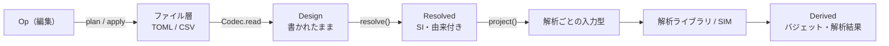

# 設計モデルの構造とファイル形式

設計データのモデルをどんな構造体で持つか、ファイルにどう置くかを書く。

## 1. 結論

- **モデルは 4 つの層に分ける。** ファイル層 → Design（書かれたまま）→ Resolved（解決済み・SI・由来付き）→ Derived（計算結果）。
  編集は Design に対して行い、解析は Resolved を読む。Derived は原則ファイルに保存しない（§9）。
- **解析はモデルを知らない。** 解析ライブラリ側が「解析ごとの入力型」を定義し、fune-projection が Resolved からその型へ射影して渡す
  （[architecture.md](architecture.md) §6.3）。足りない入力は「この解析には RW_X.max_momentum が要る」と名指しで返す。
- **製品ツリーはディレクトリで表す。** 機能のまとまり（AOCS など）はディレクトリだけで、ファイルは置かない。
  自分の質量や取付先を持つ物理的な組立品は「部品ファイル＋同じ名前のディレクトリ」で表す（§6）。
- **置き場所の原則**（§7）:
  1 つの部品で完結する情報は部品ファイルに書く。複数の部品にまたがり、それ自体が名前や属性を持つもの（モード・ネット・ハーネス）は別ディレクトリにする。
  所属は子が親を指す（部品のポートがネットを指す）。
- **システム担当が決めるもの（配分・マージン方針）は `budget/` にまとめる**（§8）。サブシステムのディレクトリには置かない。
- **ファイル形式は TOML。書き出しは 1.0 の範囲に留める**（§10）。表データは CSV、機械向けの交換は JSON。
- **形式はコーデック層に閉じ込める。** model は TOML を知らず、store の `Codec` だけが知る。将来、形式を変えても model と解析に波及しない。

## 2. 層の構成

| 層 | 中身 | 誰が作るか | 誰が使うか | 保存 |
|---|---|---|---|---|
| ファイル層 | ファイルごとの `toml_edit::DocumentMut` と位置情報 | store（Codec） | store の書き込み | git の作業ツリー |
| Design | 書かれたままの値（`0.62 kg`、`1.0 mN*m` は単位も書かれたまま）、出典、ファイル位置。型付き ID で正規化 | store の読み込み + 構造検査 | ops（編集の対象）、GUI の「元の値」表示 | ファイル層そのもの |
| Resolved | カタログ・kind・上書きを重ねた各部品の値（SI）、値の出所（catalog / override / derived）、根拠の最弱値、取付をたどった機体座標、選択中の候補 | `resolve(&Design)`（純粋関数） | 解析への射影、GUI の表、check() | しない（毎回作り直す。数千件で数十 ms） |
| Derived | 質量特性（総質量・重心・慣性）、バジェット、解析・SIM の結果 | budget、解析ライブラリ、SIM | GUI、CLI、PR コメント | 原則しない。出力先は §9 |



## 3. エンティティ

| エンティティ | 役割 | ファイル | 主な中身 |
|---|---|---|---|
| Project | プロジェクト全体の設定 | `fune.toml` | schema 版、書き出す TOML の版、サブシステムの表示名、共有カタログの参照 |
| Allocation | 配分 | `budget/allocation.toml` | 質量・電力などの上限、システムマージン、サブシステムごとの配分 |
| BudgetPolicy | マージン方針 | `budget/policy.toml` | 成熟度ごとの成長余裕、不確かさの既定幅、ハーネスの見込み |
| AttributeDef | 量の種類（quantity kind） | `defs/attribute/<id>.toml` | 値の型、次元、許可単位、表示単位、値域、状態で引くか、どのバジェットに入るか |
| KindDef | 部品の種別 | `defs/kind/<id>.toml` | 継承元、必須・任意の属性、機器の状態の語彙（off / standby / on …）、ポートの雛形、role |
| CatalogItem | 購入品・設計品の定義（ElementDefinition） | 共有カタログ or `catalog/<id>.toml` | kind、型番、成熟度、属性値、ポートの値、形状、データシート |
| Group | 機能のまとまり（サブシステム） | `parts/` 以下の、同名ファイルを持たないディレクトリ | なし（表示名は `fune.toml` の `[groups]`、配分は `budget/allocation.toml`） |
| Part | 製品ツリー上の使用（ElementUsage） | `parts/<…>/<ID>.toml` | 定義（catalog / kind）、トレード候補、員数、取付先と相対姿勢、上書き値、ポートの所属ネット |
| Mode | 衛星の運用モード | `modes/<ID>.toml` | 部品 → {基本の状態, ほかの状態の時間割合} |
| Net | 電気的な接続（論理） | `nets/<ID>.toml` | 種類（power / data / rf）、レール電圧、供給元ポート、電流制限、プロトコル |
| Harness | ケーブル区間（物理） | `harness/<ID>.toml` | 両端のポート、通すネット、線材、芯数、長さ |
| Case | 解析ケース | `cases/<ID>.toml` | モードまたはモード時系列、不確かさのどちら側を読むか、軌道、姿勢則、環境条件、期間 |
| Source | 出典の台帳 | `sources/<ID>.toml` | 種類（datasheet / measured / analysis / judgement / placeholder）、参照先、日付、記入者 |
| Requirement | 要求（軽量） | `requirements/<ID>.toml` | 文、対象の量、制約、「全モード・全ケースで」などの量化。正式な判定は外部の検証ツールに書き出す |
| Table | 表データ | `tables/<ID>.csv` + `tables/<ID>.toml` | 曲線や特性表。列ごとの単位は TOML 側で宣言 |
| View | 見た目だけの情報（Design の外） | `view/…` | 系統図の座標、3D のカメラ |

## 4. Rust の型（Design 層）

```rust
/// 型付き ID。ファイル名（またはディレクトリ名）の stem と一致し、全体で一意（大文字小文字を無視して比較）。
pub struct Id<T> { name: SmolStr, _t: PhantomData<fn() -> T> }

/// 書かれたままの設計。不変のスナップショットで、編集のたびに新しいものを作る。
pub struct Design {
    pub project: Project,
    pub budget: Budget,                                    // budget/allocation.toml と policy.toml
    pub attributes: BTreeMap<Id<AttributeDef>, Arc<AttributeDef>>,
    pub kinds: BTreeMap<Id<KindDef>, Arc<KindDef>>,
    pub catalog: BTreeMap<CatalogRef, Arc<CatalogItem>>,   // "lab/rw_18mNms" のように出所付き
    pub groups: BTreeMap<Id<Group>, Group>,                // 同名ファイルを持たないディレクトリ
    pub parts: BTreeMap<Id<Part>, Arc<Part>>,
    pub modes: BTreeMap<Id<Mode>, Arc<Mode>>,
    pub nets: BTreeMap<Id<Net>, Arc<Net>>,
    pub harnesses: BTreeMap<Id<Harness>, Arc<Harness>>,
    pub cases: BTreeMap<Id<Case>, Arc<Case>>,
    pub sources: BTreeMap<Id<Source>, Arc<Source>>,
    pub requirements: BTreeMap<Id<Requirement>, Arc<Requirement>>,
    pub tables: BTreeMap<Id<Table>, Arc<TableDecl>>,
    pub revision: Revision,                                // 追跡ファイルの (path, bytes) の BLAKE3
}

/// 製品ツリーのノード。Group と Part の ID は同じ名前空間で一意。
pub enum NodeRef { Group(Id<Group>), Part(Id<Part>) }

pub struct Group {
    pub parent: Option<NodeRef>,           // ディレクトリから決まる
    pub label: Option<String>,             // fune.toml の [groups]。無ければディレクトリ名を表示
}

pub struct Part {
    pub parent: Option<NodeRef>,           // ディレクトリから決まる（ファイルには書かない）
    pub def: PartDef,                      // Catalog(CatalogRef) | Kind(Id<KindDef>)
    pub candidates: Vec<CatalogRef>,       // トレード候補。def の catalog が選択中の 1 つ
    pub count: u32,                        // 員数。個別の姿勢や配線が要るなら別の Part にする
    pub mount: Option<Mount>,              // 取付先の Part と取付点
    pub pose: Option<Pose>,                // 取付点の座標系に対する相対位置・姿勢
    pub mount_points: BTreeMap<Id<MountPoint>, Pose>,       // 自分に他の部品を付ける点
    pub attr: BTreeMap<Id<AttributeDef>, Authored<Value>>,  // カタログ値への上書き
    pub ports: BTreeMap<Id<Port>, PortBinding>,             // ポート → 所属ネット
    pub maturity: Option<Maturity>,        // off_the_shelf / modified / new
    pub loc: Loc,
}

/// 書かれた値と、その出典と位置。
pub struct Authored<T> { pub value: T, pub from: Option<From>, pub loc: Loc }

/// 値の型は AttributeDef が宣言し、読み込み時に一致を検査する。
pub enum Value {
    Scalar(Uncertain<Quantity>),
    ByState(BTreeMap<Id<State>, Uncertain<Quantity>>),   // 機器の状態ごと（電力・発熱など）
    Vec3 { x: f64, y: f64, z: f64, unit: UnitExpr, frame: FrameRef },
    Quat { w: f64, x: f64, y: f64, z: f64 },
    Tensor3 { m: [[f64; 3]; 3], unit: UnitExpr, frame: FrameRef },
    Enum(Symbol),
    Bool(bool),
    Text(String),
    Range { min: Quantity, max: Quantity },
    Table(Id<Table>),
}

/// 書かれたままの数値と単位。mN*m は mN*m のまま持ち、SI への換算は Resolved で行う。
pub struct Quantity { pub number: f64, pub unit: UnitExpr }

/// nominal と任意の不確かさ。どちら側を読むかは解析ケースが決める。
pub struct Uncertain<T> { pub nominal: T, pub min: Option<T>, pub max: Option<T> }

pub struct Mode {
    pub label: String,
    pub description: Option<String>,
    pub states: BTreeMap<Id<Part>, StateAssign>,
}
/// 基本の状態と、ほかの状態で過ごす時間の割合。割合の残りは基本の状態。
pub struct StateAssign { pub state: Id<State>, pub duty: BTreeMap<Id<State>, f64> }

pub struct PortBinding { pub net: Id<Net> }

pub struct Net {
    pub kind: NetKind,                     // Power / Data / Rf
    pub label: Option<String>,
    pub source: Option<PortRef>,           // 電源の供給元（"PCDU.OUT3"）
    pub rail: Option<Authored<Quantity>>,
    pub limit: Option<Authored<Quantity>>,
    pub protocol: Option<Symbol>,
    pub bitrate: Option<Authored<Quantity>>,
    pub master: Option<PortRef>,
}

pub struct Harness {
    pub label: Option<String>,
    pub from: PortRef,
    pub to: PortRef,
    pub nets: Vec<Id<Net>>,
    pub wire: CatalogRef,                  // 線材（単位長さ質量・抵抗）
    pub cores: u32,
    pub length: Authored<Quantity>,
}

pub struct Budget {
    pub allocation: BTreeMap<BudgetKind, Allocation>,      // Mass / Power / Data …
    pub policy: BudgetPolicy,
}
pub struct Allocation {
    pub limit: Authored<Quantity>,
    pub system_margin: f64,
    pub alloc: BTreeMap<NodeRef, Authored<Quantity>>,
}
pub struct BudgetPolicy {
    pub growth: BTreeMap<Maturity, f64>,
    pub uncertainty: BTreeMap<Maturity, f64>,
    pub harness_allowance: f64,
}
```

## 5. Rust の型（Resolved 層と解析への射影）

```rust
pub struct Resolved {
    pub parts: BTreeMap<Id<Part>, ResolvedPart>,
    pub tree: Tree<NodeRef>,               // 製品ツリー（機能の階層）
    pub mounts: Tree<Id<Part>>,            // 取付の階層（物理の階層）
    pub diagnostics: Vec<Diagnostic>,      // severity・code・対象（Target）・ファイル位置
}

pub struct ResolvedPart {
    pub catalog: Option<CatalogRef>,       // 候補があるときは選択中のもの
    pub kind: Id<KindDef>,
    pub count: u32,
    pub attr: BTreeMap<Id<AttributeDef>, ResolvedValue>,
    pub pose_body: Option<PoseSi>,         // 取付の連鎖をたどった機体座標
}

pub struct ResolvedValue {
    pub value: Cell<SiValue>,              // 欠けていても Unset として持ち、エラーにしない
    pub origin: Origin,                    // Catalog / Override / KindDefault / Derived
    pub evidence: Evidence,                // 根拠の最弱値（placeholder が混ざれば placeholder）
    pub loc: Option<Loc>,
}
pub enum Cell<T> { Set(T), Unset }

/// 解析ライブラリの入力型への射影。解析ライブラリは設計モデルに依存しない。
pub trait Project<I> {
    fn project(r: &Resolved, case: &CaseCtx) -> Result<I, MissingInputs>;
}
// 例: impl Project<rw_unloading::Input> for RwUnloadingProjection { … }
// MissingInputs は対象（fune_model::Target）で返す。表示は "RW_X.max_momentum"・"<部品>.power" のようなパス
```

- 編集の流れ: Op は Design のパス（`RW_X.attr.mass`）を対象にする。store が最小差分のファイル編集に変え、
  書いたファイルだけ読み直して新しい Design を作り、Resolved を作り直す。
- 計算のキャッシュ: Derived は入力の fingerprint をキーにメモ化する。数千件規模なら単純な全再計算で足りる。
  遅くなったら incremental な計算フレームワーク（salsa など）を検討する。

## 6. 製品ツリーと取付

### 6.1 2 つの階層

部品には「どのサブシステムに属するか（機能）」と「どこに付いているか（物理）」の 2 つの親がある。
RW は AOCS に属するが、物理的には -Z パネルに付いている。1 つの木で両方を表そうとすると、どちらかが歪む。

- **製品ツリー（機能）** = `parts/` のディレクトリ構成。配分との比較とバジェットの集計に使う。
- **取付の階層（物理）** = 各部品の `mount`（取付先の部品と取付点）。3D 配置、重心・慣性の計算、熱の接触に使う。
- 位置は取付点に対する相対値だけを書く。パネルを動かせば、付いている部品も一緒に動く。機体座標は Resolved で導出する。

### 6.2 ディレクトリの規則

規則は 1 つだけ。**ディレクトリだけならまとまり（Group）、同じ名前のファイルがあればそれ自身も部品（物理的な組立品）**。

```
parts/
├── AOCS/              機能のまとまり: ディレクトリだけ（ファイル不要）
│   ├── RW_X.toml
│   └── STT.toml
└── POWER/
    ├── BAT.toml
    ├── SAP_PX.toml    物理的な組立品: 普通の部品ファイル（質量・取付・取付点）
    └── SAP_PX/        同じ名前のディレクトリ = SAP_PX の子部品
        ├── CELLS.toml
        └── HINGE.toml
```

- Group の ID はディレクトリ名。部品の ID と同じ名前空間で一意にする。
- Group は質量も取付も持たない。表示名は `fune.toml` の `[groups]` に任意で書き、配分は `budget/allocation.toml` に書く。
- 物理的な組立品（`SAP_PX`）は自分の質量・取付先・取付点を持ち、子部品は `mount = { on = "SAP_PX", … }` で組立品に付く。
  バジェットでは「組立品自身＋子部品の合計」がその組立品の質量になる。
- 部品を別のまとまりへ移すとファイルの移動になり、git は rename として表示する。
- `CODEOWNERS` でディレクトリごとにレビュー担当を決められる。

## 7. modes / nets / harness

### 7.1 置き場所の原則

- **1 つの部品だけで完結する情報**（質量、ポートの所属先など）は部品ファイルに書く。
- **複数の部品にまたがり、それ自体が名前や属性を持つもの**（モード、ネット、ハーネス）は別ディレクトリにする。
- **参照は ID で行う。** 部品の ID は全体で一意なので、どのディレクトリからでも `RW_X` で指せる。
- `nets/` と `harness/` は平らに並べる。ディレクトリが「親」の意味を持つのは `parts/` だけにする。

```
my-sat-design/
├── parts/      部品そのもの        ports で nets を指す
├── modes/      運用モード          → parts を参照（部品 → 状態）
├── nets/       電気的なつながり     ← parts の ports から参照される
├── harness/    ケーブル区間（物理）  → parts のポートと nets を参照
└── cases/      解析ケース          → modes を参照（モードの時系列）
```

### 7.2 modes/: 1 モード 1 ファイル、「部品 → 状態」の表

```toml
# modes/NOMINAL.toml
label       = "定常"
description = "地心指向で待機。通信は可視時のみ"

[states]
BAT    = { state = "on" }
HEATER = { state = "off" }
OBC    = { state = "on" }
PCDU   = { state = "on" }
RW_X   = { state = "on" }
RW_Y   = { state = "on" }
RW_Z   = { state = "on" }
STT    = { state = "on" }
TRX    = { state = "rx", duty = { tx = 0.1 } }
```

- `state` はカタログ（kind）が定義する機器の状態から選ぶ。電力の値はカタログ側にあり、ここには書かない。
- `duty = { tx = 0.1 }` は「周回の 10% は tx、残りは基本の状態（rx）」の意味。
- モードの消費電力は「各部品の状態ごとの電力 × 時間割合」の合計として導出する。GUI では「部品 × モード」の表で編集する。
- 表に書かれていない部品は 0 W にせず、「未指定」の警告を出す。

### 7.3 nets/: 1 ネット 1 ファイル、ネット自身の性質だけ

```toml
# nets/P12V_AOCS.toml
kind   = "power"
label  = "AOCS 12 V 系"
source = "PCDU.OUT3"
rail   = { value = 12.0, unit = "V" }
limit  = { value = 2.0, unit = "A" }
```

```toml
# nets/CAN_BUS.toml
kind     = "data"
label    = "システム CAN"
protocol = "CAN"
bitrate  = { value = 1.0, unit = "Mbit/s" }
master   = "OBC.CAN1"
```

どの部品がつながっているかはネット側に書かず、部品側のポートに書く。部品を足しても共有のファイルを書き換えないので、衝突が起きない。
系統図は「ネット＋各部品のポート」から組み立てて描く。

- `source`・`master`（とハーネスの `from`・`to`）は `"部品.ポート"` の文字列で書き、読み込むときに `PortRef`（部品 ID とポート名）にする。
  この形でなければ、そのファイルの形の誤り（`toml.schema`、行付き）としてファイルを読まない。部品やポートが無いことは `fune check` が検査する。
- **戻り（GND）のネット**は、`kind = "power"` で `rail` が 0 のもの、または ID に `GND`・`RTN` の語（`_` で区切った語。大文字小文字を
  無視）を含むもの（`fune_model::design::Net::is_return`）。系統図では GND の層に描く。表示名（`label`）は見ない。

```toml
# parts/AOCS/RW_X.toml（抜粋）
catalog = "lab/rw_18mNms"

[ports.PWR]
net = "P12V_AOCS"

[ports.DATA]
net = "CAN_BUS"
```

### 7.4 harness/: 1 区間 1 ファイル、物理的なケーブル

```toml
# harness/H_PCDU_RWX.toml
label  = "PCDU → RW_X 電源"
from   = "PCDU.OUT3"
to     = "RW_X.PWR"
nets   = ["P12V_AOCS"]
wire   = "lab/awg22_ptfe"
cores  = 2
length = { value = 0.35, unit = "m", from = { source = "layout_estimate", note = "3D 配置からの概算" } }
```

- ネットが「論理的なつながり」なのに対して、ハーネスは「実際の線」。1 本の束に複数のネットを通せる。
- 質量（長さ × 線材の単位長さ質量 × 芯数）と電圧降下（電流 × 抵抗）を区間ごとに計算する。電流はモードの消費電力とレール電圧から出す。
- 概念設計の初期にはハーネスのファイルを書かなくてよい。その間は `budget/policy.toml` の見込み割合で代用する。

### 7.5 よくある操作で変わるファイル

| 操作 | 変わるファイル |
|---|---|
| 部品を追加（RW_Z） | `parts/AOCS/RW_Z.toml`（新規）と、各 `modes/*.toml` に 1 行ずつ |
| モードを追加 | `modes/NEW.toml`（新規）だけ |
| 部品をネットにつなぐ | その部品ファイルの `ports` に 1 行 |
| ネットを新しく作る | `nets/X.toml`（新規）と、つなぐ部品の `ports` |
| ハーネス区間を足す | `harness/X.toml`（新規）だけ |
| 部品の名前を変える | 部品ファイルの移動と、参照している modes・harness・nets の `source` の書き換え（Rename の Op が一括で行う） |
| 配分を付け替える | `budget/allocation.toml` だけ |

### 7.6 モードを「モードの側」に置くトレードオフ

部品を 1 つ足すと、モードの数だけファイルが 1 行ずつ変わる。逆に、部品ファイルに `[modes] NOMINAL = "on"` と書く方式にすると、
モードを 1 つ足すたびに全部品のファイルが変わり、1 つのモードの全体像も 1 ファイルで見られなくなる。
「電力の担当者が 1 ファイルでモードの全体を確認できること」を優先して、モードの側に置く。
行は ID 順に並べるので、隣り合う ID を 2 本のブランチで同時に足さない限り、git は自動でマージできる。

## 8. 配分とマージン方針（budget/）

配分はサブシステムのディレクトリに分散させず、1 つのファイルにまとめる。

- 配分を決めるのはシステム担当、`parts/AOCS/` を触るのは AOCS 担当で、持ち主が違う。`CODEOWNERS` でレビュー担当を分けられる。
- 配分は一緒に動く。「AOCS に 0.2 kg 回して PAYLOAD を減らす」という変更が、ファイル 1 つ・差分 2 行で済む。
- 合計の確認が 1 ファイルで済む。`check()` は「配分の合計 ≤ 上限 × (1 − システムマージン)」を検査し、超えたら warning を出す。

```toml
# budget/allocation.toml
[mass]
limit         = { value = 12.0, unit = "kg" }   # ロケット側の上限
system_margin = 0.10

[mass.alloc]
AOCS      = { value = 2.0, unit = "kg" }
CDH       = { value = 0.8, unit = "kg" }
COM       = { value = 1.0, unit = "kg" }
POWER       = { value = 3.2, unit = "kg" }
PAYLOAD   = { value = 1.5, unit = "kg" }
STRUCTURE = { value = 2.3, unit = "kg" }

[power]
limit         = { value = 25.0, unit = "W" }    # 軌道平均の発電見込み
system_margin = 0.15

[power.alloc]
AOCS    = { value = 8.0, unit = "W" }
CDH     = { value = 2.5, unit = "W" }
COM     = { value = 4.0, unit = "W" }
POWER     = { value = 1.5, unit = "W" }
PAYLOAD = { value = 5.0, unit = "W" }
```

```toml
# budget/policy.toml
[growth]                 # 成熟度ごとの成長余裕（質量・電力に掛ける）
off_the_shelf = 0.05
modified      = 0.10
new           = 0.20

[uncertainty]            # 不確かさを書いていない値に当てる既定の幅（±）
off_the_shelf = 0.03
modified      = 0.10
new           = 0.20

[harness]
allowance = 0.05         # harness/ が無い間、サブシステム質量に対して見込む割合
```

配分のキーは Group か Part の ID。組立品（`SAP_PX`）のような下位のノードにも配分できる。

## 9. Derived の出力先

Derived は「保存しない」が基本。出力先は用途で分ける。

| 出力 | 場所 | git で管理するか | 用途 |
|---|---|---|---|
| バジェット・質量特性など、すぐ計算できるもの | なし（メモリ上） | — | GUI・CLI の表示。毎回計算し直す |
| 解析・SIM の実行結果 | `.fune/runs/<解析>/<ケース>/<fingerprint>/` | しない | キャッシュと、手での再実行 |
| 残したい結果 | `results/<名前>/` | する | `fune results pin` で選んだものだけ。レビューや審査で見せる |
| 他ツールへの書き出し | `exports/`（budget.json など） | する | 外部の検証ツールなどが読むファイル |
| 審査用のまとめ（PDF など） | GitHub Release の添付 | リポジトリには入れない | `git tag pdr-2026-12` と `fune report` の出力 |

```
results/thermal-hot/
├── manifest.toml        解析 ID・ケース・入力の fingerprint・元の commit・ツールの版・pin した人と日時
├── result.json          スカラー値と系列の宣言（fune-tool/1）
└── series/temperature.csv
```

```toml
# results/thermal-hot/manifest.toml
analysis    = "thermal.case"
version     = 1
case        = "hot"
fingerprint = "sha256:9f3c2a1e"
source_rev  = "a1b2c3d"
tool        = "git:example-org/thermal-tool@1e9af19"
pinned_by   = "tanaka"
pinned_at   = 2026-11-06T10:30:00+09:00
```

計算結果を全部はコミットしない理由は次のとおり。

- 入力はきれいにマージできても結果ファイルが衝突する（2 本のブランチがそれぞれ部品を足すと、質量の合計が両方で変わる）。
- 入力と食い違った古い結果が残る。
- 差分が数値の変化で埋まり、レビューしにくくなる。

PR では CI が両方のリビジョンで計算し直した変化量をコメントするので、結果をコミットしなくても差分は見られる。
時間のかかる熱解析や、CI で動かせない外部ツールの結果だけを `results/` に pin する。pin した結果は入力の fingerprint を持つので、
入力が変われば `fune check` が「この結果は古い」と警告する。大きな系列ファイルは Git LFS に置く。

## 10. ファイル形式

### 10.1 形式の比較

| 形式 | git の差分・マージ | 手編集 | GUI からの書式保存書き込み（Rust） | 入れ子・ツリー | スキーマ・エディタ支援 | 判定 |
|---|---|---|---|---|---|---|
| **TOML** | ◎ 1 行 1 値 | ○ | ◎ toml_edit 0.25（cargo が使用） | △ 深い入れ子は読みにくい | ○ JSON Schema（Tombi / Taplo、`#:schema`） | **採用**。ツリーをディレクトリで表せば弱点に当たらない |
| KDL v2 | ◎ | ○ | ◎ kdl 6.7（書式保存） | ◎ ノードの木がそのまま製品ツリーになる | △ JSON Schema が使えず、エディタ支援も少ない。Python 側の読み手が育っていない | 次点。入れ子でツリーを書きたくなったら再検討 |
| YAML | ○ | ○（インデントや型推論の罠） | ✗ serde_yaml は deprecated、書式保存の書き込み手段がない | ◎ | ○ | 不採用 |
| JSON | △ カンマと括弧で差分が汚れる | ✗ コメント不可 | ○ | ◎ | ◎ | 機械向けの交換・書き出し専用 |
| 独自 DSL（SysML v2 風） | ◎ | ◎ | ✗ パーサー・整形・LSP・書式保存をすべて自作 | ◎ | ✗ 自作 | 不採用。将来の書き出し先としてのみ |
| CSV | ○ 行単位 | ○ Excel で開ける | ○ | ✗ | △ | 表データ専用 |
| SQLite / Dolt | ✗ / △ | ✗ | — | — | — | 不採用（理由は [architecture.md](architecture.md) §2.2） |

### 10.2 TOML プロファイル

`fune fmt` と `fune check` で強制する書き方の規則。

1. 1 ファイル 1 エンティティ。ID はファイル名の stem で、全体で一意（大文字小文字を無視、Windows の予約名は不可、`_` で始めない）。
   属性 ID には部品・カタログ品のフィールド名（`label`・`count`・`maturity` など。`fune_model::field_names::{PartFieldName, CatalogFieldName}`）を使わない
   （パスの記法 `RW_X.label` で属性とフィールドを区別できないため。`fune check` の `def.reserved`、`fune attr add` も拒む）。
2. 入れ子は 2 段まで。ツリーはディレクトリ、エンティティ間の関係は ID の参照で表す。
3. インライン表は `{ value, unit, from }`、短いベクトル（`{ x, y, z, unit }`）、1 行で収まる参照だけ。
   状態や不確かさを持つ値は `[attr.<名前>]` の下にドット付きキーで 1 行 1 セル。
4. 物理量の数値は常に float で書く（`0` ではなく `0.0`）。整数は ID・員数・回数だけ。
5. 書き出しは TOML 1.0 の範囲（§10.3）。
6. 曲線・特性表・時系列は CSV に置き、列の単位は対になる TOML で宣言する。
7. 計算結果は書かない（§9）。
8. 先頭に `#:schema` を置き、VS Code（Even Better TOML / Tombi）で補完と検証を効かせる。

### 10.3 TOML の版

TOML 1.1.0 は 2025 年 12 月に正式化されたが、**書き出しは 1.0 の範囲に留める**。1.1 を使わないと決めたのではなく、読み手が揃うまで待つ。

**理由 1: 読み手がまだ揃っていない。** 設計データはアプリ以外（外部の検証ツール、Python のスクリプトやノートブック、エディタ）も読む。
1 つでも 1.0 にしか対応しない読み手があれば、1.1 の構文を書いた時点でその読み手では読めなくなる。

| 読み手 | TOML 1.1 | 確認方法（2026-11-06） |
|---|---|---|
| Rust（`toml` 1.2.0、`toml_edit` 0.25.18） | 対応 | crate の版表記 `+spec-1.1.0` |
| Python 3.15 の `tomllib` | 対応（3.15 で追加） | Python のドキュメント |
| Python 3.14 以前の `tomllib` | **非対応** | Python 3.14.4 で、複数行のインライン表がエラーになることを確認 |
| `tomli` | 2.4.0 から対応 | CHANGELOG |
| `tomlkit` | 0.15.0 から読める。0.15.2 は 1.0 のパーサーでも読めるよう、書き出しを 1.0 の範囲にしている | CHANGELOG |
| Taplo（VS Code の Even Better TOML が使用） | おそらく非対応（最新の 0.10.0 は 2025-05 公開で、1.1 の正式化より前） | crates.io の版 |

Python で読む道具は 3.14 以前の `tomllib` で動いていることが多く、3.14 の `tomllib` は 1.0 しか読めない。

**理由 2: 今回の書き方では、1.1 で得られるものが小さい。**

| 1.1 の新機能 | 今回のファイル形式での効き目 |
|---|---|
| インライン表を複数行に分けられる（末尾のカンマも可） | 1.0 でもサブテーブルにすれば 1 行 1 項目で書けるので、差分の読みやすさは変わらない。同じ内容を 2 通りに書けると整形の正規形がぶれる |
| `\e`・`\xHH` のエスケープ | 設計データでは使わない |
| 日時の秒を省略できる | 省略できなくても困らない |

**運用:**

- 書くとき: アプリと `fune fmt` は 1.0 の範囲だけで出力する。
- 読むとき: アプリは 1.1 も読めるが、手で 1.1 の構文を書くと Python 3.14 の読み手では読めなくなる。`fune check` が警告し、`fune fmt` が 1.0 の書き方に直す。
- 切り替える時期: Python で読む道具の実行環境（CI のイメージを含む）が 3.15 以上に揃い、エディタも 1.1 に対応したら。
  `fune.toml` の `[project] toml = "1.0"` を `"1.1"` に変えれば出力を切り替えられるようにしておく。

### 10.4 系統図の表示データ

`view/electrical.toml` は解析に影響しない。`[nodes]` は部品・グループの ID から、親からの相対の整数座標
（`x`, `y`, 任意の `w`, `h`）への表。`[edge]` は手で引いた線の経路で、線を指すキーから `ViewEdge` への表。
`points` は画面の絶対座標の整数 `[x, y]` の配列（2 点以上）で、隣り合う点は水平か垂直に並ぶ。
`source_side`・`target_side`（省略可、`left` / `right` / `top` / `bottom`）は端子をカードのどの側に出すか、
`source_offset`・`target_offset`（省略可、整数 [px]）はその側の上の位置（左か上の角からの距離。省略なら端子の
並びで決まる位置）を表す。どれも表示だけを変え、部品・ネット・解析の入力は変わらない。座標と位置は整数のまま書く
（`fune fmt` も小数にしない）。GUI では線を選んで両端の丸をドラッグすると、その端をカードの縁の好きな位置へ付け替えられる。
手で引いた経路の端のカードをあとから動かしたときは、描くときにその端から側の外へ短い足を出して経路の続きへつなぎ直す
（保存した経路は変えない）。

```toml
[nodes]
POWER = { x = 20, y = 20 }

[edge]
"P12V:PCDU.OUT3>RW_X.PWR" = { points = [[100, 80], [400, 80], [400, 200]], target_side = "top", target_offset = 40 }
```

線を指すキーは `ネット:始点の端子>終点の端子`。端子は `部品.ポート`、ジャンクション（中心の無いネットの分岐）は
`(ネット)`、同じ 2 枚のカードの間をまとめた線はネットを `+` でつなぐ（`P5V+P12V:…`）。向きは図の線の向き
（電源は供給元から、データはマスターから。供給元の書かれていない電源の母線は配電へ向かう）。
キーはネットと端子だけで決まり、自動配置の順番や座標を含まないので、並べ直しても同じ線を指す。
同種をまとめたカードの端子は、まとめた部品のうち ID がいちばん小さいものの名前を使う。

保存した位置と経路は自動配置より優先する。`SetViewEdge` / `UnsetViewEdge` は 1 本の経路を書く・消す、
`ResetView` はその図の `[nodes]` と `[edge]` を両方消す。CLI のコマンドは
`fune view edge-set electrical <キー> --points "x,y x,y …" [--source-side …] [--target-side …] [--source-offset …] [--target-offset …]`、
`fune view edge-reset electrical <キー>`、`fune view reset electrical`。

自動配置の条件は次のとおり（`web/src/features/diagram/layout/`。部品の ID・名前・役割は見ない）。

- 枠の見出しは表示の言語の名前だけ（英語は ID の AOCS など、日本語は設計に書いた表示名。無ければ ID）。
- 列や層は決めない（電源の枠を左端に置く、といった決まりも置かない）。いちばん外の枠（サブシステム）を縦横の格子の
  升目に、カードを枠の中の格子に置く。枠の中のすき間は横 56・縦 48 px で、線が通れる幅にする。枠の中をカードの
  縦 1 列（行 > 列 + 1）や横 1 行（列 > 2 × 行 + 1）に並べる形は使わない（図全体が列に見えるため）。
- 位置は、表示している層にかかわらず全部の層（給電・信号・GND）の線で決める。層を切り替えても枠・カード・端子の
  位置は変わらず、表示する層の線だけを引き直す。
- 置き方は探索で決める。線でよくつながる枠から順に、見積もりがいちばん小さくなる升目へ置き、そのあと升目の入れ替え・
  枠の中のカードの入れ替え・枠の中の列の数の変更を、見積もりが下がらなくなるまで繰り返す。見積もりは
  「（線の両端のカードの中心の距離（縦 + 横）の合計 + 300 px × 交差の見込み + 200 px × ほかのカードを横切る見込み）×（1 + 全体の縦横比のずれ + 0.8 × 枠の
  縦横比のずれの平均）」。式の「全体」は線の無い枠を下か右に置いたあとの形。交差の見込みは、カードの中心どうしを直線で結んだ
  ときにほかのネットの線と交わる組の数と、1 枚のカードから出る別々のネットの相手がカードの周りで入り組む数（同じ
  ネットのひと続きの数 − ネットの数）の和。ほかのカードを横切る見込みは、両端のカードの中心を縦横の 2 区間（横に出てから
  縦、縦に出てから横）で結んだとき、どちらでも両端以外のカードの上を通る線の数（横に並べたカードの奥のカードの線が
  手前のカードを回り込む並べ方を嫌う）。格子の形（1〜4 行）ごとに 1 つずつ候補を作る（`layout-estimate.ts`）。
- 詰め: 升目に置いた枠を、横・縦の順に線の相手のほうへ寄せる（相手と揃う位置の中央値）。同じ帯にある枠とは並びの
  順を守り、64 px 以上のすき間を空ける。升目の大きさで空いていた余分なすき間と線の長さが縮み、枠どうしは近づきすぎない。
- 端子の上下左右の側は、線の相手（の平均）がカードの外のどちらにいちばん離れているかで選ぶ。同じ側の端子は相手の
  位置の順に並べ（左右の側は 24 px、上下の側は端子の名前が重ならない間隔）、端子の数に合わせてカードを大きくする。
  何本も線が出る端子（バス）で、相手が端子の側の反対側（カードの裏）にいる線は、相手のいる側に分かれ口を作って
  そこから出す（同じ端子なので端の名前も同じ。カードを大回りして裏の端子へ戻る線を作らない）。分かれ口も端子と同じく
  側の上に並べ、手で端を付け替えた線では手で決めた位置を優先する。
- 線は 8 px の格子の上の直交の経路探索（A*）で引く。カードと枠の見出しの文字は通らず、カードの横を通る線は縁から
  16 px 以上離れる（端子の出口だけはその端子の線が通る）。費用は 1 格子 1 に、折れ 10、ほかのネットの線との交差 30、ほかのネットの線と平行に重なる所 400（実際には通らない）、
  ほかのネットの線のすぐ隣を平行に走る所 1.5、ほかのネットの線の上で折れる所 40、両端の入っていない枠の中 0.4、
  枠の縁（とその内外 1 格子）に沿って走る所 3。同じネットの線の上は 0.9 で、幹を共有して枝分かれする。全部の線を
  引いたあと、1 本ずつ外して引き直す。経路の両端は端子の点（React Flow が線をつなぐ、端子の外向きの縁）。
- 見積もりの小さい 6 つの候補に（全部の層の）線を引き、「20 × 経路の見つからない線の数 + 0.5 × 線の交差の数 + 4 ×
  重なりの数 + 8 × 縦横比のずれ（比の対数の差）+ 0.4 × 折れの数 + 線の総延長 / 図の対角線」がいちばん小さいものを使う
  （同じ端子・同じネットの線どうしは交差にも重なりにも数えない）。毎回同じ結果になる。交差は少ないほうがよいが、折れと
  長さほどは重く見ない（交差には飛び越しを描くので読める）。
- 端子の選び直し: 選んだ候補の線を全部引いたうえで、端子ごとに次の案を作り、その端子の線だけを引き直した費用（ほかの
  線はそのまま）が下がるものを残す（`layout-refine.ts`）。
  - 側: ほかの 3 つの側の、同じカードのほかの端子と重ならない位置のうち線の相手にいちばん近い所から出す（空きが無ければ
    並んだ端子のすぐ外側。端子が増えるとカードは大きくなるので、それを見越す）
  - 位置: 端子を出てすぐ横へずれてまた外へ向かう線（段）を、段の分だけ端子を側の上でずらしてまっすぐにする
  案は得の大きい順に 6 つまで 1 つずつ試し、全体の費用が下がる案だけを採る。採った案があれば案を出し直し、4 回まで
  繰り返す（ある端子を動かすと別の端子が動ける空きができるため。例: OBC の SPW1 を下へ移すと LVDS1 が左へ移れる）。
  端子の側は相手の中心の方向で決めるが、実際の線は間のカードや同じネットの幹を回るので、選び直したほうが線が短く、
  折れが少なくなることがある。
- 線の無い枠（構体など）は 3 列の格子にして、図の下か右のうち全体が 16:10 に近くなる方に置く。
- 線のラベル（プロトコル名）は同じ端子から出る同じプロトコルの線に 1 つだけ付け、線の脇でカード・枠の見出し・
  ほかのラベル・線と重ならない場所に置く。
- 端子の名前はカードの外の線の脇に置く（上下の側は線の右、左右の側は線の上）。上下の側の端子は、いちばん長い名前が
  隣の線に届かない間隔で並べる（側の上の位置を選び直したときも、この間隔より近づけない）。
- 交差には飛び越し（半円）を描く。水平の線がほかのネットの垂直の線をまたぐ所に入れる。手で引いた線や、カードを
  動かしてつなぎ直した線にも入れる（各線の描いている経路を `line-store.ts` で分け合う）。
- 手で動かして保存した位置は自動配置より優先する（保存した枠の大きさが、自動配置で並べた中身より小さいときは中身に
  合わせて広げる）。「位置を自動に戻す」のボタンは保存した枠とカードの位置を消して自動で並べた位置に戻す（手で引いた線の経路は
  残し、端はカードに付いていく）。「位置と線を自動に戻す」は位置と線の経路を両方消す（`ResetView`）。
- 拡大・縮小は 10%〜1000%。左下の欄に、いまの倍率（押すと 100%）、全体を見る、選んだカード・線に寄る、全体図（ミニマップ）
  の表示があり、キーでは + / − で拡大・縮小、0 で全体、1 で 100%、F で選んだものに寄る（`DiagramZoom.tsx`）。
  マウスはホイールで上下、Shift + ホイールで左右に動かし、Ctrl / ⌘ + ホイールでカーソルの位置を中心に 1 目盛り 1.2 倍ずつ
  拡大・縮小する（トラックパッドのピンチはそのまま拡大・縮小）。
- 配置の編集（位置・線の経路・端の付け替え・上の 2 つのボタン）は、⌘Z / Ctrl+Z で元に戻し、⇧⌘Z / Ctrl+Y でやり直せる
  （ツールバーのボタンでも）。編集する前の配置から戻す Op（`SetViewLayout` / `SetViewEdge` / `UnsetViewEdge`）を作って
  覚えておき、戻すときは普通の編集として送る。覚えるのはそのタブで行った最近の 100 回まで。
- デモの表示モデルの写し（`web/src/test/diagram-model.ts`）で、カードが重ならないこと・枠どうしが近づきすぎないこと・
  列に並ばないこと・直交で両端が端子の点であること・ほかのネットの線と重ならないこと・自分のカードの真裏を回り込まないこと・
  層を切り替えても位置が同じこと・毎回同じになることをテストする。

## 11. ディレクトリ構成（schema v2）

```
my-sat-design/
├── fune.toml                    # プロジェクト設定・サブシステムの表示名・共有カタログ・TOML の版
├── catalog.lock                 # 共有カタログの固定 commit
├── budget/
│   ├── allocation.toml          # 配分（システム担当）
│   └── policy.toml              # 成長余裕・不確かさの既定幅・ハーネスの見込み
├── defs/
│   ├── attribute/<id>.toml
│   └── kind/<id>.toml
├── catalog/<id>.toml            # このプロジェクト固有のカタログ
├── parts/                       # 製品ツリー = ディレクトリ
│   ├── AOCS/
│   │   ├── RW_X.toml
│   │   ├── RW_Y.toml
│   │   ├── RW_Z.toml
│   │   └── STT.toml
│   ├── POWER/
│   │   ├── BAT.toml
│   │   ├── PCDU.toml
│   │   ├── SAP_PX.toml          # 物理的な組立品
│   │   └── SAP_PX/
│   │       ├── CELLS.toml
│   │       └── HINGE.toml
│   └── STRUCTURE/
│       ├── BUS_FRAME.toml
│       └── PANEL_MZ.toml        # 取付点を持つ構体部品
├── modes/<ID>.toml
├── nets/<ID>.toml
├── harness/<ID>.toml
├── cases/<ID>.toml
├── sources/<ID>.toml
├── requirements/<ID>.toml
├── tables/<ID>.csv  tables/<ID>.toml
├── view/
├── results/<名前>/               # pin した解析結果だけ
├── exports/                     # 他ツールへの書き出し
├── .github/CODEOWNERS
└── .fune/                       # gitignore: キャッシュ、runs/
```

`CODEOWNERS` の例（担当者名は仮）を示す。

```
/budget/        @system-lead
/modes/         @system-lead @power-lead
/parts/AOCS/    @aocs-lead
/parts/POWER/     @power-lead
```

### サンプル

`fune.toml`

```toml
[project]
name   = "my-sat"
schema = 2
toml   = "1.0"              # 書き出す TOML の版

[groups]                    # サブシステムの表示名（任意）
AOCS      = "姿勢制御系"
POWER       = "電源系"
STRUCTURE = "構体系"

[[catalog]]
name = "lab"
git  = "https://git.example.com/example-lab/parts-catalog"   # 架空の例
rev  = "v2026.11"

[[catalog]]
name = "local"
path = "catalog"
```

`parts/AOCS/RW_X.toml`

```toml
#:schema ../../.fune/schema/part.json
catalog    = "lab/rw_18mNms"
candidates = ["lab/rw_18mNms", "lab/rw_30mNms"]

[mount]
on    = "PANEL_MZ"
point = "RW_SLOT_1"

[pose]
position    = { x = 0.0, y = 0.0, z = 12.0, unit = "mm" }
orientation = { w = 1.0, x = 0.0, y = 0.0, z = 0.0 }

[attr]
mass = { value = 0.62, unit = "kg", from = { source = "em_test_2026_10", note = "EM 実測" } }

[ports.PWR]
net = "P12V_AOCS"

[ports.DATA]
net = "CAN_BUS"
```

`parts/STRUCTURE/PANEL_MZ.toml`

```toml
kind     = "panel"
maturity = "new"

[attr]
mass = { value = 0.35, unit = "kg", from = { source = "cad_2026_09" } }

[mount]
on    = "BUS_FRAME"
point = "FACE_MZ"

[mount_points.RW_SLOT_1]
position    = { x = 30.0, y = 0.0, z = 5.0, unit = "mm" }
orientation = { w = 1.0, x = 0.0, y = 0.0, z = 0.0 }
```

`parts/POWER/SAP_PX.toml`（物理的な組立品）

```toml
kind     = "solar_wing"
maturity = "new"

[attr]
mass = { value = 0.18, unit = "kg", from = { source = "cad_2026_09", note = "基板と構造のみ" } }

[mount]
on    = "PANEL_PX"
point = "HINGE"

[pose]
position    = { x = 0.0, y = 0.0, z = 0.0, unit = "mm" }
orientation = { w = 1.0, x = 0.0, y = 0.0, z = 0.0 }

[mount_points.CELL_AREA]
position    = { x = 0.0, y = 120.0, z = 2.0, unit = "mm" }
orientation = { w = 1.0, x = 0.0, y = 0.0, z = 0.0 }
```

`parts/POWER/SAP_PX/CELLS.toml`（組立品の子部品）

```toml
catalog = "lab/triple_junction_cell"
count   = 24

[mount]
on    = "SAP_PX"
point = "CELL_AREA"
```

## 12. 共有カタログ

カタログは衛星をまたいで使い回す資産なので、チームで共有するリポジトリ（例: `example-org/component-catalog`）に置き、
各衛星のリポジトリからは版を固定して読み取り専用で参照する（`catalog.lock` に commit を記録）。
参照は `lab/rw_18mNms` のように出所付きで書き、同じ名前の衝突を防ぐ。
カタログの値を直したいときは、共有リポジトリに PR を出すか、その衛星の Part で上書きする（上書きは由来付きで残る）。

## 13. 未決事項

| # | 問い | 既定案 |
|---|---|---|
| M1 | 物理的な組立品を「同名のファイル＋ディレクトリ」で表す規則でよいか | よい。特別なファイル名（`_assembly.toml`）は使わない |
| M2 | 共有カタログを最初から分けるか | 最初は `catalog/` に置き、2 機目が出た時点で共有リポジトリに切り出す |
| M3 | 員数（count）と個別 Part の使い分け | 個別の姿勢・配線・状態が要るものは個別 Part、ねじや太陽電池セルのような一括品だけ count |
| M4 | Range と Uncertain の区別 | 動作温度範囲のような「仕様の範囲」は Range、値のばらつきは Uncertain |
| M5 | モードの表に書かれていない部品の扱い | 「未指定」の警告。kind に既定の状態は持たせない（暗黙の 0 W を作らないため） |
| M6 | TOML 1.1 に切り替える時期 | Python の実行環境が 3.15 以上に揃い、エディタが対応した時点 |

## 14. 実装との差分

実装（fune-model / fune-store / fune-ops）は本書に沿っているが、次の点が異なる。API の正確な形は各 crate の型と `///` の説明にある。

| 本書 | 実装 | 理由 |
|---|---|---|
| `Authored<Quantity>` と `Quantity { number, unit }` | `Quantity { value, unit, from }` | ファイルと API の形を揃えるため |
| `Value` の enum | `{ type, data }` のタグ付き enum | TS の型生成に合わせるため |
| エンティティを `Arc` で保持し、位置を値に持つ | 素の map で保持し、行の位置は別の `SourceMap` に持つ | 単純さのため |
| kind は継承を持たない | 組み込みの kind は基底の kind `component` を継承する | 共通属性（質量・外形・温度範囲）を一度だけ書くため |
| error の診断があると編集できない | 編集で **新しく** error が増える Op だけを拒否する | 既存の error があっても直す編集はできるようにするため |
| 取付の連鎖を model で合成する | model は連鎖を未合成のまま渡し、projection が sat-astro の Quat で合成する | fune-model が sat-astro に依存しないため |
| ID はファイル名から（ファイルに書かない） | 同じ。加えて JSON の Op ではペイロードの `id` を受け取り、ファイルに `id` があってファイル名と違えば `id.mismatch` | GUI と `fune apply` から新規作成できるようにするため |
| 属性の既定値 | 組み込みの属性に `default` を持てる（例: 比熱 900 J/(kg·K)）。既定値から解決した値は出所 `kind_default`・根拠 `placeholder` | 仮値であることを画面で示すため |

まだ読み込んでいないもの: `requirements/` と `tables/`（ディレクトリは認識する）。`#:schema` の見出し行はまだ書き出していない。
