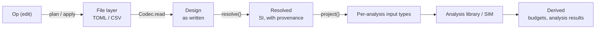

# Design model structure and file formats

This document describes what structures hold the design-data model and how it is laid out in files.

## 1. Summary

- **The model is split into four layers.** File layer → Design (as written) → Resolved (resolved, in SI, with provenance) → Derived (computed results).
  Edits are made against Design, and analyses read Resolved. Derived is not saved to files as a rule (§9).
- **Analyses do not know the model.** The analysis library defines an input type for each analysis, and fune-projection projects Resolved onto that type and passes it in
  ([architecture.md](architecture.md) §6.3). Missing inputs are reported by name, such as "this analysis needs RW_X.max_momentum".
- **The product tree is expressed with directories.** The top level is usually a directory named by a subsystem ID (such as `aocs`), and assemblies can be nested below it. Parts directly under `parts/` and other top-level folders (such as `mechanism/`) are also allowed (see §6.2 on the two sets).
  A physical assembly that has its own mass or mounting target is expressed as "a part file plus a directory of the same name" (§6).
- **Placement principle** (§7):
  Information that is complete within a single part goes in the part file. Things that span several parts and have their own names or attributes (modes, nets, harnesses) get their own directories.
  Membership is expressed by the child pointing to the parent (a part's port points to a net).
- **What the system lead decides (allocations and margin policy) is gathered in `budget/`** (§8). It is not placed in subsystem directories.
- **The file format is TOML, and output is kept within TOML 1.0** (§10). Tabular data is CSV, and machine-oriented exchange uses JSON.
- **Formats are confined to the codec layer.** The model does not know TOML; only the store's `Codec` does. Changing the format in the future does not ripple into the model or the analyses.

### 1.1 Conditions and analysis categories

Conditions are placed in `conditions/orbit.toml`, `conditions/launch.toml` and `conditions/ground/<ID>.toml`.
The settings category is `SettingScope::Conditions` (spelled `conditions`; the display name is "前提条件" / "Conditions").
The keys are `conditions.orbit.altitude`, `conditions.launch.<field>` and `conditions.ground.<ID>.<field>`.
`conditions/launch.toml` also selects the launch vehicle and the dispenser (`launcher`, `dispenser`; §5.6).
`mission/` is a reserved directory for the mission and its success criteria (#9), and is currently skipped. Phases are in `phases/` (§7.10); a phase can override the orbit for the cases that name it.

A ground station file (`label`, `latitude`, `longitude`, `altitude`, `min_elevation`, and per-band `[link.<band>]`) is edited as follows (all of it goes through Ops, so no file needs to be written by hand):

- `fune ground add <ID> [--label …] [--latitude "35.7 deg"] [--longitude "139.7 deg"] [--altitude "40 m"] [--min-elevation "10 deg"]` (Op `create_ground_station`; the GUI sends the typed text to `POST /ops/from_command` as `{ "command": "ground_add", … }`)
  creates `conditions/ground/<ID>.toml` in canonical form. Renaming a station rewrites the `verify.check` of requirements that name it (for example `margin:<link>@<ID>`, `link_closes:<ID>`); removing it is refused while a requirement's `verify.check` names it (update or remove those requirements first). The ID follows the ID rules and must not collide with an existing station (a difference only in letter case collides); the units are checked by `fune check`.
- A value of an existing station is changed with `fune set conditions.ground.<ID>.<field> …` (`SetSetting`; it does not create a station: an unknown `<ID>` is refused, so add it with `fune ground add` first), including a band: `fune set conditions.ground.<ID>.link.<band>.antenna_gain "14 dBi"`. `fune unset conditions.ground.<ID>.link.<band>` removes a band.
- `fune ground rename <ID> <NEW>` (Op `rename_ground_station`) moves the file and rewrites the station list `stations` of `analysis/comm.toml`.
- `fune ground rm <ID>` (Op `remove_ground_station`) removes the file. It is **refused while `analysis.comm.stations` lists the station** (an empty `stations` means every station is used, so nothing refers to a particular one);
  take the station out of that list first. This is the same style as removing a referenced catalog item or shared catalog.
  The API returns the stations as `DesignView.stations` (`id`, `label`, `file`, `group`, `in_use`).
Orbits and other items in the old layout are not read, and a missing orbit is reported as an existing missing input. There is no migration and no compatibility with old keys.

The analysis category is `sat_analysis::spec::AnalysisArea`. It has `System(System)` and `Condition(ConditionTopic)`,
and the first topic is `Orbit` (spelled `orbit`; display name "軌道" / "Orbit"). All 16 existing analyses remain in the subsystem category,
and their IDs are `<category key>.<analysis name>`. Topic keys and subsystem keys do not overlap. Parts, budgets, colors and `parts/<subsystem>/` are still handled by subsystem.
The API's `AnalysisInfo.area` is `{ "kind": "system", "value": "power" }` or
`{ "kind": "condition", "value": "orbit" }`. KPIs are arranged by subsystem or by topic according to the analysis category.

The settings of a topic's analyses are placed in a table within that condition's file (for example, `[eclipse_season]` in `conditions/orbit.toml`;
the setting key is `conditions.orbit.eclipse_season.<field>`). `analysis/orbit.toml` is not created.
A topic's settings location is looked up with `ConditionTopic::setting_path()`. Typed settings do not accept unknown tables or keys.

`central` in `conditions/orbit.toml` is the central body of the orbit (`earth`, `moon`, `sun`, `mercury`, `venus`, `mars`, `jupiter`, `saturn`,
`uranus`, `neptune`; Earth if omitted; the display name is `central_body` in labels.toml). Altitude is counted from this body's equatorial radius, and μ, radius, J2 and the ephemeris are held by
`sat_astro::ephem::CentralBody` (projection's `context::central_body` maps them). Sun-synchronous (`sun_synchronous`) applies to Earth only;
writing it for any other body is a `check` error (`setting.central`).

`propagator` is the orbit propagation (`kepler`, `j2`, `numerical`; `j2` if omitted). Projection maps `kepler` and `j2` directly onto `sat_astro::orbit::Propagator`.
`numerical` is **not used** by analyses: the force model of numerical propagation (drag and solar radiation pressure need values of the spacecraft) has no conventional default in sat-astro,
and projection does not invent defaults, so time-series analyses propagate with the J2 secular terms (`j2`). Writing it makes `check` notify with a warning (`setting.not_applied`)
(`numerical` reads the elements as osculating elements, so the same numbers give a different orbit from `j2`). `orbit.decay` does not use the propagator kind and finds the altitude decay with its own integration.

The **mission duration is held by a requirement** (§7.9), not by `conditions/orbit.toml`: the requirement `input = "mission_duration"` ("the mission shall last at least 1 year") gives
its `at_least` value to the analyses that need the span (`Design::mission_duration`). The old key `conditions.orbit.duration` is no longer read (see "Moved settings" in §7.9).
Without such a requirement the season analysis reports a missing input (`requirement[input/mission_duration]`).
The optional `step` of `[eclipse_season]` is a time quantity (key `conditions.orbit.eclipse_season.step`).
Reading and writing go through the existing path for condition files, and dimension checking and projection use the common table in `setting_dims`.
An unset step is also shown in the settings table.

```toml
# conditions/orbit.toml (the same file as the other orbital elements)
[eclipse_season]
step = { value = 1, unit = "day" }
```

`orbit.eclipse_season` is `AnalysisArea::Condition(ConditionTopic::Orbit)`.
Its inputs are `OrbitSpec`, `duration` and an optional `step`. The default step of 1 day is held by sat-analysis, and projection does not fill it in.
For each sample including the start and end of the period, it finds β with the existing `beta_angle_rad`, taking the J2 RAAN precession and the Sun direction into account.
Within one orbit of each sample the Sun position is fixed, and the existing orbit propagation and conical shadow are sampled at 5-second intervals.
The durations of umbra (light fraction 0) and of penumbra not including umbra (greater than 0 and less than 1) are aggregated with the existing trapezoidal rule for time fractions.
The time accuracy of the boundaries is about the sample interval at each boundary. Short eclipses and penumbrae can hide between samples.
The shadow is cast by a sphere of the central body (radius `CentralBody::radius_m`; `shadow::central_shadow_factor`), and the Sun position is as seen from the central body.
Time hidden by the Earth while orbiting the Moon (lunar eclipse) and time hidden by the Moon while orbiting the Earth are not included. An orbit with the Sun as central body has no β or eclipse, so it is an input error
(a heliocentric cruise is analysed through the Sun-distance cases below, not through the eclipse season).

The output `points` is a list of date (UTC), β [rad], umbra [s] and penumbra [s], and `series` is the same values as series for graphs.
`longest` and `max_eclipse_duration` are the sample and duration with the largest sum of umbra and penumbra, and
`beta_min` / `beta_max` are the extrema of signed β and their samples. For equal extrema, the first date is chosen.
Extrema are chosen among the samples; the true extremum between dates is not searched for.
`eclipse_free_samples` is the number of samples with no eclipse (including a fractional end point), and
`eclipse_free_duration` is an estimate of the eclipse-free period obtained by trapezoidal integration of the no-eclipse flag over the season grid.
It also outputs the season interval `step`, the in-orbit interval `shadow_step` and the approximation `fixed_sun_per_orbit`.
The verdict is informational only and no checks are attached. The KPIs list the longest eclipse and the lower and upper ends of the β range under the orbit topic.

`fune case from-eclipse <new ID> --at longest|beta_min [--mode <mode>]` re-analyzes the latest conditions with
the service's `case_from_eclipse_op` and builds an existing `SetCase` Op.
HTTP sends `{ "id": "season_longest", "at": "longest", "mode": null }` to `POST /ops/case_from_eclipse`
and saves the returned Op with the ordinary `POST /ops`. The GUI's orbit page uses the same entry point, so the preview and the CLI output are shared.
The case stores β (rad) and an optional mode. A case has no epoch field, so the sample's date is recorded in the description.
This is a case that reuses a representative β condition; it does not change the epoch of later analyses through the date in the description.
Overwriting an existing ID and unknown modes are rejected. `to_cli` returns a `fune case set` that keeps the value and the date.

**Heliocentric cruise (the Sun as central body).** The power and thermal analyses run with `central = "sun"`: the timeline gives the Sun distance `|r|` at each time (so the solar flux is `S₁ (AU/d)²`
and the generation scales the same way), there is no eclipse (the sunlit fraction is 1), and the thermal analyses take albedo and planet infrared as 0 (§5.2).
A case's `beta` is an input error there (the Sun direction has no orbit plane to measure β from), so cruise cases do not set it.
`power.sizing` is not available for a heliocentric orbit: it is sized against the longest eclipse and β season, which an orbit about the Sun does not have (the input error above).
The worst cases of a cruise are the perihelion and the aphelion, made as analysis cases with `sun_distance` (a length, key `cases.<ID>.sun_distance`, dimension checked like `beta`):

`fune case from-sun-distance <new ID> --at min|max [--mode <mode>]` finds the smallest or largest Sun distance of the orbit between the epoch and `duration`
(`sat_analysis::orbit::sun_distance_extremes`: samples at the usual step, then a golden-section refinement around the extreme; if the span is shorter than half an orbit the extreme is at the span's end)
with the service's `case_from_sun_distance_op` and builds an existing `SetCase` Op (HTTP: `POST /ops/case_from_sun_distance` with `{ "id": "perihelion", "at": "min", "mode": null }`, saved with `POST /ops`).
The distance is written in AU and the date of the extreme is recorded in the description (a case has no epoch field). The orbit must have the Sun as central body (otherwise an error).
A case with `sun_distance` makes every analysis use a **circular orbit at that distance** instead of the orbit conditions (inclination, RAAN, epoch and propagator are kept; `Context::orbit`).
So `thermal.steady` is the steady state at that distance (the orbit average of a circular orbit is constant), and `thermal.transient`, `power.orbit_generation` and `power.energy_balance` run at that distance
(for a circular orbit about the Sun the Sun direction turns slowly, one turn per orbit, and the attitude law follows it). A `sun_distance` on an orbit whose central body is not the Sun is a missing input naming `cases.<ID>.sun_distance`.
Without such a case, the orbit conditions are used as they are: `thermal.steady` then averages over one orbit (a year-scale period) with the time mean of the inverse square of the distance (`⟨(a/r)²⟩ = 1/√(1−e²)` for an ellipse).
A time series about the Sun with no number of orbits written runs **one** orbit instead of three (`spec::DEFAULT_HELIOCENTRIC_ORBITS`; an explicit `orbits` is used as written),
and its step is the usual period/200 (a year-long orbit is sampled about every 1.6 days; a `time_step` of 30 s over a year is rejected as too many samples).
The thermal transient integrates the whole span with the same adaptive method, so its cost grows with the span (about a minute in a debug build for one year of the demo; seconds in a release build).

#### Altitude decay by atmospheric drag and orbit maintenance (`orbit.decay`)

`orbit.decay` is also `AnalysisArea::Condition(ConditionTopic::Orbit)`. Its settings are `[decay]` in `conditions/orbit.toml` (all optional; the defaults are held by the analysis).

```toml
[decay]
span             = { value = 25, unit = "yr" }   # upper limit of the integration span (default 25 years)
reentry_altitude = { value = 120, unit = "km" }  # perigee altitude regarded as reentry (default 120 km)
drag_area        = { value = 0.06, unit = "m^2" } # drag area (if absent, the area of the structure's bounding box averaged over orientation = surface area / 4)
band             = { value = 2, unit = "km" }    # altitude band for orbit maintenance (if absent, drag is cancelled continuously)
```

The upper limit of the lifetime (the disposal requirement) is **not** a setting: it is the `at_most` requirement with `verify.analysis = "orbit.decay"` and `verify.check = "max_lifetime"` (§7.9).
Without such a requirement no lifetime check is made.

Other input values use existing ones: the orbit (`conditions/orbit.toml`; the case β is not used), the mass (the sum of the parts' mass properties),
the outer shape (the structure's `size`; the same `aocs::reference_box` as for aerodynamic torque), the drag coefficient (`analysis.aocs.drag_coefficient`, 2.2 if absent), and
the mission duration (the requirement `input = "mission_duration"`; the period used to judge lifetime and to accumulate the orbit-maintenance ΔV; 1 year if absent).
The propellant for orbit maintenance is the usable propellant of the propulsion analysis (`propulsion.propellant`, §7.7) (the propellant used with margin included); the propellant is not written here.
The specific impulse is the lowest among the propulsion subsystem's thrusters (conservative side), and the mass before firing is the mass with propellant loaded (`wet_mass`). The propellant and thruster used appear in the result's
`used.propellant` and `used.thruster`. Without a propulsion subsystem (maneuvers or propulsion parts), the propellant lifetime is not computed; with one, the propulsion inputs are required
(if they are missing, the altitude decay is also a missing input). The earlier `propellant` in `[decay]` is no longer read or used, and `check` urges removing it with a warning (`setting.moved`)
(`fune setting unset conditions.orbit.decay.propellant`).

**Method (orbit-averaged semi-analytic)**: With the semi-major axis `a` and the RAAN as state, the orbit-averaged rate of change of the semi-major axis over one orbit,
`da/dt = 2a²/μ ⟨v · a_D⟩` (the energy form of Gauss's planetary equations), is integrated with RK4. `a_D` is the drag acceleration from the NRLMSISE-00 density,
the velocity relative to the co-rotating atmosphere, and `Cd·A/m`; one orbit is sampled at 12 equally spaced points and averaged with the trapezoidal rule
(agreeing with 24 and 48 points to 4 digits). For a circular equatorial orbit with an altitude-only atmosphere it agrees with King-Hele's `da/dt = −ρ (Cd·A/m) √(μa) (1 − ω_E a/v)²`
(confirmed by tests). The RAAN advances at the J2 secular rate (for orbits that are not sun-synchronous, the orientation of the orbital plane relative to the dayside atmospheric bulge changes).
The step is at most 1 km of altitude decay per step and between 10 minutes and 10 days, and is cut at the boundaries of the space-weather samples. Reentry is the time when the perigee altitude falls below the reentry altitude (linearly interpolated within a step).
The orbit-maintenance ΔV is the integral of the thrust `−v̂ · a_D` that cancels along-track drag (with a band, the integral until the orbit is returned instantly to the original altitude at the lower edge of the band; equal to the ΔV to raise it, to first-order approximation).
The propellant lifetime is the ΔV obtained by using all the usable propellant (`sat_astro::rocket`) divided by the ΔV per year.

**Range of applicability**: near-circular orbits (a caution is issued above eccentricity 0.01; changes in eccentricity and argument of perigee are not tracked), altitude of roughly 180 to 1000 km.
Area and Cd are constant (attitude and panel orientation are accounted for by how the area is given). The one-orbit average picks up the daily change in universal time, so ΔV fluctuates by about 1% depending on the step.

**Solar activity conditions**: three conditions that hold the long-term values of ECSS-E-ST-10-04C Table 6-3 constant over the whole period (low F10.7 = 65, Ap = 0; medium 140, 15; high 250, 45), plus,
when a space-weather table is present (`fune data fetch space_weather`), the condition `dated` looked up by date. The service adds to the input a series looked up with `space_weather_at` every 27 days, and
leaves the version of the table used (source, retrieval time, SHA-256, range) in the result's `space_weather`. Outside the table and for missing values the medium preset is used, and
the number of sources for each of F10.7 and Ap, and the time at which forecast values or presets began to be used, are returned in `weather_sources` (the table's monthly forecasts have no Ap).

**Verdict**: a caution is issued if any condition reenters earlier than the mission duration (orbit maintenance is needed). The lifetime limit is judged with the representative condition (`dated`, or medium if absent)
(keeping the low preset for decades is an extreme assumption that ignores the solar cycle, so it is not used). If it does not reenter within the integration span, a caution is issued when the span is shorter than the limit.
A caution is issued if any condition has a propellant lifetime that does not reach the mission duration. The KPIs are the shortest lifetime, the largest one-day altitude decay and the largest one-year orbit-maintenance ΔV.

**Order-of-magnitude checks (tests)**: for a 3U CubeSat at 500 km (4 kg, 0.039 m², Cd 2.2), the lifetime is about 2.6 years for medium and about 0.7 years for high (Oltrogge & Leveque, SSC11-VII-2, 2011 gives
2 to 10 years for a 3U at 500 km, and NASA's CubeSat 101 says "a few years at 500 km"). At 400 km it is about 0.5 years for medium. For an ISS-class case (m/(Cd·A) ≈ 130 kg/m², 410 km, 51.6°), the decay is
about 3 km per month for medium and about 11 km for high (the same order as NASA's explanation of "about 2 km per month on average").


## 2. Layer structure

| Layer | Contents | Created by | Used by | Storage |
|---|---|---|---|---|
| File layer | A `toml_edit::DocumentMut` per file, and position information | store (Codec) | the store's writes | the git working tree |
| Design | Values as written (`0.62 kg`; `1.0 mN*m` keeps its unit as written), sources, file locations. Normalized with typed IDs | the store's read + structural checks | ops (the target of edits), the GUI's "original value" display | the file layer itself |
| Resolved | Each part's values (SI) with catalog, kind and overrides layered, the origin of values (catalog / override / derived), the weakest evidence, body-frame coordinates obtained by following mounts, the selected candidate | `resolve(&Design)` (a pure function) | projection to analyses, GUI tables, check() | no (rebuilt each time; tens of ms for thousands of items) |
| Derived | Mass properties (total mass, center of mass, inertia), budgets, analysis and SIM results | budget, the analysis library, SIM | GUI, CLI, PR comments | not as a rule. Output location in §9 |



## 3. Entities

| Entity | Role | File | Main contents |
|---|---|---|---|
| Project | Settings for the whole project | `fune.toml` | schema version, the TOML version to write, references to shared catalogs |
| Allocation | Allocation | `budget/allocation.toml` | limits for mass, power and so on, system margin, allocation per subsystem (or per part) |
| BudgetPolicy | Margin policy | `budget/policy.toml` | growth margin per maturity, default width of uncertainty, harness allowance |
| AttributeDef | Quantity kind | `defs/attribute/<id>.toml` | value type, dimension, allowed units, display unit, value range, whether it is looked up by state, which budget it enters, whether it is a direction (`unit_vector`: a unit vector in the part frame, drawn as an axis in 3D), and for a field-of-view half angle the direction attribute it is around (`fov_axis`, e.g. the built-in `fov_half_angle` has `fov_axis = "boresight"`; 3D draws the view cone from it). `fune attr add` takes `--unit-vector` and `--fov-axis <attribute>`; the Web does not know the attribute IDs |
| KindDef | Part kind | `defs/kind/<id>.toml` | parent kind, required and optional attributes, vocabulary of equipment states (off / standby / on …), port templates, role |
| CatalogItem | Definition of a purchased or designed item (ElementDefinition) | shared catalog or `catalog/[<dir>/…]<id>.toml` (§11.1) | kind, model number, maturity, tags (`tags = ["flight_proven", "domestic"]`: a free classification that is neither manufacturer nor kind; omitted when empty; `fune catalog set <item> tags a,b` / `unset`; a tag is non-empty, has no leading or trailing whitespace and no `,`, and is not duplicated within the same item), attribute values, port values, shape, the datasheet source (a source ID; §7.8) |
| Group | Subsystem or nested folder | a directory under `parts/` that has no same-named file (the top level is usually a subsystem ID) | none (the subsystem's display name is a built-in vocabulary entry; allocations are in `budget/allocation.toml`) |
| Part | A use in the product tree (ElementUsage) | `parts/<…>/<ID>.toml` | definition (catalog / kind), trade candidates, count and redundancy, mounting target and relative attitude, override values, the nets the ports belong to |
| Mode | The satellite's operating mode | `modes/<ID>.toml` | duration, part → {state, time fraction, active count, spare state}, eclipse override |
| Net | Electrical connection (logical) | `nets/<ID>.toml` | kind (power / data / rf), rail voltage, source port, current limit, protocol |
| Harness | Cable segment (physical) | `harness/<ID>.toml` | ports at both ends, the nets it carries, wire, number of cores, length |
| Case | Analysis case | `cases/<ID>.toml` | a mode or mode time series, a phase (§7.10), which side of the uncertainty to read, Sun distance (cruise), orbit, attitude law, environment conditions, period |
| Phase | Mission phase (commissioning, nominal operations, disposal) | `phases/<ID>.toml` | order, start and end conditions (free text), duration, the modes used, and optional overrides of the orbit and of the attitude law per mode for the cases that name the phase (§7.10) |
| Configuration | A named overlay of part poses (stowed, deployed and other placement variants) | `configurations/<ID>.toml` | label, description, and a replacement pose per part (§7.11) |
| Maneuver | Maneuver | `maneuvers/<ID>.toml` | category (a row of the ΔV budget), calculation stage, thrusters, preceding maneuver, target orbit, constraints for fine-grained stages only, dates of an interplanetary transfer (§7.7) |
| Source | Ledger of sources | `sources/[<dir>/…]<ID>.toml` (§11.1) | kind (datasheet / measured / analysis / judgement / placeholder), reference, date, author |
| Source | Ledger of sources | `sources/[<dir>/…]<ID>.toml` (§11.1) | kind (datasheet / measured / analysis / judgement / placeholder), reference, document version, retrieval date, SHA-256, distribution category, date, author (§7.8) |
| Requirement | Requirement (lightweight, a flat list) | `requirements/<ID>.toml` | statement (Japanese and English), the dimension of the constrained quantity, constraint (direction and value), quantification (all cases / named cases), source (a source ID), and what verifies it (an analysis check or a budget). The verdict itself comes from the analysis or budget (§7.9). Formal verdicts written out to external verification tools are not decided yet |
| Table | Tabular data | `tables/<ID>.csv` + `tables/<ID>.toml` | curves and characteristic tables. Units per column are declared on the TOML side |
| View | Presentation-only information (outside Design) | `view/…` | coordinates of the system diagram, the 3D camera |

### 3.1 Roles and states of kinds

Project-defined attributes and kinds can be renamed (`fune attr rename <ID> <NEW>`, `fune kind rename <ID> <NEW>`; Ops `rename_attribute`, `rename_kind`; `POST /ops`). The definition file is moved and
every reference found by the reference index (`Design::references`) is rewritten: for an attribute, the `required` / `optional` lists of kinds and the `[attr.<ID>]` keys of parts and catalog items
(including the by-state tables); for a kind, the `kind` of parts and catalog items and the `extends` of other kinds. Built-in attributes and kinds cannot be renamed, the new ID must follow the ID rules and must not be taken
(built-in ones included), and `fune check` still rejects names that clash with field names (`def.reserved`). Items of shared catalogs are read-only and cannot be rewritten, so a rename is refused
while one of them uses the definition (change the shared catalog first). Nothing else refers to a definition (analysis settings, view files and mode tables hold part, group, mode and net IDs only).

- A kind's `role` is a value of `fune_model::builtin::Role` (`enum_text!`). Its spelling is defined in one place, `builtin/role.rs`, and unknown roles are rejected when serde reads them. If omitted, the parent kind's role is used, and if the parent has none, there is no role. Custom kind IDs are free, but the vocabulary of roles is not extended.
- A role's display name is the Japanese and English name of the corresponding built-in kind. `labels.role_system` holds the subsystem of every role, keyed by Role (correspondences that belong to no subsystem are made explicit as `None`). The API returns roles as the TS `Role` type, and the Web icon table covers all roles.
- The vocabulary of states is defined freely per kind. Only the conventional stopped state uses `fune_model::builtin::STATE_OFF`, and the processing that chooses the default state also refers to this constant (it is not made an enum). The convention is that a kind with the thruster role has the firing state `STATE_THRUSTER_FIRING` (`on`) in its vocabulary; if it does not, `fune check` emits a warning (`def.thruster_firing_state`).

## 4. Rust types (Design layer)

```rust
/// Typed ID. Matches the stem of the file name (or directory name) and is unique overall (compared case-insensitively).
pub struct Id<T> { name: SmolStr, _t: PhantomData<fn() -> T> }

/// The design as written. An immutable snapshot; a new one is made on every edit.
pub struct Design {
    pub project: Project,
    pub budget: Budget,                                    // budget/allocation.toml and policy.toml
    pub attributes: BTreeMap<Id<AttributeDef>, Arc<AttributeDef>>,
    pub kinds: BTreeMap<Id<KindDef>, Arc<KindDef>>,
    pub catalog: BTreeMap<CatalogRef, Arc<CatalogItem>>,   // with an origin, such as "lab/rw_18mNms"
    pub groups: BTreeMap<Id<Group>, Group>,                // directories with no same-named file
    pub parts: BTreeMap<Id<Part>, Arc<Part>>,
    pub modes: BTreeMap<Id<Mode>, Arc<Mode>>,
    pub nets: BTreeMap<Id<Net>, Arc<Net>>,
    pub harnesses: BTreeMap<Id<Harness>, Arc<Harness>>,
    pub cases: BTreeMap<Id<Case>, Arc<Case>>,
    pub sources: BTreeMap<Id<Source>, Arc<Source>>,
    pub requirements: BTreeMap<Id<Requirement>, Arc<Requirement>>,
    pub tables: BTreeMap<Id<Table>, Arc<TableDecl>>,
    pub revision: Revision,                                // BLAKE3 of the tracked files' (path, bytes)
}

/// A node of the product tree. Group and Part IDs are unique within the same namespace.
pub enum NodeRef { Group(Id<Group>), Part(Id<Part>) }

pub struct Group {
    pub parent: Option<NodeRef>,           // determined by the directory
}

pub struct Part {
    pub parent: Option<NodeRef>,           // determined by the directory (not written in the file)
    pub def: PartDef,                      // Catalog(CatalogRef) | Kind(Id<KindDef>)
    pub candidates: Vec<CatalogRef>,       // trade candidates. The catalog in def is the selected one
    pub count: u32,                        // count. If individual attitudes or wiring are needed, make them separate Parts
    pub redundancy: Redundancy,            // none (default) / cold / warm
    pub mount: Option<Mount>,              // the mounting target Part and mount point
    pub pose: Option<Pose>,                // position and attitude relative to the mount point's frame
    pub mount_points: BTreeMap<Id<MountPoint>, Pose>,       // points where other parts attach to this one
    pub attr: BTreeMap<Id<AttributeDef>, Authored<Value>>,  // overrides of catalog values
    pub ports: BTreeMap<Id<Port>, PortBinding>,             // port → the net it belongs to
    pub maturity: Option<Maturity>,        // off_the_shelf / modified / new
    pub loc: Loc,
}

/// A written value, with its source and location.
pub struct Authored<T> { pub value: T, pub from: Option<From>, pub loc: Loc }

/// The value type is declared by AttributeDef, and the match is checked at load time.
pub enum Value {
    Scalar(Uncertain<Quantity>),
    ByState(BTreeMap<Id<State>, Uncertain<Quantity>>),   // per equipment state (power, heat dissipation, etc.)
    Vec3 { x: f64, y: f64, z: f64, unit: UnitExpr, frame: FrameRef },
    Quat { w: f64, x: f64, y: f64, z: f64 },
    Tensor3 { m: [[f64; 3]; 3], unit: UnitExpr, frame: FrameRef },
    Enum(Symbol),
    Bool(bool),
    Text(String),
    Range { min: Quantity, max: Quantity },
    Table(Id<Table>),
}

/// The number and unit as written. mN*m is kept as mN*m, and conversion to SI is done in Resolved.
pub struct Quantity { pub number: f64, pub unit: UnitExpr }

/// A nominal value and optional uncertainty. Which side to read is decided by the analysis case.
pub struct Uncertain<T> { pub nominal: T, pub min: Option<T>, pub max: Option<T> }

pub struct Mode {
    pub label: String,
    pub description: Option<String>,
    pub states: BTreeMap<Id<Part>, StateAssign>,
    pub max_duration: Option<Quantity>,    // time dimension. Used for the verdict of power.energy_balance (§5.1)
    pub when: Option<ModeWhen>,            // sunlit | eclipse | any: the period the longest-duration evaluation may place the mode in (§5.1)
    pub start: Option<StartRef>,           // { from: eclipse_exit | eclipse_entry, offset }: fixes the start of that evaluation (§5.1)
    pub eclipse: BTreeMap<Id<Part>, StateAssign>, // only the parts written here are replaced during eclipse
}
/// The base state, and the fraction of time spent in other states. The remainder of the fractions is the base state.
pub struct StateAssign {
    pub state: Id<State>,
    pub duty: BTreeMap<Id<State>, f64>,
    pub active: Option<u32>,               // omitted means all units
    pub spare_state: Option<String>,      // explicit spare state for warm redundancy
}
pub enum Redundancy { None, Cold, Warm }

pub struct PortBinding { pub net: Id<Net> }

pub struct Net {
    pub kind: NetKind,                     // Power / Data / Rf
    pub label: Option<String>,
    pub source: Option<PortRef>,           // the power source ("PCDU.OUT3")
    pub rail: Option<Authored<Quantity>>,
    pub limit: Option<Authored<Quantity>>,
    pub protocol: Option<Symbol>,
    pub bitrate: Option<Authored<Quantity>>,
    pub master: Option<PortRef>,
}

pub struct Harness {
    pub label: Option<String>,
    pub from: PortRef,
    pub to: PortRef,
    pub nets: Vec<Id<Net>>,
    pub wire: CatalogRef,                  // wire (mass and resistance per unit length)
    pub cores: u32,
    pub length: Authored<Quantity>,
}

pub struct Budget {
    pub allocation: BTreeMap<BudgetKind, Allocation>,      // Mass / Power / Data …
    pub policy: BudgetPolicy,
}
pub struct Allocation {
    pub limit: Authored<Quantity>,
    pub system_margin: f64,
    pub alloc: BTreeMap<NodeRef, Authored<Quantity>>,
}
pub struct BudgetPolicy {
    pub growth: BTreeMap<Maturity, f64>,
    pub uncertainty: BTreeMap<Maturity, f64>,
    pub harness_allowance: f64,
}
```

## 5. Rust types (Resolved layer and projection to analyses)

```rust
pub struct Resolved {
    pub parts: BTreeMap<Id<Part>, ResolvedPart>,
    pub tree: Tree<NodeRef>,               // product tree (functional hierarchy)
    pub mounts: Tree<Id<Part>>,            // mount hierarchy (physical hierarchy)
    pub diagnostics: Vec<Diagnostic>,      // severity, code, target (Target), file location
}

pub struct ResolvedPart {
    pub catalog: Option<CatalogRef>,       // the selected one when there are candidates
    pub kind: Id<KindDef>,
    pub count: u32,
    pub attr: BTreeMap<Id<AttributeDef>, ResolvedValue>,
    pub pose_body: Option<PoseSi>,         // body-frame coordinates obtained by following the chain of mounts
}

pub struct ResolvedValue {
    pub value: Cell<SiValue>,              // even if missing it is held as Unset and is not an error
    pub origin: Origin,                    // Catalog / Override / KindDefault / Derived
    pub evidence: Evidence,                // the weakest evidence (placeholder if any placeholder is mixed in)
    pub loc: Option<Loc>,
}
pub enum Cell<T> { Set(T), Unset }

/// Projection to the analysis library's input types. The analysis library does not depend on the design model.
pub trait Project<I> {
    fn project(r: &Resolved, case: &CaseCtx) -> Result<I, MissingInputs>;
}
// Example: impl Project<rw_unloading::Input> for RwUnloadingProjection { … }
// MissingInputs is returned by target (fune_model::Target). It is displayed as a path such as "RW_X.max_momentum" or "<part>.power"
```

- Edit flow: an Op targets a path in Design (`RW_X.attr.mass`). The store turns it into a minimal-diff file edit,
  re-reads only the files it wrote to build a new Design, and rebuilds Resolved.
- Computation cache: Derived is memoized keyed by a fingerprint of the inputs. At the scale of thousands of items, simple full recomputation is enough.
  If it becomes slow, consider an incremental computation framework (such as salsa).

### 5.1 Condition selection for analysis cases

Projection's `case_policy::effective_case` gives priority to an explicit case. The targets to which `analysis.common.default_case` is applied
to the whole analysis when no case is given are only `power.orbit_generation`, `aocs.rw_unloading`,
`aocs.sensor_fov` and `thermal.transient`, as declared in the same module. Everything else analyzes the whole operation or all conditions with no case selected.
If the default setting points to a case that does not exist, it is a check error.
The `case` in the run result is the case ID used, and `case_source` is `explicit` / `default` (when no case is selected, both are null as a rule).
Setting changes not yet saved are applied to analyses by the same rule. The default case is not applied to `given`, which supplies the whole input.

When no case is specified, `power.energy_balance` lists all modes one case at a time, and each case's attitude law uses that mode's
`analysis.aocs.law`. Only the upper-level `timeline.attitude` uses the attitude law of the default case's mode, looked up by the same resolution function.
In this situation `case = null` and `case_source = default_attitude`. The default case's β, orbit count, side and so on are not applied.
If there is no default case, the attitude law is also used for the upper level only when it is unique; if there are several, it is a missing input.
When an explicit case is given, that case's mode and conditions are used as before.

The case's `phase` (an ID in `phases/`, §7.10) selects a mission phase for the case. In the projection, `Context::orbit_settings` is the only place that decides which orbit settings are in effect
(the phase's `[orbit]` if it has one, otherwise `conditions/orbit.toml`; see §7.10 for the rule) and `Context::laws` is the only place that decides the attitude laws in effect (`analysis.aocs.law` with the phase's `[law.<mode>]`
laid over it per mode). A case with no phase, or a design with no phases, reads the design's orbit and laws exactly as before. A phase that does not exist is a check error (`ref.phase`) and is ignored by the projection.

The case's `side` (`nominal`, `min`, `max`) chooses which side of a value's uncertainty the analyses read (`Uncertain<T>`: `SiScalar.min` / `max` beside the nominal).
The rule is literal and the same for every attribute: with `side = "max"` an analysis reads the value's `max` if the value has one and its nominal otherwise; `side = "min"` likewise with `min`;
`nominal` or no `side` reads the nominal. With no case (the default-attitude situation above, or a run with no case) every value is the nominal.
The choice is made in one place (`SiScalar::read`), and the scalar and per-state values that projections hand to analyses and the mass budget all go through it
(budgets run for a case follow it too; listings such as `part show` stay nominal). There is no per-attribute "conservative direction": a case that wants the worst case for generated power and for load
chooses the side per value by which bounds the data carries (for example, write only `max` on a load and only `min` on a generation efficiency, and use `side = "max"` or `"min"` accordingly).
A range such as a heater's `setpoint = { min, max }` is not an uncertainty and is not affected. The result's `side` shows the side that was read (`nominal` for a case with no `side`, absent when there is no case).
`check` notifies with info `case.side_without_bounds` when a case asks for `min` / `max` but no part or catalog value carries that bound.

How it combines with the budget policy: the growth margin (`budget/policy.toml` `[growth]`) is applied on top of the value that was read, so a `max` value still gets its maturity growth.
The policy's `[uncertainty]` width is not applied to inputs; it is only the default analysis margin of the thermal temperature-range verdict (a margin on predicted temperatures), so an explicit
`min` / `max` on a value (which moves the input) and that margin (which widens the verdict) are separate and are not double counted.

Each case's `energy_margin_per_orbit` in the power balance is the minimum energy margin over the completed orbits
(including battery efficiency, before clipping by the capacity limits, already converted to a per-period value). If there is no completed orbit it is `null`,
and `energy_margin_over_span` returns the balance over the whole analysis span without converting it to a per-period value. The orbit balance verdict in this case is Warning,
and the period's balance is appended to the verdict text. If there are completed orbits, `energy_margin_over_span` is `null`.
The marker for an insufficient span, `span_fallback = orbit_mean_over_span`, is still returned.
The KPI's power balance uses the average power (`orbit_average_balance`, which does not include battery efficiency), which is a different quantity.

There are three ways of operating in the power balance. The case fields (`max_dod`, `orbit_average_balance`, `orbits`, `series` and so on)
all remain the values for operating **continuously over the whole analysis span**. Which operation the verdicts (`dod`, `energy_balance`, `depleted` in `checks`)
were evaluated under is written in the case's `evaluation`.

- **Continuous** (`continuous`): a mode with no maximum duration, or a constant load. Even with a maximum duration, if there is no base mode it is
  `no_base_mode`, and if the mode itself is the base mode it is `base_mode`; both are judged as continuous.
- **Maximum duration** (`max_duration`): if the mode has `max_duration`, the base mode (`analysis.power.base_mode`,
  or if absent the mode of the first segment of `[[sequence]]`) is run continuously, and on top of that this mode is run once for the maximum duration.
  Where the window starts follows the mode's timing (`when`, `start`; see "Timing" below). With no timing, the start is shifted per sample within one orbit, and the start whose
  minimum SOC after the window is lowest is taken as the worst. The one orbit that is shifted is the orbit starting
  "period + maximum duration + period" before the end of the analysis span (it approaches steady state before, and one orbit of recovery is observed after; if that is not enough, the start of the span).
  The verdict uses the DoD **after the window starts** (`max_dod_from_start`) and a battery that runs empty after the window starts (`depleted`).
  The initial transient of the analysis (the base mode alone, starting from `initial_soc`) is not part of this verdict; it is judged by the base mode's own continuous case.
  The result is the case's `by_max_duration`: `timing` (how the start was decided: `fixed`, `windowed` or `unspecified`), `max_dod_from_start` (used for the verdict),
  `max_dod` (from the minimum SOC over the whole analysis span, including the initial transient; reference),
  `best_max_dod` (the best start, after the window), `base_max_dod` (the base mode only), `worst_start`, `worst_start_in_orbit`,
  `eclipse_overlap`, and `orbit_average_balance` and `energy_margin_per_orbit` (one orbit from the window's rise; when inserted once per orbit).
  The window is rounded to the sample step, and the load and the power generation under that mode's attitude law are used for samples inside the window.
- **Mode sequence** (`sequence`): the sequence in use (see "Named sequences" below; `[[sequence]]` in the old form) is repeated to cover the analysis span, and the integration uses the load of the mode of the segment into which the remainder falls
  after dividing the elapsed time from the start of the sequence (the start of the analysis, or the sequence's anchor) by one period (sunlit and eclipse, and eclipse overrides, are evaluated as in `mode_load`) and the generation under the attitude law. The result is the output's
  `sequence.balance` (the same shape as a case; `load_sunlit` and `load_eclipse` are averages over the sunlit and eclipse samples), which holds the
  DoD, minimum SOC, per-orbit balance (`orbits`) and verdicts over the whole operation, plus `name` (the sequence used; none for the old unnamed form), `cycle` and `origin` (the start time of the sequence). If there is no sequence, `sequence = null`.

Duty (the time fraction of a state) is turned into an average power consumption and applied as a constant in every operation (the time distribution within an orbit is not handled). If a mode used
has duty, it is indicated by `duty = averaged` on the case and the sequence. The KPI's maximum DoD and orbit-average balance (worst) are chosen from the values of the operation used for each case's verdict
(`by_max_duration` if present) and the sequence's values.

```toml
# analysis/power.toml (sequence and base mode)
base_mode = "NOMINAL"   # if omitted, the mode of the first segment of the sequence

[[sequence]]            # the old form: an unnamed sequence, read as the sequence named `default`
mode     = "NOMINAL"
duration = { value = 76.0, unit = "min" }

[[sequence]]
mode     = "DOWNLINK"
duration = { value = 9.6, unit = "min" }
```

**Named sequences.** Several sequences can be kept by name (for example nominal operation, an imaging day, a downlink burst) and one is used by the analyses.

```toml
# analysis/power.toml (named sequences)
active_sequence = "imaging_day"   # the one the analyses use

[sequences.imaging_day]
anchor = { from = "eclipse_exit", offset = { value = 5.0, unit = "min" } }   # optional

[[sequences.imaging_day.segments]]
mode     = "NOMINAL"
duration = { value = 76.0, unit = "min" }

[[sequences.imaging_day.segments]]
mode     = "MISSION"
duration = { value = 10.0, unit = "min" }
```

- The sequence in use is `analysis.power.active_sequence`; if absent, `default` (the old `[[sequence]]`, or `[sequences.default]`), and if there is no such sequence, the first by name.
  A name that does not exist is a check error (another sequence is never used silently). The sequence is chosen per analysis setting, not per analysis case.
- The old form is still read as is (backward compatible) and is not rewritten by `fune fmt`. It cannot be written together with `[sequences.default]` (check error).
  Writing `default` with `fune sequence set default …` migrates it to `[sequences.default]` and removes `[[sequence]]`.
- `anchor` puts the start of the sequence at an eclipse event: `from` is `eclipse_exit` (sunlit again after an eclipse) or `eclipse_entry`, and `offset` (a time; negative means before; default 0).
  The sequence starts at the first such event in the analysis span and repeats with its period (the sample step rounds the event). Without `anchor` it starts at the start of the analysis.
  If the event does not occur in the span (for example no eclipse), the sequence starts at the start of the span and the sequence's `checks` carry a warning (`sequence_anchor`).
- The CLI and the GUI edit them with Ops: `SetSequence` (writes one named sequence in full; `fune sequence set <name> --segments "NOMINAL=76 min,MISSION=10 min" --anchor eclipse_exit --offset "5 min"`),
  `RemoveSequence` (`fune sequence rm`; also unsets `active_sequence` if it was the one removed), and `SetSetting` of `analysis.power.active_sequence`. The GUI's mode page lists the sequences and picks the one in use.
  Editing the segments in the GUI is not available yet (use the CLI).

**Timing of the longest-duration evaluation.** A mode with `max_duration` can say when it is used (`modes/<ID>.toml`):

```toml
max_duration = { value = 10.0, unit = "min" }
when  = "sunlit"                                                  # sunlit | eclipse | any (default)
start = { from = "eclipse_exit", offset = { value = 5.0, unit = "min" } }   # optional
```

- With `start`, the mode is evaluated only at that start (the first sample at or after the event time + offset, within the swept orbit): `by_max_duration.timing = fixed`.
- With only `when = sunlit | eclipse`, the start is shifted only over starts whose whole window lies inside that period: `timing = windowed`.
- With neither (`when = any` is the same as not writing it), today's search over every sample of one orbit is used and the verdict says so: `timing = unspecified`
  (the verdict sentence reads "worst start within the orbit; timing unspecified").
- If the timing cannot be honoured (the event does not occur in the swept orbit, or the window does not fit in any allowed window), the search falls back to the whole orbit and
  a `timing` warning is added to the case's `checks`. A fixed start that is outside the mode's own `when` also warns. `when`/`start` on a mode with no `max_duration` is a check warning (`mode.timing_unused`).
- `fune mode timing <mode> --when sunlit --start eclipse_exit --offset "5 min"` (no flags removes it; `SetModeTiming`). Dimension and spelling are checked like other settings.

Attitude laws are about the central body: `nadir_pointing` points `axis` at the central body (the generic meaning, whatever the body) and `inertial` fixes the attitude.
With the Sun as the central body, `sun_pointing` and `nadir_pointing` therefore point the same way (toward the Sun), and `nadir_body` of the thermal image's orbit data is the Sun direction as well.

When an analysis case specifies a `mode`, that mode's `[law.<mode>]` is required, and the attitude law of a different mode is not substituted.
If no mode is specified, an attitude law is used only when there is exactly one. With none or several, the analysis stops with a missing input.

### 5.2 Thermal analysis conditions

`thermal.transient` selects its environment condition with the analysis case's `thermal_case`. If omitted, it uses the thermal condition when there is exactly one,
and when there are several it reports the analysis case's `thermal_case` as a missing input. A selected ID that does not exist is also a missing input.
If no analysis case is selected at all, it reports `analysis.thermal.case`. It also stops when there are zero conditions.
`thermal.steady` still analyzes all thermal conditions.
For both analyses, the case's β is overridden only when the thermal condition has `beta`; if omitted, the case's β is kept.
Heat input on the outer surface consists of the Sun, the central body's albedo and the central body's infrared emission, and view factors are found from the central body's radius (`illumination::body_view_factor`).
The default albedo and infrared emission are per body (`sat_analysis::thermal::planet`):

| Body | Albedo | Infrared emission |
|---|---|---|
| Earth | 0.30 | uniform 237 W/m² |
| Moon | 0.12 | varies with the solar zenith angle θ at the subsatellite point: dayside `(1 − A)·S·cos θ` (subsatellite point ≈ 390 K), nightside `0.95 σ (100 K)⁴ ≈ 5.4 W/m²` |
| Sun | 0 | 0 (only direct sunlight; the written `albedo`, `planet_ir` and `preset` are not used) |
| Others | none (write `albedo` and `planet_ir` in the environment condition; if absent, projection reports a missing input) | |

The environment condition's `planet_ir` overrides the central body's uniform infrared emission (written for the Moon, it is used in place of the local-time model).
The old name `earth_ir` is also read as the same value and produces a `toml.renamed_key` warning (`fune fmt` rewrites it to `planet_ir`; §10.2 item 9).
`body` is not used as a name because it is confused with the spacecraft body.
If the solar flux is not written, it is found from the Sun distance at each time with `illumination::solar_flux_w_m2` (`SOLAR_CONSTANT·(1 AU/d)²`).
The preset solar flux (perihelion and aphelion at 1 AU) is used only for Earth and the Moon, and the preset albedo and infrared (representative LEO values) only for Earth,
so if you write a preset for any other body you must also write `solar_flux` (otherwise a missing input). The values used are in the output's `environment`
(for the Moon `planet_ir` is null, and the nightside value is `night_ir`). Albedo and infrared received from the Moon while orbiting Earth are not handled (a few tens of thousandths of Earth's or less).
With the Sun as the central body (an interplanetary cruise) the albedo and the planet infrared are 0 and there is no eclipse: only direct sunlight heats the outer surfaces.
Any written `albedo`, `planet_ir` and `preset` are not used (the preset values describe an Earth orbit), the solar flux is found from the Sun distance at each time
(or a written `solar_flux` is used as it is, for a worst-case flux), and a fixed-orientation steady case (`Fixed`) needs `solar_flux` (there is no conventional distance). The values used appear in the output's `environment`
(`albedo` 0, `planet_ir` 0, `solar_flux` null = from the distance). `thermal.steady` averages over one orbit (or is the steady state at the distance of a Sun-distance case, §1.1 "Heliocentric cruise"),
and `thermal.transient` runs `orbits` orbits (one if not written). The orbit display frame (`orbit_plane`, below) has no Sun side in this case.

#### Temperature ranges (three kinds) and verdicts

A part has three kinds of temperature range, and the thermal analysis judges each kind separately (the keys are `range_high:<node>:<kind>` and `range_low:<node>:<kind>`, one per side, and a node's range is the intersection of the parts' ranges for each kind.
In cases with a mode, the parts to which a range applies are chosen by power state; see the table below).

| Kind | Attribute | Meaning |
|---|---|---|
| `storage` | `temp_survival` | The range that does no damage even when powered off (non-operating) |
| `operating` | `temp_op` | The range in which function is maintained |
| `performance` | `temp_perf` | The range in which the specified performance is met |

Existing attributes are used as they are: `temp_op`, which was the only one judged until now, is assigned to "operating", and `temp_survival`, the non-operating range, to "storage"
(IDs are not changed, so existing designs can still be read. `temp_survival` is now also used for verdicts). The performance range is the new `temp_perf`.
Which range to judge against is chosen by the part's power state in the thermal case's mode (`[case.*] mode`; for transient analysis, the mode of the heating segment):

| Part's power in the mode | Ranges applied |
|---|---|
| Off (only the stopped state `off`) | storage only |
| On (only states other than `off`) | operating and performance |
| Both (alternating between `off` and other states by duty, or a cold spare exists) | all three |
| Undetermined (a case with no mode, a part with no assignment in the mode (such as the structure), or count 0) | all three (as before) |

The way power states are read is the same as in the mode table: the count, spares and duty are counted with `sat_analysis::modes::counted_states`, and among the states
whose time fraction and count are positive, `off` is treated as off and any other as on (`modes::power_states` only). A warm spare is in its spare state, so it is on.
The range selection is `ThermalRangeKind::applies`, and a node's range is, for each kind, the intersection of the ranges of the parts to which that kind applies (`ThermalNode::ranges_in`).
A kind with no part to apply is not judged (for example, a node whose parts are all powered in the mode has no storage verdict). In transient analysis with several heating segments,
a range that applies in any segment is applied.

Each kind gets two verdicts, one for the upper side (`range_high:<node>:<kind>`, the predicted maximum plus the uncertainty against the upper limit) and one for the lower side (`range_low:<node>:<kind>`), so a KPI can look at only its own side (the maximum-temperature KPIs use the upper side and the minimum-temperature KPI the lower side; exceeding only the upper limit does not flag the minimum temperature). The nodes-in-range KPI counts one item per node and kind: the two sides are merged and the item's verdict is the worse of the two. The comparison's own `verdict` is the worse of the two sides. Parts excluded by power state are written in the verdict text ("… (operating range -25.0 °C to 60.0 °C.
Excluding GPS and STX, powered off in mode SAFE)") and are also returned in the comparison's `excluded` (part, mode, power `power_state`).
The verdict over all steady-state cases (`envelope`) looks, for each kind, only at the cases to which that range applied; for the lower side it uses the range and margin of the case with the smallest margin to the lower limit,
and for the upper side those of the case with the smallest margin to the upper limit (if the range does not vary between cases, this is the same as comparing the minimum and maximum over all cases with the range).
The predicted temperatures in the verdict text are the temperatures of those two cases.

#### Analysis margin and worst-case presets

```toml
# analysis/thermal.toml
[margin]
uncertainty  = { value = 5.0, unit = "K" }  # uncertainty of the predicted temperature (default 0 K)
warning_band = { value = 5.0, unit = "K" }  # warn within this width of a range edge (default 5 K)

[case.hot]
preset = "hot"        # hot / cold / safe_mode
mode   = "MISSION"
```

The verdict compares "predicted minimum − uncertainty" and "predicted maximum + uncertainty" with the range; outside it is a violation, and within `warning_band` of an edge it is a warning.
The output margins (`margin_low`, `margin_high`) are the values before subtracting the uncertainty, and the values used are returned in the output's `margin`. It is a temperature difference, so write it in K (degC is a check error).

A preset fills in the solar flux, albedo and central-body infrared (`planet_ir`) not written in the environment condition (written values take precedence; the values are in `sat_analysis::thermal::preset`).
`hot` is 1414 W/m², 0.35 and 258 W/m²; `cold` and `safe_mode` are 1322 W/m², 0.25 and 217 W/m². `safe_mode` is a cold environment,
meant to be combined with the safe-mode operating mode (`mode`) to see whether heaters alone can keep the spacecraft warm.

#### Heat dissipation

Heat dissipation is found by `sat_analysis::thermal::network::load` from the part's mode average. In order of priority:
1. If `heat_fraction` exists, heat dissipation = power consumption × `heat_fraction` (RF output is not considered; the override used so far),
2. otherwise, heat dissipation = power consumption − RF output (the per-state attribute `rf_output`; a state not written is 0).

The default value of 1 for `heat_fraction` was removed (a default would always act as an override and make RF output ineffective; if not written, a part with no RF output is all heat as before).
The link-budget transmit power `tx_power` has no states, so the per-state `rf_output` is written separately for heat dissipation.
The node that emits heat is by default the node the part belongs to, and writing `part = "node"` in `[heat_node]` places it on that node (a part not in any node can also be a heat source).

#### Transient integration

`thermal.transient` integrates the node temperatures with the adaptive Dormand–Prince 8(5,3) method `sat_astro::ode::Dop853` (the workspace's only adaptive integrator; dense output).
The output samples stay at the timeline's sample times; the integrator takes whatever steps the error control asks for in between.

- **Tolerances.** The error of a step must stay within `abs_tol + rel_tol·|T|` per node (RMS over the nodes). The defaults belong to the analysis: `rel_tol = 1e-8` and `abs_tol = 1e-6 K` (`DEFAULT_REL_TOL`, `DEFAULT_ABS_TOL_K`).
  The inputs `rel_tol` and `abs_tol` override them; `max_step` is an optional upper bound on the integrator's step (there is no other step setting: the old stability estimate for the fixed-step RK4 is gone).
  The values used and the cost are returned in the output's `integration`: `smooth_segments`, `accepted_steps`, `rejected_steps`, `rhs_evaluations` and `events` (the heater switchings that stopped an integration).
- **Where the integration is split.** The right-hand side must be smooth inside one integration for the error control to work, so it is split at every sample time, at every change of the heat phase (mode), and at the eclipse boundaries
  (where the sunlit fraction leaves 1 or reaches 0; for the cylindrical shadow model the boundary is a jump, for the default conical model the penumbra begins and ends there with a kink).
  The boundaries are located by bisection of the sunlit fraction (`sat_astro::timeline::TimelineEvaluator::shadow_edges`, tolerance 1 µs) between two samples. A short eclipse that begins and ends inside one sample interval is not found.
- **External heat between samples (implemented: continuous evaluation).** The heat absorbed on the outer surfaces is evaluated inside the right-hand side at the integrator's own times, from the orbit, the Sun, the attitude law and the shadow at that time
  (`TimelineEvaluator::at`; Kepler and J2 are evaluated directly, a numerical propagator is integrated once on a grid of at most 1/100 of the period and interpolated with cubic Hermite polynomials, which agrees with a direct propagation within a metre).
  At the sample times it equals the timeline's own value. So the incidence angle, the view factor of the central body and the eclipse entry and exit are resolved between samples, and the sample step only sets the output interval
  (the old sample-and-hold evaluation held the value at the start of each sample interval). Segment ends are evaluated just inside the segment (5 µs), so a jump of the sunlit fraction is never read from the wrong side.
  Other kinks of the input (for example a face turning away from the Sun, where its absorbed heat reaches 0 with a changed slope) are not located: the error control takes smaller steps there.
- **Heater switching by event location.** While a heater is on, the margin `off_above − T` of its node is watched, and while it is off `T − on_below`; the smallest margin of the active heaters is the event function. When it reaches 0 inside a step, the crossing time is found by bisection
  (`sat_astro::math::bisect`) on the step's dense output, the segment stops there, the heater switches and the integration continues. The temperature at a switching equals the set point within `1e-5 K`, so the node no longer leaves the band by one sub-step of drift,
  and the switching times, the duty, the longest on period and the last-orbit window use the exact times. After a switching the margin to the opposite set point is the band width, which is at least `0.001 K` (a narrower band is an input error),
  so a switching cannot repeat at the same time. Heaters whose thermostat is off in a phase are held off and do not stop the integration. A crossing that goes out and back inside one step is not seen (the band is wide compared with a step).
- **Orbit display frame (`orbit_plane`).** The output also carries what the GUI's "Thermal image" needs to show where the satellite is while a transient plays, for exactly the same sample times as `series.t`
  (`sat_astro::timeline::orbit_plane_track`, type `OrbitPlaneTrack`): the position projected into a fixed orbit-plane frame (`x`, `y` in metres), whether each sample is in eclipse (`eclipse`: the sunlit fraction is below `spec::SUNLIT_THRESHOLD`, decided by the analysis so the GUI does not judge it),
  the Sun direction `sun_dir_body` and the central-body direction `nadir_body` (unit vectors in the body frame) per sample, and once the central body's `body_radius`, the Sun's elevation above the orbit plane `sun_elevation`
  at the first sample (the beta-like angle) and the `shadow_half_width` of the band to draw. The frame is fixed from the first sample: z is the orbit normal (r × v), x is the Sun direction projected onto the orbit plane
  (the first position direction if the Sun is nearly along the normal), y = z × x, so the Sun is always on the +x side and the shadow on the −x side. The frame is not updated while the orbit plane precesses.
  With the Sun as the central body the Sun is at the origin, so there is no Sun side: x is the first position direction, `sun_elevation`, `body_radius` and `shadow_half_width` are 0 and no sample is in eclipse
  (a `body_radius` of 0 means there is no central body to draw, and the GUI draws no inset; the Sun arrow still uses `sun_dir_body`).
  The picture is a schematic: the shadow band is the cylindrical shadow (half-width = body radius) and the real eclipse is the per-sample `sunlit`. It does not change any temperature or check.
- **Stiff networks.** The method is explicit. A node with a very small heat capacity strongly coupled to a large one makes the step as small as the fast time constant, whatever the accuracy. A 12-node chain of alternating 0.09 J/K and 900 J/K nodes
  (G = 10 W/K) over five orbits takes about a million steps and 12 million evaluations of the right-hand side (about a minute in a debug build; see `stiff_chain_five_orbits_cost`). There is no implicit integrator: model such a node as part of its neighbour.
- **Accuracy.** The penumbra of the conical shadow begins and ends with a `x^(3/2)`-like rise of the sunlit fraction, which the error estimate sees only partly; with orbits through the penumbra the global error is a few times the tolerance
  (about 1e-5 K at the defaults). Without a penumbra (cylindrical model, or no eclipse) the error is far below the tolerance.

#### Heaters

A heater part (`kind = "heater"`) with `setpoint = { min, max, unit = "degC" }` is a **thermostat-controlled heater** in both thermal analyses (`sat_analysis::thermal::network::{heater, heater_steady}`; the verdicts are `thermal::heater`).
It senses the temperature of its node (the node the part belongs to, or its `[heat_node]`, the same rule as heat dissipation) and heats the same node. `min` is the lower set point (on below it) and `max` the upper one (off above it);
in between the heater keeps its last state (hysteresis). When on, it dissipates its `power.on` (all of it becomes heat) times `count`.
A heater **with** a `setpoint` is passed to the analyses as a heater, **not** as a mode-average heat load, so it is never counted twice. A heater **without** a `setpoint` stays an ordinary part: its mode average power is its heat, as before.
At most one thermostat per node (a second one is an input error).

**Mode interaction.** The thermostat is active when the heater's state in the case's mode is anything other than `off` for part of the time (`on`, or `off` with an `on` duty: the way the demo writes it; `modes::power_states`).
It is disabled (0 W, never on) in a mode where the state is `off` and has no non-`off` duty. With no mode, or no assignment for the heater in the mode, it is active.
The `duty` in the mode is the *power side's* estimate and is not used by the thermal analyses while the thermostat is active (the thermostat decides the duty). In the transient analysis the mode is read per heat phase.

**Steady state** (`thermal.steady`). A thermostat has no single steady state inside its dead band, so the analysis defines it as: *the heater delivers the power P (0 ≤ P ≤ P_max) that holds its node at the lower set point.*
If the node is already at or above the lower set point without the heater, the heater is `off` (P = 0). If P_max is not enough, the heater is `saturated` (P = P_max) and the node settles below the lower set point.
Otherwise it is `regulating` and P is the heat the node would otherwise lose at the lower set point: for one node radiating to space, `P = ε σ A (T_set⁴ − T_space⁴) − Q_other`.
With several heaters the sets (off / regulating / saturated) are found by an active-set iteration until consistent: regulating nodes are fixed at their set point in the Newton solver and P is read from the node's heat balance; P < 0 moves a heater to off,
P > P_max to saturated, a saturated node above its set point or an off node below it to regulating. The result per case and heater is `state`, `power`, `capacity`, `duty_fraction = P / P_max`, `set_point` and `node_temperature`;
the node's `internal` heat includes the heater power. The check `heater:<part>` (worst case across cases) is a **violation if saturated** (capacity cannot hold the lower set point), a **warning if the duty is above 0.8** (`DEFAULT_HEATER_DUTY_WARNING`, overridable by `ThermalMarginPolicy.heater_duty_warning`, no setting yet), otherwise ok.

**Transient** (`thermal.transient`). Bang-bang with hysteresis for each heater, switching at the exact time the sensed node reaches a set point (event location; see "Transient integration"): the heater heat is constant between switchings,
and the node temperature at a switching equals the set point (within 1e-5 K), so it stays inside the band. The initial state is on below the lower set point, off above the upper one, and **off inside the band**. With `orbit_average_steady` the run starts from the steady state above
(regulating heaters start at their lower set point, using the first phase's modes).
Per heater the output has `duty_fraction` (on-time share of the run, including the start-up), `duty_fraction_last_orbit` (the last orbital period, or the whole run if shorter; used for the verdict), `mean_power`, `switchings` and `max_on_duration`,
and the series channel `heater:<part>` (W, the state at each sample time). The check `heater:<part>` is a **violation if saturated** (on for the whole last orbit and the node never reached the lower set point), a **warning if the last-orbit duty is above the threshold**, otherwise ok.

**Relation to the power side.** The electrical power analyses and budgets are unchanged: they read the heater's mode state (`on` = `power.on` all the time, `off` with an `on` duty = the weighted average). That is the conservative always-on value when the mode says `on`.
The thermal result's `mean_power` / steady `power` is what the thermostat actually needs, so the two can be compared; feeding the thermal duty back into the power budget is not done.
Limits: one thermostat per node; the redundancy of the heater only decides the power state in the mode (the heat is `power × count`); proportional or timed control, thermostat accuracy and the heater's own thermal mass are not modelled.

#### Surface materials

```toml
[coating.white_paint]
absorptivity = 0.2
emissivity   = 0.85

[surface.PANEL_PX]  # outer-surface part → surface material → area fraction (total 1)
white_paint = 0.86
black_paint = 0.14
```

A face's α/ε is the area-fraction-weighted sum (one face is one isothermal node, so both absorption and emission are linear in area). A part with `[surface.<part>]` written does not use the part's
`absorptivity` and `emissivity`. A fraction total other than 1 or a missing α/ε is a check warning (so it can be written partway through entering them one by one), and the analysis stops with an input error.

#### Couplings between nodes
Conduction and radiation between nodes come from three places. For each node pair exactly one value is used, chosen in this order (`sat_analysis::thermal::network::couplings`):
1. **Explicit** (`[conductive.*]`, `[radiative.*]`): replaces the value of that pair from the two sources below (0 isolates the pair).
2. **Enclosure** (`[enclosure]`, radiation only, between the six faces of the box): replaces the mount default of the face-to-face pairs.
3. **Mount default** (`contact_conductance` and `radiative_coupling`): one conductive link per node pair that has mounts (`contact_conductance` × the number of mounts between the pair) and, if `radiative_coupling` is written, one radiative link per such pair.
```toml
# analysis/thermal.toml
[conductive.BAT]                              # node A -> node B -> conductance (the pair is unordered)
PANEL_MZ = { value = 0.8, unit = "W/K" }
[radiative.PANEL_PX]                          # node A -> node B -> effective radiative exchange area ε_eff·A·F
PANEL_MX = { value = 0.02, unit = "m^2" }
[enclosure]                                   # present with emissivity = the enclosure model is on
emissivity = 0.85                             # inner emissivity of the six faces (above 0, at most 1)
```
A pair is written once, in either order; writing `A`→`B` and `B`→`A` is a check error (`thermal.coupling_duplicate`), as are a pair of the same node (`thermal.coupling_self`),
a node not in `[nodes]` (`ref.thermal_node`) and a negative value (`setting.range`). The dimension is checked against the setting-dimension table (`THERMAL_CONDUCTIVE`: W/K, `THERMAL_RADIATIVE`: m²).
Because a pair is a path (`analysis.thermal.conductive.BAT.PANEL_MZ`), it is edited with the generic setting operation (`fune set analysis.thermal.conductive.BAT.PANEL_MZ "0.8 W/K"`, `fune unset …`),
the same on the CLI and over HTTP; there is no separate operation. Nodes cannot be renamed, so no reference rewriting is needed.
**Enclosure model.** The box is the root part's `size` (the one part without a mount; its frame is the body frame), and its six inner faces are matched to nodes through the outer surfaces:
for each face (±X, ±Y, ±Z) the node of the outer surface whose normal points that way (within about 2.6°) and whose area is within 5 % of the face area. If any of the six faces
is not found or ambiguous, two faces share a node, or the box size is not known, the model is **not applied**: it is not an error, the mount defaults stay, and the reason is returned in the output's `couplings.enclosure.note` (`applied: false`).
When it is applied, all 15 face-to-face pairs use the enclosure value (so the mount default `radiative_coupling` is not added on top of it). Pairs that involve a component node (not a face) keep the mount default or the explicit value.
The faces are diffuse gray surfaces with a common inner emissivity ε. The view factors come from closed-form catalog formulas (`sat_astro::view_factor`): two identical, directly opposed parallel rectangles (Howell, *A Catalog of Radiation
Heat Transfer Configuration Factors*, C-11) and two perpendicular rectangles sharing an edge (C-14; the same formulas are in Incropera). A cube gives 0.19982 (opposite) and 0.20004 (adjacent), and each row sums to 1.
With the areas `A_i` of the box faces and `ρ = 1 − ε`, the Gebhart factors `B_ij` (the fraction of the energy emitted by face i that is finally absorbed by face j, including reflections) solve
`B_ij = F_ij ε_j + Σ_k F_ik ρ_k B_kj` (`sat_analysis::thermal::enclosure`, with `sat_astro::math::solve_dense`), and the exchange area of the pair is `ε_i A_i B_ij` (it equals `ε_j A_j B_ji`).
The heat flow from face i to face j is `σ ε_i A_i B_ij (T_i⁴ − T_j⁴)`. For two parallel plates this approaches `A / (1/ε₁ + 1/ε₂ − 1)`.
Assumptions: the six faces are the only surfaces of the enclosure, and **blockage of the face-to-face views by components inside is ignored**. Components inside are not part of the enclosure model in this version;
their coupling stays the mount default or the explicit value. The wall thickness is ignored (the box is the outer size).
Both thermal analyses return the couplings they used in `couplings`: for every pair the conductance (`conductive`) or exchange area (`radiative`) and its source (`mount`, `explicit` or `enclosure`),
and, when `[enclosure]` is written, the faces with their nodes and areas and the 6×6 view-factor matrix. The GUI shows these as the analysis's data tables.

#### Verification of the thermal analyses

Simple bodies whose answers are known in closed form are run through both `thermal.steady` and `thermal.transient`
(`crates/lib/analysis/tests/thermal_validation_*.rs`, public API only). Notation: α absorptivity, ε emissivity, S solar flux, σ Stefan–Boltzmann constant,
A_abs the area facing the Sun, A_rad the radiating area, C heat capacity, T_s the background temperature, τ = C / (4 ε σ A_rad T³). A face absorbs and radiates with its own area (the back of a plate is a separate face).

| Case | Closed form | Test |
|---|---|---|
| Plate, one face to the Sun | T⁴ = T_s⁴ + α S A_abs / (ε σ A_rad), steady and transient (converges after 30 τ) | `flat_plate_one_face_equilibrium` |
| Plate radiating from both faces | A_rad = 2 A_abs | `flat_plate_both_faces_radiate` |
| Cube, one face to the Sun | A_abs = a², A_rad = 6a² | `cube_one_face_to_the_sun` |
| Radiative cooling in deep space | 1/T³ = 1/T₀³ + 3 ε σ A t / C | `radiative_cooling_in_deep_space` |
| Small perturbation | decay e^(−t/τ) near equilibrium (linearised, within the nonlinear correction) | `small_perturbation_decays_with_linear_time_constant` |
| Nonlinear relaxation | C dT/dt = ε σ A (T_e⁴ − T⁴): atan x + ½ ln\|(1+x)/(1−x)\| grows linearly in t (x = T/T_e), from below and above T_e | `nonlinear_radiative_relaxation_matches_the_exact_solution` |
| White paint, black paint, MLI-like effective emissivity | T_eq ratio = ((α₁/ε₁)/(α₂/ε₂))^¼ | `surface_finish_ratios` |
| Mixed surface | area-weighted α and ε | `mixed_surface_equals_area_weighted_properties` |
| Conduction only | T_sink⁴ = Q / (ε σ A), T_hot − T_sink = Q / G | `conduction_only_steady_and_transient`, `conduction_to_a_fixed_temperature_node` |
| Two isolated masses | τ = C₁C₂ / (G (C₁ + C₂)), final temperature = heat-capacity-weighted mean | `isolated_masses_relax_to_the_energy_weighted_mean` |
| Radiation only | Q = σ E (T₁⁴ − T₂⁴) | `radiation_only_steady_and_transient`, `radiation_to_a_fixed_temperature_node` |
| Energy conservation | ∫(Q_in − Q_rad) dt = Σ C ΔT (the radiated heat is recomputed from the temperature series) | `transient_conserves_energy` |
| Orbit with eclipse | for the periodic transient, (⟨T⁴⟩ + C ΔT/(P ε σ A))^¼ equals the steady solution at the orbit-average input, whatever C is (ΔT is the temperature change over the last orbit) | `steady_matches_the_fourth_power_mean_of_the_periodic_transient` |
| Heater bang-bang | switching times τ ln 3, τ ln 1.5, τ ln 2 (first-order response between 270 K and 280 K), hence switchings, duty, longest on period and the power series | `bang_bang_period_duty_and_band_by_hand` |
| Convergence | halving the tolerance changes the result by less than the tolerance scale | `halving_the_tolerance_changes_the_result_by_less_than_the_tolerance`, `conical_shadow_converges_within_a_few_tolerances` |
| Eclipse boundary | a plate with ε ≈ 0 stops heating at the geometric entry (and resumes at the exit) of the cylindrical shadow; the time is read from the temperature change in one sample | `temperature_stops_rising_at_the_analytic_eclipse_entry_and_exit` |
| Sample-step independence | the same case with sample steps 10 s and 120 s gives the same temperatures and the same heater statistics | `results_do_not_depend_on_the_sample_step`, `heater_switching_does_not_depend_on_the_sample_step` |
| Nadir plate | absorbed = ε F q_IR A + α S ρ F A (at noon), F = (R/(R+h))² | `nadir_plate_planet_ir_and_albedo` |
| Heliocentric plate and cube (Sun as central body) | T_eq⁴ = α S₁ (AU/d)² A_abs / (ε σ A_rad), so T ∝ d^(-1/2) (0.5 / 1 / 2 AU; the 0.5 AU to 2 AU ratio is 2), steady and transient | `steady_plate_follows_the_inverse_square_root_of_distance`, `steady_cube_follows_the_inverse_square_root_of_distance`, `transient_plate_converges_to_the_distance_equilibrium` (`thermal_validation_heliocentric.rs`) |
| Heliocentric ellipse (0.7–1.5 AU) | orbit average: ⟨(a/r)²⟩ = 1/√(1−e²); transient follows T_eq(r(t)) quasi-statically | `steady_orbit_average_of_an_ellipse_uses_the_time_mean_of_inverse_square`, `transient_follows_the_equilibrium_along_an_ellipse` |

The tests use T_s = 0 unless stated (the default is 3 K, which is included in the formulas where used) and set the albedo and planet IR to 0 when only the Sun should act.
Tolerances of the closed-form comparisons (#297 with fixed-step RK4 and sample-and-hold, then #300): the deep-space cooling 1e-6 → 1e-8 K (observed 2e-10), the equilibrium after 30 τ 1e-6 → 1e-9 K (observed 1e-13),
the heater switching times, duty (1e-9) and longest on period (1e-5 s instead of 30 s), the energy balance 1e-5 → 1e-9 of ΔU on the sunlit case, and the periodic-orbit identity 0.1 K → 3e-4 K (sample step 1/4600 of the period so that the averaging window is exact).
`transient_stays_stable_when_equilibrium_is_hot` keeps a body that heats far above 400 K on a coarse sample step from diverging (the fixed-step RK4 once did); with adaptive steps it is a plain accuracy check (1 K → 1e-8 K).
`stiff_chain_with_capacity_ratio_1e4_is_solved` runs a stiff chain; the five-orbit cost is recorded by the ignored `stiff_chain_five_orbits_cost`.

### 5.3 Outer shape for attitude analysis

The outer shape used for disturbances is the part with `size` and no mount parent, if there is exactly one such part.
If there are several, the analysis stops with the candidate part IDs shown in the missing-input message, and does not choose by ID order. The handling of zero is as before.

### 5.4 Common analysis settings

The list of subsystems is held by `AnalysisSystem`, and returned in the same order in the API's `DefsView.systems`. The display name of `aocs` is AOCS in both Japanese and English, and `payload` is "ミッション機器" in Japanese and "Payload" in English. Payload has no analyses and no settings yet. The old subsystem name `attitude` is not accepted.

Settings that belong to no subsystem are placed in `analysis/common.toml`. In the project's settings list, the scope is `analysis` and the system is null.
`default_case` is an analysis case ID string. It is used only for the target analyses in §5.1 and the upper-level attitude law of the power balance; if omitted, the no-case-selected handling is kept.
The CLI and the screen use the same `SetSetting`. Example: `fune setting set analysis.common.default_case hot_imaging`.

```toml
# analysis/common.toml
default_case = "hot_imaging"
```

### 5.4a Communication settings (`analysis/comm.toml`)

`stations` lists the ground stations to use, and each `[link.<name>]` is one link
(`direction` = `down` or `up`, `part` = the transceiver part, `band` = the band under `conditions/ground/<ID>.toml` `[link.<band>]`, plus losses and `ebn0_required`).
The link budget is evaluated for every link × ground station pair whose station has that band.
The required link margin is a criterion, so it is held by a requirement (§7.9): `verify.analysis = "comm.link_budget"` with an `at_least` constraint and
`verify.check = "margin"` (every link and station), `"margin:<link>"` (that link at every station) or `"margin:<link>@<station>"` (one pair). The tightest one that covers a pair applies to that pair;
with none, the analysis default (3 dB) applies. `comm.data_throughput` uses the tightest margin of its downlink's stations. `ebn0_required` stays a link setting: it follows from the modulation and the BER, a design value.

- `data_downlink` (optional) names the downlink whose rate counts toward the daily data volume (`comm.data_throughput`). If omitted, the first downlink by name is used.
  The other downlinks are not counted, and the analysis reports their names as a notice. `check` reports an error (`ref.link`) if the name is not a link and an error (`setting.link_direction`) if the link is not a downlink.
- `antenna` (optional, per link) is the part that carries the spacecraft antenna. Its `antenna_gain` attribute is used as the spacecraft-side gain of that link;
  if omitted, the transceiver's own `antenna_gain` is used. A part without `antenna_gain` is reported as a missing input that names the part. `check` reports an error (`ref.part`) if the part does not exist,
  and renaming the part rewrites `antenna` together with `part` (both come from the reference index `Design::references`).

```toml
# analysis/comm.toml
stations      = ["TOKYO_GS"]
data_downlink = "s_down"

[link.s_down]
direction = "down"
part      = "STX"
antenna   = "S_PATCH"
band      = "s_band"
```

Both keys are set with the same `SetSetting` as other settings, for example `fune set analysis.comm.data_downlink s_down`.

A link cannot be built one field at a time with `fune set`, because a link without `direction`, `part` and `band` does not load. Links have their own Ops (all through Ops, so no file needs to be written by hand):

- `fune link add <name> --direction down|up --part <part> --band <band>` (Op `create_comm_link`; the GUI sends the typed text to `POST /ops/from_command` as `{ "command": "link_add", … }`)
  writes `[link.<name>]` with just those three keys (creating `analysis/comm.toml` if needed); the rest is set with `fune set analysis.comm.link.<name>.<key> …`.
  The name follows the ID rules and must not collide with an existing link (a difference only in letter case collides). A missing part is refused by the final check (`ref.part`); a band that a listed station lacks is only a warning (`ref.band`).
- `fune link rename <name> <new>` (Op `rename_comm_link`) renames the table and rewrites `data_downlink` and the `verify.check` of requirements that name the link
  (`margin:<link>`, `margin:<link>@<station>`, `pfd:<link>`, `pfd:<link>@<station>`). The key format is the analysis's and is defined once in the `sat-checkkey` crate, which both the analyses (building keys) and `Verification::{check_names, check_with_renamed}` (reading and rewriting the names in a key) use.
  The reference index returns these as `Referent::Link` (`RefSite::{CommDataDownlink, RequirementCheck}`).
- `fune link rm <name>` (Op `remove_comm_link`) removes the table (and the `link` table when it was the last one), and clears `data_downlink` if it named the link.
  It is refused while a requirement's `verify.check` names the link; update or remove those requirements first.

#### Distance of a link (`comm.link_budget`)

The distance used for the link depends on the central body of `conditions.orbit` (`central`). The result says which model was used (`distance_model`).

- **`earth_orbit`** (Earth): the slant range from the station to the spacecraft. The link margin is judged at the longest distance (the station's `min_elevation`), and the shortest distance (zenith, equal to the altitude) is reported as `range_min`.
- **`earth_to_body`** (Moon, a planet or the Sun): the distance from Earth to the spacecraft, `|r_body(t) − r_earth(t) + r_spacecraft(t)|`, with the body position from the ephemeris (`sat_astro::ephem`) and the spacecraft position from the orbit around the body.
  It is evaluated over the mission duration (the requirement with `input = "mission_duration"`; one year when there is none; a planet's synodic period can be longer, so write the duration for Mars and beyond).
  The margin is judged at the **maximum** distance (`slant_range`); `range_min`, `range_min_epoch` and `range_max_epoch` report the minimum and the epochs of the extremes. Approximation: the distance is measured to Earth's centre, not to the station (an error of up to Earth's radius, about 1.7 % at the Moon and 0.01 % or less beyond Mars; the elevation, see below, uses the real station position).
- `light_time` is the one-way light time at the maximum distance. Atmospheric and rain losses are the link's `atmospheric_loss` as before.

`comm.visibility` and `comm.data_throughput` find passes from the real geocentric position of a spacecraft around another body (a daily pass of the Earth's rotation, above the station's `min_elevation`).
The central body occults the spacecraft: while the line from the station to the spacecraft passes through the sphere of the body (equatorial radius), the spacecraft is not visible and the pass is cut (so a Moon or Mars orbiter has several passes a day).
The occultation by Earth's own horizon is the elevation; atmospheric refraction and the bodies' oblateness are not modelled. `comm.data_throughput` judges the link closure at the maximum Earth distance within its one-day window (the link closes down to the horizon or never), not per elevation.
The mission-wide worst distance is the link budget's job.

#### Power flux density at the ground (PFD)

For each **downlink** the link budget also reports the power flux density at the Earth's surface in the reference bandwidth,
`PFD = EIRP − 10·log10(4π·d²) − 10·log10(max(B_occupied / B_reference, 1))` [dBW/m² in `B_reference`],
evaluated at the **minimum** distance (the worst case): the zenith slant range (the altitude) for an Earth orbit, the minimum Earth distance for another body. Losses in the atmosphere are not subtracted. If `occupied_bandwidth` is not written the EIRP is taken to fall entirely inside the reference bandwidth (no spreading credit; the safe side).

Optional settings of `[link.<name>]` in `analysis/comm.toml` (set with `fune set analysis.comm.link.<name>.<key> …`; both are dimension-checked):

| key | unit | meaning |
|---|---|---|
| `pfd_reference_bandwidth` | `Hz`, `kHz` … | the reference bandwidth the limit is stated in (default 4 kHz) |
| `occupied_bandwidth` | `Hz`, `kHz`, `MHz` … | the occupied bandwidth of the signal |

The PFD limit is a criterion held by a requirement: an `at_most` requirement with `verify.analysis = "comm.link_budget"` and `verify.check = "pfd:<link>"` (every station) or `"pfd:<link>@<station>"`.
**No limit is built in or defaulted**: it depends on the band, the service and the angle of arrival, so take it from the regulation that applies to the mission.
Only a downlink that a requirement covers gets the check `pfd:<link>@<station>` (like `margin:<link>@<station>`): margin = limit − PFD; negative is a violation and under 1 dB is a warning.
Renaming or removing a station is refused while a requirement names it in `verify.check` (`…@<station>`), as for the margin key.
The demo's `R_PFD` holds a fictional limit of −135 dB for `s_down` to show the feature; it is not a regulatory value.

#### Ground stations described by G/T

A downlink band that writes `g_over_t` (dB/K, written in `dB`) does not need `antenna_gain` or `noise_temperature`: the given G/T is used (`g_over_t_given` in the result). Without `g_over_t` both are required.
An uplink needs the station's `antenna_gain` and `tx_power`; a station given as an EIRP alone can be written as `tx_power` = the EIRP and `antenna_gain = 0 dBi`. A catalog of ground stations is not provided.

### 5.5 Reverse-computed power sizing (`power.sizing`)

A steady-state analysis belonging to the Power subsystem. It outputs the required SAP and battery sizes and does not write back to part attributes.
Its inputs are the orbit, the mission duration (the requirement `input = "mission_duration"`), parts with power and modes, `solar_panel` (with normals) and `battery` parts, the attitude law and the power settings.
If parts, orbit, duration, modes, attitude law or the DoD limit (the `at_most` requirement verified by `power.energy_balance` / `dod`) are missing, it returns a missing input.
If the explicit analysis case has a mode, that mode is used; otherwise every mode (and, for the time-series reverse computation, the mode sequence as well) is reverse-computed in turn,
and the result is decided by the operation with the largest required area (`area_mode`) and the operation with the largest required capacity (`capacity_mode`).
The time-series reverse computation uses the mode's `max_duration` and timing (`when`, `start`), the sequence in use (`analysis.power.active_sequence`, `[[sequence]]`, `[sequences.<name>]`) and `analysis.power.base_mode` in the same way as `power.energy_balance`.
The capacity is closed-form over the whole span of the judged operation (including the initial transient), so it is never smaller than the DoD after the window needs.
Growth margin, count, redundancy and eclipse overrides share the aggregation of `power.mode_load`.
For a mode that includes missing assignments or power values, the analysis stops so as not to underestimate the requirement.

The longest eclipse calls `orbit.eclipse_season` with the same orbit, period and season step (the sum of umbra and penumbra).
The sunlit time is the orbital period minus the longest eclipse, and the lifetime is the mission duration converted to Julian years.
The Sun distance is limited to 1 AU, and the solar constant uses sat-astro's value. Anything other than 1 AU is an unsupported-input error.
The seasonal variation of Earth's Sun distance is not handled in this approximation.

With `Pd` and `Pe` as the sunlit and eclipse loads and `Td` and `Te` as their durations, the required generation is
`(Pe*Te/Xe + Pd*Td/Xd)/Td`. The required SAP area is this divided by the EOL generation per unit area.
Generation is computed with the existing `solar` model, using `cell_efficiency`, `packing_factor` and `eol_factor` for each part.
The incidence is obtained by running `power.orbit_generation` with the same time series, SAPs and per-mode attitude law as `power.energy_balance` (`analysis.aocs.law.<mode>`, or the upper-level attitude law if absent),
and multiplying by the incidence factor, which is the sunlit average generation divided by the generation when sunlight hits all panels head-on
(the solar flux is fixed at 1 AU, and conversion efficiency is counted in Xd, so it is not put into the time series).
It is further multiplied by `(1-annual_degradation)^lifetime_years` and `inherent_degradation`. The lifetime is the input design life `design_life` (projection passes the mission duration), or if absent the period of the season scan. Which was used is in `used.lifetime_source`.
When different panels are mixed, a design that scales up and down while keeping the current area allocation is assumed.
For a design in which aging and inherent degradation are already included in the existing `eol_factor`, override them so that additional degradation is not stacked on top.

The required battery capacity of one set is `Pe*Te/(dod_max*N*Xbattery)` (`dod_max` is the DoD limit requirement), and the total capacity is N times that.
As in the existing lumped battery model, the design capacity is the sum of all parts' capacities, and DoD and discharge efficiency are taken from the first battery. If voltage, efficiency, initial SOC or DoD differ between batteries, the result would change with the order of parts, so a `battery_mismatch` warning is emitted (only one in the output's top-level `checks`, for both the power balance and sizing).
Area and capacity include the parts' counts. The margin is `spec::ratio_margin`, and the verdict is `ratio_margin_verdict` (warning width 0).
If the load or eclipse is 0 and the requirement is 0, the margin is null (verdict OK).

The SMAD formula treats sunlit generation as a single average value, so for an attitude in which sunlit generation falls below the load (such as fixed panels in nadir pointing),
it does not count what is drawn from the battery even while sunlit, nor its losses, and underestimates area and capacity. The verdict therefore uses the following time-series reverse computation, and the SMAD values
are kept as reference values that can be compared with hand calculations.

**Time-series reverse computation.** With the same generation, battery and operation models as `power.energy_balance`, it finds the minimum area for which the balance over one orbit ≥ 0, and
the minimum capacity for which DoD stays within `dod_max`.

- The time series is run at the time of the longest eclipse: the dates and β of the upper-level time series (the same attitude law, period and step as `power.energy_balance`) are replaced with
  the date and β of `longest` of `orbit.eclipse_season`.
- Generation is the `power.energy_balance` model including the SAP's conversion efficiency and EOL (Xd, Xe and Xbattery are not used), multiplied by
  `(1-annual_degradation)^lifetime_years` and `inherent_degradation`. The time series is built only once per mode's attitude law and
  used after multiplying by the ratio to the area (generation is proportional to area; the current area allocation is kept).
- The operation is the same as the one `power.energy_balance` uses for its verdict (`evaluation`): a mode with a maximum duration is the worst case of running once on top of the base mode,
  with the start shifted within the orbit, and modes without one and the base mode are continuous. When all modes are reverse-computed, the mode sequence (`sequence`) is also counted as one operation
  (when a mode is chosen by the case, the sequence is not used. The base mode is the setting or the first of the sequence in either case).
- Area: the balance over one orbit (including battery efficiency, before clipping by capacity limits) increases with area, so starting from the SMAD area the upper end is doubled until it brackets the solution,
  then bisection narrows it until the interval width is at most `1e-4` of the upper end (`AREA_TOLERANCE`). The upper end whose balance is at least exactly 0 is taken.
  For the maximum-duration operation the worst start can change with area, so the balance at the upper end can remain larger than the tolerance.
- Capacity: each operation is run with the largest area among the operations, and the capacity is found in closed form from the per-step energy increments (independent of capacity)
  (`battery::required_capacity`. In an integration clipped at full charge, the shortfall from full charge is `max(initial shortfall − cumulative, peak − cumulative)`, so
  `capacity ≥ max(deepest drop / dod_max, smallest magnitude of cumulative / (dod_max − (1 − initial SOC)))`). The worst start of the maximum-duration operation is
  chosen from full charge with a battery size that never empties. If the initial SOC alone reaches the allowed DoD, the capacity cannot be determined.
- The required area and capacity are the largest among the operations (`area_mode`, `capacity_mode`; `sequence` for the sequence). Passing this area and capacity to `power.energy_balance` at the time of the longest eclipse
  gives a balance over one orbit ≥ 0 and DoD ≤ `dod_max` in every operation.
- For sun pointing (constant sunlit generation), if the efficiencies along the SMAD path are aligned with the power balance model (Xd = conversion efficiency, Xe = conversion efficiency × charge efficiency × discharge efficiency,
  Xbattery = discharge efficiency), the difference between the time-series values and the SMAD values is only the difference in eclipse length (the conical shadow of the season analysis versus the shadow in the time series), and in tests it is within 1%.
- When a verdict cannot be made, such as with a time series shorter than one orbit, the SMAD values are used for the verdict and a `time_series` caution is put in `checks` (`basis` is `smad`).

The output `SizingOutput` holds the method used for the verdict, `basis`; its required area and battery capacity (total and per set), margin and the deciding operation; the design area and capacity;
the overall SMAD values `smad` (required generation, area, capacity, margin, deciding mode, sunlit and eclipse loads); the time-series reverse computation `time_series` (the date and β used,
the area per operation, the balance over one orbit at that area, the capacity, and the number of evaluations); the per-mode reverse computation `modes` (incidence factor, SMAD values, time-series values and
the ratios to SMAD `area_ratio` and `capacity_ratio`); the sunlit and eclipse durations; the longest-eclipse sample (with date); the assumptions used `used`; and the verdict.
The Power page's KPIs "SAP margin" and "Battery margin" and the verdict text follow the value of `basis` (the method is written in parentheses in the verdict text).
If the optional `cell_voltage` and `cell_current` and `sizing.bus_voltage` are all given, the number in series is the bus voltage divided by the cell voltage,
and the number in parallel is the required current divided by the EOL cell current, each rounded up (the required current is from the SMAD required generation). Mixed cell types or missing attributes produce no series-parallel layout.
Temperature variation and degradation of voltage are not handled; to the current are applied EOL, aging and inherent degradation, and the incidence factor of the mode that decided the area.

Overrides are in `[sizing]` of `analysis/power.toml`. All are optional, and the defaults are held by the analysis.

| Setting | When omitted |
|---|---|
| `sunlit_efficiency` (Xd) | `analysis.power.conversion_efficiency` if present, otherwise 0.8 (a textbook rough value; `DEFAULT_SUNLIT_EFFICIENCY`) |
| `eclipse_efficiency` (Xe) | 0.6 (the whole path from the SAP to the eclipse load; a textbook rough value; `DEFAULT_ECLIPSE_EFFICIENCY`) |
| `battery_efficiency` (Xbattery) | the first battery's `discharge_efficiency` (1 in the existing model if that is omitted) |
| `annual_degradation` | 0 (no additional aging degradation) |
| `inherent_degradation` | 1 (no additional inherent degradation) |
| `battery_strings` (N) | 1 |
| `bus_voltage` | none (no series-parallel layout) |
| `sun_distance` | the conventional Sun distance of the central body (1 AU for Earth and the Moon; `CentralBody::nominal_sun_distance_m`). For other bodies, a missing input. `power.sizing` does not run about the Sun (no eclipse season) |

The solar flux is found from `illumination::solar_flux_w_m2` with `sun_distance` (the flux formula exists only there) and is used in both the SMAD and the time-series reverse computations
(at 2 AU it is 1/4, and the required area is 4 times). When a part's `packing_factor` and `eol_factor` are omitted they are 1, as in the existing generation model.
No sizing-specific defaults are provided for DoD, cell efficiency, area or battery capacity.

```toml
# analysis/power.toml (the DoD limit is the requirement verified by power.energy_balance / dod, not a key here)
[sizing]
sunlit_efficiency = 0.8
eclipse_efficiency = 0.6
annual_degradation = 0.02
bus_voltage = { value = 28.0, unit = "V" }
```

### 5.6 Launch vehicle, dispenser and launch fit (#5)

A launch vehicle and a dispenser are **catalog items** of the built-in kinds `launcher` and `dispenser`. They are not satellite parts: the kinds do not extend `component`, so they have no `mass` and never enter the mass budget, part lists or diagrams,
and a part whose kind is (or extends) one of them is an error (`part.launch_kind`). All their attributes are optional: an attribute that is written becomes a limit, and one that is not written is not checked.

| Attribute | Dimension | Units | Meaning |
|---|---|---|---|
| `max_payload_mass` | Mass | kg, g | the mass limit for the satellite |
| `payload_mass_by_c3` | Mass (curve over C3, `SpecificEnergy`) | kg, g | the mass the launcher can inject as a function of the departure C3 (below) |
| `launch_envelope` | Length (vector) | mm, m | the allowed stowed box along the body axes x, y, z (z is the launch axis) |
| `launch_load_axial`, `launch_load_lateral` | Acceleration | g0, m/s^2 | quasi-static load factors |
| `min_frequency_axial`, `min_frequency_lateral` | Frequency | Hz | minimum first natural frequencies |
| `max_tip_off_rate` | AngularVelocity | deg/s, rad/s | maximum angular rate at separation (stored; no analysis reads it yet) |

The design selects them in `conditions/launch.toml` with the same reference form as a part's `catalog` (`<catalog>/<id>`, read by `split_catalog_ref`):

```toml
launcher   = "local/lv_alpha"        # item of kind `launcher`
dispenser  = "local/disp_6u_rs"      # optional; item of kind `dispenser`
load_axial = { value = 6.0, unit = "g0" }   # written values take precedence over the catalog
```

They are edited with `fune set conditions.launch.launcher <catalog>/<id>` and `fune unset conditions.launch.launcher` (the same for `dispenser`; the Op is `SetSetting`, so HTTP `POST /ops/from_text` writes the same bytes).
`fune check` reports a selection that is not defined (`ref.launcher`, `ref.dispenser`) or has the wrong kind (`launch.kind`). Renaming the catalog item rewrites the selection, and removing the item (or its catalog) is refused while it is selected.

**Capability curve** (`payload_mass_by_c3`). Attribute values have one more type besides scalars, vectors and ranges: the **curve** (`type = "curve"`), a one-variable function written as points in increasing argument order,
joined linearly between points. The definition declares the unit dimension of both axes (`dimension` for the values, `at_dimension` for the argument; for this attribute `Mass` over `SpecificEnergy`, the dimension of C3 in km²/s²):

```toml
# catalog/lv_beta.toml (fictional launcher)
[attr]
payload_mass_by_c3 = { at = [0.0, 10.0, 20.0, 30.0], at_unit = "km^2/s^2", values = [140.0, 120.0, 90.0, 40.0], unit = "kg" }
```

The text form for `fune catalog set <item> payload_mass_by_c3 "<text>"` (and `POST /ops/from_text`) is `argument:value` pairs and the units in parentheses:
`"0:140 10:120 20:90 30:40 (km^2/s^2 -> kg)"`. `fune check` reports a curve with no point, with different numbers of arguments and values, with non-finite numbers or with arguments that are not strictly increasing (`curve.shape`),
and units of the wrong dimension on either axis (`unit.dimension`).
The curve is read only when the design has a dated transfer whose departure burn is provided by the launcher (`departure_by = "launcher"`, §7.7): it is evaluated at that transfer's C3 (`propulsion.maneuvers`' `dated_transfer.c3`).
Evaluation (`sat_analysis::structure::launch_fit`): piecewise linear in C3; **above the last point the launcher is not capable** (no extrapolation: the mass limit is 0 kg, a violation whose verdict text says "Not capable" and gives the C3 of the end of the curve);
**below the first point the mass of the first point is used** (the injected mass only grows as C3 falls, so this is the conservative reading). Without a curve, or without a transfer departed by the launcher, the curve plays no part and the numbers are exactly those of the scalar limit.
The declination of the departure asymptote against the launch site latitude is not a launch-fit check yet (a later item); `propulsion.maneuvers` reports the declination as a launch requirement.

**Precedence** (`fune_projection::launch`, the only place): a value written in `conditions/launch.toml` (`load_axial`, `load_lateral`) → the dispenser → the launcher (the nearer interface first; a value is taken from the first of them that has the attribute).
`structure.static_load` reads the loads this way. When none gives a load, the missing input is `conditions.launch.load_axial` (or `load_lateral`) and the message says it can also be given as `launch_load_axial` / `launch_load_lateral` on the dispenser or launcher.
`structure.modal_estimate` takes its minimum natural frequencies the same way (the item's `min_frequency_*`), and a requirement on `lateral` / `axial` can only tighten it (the larger wins).

**`structure.launch_fit`** judges the design against the selected items and needs at least one of them (the missing input is `conditions.launch.launcher`):

- **Mass**: launch mass = the sum of part mass × count × (1 + growth allowance) + the loaded propellant (`propulsion.propellant`, when there is a propulsion system), against the mass limit.
  When the launcher provides the departure burn of a dated transfer (§7.7), the loaded propellant no longer contains that burn, so the launch mass is the **mass at injection** (the spacecraft that the launcher injects onto the departure asymptote).
  This is the same mass as the mass budget's total including propellant: the part rows are the mass budget's rows (`fune_projection::parts::mass_budget_items`), the growth allowance is applied once by `budget_rollup`, and the propellant is one row with no growth allowance.
  The judgement uses this growth-inclusive mass; the bare sum (without the growth allowance) is also reported (`bare_mass`), and the verdict text shows both (`Launch mass with growth allowance … (bare …) (limit … from …)`).
  The budget's system margin is not applied (it reduces the budget's own limit; the launch limit is compared as it is).
  The limit is the tightest of **all** candidates: the scalar catalog value `max_payload_mass` (the dispenser's, else the launcher's), the capability curve at the transfer's C3 (when it applies, above; the dispenser's curve, else the launcher's)
  and the mass budget requirement (`verify.budget = "mass"`). A scalar limit is therefore kept as a cap (for example an adapter or structural limit) while the curve gives the performance at this C3.
  The verdict text names where the winning limit came from (`dispenser local/…`, `requirement R_MASS`, `launcher local/… at C3 12.1 km²/s²`).
- **Envelope**: the stowed outer dimensions are the `size` of the root part of the mounting tree (the same rule as the outer shape for attitude analysis, §5.3; parts that stick out of it are not measured). They are compared **axis by axis without rotation**:
  body x with the allowed x, y with y, z with z. The launch axis is the body z axis, and an item's envelope is written in the same axes. A different orientation is a different `launch_envelope`, not a rotation inside the analysis.
- **Natural frequencies**: the lowest whole-body first mode estimated by `structure.modal_estimate` (beam results `lateral` / `axial`) against the larger of the catalog minimum and the requirement (`structure.modal_estimate` / `lateral`, `axial`).
  Panel out-of-plane modes are local and are not compared. The estimate has no beam model yet (the demo has none), so these checks end as a **warning "Not verified"**; they are never silently reported as fit.
- Verdicts are two-level (fit or not): the margin is limit / value − 1, and a negative margin is a violation. Check keys are `mass`, `envelope:<x|y|z>` and `frequency:<lateral|axial>`.

Not modeled yet: random vibration (PSD), interface details (the mechanical interface, separation springs) and shock. The angular rate at separation is only stored.

### 5.7 Part interference (`structure.interference`, #384)

`structure.interference` checks whether the boxes of the parts overlap. Every part that has a `size` is a box: its centre is the part's origin, its edges are `size` along the part's own axes, and its position and orientation in the body frame
come from the mount chain (`fune_projection::structure::boxes`, which reads them only through `Resolved` / `pose::body_pose`, so the analysis follows whichever configuration the resolved design is in; mass properties use the same placement).

**An overlap is only a warning.** Boxes are larger than the real shapes (cylinders, cut-outs, lightened walls), so a hit may not be a real contact. Nothing about it is an error: `fune check` has no diagnostic for it, the analysis run is `ok`, and
the verdict of every overlapping pair is `warning` (check key `overlap:<first>:<second>`; the text says "box approximation"). With no overlap there is one `ok` check (`interference`). A violation is never produced.

- **Judgement**: oriented-box separation by the separating-axis test over 15 axes (3 + 3 face normals, 3 × 3 edge cross products; `sat_analysis::structure::interference::obb`, the only place).
  The signed separation is the largest gap over the axes. Negative means overlap: the depth is the smallest translation that separates the boxes, and its direction is `separation_axis` (body frame, from `first` to `second`: moving `second` that far along it separates them).
  For boxes that do not overlap, the gap is the best separating axis's gap, a **lower bound** of the true distance (exact when two faces face each other). All pairs are compared, O(n²) with a constant 15 axes per pair, with no broad phase (fine up to a few hundred parts).
- **Tolerance**: an overlap is reported only when its depth is **greater than** the tolerance. The default is 0.1 mm: small enough to be far below the coarseness of the boxes, large enough to ignore rounding in positions and faces that merely touch.
  It can be set in `analysis/structure.toml` as `interference_tolerance = { value = 1.0, unit = "mm" }` (`fune set analysis.structure.interference_tolerance "1 mm"`).
  Panel boxes are centred on the face of the part they are mounted on, so neighbouring panels overlap at their corners by half a panel thickness; a tolerance above that hides it. Nothing is hidden by default.
- **Mount ancestors and descendants are not judged.** A part is placed relative to the part it is mounted on, frames and panels hold their children in their box, and a child touches or sinks into its mount face by design. A pair is skipped when one part is on the other's mount chain
  (the direct mount, or any ancestor, even through a part that has no size). Siblings and parts on different branches are always judged. The limit of this rule: whether a child sticks out of, or crosses, its own ancestor's box is not seen,
  because a box cannot tell containment from interference. The number of skipped pairs is reported (`pairs_in_mount_chain`).
- **`count` > 1**: the copies share one pose, so the part is one box: it is not compared with itself, and it is listed in `repeated`. Overlaps between copies are not judged.
- **No `size`**: the part is listed in `skipped` (reason `no_size`; a `size` that is not positive is `invalid_size`). It is not a missing input. With fewer than two boxes the result is empty and successful.
- **Output**: `overlaps` (pairs, deepest first: `first`, `second`, `depth`, `separation_axis`), `parts_judged`, `pairs_judged`, `pairs_in_mount_chain`, `tolerance` (the one used), `min_clearance` (the closest non-overlapping pair), `skipped`, `repeated` and `checks`.

Not modeled: real shapes (STEP, #344), the path during deployment, and a pair cannot yet be marked as "checked, intended". Sensor fields of view and thruster plumes are judged against the same boxes by `structure.cone_clearance` (§5.8).

### 5.8 Plume and field-of-view clearance (`structure.cone_clearance`, #397)

`structure.cone_clearance` asks, for every part that carries a **cone**, which parts of the spacecraft lie inside it. A thruster plume and a sensor field of view are the same geometry (an apex, an axis, a half angle, an optional range), so there is one analysis, one geometry (`sat_analysis::structure::cone_clearance::cone`) and one report. The parts are the same oriented boxes as in §5.7
(`fune_projection::structure::boxes`, so the configuration in effect is followed: stowed and deployed layouts give different answers). The box selection (parts without a `size` are listed, not an error), the mount-chain rule and the report shape (`checks`, `skipped`) are shared with `structure.interference` (`usable_boxes`, `on_mount_chain`).

**A hit is only a warning**, for the same reason as §5.7: boxes are larger than the real shapes. No `fune check` diagnostic, the run is `ok`, never an analysis failure, and nothing blocks an edit. One `warning` check per (carrier, part), key `obstruction:<carrier>:<part>` (renaming a part rewrites the key); with no hit, one `ok` check `cone_clearance`.

- **Carrier table** (`fune_projection::structure::CARRIERS`, the only place that says which attributes give the cone): a part of one of the roles in a row carries a cone whose axis is `axis_sign × <axis attribute>` (read through `parts::direction_body`, so it is in the body frame) and whose half angle is `<half-angle attribute>`.
  Today: **thrusters** (roles `thruster`, `propulsion_thruster`): axis = −`direction` (the exhaust leaves opposite to the thrust, `direction` being the direction the spacecraft is pushed), half angle = `plume_half_angle`, kind `plume`.
  **Sensors with a field of view** (the sensor roles of `aocs.sensor_fov`: `star_tracker`, `sun_sensor`, `camera`): axis = `boresight`, half angle = `fov_half_angle`, kind `field_of_view`. Adding another carrier (an antenna beam, say) is one row in this table
  (and the half-angle attribute in the vocabulary); the geometry, rules and report do not change.
- **`plume_half_angle`** (new built-in attribute, Angle, 0 to 90°, optional on `thruster` and `propulsion_thruster`): the half angle of the cone the exhaust spreads into. Nothing is assumed when it is absent: the thruster is listed in `skipped_carriers` with reason `no_half_angle`
  (a carrier without a readable axis, with a zero axis, or with a half angle outside (0, 90°) is listed with `no_axis`, `invalid_axis` or `invalid_half_angle`). It is not a missing input.
- **Apex**: where the axis leaves the carrier's own box (box centre + axis × the box's support along the axis); the part origin when the carrier has no `size`. A nozzle or an aperture is taken to be on the box face the axis points through.
- **Not judged**: the carrier's own box, and parts on its mount chain (its mount ancestors, whose boxes contain the carrier and its apex, and any part mounted on the carrier). Siblings, parts on other branches and deployables are always judged.
  The limit of this rule: a carrier that points into its own mount (for example a thruster that fires through the bus) is not detected through the mount part itself, only through the other parts in the way. The number of boxes skipped for this reason is `parts_in_mount_chain`.
- **Range**: only points within the range of the apex count. The default is the diagonal of the axis-aligned box that holds all part boxes and all carrier positions, the largest possible distance between two points of the spacecraft, so by default nothing is excluded;
  `analysis/structure.toml` `cone_clearance_range = { value = 0.5, unit = "m" }` (`fune set analysis.structure.cone_clearance_range "0.5 m"`) narrows it. `range_is_default` tells which was used.
- **Geometry is exact for the box**: the cone is a circular cone (half angle strictly between 0 and 90°) and the box is a convex polytope. The minimum angle from the axis is 0 when the axis ray meets the box, else it is found in closed form on the 12 edges. The minimum distance from the apex to the part of the box inside the cone is the least of
  closed-form candidates (vertices, edge–cone crossings, the foot of the perpendicular on a face, the point of a face where the cone surface has the generator nearest the face normal). Touching counts as a hit (±1e-12 rad). The reported angle is over the whole box, not limited to the range. The error that remains is the box approximation itself, not the geometry.
- **Output**: `cones` (per judged carrier: `id`, `kind`, `half_angle`, `axis`, `apex`, `range`, `parts_judged`, `parts_in_mount_chain`, `obstructions` = `part`, `min_angle`, `min_distance`, nearest first), `skipped_carriers`, `skipped` (parts without a size), `range`, `range_is_default`, `parts_with_box`, `cones_judged`, `cones_obstructed`, `checks`.
- **Relation to `aocs.sensor_fov`**: that analysis is the time-domain one (which celestial bodies enter the field of view and the exclusion angles over an orbit); this one is static geometry (which of the spacecraft's own parts block it). They read the same attributes (`boresight`, `fov_half_angle`) and neither feeds the other.

Not modeled: the effect of a plume on what it hits (heating, force and torque, contamination: they need a plume flow model), real shapes (STEP, #344), fields of view that are not circular cones (rectangular fields), and drawing the cones in 3D (the layout view draws the field-of-view cone from `fov_axis`; the plume would also need the axis sign, so it is not drawn yet).

## 6. Product tree and mounting

### 6.1 Two hierarchies

A part has two parents: "which subsystem it belongs to (function)" and "where it is attached (physical)".
An RW belongs to AOCS, but is physically attached to the -Z panel. Trying to express both with a single tree distorts one of them.

- **Product tree (function)** = the directory structure of `parts/`. Used for comparison with allocations and for budget aggregation.
- **Mount hierarchy (physical)** = each part's `mount` (the mounting target part and mount point). Used for 3D placement, center-of-mass and inertia computation, and thermal contact.
- Positions are written only as values relative to the mount point. If you move a panel, the parts attached to it move too. Body-frame coordinates are derived in Resolved.

### 6.2 Directory rules

There is just one rule. **A directory alone is a grouping (Group); if a file with the same name exists, it is itself also a part (a physical assembly).**

```
parts/
├── aocs/              functional grouping: a directory only (no file needed)
│   ├── RW_X.toml
│   └── STT.toml
└── power/
    ├── BAT.toml
    ├── SAP_PX.toml    physical assembly: an ordinary part file (mass, mount, mount points)
    └── SAP_PX/        a directory of the same name = child parts of SAP_PX
        ├── CELLS.toml
        └── HINGE.toml
```

- A Group's ID is its directory name. It must be unique within the same namespace as part IDs.
- A Group has neither mass nor mounting. The subsystem directory names are `aocs`, `cdh`, `comm`, `payload`, `power`, `propulsion`, `structure` and `thermal`. Any other top-level folder (a mechanism or harness assembly, say) is allowed and only reported as an `info` diagnostic `part.system_dir` that lists the subsystem IDs.
  **"Subsystems that own analyses" and "top-level folders of the product tree" are separate sets.** The first (`AnalysisSystem`, returned as `DefsView.systems`) is the key of analyses, settings, allocations and colors and is fixed in code; the second is free. The link between them is only `Design::system_of` (location, then the kind's role, then none): parts under a non-system top-level folder belong to a subsystem only through their role, and otherwise go to the "Other" row of a budget. IDs of nested assemblies and folders are arbitrary.
- A part's subsystem is decided only by `Design::system_of`: the top-level subsystem of its location → the subsystem of the kind's role (`role_system`, including inheritance) → `None`. Parts directly under `parts/` are also allowed, and belong to a subsystem if they have a role.
- A subsystem's display name is the built-in vocabulary `labels.section` (Japanese and English). It is not overridden by the project. The API's `PartRow.system` is `System | null`, and the tree and budget rows also return `system` and the Japanese and English display names. The Web's colors look this subsystem up through the single mapping in `lib/systems.ts` (those without a subsystem get the neutral color). Allocations are written in `budget/allocation.toml`.
- A physical assembly (`SAP_PX`) has its own mass, mounting target and mount points, and child parts attach to the assembly with `mount = { on = "SAP_PX", … }`.
  In the budget, "the assembly itself plus the sum of its child parts" is the assembly's mass.
- Moving a part to another grouping moves the file, and git shows it as a rename.
- **Grouping parts of one subsystem** (say the three reaction wheels as `RW` under `aocs`): `fune part mv RW_X aocs/RW` moves the part into the folder `parts/aocs/RW/`, creating it if it does not exist. The destination is a path of IDs, outermost first
  (`aocs/RW`, or `aocs/RW/pair` for a deeper group); the first ID must already exist, and a new group goes under a subsystem or another group, never under a part. `fune part add RW_W --kind reaction_wheel --group aocs/RW` creates a part in it, and a bare ID (`--group RW`) still means an existing node.
  Move parts back with `fune part mv RW_X aocs` (the last part to leave removes the empty folder); `fune part rename-group RW WHEELS` renames the group. In Ops the same thing is `MovePart { id, to: "RW", under: ["aocs"] }` and `CreatePart { group: "RW", group_under: ["aocs"] }`.
  Grouping changes neither a part's ID, its subsystem nor any analysis or budget number: only the file path (`PartRow.dir`, `parent`) and the product tree change. A group has no display name of its own (the folder ID is shown); IDs of groups and parts are in one namespace, so a group cannot be named like a part.
  The Components page has the same operations: "Group…" in a part's header (the checked parts of the same parent), and rename and ungroup on the frame of a group in the overview.
- `CODEOWNERS` can assign review owners per directory.

## 7. modes / nets / harness

### 7.1 Placement principle

- **Information complete within a single part** (mass, which net a port belongs to, and so on) is written in the part file.
- **Things that span several parts and have their own names or attributes** (modes, nets, harnesses) get their own directories.
- **References are by ID.** Part IDs are unique overall, so a part can be pointed to as `RW_X` from any directory.
- `nets/` and `harness/` are laid out flat. Only `parts/` gives directories the meaning of "parent".

```
my-sat-design/
├── parts/      the parts themselves          ports point to nets
├── modes/      operating modes               → refer to parts (part → state)
├── nets/       electrical connections        ← referred to from parts' ports
├── harness/    cable segments (physical)     → refer to parts' ports and nets
└── cases/      analysis cases                → refer to modes (mode time series)
```

### 7.2 modes/: one file per mode, a "part → state" table

The display order is placed in `[modes] order` of `fune.toml`. Modes in the list come in the specified order, and unspecified modes follow in ID order.
If omitted, ID order is used. An ID that does not exist yields a `check` warning. In canonical form, `[modes]` is omitted when the actual order equals ID order
(a list containing a nonexistent ID is kept so that the warning remains). Renaming also rewrites the list, and deleting removes the mode from the list. Adding appends to the end when a list exists.

Move with `fune mode move <ID> --before <ID> | --after <ID> | --first | --last`.
The GUI column headers' "Move left" and "Move right" also use the same service function through `POST /ops/from_command`.
The source of truth for display order is `Design::ordered_modes`. The mode table, the CLI listing and the analyses' mode columns use this order, and the Web does not reorder.

```toml
# modes/NOMINAL.toml
label       = "Nominal"
description = "Standby in nadir pointing. Communication only while visible"

[states]
BAT    = { state = "on" }
HEATER = { state = "off" }
OBC    = { state = "on" }
PCDU   = { state = "on" }
RW_X   = { state = "on" }
RW_Y   = { state = "on" }
RW_Z   = { state = "on" }
STT    = { state = "on" }
TRX    = { state = "rx", duty = { tx = 0.1 } }
```

- `state` is chosen from the equipment states defined by the catalog (kind). Power values live on the catalog side and are not written here.
- `duty = { tx = 0.1 }` means "10% of the orbit in tx, the rest in the base state (rx)".
- A mode's power consumption is derived as the sum of "each part's power per state × time fraction". In the GUI it is edited in a "part × mode" table.
- A part not written in the table is not treated as 0 W; an "unspecified" warning is issued instead.

Part redundancy and a mode's active count are written as follows.

```toml
# parts/aocs/RW.toml (fields of other parts omitted)
count = 4
redundancy = "warm"
```

```toml
# modes/NOMINAL.toml
max_duration = { value = 90.0, unit = "min" }

[states]
RW = { state = "on", active = 3, spare_state = "idle" }
HTR = { state = "off", duty = { on = 0.2 } }

[eclipse]
HTR = { state = "on" }
```

- `active` is at most `count`. Omitted means all units. To write it explicitly, `redundancy = "cold"` or `"warm"` is required.
- Active units follow `state` and `duty`, and the remaining units are always in the spare state. A cold spare is in the built-in stopped state `STATE_OFF`.
  A warm spare is chosen from `spare_state`, then the kind's vocabulary entry `standby`, then `idle` (`WARM_SPARE_DEFAULT_STATES`). If the spare state cannot be determined, or is not in the vocabulary, it is an error.
- `[eclipse]` replaces the whole assignment of each part written there, during eclipse only (fields such as `active` and `duty` are not inherited individually).
  Parts not written use `[states]`. An override target absent from `[states]` is a warning, as with unspecified, and is not added to the analysis.
- `when` and `start` (timing of the longest-duration evaluation; §5.1) are optional; `start.offset` is dimension-checked as a time.
- `max_duration` is dimension-checked and shown in the CLI listing and the GUI's mode header. `power.energy_balance` judges by running this mode for the maximum duration
  on top of the base mode (§5.1). It does not affect the analysis span or the mode's time fraction (`mode_share`).
- Counts are evaluated only by `sat_analysis::modes::counted_states`. Power is "active units × the state's average power + spare units × the spare state's power".
  `power.mode_load.total` is for sunlit, and `total_eclipse` for eclipse (with growth margin, `*_with_growth` respectively).
  `power.energy_balance` uses these sunlit and eclipse loads. C&DH counts the same number of units from the sunlit assignment.
- The thermal mode load uses the same count evaluation. At this stage it uses only the sunlit assignment, and changes in heat dissipation due to eclipse overrides and orbit averaging are not handled.
- The CLI is `fune set RW.redundancy warm`, `fune mode set NOMINAL RW on --active 3 --spare-state idle`, and
  `fune mode set NOMINAL HTR on --eclipse`. `fune mode unset NOMINAL HTR --eclipse` returns to inheriting the sunlit assignment.
  `fune mode duration NOMINAL --max-duration "90 min"` writes the duration, and omitting the flag removes it.
  HTTP turns these into Ops through the existing `/ops/from_text` and `/ops/from_command`.
- In the GUI, the active count and spare state are changed in the edit field of a mode-table cell, and the override is saved in the separate "Eclipse state" field.
  The redundancy scheme is chosen in the basic fields of the part detail, and the maximum duration is edited in the mode header.

### 7.3 nets/: one file per net, only the net's own properties

```toml
# nets/P12V_AOCS.toml
kind   = "power"
label  = "AOCS 12 V rail"
source = "PCDU.OUT3"
rail   = { value = 12.0, unit = "V" }
limit  = { value = 2.0, unit = "A" }
```

```toml
# nets/CAN_BUS.toml
kind     = "data"
label    = "System CAN"
protocol = "CAN"
bitrate  = { value = 1.0, unit = "Mbit/s" }
master   = "OBC.CAN1"
```

Which parts are connected is not written on the net side but on the ports of the parts. Adding a part does not rewrite a shared file, so no conflicts arise.
The system diagram is built and drawn from "the nets plus each part's ports".

- `source` and `master` (and the harness's `from` and `to`) are written as a `"part.port"` string and become a `PortRef` (part ID and port name) when read.
  If it is not in this form, the file is not read, as an error in the file's shape (`toml.schema`, with line number). Whether the part and port exist is checked by `fune check`.
- A **return (GND) net** is one with `kind = "power"` and `rail` of 0, or one whose ID contains the word `GND` or `RTN` (words separated by `_`; case-insensitive)
  (`fune_model::design::Net::is_return`). In the system diagram it is drawn in the GND layer. The display name (`label`) is not looked at.

```toml
# parts/aocs/RW_X.toml (excerpt)
catalog = "lab/rw_18mNms"

[ports.PWR]
net = "P12V_AOCS"

[ports.DATA]
net = "CAN_BUS"
```

### 7.4 harness/: one file per segment, the physical cable

```toml
# harness/H_PCDU_RWX.toml
label = "PCDU → RW_X power"
from  = "PCDU.OUT3"
to    = "RW_X.PWR"
nets  = ["P12V_AOCS"]
wire  = "lab/awg22_ptfe"
cores = 2

[length]
value       = 0.35
unit        = "m"
from.source = "layout_estimate"
from.note   = "Rough estimate from the 3D layout"
```

- Whereas a net is a "logical connection", a harness is the "actual wire". Several nets can be carried in one bundle.
- Mass (length × the wire's mass per unit length × number of cores) and voltage drop (current × resistance) are computed per segment. The current is derived from the mode's power consumption and the rail voltage.
- Early in conceptual design you do not have to write harness files. In the meantime, the allowance fraction in `budget/policy.toml` is used as a substitute.

### 7.5 Files that change in common operations

| Operation | Files that change |
|---|---|
| Add a part (RW_Z) | `parts/aocs/RW_Z.toml` (new), and one line in each `modes/*.toml` |
| Add a mode | only `modes/NEW.toml` (new) |
| Connect a part to a net | one line in that part file's `ports` |
| Create a new net | `nets/X.toml` (new), and the `ports` of the parts to connect |
| Add a harness segment | only `harness/X.toml` (new) |
| Rename a part | moving the part file, and rewriting `source` in the modes, harnesses and nets that refer to it (the Rename Op does all of this at once) |
| Rename a net (`fune net rename`) | moving `nets/X.toml`, and rewriting `ports.<port>.net` of the parts, `nets` of the harness segments and the diagram node keys in `view/*.toml` that refer to it. Hand-drawn line keys (`[edge]`, `P5V:PCDU.OUT2>CAM.PWR`) are not rewritten (as for a part rename) |
| Rename a harness segment (`fune harness rename`) | only moving `harness/X.toml` (no other entity holds a harness ID) |
| Rename an analysis case (`fune case rename`) | moving `cases/X.toml`, and rewriting `default_case` of `analysis/common.toml` and `[quantify].cases` of the requirements |
| Rename a source (`fune source rename`) | moving `sources/…/X.toml` (it stays in its directory), and rewriting the `from.source` of the values of parts and catalog items (including per-state cells), `source` and `datasheet` of the catalog items, and `source` of the requirements. A shared-catalog source, or a source used by a shared-catalog item, is refused because shared catalogs are read-only |
| Rename a maneuver (`fune maneuver rename`) | moving `maneuvers/X.toml`, and rewriting `after` of the maneuvers that follow it |
| Rename the project, change its display name (`fune project set name\|label`, `fune project unset label`) | only `[project]` of `fune.toml` (comments and key order stay; `schema` and `toml` are not set by commands) |
| Reassign an allocation | only `budget/allocation.toml` |

### 7.6 The trade-off of placing modes on the mode side

Adding one part changes one line in as many files as there are modes. Conversely, if each part file carried `[modes] NOMINAL = "on"`,
adding one mode would change the files of all parts, and the whole picture of one mode could not be seen in a single file.
Giving priority to "the power lead can check the whole of a mode in one file", modes are placed on the mode side.
Lines are sorted in ID order, so git can merge automatically unless two branches add adjacent IDs at the same time.

### 7.7 maneuvers/: one file per maneuver

Input shared by the propulsion analyses (positioned like the mode table). The ID is the file name.

```toml
# maneuvers/RAISE.toml
label    = "Orbit raise 550 → 600 km"
category = "insertion"   # insertion / station_keeping / unloading / deorbit / other (a row of the ΔV budget)
method   = "propagated"  # impulsive / finite_burn / low_thrust / propagated (numerical propagation with thrust)
thruster = "EPT"         # the thruster part (thrust, specific impulse and power consumption while firing come from the part)
after    = "LEOP"        # the preceding maneuver (optional. An ID that is not a maneuver is currently treated as the first maneuver)

[target]                 # only the elements to change (elements not written stay as in the previous orbit)
altitude    = { value = 600.0, unit = "km" }   # circular orbit. Not written together with perigee_altitude or apogee_altitude
inclination = { value = 97.8, unit = "deg" }

[constraints]            # effective only for numerical propagation (propagated). The result records that analyses of other methods ignored them
sunlit_only = true       # fire only while sunlit (sunlit fraction 0.5 or more)
mode        = "THRUST"   # mode while firing (power.thrust_balance runs the power balance)
duty        = 0.8        # fraction of the allowed firing time actually fired (0 < duty ≤ 1, 1 if omitted)
steering    = "tangential"  # tangential (velocity direction. If inclination also changes, Edelbaum's yaw angle) / inertial (fixed to the initial direction)
```

A maneuver that targets another planet can carry the two dates of the transfer:

```toml
# maneuvers/MARS_TRANSFER.toml
label    = "Earth → Mars transfer and capture"
category = "insertion"
method   = "impulsive"
thruster = "MAIN"
after    = "RAISE"           # the orbit after RAISE is the parking orbit

[target]                     # capture orbit (altitudes from the target body's radius)
body             = "mars"
perigee_altitude = { value = 300.0, unit = "km" }
apogee_altitude  = { value = 33000.0, unit = "km" }

[transfer]                   # dated transfer (optional)
departure = "2028-12-10T00:00:00Z"   # same form as conditions.orbit.epoch (ISO 8601)
arrival   = "2029-09-25T00:00:00Z"
# departure_by = "launcher"          # optional: the launcher provides the departure burn (below)
```

- The target elements that can be written are `body`, `altitude`, `perigee_altitude`, `apogee_altitude` and `inclination` (changes in RAAN are not handled yet).
- If `body` (the spelling of the central body) differs from the previous orbit's central body, the transfer between bodies is computed by patched conics
  (`sat_astro::transfer::patched_conic`; `method` is `impulsive` or `finite_burn`). The bodies' orbits are regarded as circular and coplanar,
  and are connected by a Hohmann transfer. Departure is at the periapsis of the previous orbit (for Earth → Moon, a burn at the periapsis of the transfer ellipse; for Earth → Mars, a hyperbolic escape),
  and capture is a burn at the periapsis of the target orbit (`altitude`, or `perigee_altitude` and `apogee_altitude`; altitudes are from `body`'s radius; if not written, a `check` error).
  Only parent-child pairs (Earth ⇄ Moon) and bodies orbiting the same parent (Earth ⇄ Mars) are supported; Moon → Mars is split into a maneuver at an intermediate body.
  Inclination changes and launch windows (the timing of the encounter) are not counted (notes `plane_change_ignored` and `patched_conic`). Later maneuvers are computed around the target body.
  The output's burns and orbits carry the non-Earth central body `central` and the hyperbolic excess velocity `v_inf`.
  With a `[transfer]` table (below) the transfer is instead solved from the positions of the bodies on two dates.
  Writing `via_altitude` (top level) makes impulsive and finite-burn computations use a bi-elliptic transfer with that altitude as the intermediate apoapsis.
- `[transfer]` (`departure` and `arrival`, both required) makes the ΔV between the bodies come from Lambert's problem between the positions of the two bodies on those dates
  (`sat_astro::transfer::dated_transfer`; zero revolutions, prograde about the ecliptic north) instead of the Hohmann estimate. Without `[transfer]` the Hohmann-based calculation above runs unchanged.
  It is the same maneuver entity and `method` (`impulsive` or `finite_burn`; `low_thrust` and `propagated` are `check` errors) and needs `target.body`.
  Scope: two different bodies that orbit the same parent (planet ⇄ planet), as the departure body is the central body of the orbit before this maneuver.
  Earth ⇄ Moon with dates is not supported (`maneuver.transfer_bodies`). The departure burn is at the periapsis of the parking orbit (the orbit before this maneuver) and the capture burn at the periapsis of the target orbit,
  as for the Hohmann estimate; the sphere of influence is a point. The planes are not changed: the result carries a warning when the declination of the departure asymptote exceeds the parking orbit inclination.
  The date strings use the same form as `conditions.orbit.epoch`; UTC, TT and TDB are not distinguished (the leap seconds and the UTC/TT difference are ignored, which is within the precision of concept design).
  - Checks (all errors unless noted): both dates present (`maneuver.transfer_dates`), a target body (`maneuver.transfer_body`), `propagated` not used (`maneuver.transfer_method`; by model);
    dates parse (`maneuver.transfer_epoch`), inside the ephemeris range (`maneuver.transfer_ephemeris`; 1800 to 2050, wider when DE440 is installed), arrival after departure (`maneuver.transfer_order`),
    and sibling bodies (`maneuver.transfer_bodies`; by `fune_projection::maneuver_dates`, which has the ephemeris, and appended to `fune check` by `fune_service::workspace::Snapshot::of`).
  - Maneuvers otherwise carry no dates; a maneuver starts when the previous one ends, counted from the first orbit's epoch (below). When that time is later than `departure`, `propulsion.maneuvers` and
    `propulsion.dv_budget` carry a warning (`dated_transfer_timing`); the date is not moved. A second warning, `dated_transfer_plane`, is for the departure declination above the parking inclination.
  - Body positions come from DE440 when it is installed (`fune data`) and from the analytic elements (VSOP87A, Standish) otherwise, so the ΔV can differ slightly; the result's `ephemeris` says which was used
    (`de440` only when both dates were served by DE440). The result (`dated_transfer` of `propulsion.maneuvers`, `dated_transfers` of `propulsion.dv_budget`) has the time of flight, the characteristic energy C3,
    the departure and arrival excess speeds, and the departure asymptote declination; the burns carry `v_inf` as for the Hohmann estimate, and the note is `dated_lambert` instead of `patched_conic`.
  - Edit with `fune maneuver add|set ... --body mars --depart 2028-12-10T00:00:00Z --arrive 2029-09-25T00:00:00Z` (both or neither; `set` rewrites the whole maneuver, so leaving them out removes `[transfer]`).
  - **`departure_by`** (optional; `spacecraft` when not written, or `launcher`; flag `--departure-by`, which needs the two dates; the GUI maneuver dialog has it next to the dates).
    With `launcher`, the launcher injects the spacecraft onto the departure asymptote, so the departure burn is not the spacecraft's: `sat_analysis::propulsion::plan` leaves it out of the burn list
    (note `departure_by_launcher`), and so `propulsion.maneuvers`, `propulsion.dv_budget`, `propulsion.propellant` and `propulsion.thruster_usage` count only the capture burn and the later maneuvers (total ΔV = the total with the
    spacecraft departing minus the departure burn; the propellant follows by the rocket equation, and the finite-burn transfer time adds half of the capture burn only).
    The dated transfer result still carries C3, the excess speeds and the departure declination (as launch requirements; `departure_by` is in the result), and `dated_transfer_plane` and `dated_transfer_timing` are not raised
    (the parking orbit and the end of the previous maneuver play no part). `structure.launch_fit` takes the C3 of the first such transfer for the capability curve (§5.6), and its launch mass is the mass at injection.
    Check: `maneuver.departure_by_launcher_after` (warning) when such a maneuver follows another maneuver (`after`): the launcher injects the spacecraft directly, so a maneuver before it does not fit (it is still counted).
  - `propulsion.transfer_check` re-propagates each dated transfer and reports the arrival miss (against the arrival body's sphere of influence), the closest approach (distance and time), the difference of
    the arrival excess speed from Lambert's, the bodies used as third bodies, and a coarse trajectory (heliocentric ecliptic x and y of the spacecraft and both bodies, and the distance to the arrival body, in the `series`).
    The cruise starts at the centre of the departure body on the departure date with Lambert's heliocentric velocity and runs under the point-mass gravity of the Sun and the other planets (Earth too, unless it is an end).
    **The departure and arrival bodies' own gravity is not modelled**: inside their spheres of influence the patched-conic burns stand in, and a point mass at the aim point would make the aimed trajectory singular.
    So the miss is "how far the other planets push a trajectory aimed at the body's centre", not a flyby design. The search for the closest approach runs 10 days past the arrival date (`closest_approach_at_end` marks a minimum still outside that).
    Only with DE440 is the result judged: the miss within the arrival body's sphere of influence is `ok`, outside it is a warning that targeting or trajectory correction is needed; a closest approach outside the sphere of influence is also a warning.
    With the analytic ephemeris the numbers are shown but not judged (the miss is of the order of the ephemeris error, 10⁵ km for Mars), and the note `analytic_ephemeris_not_judged` says so. Without a dated transfer the result is an empty list.
- The execution order is linked by `after`. The source of truth is `Design::ordered_maneuvers` (those with no `after` start in ID order, followed by the ones linked after them).
  A cycle is a `check` error (`maneuver.cycle`).
- The first orbit is the conditions' orbit (`conditions/orbit.toml`). The dry mass is `dry_mass` in `analysis/propulsion.toml`, or if absent, the total mass of the parts' mass properties.
- `dv_margin` (default 10 %) and `residual_fraction` (remaining propellant, default 3 %) in `analysis/propulsion.toml`. The defaults are held by sat-analysis (`propulsion::input`).
- Reference checks: the thruster is a part (an error if absent, a warning if its role is not `propulsion_thruster` or `thruster`), and the constraint's mode is a mode.
  They are rewritten together by renames (RenamePart, RenameMode). When a maneuver is deleted, the maneuvers after it are relinked to the one before the deleted maneuver.
- `propagated` propagates the orbit with thrust applied (`sat_astro::orbit::propagate_powered`; the force matches the propagation method of the first orbit,
  and the mass decreases with the propellant flow). It fires until reaching the target mean semi-major axis and inclination, and outputs ΔV, duration, firing time, propellant and the final orbit
  (the `propagation` of `propulsion.maneuvers`). A thruster is required (otherwise a missing input). Perigee and apogee targets are approximated by a semi-major-axis circle, as with low thrust.
- A maneuver starts at the epoch of the first orbit, and the next maneuver starts right after the end of the previous one (waiting time will be added in phase #9).
  "When and in which orbit" for this order is given by `propulsion.orbit_history`. When there is a numerically propagated maneuver, `orbit.eclipse_season`
  (and `power.sizing`, which uses it) looks up the orbit for each sample day from this history (if there is none, the first orbit is kept).
- `propulsion.mass_properties` gives mass and center of mass with propellant loaded (beginning of life) and after use (end of life) (the propellant is a point mass at the tank part's center of mass).
- How to write: after the top-level values, `[target]`, `[constraints]` and `[transfer]` are written as heading tables, and quantities inside are `{ value, unit }`
  (`fune_store::write::records::MANEUVER_SECTIONS`). Edits use `fune maneuver add|set|rm` (the GUI sends the same arguments to `POST /ops/from_command`).

### 7.8 sources/: the ledger of sources, and the source of a value

Materials, tests, analyses and judgements that form the basis of a value are written one per file, and are pointed to by ID from a value's `from.source` and from a catalog item's `source` and `datasheet`.

```toml
# sources/ds_rw10.toml
kind         = "datasheet"
label        = "RW 10 mNms datasheet"
ref          = "https://example.com/datasheets/rw-10.pdf"
revision     = "Rev. C"
retrieved    = "2026-10-15"
sha256       = "9f86d081884c7d659a2feaa0c55ad015a3bf4f1b2b0b822cd15d6c15b0f00a08"
distribution = "on_request"
by           = "system-lead"
```

| Key | Contents | Check (`fune check`) |
|---|---|---|
| `kind` | `placeholder` / `judgement` / `analysis` / `datasheet` / `measured` (in order of strength of evidence) | the spelling is checked when read |
| `label` | display name | — |
| `ref` | the reference (URL, path in the repository, document number). If it starts with `http://` or `https://`, the GUI makes it a link that opens in a new tab (decided only by `Source::web_link`) | — |
| `revision` | version of the document (as written, such as `Rev. C` or `v1.4`) | — |
| `retrieved` | the date the document was retrieved | a day that exists in the `YYYY-MM-DD` calendar (`source.date`) |
| `sha256` | SHA-256 of the retrieved file (a PDF, etc.). To notice when a vendor replaced it without changing the version number | 64 hexadecimal digits (`source.sha256`; uppercase is also accepted) |
| `distribution` | distribution category: `public` (anyone can get it) / `on_request` (distributed on request to the vendor) / `restricted` (cannot be made public; NDA, etc.) | an item in a non-writable catalog (a shared catalog) that uses a `restricted` source is an error (`source.restricted`) |
| `date` | the date of the test, analysis or judgement | a day that exists in the `YYYY-MM-DD` calendar (`source.date`) |
| `by` | author | — |
| `note` | memo | — |

A new file is written in the order of the table. When adding a field to an existing file, as with other records (cases, harnesses), it is appended at the end without moving the current lines
(to keep diffs small; `fune fmt` does not reorder keys). `fune source set` and the GUI's sources page write with the same Op `set_source`. The material itself (the PDF) is not placed in the repository;
it is referenced by the URL in `ref`, and the SHA-256 of what was retrieved is kept.

- **The source of a value**, `from`, has three keys: `source` (a source ID), `at` (the position within the material, such as page, table or section like `p.12 Table 3`, as written), and `note`.
  A value with a source is written one element per line, in the order `from.source`, `from.at`, `from.note` (§10.2 item 3). The CLI is `fune set … --source … --at … --note …`.
- **A catalog item's `datasheet` points to a source ID** (no URL or path is written directly). The datasheet's location, version, retrieval date, SHA-256 and distribution category are
  written in one place only, on the source side, and catalog items refer to it by ID. Previously a URL or path was written in `datasheet`, but that duplicated the same information with the source's `ref`, so it was dropped.
  Pointing to a source ID that does not exist is a `ref.source` error. The old form (a URL or path written directly in `datasheet`) is still readable but is made a
  `source.datasheet_location` warning urging a move to a source (so as not to break existing catalogs). It may point to the same source as `source` (the default
  source applied to values with no source written). If the pointed source's `ref` is a Web URL, the GUI shows a link that opens it next to the datasheet field (the API's `datasheet_link`).
- Sources in a shared catalog (§12) are referred to as `<catalog name>/<ID>` (`lab/ds_rw10`). References inside a shared catalog item get their origin attached when read.
- Values from materials that cannot be made public (`restricted`) are not put into catalogs shared across satellites. If an item of a shared catalog (§12; `[[catalog]] git = …`)
  points to a `restricted` source through `source`, `datasheet` or a value's `from.source`, it is an error. Whether a catalog is writable is decided in one place,
  `CatalogSource::local_dir` (only origins of the form `path = …` are writable). Items of catalogs inside this project (`path = …`) are not covered.

### 7.9 requirements/: one file per requirement, and the compliance table

A requirement is a flat list (no tree, no parent and child, no allocation; the tree is out of scope of #10). The ID is the file name. A requirement says
what it constrains, how, for which cases, where it comes from, and what verifies it. **The verdict is not decided here**: it is the verdict of the
analysis check or the budget that the requirement points to, and the compliance table collects them.

```toml
# requirements/R_BAT_TEMP.toml
label     = "Battery operating temperature"
statement = "The battery shall stay above 0 degC in every analysis case."
quantity  = "Temperature"           # the dimension of the constrained quantity (the unit of the constraint must have it)
source    = "ds_vendor"             # a source ID (sources/). A missing source is a warning

[constraint]
kind  = "at_least"                  # at_most / at_least / equal / range
value = { value = 0.0, unit = "degC" }

[quantify]                          # for which cases it must hold. Omitted: the analysis's default case
all_cases = true                    # every case in cases/. Or `cases = ["hot_imaging", "cold_safe"]` (not both)

[verify]                            # what verifies it: an analysis check, or a budget (not both)
analysis = "thermal.steady"
check    = "range_low:BAT:operating"
```

- `statement_en` holds an English statement (the GUI shows it in English; `label` is an optional short name).
- **Constraint**: `at_most` and `at_least` use `value`; `equal` uses `value` and an optional `tolerance` (`value ± tolerance`, 0 or more); `range` uses `min` and `max`
  (`min` ≤ `max`). A field the direction does not use is an error. Every quantity must have the dimension named by `quantity` (`unit.dimension`).
- **Quantification**: `all_cases = true` means every analysis case in `cases/`; `cases = [...]` names them (an unknown case is `ref.case`). Without either, the verifying analysis picks its own default case.
- **What verifies it** (`[verify]`): `analysis` (an analysis ID; an unknown ID is `ref.analysis`) with an optional `check` (the key of one of that analysis's `checks`),
  or `budget` (`mass` / `power` / `data`; its dimension must match `quantity`, `requirement.verify_dimension`). A `check` without an `analysis`, or a `budget` together with an `analysis`, is an error.
  Without `check`, the verdict of the analysis as a whole (the worst of its checks) counts. If several checks share the key (per mode, per component), the worst one counts.
  A `check` matches a produced key by prefix at a separator (`margin` covers `margin:s_down@TOKYO_GS`), so one requirement can cover every link and station.
- `input` (top level, optional): the analysis input the requirement gives (`mission_duration`); see "Criteria live in requirements" below. It is not part of `[verify]`.
- **Where the check keys are validated**: a check key is a string the analysis builds each run (`dod`, `margin:s_down@TOKYO_GS`, `range_low:BAT:operating`), so the set of keys cannot be known without
  running the analysis. `fune check` therefore validates only what is static (the analysis ID against the registered analyses, the budget kind, the dimension, the references and the ID),
  and the compliance table validates the key when it runs the analysis: a key the analysis did not produce makes the row "not verified" with the keys that were produced.
  (`fune_model::design::ANALYSIS_IDS` mirrors the analysis registry because fune-model cannot depend on sat-analysis; a fune-projection test checks that they agree.)
- Unlike the maneuver, there is no rename: nothing refers to a requirement by ID. Removing a source or a case that a requirement points to is refused by the edit check (`ref.source`, `ref.case`).
- How to write: after the top-level values, `[constraint]`, `[quantify]` and `[verify]` are heading tables, and quantities inside are `{ value, unit }`
  (`fune_store::write::records::REQUIREMENT_SECTIONS`). Edits use `fune requirement add|set|rm` (the GUI sends the same arguments to `POST /ops/from_command`).

**Compliance table** (`fune requirement compliance`, `GET /requirements/compliance`, the Requirements page): for each requirement, the statement, the constraint, the source, what verifies it, the cases it was
evaluated for, the evaluated value (a budget's total; analysis checks carry a message but no value), and the verdict. Each quantified case is judged on its own (an analysis or budget runs once per case and is reused across requirements).
The row's verdict is the worst case, ranked **violation > not verified > warning > ok** (a requirement is not "ok" if any of its cases could not be verified). Not verified has a reason:
`no_link` (nothing to verify it), `design_input` (the requirement gives an analysis input, so there is nothing to verify), `missing_inputs` (the analysis or budget lacks inputs, listed in `detail`), `failed`, `key_not_produced`, `unknown_target` (the analysis, budget or case does not exist).
The counts (`summary`) and the verdicts are computed in `fune_service::requirements`; the Web only lays them out. The exit code of `fune requirement compliance` is 1 when any requirement is violated (`--deny-unverified` adds the not verified ones; warnings never fail it).

#### Criteria live in requirements (#10 stage 2)

A **verdict criterion** (a limit or threshold a verdict compares against) is held **only** in the `constraint` of a requirement. Budgets and analyses read it from the requirement(s) that point at them.
Design values and modelling inputs stay settings or part attributes (see the table below). One mechanism serves all of it, in `fune_model::design::criteria`:

- **Budget limit**: `verify.budget = "<kind>"` with an `at_most` constraint is the limit of that budget (`Design::budget_limit`). The limit applies to the budget view in every case (`quantify` only selects the cases the compliance table judges).
- **Analysis criterion**: a requirement whose `verify.analysis` and `verify.check` match a declared check supplies its criterion. The declared table `CRITERIA` (the single table) says which check takes its criterion from a requirement,
  the constraint direction it expects and its dimension, and which input of the analysis it feeds (`fune_projection` calls `Context::criterion`). The check key is a prefix that stops at a separator (`:` or `@`):
  `margin` covers every `margin:<link>@<station>`, `margin:s_down` covers that link at every station, and a full key covers one pair (`key_covers`).

| Check (analysis / key) | Direction, dimension | Feeds |
|---|---|---|
| `power.energy_balance` / `dod` | `at_most`, Dimensionless | the allowed DoD of the batteries (also `power.sizing`). **Required**: without it the analyses report a missing input |
| `comm.link_budget` / `margin` | `at_least`, Dimensionless (dB) | the required margin per link × station (`comm.data_throughput` takes the tightest of its downlink's stations); without one the analysis default (3 dB) applies |
| `comm.link_budget` / `pfd` | `at_most`, Dimensionless (dB) | the PFD limit of a downlink; without one no PFD check is made |
| `aocs.slew_time` / `slew_time` | `at_most`, Time | the required slew time; without one no check is made |
| `orbit.decay` / `max_lifetime` | `at_most`, Time | the lifetime limit; without one no check is made |
| `structure.modal_estimate` / `lateral`, `axial` | `at_least`, Frequency | the required natural frequency of beams, and it only tightens the minimum of the selected launcher and dispenser (§5.6; the larger applies, and `structure.launch_fit` names which one). The demo has no beams, so these rows stay "not verified" |
| `thermal.steady`, `thermal.transient` / `range_low`, `range_high` | `at_least` / `at_most`, Temperature | a node's lower or upper temperature limit (see below) |

- **Several requirements on one criterion**: the tightest applies (`at_most` the smallest, `at_least` the largest). The compliance table still judges **each row against its own constraint**:
  it re-runs the analysis or budget without the other requirements that share the criterion (a draft with `RemoveRequirement` ops; nothing is saved), so a looser requirement is met when the tighter one is, and a violated tighter one does not fail the looser one.
- **Wrong direction or dimension**: a requirement whose constraint kind or dimension does not match the declared check (or a budget requirement that is not `at_most`) is not a criterion, and `fune check` reports
  `requirement.criterion_kind` / `requirement.criterion_dimension` as an error.
- **No requirement**: the analysis or budget runs as it did when the setting was absent (no verdict for that check, the analysis default, or a missing input for the DoD limit).
- **Part temperature ranges stay part attributes** (`temp_op`, `temp_survival`, `temp_perf`). A temperature requirement (`range_low:<node>:<kind>`, `range_high:<node>:<kind>`) may only **tighten** the node's range for that check
  (the stricter of the part range and the requirement applies). A requirement looser than the part range does not widen it: the check message says it has no effect (a requirement equal to the part range adds nothing).
  The requirement is recorded in the analysis input (`network.nodes[].required`) and the message says "tightened by requirement R…".
- **Mission duration** is an input, not a criterion, so it has its own field: `input = "mission_duration"` on an `at_least` requirement of dimension Time (one per design; a second one is `requirement.input_duplicate`).
  The compliance row of such a requirement is "not verified" with the reason `design_input`.
- **Moved settings** (`design::moved_settings`): the keys `budget.<kind>.limit`, `analysis.power.dod_max`, `analysis.comm.min_margin`, `analysis.comm.link.<name>.pfd_limit`, `analysis.aocs.max_slew_time`,
  `conditions.orbit.decay.max_lifetime`, `conditions.launch.min_frequency_axial|lateral` and `conditions.orbit.duration` are no longer read. A file that still has one gets the error
  `setting.moved_to_requirement` naming the key and the requirement to write; `fune setting set` refuses them; `fune setting unset <path>` removes them.
- **Stays a setting or attribute** (design values and modelling inputs): `ebn0_required`, `system_margin`, `alloc`, growth/uncertainty/harness allowance, `storage_margin`, `usable_momentum_fraction`, `unload_dipole_fraction`,
  `slew_angle`, `dv_margin`, `residual_fraction`, `safety_factor_*` (factors applied to loads, like `system_margin`), `fastener_allowable`, `interference_tolerance`, `cone_clearance_range`, the thermal `[margin]`, ground station `min_elevation`, mode `max_duration`, and the part temperature ranges.

### 7.10 phases/: one file per mission phase

A phase is a stage of the mission (commissioning, nominal operations, disposal). The ID is the file name, and phases are listed by `(order, ID)` (`Design::ordered_phases` is the only place that decides the order).

```toml
# phases/LEOP.toml
label    = "Launch and early operations"
order    = 1                                         # an integer (kept as an integer by the TOML profile, like `count`). Omitted = 0
start    = "Separation from the launcher"            # free text: the condition that starts the phase (optional)
end      = "All subsystems checked out"              # free text (optional)
duration = { value = 30.0, unit = "d" }              # optional, a time
modes    = ["SAFE", "NOMINAL"]                       # the modes used in this phase (optional; references to modes/)

[orbit]                # optional. Same keys as conditions/orbit.toml. If present it REPLACES the design's orbit as a whole for the cases that name this phase (no per-key merge)
label    = "Disposal orbit (250 km)"
altitude = { value = 250.0, unit = "km" }
# ...

[law.NOMINAL]          # optional. Same keys as analysis/aocs.toml [law.<mode>]. Replaces that mode's attitude law for the cases that name this phase
law = "nadir_pointing"
```

- **How a case uses a phase.** A case with `phase = "<ID>"` (§5.1) reads the phase's `[orbit]` in place of `conditions/orbit.toml` as a whole (the epoch, the propagator, the `[decay]` and `[eclipse_season]` settings and so on come
  from the phase's table too, so a phase orbit has to be complete) and the phase's `[law.<mode>]` in place of the design's law for that mode (modes the phase does not list keep the design's law). Nothing else changes.
  The existing orbit and attitude-law code reads them (the orbit builder takes "the orbit settings in effect"); there is no second orbit builder. A missing input in a phase orbit names the phase file
  (`phases.<ID>.orbit.<key>`, not `conditions.orbit.<key>`), and so does a read of a phase law (`phases.<ID>.law.<mode>`).
- **Checks** (`fune check`): the ID rules (`id.invalid`, `id.duplicate`); every entry of `modes` and every key of `[law]` must be a mode (`ref.mode`); `duration` has the Time dimension (`unit.dimension`);
  the `[orbit]` table gets the same checks as the design's orbit (dimensions of the quantities, eccentricity range, `ltdn` format; the targets are `phases.<ID>.orbit.<key>`);
  a case's `phase` must exist (`ref.phase`); and `case.mode_not_in_phase` (warning) when a case with a phase names a mode that the phase's non-empty `modes` does not list.
- **References.** Phases refer to modes (`modes`, the keys of `[law]`) and cases refer to phases (`phase`); both are in the reference index (`RefSite::PhaseMode`, `PhaseLaw`, `CasePhase`).
  Renaming a mode rewrites the phases, and renaming a phase rewrites the cases. Removing a phase that a case names is rejected by the check (`ref.phase`), as removing a mode that a case names is.
- **Ops**: `CreatePhase`, `SetPhase`, `RemovePhase`, `RenamePhase`, `SetPhaseField` (one value of `orbit.<key>` or `law.<mode>.<key>`; no value removes it, and an emptied table disappears), `CopyPhaseOrbit` (writes the design's current orbit into the phase's `[orbit]` in one step, replacing the current one; it is the starting point of an orbit override), `UnsetPhaseOrbit` and `UnsetPhaseLaw` (remove the whole `[orbit]`, or the whole `[law.<mode>]` of one mode) and `SetCasePhase`.
  An attitude law override is started by writing its kind (`law.<mode>.law`) with `SetPhaseField`, because `AttitudeLawSetting` requires `law` whenever `[law.<mode>]` exists; the file stays loadable at every step.
  `SetPhase` replaces the heading fields (`label`, `order`, `start`, `end`, `duration`, `modes`) and keeps the current `[orbit]` and `[law.*]` when the Op carries none.
- **CLI** (the GUI sends the same arguments to `POST /ops/from_command`): `fune phase ls|show|add|set|rm|rename`, `fune phase set-field <ID> orbit.altitude "550 km"`, `fune phase unset-field <ID> <path>`, `fune phase copy-orbit <ID>`, `fune phase unset-orbit <ID>`, `fune phase unset-law <ID> <mode>`,
  `fune case set-phase <case> <phase>`, `fune case unset-phase <case>` and `fune case set --phase <ID>`. How to write: after the top-level values, `[orbit]` and `[law.<mode>]` are heading tables
  (`fune_store::write::records::PHASE_SECTIONS`).
- **GUI.** The phases page edits the heading fields in a dialog and the overrides in an "Edit overrides" dialog: the orbit override is the same settings table as the design orbit (`SettingsTable`) and the attitude law override is the same fields as the AOCS mode's law (`Attitude`); both take only where the values are written (`FieldEdit`: `usePhaseFieldEdit` sends `phase_field`, the design's own editors use `useSettingEdit`). "Copy the design orbit", "Remove override" and adding or removing a law override send `phase_copy_orbit`, `phase_unset_orbit`, `phase_unset_law` and `phase_field` to `POST /ops/from_command`. Not editable in the GUI: adding an orbit field that is not already in the file (as for the design orbit; use `fune phase set-field`), and removing a single field (`fune phase unset-field`).
- Not used yet: the duration and the order do not drive any analysis, and maneuvers do not read phases (`after` still names a maneuver; §7.7).

### 7.11 configurations/: named overlays of part poses

A configuration is a named variant of the placement (stowed, deployed, a cruise arrangement). The placement written in the part files (`mount`, `pose`) is the unnamed **base**; a configuration is a sparse overlay on it, and the ID is the file name (as for modes and phases).

```toml
# configurations/STOWED.toml
label       = "Stowed"
description = "Paddle folded onto the +X face"

[pose.SAP_PY]          # REPLACES SAP_PY's [pose] as a whole in this configuration (no per-key merge), relative to its unchanged mount point
position    = { x = 2.6, y = -1.5, z = 0.0, unit = "mm" }
orientation = { w = 0.707107, x = 0.0, y = 0.0, z = -0.707107 }
```

- **What it overrides.** Only the pose (`position` and `orientation`) of a part, relative to the mount point written in the part file. The mount target and mount point are not overridable. A part that the file does not list keeps its base pose, and the children of an overridden part follow it through the mount chain.
  Because the table is replaced as a whole, a key that the configuration does not write is the default (a missing `orientation` is the identity), not the base value. A design with no `configurations/` directory has the same files and the same numbers as before.
- **One place decides.** `Design::pose_in(part, configuration)` returns the written pose in effect (the configuration's row, otherwise the part's own `pose`; an unknown configuration is the base). The mount resolution calls it, and nothing else does
  (`cargo xtask check` enforces it); there is no second pose composition. `resolve` also builds a resolved design per configuration (only the mounts differ from the base), and `Resolved::in_configuration(Some(id))` returns it
  (`None` and an unknown ID return the base). These per-configuration designs are not part of any API output. Analyses read a configuration only through the projection context, which is not wired yet.
- **Checks** (`fune check`): the ID rules (`id.invalid`, `id.duplicate`); a key of `[pose]` must be a part (`ref.part`); a pose gets the same checks as a part's `pose` (`unit.dimension`, `unit.parse`, `pose.quaternion_norm`; the targets are `configurations.<ID>.pose.<PART>`);
  and `configuration.pose_without_mount` (warning) when the part has no `mount`, because the resolution does not use the pose of a part that is not mounted.
- **References.** The keys of `[pose]` are part references in the reference index (`RefSite::ConfigurationPose`). Renaming a part rewrites the key, and removing a part removes its row (and an emptied `[pose]`), the same policy as a mode's part rows.
- **How to write.** After the top-level values, `[pose.<PART>]` are heading tables with inline `position` and `orientation` (`fune_store::write::records::CONFIGURATION_SECTIONS`). `fune fmt` keeps this form.
- Not available yet: Ops, CLI commands, HTTP, selecting a configuration from the launch conditions or a phase, and analyses that read one (planned stages of #374).

## 8. Allocations and margin policy (budget/)

Allocations are gathered in a single file rather than scattered across subsystem directories.

- The system lead decides allocations, while the AOCS lead touches `parts/aocs/`; the owners differ. `CODEOWNERS` can assign review owners separately.
- Allocations move together. A change such as "shift 0.2 kg to AOCS and reduce PAYLOAD" takes one file and two lines of diff.
- The total can be checked in one file. `check()` verifies "total of allocations ≤ limit × (1 − system margin)" and emits a warning if exceeded.

```toml
# budget/allocation.toml (the limits are requirements with `verify.budget`, §7.9, not keys here)
[mass]
system_margin = 0.10

[mass.alloc]
aocs      = { value = 2.0, unit = "kg" }
cdh       = { value = 0.8, unit = "kg" }
comm       = { value = 1.0, unit = "kg" }
power       = { value = 3.2, unit = "kg" }
payload   = { value = 1.5, unit = "kg" }
structure = { value = 2.3, unit = "kg" }

[power]
system_margin = 0.15

[power.alloc]
aocs    = { value = 8.0, unit = "W" }
cdh     = { value = 2.5, unit = "W" }
comm     = { value = 4.0, unit = "W" }
power     = { value = 1.5, unit = "W" }
payload = { value = 5.0, unit = "W" }
```

```toml
# budget/policy.toml
[growth]                 # growth margin per maturity (multiplied onto mass and power)
off_the_shelf = 0.05
modified      = 0.10
new           = 0.20

[uncertainty]            # default width (±) applied to values with no uncertainty written
off_the_shelf = 0.03
modified      = 0.10
new           = 0.20

[harness]
allowance = 0.05         # fraction allowed for subsystem mass while harness/ does not exist
```

An allocation key is a subsystem ID or a part ID. Allocation is possible even if the subsystem directory does not exist yet. Parts such as assemblies (`SAP_PX`) can also be allocated to, but IDs of arbitrary folders are not accepted.
Aggregation gives priority to parts with an explicit allocation and to the nearest ancestor assembly, and otherwise gathers into the part's subsystem (including subsystems determined by role). Those without a subsystem go in the "Other" row. Only allocations of the same budget kind are used, and allocation targets of other kinds have no effect.
**The limit of a budget is held by a requirement**: the `at_most` requirement with `verify.budget = "<kind>"` (§7.9; several → the smallest applies). The old `limit` key is no longer read and `fune check` reports it (`setting.moved_to_requirement`).
For a kind with no such requirement, `fune check` emits the warning "limit not set" (`budget.limit_unset`), does not judge against a limit, and returns the current total. The budget view names the requirement that decided the limit (`limit_requirement`). `fune init` does not set a mass limit and does not embed a display name in the SAFE mode.

**Propellant in the mass budget**: the mass budget (`fune budget mass`, `GET /budgets/mass`, and the mass budget in the overview) outputs a "Propellant" row
after the rows of the parts' dry mass. Its value is taken only from the propellant loaded according to the propulsion analysis `propulsion.propellant` (the portion used with margin + the remaining portion), without applying growth margin,
and is not made an allocation row. The totals give both dry (`total`; parts only) and with propellant (`propellant.wet.total` = dry + propellant), and both are compared with
limit × (1 − system margin) (the verdict uses the same `budget_rollup`). If there is no propulsion subsystem (maneuvers, or parts with the role `propulsion_thruster` or `propellant_tank`), the row is not output and the reason `no_propulsion` is returned;
if propulsion inputs are insufficient, `missing` (with the missing inputs); if the analysis fails, `failed` (the wording is in the CLI and Web). `fune budget mass` exits with 1 even if the with-propellant total violates. The overview's mass margin card, when propellant is counted, shows the with-propellant
margin, verdict and fill, and adds both the dry and with-propellant totals in the footer. The dry mass in the propulsion analysis (`analysis.propulsion.dry_mass`, or the parts' total if absent)
does not include growth margin, so the with-propellant total is larger than `propulsion.propellant`'s `wet_mass` by the growth margin.

## 9. Output destinations for Derived

The basic rule for Derived is "do not save". Output destinations differ by purpose.

| Output | Location | Tracked in git | Purpose |
|---|---|---|---|
| Things that can be computed immediately, such as budgets and mass properties | none (in memory) | — | GUI and CLI display. Recomputed every time |
| Run results of analyses and SIM | `.fune/runs/<analysis>/<case>/<fingerprint>/` | no | cache, and manual re-runs |
| Results to keep | `results/<name>/` | yes | only those chosen with `fune results pin`. Shown at reviews and design reviews |
| Export to other tools | `exports/` (budget.json, etc.) | yes | files read by external verification tools and the like |
| Summaries for reviews (PDF, etc.) | attachments to a GitHub Release | not put in the repository | `git tag pdr-2026-12` and the output of `fune report` |

```
results/thermal-hot/
├── manifest.toml        analysis ID, case, input fingerprint, source commit, tool version, who pinned and when
├── result.json          scalar values and declarations of series (fune-tool/1)
└── series/temperature.csv
```

```toml
# results/thermal-hot/manifest.toml
analysis    = "thermal.case"
version     = 1
case        = "hot"
fingerprint = "sha256:9f3c2a1e"
source_rev  = "a1b2c3d"
tool        = "git:example-org/thermal-tool@1e9af19"
pinned_by   = "system-lead"
pinned_at   = 2026-11-06T10:30:00+09:00
```

The reasons for not committing all computed results are as follows.

- Even when inputs merge cleanly, the result files conflict (if two branches each add a part, the total mass changes in both).
- Stale results that disagree with the inputs remain.
- Diffs are filled with numerical changes, making review difficult.

On a PR, CI recomputes on both revisions and comments the changes, so differences can be seen without committing results.
Only the results of time-consuming thermal analyses and of external tools that CI cannot run are pinned in `results/`. A pinned result has the input fingerprint,
so if the inputs change, `fune check` warns "this result is stale". Large series files are placed in Git LFS.

## 10. File formats

### 10.1 Comparison of formats


| Format | git diff and merge | Hand editing | Format-preserving writes from the GUI (Rust) | Nesting and trees | Schema and editor support | Verdict |
|---|---|---|---|---|---|---|
| **TOML** | ◎ one value per line | ○ | ◎ toml_edit 0.25 (used by cargo) | △ deep nesting is hard to read | ○ JSON Schema (Tombi / Taplo, `#:schema`) | **Adopted.** Expressing the tree with directories avoids the weakness |
| KDL v2 | ◎ | ○ | ◎ kdl 6.7 (format-preserving) | ◎ the node tree becomes the product tree as is | △ JSON Schema is unavailable and editor support is thin. Readers on the Python side are not mature | Runner-up. Reconsider if we want to write the tree by nesting |
| YAML | ○ | ○ (traps in indentation and type inference) | ✗ serde_yaml is deprecated, and there is no format-preserving way to write | ◎ | ○ | Not adopted |
| JSON | △ commas and brackets make diffs noisy | ✗ no comments | ○ | ◎ | ◎ | For machine exchange and export only |
| Custom DSL (SysML v2 style) | ◎ | ◎ | ✗ parser, formatter, LSP and format-preserving writing would all be built in-house | ◎ | ✗ built in-house | Not adopted. Only as a future export target |
| CSV | ○ line-based | ○ opens in Excel | ○ | ✗ | △ | For tabular data only |
| SQLite / Dolt | ✗ / △ | ✗ | — | — | — | Not adopted (reasons in [architecture.md](architecture.md) §2.2) |

### 10.2 TOML profile

Writing rules enforced by `fune fmt` and `fune check`.

1. One entity per file. The ID is the file name's stem and is unique overall (case-insensitive, Windows reserved names not allowed, must not start with `_`).
   Attribute IDs must not use the field names of parts and catalog items (`label`, `count`, `maturity` and so on; `fune_model::field_names::{PartFieldName, CatalogFieldName}`)
   (because the path notation `RW_X.label` could not tell an attribute from a field. `def.reserved` in `fune check`, and `fune attr add` also refuses them).
2. Nesting is at most two levels. Trees are expressed by directories, and relationships between entities by ID references.
   The only exception is the dotted keys of the value rows with a source (3) (`from.*` under `[attr.<name>]`, and `<state>.*` in a per-state value's cells).
3. Inline tables are only for `{ value, unit }`, short vectors (`{ x, y, z, unit }`), ranges (`{ min, max, unit }`), curves (`{ at, at_unit, values, unit }`, §5.6), and references that fit on one line.
   Values with states or uncertainty go one cell per line under `[attr.<name>]`.
   **A value with a source (`from`) is written one element per line.** A value with no source stays a one-line inline table.
   The switch is decided only by whether a source exists, not by line length (to avoid the form changing and the diff getting noisy just because a short `note` was added).
   - Attributes (rows of `[attr]`) and values at the top level of a file (such as a harness's `length`) are written under a heading table for the value (`[attr.<name>]`, `[length]`) with
     `value` and `unit` (`min` and `max` for ranges, `x`, `y` and `z` for vectors) one per line, and the source in the dotted keys `from.source`, `from.at` and `from.note`.
   - When a source is attached to a per-state value's cell, it is written under `[attr.<name>]` with dotted keys named after the cell (`on.value`, `on.unit`, `on.from.source`)
     (`[attr.power.on]` would be three levels, so it is not used). Cells with no source stay as the current one-liners and sit in the same table.
   - A heading table is placed after the value rows of its parent table (a TOML rule). If no value rows remain in the parent table, the parent's heading (`[attr]`) is not written.
   - The `=` signs are aligned per table, including the dotted-key rows.
   - Reading gives the same value from either form (the old one-line inline table, or heading tables and dotted keys). `fune fmt` rewrites to the current form.

   ```toml
   [attr]
   specific_heat = { value = 1100.0, unit = "J/(kg*K)" }

   [attr.mass]
   value       = 115.0
   unit        = "g"
   from.source = "ds_example"
   from.at     = "p.3 Technical Specifications"
   from.note   = "Mass [g]: 115."

   [attr.power]
   off            = { value = 0.0, unit = "W" }
   on.value       = 1.0
   on.unit        = "W"
   on.from.source = "sys_judgement"
   ```
4. Numerical values of physical quantities are always written as floats (`0.0`, not `0`). Integers are only for IDs, counts (`count`, `active`) and numbers of times.
5. Output stays within TOML 1.0 (§10.3).
6. Curves, characteristic tables and time series go in CSV, and the units of the columns are declared in the paired TOML.
7. Computed results are not written (§9).
8. Put `#:schema` at the top so that completion and validation work in VS Code (Even Better TOML / Tombi).
9. A renamed key is also read from its old name with the same value, and a `toml.renamed_key` warning urges migration. `fune fmt` (and `fune set` on that file) rewrites it to
   the new name (the line position, value and comments are kept; `=` is realigned). Typing the old name into `fune set` also writes the new name. The mapping is in one place, `fune_store::profile::renamed`. At present the only entry is
   `[case.*] earth_ir` → `planet_ir` in `analysis/thermal.toml` (§5.2).

### 10.3 TOML versions

TOML 1.1.0 was finalized in December 2025, but **output is kept within TOML 1.0**. This is not a decision never to use 1.1; we wait until readers catch up.

**Reason 1: readers have not caught up yet.** Design data is also read by things other than the app (external verification tools, Python scripts and notebooks, editors).
If even one reader supports only 1.0, writing 1.1 syntax makes the data unreadable for that reader.

| Reader | TOML 1.1 | How confirmed (2026-11-06) |
|---|---|---|
| Rust (`toml` 1.2.0, `toml_edit` 0.25.18) | supported | the crate's version notation `+spec-1.1.0` |
| Python 3.15 `tomllib` | supported (added in 3.15) | Python documentation |
| Python 3.14 and earlier `tomllib` | **not supported** | confirmed on Python 3.14.4 that a multi-line inline table is an error |
| `tomli` | supported from 2.4.0 | CHANGELOG |
| `tomlkit` | readable from 0.15.0. 0.15.2 keeps its output within 1.0 so that 1.0 parsers can read it | CHANGELOG |
| Taplo (used by VS Code's Even Better TOML) | probably not supported (the latest 0.10.0 was published in 2025-05, before 1.1 was finalized) | the version on crates.io |

Tools that read in Python often run on `tomllib` of 3.14 or earlier, and 3.14's `tomllib` can read only 1.0.

**Reason 2: with the current way of writing, 1.1 brings little.**

| New feature in 1.1 | Effect on this file format |
|---|---|
| Inline tables can be split across lines (trailing commas also allowed) | In 1.0 too, sub-tables let us write one item per line, so the readability of diffs does not change. If the same content can be written two ways, the formatter's canonical form wobbles |
| `\e` and `\xHH` escapes | Not used in design data |
| Seconds can be omitted from times | Not being able to omit them is no problem |

**Operation:**

- When writing: the app and `fune fmt` output only within 1.0.
- When reading: the app can also read 1.1, but if someone writes 1.1 syntax by hand, readers on Python 3.14 can no longer read it. `fune check` warns, and `fune fmt` rewrites it to the 1.0 form.
- When to switch: when the runtime environments of Python-based tools (including CI images) are all 3.15 or later and editors support 1.1.
  We keep it so that output can be switched by changing `[project] toml = "1.0"` in `fune.toml` to `"1.1"`.

### 10.4 Display data for the system diagram

`view/electrical.toml` does not affect analyses. `[nodes]` is a table from part and group IDs to integer coordinates relative to the parent
(`x`, `y`, and optional `w`, `h`). `[edge]` is the route of hand-drawn lines, a table from keys that point to a line to `ViewEdge`.
`points` is an array of integer `[x, y]` absolute screen coordinates (two or more points), and adjacent points are aligned horizontally or vertically.
`source_side` and `target_side` (optional; `left` / `right` / `top` / `bottom`) say on which side of the card the terminal comes out, and
`source_offset` and `target_offset` (optional; integer [px]) give the position along that side (the distance from the left or top corner; if omitted, the position
determined by the order of terminals). All of them change only the display, and the inputs of parts, nets and analyses do not change. Coordinates and positions are written as integers
(`fune fmt` does not turn them into decimals either). In the GUI, selecting a line and dragging the circle at either end lets you reattach that end to any position on the card's edge.
When a card at the end of a hand-drawn route is moved afterwards, drawing adds a short leg out of that end, beyond the side, to reconnect to the continuation of the route
(the saved route is not changed).

```toml
[nodes]
power = { x = 20, y = 20 }

[edge]
"P12V:PCDU.OUT3>RW_X.PWR" = { points = [[100, 80], [400, 80], [400, 200]], target_side = "top", target_offset = 40 }
```

The key that points to a line is `net:start terminal>end terminal`. A terminal is `part.port`, a junction (a branch of a net that has no center) is
`(net)`, and a line that bundles the same two cards joins the nets with `+` (`P5V+P12V:…`). The direction is the direction of the line in the diagram
(for power, from the source; for data, from the master; a power bus with no source written goes toward distribution).
The key is determined only by the nets and terminals and contains neither the order of the automatic layout nor coordinates, so it points to the same line even after reordering.
For terminals of a card that groups items of the same kind, the name of the part with the smallest ID among the grouped parts is used.

Saved positions and routes take priority over the automatic layout. `SetViewEdge` / `UnsetViewEdge` write and delete a single route, and
`ResetView` deletes both `[nodes]` and `[edge]` for that diagram. The CLI commands are
`fune view edge-set electrical <key> --points "x,y x,y …" [--source-side …] [--target-side …] [--source-offset …] [--target-offset …]`,
`fune view edge-reset electrical <key>`, and `fune view reset electrical`.

The conditions for the automatic layout are as follows (`web/src/features/diagram/layout/`; part IDs, names and roles are not looked at).

- A frame's heading is only the name in the display language (for subsystems, the Japanese and English names from the API's built-in vocabulary; for assemblies and nested ones, the design's display name; if absent, the ID).
- No columns or layers are fixed (and no rule such as placing the Power frame at the left edge). The outermost frames (subsystems) are placed in the cells of a
  vertical and horizontal grid, and cards in a grid inside the frame. The gaps inside a frame are 56 px horizontally and 48 px vertically, wide enough for lines to pass. Arrangements that line the cards in a frame
  in a single column (rows > columns + 1) or a single row (columns > 2 × rows + 1) are not used (the whole diagram would look like columns).
- Positions are decided with the lines of all layers (power, signal, GND), regardless of the layer being displayed. Switching layers does not change the positions of frames, cards and terminals;
  only the lines of the displayed layer are redrawn.
- The placement is decided by search. Starting from the frame most strongly connected by lines, each is placed in the cell with the smallest estimate, and then swapping cells,
  swapping cards within a frame and changing the number of columns in a frame are repeated until the estimate stops decreasing. The estimate is
  "(sum over lines of the distance between the centers of the cards at both ends (vertical + horizontal) + 300 px × expected crossings + 200 px × expected passes across other cards) × (1 + deviation of the whole's aspect ratio + 0.8 × mean deviation of the frames'
  aspect ratios)". "The whole" in the formula is the shape after placing frames with no lines below or to the right. The expected crossings are the sum of the number of pairs that cross another net's line
  when the card centers are joined by straight lines, and the number of tangles around a card among the counterparts of different nets leaving one card (the number of runs of the same
  net − the number of nets). The expected passes across other cards is the number of lines that pass over a card other than the two ends in both of the two vertical-and-horizontal routes joining the centers of the end cards (go out horizontally and then
  vertically, or vertically and then horizontally) (this dislikes arrangements in which the line of a card behind in a horizontal row has to go around the card in front). One candidate is made for each grid shape (1 to 4 rows) (`layout-estimate.ts`).
- Compaction: frames placed in cells are pulled toward their line counterparts, horizontally and then vertically (the median of positions aligned with the counterparts). Frames in the same band keep their
  order and leave a gap of at least 64 px. Extra gaps left by the cell sizes and line lengths shrink, and frames do not come too close to each other.
- The side (top, bottom, left, right) of a terminal is chosen by where the counterpart (average) of its lines lies farthest outside the card. Terminals on the same side are lined up in the order of their counterparts' positions
  (24 px on left and right sides; on top and bottom sides, a spacing at which the terminal names do not overlap), and the card is enlarged to fit the number of terminals.
  For a terminal from which many lines come out (a bus), lines whose counterpart is on the opposite side of the card (behind it) get a branch point on the counterpart's side
  and come out from there (it is the same terminal, so the end name is the same. This avoids lines that go around the card to return to a terminal behind it). Branch points are lined up
  on the side like terminals, and for lines whose ends were reattached by hand, the manually chosen position takes priority.
- Lines are drawn with orthogonal route search (A*) on an 8 px grid. They do not pass through cards or the text of frame headings, and a line passing beside a card stays at least
  16 px from its edge (only the terminal's exit is passed by that terminal's line). The costs are 1 per grid cell, 10 per bend, 30 for crossing another net's line, 400 where it runs overlapping another net's line in parallel (in practice never taken),
  1.5 where it runs right beside another net's line in parallel, 40 where it bends on another net's line, 0.4 inside a frame containing neither end, and
  3 where it runs along a frame's edge (and one grid cell inside and outside it). On a line of the same net it is 0.9, so branches share a trunk. After drawing all lines,
  they are removed and redrawn one at a time. The route's ends are the terminal points (the outward edge of the terminal, where React Flow connects lines).
- Lines (of all layers) are drawn for the 6 candidates with the smallest estimates, and the one with the smallest "20 × number of lines with no route found + 0.5 × number of line crossings + 4 ×
  number of overlaps + 8 × aspect-ratio deviation (difference of the log of the ratio) + 0.4 × number of bends + total line length / the diagram's diagonal" is used
  (lines of the same terminal or the same net are not counted as crossings or overlaps). The result is the same every time. Fewer crossings are better, but they are not weighed as heavily as bends and
  length (crossings are drawn with hops, so they remain readable).
- Reselecting terminals: with all lines of the chosen candidate drawn, the next proposal is made for each terminal, and those that lower the cost of redrawing only that terminal's lines (other
  lines unchanged) are kept (`layout-refine.ts`).
  - Side: from the other three sides, the terminal comes out at the position closest to its line counterpart that does not overlap other terminals of the same card (if none is free,
    just outside the lined-up terminals; the card grows as terminals increase, so this is anticipated)
  - Position: a line that leaves the terminal, shifts sideways and heads outward again (a step) is straightened by shifting the terminal along the side by the step
  Proposals are tried one at a time, up to 6, in order of largest gain, and only those that lower the total cost are adopted. If any were adopted, proposals are generated again, repeating up to 4 times
  (because moving one terminal can open space for another to move. Example: moving the OBC's SPW1 down lets LVDS1 move left).
  The side of a terminal is decided by the direction of the counterpart's center, but actual lines go around cards in between and around the trunk of the same net, so reselecting can make lines shorter
  with fewer bends.
- Frames with no lines (such as the structure) are made a 3-column grid and placed below or to the right of the diagram, whichever brings the whole closer to 16:10.
- A line's label (protocol name) is attached only once to lines of the same protocol coming from the same terminal, and is placed beside the line where it does not overlap cards, frame headings,
  other labels or lines.
- Terminal names are placed beside the line outside the card (to the right of the line for top and bottom sides, above the line for left and right sides). Terminals on the top and bottom sides are lined up at a spacing at which the longest name
  does not reach the adjacent line (and are not brought closer than this spacing when the position along the side is reselected).
- Crossings are drawn with hops (semicircles), placed where a horizontal line passes over another net's vertical line. They are also put on hand-drawn lines and on lines reconnected after moving a card
  (the route each line draws is shared through `line-store.ts`).
- Positions saved by manual moves take priority over the automatic layout (if a saved frame's size is smaller than its contents arranged automatically, it is widened to fit the contents).
  The "Reset positions to automatic" button erases the saved frame and card positions and returns them to the automatically arranged positions (the routes of hand-drawn lines are
  kept, and their ends follow the cards). "Reset positions and lines to automatic" erases both positions and line routes (`ResetView`).
- Zoom is 10% to 1000%. The box at the lower left shows the current scale (clicking it gives 100%), fit to view, focus on the selected card or line, and an overview map
  (minimap); by key, + / − zoom in and out, 0 fits the whole, 1 gives 100%, and F focuses on the selection (`DiagramZoom.tsx`).
  With the mouse, the wheel scrolls vertically, Shift + wheel scrolls horizontally, and Ctrl / ⌘ + wheel zooms in and out around the cursor position by 1.2 times per notch
  (a trackpad pinch zooms in and out directly).
- Layout edits (positions, line routes, reattaching ends, and the two buttons above) can be undone with ⌘Z / Ctrl+Z and redone with ⇧⌘Z / Ctrl+Y
  (also with the toolbar buttons). The Op that restores from the layout before the edit (`SetViewLayout` / `SetViewEdge` / `UnsetViewEdge`) is built and
  remembered, and undoing sends it as an ordinary edit. Only the most recent 100 operations made in that tab are remembered.
- A copy of the demo's display model (`web/src/test/diagram-model.ts`) is used to test that cards do not overlap, that frames do not come too close to each other,
  that they are not lined up in columns, that routes are orthogonal with both ends at terminal points, that they do not overlap other nets' lines, that a line does not go around directly behind its own card,
  that positions are the same when layers are switched, and that results are the same every time.

## 11. Directory layout (schema v2)

```
my-sat-design/
├── fune.toml                    # project settings, shared catalogs, TOML version
├── catalog.lock                 # pinned commits of shared catalogs (§12.2. Tracked in git)
├── budget/
│   ├── allocation.toml          # allocations (system lead)
│   └── policy.toml              # growth margin, default width of uncertainty, harness allowance
├── defs/
│   ├── attribute/<id>.toml
│   └── kind/<id>.toml
├── catalog/<id>.toml            # catalog specific to this project (subdirectories allowed: catalog/<dir>/<id>.toml, §11.1)
├── parts/                       # product tree = directories
│   ├── aocs/
│   │   ├── RW_X.toml
│   │   ├── RW_Y.toml
│   │   ├── RW_Z.toml
│   │   └── STT.toml
│   ├── power/
│   │   ├── BAT.toml
│   │   ├── PCDU.toml
│   │   ├── SAP_PX.toml          # physical assembly
│   │   └── SAP_PX/
│   │       ├── CELLS.toml
│   │       └── HINGE.toml
│   └── structure/
│       ├── BUS_FRAME.toml
│       └── PANEL_MZ.toml        # structure part with mount points
├── modes/<ID>.toml
├── nets/<ID>.toml
├── harness/<ID>.toml
├── conditions/                  # conditions
│   ├── orbit.toml               # orbit and analysis settings for the orbit topic
│   ├── launch.toml              # launch conditions
│   └── ground/<ID>.toml         # ground stations
├── analysis/<subsystem>.toml    # analysis settings per subsystem (no files for topics)
├── analysis/common.toml         # common analysis settings
├── mission/                     # reserved directory for #9 (mission and success criteria; not read for now)
├── phases/<ID>.toml             # mission phases (§7.10)
├── configurations/<ID>.toml     # named overlays of part poses (§7.11)
├── cases/<ID>.toml
├── maneuvers/<ID>.toml          # maneuvers (§7.7)
├── sources/<ID>.toml            # subdirectories allowed: sources/<dir>/<ID>.toml (§11.1)
├── requirements/<ID>.toml       # requirements (§7.9)
├── tables/<ID>.csv  tables/<ID>.toml
├── view/
├── results/<name>/               # only pinned analysis results
├── exports/                     # export to other tools
├── .github/CODEOWNERS
└── .fune/                       # gitignored: cache (shared catalogs are in .fune/catalogs/. §12.3), runs/
```

### 11.1 Subdirectories of the catalog and of sources

Items of this project's catalog (`[[catalog]] path = …`) can be placed in subdirectories (for example `catalog/vendor_a/rw_10mNms.toml`) to keep a large catalog tidy.
Sources (`sources/`) follow exactly the same rules (below, "item" also reads "source", and the catalog directory is `sources/`).
The directories are read recursively, and the rules are:

- **A directory is only a location.** The item ID stays the file name: `catalog/vendor_a/rw_10mNms.toml` is `local/rw_10mNms`, and a part still writes `catalog = "local/rw_10mNms"`.
  Moving a file between directories changes no reference and no resolved value.
- The same ID in two files of one catalog is an error `id.duplicate` that points at the second file (files are read in path order).
- Directory names follow the ID rules (`validate_entity_id`: a letter first, then letters, digits, `_` and `-`; otherwise `id.invalid`). Unlike `parts/`, a directory has no meaning of its own (no group, no assembly).
- Editing an existing item (`fune catalog set`, `unset`, `rm`) writes to the file where it is, and `fune catalog rename` renames the file within its directory.
  A directory that becomes empty is removed on write (git does not keep empty directories), as for `parts/`.
- `fune catalog add <item> --kind <kind> [--subdir <DIR>]` creates the file under `<DIR>` (relative to the catalog directory; nested as `a/b`; omitted means the catalog root, the same output as before).
  The option is `--subdir` because `--dir` is already the global project location (`-C`). In the Op it is `create_catalog_item.dir`.
- `fune catalog mv <item> <DIR>` (Op `move_catalog_item`, `POST /ops`) moves an item to another directory of the same catalog; `.` is the catalog root.
  It is refused if the item is already there, the name is invalid, or the item is in a shared catalog.
- `fune source set <ID> … [--subdir <DIR>]` creates a new source under `<DIR>` (relative to `sources/`; omitted means `sources/` itself, the same output as before; Op `set_source.dir`).
  An existing source is written where it is: `--subdir` naming a different directory than the source's current one is refused with a message that points to `fune source mv` (the same directory is accepted).
  `fune source rm` removes the file where the source is. `fune source mv <ID> <DIR>` (Op `move_source`, `POST /ops`) moves it; `.` is `sources/` itself.
  It is refused if the source is already there, the name is invalid, or the source is in a shared catalog (read-only). The ID and every reference (`from.source`, `source`, `datasheet`) stay the same.
- The API exposes the directory as structure: `CatalogItemView.dir` is the list of directory names below the catalog directory (empty at the root).
  For an item of a shared catalog it is the list below the repository's `catalog/` (§12.1). `SourceView.dir` is the same for sources (below `sources/`).
- Diagnostics (`fune check`, `fune fmt --check`) point at the real file path.

An example of `CODEOWNERS` (the owner names are placeholders):

```
/budget/        @system-lead
/modes/         @system-lead @power-lead
/parts/aocs/    @aocs-lead
/parts/power/     @power-lead
```

### Samples

`fune.toml`

```toml
[project]
name   = "my-sat"
schema = 2
toml   = "1.0"              # TOML version to write

[modes]
order = ["NOMINAL", "MISSION", "DOWNLINK", "SAFE"]  # ID order if omitted

[[catalog]]
name = "lab"
git  = "https://example.com/catalog.git"   # a fictional example (§12)
rev  = "v2026.11"

[[catalog]]
name = "local"
path = "catalog"
```

`[project]` holds `name` (required), `label` (the display name, optional), `schema` and `toml`. `name` and `label` are written with `fune project set name|label <value>` and `fune project unset label`
(Op `set_project_field`; the GUI sends `{ "command": "project_set", "field": …, "value": … }` to `POST /ops/from_command`). A value must be one line of text, and `name` cannot be empty or removed.
`schema` and `toml` are not set by commands. Comments and the order of keys stay as they are (`label` is put back in its place after `name` when it was removed).
The `[[catalog]]` entries are edited with `fune catalog source add|add-local|rm` (§12.3).

`parts/aocs/RW_X.toml`

```toml
#:schema ../../.fune/schema/part.json
catalog    = "lab/rw_18mNms"
candidates = ["lab/rw_18mNms", "lab/rw_30mNms"]

[mount]
on    = "PANEL_MZ"
point = "RW_SLOT_1"

[pose]
position    = { x = 0.0, y = 0.0, z = 12.0, unit = "mm" }
orientation = { w = 1.0, x = 0.0, y = 0.0, z = 0.0 }

[attr.mass]
value       = 0.62
unit        = "kg"
from.source = "em_test_2026_10"
from.note   = "EM measurement"

[ports.PWR]
net = "P12V_AOCS"

[ports.DATA]
net = "CAN_BUS"
```

`parts/structure/PANEL_MZ.toml`

```toml
kind     = "panel"
maturity = "new"

[attr.mass]
value       = 0.35
unit        = "kg"
from.source = "cad_2026_09"

[mount]
on    = "BUS_FRAME"
point = "FACE_MZ"

[mount_points.RW_SLOT_1]
position    = { x = 30.0, y = 0.0, z = 5.0, unit = "mm" }
orientation = { w = 1.0, x = 0.0, y = 0.0, z = 0.0 }
```

`parts/power/SAP_PX.toml` (a physical assembly)

```toml
kind     = "solar_wing"
maturity = "new"

[attr.mass]
value       = 0.18
unit        = "kg"
from.source = "cad_2026_09"
from.note   = "Substrate and structure only"

[mount]
on    = "PANEL_PX"
point = "HINGE"

[pose]
position    = { x = 0.0, y = 0.0, z = 0.0, unit = "mm" }
orientation = { w = 1.0, x = 0.0, y = 0.0, z = 0.0 }

[mount_points.CELL_AREA]
position    = { x = 0.0, y = 120.0, z = 2.0, unit = "mm" }
orientation = { w = 1.0, x = 0.0, y = 0.0, z = 0.0 }
```

`parts/power/SAP_PX/CELLS.toml` (a child part of the assembly)

```toml
catalog = "lab/triple_junction_cell"
count   = 24

[mount]
on    = "SAP_PX"
point = "CELL_AREA"
```

## 12. Shared catalogs

Catalogs are assets reused across satellites, so they are placed in a repository shared by the team (for example, `example-org/parts-catalog`),
and each satellite's repository references them read-only with the version pinned (the commit is recorded in `catalog.lock`).
References are written with an origin, such as `lab/rw_18mNms`, to prevent clashes between identical names.
To correct a catalog value, either open a PR to the shared repository or override it in that satellite's Part (the override is kept with its provenance).

### 12.1 The shared catalog repository

The shared catalog repository's `catalog/` (items; subdirectories are read too, `catalog/<dir>/…/<ID>.toml`, and the ID is the file name, §11.1) and `sources/` (sources; subdirectories are read too, `sources/<dir>/…/<ID>.toml`, and the ID is the file name, §11.1) directly under its root are read. Their shape is the same as this project's
`catalog/` and `sources/` (§7.8). Other files (`fune.toml`, README and so on) are not read. The shared catalog repository itself can be made
a fune project (`[[catalog]] name = "local" path = "catalog"`), and `fune check` and `fune fmt --check` can be run there.
The attributes and kinds that items use must be built-in ones (or ones in this project's `defs/`) (the shared catalog's `defs/` is not read).

### 12.2 fune.toml and catalog.lock

```toml
# fune.toml
[[catalog]]
name = "lab"
git  = "https://example.com/catalog.git"   # a URL git can fetch (https, ssh, file://)
rev  = "main"                              # branch, tag or commit. If omitted, the default branch
```

```toml
# catalog.lock (written by fune catalog fetch and fune catalog update. Tracked in git)
[[catalog]]
name   = "lab"
git    = "https://example.com/catalog.git"
rev    = "main"
commit = "0123456789abcdef0123456789abcdef01234567"
```

For each shared catalog (`git = …`) in fune.toml, the lock holds the `git` and `rev` at the time of fetching, and the commit that `rev` resolved to.
Loading looks only at the lock's commit (even if `rev` is a branch, the contents do not change until the lock is advanced).

### 12.3 Adding, removing, fetching, updating, and the cache

| Command (HTTP) | What it does |
|---|---|
| `fune catalog source add <name> --git <URL> [--rev <rev>]` (`POST /ops/from_command` `{ "command": "catalog_source_add", … }` → `POST /ops`. The Op is `add_catalog_source`) | Adds one shared catalog after the `[[catalog]]` entries in fune.toml (written in canonical form). The name follows the ID rules and must not collide with an existing catalog (including `local` with `path`; even a difference only in letter case collides). `git` cannot be empty. **It does not fetch** (follow with `fune catalog fetch`; until then, `catalog.not_locked`). In the GUI it is "Add shared catalog" on the catalog page |
| `fune catalog source add-local <name> --path <dir>` (`{ "command": "catalog_local_add", … }` → `POST /ops`. The Op is `add_local_catalog`) | Adds a catalog of this project (`[[catalog]] name = … path = …`) after the existing entries. The name follows the same rules as for a shared catalog (including no collision with any existing catalog). The directory (inside the project, `a/b`; each name follows the ID rules) must not be the project root, must not start with a directory the project layout uses (`parts`, `sources`, `modes`, `nets`, `harness`, `cases`, `maneuvers`, `requirements`, `conditions`, `analysis`, `view`, `budget`, `defs`, …), and must not contain or be inside another catalog's directory (`fune_store::layout::parse_local_catalog_path`). The directory is not created; adding the first item creates it |
| `fune catalog source rm <name>` (`remove_catalog_source` via `POST /ops`) | Removes a catalog from fune.toml. A shared catalog (`git = …`) is removed unless a part's `catalog` or `candidates`, or a harness's `wire`, refers to an item of it (`<name>/…`; refused, listing the referring parts and harnesses). catalog.lock is not rewritten, and the next `fune catalog fetch` removes the record (until then, a `catalog.lock_unused` warning). The cache under `.fune/` remains. A catalog of this project (`path = …`) is removed only while it holds no items (their files would otherwise stay unread), after the same check of users |
| `fune catalog fetch` (`POST /catalog/fetch`) | If the lock matches fune.toml, fetches the lock's commit (the commit is not moved). For a shared catalog absent from the lock or whose `git` or `rev` differs, it resolves `rev` and writes it to the lock. Lock records absent from fune.toml are removed |
| `fune catalog fetch --locked` (`{ "locked": true }`) | Does not rewrite the lock. Fails if there is no lock or it differs from fune.toml (for CI) |
| `fune catalog update <name>` (`POST /catalog/update`) | Advances that shared catalog's lock to the current commit of `rev`. Returns the items and values that changed (`attr.mass: 150 g → 160 g`) |

Fetching is done with git commands, and authentication is left to the local git configuration (credential storage, SSH keys) (no prompting on a terminal).
What is fetched is placed in the project's `.fune/catalogs/` (`.fune/` is not tracked in git; `fune init` writes it to `.gitignore`).

```
.fune/catalogs/<name>/repo.git/        # copy of the fetch source (bare)
.fune/catalogs/<name>/<commit>/catalog/[<dir>/…]<ID>.toml
.fune/catalogs/<name>/<commit>/sources/[<dir>/…]<ID>.toml
```

The directory for each commit is put in place only after its contents are complete (temporary directory → rename), so one that exists is read as complete.
If the lock's commit is in the cache, it can be read even without a connection to the fetch source. In the CI of a satellite's repository,
run `fune catalog fetch --locked` followed by `fune check` (README's "Shared catalogs in CI").

### 12.4 Loading and references

- Items come in as `<name>/<ID>` (`lab/rw_18mNms`). Parts' `catalog` and `candidates` refer to them by this ID.
- **A shared catalog's sources are referred to as `<name>/<ID>` (`lab/ds_rw10`).** The project's source IDs do not contain `/`, so they do not collide.
  References inside a shared catalog item (`source`, `datasheet`, and a value's `from.source`) are written with the ID within that repository (`ds_rw10`) as is,
  and the origin is attached when loading (`lab/ds_rw10`). The values of this project's parts can also refer to it with `from.source = "lab/ds_rw10"`.
  The old form with a URL or path written directly in `datasheet` is kept without an origin attached (a `source.datasheet_location` warning).
- Shared items and sources are read-only (`CatalogItemView.editable` and `SourceView.editable` are false; fune-ops also refuses writes).
  Whether something is writable is decided in one place, `CatalogSource::local_dir` (whether a catalog is shared is `CatalogSource::shared_git` and `Design::shared_catalog_of`).
- If a shared item uses a source that cannot be made public (`distribution = "restricted"`), it is an error (`source.restricted`; §7.8).
- A diagnostic's location is the file in the cache (`.fune/catalogs/lab/<commit>/catalog/rw_18mNms.toml`).

### 12.5 Checks

| Code | Severity | Case | Next step (written in the message) |
|---|---|---|---|
| `catalog.not_locked` | error | the shared catalog is not in catalog.lock | `fune catalog fetch` |
| `catalog.lock_mismatch` | error | the lock's `git` or `rev` differs from fune.toml | `fune catalog update <name>` |
| `catalog.not_fetched` | error | the lock's commit is not in the cache | `fune catalog fetch` |
| `catalog.lock_unused` | warning | a lock record is not among fune.toml's shared catalogs | `fune catalog fetch` (removes it from the lock) |

The status (`ready`, `not_locked`, `lock_mismatch`, `not_fetched`) is determined only by `Design::shared_catalog_statuses`, and is used by the checks and by
the GUI's catalog page (the lock's commit and status, and the fetch button; `ProjectInfo.catalogs[].shared`).

## 13. Open questions

| # | Question | Default proposal |
|---|---|---|
| M1 | Is the rule of expressing a physical assembly as "a file plus a directory of the same name" acceptable? | Yes. No special file name (`_assembly.toml`) is used |
| M2 | Should shared catalogs be separated from the start? | Initially place them in `catalog/`, and split them out into a shared repository when a second spacecraft appears (loading is in §12) |
| M3 | When to use count versus individual Parts | Those needing individual attitude or wiring are individual Parts. A set of equipment operating in the same state is a count; the number of units split against spares is active and redundancy |
| M4 | The distinction between Range and Uncertain | A "specification range", like an operating temperature range, is a Range; scatter in a value is Uncertain |
| M5 | Handling of parts not written in a mode's table | An "unspecified" warning. A kind does not carry a default state (so as not to create an implicit 0 W) |
| M6 | When to switch to TOML 1.1 | When Python runtime environments are all 3.15 or later and editors support it |

## 14. Differences from the implementation

The implementation (fune-model / fune-store / fune-ops) follows this document, but differs in the following points. The exact shape of the API is in each crate's types and `///` documentation.

| This document | Implementation | Reason |
|---|---|---|
| `Authored<Quantity>` and `Quantity { number, unit }` | `Quantity { value, unit, from }` | To match the shape of files and the API |
| The `Value` enum | A tagged enum of the form `{ type, data }` | To suit TS type generation |
| Entities held in `Arc`, with locations in the values | Held in plain maps, with row locations kept in a separate `SourceMap` | For simplicity |
| Kinds have no inheritance | Built-in kinds inherit from the base kind `component` | To write common attributes (mass, outer shape, temperature range) only once |
| Editing is impossible while there are error diagnostics | Only Ops that add **new** errors through the edit are rejected | So that edits fixing things remain possible even when existing errors are present |
| The mount chain is composed in model | model passes the chain on uncomposed, and projection composes it with sat-astro's Quat | So that fune-model does not depend on sat-astro |
| The ID comes from the file name (not written in the file) | Same. In addition, a JSON Op accepts the payload's `id`, and if the file has an `id` that differs from the file name, `id.mismatch` | So that new items can be created from the GUI and `fune apply` |
| Attribute default values | Built-in attributes can have a `default` (for example, specific heat 900 J/(kg·K)). A value resolved from a default has origin `kind_default` and evidence `placeholder` | To show on screen that it is a provisional value |

Not yet loaded: `mission/` for #9 and `tables/` (the directories are recognized). The `#:schema` heading line is not yet written out.
